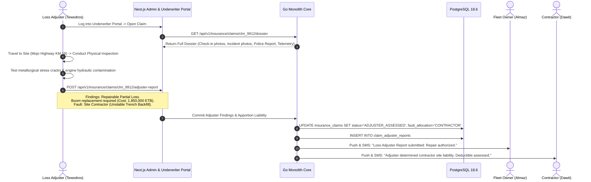
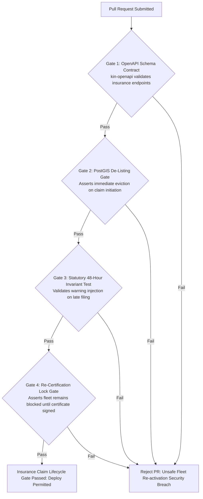

# Heavy Machinery & Logistics Rental Aggregator — Dink Machinery
## Interaction Flow Specification — 19. Comprehensive Plant All-Risks Insurance Claim Lifecycle, Police Report Ingestion & Loss Adjuster Settlement Protocol (`docs/shared/flows/19-insurance-claim-lifecycle-flowchart.md`)

**Document Identifier:** `FLOW-INSURANCE-CLAIM-DINK-CORE-V7.0`  
**Classification:** Canonical Technical Architecture & Wire Protocol Specification (Single Source of Truth)  
**Governing Documents:** `SRS-DINK-CORE-V7.0` (§5.13 IN-01 to IN-03, §5.7 RC-04, §8.1, §8.2, §10, §11), `FLOW-ENTRY-DINK-CORE-V7.0`, `FLOW-FLEET-REG-DINK-CORE-V7.0`, `FLOW-ACTIVE-RENTAL-DINK-CORE-V7.0`, `FLOW-RETURN-DAMAGE-DINK-CORE-V7.0`, `FLOW-ADMIN-OPS-DINK-CORE-V7.0`, `FLOW-CONCURRENCY-LOCKING-DINK-CORE-V7.0`, `FLOW-NOTIFICATION-ROUTING-DINK-CORE-V7.0`, `ARCH-BACKEND-GO-DINK-CORE-V7.0`, `ARCH-FLUTTER-DINK-CORE-V7.0`, `ARCH-ADMIN-NEXT-DINK-CORE-V7.0`, `ARCH-SEC-DINK-CORE-V7.0`, `DS-DINK-CORE-V7.0`, `DS-PERSONAS-DINK-CORE-V7.0`, `contracts/openapi.yaml`, `ADR-001`, `ADR-002`, `ADR-005`, `ADR-008`, `ADR-010`  
**Target Client Runtimes:** Go 1.27.3 Backend Monolith, Flutter 3.47.9 / Dart 3.9 (Cross-Platform Mobile), Next.js 16.x (latest CVE security patch) / React 19 (Admin & Underwriter Portal), PostgreSQL 18.6 + PostGIS 3.6.4, Valkey 9.1.3, ClamAV Daemon (:3310), SeaweedFS S3, Isar NoSQL  
**Target Personas:** Equipment Fleet Owner (*W/ro Almaz Tesfaye*), Civil Contractor (*Dawit Haile-Mariam*), Certified Field Operator (*Mulugeta Tadesse*), Insurance Underwriter / Loss Adjuster (*Tewodros Kassahun* / Awash Insurance S.C.), Back-Office Compliance Arbitrator (*Yohannes Bekele*)  
**Target Operating Markets:** Ethiopia (`ET`) & Kenya (`KE`) — Dynamic Multi-Country Parameterization (`LOC-01-BE`)  
**Compliance Standards:** OWASP ASVS 4.0.3 Level 3 (Tamper-Evident Media, Identity Attestation & Immutable Auditability), RFC 9457 (Problem Details), ISO 9241-110, W3C WCAG 2.2 Level AAA (Field Mode) & Level AA (Admin Mode), National Bank of Ethiopia (NBE) Directives on Insurance Underwriting Escrow, Ethiopian Insurance Corporation (EIC) / Insurance Regulatory Authority of Kenya (IRA) Statutory Claim Filing Mandates  
**Status:** Approved Engineering Baseline

---

## Table of Contents

- 1. [Executive Summary & Regulatory Architecture](#1-executive-summary--regulatory-architecture)
  - 1.1 [Purpose & The High-Tonnage Capital Risk Imperative](#11-purpose--the-high-tonnage-capital-risk-imperative)
  - 1.2 [Architectural Invariants & Non-Negotiables](#12-architectural-invariants--non-negotiables)
- 2. [End-to-End Insurance Claim Lifecycle Flowchart](#2-end-to-end-insurance-claim-lifecycle-flowchart)
- 3. [Detailed Step-by-Step State Machine & User Journey](#3-detailed-step-by-step-state-machine--user-journey)
  - 3.1 [Step 1: Catastrophic Site Incident / Loss Event Declaration (`P0_CRITICAL`)](#31-step-1-catastrophic-site-incident--loss-event-declaration-p0_critical)
  - 3.2 [Step 2: Statutory 48-Hour Claim Ingestion & Evidence Dossier Assembly](#32-step-2-statutory-48-hour-claim-ingestion--evidence-dossier-assembly)
  - 3.3 [Step 3: Police Report, Georeferenced Telemetry & Operator Breathalyzer Ingestion](#33-step-3-police-report-georeferenced-telemetry--operator-breathalyzer-ingestion)
  - 3.4 [Step 4: Underwriter & Independent Loss Adjuster Physical Inspection Docket](#34-step-4-underwriter--independent-loss-adjuster-physical-inspection-docket)
  - 3.5 [Step 5: Deductible Liability Settlement & Platform Deductible Escrow Isolation](#35-step-5-deductible-liability-settlement--platform-deductible-escrow-isolation)
  - 3.6 [Step 6: Underwriter Indemnity Disbursement, Repair Re-Certification & Inventory Re-Activation](#36-step-6-underwriter-indemnity-disbursement-repair-re-certification--inventory-re-activation)
- 4. [Underwriting Schema, Deductible Formulations & Settlement Ledger](#4-underwriting-schema-deductible-formulations--settlement-ledger)
  - 4.1 [Relational Data Model (`fleet_insurances`, `insurance_claims`, `claim_evidence_dockets`, `loss_adjuster_reports`)](#41-relational-data-model-fleet_insurances-insurance_claims-claim_evidence_dockets-loss_adjuster_reports)
  - 4.2 [Deductible Liability Allocation Mathematical Model](#42-deductible-liability-allocation-mathematical-model)
  - 4.3 [Double-Entry Ledger Balancing on Indemnity Disbursement](#43-double-entry-ledger-balancing-on-indemnity-disbursement)
- 5. [Frontier Market Edge Cases & Fault Recovery Protocols](#5-frontier-market-edge-cases--fault-recovery-protocols)
  - 5.1 [Remotely Mobilized Machineries & Offline Evidence Capture (`ADR-010`)](#51-remotely-mobilized-machineries--offline-evidence-capture-adr-010)
  - 5.2 [Total Constructive Loss (TOL) & Automated Capital De-Registration](#52-total-constructive-loss-tol--automated-capital-de-registration)
  - 5.3 [Disputed Operator Negligence vs. Pure Accidental Failure](#53-disputed-operator-negligence-vs-pure-accidental-failure)
  - 5.4 [Multi-Currency Claim Adjustment (`ETB` vs. `KES`)](#54-multi-currency-claim-adjustment-etb-vs-kes)
- 6. [Client UI/UX Ergonomic Specifications & Emergency Incident Screen](#6-client-uiux-ergonomic-specifications--emergency-incident-screen)
  - 6.1 [Field SOS Incident Reporter with Live Reticle Viewfinder ($56 \times 56\text{ dp}$)](#61-field-sos-incident-reporter-with-live-reticle-viewfinder-56-times-56text-dp)
  - 6.2 [Loss Adjuster Split-Screen Comparative Damage Workbench](#62-loss-adjuster-split-screen-comparative-damage-workbench)
  - 6.3 [Deductible Settlement & Indemnity Tracking HUD](#63-deductible-settlement--indemnity-tracking-hud)
- 7. [Wire Protocol Contracts & RFC 9457 Error Schemas](#7-wire-protocol-contracts--rfc-9457-error-schemas)
  - 7.1 [`POST /api/v1/insurance/claims/initiate`](#71-post-apiv1insuranceclaimsinitiate)
  - 7.2 [`POST /api/v1/insurance/claims/{id}/evidence`](#72-post-apiv1insuranceclaimsidevidence)
  - 7.3 [`POST /api/v1/insurance/claims/{id}/adjuster-report`](#73-post-apiv1insuranceclaimsidadjuster-report)
  - 7.4 [`POST /api/v1/insurance/claims/{id}/settlement-decision`](#74-post-apiv1insuranceclaimsidsettlement-decision)
  - 7.5 [RFC 9457 Universal Problem Details Payloads](#75-rfc-9457-universal-problem-details-payloads)
- 8. [Automated Testing Suite & Verification Gates](#8-automated-testing-suite--verification-gates)

---

## 1. Executive Summary & Regulatory Architecture

### 1.1 Purpose & The High-Tonnage Capital Risk Imperative

Heavy capital plant machinery deployed across infrastructure construction projects in Ethiopia and Kenya involves immense financial exposure. A 30-ton hydraulic crawler excavator, 50-ton all-terrain crane, or multi-axle lowboy trailer carries an asset replacement value exceeding $12,000,000.00\text{ to }35,000,000.00\text{ ETB}$ ($100,000\text{ to }300,000\text{ USD}$). 

When deployed in extreme physical operating environments—such as deep rock quarries, unstable bridge riverbeds, or steep mountainous road cuts along the Great Rift Valley—equipment is exposed to catastrophic risk profiles:
* **Structural Rollovers & Boom Collapses:** Instability on uncompacted subgrade causing structural tipping or telescopic crane boom buckling.
* **Catastrophic Flooding & Submersion:** Seasonal flash floods sweeping through culverts and river diversions, submerging engine compartments and electronic controllers.
* **Total Constructive Loss & Sabotage:** Major mechanical fire, landslide burials, or site riots resulting in total physical write-offs.

Under standard platform rental operations (`FLOW-RETURN-DAMAGE-DINK-CORE-V7.0`), routine wear and minor operational damage ($\le \text{policy deductible}$) are settled directly between parties. However, when damages exceed the deductible threshold or involve catastrophic structural stoppage, the **Comprehensive Plant All-Risks (CPAR) Insurance Claim Lifecycle** activates.

This specification formalizes the canonical multi-actor protocol linking Equipment Owners, Civil Contractors, Certified Operators, Platform Arbitrators, and Licensed Corporate Underwriters (*e.g., Awash Insurance S.C., Ethiopian Insurance Corporation, Jubilee Insurance Kenya*).

### 1.2 Architectural Invariants & Non-Negotiables

1. **Statutory 48-Hour Underwriter Notification Invariant (`IN-01`, `IN-02`):** Platform terms and underwriter policy covenants mandate that any incident resulting in a potential insurance claim must be formally logged within **48 hours** of occurrence. Failure to log within 48 hours risks claim denial by the underwriter; the platform automatically flags late submissions with statutory delay warnings.
2. **Immediate PostGIS Fleet De-Listing (`STATUS: INSURANCE_HOLD`):** The moment an insurance claim is initiated, the affected equipment is automatically un-indexed from public spatial search (`SR-01` to `SR-03`). It cannot be reserved or remobilized until an accredited Loss Adjuster issues a signed **Repair Completion & Re-Certification Certificate**.
3. **Immutable Baseline Reticle Cross-Examination:** Claim adjudication requires cryptographic cross-referencing between pre-rental check-in reticle photos (`FLOW-ACTIVE-RENTAL-DINK-CORE-V7.0 §3.1`) and incident damage photos. All evidence files are stripped of client EXIF, scanned for malware via ClamAV over TCP socket `:3310`, and permanently anchored with SHA-256 hashes in SeaweedFS S3.
4. **Deductible Liability Apportionment Invariant:** The equipment owner’s policy deductible (e.g., $50,000.00\text{ ETB}$) is legally apportioned based on fault:
   - If damage was caused by site contractor negligence (e.g., driving machinery onto uncertified backfill against operator warnings), the **Civil Contractor is liable for 100% of the deductible**.
   - If damage was caused by pre-existing metal fatigue or equipment failure, the **Equipment Owner absorbs the deductible**.
5. **Zero-Escrow Direct Indemnity Settlement:** Insurance indemnity payouts are disbursed directly by the licensed underwriter to the approved commercial equipment repairer or owner bank account, satisfying National Bank of Ethiopia (NBE) non-custodial directives.

---

## 2. End-to-End Insurance Claim Lifecycle Flowchart

```mermaid
flowchart TD
    IncidentEvent(["Catastrophic Site Incident Occurs<br/>(e.g., Excavator Rollover / Boom Buckling)"]) --> FieldSOS["Step 1: Emergency SOS / Incident Submission (P0)<br/>Operator/Contractor files Incident via Mobile HUD<br/>Captures GPS, Visuals, Rollover Severity"]
    
    FieldSOS --> DeListFleet["Immediate System Safeguards:<br/>1. UPDATE fleets SET status = 'INSURANCE_HOLD'<br/>2. Evict fleet from PostGIS Search Index<br/>3. Halt active rental billing timer"]
    
    DeListFleet --> AssembleDossier["Step 2: 48-Hour Evidence Dossier Assembly<br/>Upload 8-Angle Damage Photos, Engine Meter Photo,<br/>Witness Statements & Site Incident Diary"]
    
    AssembleDossier --> PoliceIngest["Step 3: Police Report & Regulatory Ingestion<br/>Upload Certified Local Police Incident Docket<br/>Operator Breathalyzer / Substance Attestation"]
    
    PoliceIngest --> UnderwriterReview["Step 4: Underwriter Formal Ingestion<br/>Dossier transmitted to Awash Insurance / EIC Portal<br/>Underwriter appoints Licensed Loss Adjuster"]
    
    UnderwriterReview --> LossAdjusterVisit["Loss Adjuster On-Site Physical Inspection<br/>Adjuster inspects metal fracture shear lines,<br/>hydraulic pressures, and GPS blackbox telemetry"]
    
    LossAdjusterVisit --> AdjusterReport["Step 4b: Submit Adjuster Assessment Report<br/>POST /api/v1/insurance/claims/{id}/adjuster-report<br/>Determines Repairable vs. Total Constructive Loss (TOL)"]
    
    AdjusterReport --> LiabilityRuling{"Adjuster / Admin Liability Determination"}
    
    LiabilityRuling -->|"Contractor Fault (Site Negligence)"| ContractorDeductible["Contractor Assessed Deductible Liability<br/>Pre-funded or Invoiced via Net Terms"]
    LiabilityRuling -->|"Owner Fault (Mechanical Fatigue)"| OwnerDeductible["Owner Absorbs Policy Deductible<br/>Debited from owner_wallets"]
    LiabilityRuling -->|"Force Majeure / Unavoidable"| SharedDeductible["Deductible Split per Platform Terms"]

    ContractorDeductible --> SettleDeductible["Step 5: Deductible Liability Settlement<br/>Deductible funds isolated in settlement ledger"]
    OwnerDeductible --> SettleDeductible
    SharedDeductible --> SettleDeductible

    SettleDeductible --> UnderwriterDecision{"Underwriter Claim Adjudication"}

    UnderwriterDecision -->|"Claim Denied (Policy Breach)"| ClaimDenied["Status: CLAIM_DENIED<br/>Owner / Contractor transition to Legal Dispute<br/>Fleet remains in MAINTENANCE_HOLD"]
    
    UnderwriterDecision -->|"Claim Approved (Partial Loss)"| AuthorizedRepair["Underwriter Issues Repair Work Order<br/>Approved Repair Facility (e.g., Tractafric / Moenco)"]
    
    UnderwriterDecision -->|"Claim Approved (Total Loss)"| TotalLossPayout["Status: TOTAL_LOSS_SETTLED<br/>Underwriter pays Insured Market Value<br/>Fleet Permanently De-Registered from Dink"]

    AuthorizedRepair --> ExecuteRepairs["Physical Overhaul & Component Replacement<br/>Boom rebuild, hydraulic pump replacement, rewiring"]
    
    ExecuteRepairs --> ReCertify["Step 6: Repair Re-Certification & Field Audit<br/>Loss Adjuster uploads signed Roadworthiness Cert<br/>Mechanical baseline hour meter re-anchored"]
    
    ReCertify --> ReactivateFleet["UPDATE fleets SET status = 'ACTIVE'<br/>Re-indexed into PostGIS spatial search<br/>Claim State -> SETTLED_CLOSED"]
    ReactivateFleet --> EndLifecycle(["Insurance Lifecycle Concluded Cleanly"])
    TotalLossPayout --> EndLifecycle
```



---

## 3. Detailed Step-by-Step State Machine & User Journey

### 3.1 Step 1: Catastrophic Site Incident / Loss Event Declaration (`P0_CRITICAL`)

When major equipment destruction occurs during an active hire (`FLOW-ACTIVE-RENTAL-DINK-CORE-V7.0`), the Certified Field Operator (*Mulugeta Tadesse*) or Site Contractor (*Dawit Haile-Mariam*) taps the high-visibility **"EMERGENCY SOS: REPORT MAJOR DAMAGE / LOSS"** actuator on the Active Rental HUD.

```text
+-------------------------------------------------------------------+
|  [!] EMERGENCY SOS: REPORT CATASTROPHIC PLANT LOSS     STEP 1 OF 3|
+-------------------------------------------------------------------+
|  CRITICAL SAFETY WARNING:                                         |
|  1. Ensure all site personnel are clear of mechanical hazards.    |
|  2. Turn off engine ignition and battery isolators if safe.       |
|  3. Do not move equipment until photographed and police inspect.  |
|                                                                   |
|  INCIDENT CLASSIFICATION *                                        |
|  ( ) ROLLOVER_STRUCTURAL_TIPPING - Machine overturned on slope    |
|  (*) BOOM_BUCKLE_COLLAPSE - Telescopic boom or stick cracked/bent  |
|  ( ) HYDRAULIC_FIRE_EXPLOSION - Thermal engine or fluid fire      |
|  ( ) SUBMERSION_FLOOD_BURIAL - Submerged in river/trench burial    |
|  ( ) CATASTROPHIC_COLLISION - Struck by dump truck / lowboy       |
|                                                                   |
|  INCIDENT LOCATION COORDINATES (AUTO-LOCKED VIA GPS)             |
|  Latitude : 8.841209 N | Longitude : 38.789104 E                  |
|  Site Tag : Mojo-Meki Highway Expansion Site B (Culvert 09)       |
|                                                                   |
|  +-------------------------------------------------------------+  |
|  |                 TRANSMIT IMMEDIATE EMERGENCY SOS            |  |
|  |                 (Height: 56dp, Crimson 600)                 |  |
|  +-------------------------------------------------------------+  |
+-------------------------------------------------------------------+
```

#### Automated System Actions upon SOS Emission
1. **Rental Shift Timer Paused:** Automatically creates an immutable entry in `shift_hour_pauses` halting billable rental hours (`AR-05`).
2. **PostGIS Spatial Blackout:** Updates `fleets.status = 'INSURANCE_HOLD'`, immediately evicting the asset from the PostGIS spatial search index.
3. **Emergency Multi-Channel Broadcast (`FLOW-NOTIFICATION-ROUTING-DINK-CORE-V7.0`):** P0 notifications (Push chimes, automated telephony voice calls, and carrier SMS alerts) are fired simultaneously to:
   - Equipment Fleet Owner (*W/ro Almaz Tesfaye*).
   - Platform Compliance Desk (*Yohannes Bekele*).
   - Underwriter Claims Emergency Desk (*Awash Insurance S.C.*).

---

### 3.2 Step 2: Statutory 48-Hour Claim Ingestion & Evidence Dossier Assembly

Following safety securing, the platform grants the equipment owner and contractor an active **48-Hour Claim Assembly Window** to photograph physical damage and document environmental conditions:

```text
+-------------------------------------------------------------------+
|  [<- BACK]              INSURANCE CLAIM DOSSIER       STEP 2 OF 3 |
+-------------------------------------------------------------------+
|  CLAIM #CLM-2026-9912 | AWASH POLICY: CPAR-99482103-ET            |
|  TIME REMAINING TO COMPLETE FILING: 38 HOURS, 14 MINUTES          |
|                                                                   |
|  MANDATORY 8-ANGLE DAMAGE PHOTOGRAPHS (RETICLE VERIFIED):         |
|  [V] Front View (Full Frame)         [V] Rear Engine Compartment  |
|  [V] Point of Impact Close-up        [V] Left Track / Outriggers  |
|  [V] Right Track / Outriggers        [V] Boom / Structural Pivot  |
|  [>] Cabin Operator Console          [ ] Cabin Hour Meter Reading |
|                                                                   |
|  +-------------------------------------------------------------+  |
|  | [RETICLE VIEWFINDER: CAPTURE CABIN HOUR METER CLOSE-UP]     |  |
|  | Current Meter Display: [ 1,488.40 Hours ]                   |  |
|  +-------------------------------------------------------------+  |
|                                                                   |
|  NARRATIVE CIRCUMSTANCE STATEMENT *                               |
|  +-------------------------------------------------------------+  |
|  | Trench bank collapsed under right track during deep culvert |  |
|  | excavation. Machine tipped 45 degrees, bending main boom.   |  |
|  +-------------------------------------------------------------+  |
|                                                                   |
|  +-------------------------------------------------------------+  |
|  |                 SAVE & PROCEED TO POLICE REPORT             |  |
|  |                 (Height: 56dp, Amber 500)                   |  |
|  +-------------------------------------------------------------+  |
+-------------------------------------------------------------------+
```

#### Upload Sanitation & Metadata Stripping
All uploaded visual evidence is streamed over TCP socket `:3310` to ClamAV via `zINSTREAM` protocol. Upon clean clearance, the Go monolith strips client EXIF metadata (preventing geographic spoofing), recalculates device hardware accelerometer vectors, and commits the WebP artifacts to SeaweedFS S3 (`s3://dink-insurance-vault/claims/{id}/`).

---

### 3.3 Step 3: Police Report, Georeferenced Telemetry & Operator Breathalyzer Ingestion

Under Ethiopian Commercial Code and Kenya Traffic/Plant Safety Acts, major plant loss claims require statutory law enforcement verification:
1. **Local Police Incident Report:** Upload of the stamped, signed police investigation report from the nearest municipal/woreda police station (e.g., *Mojo Woreda Police Station Docket #POL-4412/18*).
2. **Operator Telemetry Dump:** Automatic aggregation of high-resolution GPS telemetry logged during the 30 minutes preceding the incident (`GPS-04`), capturing travel speed, heading, and working perimeter boundaries.
3. **Operator Substance Attestation:** Mandatory signed digital statement from the site resident engineer confirming the certified operator (*Mulugeta Tadesse*) was physically unimpaired and had passed a post-incident alcohol breathalyzer audit where required by site safety protocols.

---

### 3.4 Step 4: Underwriter & Independent Loss Adjuster Physical Inspection Docket

Upon formal submission, the claim transitions to `UNDERWRITER_REVIEW`. Awash Insurance S.C. assigns an accredited Independent Loss Adjuster (*Tewodros Kassahun* / *National Loss Adjusters PLC*):



#### Adjuster Categorization Invariants
* **Partial Loss (Repairable):** Cost of restoration does not exceed $75\%$ of the machine's registered market value. The underwriter issues a repair authorization order.
* **Total Constructive Loss (TOL):** Estimated repairs exceed $75\%$ of the insured market value. The underwriter declares a total loss, pays out the pre-agreed capital market value, and assumes salvage ownership of the scrap machinery.

---

### 3.5 Step 5: Deductible Liability Settlement & Platform Deductible Escrow Isolation

Every commercial Plant All-Risks policy maintains a **Mandatory Policy Deductible** (typically $5\%\text{ of loss}$ or a fixed $50,000.00\text{ to }100,000.00\text{ ETB}$ minimum). Before repair work commences, the deductible must be settled:

```text
+-------------------------------------------------------------------+
|  [<- BACK]              DEDUCTIBLE SETTLEMENT         STEP 3 OF 3 |
+-------------------------------------------------------------------+
|  CLAIM #CLM-2026-9912 | REPAIR COST: 1,850,000.00 ETB             |
|                                                                   |
|  POLICY DEDUCTIBLE DUE : 50,000.00 ETB (Awash Insurance Policy)   |
|  ADJUDICATED FAULT     : CIVIL CONTRACTOR (Site Trench Collapse)  |
|  LIABLE PARTY          : Haile-Mariam Construction GC-1           |
|                                                                   |
|  SETTLEMENT OPTIONS FOR CONTRACTOR:                               |
|                                                                   |
|  [ OPTION 1: DRAWDOWN AGAINST CORPORATE CREDIT LINE ]             |
|  Instantly settle via your approved Net-30 revolving facility.    |
|  +-------------------------------------------------------------+  |
|  |       DRAWDOWN 50,000 ETB FROM CREDIT LINE (PO ISSUED)      |  |
|  |                 (Height: 56dp, Emerald 600)                 |  |
|  +-------------------------------------------------------------+  |
|                                                                   |
|  [ OPTION 2: DIRECT COMMERCIAL BANK WIRE TRANSFER ]               |
|  Direct deposit to Awash Insurance S.C. Claims Escrow Account.    |
|  +-------------------------------------------------------------+  |
|  |                 UPLOAD BANK WIRE RECEIPT                    |  |
|  |                 (Height: 56dp, Slate 800)                   |  |
|  +-------------------------------------------------------------+  |
+-------------------------------------------------------------------+
```

If the contractor contests the adjuster's fault determination, they can escalate to platform arbitration (`FLOW-ADMIN-OPS-DINK-CORE-V7.0 §3.4`). However, to avoid delaying mechanical restoration, the underwriter permits the equipment owner to advance the deductible, recording a subrogation debt claim against the contractor in `financial_ledger_entries`.

---

### 3.6 Step 6: Underwriter Indemnity Disbursement, Repair Re-Certification & Inventory Re-Activation

1. **Direct Work Order Issuance:** Awash Insurance issues an irrevocable payment guarantee to an authorized regional equipment dealer (e.g., *Moenco Ethiopia / Tractafric Heavy Equipment*).
2. **Component Replacement & Testing:** The dealer installs a new hydraulic boom, tests hydraulic line pressures ($350\text{ bar}$ continuous load), and executes a 4-hour dynamic load test.
3. **Loss Adjuster Re-Certification Inspection:** Loss Adjuster *Tewodros Kassahun* conducts a post-repair verification audit, photographs the restored asset, and signs the **Engineering Re-Certification Certificate**.
4. **Platform Re-Activation:**
   - Tewodros uploads the re-certification certificate via `POST /api/v1/insurance/claims/{id}/re-certify`.
   - The Go backend transitions the claim to `SETTLED_CLOSED`.
   - The Caterpillar 320D’s status in PostgreSQL transitions from `INSURANCE_HOLD` back to `ACTIVE`, re-indexing the asset into PostGIS spatial search.

---

## 4. Underwriting Schema, Deductible Formulations & Settlement Ledger

### 4.1 Relational Data Model (`fleet_insurances`, `insurance_claims`, `claim_evidence_dockets`, `loss_adjuster_reports`)

```mermaid
erDiagram
    fleets ||--o{ fleet_insurances : "covered by"
    fleet_insurances ||--o{ insurance_claims : "claims against"
    insurance_claims ||--o{ claim_evidence_dockets : "documents"
    insurance_claims ||--o{ loss_adjuster_reports : "adjudicated by"
    bookings ||--o{ insurance_claims : "originated during"

    fleet_insurances {
        uuid id PK
        uuid fleet_id FK
        string provider_name
        string policy_number UK
        string coverage_type -- 'CPAR_COMPREHENSIVE', 'THIRD_PARTY_ONLY'
        bigint insured_value_minor
        bigint deductible_amount_minor
        decimal deductible_percentage
        timestamptz valid_from
        timestamptz valid_until
        boolean is_active
    }

    insurance_claims {
        uuid id PK
        string claim_docket_number UK
        uuid fleet_insurance_id FK
        uuid booking_id FK
        uuid initiator_user_id FK
        string incident_category
        string status -- 'INITIATED', 'DOSSIER_PENDING', 'UNDERWRITER_REVIEW', 'ADJUSTER_ASSESSED', 'REPAIR_AUTHORIZED', 'SETTLED_CLOSED', 'CLAIM_DENIED'
        string fault_allocation -- 'CONTRACTOR', 'OWNER', 'FORCE_MAJEURE', 'PENDING'
        bigint estimated_loss_minor
        bigint approved_indemnity_minor
        bigint deductible_applied_minor
        timestamptz incident_timestamp
        timestamptz created_at
    }

    loss_adjuster_reports {
        uuid id PK
        uuid claim_id FK
        string adjuster_full_name
        string adjuster_license_number
        string assessment_type -- 'PARTIAL_LOSS_REPAIR', 'TOTAL_CONSTRUCTIVE_LOSS'
        bigint parts_cost_minor
        bigint labour_cost_minor
        bigint salvage_value_minor
        text metallurgical_findings
        boolean fraud_suspected
        timestamptz completed_at
    }
```

---

### 4.2 Deductible Liability Allocation Mathematical Model

The total net loss $L_{\text{net}}$ and deductible payable $D_{\text{payable}}$ are governed by:

$$D_{\text{payable}} = \max\left(D_{\text{fixed\_min}}, \text{Gross Loss} \times D_{\text{percentage}}\right)$$

$$\text{Underwriter Indemnity} = \min\left(\text{Insured Value}, \text{Gross Loss} - D_{\text{payable}}\right)$$

#### Deductible Responsibility Matrix
$$\text{Liability Allocation} = \begin{cases} \text{Contractor Pays } 100\% \text{ of } D_{\text{payable}} & \text{if Fault} = \text{CONTRACTOR\_NEGLIGENCE} \\ \text{Owner Absorbs } 100\% \text{ of } D_{\text{payable}} & \text{if Fault} = \text{MECHANICAL\_FATIGUE} \\ \text{Split } 50\% / 50\% & \text{if Fault} = \text{FORCE\_MAJEURE\_ENVIRONMENTAL} \end{cases}$$

---

### 4.3 Double-Entry Ledger Balancing on Indemnity Disbursement

When deductible liabilities and repair settlements are recorded in `financial_ledger_entries`:

```sql
-- 1. Contractor Settle Deductible Liability
INSERT INTO financial_ledger_entries (
    id, transaction_group_id, account_type, entity_id, debit_minor, credit_minor, description
) VALUES 
(gen_random_uuid(), $group_id, 'CONTRACTOR_RECEIVABLE', $contractor_id, 5000000, 0, 'CPAR Deductible Liability Claim #CLM-2026-9912'),
(gen_random_uuid(), $group_id, 'INSURANCE_DEDUCTIBLE_HOLDING', 'AWASH_INSURANCE_SC', 0, 5000000, 'Deductible funds held for repair work order');

-- 2. Underwriter Direct Settlement Authorization
INSERT INTO financial_ledger_entries (
    id, transaction_group_id, account_type, entity_id, debit_minor, credit_minor, description
) VALUES 
(gen_random_uuid(), $group_id, 'INSURANCE_INDEMNITY_ESCROW', 'AWASH_INSURANCE_SC', 180000000, 0, 'Approved repair indemnity to authorized dealer'),
(gen_random_uuid(), $group_id, 'DEALER_SETTLEMENT_CLEARING', 'MOENCO_ETHIOPIA', 0, 180000000, 'Direct repair fulfillment guarantee');
```

---

## 5. Frontier Market Edge Cases & Fault Recovery Protocols

### 5.1 Remotely Mobilized Machineries & Offline Evidence Capture (`ADR-010`)

When a major incident occurs in remote geographical sectors with zero cellular infrastructure (e.g., Afar desert geothermal pads or Ogaden pipeline rights-of-way):
* The Flutter mobile app switches into **Offline Insurance Evidencing Mode**.
* The camera captures mandatory photos with local SHA-256 watermarking, device hardware orientation vectors, and cryptographic timestamps anchored via the device hardware keystore.
* The complete dossier is stored in local **Isar NoSQL** storage (`isar_insurance_claims`).
* The statutory 48-hour submission clock recognizes the signed local creation timestamp ($T_{\text{offline}}$), preventing underwriter claim dismissal due to cellular transit delays.

### 5.2 Total Constructive Loss (TOL) & Automated Capital De-Registration

If the loss adjuster declares an asset a Total Constructive Loss:
1. `insurance_claims.status` transitions to `TOTAL_CONSTRUCTIVE_LOSS`.
2. The Go backend executes an automated capital retirement:
   - Sets `fleets.status = 'PERMANENTLY_DECOMMISSIONED'`.
   - Revokes active booking capability permanently.
   - Preserves all historical telemetry, inspection reticle archives, and financial logs for statutory 10-year insurance regulatory audit retention.

### 5.3 Disputed Operator Negligence vs. Pure Accidental Failure

A frequent industry conflict: the contractor claims the operator caused the rollover; the owner claims the contractor forced the machine to dig outside engineering parameters.
* **Telemetry Blackbox Reconstruction:** The platform interrogates the `fleet_location_history` database (`GPS-04`), correlating machine inclination, speed, and GPS boundary stamps against project geofences.
* **Underwriter Technical Arbitration:** The Loss Adjuster evaluates the metallurgical failure plane. If hydraulic boom cracks show preexisting oxidization (indicating old metal fatigue), fault is assigned to the owner. If fracture surfaces show fresh, instantaneous tensile shear under extreme overweight loading, fault is assigned to the contractor.

### 5.4 Multi-Currency Claim Adjustment (`ETB` vs. `KES`)

Because replacement heavy machinery components (e.g., genuine Caterpillar hydraulic cylinders or Cummins diesel blocks) are priced in foreign exchange (USD):
* Claim losses in Ethiopia are calculated in `ETB` using the official National Bank of Ethiopia commercial bank selling exchange rate on the date of adjuster report filing.
* Payout disbursements from regional underwriters (e.g., Jubilee Kenya in `KES`) remain strictly within domestic currency rails, avoiding cross-border currency conversion friction.

---

## 6. Client UI/UX Ergonomic Specifications & Emergency Incident Screen

### 6.1 Field SOS Incident Reporter with Live Reticle Viewfinder ($56 \times 56\text{ dp}$)

* **High-Vis Disaster Palette:** The SOS UI uses pure stark crimson (`#DC2626`) and warning amber (`#D97706`) against black high-contrast backgrounds (`#000000`), exceeding WCAG 2.2 Level AAA standards ($> 14:1\text{ contrast}$) for extreme outdoor sunlight ($> 85,000\text{ lux}$).
* **Glove-Friendly Touch Targets:** Primary actuators enforce **$56 \times 56\text{ dp}$** minimum hit targets (scaling to **$64 \times 64\text{ dp}$** in Field Mode).

```text
+-------------------------------------------------------------------+
|  [!] CATASTROPHIC LOSS: CAMERA RETICLE               PHOTO 4 OF 8 |
+-------------------------------------------------------------------+
|  POSITION CAMERA: POINT OF STRUCTURAL FRACTURE                    |
|  Align crack / structural tear within yellow guidelines.          |
|                                                                   |
|  +-------------------------------------------------------------+  |
|  | [RETICLE VIEWFINDER: LIVE CAMERA FEED]                      |  |
|  | + - - - - - - - - - - - - - - - - - - - - - - - - - - - - + |  |
|  | |                                                         | |  |
|  | |           [   ALIGN FRACTURED BOOM COMPONENT   ]        | |  |
|  | |                                                         | |  |
|  | + - - - - - - - - - - - - - - - - - - - - - - - - - - - - + |  |
|  | (o) LIGHT METER: EXCELLENT | ACCELEROMETER DRIFT: 0.01g     |  |
|  +-------------------------------------------------------------+  |
|                                                                   |
|  [ SNAP PHOTO ] (Large 64dp Crimson Button)                       |
+-------------------------------------------------------------------+
```

### 6.2 Loss Adjuster Split-Screen Comparative Damage Workbench

The Next.js Admin & Underwriter Console (`AD-06-WEB`) provides loss adjusters with an interactive comparative inspection interface:
* **Left Pane (Baseline State):** Pre-rental check-in reticle inspection photos (`FLOW-ACTIVE-RENTAL-DINK-CORE-V7.0 §3.1`) captured prior to machine deployment.
* **Right Pane (Loss State):** High-resolution incident damage photos with synchronized pinch-to-zoom and pan controls.
* **Measurement Overlay:** On-screen digital vernier calipers allowing adjusters to measure structural displacement millimeters directly on high-resolution photos.

### 6.3 Deductible Settlement & Indemnity Tracking HUD

Both contractor and owner interfaces render a dedicated **Insurance Claim Progress HUD** displaying:
* Live status stepper: `[ Incident Logged ] -> [ Dossier Submitted ] -> [ Adjuster Review ] -> [ Repair Authorized ] -> [ Re-Certified ]`.
* Deductible contribution status and outstanding liability breakdown.

---

## 7. Wire Protocol Contracts & RFC 9457 Error Schemas

### 7.1 `POST /api/v1/insurance/claims/initiate`

Initiates a catastrophic insurance claim docket, halts rental shift timers, and de-lists the fleet.

#### Request Headers
```http
POST /api/v1/insurance/claims/initiate HTTP/1.1
Host: api.dinkmachinery.com
Content-Type: application/json
Authorization: Bearer <userAccessToken>
X-Country-Code: ET
```

#### Request Payload
```json
{
  "bookingId": "bk_8829a10f",
  "incidentCategory": "BOOM_BUCKLE_COLLAPSE",
  "incidentTimestamp": "2026-10-27T14:30:00Z",
  "location": {
    "latitude": 8.841209,
    "longitude": 38.789104,
    "siteName": "Mojo-Meki Highway Expansion Site B"
  },
  "initialNarrative": "Excavator main boom buckled under heavy rock handling. Trench bank subsided."
}
```

#### Response: `HTTP 201 Created`
```json
{
  "success": true,
  "data": {
    "claimDocketNumber": "CLM-2026-9912",
    "fleetId": "flt_019f8a2c",
    "status": "DOSSIER_PENDING",
    "insuranceProvider": "Awash Insurance S.C.",
    "policyNumber": "CPAR-99482103-ET",
    "statutoryFilingDeadline": "2026-10-29T14:30:00Z",
    "fleetStatus": "INSURANCE_HOLD",
    "shiftBillingPaused": true
  },
  "timestamp": "2026-10-27T14:45:00Z"
}
```

---

### 7.2 `POST /api/v1/insurance/claims/{id}/evidence`

Uploads mandatory 8-angle damage photos, police reports, and telemetry files.

#### Request Headers
```http
POST /api/v1/insurance/claims/CLM-2026-9912/evidence HTTP/1.1
Host: api.dinkmachinery.com
Content-Type: multipart/form-data
Authorization: Bearer <userAccessToken>
```

#### Multipart Form Body
* `evidenceType`: String (`"POLICE_INVESTIGATION_REPORT"`)
* `documentReference`: String (`"POL-4412/18"`)
* `issuingAuthority`: String (`"Mojo Woreda Police Division"`)
* `evidenceFile`: Binary PDF/Image file (Clean scanned via ClamAV)

#### Response: `HTTP 200 OK`
```json
{
  "success": true,
  "data": {
    "claimDocketNumber": "CLM-2026-9912",
    "evidenceId": "ev_019a8f4c",
    "evidenceType": "POLICE_INVESTIGATION_REPORT",
    "storageUri": "s3://dink-insurance-vault/claims/CLM-2026-9912/police_docket.pdf",
    "sha256Hash": "e3b0c44298fc1c149afbf4c8996fb92427ae41e4649b934ca495991b7852b855",
    "uploadedAt": "2026-10-27T16:00:00Z"
  },
  "timestamp": "2026-10-27T16:00:01Z"
}
```

---

### 7.3 `POST /api/v1/insurance/claims/{id}/adjuster-report`

Accredited Loss Adjuster submits physical metallurgical findings, repair cost estimates, and fault allocation.

#### Request Headers
```http
POST /api/v1/insurance/claims/CLM-2026-9912/adjuster-report HTTP/1.1
Host: api.dinkmachinery.com
Content-Type: application/json
Authorization: Bearer <adjusterAccessToken>
```

#### Request Payload
```json
{
  "adjusterLicenseNumber": "LA-ET-2024-0089",
  "assessmentType": "PARTIAL_LOSS_REPAIR",
  "faultAllocation": "CONTRACTOR",
  "partsCostMinor": 145000000,
  "labourCostMinor": 40000000,
  "salvageValueMinor": 0,
  "metallurgicalFindings": "Failure caused by sudden dynamic overload due to ground displacement. Zero pre-existing metal fatigue observed on boom weldments.",
  "recommendedDealer": "Moenco Ethiopia (Caterpillar Authorized Dealer)",
  "deductibleAssessedMinor": 5000000
}
```

#### Response: `HTTP 200 OK`
```json
{
  "success": true,
  "data": {
    "claimDocketNumber": "CLM-2026-9912",
    "status": "ADJUSTER_ASSESSED",
    "repairAuthorized": true,
    "totalRepairCostMinor": 185000000,
    "deductibleDueMinor": 5000000,
    "liableParty": "HAIL_MARIAM_CONSTRUCTION",
    "submittedAt": "2026-10-27T17:15:00Z"
  },
  "timestamp": "2026-10-27T17:15:00Z"
}
```

---

### 7.4 `POST /api/v1/insurance/claims/{id}/settlement-decision`

Underwriter submits formal claim settlement decision.

#### Request Payload
```json
{
  "decision": "APPROVED_FOR_REPAIR",
  "workOrderNumber": "WO-AWASH-2026-8819",
  "approvedRepairFacility": "Moenco Ethiopia",
  "netIndemnityDisbursedMinor": 180000000,
  "deductibleConfirmedReceived": true
}
```

#### Response: `HTTP 200 OK`
```json
{
  "success": true,
  "data": {
    "claimDocketNumber": "CLM-2026-9912",
    "status": "REPAIR_AUTHORIZED",
    "workOrder": "WO-AWASH-2026-8819",
    "estimatedRepairDays": 14,
    "authorizedAt": "2026-10-27T17:30:00Z"
  },
  "timestamp": "2026-10-27T17:30:00Z"
}
```

---

### 7.5 RFC 9457 Universal Problem Details Payloads

#### Example: Statutory 48-Hour Deadline Breached (`HTTP 422 Unprocessable Entity`)
```json
{
  "type": "[https://api.dinkmachinery.com/errors/statutory-insurance-filing-expired](https://api.dinkmachinery.com/errors/statutory-insurance-filing-expired)",
  "title": "Statutory 48-Hour Filing Window Expired",
  "status": 422,
  "detail": "Claim was submitted 54 hours after incident occurrence. Underwriter policy covenants mandate notification within 48 hours.",
  "instance": "/api/v1/insurance/claims/initiate",
  "code": "ERR_INSURANCE_STATUTORY_DEADLINE_BREACHED",
  "invalidParams": [
    {
      "name": "incidentTimestamp",
      "reason": "Exceeded 48h covenant boundary by 6 hours. Formal late filing justification mandated."
    }
  ]
}
```

#### Example: Premature Re-Activation Blocked (`HTTP 409 Conflict`)
```json
{
  "type": "[https://api.dinkmachinery.com/errors/fleet-in-insurance-hold](https://api.dinkmachinery.com/errors/fleet-in-insurance-hold)",
  "title": "Cannot Re-Activate Equipment Under Insurance Hold",
  "status": 409,
  "detail": "Caterpillar 320D is actively locked in claim #CLM-2026-9912. Re-activation requires an accredited Loss Adjuster Re-Certification Certificate.",
  "instance": "/api/v1/fleets/flt_019f8a2c/activate",
  "code": "ERR_FLEET_LOCKED_IN_INSURANCE_HOLD"
}
```

---

## 8. Automated Testing Suite & Verification Gates



1. **OpenAPI Schema Contract Gate (`kin-openapi`):** Validates all insurance claim initiation, evidence ingestion, loss adjuster reporting, and settlement decision request/response schemas against `contracts/openapi.yaml`.
2. **PostGIS De-Listing Automated Integration Test:** Spins up a PostgreSQL and PostGIS testcontainer, initiates an insurance claim for an active fleet, and asserts that subsequent bounding-box and radius queries (`ST_DWithin`) return zero occurrences of the asset within $< 20\text{ ms}$.
3. **Statutory 48-Hour Timing Invariant Test:** Advances mock test clocks past 48 hours relative to `incidentTimestamp`, asserting that the API intercepts the submission with RFC 9457 HTTP 422 `ERR_INSURANCE_STATUTORY_DEADLINE_BREACHED`.
4. **Re-Certification Safety Verification:** Simulates an administrative attempt to toggle an asset from `INSURANCE_HOLD` directly to `ACTIVE` without an associated `loss_adjuster_reports` signed completion record, verifying that database triggers and Go domain service validators abort the transaction with HTTP 409 Conflict.

---

*This document defines the canonical technical architecture, failure state machines, underwriting schema, deductible allocation formulas, and wire protocols for Comprehensive Plant All-Risks Insurance Claim Lifecycle, Police Report Ingestion & Loss Adjuster Settlement in Dink Machinery Version 7.0. All downstream Flutter mobile screens, Go monolith service layers, and Next.js admin/underwriter portals must strictly adhere to this specification.*