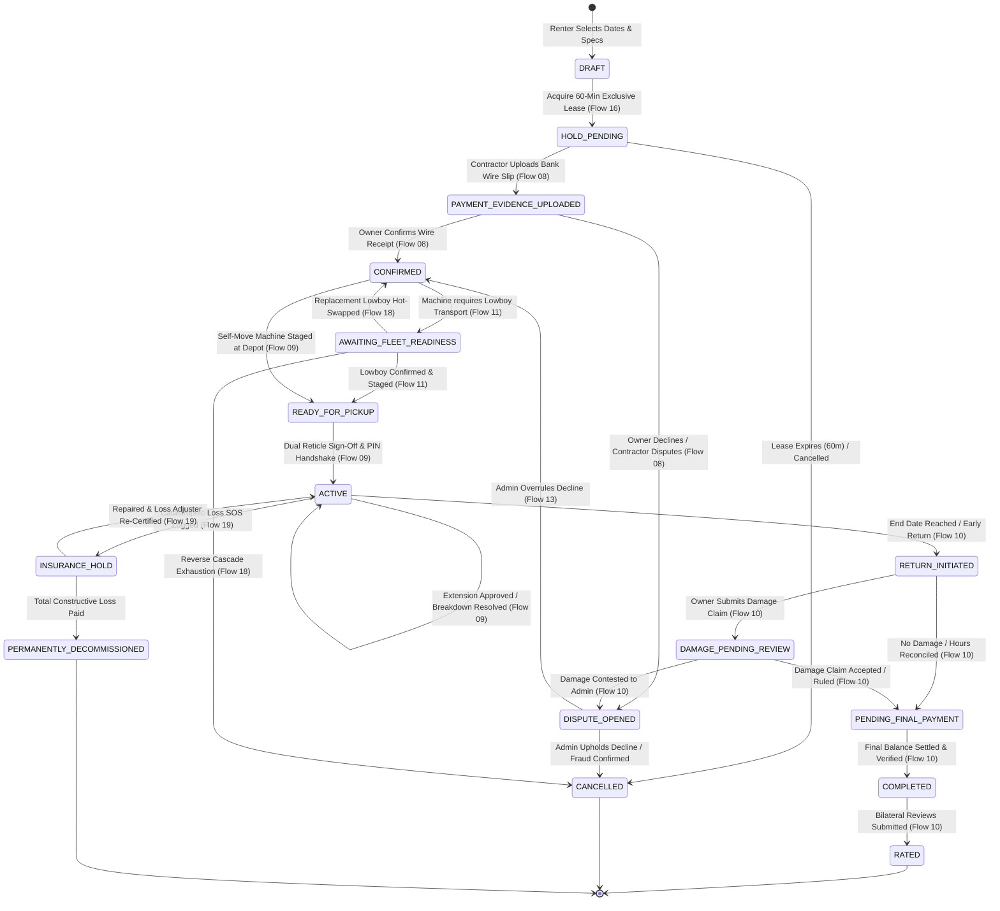
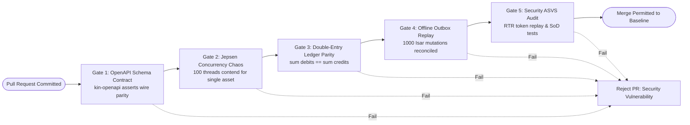

# Heavy Machinery & Logistics Rental Aggregator — Dink Machinery
## Interaction Flow Specification Index & Architectural Governance (`docs/shared/flows/INDEX.md`)

**Document Identifier:** `FLOW-INDEX-DINK-CORE-V7.0`  
**Classification:** Master Architectural Index & Flow Routing Manifest (Single Source of Truth)  
**Governing Documents:** `SRS-DINK-CORE-V7.0` (§1 to §11), `ARCH-BACKEND-GO-DINK-CORE-V7.0`, `ARCH-FLUTTER-DINK-CORE-V7.0`, `ARCH-ADMIN-NEXT-DINK-CORE-V7.0`, `ARCH-SEC-DINK-CORE-V7.0`, `DS-DINK-CORE-V7.0`, `DS-PERSONAS-DINK-CORE-V7.0`, `contracts/openapi.yaml`, `ADR-001` through `ADR-010`  
**Target Runtimes:** Go 1.24 Monolith Backend, Flutter 3.44 / Dart 3.9 (Cross-Platform Mobile), Next.js 16 / React 19 (Web Admin & Corporate Portal), PostgreSQL 18.4 + PostGIS 3.4, Valkey 8.0, ClamAV Daemon (:3310), SeaweedFS S3, Isar NoSQL 3.1+  
**Target Personas:** Civil Engineering Contractor (*Dawit Haile-Mariam* / *Patrick Kariuki*), Fleet Owner & Depot Yard Manager (*W/ro Almaz Tesfaye* / *Kamau Ndegwa*), Certified Field Operator (*Mulugeta Tadesse* / *Juma Omwamba*), Lowboy Transporter (*Ato Girma Wolde* / *Samuel Odhiambo*), Compliance Officer & Security Auditor (*Yohannes Bekele*)  
**Target Operating Markets:** Ethiopia (`ET`) & Kenya (`KE`) — Dynamic Multi-Country Parameterization (`LOC-01-BE`)  
**Compliance Standards:** OWASP ASVS 4.0.3 Level 3 (Identity, Concurrency, Secrets & Access Control), RFC 9457 (Problem Details), RFC 7519 (JWT), RFC 6238 (TOTP), ISO 9241-110, W3C WCAG 2.2 Level AAA (Field Mobile) & Level AA (Admin Web), National Bank of Ethiopia (NBE) Directives, Kenya Data Protection Act 2019  
**Status:** Approved Engineering Baseline

---

## Table of Contents

- 1. [Executive Architecture & System Scope](#1-executive-architecture--system-scope)
  - 1.1 [Purpose & Engineering Mandate](#11-purpose--engineering-mandate)
  - 1.2 [Document Architecture & Cross-Reference Structure](#12-document-architecture--cross-reference-structure)
- 2. [Canonical Flow Catalog & System Decomposition](#2-canonical-flow-catalog--system-decomposition)
  - 2.1 [Core Lifecycle & Operational Flows (01 through 19)](#21-core-lifecycle--operational-flows-01-through-19)
  - 2.2 [Technical Appendices (A through B)](#22-technical-appendices-a-through-b)
- 3. [Global State Machine Taxonomy & Lifecycle Traversal](#3-global-state-machine-taxonomy--lifecycle-traversal)
  - 3.1 [Unified Booking State Machine (`BookingStatus`)](#31-unified-booking-state-machine-bookingstatus)
  - 3.2 [Sub-Booking Graph & Coupled Fleet Hierarchy (`ParentBookingID`)](#32-sub-booking-graph--coupled-fleet-hierarchy-parentbookingid)
- 4. [Shared Architectural Invariants & Non-Negotiables](#4-shared-architectural-invariants--non-negotiables)
  - 4.1 [Non-Custodial Financial Settlement Invariant (NBE Compliance)](#41-non-custodial-financial-settlement-invariant-nbe-compliance)
  - 4.2 [Zero Double-Booking Guarantee (Two-Tier Locking Hierarchy)](#42-zero-double-booking-guarantee-two-tier-locking-hierarchy)
  - 4.3 [Monotonic Meter Reading Non-Regression](#43-monotonic-meter-reading-non-regression)
  - 4.4 [Dynamic Metadata-Driven UI Engines](#44-dynamic-metadata-driven-ui-engines)
  - 4.5 [Offline-First Local Execution Perimeter (`ADR-010`)](#45-offline-first-local-execution-perimeter-adr-010)
- 5. [Cross-Cutting Wire Protocols & RFC 9457 Error Standard](#5-cross-cutting-wire-protocols--rfc-9457-error-standard)
  - 5.1 [Uniform Problem Details Header & Payload Protocol](#51-uniform-problem-details-header--payload-protocol)
  - 5.2 [Platform-Wide Error Code Catalog](#52-platform-wide-error-code-catalog)
- 6. [Verification Gates & Continuous Integration Pipeline](#6-verification-gates--continuous-integration-pipeline)

---

## 1. Executive Architecture & System Scope

### 1.1 Purpose & Engineering Mandate

This master index serves as the centralized architectural directory and routing manifest for the complete interaction flow specification suite of **Dink Machinery Version 7.0**. 

The Dink Machinery aggregator orchestrates high-value, heavy construction plant equipment and specialized multi-axle freight logistics across East Africa (specifically Ethiopia and Kenya). Operating within a frontier digital and financial environment characterized by intermittent cellular connectivity, non-custodial direct bank settlements, and extreme physical field hazards, the platform requires an exhaustive, deterministic, and formally verified set of interaction flows.

Every document in this directory represents an immutable, single source of truth governing:
* **The Wire Protocol:** HTTP/3, WebSocket, and SSE message payloads strictly adhering to `contracts/openapi.yaml`.
* **The Client UX Ergonomics:** Cross-platform Flutter 3.44 mobile layouts ($56 \times 56\text{ dp}$ hit targets, solar contrast modes) and Next.js 16 / React 19 web admin consoles.
* **The Database Invariants:** PostgreSQL 18.4 relational constraints, PostGIS 3.4 spatial indexes, and Valkey 8.0 distributed memory caching.
* **The Security Posture:** OWASP ASVS 4.0.3 Level 3 compliance across identity verification, session isolation, and cryptographic auditing.

### 1.2 Document Architecture & Cross-Reference Structure

```text
docs/shared/flows/
├── INDEX.md                                                    <-- (This Document)
├── 01-onboarding-role-selection.md                             [Flow 01]
├── 02-renter-authentication-id-verification.md                 [Flow 02]
├── 03-owner-kyc-registration.md                                [Flow 03]
├── 04-operator-profile-fleet-linking.md                        [Flow 04]
├── 05-fleet-attachment-registration-spec-configuration.md      [Flow 05]
├── 06-discovery-spatial-search-equipment-comparison.md         [Flow 06]
├── 07-booking-state-machine-lifecycle.md                       [Flow 07]
├── 08-payment-verification-receipt-audit-dispute-flow.md       [Flow 08]
├── 09-active-rental-handover-extension-issues.md               [Flow 09]
├── 10-return-damage-assessment-completion.md                   [Flow 10]
├── 11-logistics-transport-integration.md                       [Flow 11]
├── 12-commission-tracking-payout.md                            [Flow 12]
├── 13-admin-operations-dashboard.md                            [Flow 13]
├── 14-corporate-account-approval-workflow.md                   [Flow 14]
├── 15-secure-phone-number-change-flow.md                       [Flow 15]
├── 16-optimistic-locking-concurrency-resolution-flow.md        [Flow 16]
├── 17-multichannel-notification-routing-flow.md                [Flow 17]
├── 18-logistics-provider-cancellation-reverse-cascade-flow.md  [Flow 18]
├── 19-insurance-claim-lifecycle-flowchart.md                   [Flow 19]
├── appendix-a-notification-offline-handling.md                 [Appendix A]
└── appendix-b-authentication-security-flow.md                  [Appendix B]
```

---

## 2. Canonical Flow Catalog & System Decomposition

### 2.1 Core Lifecycle & Operational Flows (01 through 19)

#### `01-onboarding-role-selection.md` — Entry & Dynamic Multi-Persona Routing
* **Identifier:** `FLOW-ENTRY-DINK-CORE-V7.0`
* **Scope:** Universal mobile and web landing, geographic sovereignty selection (`ET` vs. `KE`), locale hydration (Amharic, Afaan Oromoo, Swahili, English), and multi-persona onboarding forks (Commercial Contractor, Fleet Owner, Field Operator, Freight Transporter).
* **Key Invariant:** Zero-friction unauthenticated browsing; role claims bound strictly post-auth.

#### `02-renter-authentication-id-verification.md` — Renter Onboarding & Identity Attestation
* **Identifier:** `FLOW-RENTER-AUTH-DINK-CORE-V7.0`
* **Scope:** Telephony MSISDN carrier auto-detection, SMS/WhatsApp OTP challenge verification, government identity card ingestion (Kebele ID / Kenyan National ID), and ClamAV-shielded document ingestion.
* **Key Invariant:** Unverified accounts restricted from creating reservation holds.

#### `03-owner-kyc-registration.md` — Fleet Owner KYC & Commercial Underwriting
* **Identifier:** `FLOW-OWNER-KYC-DINK-CORE-V7.0`
* **Scope:** Enterprise commercial registration, Ministry of Trade license parsing, TIN validation, VAT registration, corporate bank account binding, and platform tier assignment.
* **Key Invariant:** Mandatory trade license validation before fleet publishing rights are granted.

#### `04-operator-profile-fleet-linking.md` — Operator Certification & Yard Roster Linking
* **Identifier:** `FLOW-OPERATOR-LINK-DINK-CORE-V7.0`
* **Scope:** Heavy plant operator license ingestion, machinery class badging (Excavators, Dozers, Cranes), and bilateral cryptographic invite pairing between fleet owners and certified operators.
* **Key Invariant:** Non-certified operators blocked from binding to high-tonnage plant classes.

#### `05-fleet-attachment-registration-spec-configuration.md` — Fleet Ingestion & Dynamic EAV Specs
* **Identifier:** `FLOW-FLEET-REG-DINK-CORE-V7.0`
* **Scope:** Multi-angle photo walkaround ingestion, cabin mechanical hour meter baseline anchoring, dynamic EAV specification forms (`SpecFieldDefinition`), logistics-critical spec indexing (`FleetSpecIndexed`), and standalone attachment bundling.
* **Key Invariant:** Initial meter reading establishes an immutable non-regressive baseline (`FL-04`).

#### `06-discovery-spatial-search-equipment-comparison.md` — Spatial Search & Comparative Matrix
* **Identifier:** `FLOW-DISCOVERY-DINK-CORE-V7.0`
* **Scope:** PostGIS radius queries (`ST_DWithin`), geographic bounding-box viewport clustering, dynamic faceted filtering (Tonnage, Power, Boom Length), side-by-side comparison matrices (`IsComparable`), and live calendar availability lookups.
* **Key Invariant:** Sub-50ms spatial search execution across $> 25,000$ active fleet listings.

#### `07-booking-state-machine-lifecycle.md` — Canonical Booking State Machine
* **Identifier:** `FLOW-BOOKING-STATE-MACHINE-DINK-CORE-V7.0`
* **Scope:** The canonical 14-state transactional lifecycle, state transition invariants, transition triggers, role permissions, and terminal audit states.
* **Key Invariant:** Strict single-direction state progression; no bypass of verification states.

#### `08-payment-verification-receipt-audit-dispute-flow.md` — P2P Wire Settlement & Dispute Arbitration
* **Identifier:** `FLOW-PAYMENT-DISPUTE-DINK-CORE-V7.0`
* **Scope:** Non-custodial bank wire slip ingestion (CBE, Awash, Telebirr, M-PESA), owner transaction audit workflows, 24-hour verification countdown timers, decline contests, and administrative compliance arbitration.
* **Key Invariant:** Zero platform fund escrow; platform enforces compliance via listing suspensions.

#### `09-active-rental-handover-extension-issues.md` — Active Rental Management & Dual Handover
* **Identifier:** `FLOW-ACTIVE-RENTAL-DINK-CORE-V7.0`
* **Scope:** Pre-rental physical inspection with accelerometer-stabilized meter reticle, dual 6-digit challenge PIN sign-off, live Active Rental HUD, rental extensions with collision detection, and on-site mechanical breakdown logging with billing pause.
* **Key Invariant:** Monotonic meter enforcement: $\text{Handover Meter} \ge \text{Baseline Meter}$.

#### `10-return-damage-assessment-completion.md` — Rental Return, Damage Assessment & Completion
* **Identifier:** `FLOW-RETURN-DAMAGE-DINK-CORE-V7.0`
* **Scope:** Post-rental return inspection, shift hour allowance reconciliation ($8\text{ hrs/day}$ baseline), excess operating hour surcharges, 24-hour itemized damage claim dockets, contractor response triage, final net P2P settlement, and bilateral blind 5-star reviews.
* **Key Invariant:** $\text{Final Balance} = (\text{Base} + \text{Excess Hours} + \text{Damage}) - \text{Prepayment}$.

#### `11-logistics-transport-integration.md` — Heavy Haulage & Lowboy Transport Coupling
* **Identifier:** `FLOW-LOGISTICS-DINK-CORE-V7.0`
* **Scope:** Transport requirement triggers for immovable plant (`self_move_capable = false`), automated volumetric/tonnage compatibility matching (`FleetSpecIndexed`), linked sub-booking creation (`ParentBookingID`), owner-handled external transport escapes, and two-phase transit telemetry monitoring.
* **Key Invariant:** Equipment fleet owner acts as the debtor/renter for linked logistics sub-bookings.

#### `12-commission-tracking-payout.md` — Revenue Ledger, Owner Debt & Settlement
* **Identifier:** `FLOW-COMMISSION-PAYOUT-DINK-CORE-V7.0`
* **Scope:** Automated platform commission computation upon booking confirmation, pre-funded wallet debits (`owner_wallets`), double-entry ledger journaling, manual bank wire commission top-ups, back-office financial auditing, and 30-day delinquency inventory lockouts.
* **Key Invariant:** Strict double-entry balance parity: $\sum \text{Debits} = \sum \text{Credits}$.

#### `13-admin-operations-dashboard.md` — Dynamic Admin Engine & Dispute Arbitration
* **Identifier:** `FLOW-ADMIN-OPS-DINK-CORE-V7.0`
* **Scope:** Server-driven UI engine synthesizing console viewports from database schemas (`AdminPage`, `AdminTableConfig`, `AdminAction`), multi-tier RBAC permission grids, split-screen visual dispute lightboxes, and append-only tamper-evident audit logs.
* **Key Invariant:** Zero hardcoded routes in admin console; UI synthesized from metadata.

#### `14-corporate-account-approval-workflow.md` — Enterprise Hierarchies & Approval Quorums
* **Identifier:** `FLOW-CORP-APPROVAL-DINK-CORE-V7.0`
* **Scope:** Corporate organization onboarding, commercial credit underwriting, dynamic multi-signatory approval chains (All-Must-Approve, $N$-of-$M$, Executive Veto), automated Purchase Order (PO) issuance, Net-30/60 revolving credit line drawdowns, and dual-context switching.
* **Key Invariant:** Separation of Duties (SoD): Originator cannot approve own requisition.

#### `15-secure-phone-number-change-flow.md` — Phone Migration & SIM-Swap Mitigation
* **Identifier:** `FLOW-PHONE-MIGRATION-DINK-CORE-V7.0`
* **Scope:** Step-up biometric authentication, sequential dual-token verification (`OTP_OLD` + `OTP_NEW`), emergency out-of-band identity recovery for lost/stolen SIMs, atomic database phone swaps, global session invalidation, 24-hour financial quarantines, and 1-tap account freeze kill-switches.
* **Key Invariant:** Prohibited offline; requires continuous live cryptographic connection.

#### `16-optimistic-locking-concurrency-resolution-flow.md` — Concurrency Control & State Reconciliation
* **Identifier:** `FLOW-CONCURRENCY-LOCKING-DINK-CORE-V7.0`
* **Scope:** Pre-reservation ETag hashing, Valkey 60-minute atomic distributed leases (`SET ... NX EX 3600`), PostgreSQL GiST temporal exclusion constraints (`EXCLUDE USING gist`), OCC update interception (HTTP 412 / 409), automated standby queues (`ZADD`), and network retry deduplication (`Idempotency-Key`).
* **Key Invariant:** Zero double-bookings mathematically guaranteed by GiST range exclusions.

#### `17-multichannel-notification-routing-flow.md` — Multi-Channel Routing & Template Synthesis
* **Identifier:** `FLOW-NOTIFICATION-ROUTING-DINK-CORE-V7.0`
* **Scope:** Domain event ingestion, recipient preference evaluation, quiet-hours suppression logic, Mustache template interpolation across 4 languages (Amharic, Afaan Oromoo, Swahili, English), FCM HTTP v1 push dispatches, carrier SMS routing, WhatsApp Business messaging, and automated voice IVR alerts.
* **Key Invariant:** P0 safety and security alerts bypass user quiet-hours and channel opt-outs.

#### `18-logistics-provider-cancellation-reverse-cascade-flow.md` — Freight Default & Transshipment
* **Identifier:** `FLOW-LOGISTICS-REVERSE-CASCADE-DINK-CORE-V7.0`
* **Scope:** Pre-transit cancellation and mid-transit breakdown handling, parent booking operational freeze (`AWAITING_FLEET_READINESS`), automated spatial replacement matcher ($50\text{ km}$ radius), 60-minute emergency SLA re-pairing, sub-booking graph hot-swaps, defaulting carrier wallet penalties ($20\%$), and terminal reverse cancellation cascades.
* **Key Invariant:** Equipment fleet owner exonerated from cancellation penalties upon logistics default.

#### `19-insurance-claim-lifecycle-flowchart.md` — Plant All-Risks Insurance & Loss Adjustment
* **Identifier:** `FLOW-INSURANCE-CLAIM-DINK-CORE-V7.0`
* **Scope:** Catastrophic loss SOS reporting (`P0_CRITICAL`), immediate PostGIS fleet de-listing (`INSURANCE_HOLD`), statutory 48-hour evidence dossier assembly, certified police report ingestion, independent loss adjuster on-site inspections, fault-based deductible allocation, underwriter direct indemnity disbursements, and engineering re-certification.
* **Key Invariant:** Equipment locked in `INSURANCE_HOLD` until Loss Adjuster signs re-certification.

---

### 2.2 Technical Appendices (A through B)

#### `appendix-a-notification-offline-handling.md` — Universal Event Matrix & Offline Handling
* **Identifier:** `FLOW-APPENDIX-NOTIF-OFFLINE-DINK-CORE-V7.0`
* **Scope:** Master cross-flow notification event routing matrix, embedded Isar NoSQL schema topology, client outbox mutation engine (`SyncOutboxItem`), peer-to-peer offline cryptographic QR handshakes (HMAC-SHA256), two-way differential synchronization algorithms, domain conflict resolution rules (CRDT/LWW), and SMS UCS-2 Ethiopic charset boundary controls.
* **Key Invariant:** High-value financial mutations strictly prohibited in offline execution mode.

#### `appendix-b-authentication-security-flow.md` — Cryptographic Protocols & Security Architecture
* **Identifier:** `FLOW-APPENDIX-AUTH-SEC-DINK-CORE-V7.0`
* **Scope:** Primary authentication, asymmetric stateless JWT minting (ECDSA Curve P-256 / SHA-256), Refresh Token Rotation (RTR) with immediate token family invalidation upon replay, Argon2id password hashing parameters ($m=65536, t=3, p=4$), mobile hardware Secure Enclave / Android Keystore integrations, biometric step-up challenges, and sub-millisecond Valkey session blacklisting.
* **Key Invariant:** Access tokens expire strictly in 15 minutes; used refresh token replay nukes family.

---

## 3. Global State Machine Taxonomy & Lifecycle Traversal

### 3.1 Unified Booking State Machine (`BookingStatus`)

The core commercial transaction lifecycle is modeled as an immutable, deterministic finite state machine implemented in Go and enforced via PostgreSQL table constraints:



---

### 3.2 Sub-Booking Graph & Coupled Fleet Hierarchy (`ParentBookingID`)

To maintain relational integrity between primary heavy plant machinery and secondary transport legs:
* A child logistics booking explicitly references the primary machinery booking via `bookings.parent_booking_id`.
* The equipment fleet owner is modeled as the "renter" on the child sub-booking, preserving customer isolation for the civil contractor.
* Any status transition of the child sub-booking into failure (`CANCELLED_CARRIER_DEFAULT` or `TRANSSHIPMENT_REQUIRED`) automatically trips the parent booking into `AWAITING_FLEET_READINESS` via database triggers, blocking premature site mobilization.

---

## 4. Shared Architectural Invariants & Non-Negotiables

### 4.1 Non-Custodial Financial Settlement Invariant (NBE Compliance)

Under National Bank of Ethiopia directives governing marketplace platforms, Dink Machinery **never holds, pools, or intermediates gross equipment rental capital**.
* Prepayments, shift extensions, damage liabilities, and final balances settle directly between the contractor’s and owner’s corporate bank accounts (`MANUAL_TRANSFER`).
* Dink Machinery monetizes exclusively through an **Owner Debt Ledger Architecture (`FLOW-12`)**: the platform calculates commission upon confirmation and debits the owner's pre-funded wallet (`owner_wallets`).
* Delinquent commission balances past 30 days trigger automated spatial search blackouts (`status = 'DELINQUENT_INACTIVE'`).

---

### 4.2 Zero Double-Booking Guarantee (Two-Tier Locking Hierarchy)

Double-booking is structurally prohibited through a two-tier locking model (`FLOW-16`):
1. **In-Memory Volatile Lease (Valkey 8.0):** An atomic distributed key (`hold:fleet:{id}`) grants a 60-minute exclusive checkout window, absorbing high-concurrency contention and providing sub-millisecond feedback.
2. **Relational Canonical Exclusion (PostgreSQL 18.4):** A GiST spatial-temporal exclusion constraint (`EXCLUDE USING gist (fleet_id WITH =, hire_period WITH &&)`) blocks overlapping date ranges at the storage disk layer, guaranteeing zero phantom bookings under serializable transaction isolation.

---

### 4.3 Monotonic Meter Reading Non-Regression

Engine hour meters represent the primary metric for wear, billing, and maintenance:
* Every physical state transition enforces the monotonic rule:
  $$\text{Baseline Meter} \le \text{Handover Check-In Meter} \le \text{Return Check-Out Meter}$$
* Any submission violating this invariant is rejected immediately with RFC 9457 HTTP 422 Unprocessable Entity (`ERR_METER_READING_REGRESSION`).
* Physical close-ups captured via the mobile camera reticle require accelerometer steady-state validation ($< 0.05g\text{ drift}$) to eliminate blurred, fraudulent, or pre-photographed meter displays.

---

### 4.4 Dynamic Metadata-Driven UI Engines

To avoid technical debt and eliminate mobile/web app deployments for routine operational updates:
* **Mobile Field Forms (`FLOW-05`):** Equipment specifications are defined via EAV schemas (`Category` $\rightarrow$ `SpecFieldGroup` $\rightarrow$ `SpecFieldDefinition`). The Flutter app dynamically renders form sections, validation bounds, and measurement unit suffixes from API schemas.
* **Admin Web Viewports (`FLOW-13`):** The Next.js console contains zero hardcoded table columns or action buttons. Viewports are compiled dynamically from `AdminPage`, `AdminTableConfig`, and `AdminAction` records bound to granular RBAC permissions.
* **Notification Synthesis (`FLOW-17`):** Alert messages are synthesized dynamically from `NotificationTemplate` across four languages (Amharic, Afaan Oromoo, Swahili, English) using Mustache token interpolation.

---

### 4.5 Offline-First Local Execution Perimeter (`ADR-010`)

On-site operations (pre-rental reticle inspections, handover PIN signatures, breakdown notices, and return walkarounds) execute with zero latency in disconnected quarry pits via embedded **Isar NoSQL** (`FLOW-APPENDIX-A`):
* Physical peer-to-peer handshakes execute via cryptographically signed dynamic QR codes (HMAC-SHA256).
* Mutations are committed to a local client outbox (`SyncOutboxItem`) and synced upstream using two-way differential synchronization upon 3G/4G signal restoration.
* **Strict Security Exception:** Credential changes, phone migrations, bank coordinate mutations, and corporate credit line drawdowns are strictly prohibited from offline execution.

---

## 5. Cross-Cutting Wire Protocols & RFC 9457 Error Standard

### 5.1 Uniform Problem Details Header & Payload Protocol

All error responses across all API endpoints strictly conform to **RFC 9457 (Problem Details for HTTP APIs)**, returning `Content-Type: application/problem+json`:

```json
{
  "type": "[https://api.dinkmachinery.com/errors/](https://api.dinkmachinery.com/errors/){error-code-slug}",
  "title": "{Human Readable Summary}",
  "status": 400,
  "detail": "{Specific, contextual explanation of the failure condition.}",
  "instance": "{Request URI Path}",
  "code": "{CANONICAL_MACHINE_READABLE_CODE}",
  "invalidParams": [
    {
      "name": "{fieldName}",
      "reason": "{Validation failure explanation}"
    }
  ]
}
```

---

### 5.2 Platform-Wide Error Code Catalog

The following canonical error codes are utilized across the entire interaction suite:

| HTTP Status | Canonical Error Code (`code`) | Originating Flow(s) | Architectural Root Cause |
|:---:|---|---|---|
| `401` | `ERR_INVALID_CREDENTIALS` | Appendix B | Password or identifier verification failed. |
| `401` | `ERR_TOKEN_REVOKED` | Appendix B | Access token issued under superseded `token_version`. |
| `401` | `ERR_TOKEN_FAMILY_COMPROMISED`| Appendix B | Replay attack detected on consumed refresh token. |
| `402` | `ERR_INSUFFICIENT_WALLET_BALANCE`| Flow 12 | Owner wallet credit limit exceeded; top-up required. |
| `402` | `ERR_CORPORATE_CREDIT_EXHAUSTED`| Flow 14 | Requisition exceeds corporate Net-30 revolving credit limit. |
| `403` | `ERR_STEP_UP_AUTHENTICATION_REQUIRED`| Appendix B | High-risk mutation attempted without step-up ticket. |
| `403` | `ERR_SOD_SELF_APPROVAL_PROHIBITED`| Flow 14 | Separation of Duties violation: Originator self-approval. |
| `403` | `ERR_ACCOUNT_IN_SECURITY_QUARANTINE`| Flow 15 | Mutation blocked by active 24h phone migration quarantine. |
| `403` | `ERR_OWNER_DELINQUENT_SUSPENDED`| Flow 12 | Commission debt $> 30\text{ days}$ overdue; operations locked. |
| `404` | `ERR_ENTITY_NOT_FOUND` | Universal | Target UUID does not exist or tenant access denied. |
| `409` | `ERR_RESERVATION_HOLD_ACTIVE` | Flow 06, 16 | Fleet asset currently locked under Valkey 60-min lease. |
| `409` | `ERR_TEMPORAL_OVERLAP` | Flow 07, 16 | PostgreSQL GiST exclusion violation; overlapping hire range. |
| `409` | `ERR_PHONE_NUMBER_ALREADY_REGISTERED`| Flow 15 | Migration target MSISDN collision with existing user. |
| `409` | `ERR_ADMIN_CONCURRENT_LOCK` | Flow 13 | Dossier locked by another active compliance officer session. |
| `409` | `ERR_DAMAGE_AUDIT_WINDOW_EXPIRED`| Flow 10 | Post-rental 24-hour damage claim window has elapsed. |
| `409` | `ERR_FLEET_LOCKED_IN_INSURANCE_HOLD`| Flow 19 | Machine cannot activate without Loss Adjuster certificate. |
| `410` | `ERR_LOGISTICS_SLA_EXPIRED` | Flow 18 | 60-minute emergency freight transshipment window elapsed. |
| `412` | `ERR_PRECONDITION_FAILED` | Flow 16 | Stale `If-Match` ETag; concurrent entity mutation detected. |
| `412` | `ERR_OFFLINE_SYNC_VERSION_STALE`| Appendix A | Client base version outdated; differential pull required. |
| `422` | `ERR_METER_READING_REGRESSION` | Flow 05, 09, 10 | Submitted meter reading is lower than previous checkpoint. |
| `422` | `ERR_LOGISTICS_OVERWEIGHT_CAPACITY`| Flow 11 | Lowboy payload capacity is insufficient for plant tonnage. |
| `422` | `ERR_INSURANCE_STATUTORY_DEADLINE_BREACHED`| Flow 19 | Claim filed $> 48\text{ hours}$ post-incident; covenant breach. |
| `429` | `ERR_TELEPHONY_RATE_LIMIT` | Flow 15, 17 | SMS/OTP gateway rate limit breached; backoff imposed. |

---

## 6. Verification Gates & Continuous Integration Pipeline

To ensure that no code modification introduces schema drift, race conditions, or financial discrepancies, every pull request against the Dink Machinery codebase must clear five automated verification gates:



1. **OpenAPI Schema Contract Gate (`kin-openapi`):** Validates all client DTOs, Go HTTP controllers, and error structures against `contracts/openapi.yaml`.
2. **Jepsen-Style Concurrency Chaos Benchmark (`FLOW-16`):** Spins up 100 concurrent Goroutines contending for a single machine hold, asserting exactly 1 winner, 99 clean 409s, and zero database exclusion violations.
3. **Double-Entry Financial Ledger Parity Gate (`FLOW-10`, `FLOW-12`):** Executes 1,000 synthetic bookings, extensions, damage settlements, and top-ups, validating that $\sum \text{Debit Minor} = \sum \text{Credit Minor}$ across all accounts with zero-penny discrepancy.
4. **Offline Outbox Replay & QR Handshake Gate (`FLOW-APPENDIX-A`):** Simulates 1,000 Isar NoSQL offline mutations under simulated $100\%$ packet loss, asserting zero mutation drops and perfect cryptographic QR verification upon reconnection.
5. **ASVS Security & RTR Token Replay Gate (`FLOW-APPENDIX-B`):** Simulates refresh token interception and reuse, asserting that the authorization server revokes the entire token family, increments `token_version`, and locks out all active sessions in $< 1.0\text{ ms}$.

---

*This document establishes the canonical index, architectural invariants, global state machine topology, and error catalog for the Dink Machinery Version 7.0 Interaction Flow Specification suite. All technical implementations across Flutter mobile applications, Next.js web consoles, Go monolith services, and PostgreSQL database schemas must strictly conform to this master governance framework.*