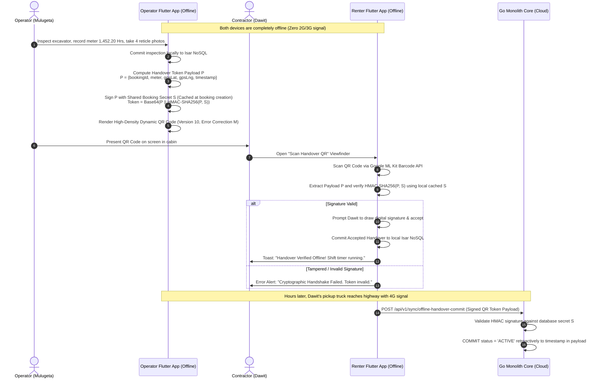
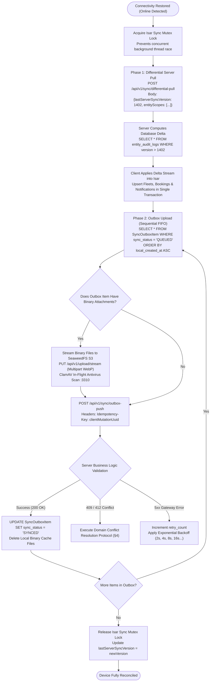
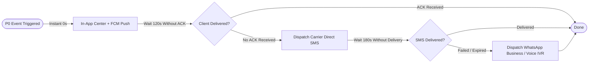
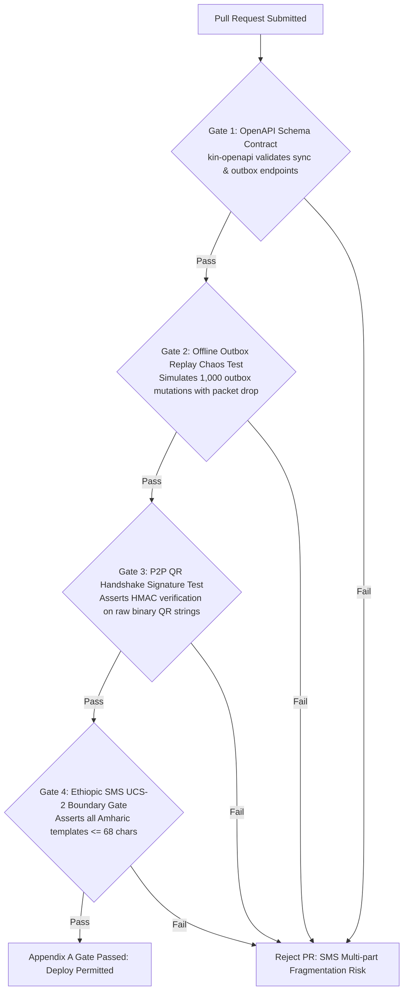

# Heavy Machinery & Logistics Rental Aggregator — Dink Machinery
## Interaction Flow Specification — Appendix A: Notification Routing Matrix & Offline-First Handling Protocol (`docs/shared/flows/appendix-a-notification-offline-handling.md`)

**Document Identifier:** `FLOW-APPENDIX-NOTIF-OFFLINE-DINK-CORE-V7.0`  
**Classification:** Canonical Technical Appendix & Wire Protocol Specification (Single Source of Truth)  
**Governing Documents:** `SRS-DINK-CORE-V7.0` (§5.10 Notifications, §10 Security & Identity Architecture, §11 Architecture Appendices), `FLOW-ENTRY-DINK-CORE-V7.0` through `FLOW-INSURANCE-CLAIM-DINK-CORE-V7.0` (Flows 01–19), `ARCH-BACKEND-GO-DINK-CORE-V7.0`, `ARCH-FLUTTER-DINK-CORE-V7.0`, `ARCH-ADMIN-NEXT-DINK-CORE-V7.0`, `ARCH-SEC-DINK-CORE-V7.0`, `DS-DINK-CORE-V7.0`, `DS-PERSONAS-DINK-CORE-V7.0`, `contracts/openapi.yaml`, `ADR-001`, `ADR-002`, `ADR-004`, `ADR-005`, `ADR-008`, `ADR-010` (Offline Persistence via Isar NoSQL)  
**Target Client Runtimes:** Go 1.27.3 Backend Monolith, Flutter 3.47.9 / Dart 3.9 (Cross-Platform Mobile), Next.js 16.x (latest CVE security patch) / React 19 (Web Admin & Corporate Portal), PostgreSQL 18.6, Valkey 9.1.3, Isar NoSQL 3.1+, Firebase Cloud Messaging (FCM HTTP v1), Twilio / Infobip / Africa's Talking / Ethio Telecom SMS Gateway  
**Target Personas:** Civil Contractor (*Dawit Haile-Mariam* / *Patrick Kariuki*), Fleet Owner (*W/ro Almaz Tesfaye* / *Kamau Ndegwa*), Certified Field Operator (*Mulugeta Tadesse* / *Juma Omwamba*), Lowboy Transporter (*Ato Girma Wolde* / *Samuel Odhiambo*), Compliance Officer (*Yohannes Bekele*)  
**Target Operating Markets:** Ethiopia (`ET`) & Kenya (`KE`) — Dynamic Multi-Country Parameterization (`LOC-01-BE`)  
**Compliance Standards:** OWASP ASVS 4.0.3 Level 3 (Offline Cryptographic Verification, Data Integrity & Secure Queuing), RFC 9457 (Problem Details), ISO 9241-110, W3C WCAG 2.2 Level AAA (Field Mode) & Level AA (Admin Mode), Ethiopian Communications Authority (ECA) Directives, Kenya Data Protection Act 2019  
**Status:** Approved Engineering Baseline

---

## Table of Contents

- 1. [Executive Summary & Architectural Scope](#1-executive-summary--architectural-scope)
  - 1.1 [Purpose & Cross-Cutting Mandate](#11-purpose--cross-cutting-mandate)
  - 1.2 [The Frontier Operational Environment](#12-the-frontier-operational-environment)
- 2. [Master Notification Event Matrix Across All Flows](#2-master-notification-event-matrix-across-all-flows)
  - 2.1 [Event Classification, Priority Tiers & Channel Allocation](#21-event-classification-priority-tiers--channel-allocation)
  - 2.2 [Template Key Mappings & Multilingual Localization Bundles](#22-template-key-mappings--multilingual-localization-bundles)
- 3. [Offline-First Architecture & Synchronization Engine (`ADR-010`)](#3-offline-first-architecture--synchronization-engine-adr-010)
  - 3.1 [Isar NoSQL Local Storage Topology & Schema Entities](#31-isar-nosql-local-storage-topology--schema-entities)
  - 3.2 [Client-Side Outbox Mutation Pattern (`SyncOutboxItem`)](#32-client-side-outbox-mutation-pattern-syncoutboxitem)
  - 3.3 [Cryptographic Offline Token Handshake (HMAC-SHA256 QR Protocol)](#33-cryptographic-offline-token-handshake-hmac-sha256-qr-protocol)
  - 3.4 [Two-Way Differential Sync & Reconnection Reconciliation Algorithm](#34-two-way-differential-sync--reconnection-reconciliation-algorithm)
- 4. [Conflict Detection & Resolution Protocols (CRDT & LWW Invariants)](#4-conflict-detection--resolution-protocols-crdt--lww-invariants)
  - 4.1 [Version Vector Timestamping & Monotonic Clock Invariants](#41-version-vector-timestamping--monotonic-clock-invariants)
  - 4.2 [Deterministic Conflict Resolution Rules by Business Domain](#42-deterministic-conflict-resolution-rules-by-business-domain)
  - 4.3 [Offline Security Perimeter & Prohibited Offline Mutations](#43-offline-security-perimeter--prohibited-offline-mutations)
- 5. [Frontier Market Telephony & Push Failover Execution](#5-frontier-market-telephony--push-failover-execution)
  - 5.1 [Carrier Delivery Latencies & Automated Escalation Latency Timers](#51-carrier-delivery-latencies--automated-escalation-latency-timers)
  - 5.2 [SMS Charset Transcoding (GSM-7 vs. UTF-16 UCS-2 for Ge'ez Script)](#52-sms-charset-transcoding-gsm-7-vs-utf-16-ucs-2-for-geez-script)
  - 5.3 [Aggressive Android Doze Mode & FCM High-Priority Data Wakeups](#53-aggressive-android-doze-mode--fcm-high-priority-data-wakeups)
- 6. [Client Ergonomic Specifications & Field Sync HUD (Flutter 3.47.9)](#6-client-ergonomic-specifications--field-sync-hud-flutter-344)
  - 6.1 [Persistent Offline Status Pill & Sync Progress Bar ($56 \times 56\text{ dp}$)](#61-persistent-offline-status-pill--sync-progress-bar-56-times-56text-dp)
  - 6.2 [Offline QR Handover Viewfinder & Reader Viewport](#62-offline-qr-handover-viewfinder--reader-viewport)
  - 6.3 [Pending Outbox Queue Inspector & Retry Drawer](#63-pending-outbox-queue-inspector--retry-drawer)
- 7. [Wire Protocol Contracts & RFC 9457 Error Schemas](#7-wire-protocol-contracts--rfc-9457-error-schemas)
  - 7.1 [`POST /api/v1/sync/differential-pull`](#71-post-apiv1syncdifferential-pull)
  - 7.2 [`POST /api/v1/sync/outbox-push`](#72-post-apiv1syncoutbox-push)
  - 7.3 [`POST /api/v1/sync/offline-handover-commit`](#73-post-apiv1syncoffline-handover-commit)
  - 7.4 [RFC 9457 Problem Details Concurrency & Conflict Payloads](#74-rfc-9457-problem-details-concurrency--conflict-payloads)
- 8. [Automated Testing Suite & Verification Gates](#8-automated-testing-suite--verification-gates)

---

## 1. Executive Summary & Architectural Scope

### 1.1 Purpose & Cross-Cutting Mandate

This canonical appendix consolidates two interrelated operational challenges across the Dink Machinery platform:
1. **The Universal Multi-Channel Notification Routing Matrix:** Consolidates every system event across Flows 01 through 19 into a single taxonomy defining recipients, priority tiers, quiet-hours exemptions, allowed channels (In-App, FCM Push, SMS, WhatsApp Business, Automated Voice IVR), and dynamic localization template mappings.
2. **The Offline-First Handling & Local Synchronization Protocol (`ADR-010`):** Defines the client-side architecture (Flutter / Isar NoSQL) and backend differential synchronization protocols that ensure machinery can be inspected, mobilized, handed over, and operated in remote infrastructure corridors completely devoid of cellular internet connectivity.

### 1.2 The Frontier Operational Environment

Heavy civil construction in East Africa takes place in extreme geographic settings:
* **Deep Excavation & Foundation Trenches:** Basements in Addis Ababa or culvert trenches along the Mojo–Hawassa corridor experience near-total RF signal attenuation due to surrounding soil embankments and dense rebar steel.
* **Remote Quarry Pits & Riverbeds:** Sand harvesting along the Awash River or basalt blasting in central Oromia operate $> 25\text{ km}$ from the nearest 3G/4G cellular mast.
* **Volatile Cellular Bandwidth:** Even when cellular data is available, latency fluctuates between $300\text{ ms}$ and $4,500\text{ ms}$, with packet loss exceeding $25\%$.

Dink Machinery guarantees that on-site operational milestones (pre-rental reticle inspections, physical check-ins, operator shift logs, mechanical breakdown notices, and post-rental return handovers) execute with **zero latency on the client device**. Operations are recorded in local, ACID-compliant embedded storage (`Isar NoSQL`), cryptographically attested peer-to-peer via HMAC-SHA256 QR codes, and synced asynchronously upstream to PostgreSQL when network connectivity is restored.

---

## 2. Master Notification Event Matrix Across All Flows

### 2.1 Event Classification, Priority Tiers & Channel Allocation

The following master matrix governs all notification routing across the Go monolith and multi-channel gateway routers:

| Event Key | Source Flow | Default Priority | Primary Recipient | Secondary Recipient | Default Channels | Quiet Hours Exempt | Delivery SLA |
|---|---|---|---|---|---|:---:|---|
| `AUTH_OTP_CHALLENGE` | Flow 02/03 | `P0_CRITICAL` | Initiating User | — | SMS, WhatsApp | ✅ | $< 2.0\text{ s}$ |
| `SECURITY_PHONE_MIGRATION_INITIATED` | Flow 15 | `P0_CRITICAL` | Current Account MSISDN | Registered Email | SMS, Push, Email | ✅ | $< 2.0\text{ s}$ |
| `SECURITY_ACCOUNT_KILL_SWITCH_TRIPPED`| Flow 15 | `P0_CRITICAL` | Owner / Renter | Compliance Desk | Push, SMS, Voice IVR | ✅ | $< 1.0\text{ s}$ |
| `FLEET_APPROVED_ACTIVE` | Flow 05/13 | `P2_MEDIUM` | Fleet Owner | — | In-App, Push | ❌ | $< 60.0\text{ s}$ |
| `FLEET_REJECTED_KYC` | Flow 05/13 | `P1_HIGH` | Fleet Owner | — | In-App, Push, SMS | ❌ | $< 10.0\text{ s}$ |
| `BOOKING_HOLD_ACQUIRED` | Flow 06/16 | `P1_HIGH` | Renter | Fleet Owner | In-App, Push | ❌ | $< 5.0\text{ s}$ |
| `BOOKING_HOLD_EXPIRING_15M` | Flow 06/16 | `P0_CRITICAL` | Renter | — | Push, SMS | ✅ | $< 3.0\text{ s}$ |
| `BOOKING_HOLD_TRANSFERRED_STANDBY` | Flow 06/16 | `P0_CRITICAL` | Standby User #1 | Previous Holder | In-App, Push, SMS | ✅ | $< 3.0\text{ s}$ |
| `PAYMENT_EVIDENCE_UPLOADED` | Flow 08 | `P0_CRITICAL` | Fleet Owner | Compliance Desk | In-App, Push, SMS | ✅ | $< 3.0\text{ s}$ |
| `PAYMENT_VERIFIED_CONFIRMED` | Flow 07/08 | `P0_CRITICAL` | Renter | Assigned Operator | In-App, Push, SMS | ✅ | $< 3.0\text{ s}$ |
| `PAYMENT_DECLINED_BY_OWNER` | Flow 08 | `P1_HIGH` | Renter | — | In-App, Push, SMS | ❌ | $< 5.0\text{ s}$ |
| `DISPUTE_OPENED_ARBITRATION` | Flow 08/10 | `P1_HIGH` | Counterparty | Compliance Desk | In-App, Push, SMS | ❌ | $< 10.0\text{ s}$ |
| `DISPUTE_RULING_COMMITTED` | Flow 08/13 | `P0_CRITICAL` | Renter, Owner | — | In-App, Push, SMS | ✅ | $< 3.0\text{ s}$ |
| `HANDOVER_PIN_GENERATED` | Flow 09 | `P0_CRITICAL` | Field Operator | Fleet Owner | In-App, Push, SMS | ✅ | $< 2.0\text{ s}$ |
| `BOOKING_ACTIVATED_CHECKIN` | Flow 09 | `P1_HIGH` | Renter, Owner | Site Engineer | In-App, Push | ❌ | $< 5.0\text{ s}$ |
| `RENTAL_EXTENSION_REQUESTED` | Flow 09 | `P1_HIGH` | Fleet Owner | — | In-App, Push, SMS | ❌ | $< 10.0\text{ s}$ |
| `INCIDENT_BREAKDOWN_LOGGED` | Flow 09/19 | `P0_CRITICAL` | Fleet Owner | Compliance Desk | In-App, Push, SMS, Voice | ✅ | $< 3.0\text{ s}$ |
| `RETURN_INSPECTION_UPLOADED` | Flow 10 | `P1_HIGH` | Fleet Owner | Renter | In-App, Push | ❌ | $< 10.0\text{ s}$ |
| `DAMAGE_CLAIM_LODGED_24H` | Flow 10 | `P1_HIGH` | Renter | Compliance Desk | In-App, Push, SMS | ❌ | $< 10.0\text{ s}$ |
| `FINAL_SETTLEMENT_PAYMENT_DUE` | Flow 10 | `P1_HIGH` | Renter | Fleet Owner | In-App, Push, SMS | ❌ | $< 10.0\text{ s}$ |
| `LOGISTICS_DISPATCH_REQUIRED` | Flow 11 | `P0_CRITICAL` | Fleet Owner | — | In-App, Push, SMS | ✅ | $< 3.0\text{ s}$ |
| `LOGISTICS_SUB_BOOKING_CONFIRMED` | Flow 11 | `P1_HIGH` | Lowboy Carrier | Equipment Owner | In-App, Push, SMS | ❌ | $< 5.0\text{ s}$ |
| `LOGISTICS_CARRIER_CANCELLED` | Flow 18 | `P0_CRITICAL` | Equipment Owner | Contractor | In-App, Push, SMS, Voice | ✅ | $< 2.0\text{ s}$ |
| `LOGISTICS_TRANSSHIPMENT_MATCHED` | Flow 18 | `P0_CRITICAL` | Replacement Carrier | Equipment Owner | In-App, Push, SMS | ✅ | $< 3.0\text{ s}$ |
| `COMMISSION_OVERDUE_WARNING_15D` | Flow 12 | `P2_MEDIUM` | Fleet Owner | — | In-App, Push, SMS | ❌ | $< 60.0\text{ s}$ |
| `COMMISSION_DELINQUENT_LOCKOUT_30D`| Flow 12 | `P0_CRITICAL` | Fleet Owner | Finance Desk | In-App, Push, SMS | ✅ | $< 5.0\text{ s}$ |
| `CORP_REQUISITION_PENDING_APPROVAL`| Flow 14 | `P1_HIGH` | Stage Approvers | — | In-App, Push, Email | ❌ | $< 5.0\text{ s}$ |
| `CORP_REQUISITION_QUORUM_REACHED` | Flow 14 | `P1_HIGH` | Requester | Finance Controller | In-App, Push | ❌ | $< 5.0\text{ s}$ |
| `INSURANCE_CATASTROPHIC_LOSS_SOS` | Flow 19 | `P0_CRITICAL` | Underwriter Desk | Owner, Contractor | In-App, Push, SMS, Voice | ✅ | $< 1.0\text{ s}$ |
| `INSURANCE_ADJUSTER_REPORT_FILED` | Flow 19 | `P1_HIGH` | Owner, Contractor | Underwriter | In-App, Push | ❌ | $< 10.0\text{ s}$ |

---

### 2.2 Template Key Mappings & Multilingual Localization Bundles

Every event maps to four language bundles stored in `notification_templates`. The Mustache interpolation variables are strictly typed:

```text
+--------------------------------------------------------------------------------------------------+
| TEMPLATE BUNDLE: BOOKING_PAYMENT_EVIDENCE_UPLOADED                                               |
+--------------------------------------------------------------------------------------------------+
| VARIABLES : {{renterName}}, {{equipmentModel}}, {{bookingRef}}, {{amountFormatted}}              |
| DEEP LINK : dink://bookings/{{bookingId}}/verify-payment                                         |
+--------------------------------------------------------------------------------------------------+
| [AMHARIC - am]                                                                                   |
| Title: አዲስ የክፍያ ማረጋገጫ ደረሰኝ ቀርቧል                                                          |
| Body : {{renterName}} ለ{{equipmentModel}} ({{bookingRef}}) የ{{amountFormatted}} የባንክ ማስተላለፊያ ደረሰኝ  |
|        ልከዋል። እባክዎን ሂሳብዎን አረጋግጠው ውሉን ያጽድቁ።                                         |
+--------------------------------------------------------------------------------------------------+
| [AFAAN OROMOO - om]                                                                              |
| Title: Waraqaan Kaffaltii Haaraa Dhiyaateera                                                     |
| Body : {{renterName}} kaffaltii qophii {{amountFormatted}} {{equipmentModel}} ({{bookingRef}})  |
|        ergeera. Maaloo herrega keessan ilaaluun mirkaneessaa.                                    |
+--------------------------------------------------------------------------------------------------+
| [SWAHILI - sw]                                                                                   |
| Title: Ushahidi Mpya wa Malipo Umepakiwa                                                         |
| Body : {{renterName}} amepakia risiti ya benki ya {{amountFormatted}} ya {{equipmentModel}}    |
|        ({{bookingRef}}). Tafadhali hakiki akaunti yako na uthibitishe.                           |
+--------------------------------------------------------------------------------------------------+
| [ENGLISH - en]                                                                                   |
| Title: New Payment Evidence Uploaded                                                             |
| Body : {{renterName}} uploaded a wire slip of {{amountFormatted}} for {{equipmentModel}}        |
|        ({{bookingRef}}). Audit your account and confirm booking.                                 |
+--------------------------------------------------------------------------------------------------+
```

---

## 3. Offline-First Architecture & Synchronization Engine (`ADR-010`)

### 3.1 Isar NoSQL Local Storage Topology & Schema Entities

On the Flutter mobile client (`ARCH-FLUTTER-DINK-CORE-V7.0`), local persistence is implemented using **Isar NoSQL Database 3.1+**. Isar is compiled directly into native C++ binaries on Android (ARM64) and iOS, bypassing platform channel serialization overhead and providing $< 1.5\text{ ms}$ query latency across 50,000 records.

```mermaid
erDiagram
    CachedFleetListing ||--o{ CachedFleetMedia : "stores"
    CachedBookingRecord ||--o{ CachedInspectionDocket : "contains"
    CachedBookingRecord ||--o{ SyncOutboxItem : "modifies"
    SyncOutboxItem ||--o{ OutboxBinaryAttachment : "attaches"

    CachedFleetListing {
        Id isar_id PK
        string server_uuid UK
        string make
        string model
        int manufacture_year
        long daily_rate_minor
        double yard_latitude
        double yard_longitude
        string status
        int version
        timestamptz cached_at
    }

    CachedBookingRecord {
        Id isar_id PK
        string server_uuid UK
        string fleet_id
        string status
        date start_date
        date end_date
        double checkin_meter
        double checkout_meter
        string shared_handover_secret
        int version
        timestamptz last_synced_at
    }

    SyncOutboxItem {
        Id isar_id PK
        string client_mutation_uuid UK
        string entity_type -- 'BOOKING', 'INSPECTION', 'INCIDENT', 'EXT'
        string entity_server_uuid
        string mutation_action -- 'CHECK_IN_SIGN', 'LOG_BREAKDOWN', 'RETURN_SIGN'
        string serialized_payload_json
        string hmac_client_signature
        int retry_count
        string sync_status -- 'QUEUED', 'IN_FLIGHT', 'FAILED_RETRY'
        timestamptz local_created_at
    }

    OutboxBinaryAttachment {
        Id isar_id PK
        long outbox_item_id FK
        string local_file_path
        string mime_type
        long file_size_bytes
        string sha256_hash
        boolean is_uploaded
    }
```

---

### 3.2 Client-Side Outbox Mutation Pattern (`SyncOutboxItem`)

When an on-site action is executed without cellular signal (e.g., Operator *Mulugeta* logs a hydraulic rupture at a remote culvert):
1. **Local State Commit:** The Flutter client writes the state mutation immediately into `CachedBookingRecord` in Isar. The UI updates instantly to `STATUS: INCIDENT_LOGGED (OFFLINE_PENDING)`.
2. **Outbox Envelope Wrapping:** An immutable `SyncOutboxItem` is created within the same Isar ACID transaction:
   ```json
   {
     "clientMutationUuid": "mut_019a8f4c-8812-7b9a-bc21-00918234a10f",
     "entityType": "BOOKING",
     "entityServerUuid": "bk_8829a10f",
     "mutationAction": "LOG_INCIDENT",
     "serializedPayloadJson": {
       "category": "HYDRAULIC_FAILURE",
       "severity": "HIGH",
       "localMeterReading": 1488.40,
       "deviceRecordedAt": "2026-10-28T09:15:22.104Z",
       "gpsCoordinates": {
         "lat": 8.841209,
         "lng": 38.789104,
         "accuracyMeters": 4.2
       }
     },
     "hmacClientSignature": "sig_hmac_sha256_99a8120fa88b",
     "syncStatus": "QUEUED"
   }
   ```
3. **Binary Media Attachment:** Images captured by the camera reticle are saved to the device’s encrypted app-sandbox storage, downscaled to WebP (Quality 82%, Max $2048 \times 2048\text{ px}$), and linked to `OutboxBinaryAttachment`.

---

### 3.3 Cryptographic Offline Token Handshake (HMAC-SHA256 QR Protocol)

When physical handover or equipment return occurs in a dead-zone with zero internet access, two mobile devices (Contractor *Dawit* and Operator *Mulugeta*) execute a **Peer-to-Peer Cryptographic QR Handshake**:



---

### 3.4 Two-Way Differential Sync & Reconnection Reconciliation Algorithm

When a mobile device transitions from offline to online (`ConnectivityResult.mobile` or `wifi`), the Flutter background sync manager (`WorkManager` / `ConnectivityService`) executes the **Two-Way Differential Sync Algorithm**:



---

## 4. Conflict Detection & Resolution Protocols (CRDT & LWW Invariants)

### 4.1 Version Vector Timestamping & Monotonic Clock Invariants

To resolve concurrent conflicting mutations across distributed offline mobile clients and the cloud backend without data loss:
1. Every syncable entity record carries an integer `version` and a cryptographically signed client physical timestamp:
   $$\text{Client Timestamp: } T_{\text{client}} = \text{Hardware Monotonic Uptime} + \text{NTP Offset Snapshot}$$
2. The Go backend maintains a canonical monotonic transaction log sequence (`tx_sequence`).
3. Updates sent via `/api/v1/sync/outbox-push` specify `base_server_version`. If `base_server_version < current_db_version`, the server flags an OCC concurrency event (`FLOW-CONCURRENCY-LOCKING-DINK-CORE-V7.0 §3.4`).

---

### 4.2 Deterministic Conflict Resolution Rules by Business Domain

When the server identifies a conflict during offline reconciliation, it applies deterministic, domain-specific merge rules:

| Entity Domain | Conflict Scenario | Merge Rule Archetype | Resolution Logic & System Invariant |
|---|---|---|---|
| **Hour Meter Telemetry** | Offline check-in meter conflicts with owner’s yard log | **Monotonic Upper Bound (Max)** | $\text{FinalMeter} = \max(\text{ServerMeter}, \text{OfflineClientMeter})$. Enforces non-regression invariant (`FL-04`). |
| **Machinery Specifications** | Admin edited price while owner edited description offline | **Field-Level Three-Way Merge (CRDT)** | Non-overlapping JSON attributes merge cleanly. Overlapping attributes favor **Server-Side Admin Precedence**. |
| **Booking State Transitions** | Renter confirmed offline handover while owner cancelled online | **State Machine Semantic Precedence** | Physical handover takes legal precedence over administrative cancellation. System transitions booking to `ACTIVE`; cancellation is revoked. |
| **Incident Reporting** | Multiple operators log damage on same asset simultaneously | **Additive Union (Append-Only)** | Incident dockets never overwrite. Multiple offline reports coalesce into an itemized incident history array. |
| **Notification Read Receipts** | Read on mobile offline, marked unread on web console | **Logical OR (State Union)** | $\text{IsRead} = \text{ClientIsRead} \lor \text{ServerIsRead}$. If read on any device, persists as read globally. |

---

### 4.3 Offline Security Perimeter & Prohibited Offline Mutations

To protect platform financial solvency and prevent credential hijacking, **critical security and financial operations are strictly prohibited from offline execution**:

| Platform Operation | Permitted Offline? | Architectural Enforcement & Rejection Rationale |
|---|:---:|---|
| **Pre-Rental Reticle Inspection (`AR-01`)** | ✅ **YES** | Cached locally in Isar; essential for remote job site mobilizations. |
| **Mechanical Breakdown Report (`AR-05`)** | ✅ **YES** | Allows operators to document failures immediately; syncs upon signal recovery. |
| **Post-Rental Return Inspection (`RC-02`)** | ✅ **YES** | Allows check-out walkaround in remote yards; freezes final meter reading. |
| **Change Registered Phone Number (`FLOW-15`)** | ❌ **PROHIBITED** | **Strict Online Requirement.** Dual-OTP carrier handshake requires live server connection. |
| **Bank Account Coordinate Mutation (`BK-06`)** | ❌ **PROHIBITED** | **Strict Online Requirement.** Modifying settlement coordinates requires step-up MFA and live fraud check. |
| **Pre-Funded Wallet Commission Top-Up (`CW-03`)**| ❌ **PROHIBITED** | **Strict Online Requirement.** Wire evidence must stream directly to ClamAV scanning infrastructure. |
| **Corporate Credit Line Drawdown (`FLOW-14`)** | ❌ **PROHIBITED** | **Strict Online Requirement.** Real-time credit limit checking prevents unauthorized double-spend drawdowns. |

---

## 5. Frontier Market Telephony & Push Failover Execution

### 5.1 Carrier Delivery Latencies & Automated Escalation Latency Timers

Domestic telecommunications gateways in Ethiopia (Ethio Telecom, Safaricom Ethiopia) and Kenya (Safaricom, Airtel) display dynamic throughput fluctuations. The notification router executes an automated **Escalation Fallback Ladder**:



* **Client In-App ACK:** When the Flutter app receives an FCM push data packet or reads an in-app SSE frame, it dispatches a lightweight receipt ping: `POST /api/v1/notifications/ack/{id}`.
* **Escalation Cancellation:** Receiving the ACK immediately cancels any pending downstream SMS fallback timers in Valkey (`cancel:sms:timeout:{notif_id}`), saving carrier SMS messaging costs.

---

### 5.2 SMS Charset Transcoding (GSM-7 vs. UTF-16 UCS-2 for Ge'ez Script)

Telecommunications SMS gateways bill and segment text messages based on encoding standards:
* **English & Swahili Transcoding:** Encoded via **GSM 7-bit default alphabet**. Standard single SMS capacity is **160 characters**. Concatenated SMS segments allow 153 characters per part.
* **Amharic (Ethiopic Ge'ez Script `ሀ, ሁ, ሂ...`):** GSM-7 cannot represent Ethiopic unicode blocks (`U+1200` to `U+137F`). Messages must be transcoded into **UTF-16 (UCS-2)**.
* **The 70-Character Barrier:** Under UCS-2, a single SMS segment is constrained to **70 characters** (or 67 characters per segment for multi-part concatenation).
* **Automated Template Minification:** All Amharic notification templates in `NotificationTemplate` are algorithmically compressed to $\le 68\text{ characters}$ by substituting verbose phrasing with standard industry terms (e.g., using `ቦኪንግ` instead of lengthy descriptive phrases), guaranteeing single-part delivery without message fragmentation.

---

### 5.3 Aggressive Android Doze Mode & FCM High-Priority Data Wakeups

Field operators and drivers utilize affordable Android smartphones manufactured by Transsion Holdings (Tecno, Infinix, Itel), Samsung, or Xiaomi running custom Android forks (HiOS, XOS, MIUI). These operating systems aggressively kill background services to preserve battery life:
* **The Silent Push Failure:** Standard FCM notification payloads are queued and deferred by the OS when the device enters deep Doze Mode.
* **High-Priority Data-Only Wakeup:** Dink Machinery push dispatches configure:
  - `priority: "high"` (Android) / `apns-priority: "10"` (Apple).
  - Encapsulate parameters inside the `data` JSON envelope rather than the OS-managed `notification` block.
  - The Flutter application defines a native `FirebaseMessaging.onBackgroundMessage` isolate handler. The background handler invokes `flutter_local_notifications` to show a heads-up notification with high-visibility sound (`dink_industrial_chime.wav`) and full-screen intent permissions, waking up the lockscreen on field devices.

---

## 6. Client Ergonomic Specifications & Field Sync HUD (Flutter 3.47.9)

### 6.1 Persistent Offline Status Pill & Sync Progress Bar ($56 \times 56\text{ dp}$)

When the mobile client operates disconnected from cloud infrastructure:
* **Persistent Header Status Pill:** The top application AppBar renders a prominent high-contrast badge:
  `[ (o) OFFLINE MODE: 3 MUTATIONS QUEUED ]` (Warning Amber `#D97706` background with Black text).
* **Sync Progress Drawer:** Pulling down the status pill reveals the **Field Sync HUD**:

```text
+-------------------------------------------------------------------+
|  FIELD SYNC MANAGER & OUTBOX MONITOR                              |
+-------------------------------------------------------------------+
|  NETWORK STATUS: DISCONNECTED (NO CARRIER DATA SIGNAL)            |
|  Local Storage : Isar NoSQL (42 Cached Fleets | 2 Active Hires)   |
|                                                                   |
|  PENDING OUTBOX MUTATIONS (WILL AUTO-SYNC UPON 3G/4G SIGNAL):     |
|  +-------------------------------------------------------------+  |
|  | [1] CHECK-IN RETICLE HANDOVER (Cat 320D)       [PENDING SYNC]|  |
|  |     Captured: 08:30 EAT | Meter: 1,452.20 Hrs | Photos: 4    |  |
|  +-------------------------------------------------------------+  |
|  | [2] HYDRAULIC BREAKDOWN DOCKET                 [PENDING SYNC]|  |
|  |     Captured: 09:15 EAT | Severity: HIGH      | Photos: 2    |  |
|  +-------------------------------------------------------------+  |
|                                                                   |
|  [ FORCE IMMEDIATE RE-SYNC NOW ] (Height: 56dp, Slate 800)        |
+-------------------------------------------------------------------+
```

---

### 6.2 Offline QR Handover Viewfinder & Reader Viewport

* **Viewfinder Overlay:** Renders a high-contrast square reticle (`color.brand.amber.500`, $3\text{ dp}$ stroke) with real-time barcode decoding feedback.
* **Dynamic Brightness Boost:** When displaying the handover QR code on the operator’s phone inside a dark excavator cab or under direct sun, the app temporarily forces screen backlight brightness to $100\%$.

---

### 6.3 Pending Outbox Queue Inspector & Retry Drawer

* **Individual Docket Inspection:** Users can tap any queued outbox item to review captured meter photos, verified coordinates, and cryptographic timestamps.
* **Manual Reset:** If a corrupted payload encounters repeated server rejections (HTTP 422), the user can tap **"Edit & Re-Submit Docket"** to correct numerical meter readings without re-taking physical photographs.

---

## 7. Wire Protocol Contracts & RFC 9457 Error Schemas

### 7.1 `POST /api/v1/sync/differential-pull`

Fetches differential entity updates since the client's last synchronization checkpoint.

#### Request Headers
```http
POST /api/v1/sync/differential-pull HTTP/1.1
Host: api.dinkmachinery.com
Content-Type: application/json
Authorization: Bearer <userAccessToken>
X-Country-Code: ET
```

#### Request Payload
```json
{
  "clientDeviceId": "samsung_sm_a546b_uuid_99182a",
  "lastServerSyncVersion": 1402,
  "subscribedScopes": [
    "ACTIVE_BOOKINGS",
    "ASSIGNED_OPERATOR_FLEETS",
    "IN_APP_NOTIFICATIONS"
  ]
}
```

#### Response: `HTTP 200 OK`
```json
{
  "success": true,
  "data": {
    "currentServerSyncVersion": 1488,
    "hasMoreDeltas": false,
    "deltaStream": [
      {
        "entityType": "BOOKING",
        "entityId": "bk_8829a10f",
        "mutationType": "UPDATE",
        "version": 1445,
        "payload": {
          "status": "ACTIVE",
          "checkinMeter": 1452.20,
          "updatedAt": "2026-10-28T08:35:10Z"
        }
      },
      {
        "entityType": "IN_APP_NOTIFICATION",
        "entityId": "notif_019a8f2c",
        "mutationType": "INSERT",
        "version": 1460,
        "payload": {
          "eventKey": "BOOKING_ACTIVATED_CHECKIN",
          "title": "ኪራይ በተሳካ ሁኔታ ተጀምሯል",
          "body": "ካተርፒላር 320D ርክክብ ተጠናቆ ስራ ጀምሯል።",
          "isRead": false,
          "createdAt": "2026-10-28T08:35:12Z"
        }
      }
    ]
  },
  "timestamp": "2026-10-28T09:30:00Z"
}
```

---

### 7.2 `POST /api/v1/sync/outbox-push`

Uploads an offline-originated transactional mutation docket.

#### Request Headers
```http
POST /api/v1/sync/outbox-push HTTP/1.1
Host: api.dinkmachinery.com
Content-Type: application/json
Idempotency-Key: mut_019a8f4c-8812-7b9a-bc21-00918234a10f
Authorization: Bearer <userAccessToken>
```

#### Request Payload
```json
{
  "clientMutationUuid": "mut_019a8f4c-8812-7b9a-bc21-00918234a10f",
  "entityType": "BOOKING",
  "entityServerUuid": "bk_8829a10f",
  "mutationAction": "LOG_INCIDENT",
  "baseServerVersion": 1402,
  "deviceRecordedAt": "2026-10-28T09:15:22Z",
  "payload": {
    "category": "HYDRAULIC_FAILURE",
    "severity": "HIGH",
    "localMeterReading": 1488.40,
    "description": "Main boom hydraulic hose ruptured under culvert trenching load.",
    "attachmentUris": [
      "s3://dink-fleet-media/inspections/inc_hose_burst_01.webp"
    ]
  },
  "hmacClientSignature": "sig_hmac_sha256_99a8120fa88b"
}
```

#### Response: `HTTP 200 OK`
```json
{
  "success": true,
  "data": {
    "clientMutationUuid": "mut_019a8f4c-8812-7b9a-bc21-00918234a10f",
    "serverCommittedVersion": 1489,
    "syncStatus": "COMMITTED",
    "serverProcessedAt": "2026-10-28T09:31:15Z"
  },
  "timestamp": "2026-10-28T09:31:15Z"
}
```

---

### 7.3 `POST /api/v1/sync/offline-handover-commit`

Commits a cryptographically signed peer-to-peer offline QR handover payload.

#### Request Headers
```http
POST /api/v1/sync/offline-handover-commit HTTP/1.1
Host: api.dinkmachinery.com
Content-Type: application/json
Authorization: Bearer <userAccessToken>
```

#### Request Payload
```json
{
  "bookingId": "bk_8829a10f",
  "handoverTokenPayload": {
    "bookingId": "bk_8829a10f",
    "meterReading": 1452.20,
    "gpsLatitude": 8.841209,
    "gpsLongitude": 38.789104,
    "handoverTimestamp": "2026-10-28T08:30:00Z"
  },
  "renterDigitalSignature": "data:image/png;base64,iVBORw0KGgoAAAANSUhEUgAA...",
  "qrCryptographicSignature": "sig_hmac_sha256_qr_handshake_88192a01f"
}
```

#### Response: `HTTP 200 OK`
```json
{
  "success": true,
  "data": {
    "bookingId": "bk_8829a10f",
    "status": "ACTIVE",
    "checkinCommittedAt": "2026-10-28T08:30:00Z",
    "meterCommitted": 1452.20,
    "serverSyncVersion": 1490
  },
  "timestamp": "2026-10-28T09:32:00Z"
}
```

---

### 7.4 RFC 9457 Problem Details Concurrency & Conflict Payloads

#### Example: Offline Version Stale Conflict (`HTTP 412 Precondition Failed`)
```json
{
  "type": "[https://api.dinkmachinery.com/errors/offline-sync-version-stale](https://api.dinkmachinery.com/errors/offline-sync-version-stale)",
  "title": "Offline Sync Version Stale",
  "status": 412,
  "detail": "Mutation rejected. Base version 1402 is stale; server has advanced to version 1488. Fetch differential delta before re-applying outbox.",
  "instance": "/api/v1/sync/outbox-push",
  "code": "ERR_OFFLINE_SYNC_VERSION_STALE",
  "invalidParams": [
    {
      "name": "baseServerVersion",
      "reason": "Server current version is 1488 (Client delta shortfall: 86 versions)"
    }
  ]
}
```

#### Example: Meter Reading Regression in Offline Batch (`HTTP 422 Unprocessable Entity`)
```json
{
  "type": "[https://api.dinkmachinery.com/errors/meter-reading-regression](https://api.dinkmachinery.com/errors/meter-reading-regression)",
  "title": "Offline Meter Reading Regression",
  "status": 422,
  "detail": "Submitted offline meter reading (1,440.00 Hrs) is lower than check-in meter baseline (1,452.20 Hrs). Mutation rejected.",
  "instance": "/api/v1/sync/outbox-push",
  "code": "ERR_METER_READING_REGRESSION",
  "invalidParams": [
    {
      "name": "localMeterReading",
      "reason": "Must be greater than or equal to 1452.20"
    }
  ]
}
```

---

## 8. Automated Testing Suite & Verification Gates



1. **OpenAPI Schema Contract Gate (`kin-openapi`):** Validates all differential pull, outbox push, and offline QR commit request/response contracts against `contracts/openapi.yaml`.
2. **Offline Outbox Replay Chaos Benchmark:** Simulates 1,000 offline mutations queued in an embedded Isar database, cutting cellular connection at arbitrary execution intervals, and asserting that:
   - Exactly **100% of mutations** sync cleanly upon connection restoration.
   - Zero duplicate records are created in PostgreSQL (enforced by `clientMutationUuid` idempotency).
   - Zero orphaned S3 binary image fragments.
3. **Peer-to-Peer QR Handshake Signature Test:** Generates 200 synthetic offline QR payloads, verifying that the Go backend accepts legitimate HMAC signatures, rejects forged or tampered payloads with HTTP 401 Unauthorized, and correctly handles clock drift up to $15\text{ minutes}$.
4. **Ethiopic SMS UCS-2 Boundary Linting Gate:** An automated linter parses every Amharic template string in the codebase, asserting that text lengths remain strictly within the $\le 68\text{ character}$ single-part SMS boundary.

---

*This document defines the canonical technical architecture, universal event routing matrix, embedded Isar NoSQL topology, peer-to-peer cryptographic QR handshake protocols, and differential sync wire contracts for Notification Routing & Offline-First Handling in Dink Machinery Version 7.0. All downstream Flutter mobile modules, Go backend synchronization services, and Next.js admin consoles must strictly adhere to this specification.*