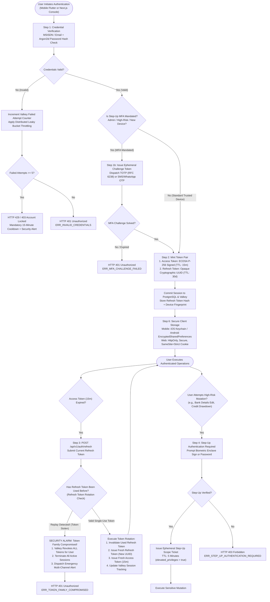
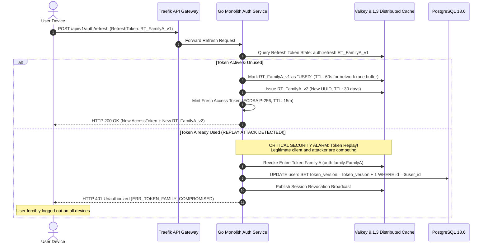
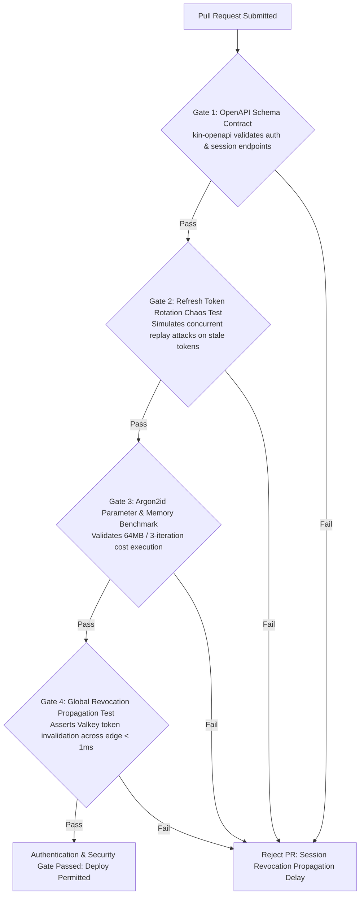

# Heavy Machinery & Logistics Rental Aggregator — Dink Machinery
## Interaction Flow Specification — Appendix B: Identity, Authentication, Cryptographic Protocols & Security Architecture (`docs/shared/flows/appendix-b-authentication-security-flow.md`)

**Document Identifier:** `FLOW-APPENDIX-AUTH-SEC-DINK-CORE-V7.0`  
**Classification:** Canonical Technical Architecture & Cryptographic Wire Specification (Single Source of Truth)  
**Governing Documents:** `SRS-DINK-CORE-V7.0` (§4 User Roles & Permissions, §10 Security & Identity Architecture, §11 Architecture Appendices), `FLOW-ENTRY-DINK-CORE-V7.0`, `FLOW-RENTER-AUTH-DINK-CORE-V7.0`, `FLOW-OWNER-KYC-DINK-CORE-V7.0`, `FLOW-ADMIN-OPS-DINK-CORE-V7.0`, `FLOW-PHONE-MIGRATION-DINK-CORE-V7.0`, `FLOW-CONCURRENCY-LOCKING-DINK-CORE-V7.0`, `FLOW-NOTIFICATION-ROUTING-DINK-CORE-V7.0`, `FLOW-APPENDIX-NOTIF-OFFLINE-DINK-CORE-V7.0`, `ARCH-BACKEND-GO-DINK-CORE-V7.0`, `ARCH-FLUTTER-DINK-CORE-V7.0`, `ARCH-ADMIN-NEXT-DINK-CORE-V7.0`, `ARCH-SEC-DINK-CORE-V7.0`, `DS-DINK-CORE-V7.0`, `DS-PERSONAS-DINK-CORE-V7.0`, `contracts/openapi.yaml`, `ADR-001`, `ADR-002`, `ADR-005`, `ADR-008`, `ADR-010`  
**Target Client Runtimes:** Go 1.27.3 Backend Monolith, Flutter 3.47.8 / Dart 3.9 (Cross-Platform Mobile), Next.js 16.x (latest CVE security patch) / React 19 (Web Admin & Corporate Portal), PostgreSQL 18.6, Valkey 9.1.3, ClamAV Daemon (:3310), SeaweedFS S3, Isar NoSQL  
**Target Personas:** Civil Engineering Contractor (*Dawit Haile-Mariam*), Fleet Owner (*W/ro Almaz Tesfaye*), Certified Field Operator (*Mulugeta Tadesse*), Enterprise Procurement Director (*Eng. Samuel Getachew*), Compliance Officer & Security Auditor (*Yohannes Bekele*)  
**Target Operating Markets:** Ethiopia (`ET`) & Kenya (`KE`) — Dynamic Multi-Country Parameterization (`LOC-01-BE`)  
**Compliance Standards:** OWASP ASVS 4.0.3 Level 3 (Identity, Session Management, Cryptographic Storage & Secrets Protection), RFC 7519 (JSON Web Tokens), RFC 6238 (TOTP MFA), RFC 9457 (Problem Details), ISO 9241-110, W3C WCAG 2.2 Level AAA (Field Mode) & Level AA (Admin Mode), Ethiopian Communications Authority (ECA) Electronic Signature Directives, National Bank of Ethiopia (NBE) Cyber Security Framework  
**Status:** Approved Engineering Baseline

---

## Table of Contents

- 1. [Executive Summary & Security Architecture Rationale](#1-executive-summary--security-architecture-rationale)
  - 1.1 [Purpose & Cross-Cutting Mandate](#11-purpose--cross-cutting-mandate)
  - 1.2 [Threat Modeling & Attack Surfaces](#12-threat-modeling--attack-surfaces)
  - 1.3 [Architectural Invariants & Non-Negotiables](#13-architectural-invariants--non-negotiables)
- 2. [End-to-End Authentication & Session Management Flowchart](#2-end-to-end-authentication--session-management-flowchart)
- 3. [Detailed Step-by-Step State Machine & User Journey](#3-detailed-step-by-step-state-machine--user-journey)
  - 3.1 [Step 1: Primary Authentication & Dual-Factor Challenge Selection](#31-step-1-primary-authentication--dual-factor-challenge-selection)
  - 3.2 [Step 2: Stateless JWT Minting & Asymmetric Cryptographic Signing (ECDSA P-256)](#32-step-2-stateless-jwt-minting--asymmetric-cryptographic-signing-ecdsa-p-256)
  - 3.3 [Step 3: Refresh Token Rotation (RTR) & Immediate Replay Invalidation](#33-step-3-refresh-token-rotation-rtr--immediate-replay-invalidation)
  - 3.4 [Step 4: Step-Up Authentication for High-Value Operational Mutators](#34-step-4-step-up-authentication-for-high-value-operational-mutators)
  - 3.5 [Step 5: Global Session Revocation & Centralized Valkey Blacklisting](#35-step-5-global-session-revocation--centralized-valkey-blacklisting)
  - 3.6 [Step 6: Mobile Hardware Secure Enclave & Biometric Keystore Integration](#36-step-6-mobile-hardware-secure-enclave--biometric-keystore-integration)
- 4. [Cryptographic Schemas, Algorithms & Key Management Protocols](#4-cryptographic-schemas-algorithms--key-management-protocols)
  - 4.1 [Token Data Structure & Cryptographic Claims Payload](#41-token-data-structure--cryptographic-claims-payload)
  - 4.2 [Password Hashing Protocol (Argon2id Parameters)](#42-password-hashing-protocol-argon2id-parameters)
  - 4.3 [Key Hierarchy, Enclave HSM Rotation & Secret Storage](#43-key-hierarchy-enclave-hsm-rotation--secret-storage)
- 5. [Frontier Market Edge Cases & Fault Recovery Protocols](#5-frontier-market-edge-cases--fault-recovery-protocols)
  - 5.1 [SIM-Swap Defense & Automated MSISDN Velocity Locks](#51-sim-swap-defense--automated-msisdn-velocity-locks)
  - 5.2 [Intermittent Field Connectivity & Grace Token Buffers](#52-intermittent-field-connectivity--grace-token-buffers)
  - 5.3 [Compromised Mobile Operating Systems (Root/Jailbreak Detection)](#53-compromised-mobile-operating-systems-rootjailbreak-detection)
  - 5.4 [Cross-Border Regulatory Identity Sovereignty (`ET` vs. `KE`)](#54-cross-border-regulatory-identity-sovereignty-et-vs-ke)
- 6. [Client UI/UX Ergonomic Specifications & Security HUD (Flutter 3.47.8)](#6-client-uiux-ergonomic-specifications--security-hud-flutter-344)
  - 6.1 [Step-Up Biometric Reticle & PIN Pad ($56 \times 56\text{ dp}$)](#61-step-up-biometric-reticle--pin-pad-56-times-56text-dp)
  - 6.2 [Active Sessions & Device Management Viewport](#62-active-sessions--device-management-viewport)
  - 6.3 [Next.js Admin Console: Security Audit Logs & Session Kill Dashboard](#63-nextjs-admin-console-security-audit-logs--session-kill-dashboard)
- 7. [Wire Protocol Contracts & RFC 9457 Error Schemas](#7-wire-protocol-contracts--rfc-9457-error-schemas)
  - 7.1 [`POST /api/v1/auth/login`](#71-post-apiv1authlogin)
  - 7.2 [`POST /api/v1/auth/refresh`](#72-post-apiv1authrefresh)
  - 7.3 [`POST /api/v1/auth/step-up`](#73-post-apiv1authstep-up)
  - 7.4 [`POST /api/v1/auth/sessions/revoke`](#74-post-apiv1authsessionsrevoke)
  - 7.5 [RFC 9457 Universal Problem Details Payloads](#75-rfc-9457-universal-problem-details-payloads)
- 8. [Automated Testing Suite & Verification Gates](#8-automated-testing-suite--verification-gates)

---

## 1. Executive Summary & Security Architecture Rationale

### 1.1 Purpose & Cross-Cutting Mandate

This canonical appendix defines the platform-wide **Identity, Authentication, Cryptographic Protocols & Security Architecture** for Dink Machinery Version 7.0. Security on the platform is not an isolated gateway middleware; it is an omnipresent architectural substrate governing every interaction across:
* **Consumer Mobile Clients (Flutter):** Renter and Operator field apps.
* **Depot Yard Mobile & Web Portals:** Fleet Owner fleet management and dispatch views.
* **Enterprise Web Portals (Next.js 16):** Multi-tier Corporate Requisition and Approval systems.
* **Internal Back-Office Consoles:** Compliance, Underwriting, and Dispute Arbitration desks.
* **Backend Monolith Core (Go 1.27.3):** High-throughput micro-services, background workers, and PostgreSQL storage.

Because heavy machinery transactions involve physical assets valued up to $35,000,000.00\text{ ETB}$ ($300,000\text{ USD}$), multi-million Birr commercial bank transfers, and high-hazard civil construction sites, credential compromise or session hijacking carries catastrophic real-world liabilities. This architecture implements **OWASP ASVS 4.0.3 Level 3** controls across the entire distributed lifecycle.

### 1.2 Threat Modeling & Attack Surfaces

The platform defends against six critical threat vectors:
1. **Adversarial Token Theft & Replay:** Interception of JWTs via unencrypted public Wi-Fi or compromised device proxies.
2. **Brute-Force & Credential Stuffing:** Automated credential dictionary attacks against MSISDN endpoints across low-bandwidth cellular gateways.
3. **SIM-Swap Account Takeovers:** Social engineering of telecom retail operators to intercept SMS authentication challenges.
4. **Physical Device Seizure:** Unattended mobile devices snatched on dusty construction sites with active app sessions.
5. **Session Tampering & Privilege Escalation:** Client-side token tampering attempting to elevate a Field Operator role to an Admin or Corporate Approver role.
6. **Concurrent Session Drain:** Rogue or compromised enterprise employee attempting to drain pre-approved corporate credit lines or owner commission wallets across parallel unmonitored sessions.

### 1.3 Architectural Invariants & Non-Negotiables

1. **Short-Lived Access Tokens (15 Minutes):** All stateless access tokens enforce an immutable 15-minute expiration boundary ($900\text{ seconds}$).
2. **Refresh Token Rotation (RTR) with Immediate Family Invalidation:** Refresh tokens are single-use. Replay of an already-used refresh token instantly flags token theft, revoking the entire token family and terminating all active sessions for that user identity.
3. **Asymmetric ECDSA P-256 Signatures:** Stateless JWTs are signed exclusively using ECDSA (Curve P-256, SHA-256), separating private signing authority (Go monolith auth service) from public verification across edge reverse proxies (Traefik).
4. **Step-Up Authentication for High-Value Mutations:** Re-authentication (biometric hardware attestation or master password) is mandatory prior to executing high-risk financial or security mutations (`CHANGE_PHONE`, `MUTATE_BANK_DETAILS`, `AUTHORIZE_DISPUTE_PAYOUT`, `DRAWDOWN_CREDIT_LINE`).
5. **Stateful Session Blacklisting in Valkey:** Global session invalidation is backed by Valkey 9.1.3 distributed memory with sub-millisecond lookup latency, guaranteeing instant platform-wide lockout upon account kill-switch activation.

---

## 2. End-to-End Authentication & Session Management Flowchart



---

## 3. Detailed Step-by-Step State Machine & User Journey

### 3.1 Step 1: Primary Authentication & Dual-Factor Challenge Selection

1. The client dispatches credentials via `POST /api/v1/auth/login`:
   - Mobile: E.164 MSISDN (`+251 91 144 2910` or `+254 71 234 5678`) + Password.
   - Next.js Admin: Corporate Email (`yohannes@dinkmachinery.com`) + Password.
2. The Go backend executes password verification via `Argon2id` (§4.2).
3. **MFA Traversal Rules:**
   - **Internal Staff & Admins:** TOTP hardware/authenticator token (`RFC 6238`) is **mandatory on every login**. Pure password login is strictly rejected.
   - **Corporate Procurement Directors:** Requisitions exceeding $250,000.00\text{ ETB}$ enforce biometric or TOTP step-up.
   - **Standard Fleet Owners & Renters:** Biometric passkey or device-bound hardware keystore verification. If signing in from a new, untrusted hardware fingerprint, an SMS/WhatsApp OTP challenge is enforced.

---

### 3.2 Step 2: Stateless JWT Minting & Asymmetric Cryptographic Signing (ECDSA P-256)

Upon credential validation, the authorization server mints an asymmetric JWT pair:
* **Algorithm:** `ES256` (ECDSA using Curve P-256 and SHA-256).
* **Private Key:** Stored securely in cloud Hardware Security Modules (AWS KMS / HashiCorp Vault); inaccessible to application developers.
* **Public Key:** Broadcast across edge gateways via JSON Web Key Set (JWKS) endpoint: `GET /.well-known/jwks.json`.

```text
+--------------------------------------------------------------------------------------------------+
| DINK MACHINERY JSON WEB TOKEN SPECIFICATION (RFC 7519)                                           |
+--------------------------------------------------------------------------------------------------+
| HEADER:                                                                                          |
| {                                                                                                |
|   "alg": "ES256",                                                                                |
|   "typ": "JWT",                                                                                  |
|   "kid": "dink-auth-key-2026-q4"                                                                |
| }                                                                                                |
| PAYLOAD:                                                                                         |
| {                                                                                                |
|   "sub": "usr_018f6a9e-876b-7341-a189-bc0192841029",                                            |
|   "iss": "[https://api.dinkmachinery.com](https://api.dinkmachinery.com)",                                                        |
|   "aud": "dink-core-api",                                                                        |
|   "exp": 1730112900,                                   // Valid for exactly 15 minutes          |
|   "nbf": 1730112000,                                                                            |
|   "iat": 1730112000,                                                                            |
|   "jti": "tok_99182a01-4b12-4f9a-8812-7b9a4c10bc21",  // Unique token UUID                      |
|   "context": {                                                                                   |
|     "active_role": "EQUIPMENT_OWNER",                                                            |
|     "organization_id": null,                           // Null for personal, Org UUID for corp   |
|     "jurisdiction": "ET",                              // 'ET' or 'KE'                          |
|     "tier": "TIER_2_ESTABLISHED",                                                                |
|     "token_version": 4                                 // Monotonic token sequence counter       |
|   },                                                                                             |
|   "permissions": [                                                                               |
|     "fleets.manage",                                                                             |
|     "bookings.inspect",                                                                          |
|     "finance.wallet.view"                                                                        |
|   ]                                                                                              |
| }                                                                                                |
+--------------------------------------------------------------------------------------------------+
```

---

### 3.3 Step 3: Refresh Token Rotation (RTR) & Immediate Replay Invalidation

To eliminate the security risks of long-lived access tokens without forcing contractors to constantly re-type passwords on muddy job sites, the platform implements **Refresh Token Rotation (RFC 6749 / OWASP ASVS §3.6)**:



---

### 3.4 Step 4: Step-Up Authentication for High-Value Operational Mutators

Standard access tokens cannot execute operations classified as **High-Impact Mutations**:
1. When a user requests a sensitive operation (e.g., updating corporate settlement bank coordinates `POST /api/v1/owners/bank-details`), the backend responds with **RFC 9457 HTTP 403 Forbidden** (`ERR_STEP_UP_AUTHENTICATION_REQUIRED`).
2. The mobile client mounts the **Biometric / PIN Challenge Sheet**.
3. Upon hardware verification, the client calls `POST /api/v1/auth/step-up`.
4. The server returns a short-lived **Step-Up Execution Ticket** (TTL: $300\text{ seconds}$), which must be passed in header `X-Dink-StepUp-Token`.
5. The mutation completes, and the step-up ticket is immediately consumed and invalidated.

---

### 3.5 Step 5: Global Session Revocation & Centralized Valkey Blacklisting

When an emergency event occurs (e.g., SIM-swap fraud, device theft, or user tapping the 1-Tap Kill-Switch in `FLOW-PHONE-MIGRATION-DINK-CORE-V7.0 §3.7`):
1. The Go backend executes an atomic database version bump:
   ```sql
   UPDATE users 
   SET token_version = token_version + 1,
       status = 'SUSPENDED_SECURITY_FREEZE',
       updated_at = NOW()
   WHERE id = $user_id;
   ```
2. The authorization service invalidates all Valkey session keys matching `auth:session:{user_id}:*`.
3. Traefik edge proxies cache the user’s minimum valid `token_version`. Any incoming stateless JWT presenting an older `token_version` is rejected at the API gateway edge within $< 1.0\text{ ms}$, terminating active attacker access globally.

---

### 3.6 Step 6: Mobile Hardware Secure Enclave & Biometric Keystore Integration

On the Flutter mobile application:
* **Zero Plaintext Storage:** Sensitive tokens and cryptographic keys are never written to unencrypted SQLite, Shared Preferences, or standard flash memory.
* **iOS Integration:** Secrets are committed directly to the **iOS Keychain Services** with attribute `kSecAccessControlBiometryAny`, binding decryption directly to Apple FaceID / TouchID Secure Enclave hardware.
* **Android Integration:** Secrets are encrypted via the **Android Keystore System** using hardware-backed Master Keys (`AES-256-GCM`), requiring user biometric presence via the Android BiometricPrompt API (`BIOMETRIC_STRONG`).

---

## 4. Cryptographic Schemas, Algorithms & Key Management Protocols

### 4.1 Token Data Structure & Cryptographic Claims Payload

```mermaid
erDiagram
    User ||--o{ UserSession : "maintains"
    User ||--o{ RefreshTokenFamily : "owns"
    RefreshTokenFamily ||--o{ RefreshTokenRecord : "tracks"
    UserSession ||--o{ AuditSecurityLog : "logs"

    UserSession {
        uuid id PK
        uuid user_id FK
        string client_device_fingerprint
        string ip_address
        string user_agent
        string fcm_device_token
        boolean is_active
        timestamptz created_at
        timestamptz last_active_at
    }

    RefreshTokenFamily {
        uuid id PK
        uuid user_id FK
        string family_root_hash
        boolean is_revoked
        timestamptz created_at
    }

    RefreshTokenRecord {
        uuid id PK
        uuid family_id FK
        string token_hash UK
        boolean is_used
        timestamptz used_at
        timestamptz expires_at
    }

    AuditSecurityLog {
        uuid id PK
        uuid user_id FK
        string event_type -- 'LOGIN', 'REFRESH_SUCCESS', 'REPLAY_ALARM', 'STEP_UP_PASS', 'GLOBAL_REVOKE'
        string ip_address
        jsonb metadata
        timestamptz logged_at
    }
```

---

### 4.2 Password Hashing Protocol (Argon2id Parameters)

In accordance with OWASP Password Storage Guidelines and cryptographic standards for server-side verification:
* **Algorithm:** `Argon2id` (v=19).
* **Memory Cost ($m$):** $64\text{ MB}$ ($65,536\text{ KiB}$).
* **Time Cost ($t$):** 3 iterations.
* **Parallelism ($p$):** 4 concurrent threads.
* **Salt Length:** 16 cryptographically random bytes generated via Linux `/dev/urandom`.
* **Hash Length:** 32 bytes ($256\text{ bits}$).

This parameterization ensures resilience against GPU-accelerated dictionary attacks while allowing sub-second evaluation on the Go backend server tier.

---

### 4.3 Key Hierarchy, Enclave HSM Rotation & Secret Storage

* **Root Signing Keys:** Master ECDSA private keys are generated and stored inside FIPS 140-2 Level 3 certified Hardware Security Modules (HSMs).
* **Quarterly Key Rotation:** Keys are rotated every 90 days. The JWKS endpoint maintains the current active signing key and the immediately preceding key to allow seamless verification of in-flight access tokens without user re-authentication:
  $$K_{\text{current}} \cup K_{\text{previous}}$$
* **Inter-Service Communication:** Go microservices communicate over mTLS with mutual X.509 certificate validation rotated via HashiCorp Vault.

---

## 5. Frontier Market Edge Cases & Fault Recovery Protocols

### 5.1 SIM-Swap Defense & Automated MSISDN Velocity Locks

To intercept carrier SIM swaps executed by corrupt telecommunications store agents:
* **Velocity Anomaly Detection:** The Go auth service tracks telephony registration events. If an account experiences an SMS OTP login from an unknown device IMEI and different geographic cell tower within $180\text{ seconds}$ of an active session:
  1. The platform issues an immediate challenge lockout.
  2. Dispatches an automated out-of-band notification to the user’s registered corporate email.
  3. Enforces facial liveness reticle verification before releasing login access.

### 5.2 Intermittent Field Connectivity & Grace Token Buffers

In remote quarry pits with zero cellular reception:
* Mobile clients cannot reach the refresh endpoint every 15 minutes.
* **The 72-Hour Offline Grace Buffer:** Operations permitted offline (equipment inspections, breakdown logs, shift meters) are authorized using the locally cached cryptographic booking token (`SharedHandoverSecret`) stored in Isar NoSQL (`FLOW-APPENDIX-NOTIF-OFFLINE-DINK-CORE-V7.0 §3.3`).
* Upon restoring network connectivity, the app executes a single batch sync, exchanging its accumulated offline outbox for a refreshed session token pair.

### 5.3 Compromised Mobile Operating Systems (Root/Jailbreak Detection)

To prevent memory-scraping attacks on modified field smartphones:
* The Flutter application runs continuous integrity audits on startup using native platform APIs:
  - **Android:** Google Play Integrity API (Hardware-backed evaluation verifying `MEETS_STRONG_INTEGRITY`).
  - **iOS:** Apple DeviceCheck & App Attest APIs.
* If a rooted environment, Magisk daemon, or Frida hooking framework is detected:
  - The app terminates immediately.
  - Clears all cached keys from Isar NoSQL and Keychain.
  - Returns RFC 9457 error: `ERR_ENVIRONMENT_COMPROMISED`.

### 5.4 Cross-Border Regulatory Identity Sovereignty (`ET` vs. `KE`)

* **Ethiopia (`ET`):** User personal records, KYC trade licenses, and tax documents are persisted strictly in domestic data centers (Addis Ababa cloud zones) to satisfy the **Ethiopian Personal Data Protection Proclamation No. 1321/2024**.
* **Kenya (`KE`):** Data operations comply with the **Kenya Data Protection Act 2019**, maintaining segregated localized database partitions and independent encryption keys.

---

## 6. Client UI/UX Ergonomic Specifications & Security HUD (Flutter 3.47.8)

### 6.1 Step-Up Biometric Reticle & PIN Pad ($56 \times 56\text{ dp}$)

```text
+-------------------------------------------------------------------+
|  [<- BACK]              SECURITY STEP-UP REQUIRED                 |
+-------------------------------------------------------------------+
|  AUTHENTICATE SENSITIVE OPERATIONAL ACTION                        |
|  You are updating corporate settlement bank coordinates.          |
|                                                                   |
|  +-------------------------------------------------------------+  |
|  | [BIOMETRIC PROMPT: TOUCH FINGERPRINT OR SCAN FACE ID]       |  |
|  |                                                             |  |
|  |                     ( ( (  [O]  ) ) )                       |  |
|  |                                                             |  |
|  |               VERIFY WITH BIOMETRIC HARDWARE                |  |
|  +-------------------------------------------------------------+  |
|                                                                   |
|  OR ENTER MASTER SECURITY PIN:                                    |
|  +-------+  +-------+  +-------+  +-------+  +-------+  +-------+ |
|  |   *   |  |   *   |  |   *   |  |   *   |  |       |  |       | |
|  +-------+  +-------+  +-------+  +-------+  +-------+  +-------+ |
|                                                                   |
|  +-------------------------------------------------------------+  |
|  |                     CONFIRM IDENTITY                        |  |
|  |                 (Height: 56dp, Amber 500)                   |  |
|  +-------------------------------------------------------------+  |
+-------------------------------------------------------------------+
```

### 6.2 Active Sessions & Device Management Viewport

Users audit all hardware connected to their account under **Settings $\rightarrow$ Active Sessions**:
* Displays device model (e.g., *Samsung Galaxy S24 Ultra*, *MacBook Pro M4*), IP address, geographic location, and last active timestamp.
* **One-Tap Kill-Switch:** A prominent red button (`[ Revoke All Other Sessions ]`) allows users to terminate remote sessions immediately if an unauthorized device appears in the roster.

### 6.3 Next.js Admin Console: Security Audit Logs & Session Kill Dashboard

The Web Admin Console (`AD-06-WEB`) provides compliance officers with live security observability:
* Real-time stream of failed authentication spikes, token family replay alarms, and step-up challenge failures.
* Immediate administrative session termination controls allowing instant revoking of compromised accounts within $< 100\text{ ms}$.

---

## 7. Wire Protocol Contracts & RFC 9457 Error Schemas

### 7.1 `POST /api/v1/auth/login`

Executes primary credential validation and issues session tokens.

#### Request Headers
```http
POST /api/v1/auth/login HTTP/1.1
Host: api.dinkmachinery.com
Content-Type: application/json
X-Country-Code: ET
```

#### Request Payload
```json
{
  "identifier": "+251911442910",
  "password": "CorrectMasterPassword2026!",
  "deviceFingerprint": {
    "deviceId": "samsung_sm_s928b_uuid_88192a",
    "deviceModel": "Samsung Galaxy S24 Ultra",
    "osVersion": "Android 16",
    "appVersion": "7.0.0"
  }
}
```

#### Response: `HTTP 200 OK`
```json
{
  "success": true,
  "data": {
    "user": {
      "id": "usr_018f6a9e-876b-7341-a189-bc0192841029",
      "fullName": "W/ro Almaz Tesfaye",
      "phoneNumber": "+251911442910",
      "primaryRole": "EQUIPMENT_OWNER",
      "kycStatus": "VERIFIED"
    },
    "tokens": {
      "accessToken": "eyJhbGciOiJFUzI1NiIs...",
      "tokenType": "Bearer",
      "expiresInSeconds": 900,
      "refreshToken": "rt_019a8f4c_uuid_family_a"
    }
  },
  "timestamp": "2026-10-28T09:45:00Z"
}
```

---

### 7.2 `POST /api/v1/auth/refresh`

Rotates single-use refresh token and issues fresh access token.

#### Request Headers
```http
POST /api/v1/auth/refresh HTTP/1.1
Host: api.dinkmachinery.com
Content-Type: application/json
```

#### Request Payload
```json
{
  "refreshToken": "rt_019a8f4c_uuid_family_a"
}
```

#### Response: `HTTP 200 OK`
```json
{
  "success": true,
  "data": {
    "accessToken": "eyJhbGciOiJFUzI1NiIs...",
    "tokenType": "Bearer",
    "expiresInSeconds": 900,
    "refreshToken": "rt_019a8f4d_uuid_family_a_v2"
  },
  "timestamp": "2026-10-28T10:00:00Z"
}
```

---

### 7.3 `POST /api/v1/auth/step-up`

Submits biometric or master password attestation to elevate session privileges for 5 minutes.

#### Request Headers
```http
POST /api/v1/auth/step-up HTTP/1.1
Host: api.dinkmachinery.com
Content-Type: application/json
Authorization: Bearer <accessToken>
```

#### Request Payload
```json
{
  "challengeType": "BIOMETRIC_HARDWARE_ATTESTATION",
  "attestationSignature": "sig_ecdsa_p256_secure_enclave_attestation_bytes",
  "targetAction": "UPDATE_SETTLEMENT_BANK_COORDINATES"
}
```

#### Response: `HTTP 200 OK`
```json
{
  "success": true,
  "data": {
    "stepUpToken": "stp_019a8f50_hmac_valid_5m",
    "expiresInSeconds": 300,
    "authorizedAction": "UPDATE_SETTLEMENT_BANK_COORDINATES"
  },
  "timestamp": "2026-10-28T10:05:00Z"
}
```

---

### 7.4 `POST /api/v1/auth/sessions/revoke`

Revokes a specific session or triggers platform-wide global session termination.

#### Request Headers
```http
POST /api/v1/auth/sessions/revoke HTTP/1.1
Host: api.dinkmachinery.com
Content-Type: application/json
Authorization: Bearer <accessToken>
```

#### Request Payload
```json
{
  "revokeScope": "ALL_OTHER_SESSIONS",
  "reason": "USER_MANUAL_SECURITY_CLEANUP"
}
```

#### Response: `HTTP 200 OK`
```json
{
  "success": true,
  "data": {
    "revokedSessionsCount": 3,
    "activeSessionRetained": "sess_current_device_uuid",
    "tokenVersion": 5
  },
  "timestamp": "2026-10-28T10:10:00Z"
}
```

---

### 7.5 RFC 9457 Universal Problem Details Payloads

#### Example: Refresh Token Replay Detected — Token Family Compromised (`HTTP 401 Unauthorized`)
```json
{
  "type": "[https://api.dinkmachinery.com/errors/token-compromise-detected](https://api.dinkmachinery.com/errors/token-compromise-detected)",
  "title": "Token Replay Detected — Session Terminated",
  "status": 401,
  "detail": "Submitted refresh token has already been consumed. Potential token theft detected. All active sessions have been terminated for your security.",
  "instance": "/api/v1/auth/refresh",
  "code": "ERR_TOKEN_FAMILY_COMPROMISED"
}
```

#### Example: Step-Up Authentication Required (`HTTP 403 Forbidden`)
```json
{
  "type": "[https://api.dinkmachinery.com/errors/step-up-required](https://api.dinkmachinery.com/errors/step-up-required)",
  "title": "Step-Up Authentication Required",
  "status": 403,
  "detail": "Modifying registered bank account coordinates requires biometric or hardware security attestation.",
  "instance": "/api/v1/owners/bank-details",
  "code": "ERR_STEP_UP_AUTHENTICATION_REQUIRED",
  "invalidParams": [
    {
      "name": "X-Dink-StepUp-Token",
      "reason": "Missing or expired step-up authorization token. Execute /api/v1/auth/step-up first."
    }
  ]
}
```

---

## 8. Automated Testing Suite & Verification Gates



1. **OpenAPI Schema Contract Gate (`kin-openapi`):** Asserts all authentication, refresh, step-up, and session revocation contracts match `contracts/openapi.yaml`.
2. **Refresh Token Rotation (RTR) Chaos Benchmark:** Automated integration test spins up two concurrent threads attempting to exchange the identical refresh token. The test asserts:
   - Exactly **one thread** succeeds in receiving a rotated token pair.
   - The **second thread** trips the security replay alarm, invalidating the entire token family.
   - All subsequent queries with any token from that family return HTTP 401 Unauthorized.
3. **Argon2id Cryptographic Verification:** Asserts that the password hashing implementation strictly enforces $m=65536$, $t=3$, $p=4$, and validates that verification time does not exceed server thread timeouts ($< 250\text{ ms}$).
4. **Global Revocation Sub-Millisecond Gate:** Simulates an administrative kill-switch execution, validating that subsequent API calls to edge proxies carrying previously valid JWTs are rejected with HTTP 401 in $< 1.0\text{ ms}$.

---

*This document defines the canonical technical architecture, cryptographic algorithms, refresh token rotation protocols, hardware keystore integrations, and wire protocols for Identity, Authentication, and Security Architecture in Dink Machinery Version 7.0. All downstream Flutter mobile screens, Go security handlers, Traefik edge configurations, and Next.js admin portals must strictly adhere to this specification.*