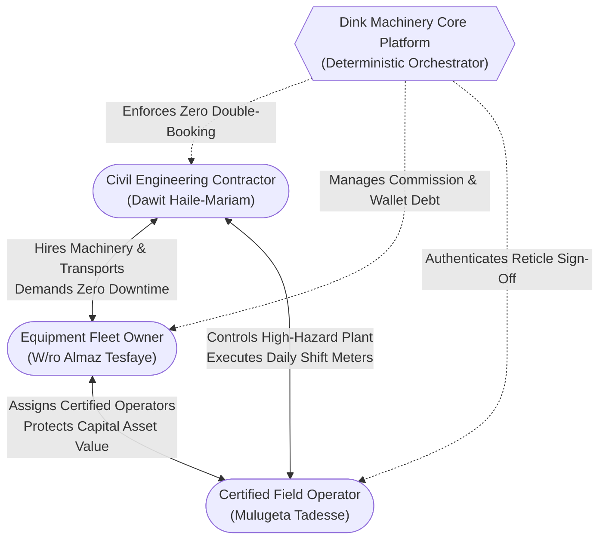
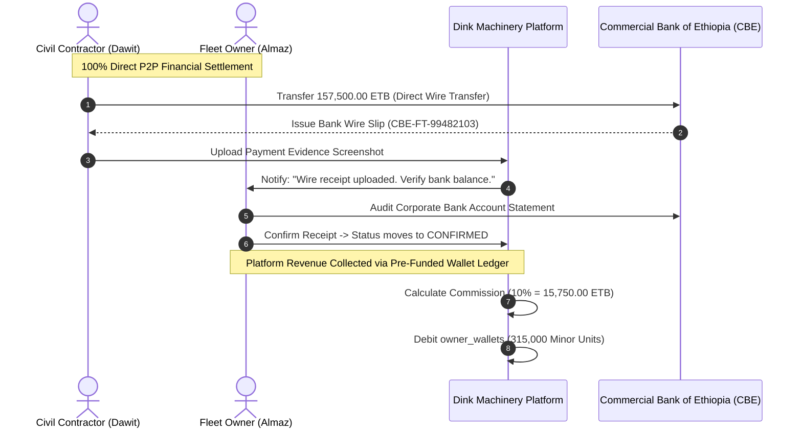
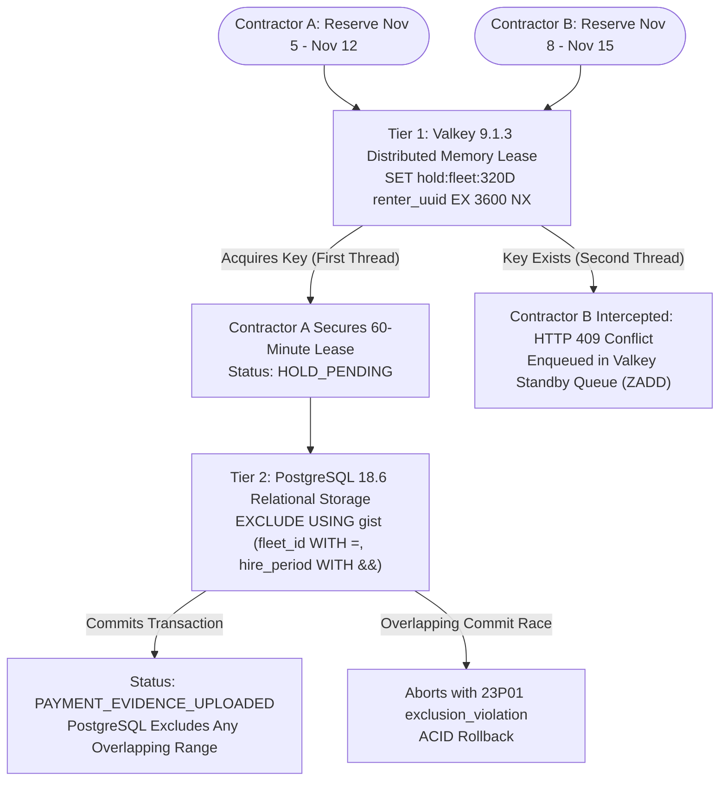
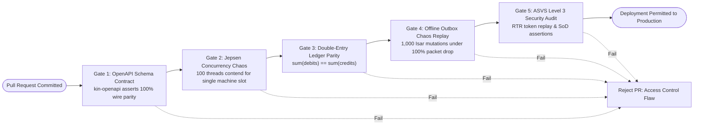

# Heavy Machinery & Logistics Rental Aggregator — Dink Machinery
## Software Requirements Specification — 01. Introduction, Product Scope, User Roles & System Context (`docs/shared/requirements/01-introduction.md`)

**Document Identifier:** `SRS-DINK-CORE-V7.0-SEC-01`  
**Classification:** Canonical System Requirements Specification & Architecture Baseline (Single Source of Truth)  
**Governing Standard:** IEEE Std 830-1998 / IEEE/ISO/IEC 29148:2018 (Systems and Software Engineering — Requirements Engineering)  
**Associated Artifacts:** `SRS-DINK-CORE-V7.0` (Full Suite §1–§14), `FLOW-ENTRY-DINK-CORE-V7.0` through `FLOW-INSURANCE-CLAIM-DINK-CORE-V7.0` (Interaction Flows 01–19), `FLOW-APPENDIX-NOTIF-OFFLINE-DINK-CORE-V7.0`, `FLOW-APPENDIX-AUTH-SEC-DINK-CORE-V7.0`, `ARCH-BACKEND-GO-DINK-CORE-V7.0`, `ARCH-FLUTTER-DINK-CORE-V7.0`, `ARCH-ADMIN-NEXT-DINK-CORE-V7.0`, `ARCH-SEC-DINK-CORE-V7.0`, `DS-DINK-CORE-V7.0`, `DS-PERSONAS-DINK-CORE-V7.0`, `contracts/openapi.yaml`, `ADR-001` through `ADR-010`  
**Target Runtimes:** Go 1.27.3 Backend Monolith, Flutter 3.47.9 / Dart 3.9 (Cross-Platform Mobile), Next.js 16.x (latest CVE security patch) / React 19 (Web Admin & Corporate Portal), PostgreSQL 18.6 + PostGIS 3.6.4, Valkey 9.1.3, ClamAV Daemon (:3310), SeaweedFS S3, Isar NoSQL 3.1+  
**Target Personas:** Civil Engineering Contractor (*Dawit Haile-Mariam* / *Patrick Kariuki*), Fleet Owner & Depot Yard Manager (*W/ro Almaz Tesfaye* / *Kamau Ndegwa*), Certified Field Operator (*Mulugeta Tadesse* / *Juma Omwamba*), Lowboy Transporter (*Ato Girma Wolde* / *Samuel Odhiambo*), Compliance Officer & Security Auditor (*Yohannes Bekele*)  
**Target Operating Markets:** Ethiopia (`ET`) & Kenya (`KE`) — Dynamic Multi-Country Parameterization (`LOC-01-BE`)  
**Compliance Standards:** OWASP ASVS 4.0.3 Level 3 (Identity, Concurrency, Secrets & Access Control), RFC 9457 (Problem Details), RFC 7519 (JWT), RFC 6238 (TOTP), ISO 9241-110, W3C WCAG 2.2 Level AAA (Field Mobile) & Level AA (Admin Web), National Bank of Ethiopia (NBE) Directives, Kenya Data Protection Act 2019  
**Status:** Approved Engineering Baseline

---

## Table of Contents

- 1. [Document Overview & Mandate](#1-document-overview--mandate)
  - 1.1 [Purpose & Scope](#11-purpose--scope)
  - 1.2 [Primary Audience & Stakeholder Responsibilities](#12-primary-audience--stakeholder-responsibilities)
  - 1.3 [Document Conventions & Requirement Numbering](#13-document-conventions--requirement-numbering)
- 2. [Product Vision & Strategic Context](#2-product-vision--strategic-context)
  - 2.1 [Executive Vision Statement](#21-executive-vision-statement)
  - 2.2 [The Heavy Machinery Operational Triad Mental Model](#22-the-heavy-machinery-operational-triad-mental-model)
  - 2.3 [Frontier Market Dynamics & Regional Localization (`ET` & `KE`)](#23-frontier-market-dynamics--regional-localization-et--ke)
- 3. [Phased Release Scope & System Boundaries](#3-phased-release-scope--system-boundaries)
  - 3.1 [Phase 1: Core Marketplace MVP (P2P Contractual Lifecycle)](#31-phase-1-core-marketplace-mvp-p2p-contractual-lifecycle)
  - 3.2 [Phase 2: Corporate Account Hierarchy & Credit Line Engine](#32-phase-2-corporate-account-hierarchy--credit-line-engine)
  - 3.3 [Phase 3: Telematics, Automated Dynamic Pricing & Regional Expansion](#33-phase-3-telematics-automated-dynamic-pricing--regional-expansion)
- 4. [Universal Glossary & Architectural Taxonomy](#4-universal-glossary--architectural-taxonomy)
- 5. [User Roles, Personas & Granular RBAC Matrix](#5-user-roles-personas--granular-rbac-matrix)
  - 5.1 [Primary Actors & Persona Profiles](#51-primary-actors--persona-profiles)
  - 5.2 [Comprehensive Permission Matrix (ASVS Level 3 Access Control)](#52-comprehensive-permission-matrix-asvs-level-3-access-control)
- 6. [Architectural Invariants & Non-Negotiable Engineering Principles](#6-architectural-invariants--non-negotiable-engineering-principles)
  - 6.1 [Non-Custodial Financial Settlement (NBE Directive Compliance)](#61-non-custodial-financial-settlement-nbe-directive-compliance)
  - 6.2 [Zero Double-Booking Guarantee (Two-Tier Locking Hierarchy)](#62-zero-double-booking-guarantee-two-tier-locking-hierarchy)
  - 6.3 [Strict Monotonic Meter Non-Regression](#63-strict-monotonic-meter-non-regression)
  - 6.4 [Server-Driven Metadata & Schema Synthesis](#64-server-driven-metadata--schema-synthesis)
  - 6.5 [Offline-First Local Execution Perimeter (`ADR-010`)](#65-offline-first-local-execution-perimeter-adr-010)
- 7. [Verification Gates & Quality Traceability Matrix](#7-verification-gates--quality-traceability-matrix)

---

## 1. Document Overview & Mandate

### 1.1 Purpose & Scope

This specification constitutes **Section 01 (Introduction, Product Scope, User Roles & System Context)** of the canonical Software Requirements Specification (SRS) for **Dink Machinery Version 7.0**. 

Heavy plant equipment aggregation in East Africa (Ethiopia and Kenya) operates under unique market conditions: high capital value per machine, extreme environmental hazards, cash- or direct-wire-dominated financial systems, and intermittent cellular connectivity in remote construction zones. Dink Machinery bridges this operational gap by replacing informal, high-risk broker networks with a formally verified, deterministic digital platform.

This document establishes:
1. The strategic product mandate, business context, and operational parameters of Dink Machinery.
2. The phased deployment roadmap separating MVP launch requirements from downstream enterprise and telematics capabilities.
3. The platform-wide domain glossary and standardized architectural taxonomy.
4. The user personas and granular Role-Based Access Control (RBAC) permissions matrix enforced across API gateways and domain services.
5. The core architectural invariants governing financial non-custodianship, double-booking prevention, monotonic hour logging, server-driven UI synthesis, and offline-first execution.

### 1.2 Primary Audience & Stakeholder Responsibilities

This specification serves as the baseline technical contract for all cross-functional engineering teams:

| Stakeholder Role | Primary Document Application |
|---|---|
| **Product Managers** | Maintain backlog prioritization, validate scope boundaries, and ensure compliance with operational KPIs. |
| **Backend Engineers (Go)** | Design domain entities, enforce ACID transactional invariants, implement RBAC filters, and satisfy OpenAPI wire contracts. |
| **Mobile Engineers (Flutter)** | Build responsive mobile viewports, implement offline Isar NoSQL caching, manage camera reticles, and execute biometric step-up flows. |
| **Frontend Engineers (Next.js)** | Implement server-driven dynamic admin tables, split-screen dispute lightboxes, and corporate governance portals. |
| **QA & Test Automation Engineers** | Derive end-to-end integration test suites, concurrent load tests, and security boundary assertions. |
| **Compliance & Legal Auditors** | Audit adherence to National Bank of Ethiopia (NBE) non-custodial directives and data protection statutes. |

### 1.3 Document Conventions & Requirement Numbering

* **Requirement Keys:** Requirements are indexed using structured category codes followed by sequential numeric tags:
  - `REG-xxx`: Registration, Authentication & Identity Attestation
  - `FLT-xxx`: Fleet, Attachment & Logistics Specification Configuration
  - `DSC-xxx`: Discovery, Spatial Querying & Equipment Comparison
  - `BKG-xxx`: Booking State Machine & Transaction Lifecycle
  - `FIN-xxx`: Financial Settlement, Commission & Wallet Accounting
  - `ADM-xxx`: Back-Office Administration & Dynamic UI Generation
  - `SEC-xxx`: Security Architecture, Cryptography & Session Integrity
* **Priority Classification:**
  - **`P0` (Mandatory MVP):** Critical operational path; system launch is blocked without verified implementation.
  - **`P1` (Phase 2 Enterprise):** High-value corporate capabilities scheduled for phased deployment.
  - **`P2` (Phase 3 Advanced):** Next-generation IoT telematics, AI pricing, and regional market expansion.
* **Normative Language:** The keywords **MUST**, **MUST NOT**, **REQUIRED**, **SHALL**, **SHALL NOT**, **SHOULD**, **RECOMMENDED**, and **MAY** in this document are to be interpreted as described in RFC 2119 / BCP 14.

---

## 2. Product Vision & Strategic Context

### 2.1 Executive Vision Statement

> *"To establish the definitive, trusted digital marketplace and operating system for heavy construction machinery and specialized logistics across East Africa—maximizing fleet utilization for asset owners, eliminating project downtime for civil contractors, and enforcing absolute transparency, safety, and accountability through deterministic software engineering."*

### 2.2 The Heavy Machinery Operational Triad Mental Model

The platform's operational architecture is shaped by three distinct field personas (`DS-PERSONAS-DINK-CORE-V7.0`):



1. **Dawit Haile-Mariam (Civil Contractor):** Operates on tight project milestones subject to severe liquidated damages ($25,000.00\text{ to }60,000.00\text{ ETB/day}$). Requires transparent pricing, instant verified availability, reliable delivery logistics, and protection against inflated post-rental damage claims.
2. **W/ro Almaz Tesfaye (Fleet Owner):** Manages capital assets valued between $12,000,000.00\text{ and }35,000,000.00\text{ ETB}$ per unit. Requires legally attested condition logs before releasing machines, guaranteed collection of excess shift hours, automated transport coupling, and clear visibility into net earnings.
3. **Mulugeta Tadesse (Certified Operator):** Operates high-hazard machinery under direct equatorial sunlight ($> 85,000\text{ lux}$) inside vibrating cabs. Requires high-contrast mobile reticles ($56 \times 56\text{ dp}$ hit targets), rapid photo burst uploads, and offline verification capabilities when working deep in foundation cuts.

### 2.3 Frontier Market Dynamics & Regional Localization (`ET` & `KE`)

The system architecture incorporates the operational realities of the East African market:

```text
+--------------------------------------------------------------------------------------------------+
| REGIONAL DUAL-MARKET PARAMETERIZATION MATRIX (LOC-01-BE)                                         |
+--------------------------------------------------------------------------------------------------+
| PARAMETER / CAPABILITY          | ETHIOPIA (ET)                      | KENYA (KE)                 |
+---------------------------------+------------------------------------+----------------------------+
| Sovereign Currency Code         | ETB (Ethiopian Birr, Minor: Cents) | KES (Kenyan Shilling)      |
| Telephony Country Calling Code  | +251 (Ethio Telecom, Safaricom ET) | +254 (Safaricom, Airtel)   |
| Primary Commercial Rails        | Bank Wire (CBE, Awash), Telebirr   | M-PESA Paybill, KCB Wire   |
| Regulatory Framework            | NBE Non-Custodial Directives       | Central Bank of Kenya / IRA|
| Supported System Locales        | Amharic (am), Afaan Oromoo (om),   | Swahili (sw), English (en) |
|                                 | English (en)                       |                            |
| Identity Documentation Standard | Kebele ID, Digital Fanous, TIN     | Kenyan National ID, KRA PIN|
| Data Residency Compliance       | ECA Proclamation No. 1321/2024     | Kenya Data Protection 2019 |
+--------------------------------------------------------------------------------------------------+
```

---

## 3. Phased Release Scope & System Boundaries

```mermaid
flowchart LR
    subgraph Phase1["Phase 1: Core Marketplace MVP (P0)"]
        direction TB
        P1_A["Peer-to-Peer Rental Lifecycle"]
        P1_B["P2P Direct Bank Settlements"]
        P1_C["Logistics as First-Class Category"]
        P1_D["Dynamic EAV Specifications"]
        P1_E["Offline Reticle Inspections"]
        P1_F["Dynamic Web Admin Console"]
    end

    subgraph Phase2["Phase 2: Corporate Architecture (P1)"]
        direction TB
        P2_A["Corporate Account Hierarchy"]
        P2_B["Multi-Signatory Quorum Chains"]
        P2_C["Revolving Credit Line (Net-30/60)"]
        P2_D["Automated PO Generation"]
        P2_E["Project Cost Center Tagging"]
    end

    subgraph Phase3["Phase 3: Advanced Intelligence (P2)"]
        direction TB
        P3_A["CAN-Bus IoT Telematics Sync"]
        P3_B["Dynamic Machine-Learned Pricing"]
        P3_C["Operator Open Talent Exchange"]
        P3_D["Direct Gateway In-App Checkout"]
    end

    Phase1 ==> Phase2 ==> Phase3
```



### 3.1 Phase 1: Core Marketplace MVP (P2P Contractual Lifecycle)

The MVP delivery is strictly constrained to core transaction integrity:
* **Registration & Role Binding:** Dual-track renter and owner KYC verification with multi-channel OTP attestation (`FLOW-01` to `FLOW-04`).
* **Fleet Registration & Dynamic EAV:** Metadata-driven equipment specification capture, standalone attachment inventory, and cabin baseline hour meter anchoring (`FLOW-05`).
* **Spatial Discovery:** PostGIS sub-50ms radius and viewport bounding-box search with multi-variable comparative matrices (`FLOW-06`).
* **Deterministic Booking Flow:** Valkey-backed 60-minute exclusive reservation hold leases and PostgreSQL GiST temporal exclusion constraints (`FLOW-07`, `FLOW-16`).
* **Non-Custodial Payment Flow:** Upload of manual bank wire transfer receipts, owner audit verification, and administrative dispute arbitration (`FLOW-08`, `FLOW-13`).
* **Field Handover & Return Auditing:** Dual-party 6-digit challenge PIN handovers, monotonic shift meter reconciliation ($8\text{ hrs/day}$), 24-hour damage claim dockets, and net balance settlements (`FLOW-09`, `FLOW-10`).
* **Integrated Heavy Logistics:** Modeling multi-axle lowboy trailers as a first-class fleet category (`ParentBookingID`), automated volumetric/tonnage compatibility matching, and reverse failure cascades (`FLOW-11`, `FLOW-18`).
* **Monetization Engine:** Pre-funded owner wallet ledger tracking, automated commission debits upon confirmation, manual wire top-ups, and delinquency inventory suspensions (`FLOW-12`).
* **Comprehensive Plant All-Risks Insurance:** Statutory 48-hour incident reporting, immediate PostGIS fleet de-listing (`INSURANCE_HOLD`), police docket ingestion, and loss adjuster re-certification (`FLOW-19`).

### 3.2 Phase 2: Corporate Account Hierarchy & Credit Line Engine

Phase 2 introduces organizational governance for tier-1 civil engineering contractors and joint ventures (`FLOW-14`):
* Corporate entity onboarding with audited financial balance sheet underwriting.
* Member delegation of authority (Requester, Approver, Corporate Admin).
* Algebraic approval quorum rule engines (All-Must-Approve, $N$-of-$M$, Executive Veto).
* Revolving credit line drawdowns (`Net-30` or `Net-60`), consolidated monthly enterprise billing, and formal Purchase Order (PO) document generation.

### 3.3 Phase 3: Advanced Intelligence & Regional Scaling

Phase 3 transitions the platform into an automated operational network:
* **CAN-Bus IoT Telematics:** Automated, direct ingestion of engine telemetry (hours, fuel consumption, diagnostic trouble codes) via hardware dongles, bypassing manual meter reticle verification.
* **Algorithmic Dynamic Pricing:** Machine learning models forecasting supply-demand density by machine class, seasonal monsoon earthmoving trends, and regional fuel indexes.
* **Open Operator Marketplace:** An independent marketplace allowing verified certified operators to bid directly on temporary site contracts.

---

## 4. Universal Glossary & Architectural Taxonomy

```text
+--------------------------------------------------------------------------------------------------+
| DINK MACHINERY UNIVERSAL DOMAIN GLOSSARY                                                         |
+--------------------------------------------------------------------------------------------------+
| TERM                            | FORMAL ARCHITECTURAL DEFINITION                                |
+---------------------------------+----------------------------------------------------------------+
| Active Rental HUD               | High-contrast persistent operational view displaying elapsed   |
|                                 | shift hours, machine telemetry, and emergency action buttons.  |
| Attachment                      | Non-self-propelled implement (hydraulic hammer, auger, bucket) |
|                                 | rentable standalone or bundled with a host machine.            |
| Baseline Hour Meter             | Certified mechanical engine hour reading recorded at initial   |
|                                 | fleet onboarding; forms the floor for all future rentals.      |
| Booking                         | A legally binding contractual reservation for an asset over a  |
|                                 | discrete date range [start_date, end_date).                    |
| Cancellation Penalty            | Contractual fee levied against a party that cancels after a    |
|                                 | booking has reached confirmed status.                          |
| Commission Ledger               | Double-entry ledger tracking platform service revenue due from |
|                                 | equipment fleet owners upon booking confirmation.              |
| Dual Handover Protocol          | Synchronized physical inspection process requiring matching    |
|                                 | photographic evidence and a 6-digit challenge PIN.             |
| Dynamic EAV Engine              | Entity-Attribute-Value architecture allowing admin definition   |
|                                 | of machine technical specifications without code changes.      |
| Fleet                           | Any rentable equipment asset—whether heavy plant machinery or   |
|                                 | a multi-axle lowboy logistics transport trailer.               |
| GiST Temporal Exclusion         | PostgreSQL storage-layer constraint preventing overlapping     |
|                                 | daterange reservations on the same asset.                      |
| Idempotency Key                 | Unique client-generated UUID v4 header preventing duplicate    |
|                                 | mutation executions caused by mobile network retries.          |
| In-App Notification Center      | Localized repository storing user notifications with real-time |
|                                 | WebSocket/SSE synchronization and unread counters.             |
| Isar NoSQL                      | High-performance embedded client database providing offline-   |
|                                 | first storage on Flutter mobile devices.                       |
| Logistics Sub-Booking           | Child booking linking a lowboy trailer to a parent machine     |
|                                 | booking via ParentBookingID.                                   |
| Loss Adjuster                   | Independent licensed engineer inspecting catastrophic damage   |
|                                 | and issuing statutory repair re-certification certificates.    |
| Monotonic Non-Regression        | Mathematical invariant asserting that equipment hour meters    |
|                                 | can never decrease across successive operations.               |
| Optimistic Concurrency (OCC)   | Concurrency pattern utilizing entity version tokens and HTTP   |
|                                 | If-Match headers to intercept conflicting state changes.       |
| Payment Evidence                | User-uploaded screenshot or digital photo of a commercial bank |
|                                 | transfer receipt or mobile money transaction slip.             |
| Problem Details (RFC 9457)      | Standardized JSON structure for machine-readable HTTP error    |
|                                 | payloads across all client-server communications.              |
| Reverse Cascade                 | Automatic operational freeze and cancellation protocol applied |
|                                 | to a parent booking when its transport trailer fails.          |
| Standby Queue                   | Valkey-backed sorted set holding contractors in line for an    |
|                                 | asset pending expiration of an active reservation hold.        |
| Valkey Distributed Lease        | In-memory key-value lock granting an exclusive 60-minute       |
|                                 | reservation window for bank transfer execution.                |
+--------------------------------------------------------------------------------------------------+
```

---

## 5. User Roles, Personas & Granular RBAC Matrix

### 5.1 Primary Actors & Persona Profiles

Dink Machinery enforces strict role boundaries across five primary user classifications:
1. **Renter (Individual / Small Builder):** Discovers equipment, reserves slots, transfers bank prepayments, signs handover reticles, and reviews equipment owners.
2. **Fleet Owner & Yard Manager:** Registers heavy plant and trailers, sets rental pricing, assigns team operators, confirms wire receipts, and collects payouts.
3. **Certified Field Operator:** Operates machinery on site, logs daily engine hours, records breakdowns, and executes handover inspections.
4. **Logistics Transport Carrier:** Operates multi-axle lowboys, confirms transport sub-bookings, updates transit milestones, and executes transshipments.
5. **Platform Staff (Compliance, Auditor, Super Admin):** Verifies KYC dossiers, arbitrates payment and damage disputes, manages dynamic categories, and audits platform finances.

---

### 5.2 Comprehensive Permission Matrix (ASVS Level 3 Access Control)

```text
+--------------------------------------------------------------------------------------------------+
| DINK MACHINERY ROLE-BASED ACCESS CONTROL (RBAC) MASTER MATRIX                                    |
+--------------------------------------------------------------------------------------------------+
| PERMISSION IDENTIFIER              | RENTER | OWNER | OPERATOR | CARRIER | COMPLIANCE | SUPER ADMIN|
+------------------------------------+:------:+:-----:+:--------:+:-------:+:----------:+:----------:+
| auth.session.create                |   ✅   |   ✅  |    ✅    |    ✅   |     ✅     |     ✅     |
| profile.personal.update            |   ✅   |   ✅  |    ✅    |    ✅   |     ✅     |     ✅     |
| fleet.listing.search               |   ✅   |   ✅  |    ✅    |    ✅   |     ✅     |     ✅     |
| fleet.asset.create                 |   ❌   |   ✅  |    ❌    |    ✅   |     ❌     |     ✅     |
| fleet.asset.update_pricing         |   ❌   |   ✅  |    ❌    |    ✅   |     ❌     |     ✅     |
| fleet.asset.deactivate             |   ❌   |   ✅  |    ❌    |    ✅   |     ✅     |     ✅     |
| fleet.operator.assign              |   ❌   |   ✅  |    ❌    |    ❌   |     ❌     |     ✅     |
| booking.reservation.hold           |   ✅   |   ❌  |    ❌    |    ❌   |     ❌     |     ✅     |
| booking.payment.upload_evidence    |   ✅   |   ❌  |    ❌    |    ❌   |     ❌     |     ✅     |
| booking.payment.verify_receipt     |   ❌   |   ✅  |    ❌    |    ✅   |     ✅     |     ✅     |
| booking.cancellation.execute       |   ✅   |   ✅  |    ❌    |    ✅   |     ✅     |     ✅     |
| booking.handover.inspect           |   ✅   |   ✅  |    ✅    |    ❌   |     ❌     |     ✅     |
| booking.handover.sign_pin          |   ✅   |   ❌  |    ✅    |    ❌   |     ❌     |     ✅     |
| booking.incident.report            |   ✅   |   ✅  |    ✅    |    ✅   |     ❌     |     ✅     |
| booking.damage.lodge_claim         |   ❌   |   ✅  |    ❌    |    ✅   |     ❌     |     ✅     |
| booking.rating.submit              |   ✅   |   ✅  |    ❌    |    ✅   |     ❌     |     ✅     |
| logistics.subbooking.create        |   ❌   |   ✅  |    ❌    |    ❌   |     ❌     |     ✅     |
| logistics.transit.update_telemetry |   ❌   |   ❌  |    ❌    |    ✅   |     ❌     |     ✅     |
| finance.wallet.view               |   ❌   |   ✅  |    ❌    |    ✅   |     ✅     |     ✅     |
| finance.wallet.settle_debt         |   ❌   |   ✅  |    ❌    |    ✅   |     ❌     |     ✅     |
| admin.kyc.approve                  |   ❌   |   ❌  |    ❌    |    ❌   |     ✅     |     ✅     |
| admin.dispute.arbitrate            |   ❌   |   ❌  |    ❌    |    ❌   |     ✅     |     ✅     |
| admin.finance.audit_topup          |   ❌   |   ❌  |    ❌    |    ❌   |     ✅     |     ✅     |
| admin.taxonomy.manage_eav          |   ❌   |   ❌  |    ❌    |    ❌   |     ❌     |     ✅     |
| admin.rbac.manage_permissions      |   ❌   |   ❌  |    ❌    |    ❌   |     ❌     |     ✅     |
| system.audit_logs.view             |   ❌   |   ❌  |    ❌    |    ❌   |     ✅     |     ✅     |
+--------------------------------------------------------------------------------------------------+
```

---

## 6. Architectural Invariants & Non-Negotiable Engineering Principles

### 6.1 Non-Custodial Financial Settlement (NBE Directive Compliance)



1. **Zero Custodial Escrow:** Dink Machinery never holds, pools, or intermediates gross equipment rental capital. All rental fees settle directly between commercial bank accounts.
2. **Pre-Funded Wallet Debt Accounting:** Platform service commission is tracked through an automated ledger debited upon booking confirmation (`FLOW-12`).
3. **Delinquency Lockouts:** Owners who carry an overdue negative wallet balance past $30\text{ days}$ are automatically excluded from the public PostGIS discovery index.

---

### 6.2 Zero Double-Booking Guarantee (Two-Tier Locking Hierarchy)



* **Valkey 60-Minute Lease:** Provides sub-millisecond feedback on high-concurrency contention while contractors travel to bank branches or initiate online banking transfers.
* **PostgreSQL GiST Range Exclusion:** Mathematically guarantees zero overlapping date ranges at the physical disk storage layer.

---

### 6.3 Strict Monotonic Meter Non-Regression

To prevent fraudulent meter rollbacks and billing disputes, all engine hour meter logs enforce:

$$\text{Baseline Meter (Registration)} \le \text{Handover Meter (Check-In)} \le \text{Return Meter (Check-Out)}$$

* **Camera Reticle Validation:** Photos must be captured through the live application reticle. Device accelerometer drift must verify $< 0.05g$ variance during shutter actuation.
* **Automated Regression Trapping:** Any input violating this inequality aborts the transaction immediately with **RFC 9457 HTTP 422 Unprocessable Entity** (`ERR_METER_READING_REGRESSION`).

---

### 6.4 Server-Driven Metadata & Schema Synthesis

To prevent technical debt and eliminate app store update delays:
* **EAV Specification Models:** Machinery technical specifications are defined in PostgreSQL (`Category` $\rightarrow$ `SpecFieldGroup` $\rightarrow$ `SpecFieldDefinition`). The Flutter app dynamically compiles form controls, validation rules, and unit labels from API schemas.
* **Dynamic Web Admin Console:** The Next.js 16 Web Admin Console compiles table columns, action buttons, filter bars, and split-screen diff viewers directly from server metadata (`AdminPage`, `AdminTableConfig`, `AdminAction`).
* **Dynamic Notification Templates:** Message payloads across Amharic, Afaan Oromoo, Swahili, and English are synthesized dynamically from `NotificationTemplate` using Mustache token interpolation.

---

### 6.5 Offline-First Local Execution Perimeter (`ADR-010`)

* **Isar NoSQL Embedded Storage:** Field operations (reticle walkarounds, check-in inspections, mechanical breakdown logs, check-out return meters) execute locally with zero cellular connectivity.
* **Peer-to-Peer QR Handshake:** Field handovers between contractor and operator execute via cryptographically signed dynamic QR codes (HMAC-SHA256).
* **Security & Financial Perimeter:** Credential changes, phone migrations, bank coordinate updates, and corporate credit line drawdowns are **strictly prohibited offline** and mandate a continuous, live, authenticated cloud connection.

---

## 7. Verification Gates & Quality Traceability Matrix

Every pull request against the Dink Machinery platform must clear five automated quality verification gates before deployment to staging or production:



1. **OpenAPI Schema Contract Gate (`kin-openapi`):** Validates all client DTOs, Go HTTP controllers, and error structures against `contracts/openapi.yaml`.
2. **Jepsen-Style Concurrency Chaos Benchmark (`FLOW-16`):** Asserts that under 100 concurrent reservation requests, exactly 1 thread wins the lease and 99 receive clean HTTP 409 Conflict responses.
3. **Double-Entry Financial Ledger Parity Gate (`FLOW-10`, `FLOW-12`):** Validates mathematical parity ($\sum \text{Debit Minor} = \sum \text{Credit Minor}$) across all operational permutations.
4. **Offline Outbox Replay & QR Handshake Gate (`FLOW-APPENDIX-A`):** Asserts $100\%$ data reconciliation from local Isar NoSQL outbox queues following network restoration.
5. **ASVS Security & RTR Token Replay Gate (`FLOW-APPENDIX-B`):** Asserts immediate revocation of entire token families upon refresh token replay detection.

---

*This document establishes the canonical introduction, operational vision, user roles, system scope, and core architectural invariants for the Dink Machinery Version 7.0 requirements baseline. All downstream functional specifications (`02` through `14`), technical architecture documents, and codebase implementations must strictly conform to this master specification.*