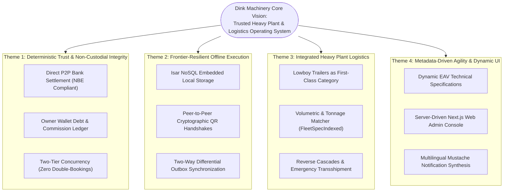
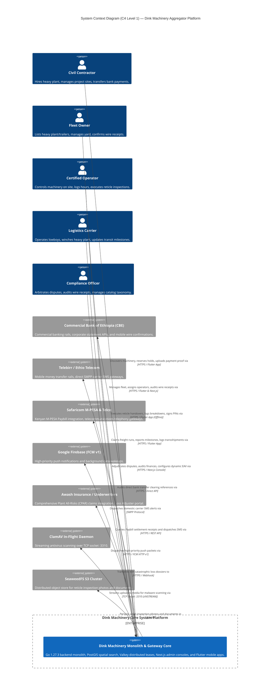

# Heavy Machinery & Logistics Rental Aggregator — Dink Machinery
## Software Requirements Specification — 03. Product Vision, Strategic Themes, Target Personas & High-Level System Context (`docs/shared/requirements/03-product-vision.md`)

**Document Identifier:** `SRS-DINK-CORE-V7.0-SEC-03`  
**Classification:** Canonical System Requirements Specification & Strategic Product Baseline (Single Source of Truth)  
**Governing Standard:** IEEE Std 830-1998 / IEEE/ISO/IEC 29148:2018 (Systems and Software Engineering — Requirements Engineering)  
**Associated Artifacts:** `SRS-DINK-CORE-V7.0` (Full Suite §1–§14), `FLOW-ENTRY-DINK-CORE-V7.0` through `FLOW-INSURANCE-CLAIM-DINK-CORE-V7.0` (Interaction Flows 01–19), `FLOW-APPENDIX-NOTIF-OFFLINE-DINK-CORE-V7.0`, `FLOW-APPENDIX-AUTH-SEC-DINK-CORE-V7.0`, `ARCH-BACKEND-GO-DINK-CORE-V7.0`, `ARCH-FLUTTER-DINK-CORE-V7.0`, `ARCH-ADMIN-NEXT-DINK-CORE-V7.0`, `ARCH-SEC-DINK-CORE-V7.0`, `DS-DINK-CORE-V7.0`, `DS-PERSONAS-DINK-CORE-V7.0`, `contracts/openapi.yaml`, `ADR-001` through `ADR-010`  
**Target Runtimes:** Go 1.27.3 Backend Monolith, Flutter 3.47.8 / Dart 3.9 (Cross-Platform Mobile), Next.js 16.x (latest CVE security patch) / React 19 (Web Admin & Corporate Portal), PostgreSQL 18.6 + PostGIS 3.6.4, Valkey 9.1.3, ClamAV Daemon (:3310), SeaweedFS S3, Isar NoSQL 3.1+  
**Target Personas:** Civil Engineering Contractor (*Dawit Haile-Mariam* / *Patrick Kariuki*), Fleet Owner & Depot Yard Manager (*W/ro Almaz Tesfaye* / *Kamau Ndegwa*), Certified Field Operator (*Mulugeta Tadesse* / *Juma Omwamba*), Lowboy Transporter (*Ato Girma Wolde* / *Samuel Odhiambo*), Compliance Officer & Security Auditor (*Yohannes Bekele*)  
**Target Operating Markets:** Ethiopia (`ET`) & Kenya (`KE`) — Dynamic Multi-Country Parameterization (`LOC-01-BE`)  
**Compliance Standards:** OWASP ASVS 4.0.3 Level 3 (Identity, Concurrency, Secrets & Access Control), RFC 9457 (Problem Details), RFC 7519 (JWT), RFC 6238 (TOTP), ISO 9241-110, W3C WCAG 2.2 Level AAA (Field Mobile) & Level AA (Admin Web), National Bank of Ethiopia (NBE) Directives, Kenya Data Protection Act 2019  
**Status:** Approved Engineering Baseline

---

## Table of Contents

- 1. [Executive Vision & Strategic Rationale](#1-executive-vision--strategic-rationale)
  - 1.1 [The Core Problem Statement (The Broken Brokerage Landscape)](#11-the-core-problem-statement-the-broken-brokerage-landscape)
  - 1.2 [Product Vision Statement](#12-product-vision-statement)
  - 1.3 [Strategic Value Propositions by Marketplace Participant](#13-strategic-value-propositions-by-marketplace-participant)
- 2. [Strategic Architectural Themes](#2-strategic-architectural-themes)
  - 2.1 [Theme 1: Deterministic Trust & Non-Custodial Financial Integrity](#21-theme-1-deterministic-trust--non-custodial-financial-integrity)
  - 2.2 [Theme 2: Frontier-Resilient Offline Execution Perimeter (`ADR-010`)](#22-theme-2-frontier-resilient-offline-execution-perimeter-adr-010)
  - 2.3 [Theme 3: Integrated Heavy Logistics as an Atomic Operational Pair](#23-theme-3-integrated-heavy-logistics-as-an-atomic-operational-pair)
  - 2.4 [Theme 4: Metadata-Driven Agility & Dynamic UI Synthesis](#24-theme-4-metadata-driven-agility--dynamic-ui-synthesis)
- 3. [Canonical User Personas & Mental Models](#3-canonical-user-personas--mental-models)
  - 3.1 [Primary Persona 1: Dawit Haile-Mariam (Civil Engineering Contractor)](#31-primary-persona-1-dawit-haile-mariam-civil-engineering-contractor)
  - 3.2 [Primary Persona 2: W/ro Almaz Tesfaye (Fleet Owner & Depot Yard Manager)](#32-primary-persona-2-wro-almaz-tesfaye-fleet-owner--depot-yard-manager)
  - 3.3 [Primary Persona 3: Mulugeta Tadesse (Certified Field Operator)](#33-primary-persona-3-mulugeta-tadesse-certified-field-operator)
  - 3.4 [Primary Persona 4: Ato Girma Wolde (Lowboy Logistics Fleet Provider)](#34-primary-persona-4-ato-girma-wolde-lowboy-logistics-fleet-provider)
  - 3.5 [Primary Persona 5: Yohannes Bekele (Compliance Officer & Arbitrator)](#35-primary-persona-5-yohannes-bekele-compliance-officer--arbitrator)
- 4. [High-Level System Context & External Boundary Interfaces](#4-high-level-system-context--external-boundary-interfaces)
  - 4.1 [C4 System Context Diagram (Level 1)](#41-c4-system-context-diagram-level-1)
  - 4.2 [External Enterprise & Sovereign Interfaces](#42-external-enterprise--sovereign-interfaces)
- 5. [Success Metrics, Operational KPIs & Engineering Targets](#5-success-metrics-operational-kpis--engineering-targets)
  - 5.1 [Business & Marketplace Liquidity Metrics](#51-business--marketplace-liquidity-metrics)
  - 5.2 [Platform Technical & Performance Latency SLOs](#52-platform-technical--performance-latency-slos)
- 6. [Requirements Traceability Matrix (Vision to Flow Mapping)](#6-requirements-traceability-matrix-vision-to-flow-mapping)

---

## 1. Executive Vision & Strategic Rationale

### 1.1 The Core Problem Statement (The Broken Brokerage Landscape)

The heavy civil construction, infrastructure, and mining sectors across East Africa represent billions of dollars in annual capital expenditure. Yet, the acquisition and mobilization of critical plant assets—such as 20-to-40 ton crawler excavators, track-type bulldozers, motor graders, wheel loaders, and lowboy trailers—remains bound to an informal, fragmented, and adversarial broker network (*"delalas"*):

```text
+--------------------------------------------------------------------------------------------------+
| THE ADVERSARIAL BROKER NETWORK VS. THE DINK MACHINERY PARADIGM                                  |
+--------------------------------------------------------------------------------------------------+
| TRADITIONAL INFORMAL BROKERAGE                  | DINK MACHINERY VERSION 7.0 ARCHITECTURE        |
+-------------------------------------------------+------------------------------------------------+
| Opaque, variable broker margins (15% to 35%)    | Transparent, fixed commission structure (10%   |
| inflated arbitrarily based on contractor urgency| machinery, 2.5% pass-through freight).         |
+-------------------------------------------------+------------------------------------------------+
| Zero verified mechanical availability; brokers  | Sub-second PostGIS 3.6.4 spatial discovery with  |
| "shop" unavailable or broken equipment.         | real-time Valkey calendar availability locks.  |
+-------------------------------------------------+------------------------------------------------+
| Disconnected logistics; contractor discovers    | Heavy lowboy trailers modeled as an atomic     |
| excavator cannot move on asphalt after hiring.  | sub-booking pair (ParentBookingID coupling).   |
+-------------------------------------------------+------------------------------------------------+
| Verbal, undocumented handovers leading to       | Accelerometer-stabilized reticle inspections   |
| endless post-rental disputes over hour meters.  | with dual-party challenge PIN sign-offs.       |
+-------------------------------------------------+------------------------------------------------+
| High risk of financial wire fraud, bad-faith    | Immutable P2P bank wire auditing, double-entry |
| payment denials, and unreturned prepayments.    | revenue ledgers, and compliance arbitration.   |
+-------------------------------------------------+------------------------------------------------+
```

When an excavator breaks down or a lowboy transporter fails to show up, construction projects face liquidated damages exceeding $25,000.00\text{ to }60,000.00\text{ ETB/day}$ ($200\text{ to }500\text{ USD/day}$), while equipment owners experience chronic asset underutilization ($< 45\%\text{ annual fleet uptime}$).

### 1.2 Product Vision Statement

> *"Dink Machinery establishes the definitive, trusted digital marketplace and operating system for heavy construction machinery and specialized logistics across East Africa—maximizing fleet utilization for asset owners, eliminating project downtime for civil contractors, and enforcing absolute transparency, safety, and accountability through deterministic software engineering."*

### 1.3 Strategic Value Propositions by Marketplace Participant

* **For Civil Contractors:** Guaranteed machine availability within a $50\text{ km}$ radius, fixed upfront pricing without unverified broker markups, transparent shift hour allowances ($8.0\text{ hrs/day}$), integrated lowboy delivery to the job site, and standardized dispute resolution.
* **For Equipment Fleet Owners:** Unprecedented market reach to commercial contractors across Ethiopia and Kenya, guaranteed collection of excess shift operating hours, pre-screened certified operators, automated logistics coupling, and legally binding photographic pre-rental handover records protecting asset capital.
* **For Logistics Providers:** High-yield heavy haulage contracts paired directly to confirmed equipment hires without administrative negotiation, clear dimensional parameters for bridge clearances, and reverse cascade protections that compensate for dead-head mobilization runs.
* **For Certified Operators:** Digital verification of heavy machinery certifications, safe operating envelopes, transparent daily shift meter tracking, and direct integration into tier-1 enterprise project sites.

---

## 2. Strategic Architectural Themes



### 2.1 Theme 1: Deterministic Trust & Non-Custodial Financial Integrity

Under the regulatory directives of the National Bank of Ethiopia (NBE) and the Central Bank of Kenya (CBK), non-banking digital aggregators are prohibited from acting as custodial escrow accounts for large commercial transactions. 

Dink Machinery embraces this constraint as an architectural strength:
* **100% Peer-to-Peer Wire Settlements:** Capital movements (e.g., $157,500.00\text{ ETB}$ prepayments or final reconciliations) flow directly between the contractor’s and owner’s corporate bank accounts (`FLOW-08`).
* **Pre-Funded Wallet Debt Accounting:** Platform service revenue is collected via a virtual double-entry ledger (`owner_wallets`). The platform calculates commission upon confirmation and debits the owner's wallet balance (`FLOW-12`).
* **Two-Tier Concurrency Control:** In-memory distributed leases in Valkey 9.1.3 combined with PostgreSQL 18.6 GiST temporal range exclusion constraints mathematically guarantee zero double-bookings (`FLOW-16`).

### 2.2 Theme 2: Frontier-Resilient Offline Execution Perimeter (`ADR-010`)

Heavy civil construction unfolds in deep river culverts, foundation excavations, and remote quarries with zero cellular data coverage. The platform mandates that physical field operations execute with **zero network latency**:
* **Isar NoSQL Persistence:** Handover reticle inspections, daily shift meter logs, mechanical breakdown notices, and return walkarounds commit immediately to local embedded storage (`FLOW-APPENDIX-A`).
* **Peer-to-Peer Cryptographic QR Handshake:** Disconnected devices authenticate physical plant handovers by scanning dynamic HMAC-SHA256 QR codes.
* **Strict Security Perimeter:** High-value mutations—such as phone number changes (`FLOW-15`), bank coordinate modifications, and corporate credit line drawdowns (`FLOW-14`)—are strictly blocked from offline execution, requiring live server connections.

### 2.3 Theme 3: Integrated Heavy Logistics as an Atomic Operational Pair

Steel-tracked excavators, heavy bulldozers, and asphalt pavers destroy paved asphalt roads and travel at speeds $< 5\text{ km/h}$. They cannot travel to construction sites under their own power (`self_move_capable = false`).

Dink Machinery rejects treating logistics as a disconnected side-module:
* **Logistics as a First-Class Category:** Multi-axle lowboy trailers, prime movers, and flatbeds are ingested via standard fleet registration (`FLOW-05`, `FLOW-11`).
* **Sub-Booking Graph Architecture:** Every transport booking is bound to the parent equipment hire via `ParentBookingID`.
* **Reverse Failure Cascades:** If a lowboy carrier cancels or breaks down mid-transit, the system freezes parent equipment readiness (`AWAITING_FLEET_READINESS`), executes automated spatial transshipment matching ($50\text{ km}$ radius), or executes an orderly reverse cancellation that exonerates the owner and refunds the contractor in full (`FLOW-18`).

### 2.4 Theme 4: Metadata-Driven Agility & Dynamic UI Synthesis

To eliminate mobile app deployment cycles and accommodate hundreds of diverse machinery classifications:
* **Dynamic EAV Specifications:** New equipment categories and engineering attributes (e.g., *Bucket Breakout Force*, *Boom Length*, *Axle Count*) are defined in PostgreSQL and compiled dynamically into mobile forms (`FLOW-05`).
* **Server-Driven Admin Consoles:** The Next.js 16 Web Admin Console compiles table columns, action buttons, and split-screen diff viewers from database schemas (`AdminPage`, `AdminTableConfig`, `AdminAction`), bound to granular RBAC roles (`FLOW-13`).
* **Dynamic Notification Synthesis:** Messages across Amharic, Afaan Oromoo, Swahili, and English are synthesized dynamically from `NotificationTemplate` records using Mustache token interpolation (`FLOW-17`).

---

## 3. Canonical User Personas & Mental Models

### 3.1 Primary Persona 1: Dawit Haile-Mariam (Civil Engineering Contractor)

```text
+--------------------------------------------------------------------------------------------------+
| PERSONA DOSSIER: DAWIT HAILE-MARIAM                                                              |
+--------------------------------------------------------------------------------------------------+
| Role & Title     : Managing Director & Senior Site Project Manager                                |
| Enterprise Entity: Haile-Mariam Construction General Contractors (MUDCo GC-1 License)             |
| Operating Base   : Addis Ababa, Ethiopia (Active Project: Mojo-Meki Highway Expansion Site B)     |
| Demographics     : Age 46 | BSc Civil Engineering (AAU) | 22 Years Construction Experience       |
| Hardware Profile : Samsung Galaxy S24 Ultra (Android 16) | iPad Pro 13" (Field Cabin Layouts)     |
+--------------------------------------------------------------------------------------------------+
| GOALS & OPERATIONAL IMPERATIVES:                                                                 |
| 1. Source verified, high-tonnage earthmoving machinery within 48 hours of site schedule demands. |
| 2. Eliminate project stoppage penalties by ensuring equipment arrives on site on time.           |
| 3. Prevent fraudulent hour meter billing and unjustified post-rental damage claims.              |
| 4. Maintain consolidated corporate project cost-center accounting across multiple sites.         |
+--------------------------------------------------------------------------------------------------+
| PAIN POINTS & MARKET FRICTIONS:                                                                  |
| * Unscrupulous informal brokers charging unverified 25% markups on third-party equipment.        |
| * Machinery arriving on site with leaking hydraulic cylinders or cracked track pads.             |
| * Disconnected transport: Excavator booked, but no lowboy trailer available for 4 days.          |
| * Lengthy post-rental disputes over preexisting scratches and broken bucket teeth.               |
+--------------------------------------------------------------------------------------------------+
```

### 3.2 Primary Persona 2: W/ro Almaz Tesfaye (Fleet Owner & Depot Yard Manager)

```text
+--------------------------------------------------------------------------------------------------+
| PERSONA DOSSIER: W/RO ALMAZ TESFAYE                                                              |
+--------------------------------------------------------------------------------------------------+
| Role & Title     : Managing Partner & Fleet Depot Director                                       |
| Enterprise Entity: Tesfaye Heavy Transport & Machinery Rental PLC (18 Capital Plant Assets)       |
| Operating Base   : Kality Industrial Depot Yard, Addis Ababa, Ethiopia                           |
| Demographics     : Age 52 | BA Accounting | 16 Years Heavy Plant Yard Operations                 |
| Hardware Profile : iPhone 16 Pro Max (iOS 19) | Dell XPS 15 (Windows 11, Web Admin Console)      |
+--------------------------------------------------------------------------------------------------+
| GOALS & OPERATIONAL IMPERATIVES:                                                                 |
| 1. Maximize capital asset utilization rate (targeting > 75% billable days per year).             |
| 2. Protect capital investment ($15M+ ETB per excavator) through legally binding condition logs.   |
| 3. Ensure guaranteed collection of excess shift operating hours and rapid P2P wire settlements. |
| 4. Monitor pre-funded platform commission balances and maintain an active listing standing.      |
+--------------------------------------------------------------------------------------------------+
| PAIN POINTS & MARKET FRICTIONS:                                                                  |
| * Contractors abusing equipment on site (over-revving engines, exceeding shift hours).           |
| * Cash-flow delays from contractors withholding final balance payments after machine demobilization.|
| * Lowboy transport providers failing to show up at the yard, causing booking cancellations.      |
| * Complicated, untrusted third-party escrow systems that delay direct access to rental capital.  |
+--------------------------------------------------------------------------------------------------+
```

### 3.3 Primary Persona 3: Mulugeta Tadesse (Certified Field Operator)

```text
+--------------------------------------------------------------------------------------------------+
| PERSONA DOSSIER: MULUGETA TADESSE                                                                |
+--------------------------------------------------------------------------------------------------+
| Role & Title     : Senior Certified Heavy Plant Operator (Hydraulic Crawler Excavators)          |
| Operating Scope  : Assigned to Almaz Tesfaye’s Caterpillar 320D Roster                           |
| Operating Base   : Field Mobile (Currently stationed on site at Mojo Highway Culvert 09)         |
| Demographics     : Age 38 | Technical Vocational Certificate (Machinery Operation) | 14 Yrs Exp  |
| Hardware Profile : Tecno Camon 30 Premier (Android 15) | Thick Leather Safety Gloves User        |
+--------------------------------------------------------------------------------------------------+
| GOALS & OPERATIONAL IMPERATIVES:                                                                 |
| 1. Maintain a verified digital operator profile with unblemished safety and machine uptime badge.|
| 2. Execute rapid pre-rental and post-rental physical reticle inspections without manual paperwork.|
| 3. Accurately log mechanical breakdowns to immediately pause billable shift hours.               |
| 4. Operate mobile interface under extreme solar glare (> 85,000 lux) and severe cab vibrations.  |
+--------------------------------------------------------------------------------------------------+
| PAIN POINTS & MARKET FRICTIONS:                                                                  |
| * Mobile application buttons too small to tap while wearing heavy split-leather work gloves.     |
| * App crashing or losing data when operating deep in foundation trenches with zero 4G signal.    |
| * Being blamed for preexisting mechanical defects or hydraulic leaks originated by prior operators.|
+--------------------------------------------------------------------------------------------------+
```

### 3.4 Primary Persona 4: Ato Girma Wolde (Lowboy Logistics Fleet Provider)

```text
+--------------------------------------------------------------------------------------------------+
| PERSONA DOSSIER: ATO GIRMA WOLDE                                                                 |
+--------------------------------------------------------------------------------------------------+
| Role & Title     : Operations Director & Prime Mover Fleet Master                                |
| Enterprise Entity: Girma Heavy Haulage PLC (Six 40-Ton Tri-Axle Lowboys & Step-Deck Trailers)    |
| Operating Base   : Akaki Logistics Industrial Hub, Addis Ababa, Ethiopia                         |
| Demographics     : Age 49 | Diploma in Automotive Engineering | 20 Years Heavy Freight Operations |
| Hardware Profile : Samsung Galaxy A55 (Android 15) | Desktop Web Chrome (Depot Dispatch)         |
+--------------------------------------------------------------------------------------------------+
| GOALS & OPERATIONAL IMPERATIVES:                                                                 |
| 1. Secure steady, guaranteed round-trip machinery mobilization runs with clear dimensional data. |
| 2. Eliminate dead-head transit by pairing delivery drops with return yard demobilizations.       |
| 3. Protect business solvency through fair freight default penalty restitution.                   |
| 4. Rapidly coordinate emergency roadside transshipments when a prime mover suffers mechanical loss.|
+--------------------------------------------------------------------------------------------------+
| PAIN POINTS & MARKET FRICTIONS:                                                                  |
| * Arriving at an equipment yard only to discover the excavator exceeds trailer width or tonnage. |
| * Traffic police weighbridge holds caused by improper boom positioning on trailer beds.          |
| * Excessive platform commission rates that eat up thin freight fuel margins.                     |
+--------------------------------------------------------------------------------------------------+
```

### 3.5 Primary Persona 5: Yohannes Bekele (Compliance Officer & Arbitrator)

```text
+--------------------------------------------------------------------------------------------------+
| PERSONA DOSSIER: YOHANNES BEKELE                                                                 |
+--------------------------------------------------------------------------------------------------+
| Role & Title     : Head of Platform Compliance, Risk & Dispute Arbitration                       |
| Operating Base   : Dink Machinery Central Headquarters, Addis Ababa, Ethiopia                    |
| Demographics     : Age 39 | LLB Law (AAU), MSc Information Systems | 10 Yrs Commercial Adjudication|
| Hardware Profile : MacBook Pro M4 Max (macOS 16, Multi-Monitor Workstation Desk)                 |
+--------------------------------------------------------------------------------------------------+
| GOALS & OPERATIONAL IMPERATIVES:                                                                 |
| 1. Maintain marketplace trust by adjudicating payment and damage disputes within a 24-hour SLA.  |
| 2. Cross-examine photographic reticle dockets against pre-rental baselines to resolve conflicts. |
| 3. Verify corporate trade licenses, tax registration numbers, and banking coordinates.          |
| 4. Audit manual commission top-up wire receipts against live corporate banking feeds.            |
+--------------------------------------------------------------------------------------------------+
| PAIN POINTS & MARKET FRICTIONS:                                                                  |
| * Contested bank transfer receipts requiring manual reconciliation against commercial bank portals.|
| * Subjective, emotional claims by contractors and owners lacking objective visual evidence.      |
| * High-concurrency review collisions when multiple staff members review the same dispute docket. |
+--------------------------------------------------------------------------------------------------+
```

---

## 4. High-Level System Context & External Boundary Interfaces

### 4.1 C4 System Context Diagram (Level 1)



---

### 4.2 External Enterprise & Sovereign Interfaces

The platform interfaces with eight primary external enterprise systems:

```text
+--------------------------------------------------------------------------------------------------+
| DINK MACHINERY EXTERNAL BOUNDARY INTERFACE CATALOG                                               |
+--------------------------------------------------------------------------------------------------+
| SYSTEM IDENTIFIER               | PROTOCOL / TRANSPORT | FUNCTIONAL RESPONSIBILITY               |
+---------------------------------+----------------------+-----------------------------------------+
| Commercial Bank of Ethiopia     | REST / ISO 8583      | Reconciliation of manual wire reference |
| (CBE Direct Gateway)            | HTTPS                | codes for P2P equipment prepayments.    |
+---------------------------------+----------------------+-----------------------------------------+
| Ethio Telecom Enterprise SMPP   | SMPP v3.4 over TLS   | High-throughput domestic SMS delivery   |
| (Direct Operator Gateway)       | TCP Port 2775        | for OTPs and P0 critical alerts.        |
+---------------------------------+----------------------+-----------------------------------------+
| Safaricom Daraja M-PESA API     | REST JSON over HTTPS | Ingestion of Kenyan Paybill settlement  |
| (Kenya Commercial Rails)        | Port 443             | receipts and B2B payout confirmations.  |
+---------------------------------+----------------------+-----------------------------------------+
| Google Firebase Cloud Messaging | HTTP/2 v1 REST API   | Low-latency push notifications with     |
| (FCM Push Service)              | Port 443             | high-priority Android Doze wakeups.     |
+---------------------------------+----------------------+-----------------------------------------+
| ClamAV Antivirus Daemon         | TCP Socket :3310     | Streaming in-flight scanning of all     |
| (Malware Ingestion Shield)      | zINSTREAM Protocol   | uploaded inspection photos and PDFs.    |
+---------------------------------+----------------------+-----------------------------------------+
| SeaweedFS Distributed S3        | Amazon S3 API        | Highly scalable binary object storage   |
| (Media Storage Cluster)         | HTTPS Port 8333      | for immutable reticle photos and dockets|
+---------------------------------+----------------------+-----------------------------------------+
| Awash Insurance Claims Portal   | Webhook / REST       | Transmission of 48-hour loss dossiers   |
| (CPAR Underwriting Desk)        | Port 443             | and Loss Adjuster inspection reports.   |
+---------------------------------+----------------------+-----------------------------------------+
| WhatsApp Business API           | REST JSON over HTTPS | Secondary fallback communication channel|
| (Infobip / Twilio Gateway)      | Port 443             | for regional telephony delivery drops.  |
+---------------------------------+----------------------+-----------------------------------------+
```

---

## 5. Success Metrics, Operational KPIs & Engineering Targets

### 5.1 Business & Marketplace Liquidity Metrics

The business viability and market impact of Dink Machinery are measured against five key performance indicators:
1. **Fleet Utilization Index:** Increase average billable operating days for registered machinery from the historical baseline of $42\%$ to $\ge 72\%$ within 12 months of depot onboarding.
2. **Contractor Downtime Reduction:** Reduce average contractor equipment sourcing latency from $4.2\text{ days}$ (via informal brokers) to $< 30\text{ minutes}$ (from discovery to confirmed hold).
3. **Dispute Resolution Velocity:** $100\%$ of payment contestations and damage claim dockets resolved by compliance arbitration within **$24.0\text{ hours}$** of docket creation.
4. **Logistics Hot-Swap Success Rate:** Achieve $\ge 90\%$ successful roadside transshipment re-pairing within the **$60\text{ minute}$** emergency SLA window during carrier breakdowns.
5. **Zero Platform Capital Loss:** Maintain $100\%$ financial ledger parity ($\sum \text{Debits} = \sum \text{Credits}$) across all double-entry owner wallet and commission accounts.

---

### 5.2 Platform Technical & Performance Latency SLOs

To satisfy frontier operational demands, the technical infrastructure enforces strict Service Level Objectives (SLOs):

```text
+--------------------------------------------------------------------------------------------------+
| DINK MACHINERY TECHNICAL PERFORMANCE SERVICE LEVEL OBJECTIVES (SLOS)                             |
+--------------------------------------------------------------------------------------------------+
| OPERATION / PIPELINE            | TARGET LATENCY (p95)| TARGET LATENCY (p99)| CONSTRAINING FACTOR|
+---------------------------------+---------------------+---------------------+--------------------+
| Spatial PostGIS Radius Query    | < 25 ms             | < 45 ms             | 25k Fleets, 50km   |
| Valkey Distributed Lease Commit | < 2 ms              | < 5 ms              | SET ... NX EX 3600 |
| Stateless JWT Auth Validation   | < 0.5 ms            | < 1.0 ms            | Local ECDSA Verify |
| In-App Notification SSE Push    | < 50 ms             | < 100 ms            | Active WebSockets  |
| Critical SMS Gateway Ingress    | < 1,500 ms          | < 3,000 ms          | Direct SMPP Bind   |
| Offline Isar NoSQL Mutation     | < 1.5 ms            | < 3.0 ms            | Native C++ Core    |
| In-Flight ClamAV Stream Scan    | < 300 ms            | < 600 ms            | 10MB WebP Image    |
| Two-Way Differential Sync Pull  | < 120 ms            | < 250 ms            | Delta Versioning   |
+--------------------------------------------------------------------------------------------------+
```

---

## 6. Requirements Traceability Matrix (Vision to Flow Mapping)

The four strategic architectural themes map deterministically across the 19 interaction flows and technical appendices:

```text
+--------------------------------------------------------------------------------------------------+
| STRATEGIC THEME TO INTERACTION FLOW TRACEABILITY MATRIX                                          |
+--------------------------------------------------------------------------------------------------+
| STRATEGIC THEME                 | GOVERNING FLOW IDENTIFIERS                                     |
+---------------------------------+----------------------------------------------------------------+
| Theme 1: Deterministic Trust &  | FLOW-06 (Discovery & Availability Holds)                       |
| Non-Custodial Financial         | FLOW-07 (Canonical Booking State Machine)                      |
| Integrity                       | FLOW-08 (P2P Wire Verification & Dispute Arbitration)          |
|                                 | FLOW-10 (Return Settlement & Damage Assessment)                |
|                                 | FLOW-12 (Commission Tracking & Owner Debt Ledgers)             |
|                                 | FLOW-16 (Optimistic Locking & Concurrency Resolution)          |
+---------------------------------+----------------------------------------------------------------+
| Theme 2: Frontier-Resilient     | FLOW-09 (Active Rental Handover & Extension Protocol)          |
| Offline Execution Perimeter     | FLOW-10 (Post-Rental Return Inspection)                        |
|                                 | FLOW-15 (Secure Phone Number Migration - Prohibited Offline)   |
|                                 | FLOW-19 (Insurance Catastrophic Loss Dossier Ingestion)        |
|                                 | FLOW-APPENDIX-A (Notification Matrix & Offline Handling)       |
+---------------------------------+----------------------------------------------------------------+
| Theme 3: Integrated Heavy       | FLOW-05 (Fleet Registration & Logistics Spec Configuration)   |
| Plant Logistics                 | FLOW-11 (Logistics Transport Integration & Sub-Bookings)       |
|                                 | FLOW-18 (Logistics Provider Cancellation & Reverse Cascades)   |
+---------------------------------+----------------------------------------------------------------+
| Theme 4: Metadata-Driven Agility| FLOW-01 (Entry Onboarding & Dynamic Role Selection)            |
| & Dynamic UI Synthesis          | FLOW-05 (Dynamic EAV Technical Specification Engine)           |
|                                 | FLOW-13 (Server-Driven Web Admin Console & Dynamic UI)         |
|                                 | FLOW-14 (Corporate Account Hierarchy & Multi-Tier Quorums)     |
|                                 | FLOW-17 (Multi-Channel Notification Routing & Mustache Engine) |
|                                 | FLOW-APPENDIX-B (Identity, Cryptography & Security Protocols)  |
+---------------------------------+----------------------------------------------------------------+
```

---

*This document establishes the canonical product vision, strategic architectural themes, primary user personas, C4 system context boundaries, and operational KPIs for Dink Machinery Version 7.0. All downstream functional specifications, system architecture designs, and software implementations must strictly adhere to the strategic mandates codified herein.*
```