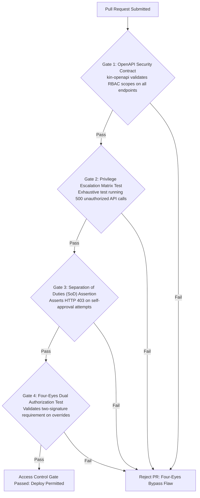

# Heavy Machinery & Logistics Rental Aggregator — Dink Machinery
## Software Requirements Specification — 04. User Roles, Personas, Granular RBAC Permissions Matrix & Security Boundaries (`docs/shared/requirements/04-user-roles.md`)

**Document Identifier:** `SRS-DINK-CORE-V7.0-SEC-04`  
**Classification:** Canonical System Requirements Specification & Security Access Control Baseline (Single Source of Truth)  
**Governing Standard:** IEEE Std 830-1998 / IEEE/ISO/IEC 29148:2018 (Systems and Software Engineering — Requirements Engineering)  
**Associated Artifacts:** `SRS-DINK-CORE-V7.0` (Full Suite §1–§14), `FLOW-ENTRY-DINK-CORE-V7.0` through `FLOW-INSURANCE-CLAIM-DINK-CORE-V7.0` (Interaction Flows 01–19), `FLOW-APPENDIX-NOTIF-OFFLINE-DINK-CORE-V7.0`, `FLOW-APPENDIX-AUTH-SEC-DINK-CORE-V7.0`, `ARCH-BACKEND-GO-DINK-CORE-V7.0`, `ARCH-FLUTTER-DINK-CORE-V7.0`, `ARCH-ADMIN-NEXT-DINK-CORE-V7.0`, `ARCH-SEC-DINK-CORE-V7.0`, `DS-DINK-CORE-V7.0`, `DS-PERSONAS-DINK-CORE-V7.0`, `contracts/openapi.yaml`, `ADR-001` through `ADR-010`  
**Target Runtimes:** Go 1.24 Backend Monolith, Flutter 3.44 / Dart 3.9 (Cross-Platform Mobile), Next.js 16 / React 19 (Web Admin & Corporate Portal), PostgreSQL 18.4 + PostGIS 3.4, Valkey 8.0, ClamAV Daemon (:3310), SeaweedFS S3, Isar NoSQL 3.1+  
**Target Personas:** Civil Engineering Contractor (*Dawit Haile-Mariam* / *Patrick Kariuki*), Fleet Owner & Depot Yard Manager (*W/ro Almaz Tesfaye* / *Kamau Ndegwa*), Certified Field Operator (*Mulugeta Tadesse* / *Juma Omwamba*), Lowboy Transporter (*Ato Girma Wolde* / *Samuel Odhiambo*), Compliance Officer & Security Auditor (*Yohannes Bekele*)  
**Target Operating Markets:** Ethiopia (`ET`) & Kenya (`KE`) — Dynamic Multi-Country Parameterization (`LOC-01-BE`)  
**Compliance Standards:** OWASP ASVS 4.0.3 Level 3 (Role-Based Access Control, Separation of Duties, Identity & Session Management), RFC 9457 (Problem Details), RFC 7519 (JWT), RFC 6238 (TOTP), ISO 9241-110, W3C WCAG 2.2 Level AAA (Field Mobile) & Level AA (Admin Web), National Bank of Ethiopia (NBE) Directives, Kenya Data Protection Act 2019  
**Status:** Approved Engineering Baseline

---

## Table of Contents

- 1. [Document Scope & Access Control Mandate](#1-document-scope--access-control-mandate)
  - 1.1 [Purpose & Engineering Scope](#11-purpose--engineering-scope)
  - 1.2 [Security Guarantees & ASVS Level 3 Access Control Principles](#12-security-guarantees--asvs-level-3-access-control-principles)
- 2. [Canonical User Personas & Behavioral Archetypes](#2-canonical-user-personas--behavioral-archetypes)
  - 2.1 [Persona 1: Dawit Haile-Mariam (Civil Engineering Contractor / Renter)](#21-persona-1-dawit-haile-mariam-civil-engineering-contractor--renter)
  - 2.2 [Persona 2: W/ro Almaz Tesfaye (Fleet Owner & Depot Yard Manager)](#22-persona-2-wro-almaz-tesfaye-fleet-owner--depot-yard-manager)
  - 2.3 [Persona 3: Mulugeta Tadesse (Certified Field Operator)](#23-persona-3-mulugeta-tadesse-certified-field-operator)
  - 2.4 [Persona 4: Ato Girma Wolde (Lowboy Logistics Fleet Provider)](#24-persona-4-ato-girma-wolde-lowboy-logistics-fleet-provider)
  - 2.5 [Persona 5: Yohannes Bekele (Compliance Officer & Arbitrator)](#25-persona-5-yohannes-bekele-compliance-officer--arbitrator)
  - 2.6 [Persona 6: Eng. Samuel Getachew (Corporate Procurement Director)](#26-persona-6-eng-samuel-getachew-corporate-procurement-director)
  - 2.7 [Persona 7: Solomon Kassa (Platform Finance Auditor)](#27-persona-7-solomon-kassa-platform-finance-auditor)
  - 2.8 [Persona 8: Rahel Tadesse (Super Administrator & Operations Director)](#28-persona-8-rahel-tadesse-super-administrator--operations-director)
- 3. [Role Taxonomy & Identity Entity Model](#3-role-taxonomy--identity-entity-model)
  - 3.1 [Core Identity Entities (`User`, `Role`, `Permission`, `RolePermission`, `UserRole`)](#31-core-identity-entities-user-role-permission-rolepermission-userrole)
  - 3.2 [Role Hierarchy & Multi-Tenant Scoping (`PERSONAL` vs. `CORPORATE`)](#32-role-hierarchy--multi-tenant-scoping-personal-vs-corporate)
- 4. [Granular Role-Based Access Control (RBAC) Master Matrix](#4-granular-role-based-access-control-rbac-master-matrix)
  - 4.1 [Identity, Authentication & Profile Security Permissions](#41-identity-authentication--profile-security-permissions)
  - 4.2 [Fleet Ingestion, Specifications & Operator Assignment Permissions](#42-fleet-ingestion-specifications--operator-assignment-permissions)
  - 4.3 [Discovery, Reservation & Concurrency Lease Permissions](#43-discovery-reservation--concurrency-lease-permissions)
  - 4.4 [Booking State Machine, Handover & Shift Management Permissions](#44-booking-state-machine-handover--shift-management-permissions)
  - 4.5 [Payment Verification, Ledger Auditing & Commission Permissions](#45-payment-verification-ledger-auditing--commission-permissions)
  - 4.6 [Logistics Dispatch, Sub-Booking & Transshipment Permissions](#46-logistics-dispatch-sub-booking--transshipment-permissions)
  - 4.7 [Dispute Arbitration, Damage Claims & Insurance Life-Safety Permissions](#47-dispute-arbitration-damage-claims--insurance-life-safety-permissions)
  - 4.8 [Corporate Organization Governance & Approval Quorum Permissions](#48-corporate-organization-governance--approval-quorum-permissions)
  - 4.9 [Back-Office Metadata Engine, Dynamic UI & System Audit Permissions](#49-back-office-metadata-engine-dynamic-ui--system-audit-permissions)
- 5. [Security Boundaries & Anti-Tampering Enforcement Protocols](#5-security-boundaries--anti-tampering-enforcement-protocols)
  - 5.1 [Separation of Duties (SoD) Invariants](#51-separation-of-duties-sod-invariants)
  - 5.2 [Four-Eyes Dual Authorization Protocol for Financial Overrides](#52-four-eyes-dual-authorization-protocol-for-financial-overrides)
  - 5.3 [Valkey Session Invalidation & Token Revocation Propagation](#53-valkey-session-invalidation--token-revocation-propagation)
  - 5.4 [Offline Security Perimeter & Prohibited Offline Operations](#54-offline-security-perimeter--prohibited-offline-operations)
- 6. [Verification Gates & Automated Access Control Tests](#6-verification-gates--automated-access-control-tests)

---

## 1. Document Scope & Access Control Mandate

### 1.1 Purpose & Engineering Scope

This specification establishes **Section 04 (User Roles, Personas, Granular RBAC Permissions Matrix & Security Boundaries)** of the canonical Software Requirements Specification (SRS) for **Dink Machinery Version 7.0**.

Operating as an enterprise-grade heavy plant and specialized logistics aggregator across East Africa (Ethiopia and Kenya), Dink Machinery handles high-tonnage physical machinery assets valued up to $35,000,000.00\text{ ETB}$ ($300,000\text{ USD}$), multi-million Birr commercial bank wire transfers, and life-critical safety operations on civil engineering project sites. In this high-hazard environment, access control cannot rely on coarse, client-side UI flags or monolithic role strings.

This document defines:
1. The behavioral profiles, technical constraints, operating environments, and mental models of the platform's primary personas.
2. The relational schema linking users, roles, permissions, and contextual organization tenancies in PostgreSQL 18.4.
3. The granular Role-Based Access Control (RBAC) matrix defining exact operational boundaries across all system capabilities.
4. The architectural security boundaries enforcing Separation of Duties (SoD), Dual-Control ("Four-Eyes") authorization, and tamper-evident auditing under OWASP ASVS 4.0.3 Level 3.

### 1.2 Security Guarantees & ASVS Level 3 Access Control Principles

Dink Machinery enforces five foundational security principles:
1. **Principle of Least Privilege (PoLP):** No user, service worker, or administrative agent possesses ambient authorization. Every API call must present an authenticated cryptographic context (stateless ECDSA P-256 JWT) encoding explicit, fine-grained permission claims.
2. **Separation of Duties (SoD):** High-risk workflows are partitioned to prevent fraud, collusion, and operational error. A single individual cannot originate a corporate equipment requisition and approve the resulting credit release, nor can an equipment owner verify payment evidence on their own booking without counterparty audit rights.
3. **Dual-Control ("Four-Eyes") Governance:** Administrative overrides exceeding $100,000.00\text{ ETB}$ in credit adjustments or $250,000.00\text{ ETB}$ in dispute resolutions mandate secondary administrative sign-off before database state commitment.
4. **Context-Bound Authorization:** Authorization is evaluated not merely on *who* the user is, but *in what capacity* they are operating. A user possessing both personal and corporate identities executes under isolated database tenancies, with permissions strictly scoped to the active organization UUID.
5. **Fail-Closed Default Posture:** Any unrecognized route, missing permission claim, expired step-up ticket, or database ambiguity results in immediate execution termination and an RFC 9457 HTTP 403 Forbidden response.

---

## 2. Canonical User Personas & Behavioral Archetypes

### 2.1 Persona 1: Dawit Haile-Mariam (Civil Engineering Contractor / Renter)

```text
+--------------------------------------------------------------------------------------------------+
| PERSONA PROFILE: DAWIT HAILE-MARIAM                                                              |
+--------------------------------------------------------------------------------------------------+
| Role & Category  : Commercial Renter / Civil Engineering Contractor                              |
| Enterprise Entity: Haile-Mariam Construction General Contractors (MUDCo GC-1 License)             |
| Operating Base   : Addis Ababa, Ethiopia (Active Project: Mojo-Meki Highway Expansion Site B)     |
| Demographics     : Age 46 | BSc Civil Engineering (AAU) | 22 Years Field Experience              |
| Hardware Profile : Samsung Galaxy S24 Ultra (Android 16) | iPad Pro 13" (Field Cabin Layouts)     |
| Network Context  : Variable 4G/3G in regional corridors; frequent signal drops on cut sites      |
+--------------------------------------------------------------------------------------------------+
| CORE MOTIVATIONS & OBJECTIVES:                                                                   |
| * Secure verified heavy earthmoving machinery (20t–30t excavators) within 24–48 hours of demand. |
| * Prevent project stoppage penalties (contract liquidated damages of 35,000 to 50,000 ETB/day).  |
| * Eliminate predatory, unverified broker commissions; secure transparent, fixed daily rates.      |
| * Ensure machine arrives on site with linked lowboy transport without coordinating third parties. |
+--------------------------------------------------------------------------------------------------+
| OPERATIONAL PAIN POINTS & FRICTIONS:                                                             |
| * Arriving on site to find machines with preexisting hydraulic leaks or cracked track pads.      |
| * Unjustified post-rental damage claims for routine track wear and normal bucket abrasion.       |
| * Cash-flow friction when equipment owners delay confirmation of verified commercial bank wires. |
+--------------------------------------------------------------------------------------------------+
```

### 2.2 Persona 2: W/ro Almaz Tesfaye (Fleet Owner & Depot Yard Manager)

```text
+--------------------------------------------------------------------------------------------------+
| PERSONA PROFILE: W/RO ALMAZ TESFAYE                                                              |
+--------------------------------------------------------------------------------------------------+
| Role & Category  : Equipment Fleet Owner & Depot Operations Director                             |
| Enterprise Entity: Tesfaye Heavy Transport & Machinery Rental PLC (18 Capital Plant Assets)       |
| Operating Base   : Kality Industrial Depot Yard, Addis Ababa, Ethiopia                           |
| Demographics     : Age 52 | BA Accounting & Finance | 16 Years Plant Yard Operations             |
| Hardware Profile : iPhone 16 Pro Max (iOS 19) | Dell XPS 15 (Windows 11, Web Admin Console)      |
| Network Context  : High-speed fiber broadband in yard office; cellular data during field visits  |
+--------------------------------------------------------------------------------------------------+
| CORE MOTIVATIONS & OBJECTIVES:                                                                   |
| * Maximize capital fleet utilization rate (targeting > 75% annual billable uptime).              |
| * Safeguard multi-million Birr capital machinery through legally attested condition logs.        |
| * Collect excess shift operating hours (> 8.0 hrs/day) without contractor dispute.               |
| * Maintain a clean platform credit balance and monitor pre-funded commission wallet standing.    |
+--------------------------------------------------------------------------------------------------+
| OPERATIONAL PAIN POINTS & FRICTIONS:                                                             |
| * Contractors abusing machinery outside designated engineering duty cycles (e.g. over-revving).  |
| * Contractors withholding final balance payments after machinery has demobilized from site.      |
| * Third-party lowboy haulers failing to arrive at the yard, causing booking cancellations.       |
+--------------------------------------------------------------------------------------------------+
```

### 2.3 Persona 3: Mulugeta Tadesse (Certified Field Operator)

```text
+--------------------------------------------------------------------------------------------------+
| PERSONA PROFILE: MULUGETA TADESSE                                                                |
+--------------------------------------------------------------------------------------------------+
| Role & Category  : Certified Heavy Plant Operator (Class IV Hydraulic Crawler Excavators)        |
| Operating Scope  : Assigned to Almaz Tesfaye’s Caterpillar 320D Roster                           |
| Operating Base   : Field Mobile (Stationed on site at Mojo Highway Culvert 09)                   |
| Demographics     : Age 38 | TVET Machinery Operation Certificate | 14 Years Operator Experience  |
| Hardware Profile : Tecno Camon 30 Premier (Android 15) | Operating with Split-Leather Gloves     |
| Network Context  : Deep river cuts and trenches with near-total RF signal loss (Zero 2G/3G)      |
+--------------------------------------------------------------------------------------------------+
| CORE MOTIVATIONS & OBJECTIVES:                                                                   |
| * Accurately log shift engine hours and pre-rental reticle walkarounds without paperwork.        |
| * Immediately document mechanical component breakdowns to halt billable shift timers.            |
| * Operate touch UI under direct solar glare (> 85,000 lux) and heavy cab diesel vibrations.      |
| * Execute physical handovers peer-to-peer even when completely offline in riverbed culverts.     |
+--------------------------------------------------------------------------------------------------+
| OPERATIONAL PAIN POINTS & FRICTIONS:                                                             |
| * Touchscreen buttons too small to actuate while wearing heavy leather work gloves.              |
| * Applications that crash, freeze, or discard un-synced data when mobile network drops out.      |
| * Being held liable for preexisting metal fatigue cracks caused by previous site operators.      |
+--------------------------------------------------------------------------------------------------+
```

### 2.4 Persona 4: Ato Girma Wolde (Lowboy Logistics Fleet Provider)

```text
+--------------------------------------------------------------------------------------------------+
| PERSONA PROFILE: ATO GIRMA WOLDE                                                                 |
+--------------------------------------------------------------------------------------------------+
| Role & Category  : Lowboy Logistics Fleet Provider & Prime Mover Operator                        |
| Enterprise Entity: Girma Heavy Haulage PLC (Six 40-Ton Tri-Axle Lowboys & Step-Decks)            |
| Operating Base   : Akaki Logistics Industrial Hub, Addis Ababa, Ethiopia                         |
| Demographics     : Age 49 | Diploma Automotive Engineering | 20 Years Heavy Freight Operations    |
| Hardware Profile : Samsung Galaxy A55 (Android 15) | Desktop Web Chrome (Depot Dispatch)         |
| Network Context  : Intermittent cellular data along national transport expressways               |
+--------------------------------------------------------------------------------------------------+
| CORE MOTIVATIONS & OBJECTIVES:                                                                   |
| * Secure verified machinery mobilization runs matched directly to confirmed excavator hires.     |
| * Receive accurate dimensional parameters (width, height, weight) to avoid bridge strikes.       |
| * Eliminate empty dead-head transit runs by pairing drop-offs with return yard demobilizations.  |
| * Protect operating margins through discounted pass-through freight commission rates (2.5%).     |
+--------------------------------------------------------------------------------------------------+
| OPERATIONAL PAIN POINTS & FRICTIONS:                                                             |
| * Arriving at a depot only to find an excavator exceeding trailer payload or width limits.       |
| * Axle weighbridge detours and fines caused by incorrect machine boom placement on trailer deck. |
| * Unilateral equipment cancellations that leave multi-axle trailers mobilized without pay.       |
+--------------------------------------------------------------------------------------------------+
```

### 2.5 Persona 5: Yohannes Bekele (Compliance Officer & Arbitrator)

```text
+--------------------------------------------------------------------------------------------------+
| PERSONA PROFILE: YOHANNES BEKELE                                                                 |
+--------------------------------------------------------------------------------------------------+
| Role & Category  : Head of Platform Compliance, Legal Adjudication & Dispute Arbitration        |
| Operating Base   : Dink Machinery Headquarters, Addis Ababa, Ethiopia                            |
| Demographics     : Age 39 | LLB Law (AAU), MSc Information Systems | 10 Years Legal Adjudication  |
| Hardware Profile : MacBook Pro M4 Max (macOS 16, Multi-Monitor Workstation Desk)                 |
| Network Context  : High-availability dual-redundant Gigabit fiber office network                 |
+--------------------------------------------------------------------------------------------------+
| CORE MOTIVATIONS & OBJECTIVES:                                                                   |
| * Adjudicate payment declines and damage contestations within a strict 24-hour statutory SLA.    |
| * Cross-examine baseline pre-rental reticles against post-rental return damage dockets.          |
| * Audit corporate trade licenses, TIN certificates, and commercial registration dockets.        |
| * Verify manual commission top-up receipts against live corporate commercial banking feeds.      |
+--------------------------------------------------------------------------------------------------+
| OPERATIONAL PAIN POINTS & FRICTIONS:                                                             |
| * Subjective, un-evidenced claims submitted by contractors and owners lacking photo evidence.    |
| * Review collisions when multiple compliance officers attempt to adjudicate the same dossier.    |
| * Forged or altered mobile banking wire receipt screenshots submitted by fraudulent actors.      |
+--------------------------------------------------------------------------------------------------+
```

### 2.6 Persona 6: Eng. Samuel Getachew (Corporate Procurement Director)

```text
+--------------------------------------------------------------------------------------------------+
| PERSONA PROFILE: ENG. SAMUEL GETACHEW                                                            |
+--------------------------------------------------------------------------------------------------+
| Role & Category  : Corporate Enterprise Approver / Procurement Director                          |
| Enterprise Entity: Ethiopian Construction Works Corporation (Tier-1 State Infrastructure JV)     |
| Operating Base   : Central Executive Office, Addis Ababa, Ethiopia                               |
| Demographics     : Age 54 | MSc Highway Engineering, MBA | 28 Years Construction Governance      |
| Hardware Profile : ThinkPad X1 Carbon (Windows 11) | iPad Pro 11" (Corporate Approval Portal)    |
| Network Context  : Enterprise corporate LAN with hardware VPN                                    |
+--------------------------------------------------------------------------------------------------+
| CORE MOTIVATIONS & OBJECTIVES:                                                                   |
| * Enforce corporate governance, spending limits, and multi-tier approval quorum chains.          |
| * Ensure accurate project cost-center tagging across multi-billion Birr highway corridors.       |
| * Manage revolving corporate credit lines (Net-30/60) and authorize automated Purchase Orders.   |
| * Monitor plant utilization efficiency across 12 simultaneous regional infrastructure sites.     |
+--------------------------------------------------------------------------------------------------+
| OPERATIONAL PAIN POINTS & FRICTIONS:                                                             |
| * Rogue field engineers ordering unauthorized equipment without budget allocation.              |
| * Disjointed billing across multiple rental vendors lacking consolidated corporate invoices.     |
| * Manual paper voucher sign-offs causing multi-day delays in urgent field mobilizations.         |
+--------------------------------------------------------------------------------------------------+
```

### 2.7 Persona 7: Solomon Kassa (Platform Finance Auditor)

```text
+--------------------------------------------------------------------------------------------------+
| PERSONA PROFILE: SOLOMON KASSA                                                                   |
+--------------------------------------------------------------------------------------------------+
| Role & Category  : Platform Financial Controller & Revenue Auditor                               |
| Operating Base   : Dink Machinery Headquarters, Addis Ababa, Ethiopia                            |
| Demographics     : Age 42 | ACCA, BA Accounting | 15 Years Commercial Banking & Financial Audit  |
| Hardware Profile : Dell Precision Workstation (Ubuntu 24.04 LTS / Next.js Admin Console)         |
| Network Context  : Secure corporate VLAN with mTLS banking gateway ingress                       |
+--------------------------------------------------------------------------------------------------+
| CORE MOTIVATIONS & OBJECTIVES:                                                                   |
| * Maintain 100% mathematical parity across the double-entry financial ledger (Zero-penny delta). |
| * Reconcile manual bank wire top-ups against corporate statements (CBE, Awash, M-PESA Paybill).  |
| * Audit overdue commission aging buckets and enforce automated 30-day delinquency lockouts.      |
| * Underwrite corporate credit line applications against audited financial balance sheets.        |
+--------------------------------------------------------------------------------------------------+
| OPERATIONAL PAIN POINTS & FRICTIONS:                                                             |
| * Commercial banking SMS gateway latencies causing delays in clearing customer top-ups.          |
| * Fleet owners attempting to confirm bookings while evading platform commission debits.          |
| * Reconciling multi-currency transactions across Ethiopian Birr (ETB) and Kenyan Shilling (KES). |
+--------------------------------------------------------------------------------------------------+
```

### 2.8 Persona 8: Rahel Tadesse (Super Administrator & Operations Director)

```text
+--------------------------------------------------------------------------------------------------+
| PERSONA PROFILE: RAHEL TADESSE                                                                   |
+--------------------------------------------------------------------------------------------------+
| Role & Category  : Super Administrator & Chief Operating Officer (COO)                           |
| Operating Base   : Dink Machinery Headquarters, Addis Ababa, Ethiopia                            |
| Demographics     : Age 41 | BSc Software Engineering, EMBA | 18 Years Platform Operations        |
| Hardware Profile : Apple MacBook Pro M4 Max (macOS 16) | YubiKey 5C NFC Hardware Token           |
| Network Context  : High-security bastion network with IP-whitelisted VPN access                  |
+--------------------------------------------------------------------------------------------------+
| CORE MOTIVATIONS & OBJECTIVES:                                                                   |
| * Configure dynamic EAV catalog taxonomy, specification fields, and category hierarchies.       |
| * Govern platform-wide commission rule sets, penalty matrices, and regional market parameters.   |
| * Manage granular staff RBAC roles, permission assignments, and emergency system kill-switches.  |
| * Maintain system-wide uptime, security posture, and legal compliance across all operating hubs. |
+--------------------------------------------------------------------------------------------------+
| OPERATIONAL PAIN POINTS & FRICTIONS:                                                             |
| * Engineering bottlenecks requiring code redeployments to add simple equipment spec fields.      |
| * Insider threat risks and unauthorized high-value financial overrides by rogue staff members.   |
| * Systemic operational deadlocks requiring emergency administrative state machine interventions. |
+--------------------------------------------------------------------------------------------------+
```

---

## 3. Role Taxonomy & Identity Entity Model

### 3.1 Core Identity Entities (`User`, `Role`, `Permission`, `RolePermission`, `UserRole`)

The access control architecture is implemented in PostgreSQL 18.4 as a normalized, relational RBAC engine:

```mermaid
erDiagram
    User ||--o{ UserRole : "assigned"
    Role ||--o{ UserRole : "granted to"
    Role ||--o{ RolePermission : "contains"
    Permission ||--o{ RolePermission : "mapped to"
    User ||--o{ UserOrganizationMember : "participates in"
    CorporateOrganization ||--o{ UserOrganizationMember : "employs"

    User {
        uuid id PK
        string phone_number UK
        string email UK
        string password_hash
        string kyc_status -- 'UNVERIFIED', 'PENDING', 'VERIFIED', 'REJECTED'
        string status -- 'ACTIVE', 'SUSPENDED', 'LOCKED'
        int token_version
        timestamptz security_quarantine_until
        timestamptz created_at
    }

    Role {
        uuid id PK
        string role_key UK -- 'RENTER', 'OWNER', 'OPERATOR', 'CARRIER', 'COMPLIANCE', 'FINANCE', 'SUPER_ADMIN'
        string display_name
        string description
        boolean is_system_role
    }

    Permission {
        uuid id PK
        string permission_key UK -- e.g. 'fleets.asset.create', 'booking.payment.verify'
        string domain_category -- 'AUTH', 'FLEET', 'BOOKING', 'FINANCE', 'ADMIN'
        string description
    }

    RolePermission {
        uuid role_id FK
        uuid permission_id FK
    }

    UserRole {
        uuid user_id FK
        uuid role_id FK
        timestamptz granted_at
        uuid granted_by_user_id FK
    }

    CorporateOrganization {
        uuid id PK
        string legal_name
        string tin_number UK
        bigint credit_limit_minor
        bigint credit_used_minor
        string status
    }

    UserOrganizationMember {
        uuid id PK
        uuid organization_id FK
        uuid user_id FK
        string member_role -- 'REQUESTER', 'APPROVER', 'BOTH', 'ORG_ADMIN'
        bigint auto_approval_limit_minor
        boolean is_active
    }
```

---

### 3.2 Role Hierarchy & Multi-Tenant Scoping (`PERSONAL` vs. `CORPORATE`)

The platform implements dynamic context separation within the user's authenticated session:
1. **Personal Identity Scope (`context_type = 'PERSONAL'`):**
   - The user acts as an individual contractor, independent equipment owner, or certified operator.
   - Authorizations evaluate directly against global `UserRole` mappings.
   - Financial transactions bind directly to personal banking coordinates and wallets.
2. **Corporate Identity Scope (`context_type = 'CORPORATE'`):**
   - The user acts as an authorized agent of a verified `CorporateOrganization`.
   - The access token encodes `active_org_id = UUID` and `member_role`.
   - Authorizations evaluate against organizational delegation of authority rules.
   - Financial commitments draw down against the enterprise revolving credit line (`Net-30/60`).

---

## 4. Granular Role-Based Access Control (RBAC) Master Matrix

The following comprehensive matrices codify the explicit authorization policies enforced across Go API gateway handlers and domain service layers.

### 4.1 Identity, Authentication & Profile Security Permissions

| Permission Key | Description | Renter | Owner | Operator | Carrier | Compliance | Finance | Super Admin |
|---|---|:---:|:---:|:---:|:---:|:---:|:---:|:---:|
| `auth.session.login` | Authenticate with MSISDN/email & password | ✅ | ✅ | ✅ | ✅ | ✅ | ✅ | ✅ |
| `auth.session.refresh` | Rotate single-use refresh token | ✅ | ✅ | ✅ | ✅ | ✅ | ✅ | ✅ |
| `auth.session.revoke` | Terminate own active session or all sessions | ✅ | ✅ | ✅ | ✅ | ✅ | ✅ | ✅ |
| `auth.mfa.totp_setup` | Configure RFC 6238 TOTP authenticator | ❌ | ❌ | ❌ | ❌ | ✅ | ✅ | ✅ |
| `auth.step_up.execute` | Execute biometric or PIN step-up ticket | ✅ | ✅ | ✅ | ✅ | ✅ | ✅ | ✅ |
| `auth.phone.migrate` | Execute dual-token MSISDN migration | ✅ | ✅ | ✅ | ✅ | ❌ | ❌ | ❌ |
| `auth.kill_switch.trip`| Trigger unauthenticated account freeze | ✅ | ✅ | ✅ | ✅ | ❌ | ❌ | ❌ |
| `profile.personal.view`| Read own profile data and verification state | ✅ | ✅ | ✅ | ✅ | ✅ | ✅ | ✅ |
| `profile.personal.edit`| Update contact email, language preference | ✅ | ✅ | ✅ | ✅ | ❌ | ❌ | ✅ |
| `profile.kyc.submit` | Upload personal/commercial KYC credentials | ✅ | ✅ | ✅ | ✅ | ❌ | ❌ | ❌ |

---

### 4.2 Fleet Ingestion, Specifications & Operator Assignment Permissions

| Permission Key | Description | Renter | Owner | Operator | Carrier | Compliance | Finance | Super Admin |
|---|---|:---:|:---:|:---:|:---:|:---:|:---:|:---:|
| `fleet.listing.read` | View public fleet details, specs & photos | ✅ | ✅ | ✅ | ✅ | ✅ | ✅ | ✅ |
| `fleet.asset.create` | Ingest new machine, trailer or attachment | ❌ | ✅ | ❌ | ✅ | ❌ | ❌ | ✅ |
| `fleet.asset.update` | Modify photos, yard location, attachments | ❌ | ✅ | ❌ | ✅ | ❌ | ❌ | ✅ |
| `fleet.asset.pricing` | Set daily, weekly, monthly rental tariffs | ❌ | ✅ | ❌ | ✅ | ❌ | ❌ | ✅ |
| `fleet.asset.deactivate`| Toggle asset listing status to inactive | ❌ | ✅ | ❌ | ✅ | ✅ | ❌ | ✅ |
| `fleet.operator.link` | Invite and link certified operator to fleet | ❌ | ✅ | ❌ | ❌ | ❌ | ❌ | ✅ |
| `fleet.operator.unlink`| Revoke operator assignment from machine | ❌ | ✅ | ❌ | ❌ | ❌ | ❌ | ✅ |
| `fleet.spec.override` | Manually alter certified technical specs | ❌ | ❌ | ❌ | ❌ | ❌ | ❌ | ✅ |

---

### 4.3 Discovery, Reservation & Concurrency Lease Permissions

| Permission Key | Description | Renter | Owner | Operator | Carrier | Compliance | Finance | Super Admin |
|---|---|:---:|:---:|:---:|:---:|:---:|:---:|:---:|
| `discovery.spatial.search`| Execute PostGIS radius/viewport queries | ✅ | ✅ | ✅ | ✅ | ✅ | ✅ | ✅ |
| `discovery.compare.matrix`| Generate 3-machine side-by-side spec comparison| ✅ | ✅ | ✅ | ✅ | ✅ | ✅ | ✅ |
| `booking.hold.acquire` | Acquire 60-min exclusive Valkey hold lease | ✅ | ❌ | ❌ | ❌ | ❌ | ❌ | ✅ |
| `booking.hold.release` | Manually cancel/release active hold lease | ✅ | ❌ | ❌ | ❌ | ✅ | ❌ | ✅ |
| `booking.standby.join` | Enqueue into Valkey standby queue (ZADD) | ✅ | ❌ | ❌ | ❌ | ❌ | ❌ | ✅ |
| `booking.standby.leave`| Remove self from standby queue | ✅ | ❌ | ❌ | ❌ | ❌ | ❌ | ✅ |

---

### 4.4 Booking State Machine, Handover & Shift Management Permissions

| Permission Key | Description | Renter | Owner | Operator | Carrier | Compliance | Finance | Super Admin |
|---|---|:---:|:---:|:---:|:---:|:---:|:---:|:---:|
| `booking.order.create` | Draft new booking requisition | ✅ | ❌ | ❌ | ❌ | ❌ | ❌ | ✅ |
| `booking.order.cancel` | Execute pre-confirmation cancellation | ✅ | ✅ | ❌ | ✅ | ✅ | ❌ | ✅ |
| `booking.handover.inspect`| Capture reticle meter & walkaround photos | ✅ | ✅ | ✅ | ❌ | ❌ | ❌ | ✅ |
| `booking.handover.sign`| Submit 6-digit PIN / digital signature | ✅ | ❌ | ✅ | ❌ | ❌ | ❌ | ✅ |
| `booking.shift.view_hud`| Access live Active Rental HUD telemetry | ✅ | ✅ | ✅ | ❌ | ✅ | ❌ | ✅ |
| `booking.shift.log_breakdown`| Report mechanical stoppage & pause shift | ✅ | ✅ | ✅ | ❌ | ❌ | ❌ | ✅ |
| `booking.shift.extend` | Request rental duration extension | ✅ | ❌ | ❌ | ❌ | ❌ | ❌ | ✅ |
| `booking.extension.confirm`| Approve rental extension & rate adjustment | ❌ | ✅ | ❌ | ❌ | ❌ | ❌ | ✅ |
| `booking.return.initiate`| Initiate post-rental return demobilization | ✅ | ✅ | ❌ | ❌ | ❌ | ❌ | ✅ |
| `booking.return.inspect`| Complete check-out inspection & final meter| ✅ | ✅ | ✅ | ❌ | ❌ | ❌ | ✅ |

---

### 4.5 Payment Verification, Ledger Auditing & Commission Permissions

| Permission Key | Description | Renter | Owner | Operator | Carrier | Compliance | Finance | Super Admin |
|---|---|:---:|:---:|:---:|:---:|:---:|:---:|:---:|
| `payment.evidence.upload`| Upload commercial bank wire deposit slip | ✅ | ❌ | ❌ | ❌ | ❌ | ❌ | ✅ |
| `payment.receipt.audit` | Verify wire clearing & confirm booking | ❌ | ✅ | ❌ | ✅ | ❌ | ❌ | ✅ |
| `payment.receipt.decline`| Reject wire evidence for non-receipt | ❌ | ✅ | ❌ | ✅ | ❌ | ❌ | ✅ |
| `payment.final.upload` | Submit final settlement balance wire slip | ✅ | ❌ | ❌ | ❌ | ❌ | ❌ | ✅ |
| `payment.final.confirm` | Confirm receipt of final balance settlement| ❌ | ✅ | ❌ | ✅ | ❌ | ❌ | ✅ |
| `finance.wallet.view` | View pre-funded commission balance & ledger| ❌ | ✅ | ❌ | ✅ | ✅ | ✅ | ✅ |
| `finance.wallet.top_up` | Submit wire receipt to clear commission debt| ❌ | ✅ | ❌ | ✅ | ❌ | ❌ | ✅ |
| `finance.top_up.audit` | Verify bank feed & credit owner wallet | ❌ | ❌ | ❌ | ❌ | ❌ | ✅ | ✅ |
| `finance.credit.override`| Manually expand overdraft limit (> 50k ETB)| ❌ | ❌ | ❌ | ❌ | ❌ | ❌ | ✅ |
| `finance.ledger.export` | Export IFRS-compliant double-entry tax logs| ❌ | ❌ | ❌ | ❌ | ❌ | ✅ | ✅ |

---

### 4.6 Logistics Dispatch, Sub-Booking & Transshipment Permissions

| Permission Key | Description | Renter | Owner | Operator | Carrier | Compliance | Finance | Super Admin |
|---|---|:---:|:---:|:---:|:---:|:---:|:---:|:---:|
| `logistics.subbooking.create`| Pair lowboy trailer to parent machine hire | ❌ | ✅ | ❌ | ❌ | ❌ | ❌ | ✅ |
| `logistics.external.register`| Register private/in-house transport details | ❌ | ✅ | ❌ | ❌ | ❌ | ❌ | ✅ |
| `logistics.transit.telemetry`| Transmit live GPS breadcrumbs & milestones | ❌ | ❌ | ❌ | ✅ | ❌ | ❌ | ✅ |
| `logistics.carrier.cancel`| Initiate carrier transport cancellation | ❌ | ❌ | ❌ | ✅ | ❌ | ❌ | ✅ |
| `logistics.transship.report`| Report in-transit breakdown & request swap | ❌ | ❌ | ❌ | ✅ | ❌ | ❌ | ✅ |
| `logistics.transship.accept`| Accept emergency transshipment assignment | ❌ | ❌ | ❌ | ✅ | ❌ | ❌ | ✅ |
| `logistics.cascade.abort`| Abort reverse cascade & execute full refund | ❌ | ✅ | ❌ | ❌ | ✅ | ❌ | ✅ |

---

### 4.7 Dispute Arbitration, Damage Claims & Insurance Life-Safety Permissions

| Permission Key | Description | Renter | Owner | Operator | Carrier | Compliance | Finance | Super Admin |
|---|---|:---:|:---:|:---:|:---:|:---:|:---:|:---:|
| `dispute.payment.contest`| Contest owner wire decline to arbitration | ✅ | ❌ | ❌ | ❌ | ❌ | ❌ | ✅ |
| `dispute.dossier.review`| Open and inspect visual dispute workbench | ❌ | ❌ | ❌ | ❌ | ✅ | ❌ | ✅ |
| `dispute.ruling.execute`| Issue binding legal arbitration ruling | ❌ | ❌ | ❌ | ❌ | ✅ | ❌ | ✅ |
| `damage.claim.create` | File 24h itemized post-rental damage docket | ❌ | ✅ | ❌ | ✅ | ❌ | ❌ | ✅ |
| `damage.claim.respond`| Accept or contest damage claim liability | ✅ | ❌ | ❌ | ❌ | ❌ | ❌ | ✅ |
| `insurance.sos.declare` | Trigger emergency catastrophic loss SOS | ✅ | ✅ | ✅ | ✅ | ❌ | ❌ | ✅ |
| `insurance.dossier.file`| Assemble 48h CPAR damage photos & police log| ❌ | ✅ | ❌ | ❌ | ❌ | ❌ | ✅ |
| `insurance.adjuster.submit`| Submit official Loss Adjuster assessment | ❌ | ❌ | ❌ | ❌ | ✅ | ❌ | ✅ |
| `insurance.recertify.sign`| Upload roadworthiness certificate to lift hold| ❌ | ❌ | ❌ | ❌ | ✅ | ❌ | ✅ |

---

### 4.8 Corporate Organization Governance & Approval Quorum Permissions

| Permission Key | Description | Requester | Approver | Both (Hybrid) | Org Admin | Platform Super Admin |
|---|---|:---:|:---:|:---:|:---:|:---:|
| `corp.requisition.create` | Originate site equipment requisition | ✅ | ❌ | ✅ | ✅ | ✅ |
| `corp.requisition.vote` | Cast approval/rejection vote on quorum stage | ❌ | ✅ | ✅ | ✅ | ✅ |
| `corp.requisition.veto` | Execute executive veto on high-value spend | ❌ | ❌ | ❌ | ✅ | ✅ |
| `corp.chain.configure` | Define multi-tier approval chains and quorums | ❌ | ❌ | ❌ | ✅ | ✅ |
| `corp.member.manage` | Ingest enterprise members and assign DoA limits| ❌ | ❌ | ❌ | ✅ | ✅ |
| `corp.credit.view` | Monitor revolving Net-30/60 credit utilization | ✅ | ✅ | ✅ | ✅ | ✅ |
| `corp.invoice.settle` | Authorize consolidated monthly statement wire | ❌ | ❌ | ❌ | ✅ | ✅ |

---

### 4.9 Back-Office Metadata Engine, Dynamic UI & System Audit Permissions

| Permission Key | Description | Support Agent | Compliance Officer | Finance Auditor | Super Admin |
|---|---|:---:|:---:|:---:|:---:|
| `admin.viewports.render` | Request dynamic admin navigation & page schemas | ✅ | ✅ | ✅ | ✅ |
| `admin.kyc.review` | Approve/reject owner & operator KYC credentials | ❌ | ✅ | ❌ | ✅ |
| `admin.taxonomy.edit_eav`| Add/edit categories, spec fields & validation rules| ❌ | ❌ | ❌ | ✅ |
| `admin.rules.commissions`| Configure dynamic commission percentages | ❌ | ❌ | ❌ | ✅ |
| `admin.rules.penalties` | Mutate cancellation penalty matrix rules | ❌ | ❌ | ❌ | ✅ |
| `admin.templates.edit` | Modify multilingual notification Mustache bundles| ❌ | ❌ | ❌ | ✅ |
| `admin.rbac.assign_role` | Grant administrative roles to staff members | ❌ | ❌ | ❌ | ✅ |
| `system.audit.view_logs` | Inspect append-only tamper-evident audit ledger | ❌ | ✅ | ✅ | ✅ |
| `system.kill_switch.trip`| Execute emergency system-wide freeze | ❌ | ❌ | ❌ | ✅ |

---

## 5. Security Boundaries & Anti-Tampering Enforcement Protocols

### 5.1 Separation of Duties (SoD) Invariants

To prevent fraudulent collusion and financial embezzlement, the platform enforces hard domain invariants:
1. **Requisition Self-Approval Prohibition (`FLOW-14`):**
   ```go
   if requisition.RequesterUserID == action.ApproverUserID {
       return rfc9457.NewForbiddenError(
           "ERR_SOD_SELF_APPROVAL_PROHIBITED",
           "Separation of Duties violation: A corporate member cannot approve their own requisition.",
       )
   }
   ```
2. **Payment Self-Verification Prohibition (`FLOW-08`):** An equipment owner cannot approve payment evidence on a booking where they are also listed as the renting party.
3. **Dispute Self-Arbitration Prohibition (`FLOW-13`):** Compliance officers are strictly blocked from reviewing dispute dockets involving fleets or accounts registered to their own familial or commercial entities.

### 5.2 Four-Eyes Dual Authorization Protocol for Financial Overrides

High-value financial and compliance adjustments mandate **Dual-Control Authorization**:
* **Monetary Thresholds:**
  - Owner Wallet Credit Limit Overdraft Expansion $> 100,000.00\text{ ETB}$.
  - Disputed Payment Claim Reversal $> 250,000.00\text{ ETB}$.
  - Manual Platform Refund Disbursement $> 500,000.00\text{ ETB}$.
* **Execution Workflow:**
  1. The initiating Compliance Officer (*Yohannes Bekele*) reviews the docket and applies cryptographic approval #1. The record transitions to `PENDING_SECOND_APPROVAL`.
  2. A second, independent administrative officer (Super Admin *Rahel Tadesse*) receives a P0 alert on the Web Admin Console.
  3. Rahel inspects the audit trail and applies cryptographic signature #2 with her YubiKey hardware token.
  4. Only upon dual signature validation does PostgreSQL commit the ledger adjustment.

---

### 5.3 Valkey Session Invalidation & Token Revocation Propagation

When an account is compromised or locked:
1. **Atomic Token Version Bump:** PostgreSQL increments `users.token_version`:
   $$\text{token\_version} = \text{token\_version} + 1$$
2. **Valkey Distributed Key Deletion:** Background routines delete all active session references matching:
   `auth:session:{user_id}:*`
3. **Edge Gateways Ingress Check:** Traefik reverse proxies cache `token_version` in local memory with a 60-second TTL. Any incoming request bearing a stateless JWT with an obsolete `token_version` is rejected with **RFC 9457 HTTP 401 Unauthorized** (`ERR_TOKEN_REVOKED`) in $< 1.0\text{ ms}$.

---

### 5.4 Offline Security Perimeter & Prohibited Offline Operations

Under `ADR-010`, physical operations in disconnected quarry trenches are supported via embedded Isar NoSQL caching. However, to preserve platform solvency, **high-risk financial and credential operations are strictly prohibited offline**:

```text
+--------------------------------------------------------------------------------------------------+
| DINK MACHINERY OFFLINE SECURITY PERIMETER BOUNDARY MATRIX                                        |
+--------------------------------------------------------------------------------------------------+
| OPERATION CATEGORY              | PERMITTED OFFLINE? | ARCHITECTURAL SECURITY JUSTIFICATION       |
+---------------------------------+:------------------:+--------------------------------------------+
| Pre-Rental Reticle Inspection   |       ✅ YES       | Operational necessity; verified via local  |
| (Check-In Walkaround & Meter)   |                    | accelerometer & peer-to-peer QR handshake.|
+---------------------------------+:------------------:+--------------------------------------------+
| Mechanical Breakdown Logging    |       ✅ YES       | Prevents unfair billing; queues outbox     |
| (Shift Timer Pause Notice)      |                    | packet with hardware monotonic timestamp.  |
+---------------------------------+:------------------:+--------------------------------------------+
| Post-Rental Return Inspection   |       ✅ YES       | Freezes final hour meter reading locally;  |
| (Check-Out Walkaround & Meter)  |                    | syncs upstream upon signal restoration.    |
+---------------------------------+:------------------:+--------------------------------------------+
| MSISDN Phone Number Migration   |   ❌ PROHIBITED    | High SIM-swap risk; mandates real-time     |
| (Flow 15)                       |                    | dual-carrier OTP handshake with live server|
+---------------------------------+:------------------:+--------------------------------------------+
| Bank Settlement Coordinate Edit |   ❌ PROHIBITED    | Prevents payout redirection; mandates live |
| (Bank Account Number Mutation)  |                    | biometric step-up and fraud check.         |
+---------------------------------+:------------------:+--------------------------------------------+
| Commission Wallet Top-Up        |   ❌ PROHIBITED    | Prevents fake balance credits; wire slip   |
| (Flow 12)                       |                    | mandates streaming in-flight ClamAV scan.  |
+---------------------------------+:------------------:+--------------------------------------------+
| Corporate Credit Drawdown       |   ❌ PROHIBITED    | Prevents double-spending credit limits     |
| (Requisition Approval Flow 14)  |                    | across concurrent offline site devices.    |
+---------------------------------+:------------------:+--------------------------------------------+
```

---

## 6. Verification Gates & Automated Access Control Tests

Every software build must pass four rigorous automated access control verification gates prior to deployment:



1. **OpenAPI Security Scope Contract Gate (`kin-openapi`):** Validates that every path in `contracts/openapi.yaml` explicitly declares required security schemes (`OAuth2` / `BearerAuth`) and granular permission scopes.
2. **Privilege Escalation Exhaustion Benchmark:** An automated integration test suite iterates through all 60+ permission keys, executing API calls using lower-privilege tokens (e.g., attempting `fleet.asset.create` with a `RENTER` token or `dispute.ruling.execute` with an `OPERATOR` token), asserting $100\%$ return of HTTP 403 Forbidden.
3. **Separation of Duties (SoD) Unit Assertion:** Simulates corporate approval submissions where `RequesterUserID == ApproverUserID`, verifying that the Go domain service returns HTTP 403 `ERR_SOD_SELF_APPROVAL_PROHIBITED` on every permutation.
4. **Four-Eyes Dual Control Integration Gate:** Simulates single-officer attempts to commit high-value credit expansions ($> 100,000.00\text{ ETB}$), asserting that database transactions abort cleanly until the second cryptographic signature is verified.

---

*This document establishes the canonical user personas, role hierarchy, granular RBAC permissions matrix, and architectural security boundaries for Dink Machinery Version 7.0. All downstream requirements specifications (`05` through `14`), technical architecture designs, wire protocol controllers, and client software implementations must strictly conform to the access control policies codified herein.*