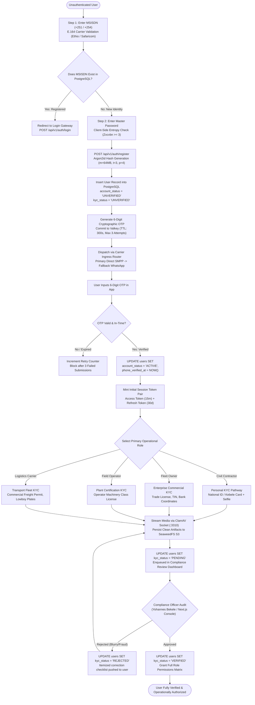
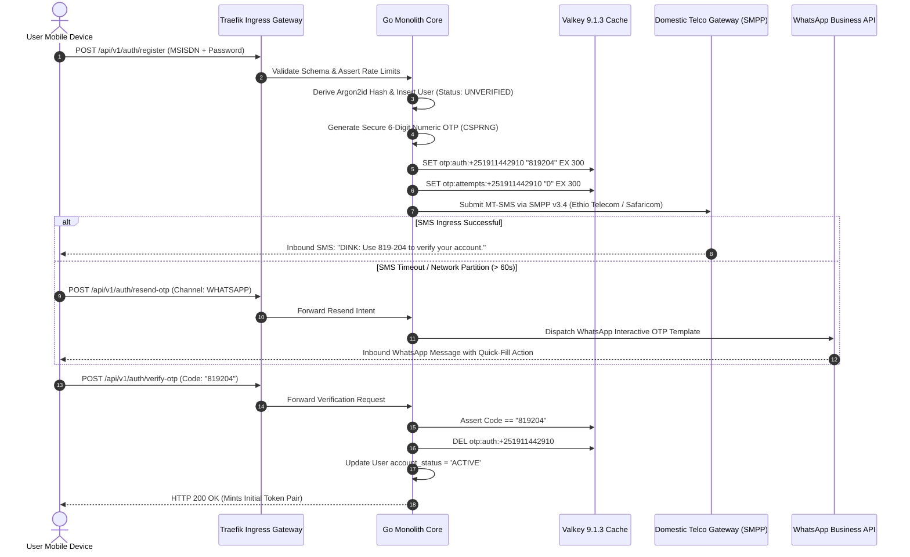
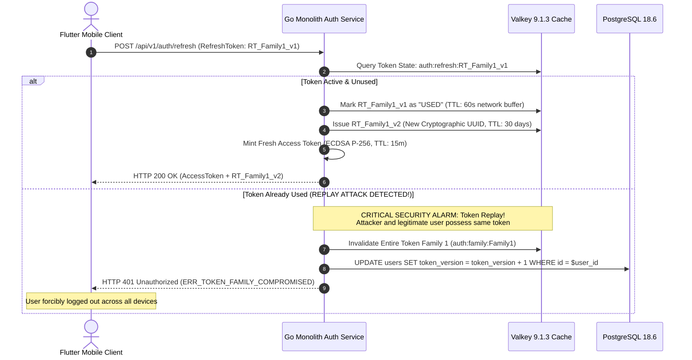
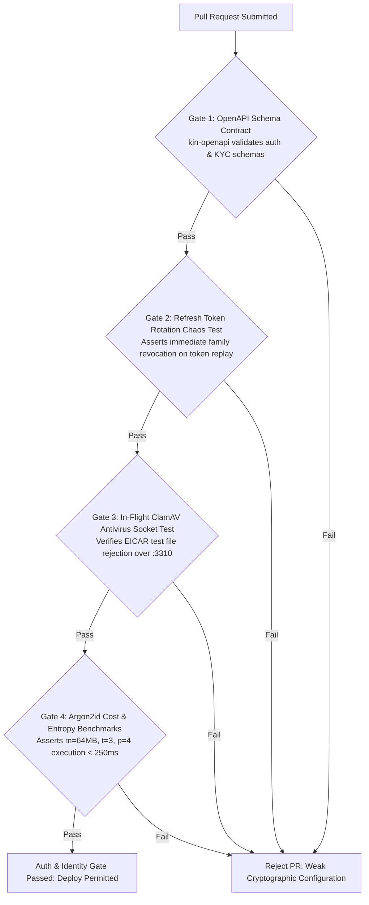

# Heavy Machinery & Logistics Rental Aggregator — Dink Machinery
## Software Requirements Specification — 05.01. User Onboarding, Identity Attestation & Authentication Architecture (`docs/shared/requirements/05-01-registration-authentication.md`)

**Document Identifier:** `SRS-DINK-CORE-V7.0-SEC-05-01`  
**Classification:** Canonical System Requirements Specification & Security Baseline (Single Source of Truth)  
**Governing Standard:** IEEE Std 830-1998 / IEEE/ISO/IEC 29148:2018 (Systems and Software Engineering — Requirements Engineering)  
**Associated Artifacts:** `SRS-DINK-CORE-V7.0` (Full Suite §1–§14), `FLOW-ENTRY-DINK-CORE-V7.0`, `FLOW-RENTER-AUTH-DINK-CORE-V7.0`, `FLOW-OWNER-KYC-DINK-CORE-V7.0`, `FLOW-OPERATOR-LINK-DINK-CORE-V7.0`, `FLOW-PHONE-MIGRATION-DINK-CORE-V7.0`, `FLOW-APPENDIX-AUTH-SEC-DINK-CORE-V7.0`, `ARCH-BACKEND-GO-DINK-CORE-V7.0`, `ARCH-FLUTTER-DINK-CORE-V7.0`, `ARCH-ADMIN-NEXT-DINK-CORE-V7.0`, `ARCH-SEC-DINK-CORE-V7.0`, `DS-DINK-CORE-V7.0`, `DS-PERSONAS-DINK-CORE-V7.0`, `contracts/openapi.yaml`, `ADR-001`, `ADR-002`, `ADR-005`, `ADR-008`, `ADR-010`  
**Target Runtimes:** Go 1.27.3 Backend Monolith, Flutter 3.47.9 / Dart 3.9 (Cross-Platform Mobile), Next.js 16.x (latest CVE security patch) / React 19 (Web Admin & Corporate Portal), PostgreSQL 18.6, Valkey 9.1.3, ClamAV Daemon (:3310), SeaweedFS S3, Isar NoSQL 3.1+  
**Target Personas:** Civil Engineering Contractor (*Dawit Haile-Mariam* / *Patrick Kariuki*), Fleet Owner & Depot Yard Manager (*W/ro Almaz Tesfaye* / *Kamau Ndegwa*), Certified Field Operator (*Mulugeta Tadesse* / *Juma Omwamba*), Lowboy Transporter (*Ato Girma Wolde* / *Samuel Odhiambo*), Compliance Officer & Security Auditor (*Yohannes Bekele*)  
**Target Operating Markets:** Ethiopia (`ET`) & Kenya (`KE`) — Dynamic Multi-Country Parameterization (`LOC-01-BE`)  
**Compliance Standards:** OWASP ASVS 4.0.3 Level 3 (Authentication Verification, Session Management, Cryptographic Storage), RFC 7519 (JWT), RFC 6238 (TOTP MFA), RFC 9457 (Problem Details), ISO 9241-110, W3C WCAG 2.2 Level AAA (Field Mobile) & Level AA (Admin Web), Ethiopian Communications Authority (ECA) Directives, Kenya Data Protection Act 2019  
**Status:** Approved Engineering Baseline

---

## Table of Contents

- 1. [Document Scope & Engineering Mandate](#1-document-scope--engineering-mandate)
  - 1.1 [Purpose & Functional Scope](#11-purpose--functional-scope)
  - 1.2 [Security Guarantees & ASVS Level 3 Authentication Principles](#12-security-guarantees--asvs-level-3-authentication-principles)
- 2. [Onboarding & Identity Lifecycle State Machine](#2-onboarding--identity-lifecycle-state-machine)
  - 2.1 [Registration & Verification State Transition Engine](#21-registration--verification-state-transition-engine)
  - 2.2 [Status State Machine Taxonomy (`UserKYCStatus` & `UserAccountStatus`)](#22-status-state-machine-taxonomy-userkycstatus--useraccountstatus)
- 3. [Core Registration & MSISDN Sovereignty Requirements](#3-core-registration--msisdn-sovereignty-requirements)
  - 3.1 [E.164 Identity Anchoring & Carrier Detection (`REG-01` to `REG-04`)](#31-e164-identity-anchoring--carrier-detection-reg-01-to-reg-04)
  - 3.2 [Password Ingestion & Argon2id Derivation Invariants (`REG-05` to `REG-07`)](#32-password-ingestion--argon2id-derivation-invariants-reg-05-to-reg-07)
  - 3.3 [Terms of Service, Geopolitical Jurisdiction & Privacy Binding (`REG-08`, `REG-09`)](#33-terms-of-service-geopolitical-jurisdiction--privacy-binding-reg-08-reg-09)
- 4. [Multi-Channel Telephony Verification & Anti-Automation Engine](#4-multi-channel-telephony-verification--anti-automation-engine)
  - 4.1 [OTP Challenge Generation & Cryptographic Lifecycles (`AUT-01` to `AUT-05`)](#41-otp-challenge-generation--cryptographic-lifecycles-aut-01-to-aut-05)
  - 4.2 [Carrier Routing, Fallback Protocols & WhatsApp Escalation](#42-carrier-routing-fallback-protocols--whatsapp-escalation)
  - 4.3 [Distributed Rate Limiting & Leaky Bucket Algorithms](#43-distributed-rate-limiting--leaky-bucket-algorithms)
- 5. [Government Identity Attestation & KYC Ingestion Pipeline](#5-government-identity-attestation--kyc-ingestion-pipeline)
  - 5.1 [Personal Identity Requirements (Kebele ID / Passport / National ID) (`KYC-01` to `KYC-05`)](#51-personal-identity-requirements-kebele-id--passport--national-id-kyc-01-to-kyc-05)
  - 5.2 [Commercial Enterprise KYC (Trade License, TIN & VAT Registration) (`KYC-06` to `KYC-10`)](#52-commercial-enterprise-kyc-trade-license-tin--vat-registration-kyc-06-to-kyc-10)
  - 5.3 [In-Flight Malware Defense (ClamAV Streaming Socket `:3310`)](#53-in-flight-malware-defense-clamav-streaming-socket-3310)
  - 5.4 [Compliance Officer Audit Docket & Verification Workflow (`FLOW-13`)](#54-compliance-officer-audit-docket--verification-workflow-flow-13)
- 6. [Authentication Architecture & Session Token Mechanics](#6-authentication-architecture--session-token-mechanics)
  - 6.1 [Stateless Asymmetric Token Minting (ECDSA P-256 / SHA-256) (`AUT-06` to `AUT-09`)](#61-stateless-asymmetric-token-minting-ecdsa-p-256--sha-256-aut-06-to-aut-09)
  - 6.2 [Refresh Token Rotation (RTR) & Immediate Family Revocation Invariant](#62-refresh-token-rotation-rtr--immediate-family-revocation-invariant)
  - 6.3 [Step-Up Authentication & Elevated Operational Scopes (`AUT-10`, `AUT-11`)](#63-step-up-authentication--elevated-operational-scopes-aut-10-aut-11)
  - 6.4 [Global Session Invalidation & Valkey Token Blacklisting](#64-global-session-invalidation--valkey-token-blacklisting)
- 7. [Client Hardware Keystore & Biometric Enclave Integration](#7-client-hardware-keystore--biometric-enclave-integration)
  - 7.1 [Mobile Platform Enclave Integration (iOS Keychain / Android Keystore)](#71-mobile-platform-enclave-integration-ios-keychain--android-keystore)
  - 7.2 [Root, Jailbreak & Hooking Environment Defense](#72-root-jailbreak--hooking-environment-defense)
  - 7.3 [Field Offline Token Buffering & Reconnection Handshake (`ADR-010`)](#73-field-offline-token-buffering--reconnection-handshake-adr-010)
- 8. [Wire Protocol Contracts & RFC 9457 Error Schemas](#8-wire-protocol-contracts--rfc-9457-error-schemas)
  - 8.1 [`POST /api/v1/auth/register`](#81-post-apiv1authregister)
  - 8.2 [`POST /api/v1/auth/verify-otp`](#82-post-apiv1authverify-otp)
  - 8.3 [`POST /api/v1/auth/login`](#83-post-apiv1authlogin)
  - 8.4 [`POST /api/v1/auth/refresh`](#84-post-apiv1authrefresh)
  - 8.5 [`POST /api/v1/kyc/dossier`](#85-post-apiv1kycdossier)
  - 8.6 [RFC 9457 Universal Problem Details Payloads](#86-rfc-9457-universal-problem-details-payloads)
- 9. [Automated Testing Suite & Verification Gates](#9-automated-testing-suite--verification-gates)

---

## 1. Document Scope & Engineering Mandate

### 1.1 Purpose & Functional Scope

This specification establishes **Section 05.01 (User Onboarding, Identity Attestation & Authentication Architecture)** of the canonical Software Requirements Specification (SRS) for **Dink Machinery Version 7.0**.

In the East African heavy plant and freight logistics sector, identity authentication is the bedrock of physical and financial safety. Operating high-hazard construction machinery—such as 30-ton crawler excavators, rough-terrain mobile cranes, and multi-axle lowboy trailers—involves immense capital risk ($100,000\text{ to }300,000\text{ USD}$ per asset) and severe public liability. Unverified actors, fraudulent phone accounts, or forged wire receipts threaten market solvency.

This document formally specifies:
1. The sovereign E.164 MSISDN identity framework anchoring natural persons and commercial enterprises.
2. The multi-channel telephony verification pipeline integrating direct domestic telecom gateways (Ethio Telecom, Safaricom) with automated WhatsApp fallback.
3. The Know Your Customer (KYC) ingestion engine enforcing ClamAV-shielded document verification across national Kebele IDs, passports, Kenyan National IDs, and Ministry of Trade commercial licenses.
4. The OWASP ASVS Level 3 session management lifecycle utilizing asymmetric ECDSA P-256 JWTs, Refresh Token Rotation (RTR), hardware biometric enclaves, and distributed sub-millisecond Valkey session blacklisting.

### 1.2 Security Guarantees & ASVS Level 3 Authentication Principles

The authentication architecture enforces four non-negotiable security guarantees:
1. **Zero Ambient Authority:** Every transactional mutation requires explicit cryptographic attestation. No API handler permits execution without an authenticated, unrevoked JWT containing verified claim scopes.
2. **Short-Lived Ephemeral Bearer Tokens ($900\text{ Seconds}$):** Stateless access tokens enforce an immutable 15-minute expiration boundary. Re-authentication is handled transparently via single-use rotating refresh tokens.
3. **Immediate Replay Family Revocation:** Replaying an already-consumed refresh token immediately triggers a security alarm, revoking the entire token family, bumping the user's `token_version`, and terminating all active sessions globally.
4. **Step-Up Authentication for High-Risk Mutators:** Access to financial coordinates, master phone numbers, or corporate credit drawdowns mandates dynamic hardware-backed step-up authentication (biometrics or master password re-entry).

---

## 2. Onboarding & Identity Lifecycle State Machine

### 2.1 Registration & Verification State Transition Engine



---

### 2.2 Status State Machine Taxonomy (`UserKYCStatus` & `UserAccountStatus`)

User accounts maintain two orthogonal, immutable state variables in PostgreSQL:

#### Account Status (`account_status`)
* **`UNVERIFIED`:** Registration initiated; MSISDN ownership has not been validated via OTP challenge. Token issuance is blocked.
* **`ACTIVE`:** MSISDN validated; user can browse catalogs, manage personal profile data, and submit KYC credentials.
* **`SUSPENDED_SECURITY_FREEZE`:** Account locked by compliance desk or 1-tap kill-switch (`FLOW-15`); active sessions evicted globally.
* **`DELINQUENT_LOCKED`:** Commission debt overdue past 30 days (`FLOW-12`); marketplace discovery access revoked.
* **`TERMINATED`:** Account permanently closed due to confirmed fraud, forged licensing, or contractual default.

#### KYC Verification Status (`kyc_status`)
* **`UNVERIFIED`:** Zero compliance documentation submitted. High-risk operations (booking holds, machine listings, shift sign-offs) are blocked.
* **`PENDING`:** Dossier uploaded, scanned clean by ClamAV, and enqueued in the Next.js Compliance Console (`AD-06-WEB`).
* **`VERIFIED`:** Official credentials audited and approved by a compliance officer. Full operational role permissions granted.
* **`REJECTED`:** Documentation rejected. User is prompted with specific remediation reasons (e.g., *Expired Trade License*).

---

## 3. Core Registration & MSISDN Sovereignty Requirements

### 3.1 E.164 Identity Anchoring & Carrier Detection (`REG-01` to `REG-04`)

In East Africa, the mobile phone number is the sovereign anchor of commercial identity and mobile payments:

```text
+--------------------------------------------------------------------------------------------------+
| MSISDN REGISTRATION SPECIFICATION TABLE                                                          |
+--------------------------------------------------------------------------------------------------+
| ID     | REQUIREMENT                    | PRIORITY | VALIDATION BOUNDS & TECHNICAL BEHAVIOR      |
+--------+--------------------------------+----------+---------------------------------------------+
| REG-01 | E.164 Universal Format Masking | P0       | Phone numbers must normalize to strict E.164|
|        |                                |          | format: +251XXXXXXXXX or +254XXXXXXXXX.     |
+--------+--------------------------------+----------+---------------------------------------------+
| REG-02 | Dynamic Telco Carrier Ingress  | P0       | Mobile client dynamically detects carrier   |
|        | Detection                      |          | prefixes (e.g., 09/07 for Ethio/Safaricom ET|
|        |                                |          | and 07/01 for Safaricom/Airtel KE) and      |
|        |                                |          | renders localized telco trust badges.       |
+--------+--------------------------------+----------+---------------------------------------------+
| REG-03 | Database Uniqueness Constraint | P0       | users.phone_number maintains an immutable   |
|        |                                |          | UNIQUE constraint in PostgreSQL. Existing   |
|        |                                |          | numbers return HTTP 409 Conflict.           |
+--------+--------------------------------+----------+---------------------------------------------+
| REG-04 | Country Code Sovereignty Lock  | P0       | Account jurisdiction ('ET' or 'KE') is bound|
|        |                                |          | at registration, determining currency (ETB/ |
|        |                                |          | KES) and tax calculation engines.           |
+--------------------------------------------------------------------------------------------------+
```

---

### 3.2 Password Ingestion & Argon2id Derivation Invariants (`REG-05` to `REG-07`)

Passwords protect master credentials against credential stuffing and brute-force attacks:
* **`REG-05` Complexity Enforcement:** Minimum length of 10 characters. Must contain at least one uppercase letter, one lowercase letter, one numeric digit, and one special symbol (`!@#$%^&*()_+-=`).
* **`REG-06` Client-Side Entropy Scored via Zxcvbn:** Mobile client evaluates password entropy in real time. Passwords scoring $< 3$ on the Zxcvbn scale are rejected before network transmission.
* **`REG-07` Cryptographic Storage Parameters (Argon2id):**
  Passwords are never stored in plaintext or weak hashes (MD5, SHA-1, standard bcrypt). The Go backend executes the `Argon2id` key derivation function with strict cryptographic parameterization:
  - Memory Cost ($m$): $64\text{ MB}$ ($65,536\text{ KiB}$).
  - Time Cost ($t$): 3 iterations.
  - Parallelism ($p$): 4 concurrent OS threads.
  - Salt Length: 16 cryptographically random bytes sourced from Linux `/dev/urandom`.
  - Hash Length: 32 bytes ($256\text{ bits}$).

---

### 3.3 Terms of Service, Geopolitical Jurisdiction & Privacy Binding (`REG-08`, `REG-09`)

* **`REG-08` Terms & Privacy Acceptance:** Registration requires explicit affirmative opt-in checkboxes referencing versioned platform terms:
  `[X] I agree to the Dink Machinery Rental Terms of Service (v7.0) and Privacy Policy.`
* **`REG-09` Cryptographic Agreement Ledger:** The system records `terms_version`, `accepted_at_timestamp`, `client_ip_address`, and `client_user_agent` in `user_legal_agreements` for statutory non-repudiation.

---

## 4. Multi-Channel Telephony Verification & Anti-Automation Engine

### 4.1 OTP Challenge Generation & Cryptographic Lifecycles (`AUT-01` to `AUT-05`)



* **`AUT-01` High-Entropy Cryptographic Token Generation:** OTP codes are 6-digit pseudo-random numeric strings generated via Go `crypto/rand` (CSPRNG), guaranteeing uniform distribution across $100,000\text{ to }999,999$.
* **`AUT-02` Strict 5-Minute Time-To-Live (TTL):** OTP keys in Valkey enforce an absolute expiration of $300\text{ seconds}$. Expired submissions return HTTP 410 Gone (`ERR_OTP_EXPIRED`).
* **`AUT-03` Attempt Exhaustion Invariant (Max 3 Tries):** Valkey tracks failed verification attempts (`otp:attempts:{phone}`). Upon the 3rd incorrect submission, the OTP key is immediately deleted, invalidating the challenge and enforcing a 15-minute re-initiation cooldown.
* **`AUT-04` In-App Telephony Retriever Integration:** The Flutter app binds to the Android SMS User Consent API and iOS SMS AutoFill, auto-populating the 6-digit reticle without app switching.

---

### 4.2 Carrier Routing, Fallback Protocols & WhatsApp Escalation

Due to regional SMS gateway congestion along infrastructure corridors:
* **Primary Route:** Direct domestic SMPP connections (Ethio Telecom Enterprise Gateway / Safaricom Kenya Bulk API).
* **60-Second Cooldown:** The client displays an animated 60-second radial timer before unlocking alternate dispatch routes.
* **WhatsApp Business Fallback:** If SMS delivery drops, the user can request delivery via the verified Dink Machinery WhatsApp Business channel (`Infobip` / `Twilio`). The identical Valkey OTP token is transmitted, preventing retry race conditions.

---

### 4.3 Distributed Rate Limiting & Leaky Bucket Algorithms

To prevent SMS bombing, financial draining, and distributed denial-of-service (DDoS):

| Rate Limit Boundary Key | Max Requests | Sliding Window Duration | System Enforcement Penalty |
|---|---|---|---|
| `ratelimit:otp:request:phone:{msisdn}` | 3 Dispatches | 15 Minutes | Cooldown lock: Dispatches blocked for 15 minutes. |
| `ratelimit:otp:verify:phone:{msisdn}` | 3 Attempts | 5 Minutes | Challenge killed: OTP voided; requires new registration. |
| `ratelimit:auth:login:ip:{client_ip}` | 10 Attempts | 1 Minute | Gateway block: Traefik rejects IP with HTTP 429. |
| `ratelimit:auth:global:ip:{client_ip}` | 100 Requests | 1 Minute | Distributed edge throttling. |

---

## 5. Government Identity Attestation & KYC Ingestion Pipeline

### 5.1 Personal Identity Requirements (Kebele ID / Passport / National ID) (`KYC-01` to `KYC-05`)

All renting contractors and certified operators must provide verified personal identification:
* **`KYC-01` Accepted Identification Types:**
  - **Ethiopia (`ET`):** Resident Kebele Identity Card, Digital National ID (Fayda), Valid Ethiopian Passport.
  - **Kenya (`KE`):** Kenyan National Identity Card, Valid Kenyan Passport, Alien Registration Card.
* **`KYC-02` Dual-Side Physical Document Capture:** Requires high-resolution camera captures of both Document Front and Document Back.
* **`KYC-03` Live Facial Liveness Reticle:** To prevent synthetic identity fraud, the user must frame their face in the mobile camera viewfinder. The app runs on-device depth and blink detection, capturing a live biometric reference selfie.
* **`KYC-04` Document Number & Expiry Extraction:** User enters document registration number and expiration date, validated against official national formatting regex patterns.
* **`KYC-05` Non-Expiring Status Invariant:** Documents expiring within $< 30\text{ days}$ of registration are rejected.

---

### 5.2 Commercial Enterprise KYC (Trade License, TIN & VAT Registration) (`KYC-06` to `KYC-10`)

Fleet owners, corporate contractors, and lowboy logistics providers must provide corporate verification:
* **`KYC-06` Commercial Trade License Document:** Clear photograph or PDF of the registered Ministry of Trade and Regional Integration (Ethiopia) or Registrar of Companies (Kenya) operational license.
* **`KYC-07` Tax Identification Number (TIN):** Mandatory 10-digit TIN string. Format and check-digits are validated against the Ethiopian Ministry of Revenue / Kenya Revenue Authority (KRA) algorithms.
* **`KYC-08` Value Added Tax (VAT) Certificate:** VAT registration certificate for corporate invoicing and withholding tax compliance.
* **`KYC-09` Commercial Bank Account Coordinates:** Verified bank name, branch, account name, and account number matching the registered corporate entity name.
* **`KYC-10` Principal Executive Attestation:** Digital statement signed by the Managing Partner or Director affirming legal ownership of listed machinery.

---

### 5.3 In-Flight Malware Defense (ClamAV Streaming Socket `:3310`)

All document uploads and facial verification captures must pass an in-flight security boundary:

```text
Client Multipart Upload -> Traefik Ingress Gateway -> Go Monolith Stream Reader
                                                            |
                                               TCP Socket :3310 (zINSTREAM)
                                                            v
                                                  ClamAV Malware Daemon
                                                            |
                                        +-------------------+-------------------+
                                        | Clean (OK)                            | Infected (Virus)
                                        v                                       v
                             Strip EXIF Metadata                     Abort Transaction (HTTP 422)
                             Transcode to WebP (Quality 82%)         Log Security Incident
                             Commit to SeaweedFS S3 Vault            Blacklist Device Fingerprint
```

1. **Zero Disk Spooling:** Uploaded bytes stream directly from the HTTP multipart reader across the Unix domain or TCP socket to ClamAV. Files are scanned in-flight before touching physical storage.
2. **Metadata Scrubbing:** Clean images have all EXIF, GPS location, and camera hardware tags stripped.
3. **Optimized Archival:** Documents and photos are transcoded to WebP (Quality 82%, Max dimension $2048 \times 2048\text{ px}$) and archived in SeaweedFS S3 under cryptographic content hashes (`s3://dink-kyc-vault/users/{id}/`).

---

### 5.4 Compliance Officer Audit Docket & Verification Workflow (`FLOW-13`)

Once uploaded, the dossier appears in the Next.js Web Admin Console (`AD-06-WEB`):
* **Compliance Workbench:** Compliance Officer *Yohannes Bekele* compares the live facial reticle capture against the Kebele/Passport document photo using synchronized side-by-side zoom viewports.
* **Commercial Verification:** Yohannes validates the TIN and Trade License against the official government portal.
* **Adjudication Decisions:**
  - **Approval:** Transitions `users.kyc_status = 'VERIFIED'`. System dispatches multi-channel notification and unlocks fleet publishing and booking capabilities.
  - **Rejection:** Transitions `users.kyc_status = 'REJECTED'`. Yohannes selects structured rejection reasons (`BLURRY_DOCUMENT_CAPTURE`, `EXPIRED_TRADE_LICENSE`, `NAME_TIN_MISMATCH`). An itemized remediation checklist is pushed to the user's dashboard.

---

## 6. Authentication Architecture & Session Token Mechanics

### 6.1 Stateless Asymmetric Token Minting (ECDSA P-256 / SHA-256) (`AUT-06` to `AUT-09`)

Authentication on Dink Machinery utilizes stateless JSON Web Tokens (RFC 7519) signed via asymmetric cryptography:
* **`AUT-06` Algorithm Standard:** `ES256` (ECDSA using NIST Curve P-256 and SHA-256).
* **`AUT-07` Key Storage Separation:** Private signing keys reside strictly inside cloud Hardware Security Modules (AWS KMS / HashiCorp Vault). Reverse proxies and microservices verify signatures statelessly using public keys exposed via `GET /.well-known/jwks.json`.
* **`AUT-08` Short-Lived Access Tokens ($900\text{ Seconds}$):** Access tokens remain valid for exactly 15 minutes.
* **`AUT-09` Cryptographic Claims Envelope:**
  ```json
  {
    "sub": "usr_018f6a9e-876b-7341-a189-bc0192841029",
    "iss": "[https://api.dinkmachinery.com](https://api.dinkmachinery.com)",
    "aud": "dink-core-api",
    "exp": 1730112900,
    "nbf": 1730112000,
    "iat": 1730112000,
    "jti": "tok_99182a01-4b12-4f9a-8812-7b9a4c10bc21",
    "context": {
      "active_role": "EQUIPMENT_OWNER",
      "active_org_id": null,
      "jurisdiction": "ET",
      "kyc_status": "VERIFIED",
      "token_version": 4
    },
    "permissions": [
      "fleet.asset.create",
      "fleet.asset.pricing",
      "payment.receipt.audit",
      "finance.wallet.view"
    ]
  }
  ```

---

### 6.2 Refresh Token Rotation (RTR) & Immediate Family Revocation Invariant

To balance security with field usability, long-lived access is governed by **Refresh Token Rotation (OWASP ASVS §3.6)**:



---

### 6.3 Step-Up Authentication & Elevated Operational Scopes (`AUT-10`, `AUT-11`)

Standard access tokens cannot execute high-impact mutations:
* **Trigger Operations:** Altering bank account coordinates (`BK-06`), phone number migration (`FLOW-15`), corporate credit line drawdowns (`FLOW-14`), or authorizing dispute payout settlements (`FLOW-08`).
* **Protocol:**
  1. The API intercepts the request, returning HTTP 403 Forbidden (`ERR_STEP_UP_AUTHENTICATION_REQUIRED`).
  2. The client prompts the user for biometric authentication (FaceID/Fingerprint) or master password re-entry.
  3. The client calls `POST /api/v1/auth/step-up`.
  4. The server returns a short-lived **Step-Up Execution Ticket** (TTL: $300\text{ seconds}$), passed in header `X-Dink-StepUp-Token`.
  5. The target mutation executes, immediately consuming and invalidating the ticket.

---

### 6.4 Global Session Invalidation & Valkey Token Blacklisting

When an emergency event occurs (phone theft, SIM swap, compromised device):
1. **Database Version Bump:** PostgreSQL increments `users.token_version`:
   $$\text{token\_version} = \text{token\_version} + 1$$
2. **Valkey Session Purge:** Background routines delete all keys matching:
   `auth:session:{user_id}:*`
3. **Edge Ingress Enforcement:** Traefik reverse proxies cache `token_version` with a 60-second TTL. Inbound requests presenting JWTs with older `token_version` values are rejected with HTTP 401 Unauthorized (`ERR_TOKEN_REVOKED`) in $< 1.0\text{ ms}$.

---

## 7. Client Hardware Keystore & Biometric Enclave Integration

### 7.1 Mobile Platform Enclave Integration (iOS Keychain / Android Keystore)

Tokens and cryptographic private keys are never stored in unencrypted local storage, Shared Preferences, or raw SQLite:
* **Apple iOS:** Keys are committed to **iOS Keychain Services** with attribute `kSecAccessControlBiometryAny`, requiring Apple Secure Enclave hardware biometric attestation to read.
* **Google Android:** Keys are stored in the **Android Keystore System** using hardware-backed Master Keys (`AES-256-GCM`), requiring user presence via the Android BiometricPrompt API (`BIOMETRIC_STRONG`).

---

### 7.2 Root, Jailbreak & Hooking Environment Defense

To prevent memory-scraping attacks on modified field devices:
* The Flutter app executes integrity checks on startup using native platform APIs:
  - **Android:** Google Play Integrity API (Verifying `MEETS_STRONG_INTEGRITY`).
  - **iOS:** Apple DeviceCheck & App Attest APIs.
* If a rooted environment, Magisk daemon, or Frida hooking framework is detected:
  - Application terminates immediately.
  - Wipes all cached keys from Isar NoSQL and Keychain.
  - Returns RFC 9457 error: `ERR_ENVIRONMENT_COMPROMISED`.

---

### 7.3 Field Offline Token Buffering & Reconnection Handshake (`ADR-010`)

When working in remote quarries with zero cellular connectivity:
* The 15-minute access token will expire during physical operations.
* **72-Hour Offline Token Buffer:** Operations permitted offline (inspections, daily shift meters, breakdown logs) are authorized using the locally cached cryptographic booking token (`SharedHandoverSecret`) stored in Isar NoSQL (`FLOW-APPENDIX-A`).
* Upon restoring 3G/4G connectivity, the client executes a single batch sync, exchanging its offline outbox for a refreshed session token pair.

---

## 8. Wire Protocol Contracts & RFC 9457 Error Schemas

### 8.1 `POST /api/v1/auth/register`

Initiates user registration and dispatches initial OTP challenge.

#### Request Headers
```http
POST /api/v1/auth/register HTTP/1.1
Host: api.dinkmachinery.com
Content-Type: application/json
X-Country-Code: ET
```

#### Request Payload
```json
{
  "phoneNumber": "+251911442910",
  "password": "StrongPassword2026!",
  "fullName": "W/ro Almaz Tesfaye",
  "primaryRole": "EQUIPMENT_OWNER",
  "termsVersion": "v7.0",
  "deviceFingerprint": {
    "deviceId": "samsung_sm_s928b_uuid_88192a",
    "deviceModel": "Samsung Galaxy S24 Ultra",
    "osVersion": "Android 16",
    "appVersion": "7.0.0"
  }
}
```

#### Response: `HTTP 201 Created`
```json
{
  "success": true,
  "data": {
    "userId": "usr_018f6a9e-876b-7341-a189-bc0192841029",
    "phoneNumber": "+251911442910",
    "accountStatus": "UNVERIFIED",
    "otpExpiresInSeconds": 300,
    "resendAvailableInSeconds": 60
  },
  "timestamp": "2026-10-28T09:45:00Z"
}
```

---

### 8.2 `POST /api/v1/auth/verify-otp`

Submits 6-digit challenge code to verify MSISDN and activate account.

#### Request Payload
```json
{
  "phoneNumber": "+251911442910",
  "otpCode": "819204"
}
```

#### Response: `HTTP 200 OK`
```json
{
  "success": true,
  "data": {
    "userId": "usr_018f6a9e-876b-7341-a189-bc0192841029",
    "accountStatus": "ACTIVE",
    "kycStatus": "UNVERIFIED",
    "tokens": {
      "accessToken": "eyJhbGciOiJFUzI1NiIs...",
      "tokenType": "Bearer",
      "expiresInSeconds": 900,
      "refreshToken": "rt_019a8f4c_uuid_family_a"
    }
  },
  "timestamp": "2026-10-28T09:46:00Z"
}
```

---

### 8.3 `POST /api/v1/auth/login`

Standard authentication endpoint for existing registered users.

#### Request Payload
```json
{
  "identifier": "+251911442910",
  "password": "StrongPassword2026!",
  "deviceFingerprint": {
    "deviceId": "samsung_sm_s928b_uuid_88192a",
    "deviceModel": "Samsung Galaxy S24 Ultra",
    "osVersion": "Android 16"
  }
}
```

#### Response: `HTTP 200 OK`
```json
{
  "success": true,
  "data": {
    "user": {
      "id": "usr_018f6a9e-876b-7341-a189-bc0192841029",
      "fullName": "W/ro Almaz Tesfaye",
      "phoneNumber": "+251911442910",
      "primaryRole": "EQUIPMENT_OWNER",
      "accountStatus": "ACTIVE",
      "kycStatus": "VERIFIED"
    },
    "tokens": {
      "accessToken": "eyJhbGciOiJFUzI1NiIs...",
      "tokenType": "Bearer",
      "expiresInSeconds": 900,
      "refreshToken": "rt_019a8f4d_uuid_family_b"
    }
  },
  "timestamp": "2026-10-28T09:47:00Z"
}
```

---

### 8.4 `POST /api/v1/auth/refresh`

Rotates single-use refresh token and issues fresh access token.

#### Request Payload
```json
{
  "refreshToken": "rt_019a8f4d_uuid_family_b"
}
```

#### Response: `HTTP 200 OK`
```json
{
  "success": true,
  "data": {
    "accessToken": "eyJhbGciOiJFUzI1NiIs...",
    "tokenType": "Bearer",
    "expiresInSeconds": 900,
    "refreshToken": "rt_019a8f4e_uuid_family_b_v2"
  },
  "timestamp": "2026-10-28T10:02:00Z"
}
```

---

### 8.5 `POST /api/v1/kyc/dossier`

Uploads government identification documents and commercial trade licenses.

#### Request Headers
```http
POST /api/v1/kyc/dossier HTTP/1.1
Host: api.dinkmachinery.com
Content-Type: multipart/form-data
Authorization: Bearer <accessToken>
```

#### Multipart Form Body
* `dossierType`: String (`"COMMERCIAL_OWNER_KYC"`)
* `tradeLicenseNumber`: String (`"ET-MOTI-2024-99120"`)
* `tinNumber`: String (`"0048192041"`)
* `tradeLicenseDocument`: Binary Image/PDF (Scanned via ClamAV)
* `vatCertificateDocument`: Binary Image/PDF (Scanned via ClamAV)
* `principalIdFront`: Binary Image (Front of Kebele ID / Passport)
* `principalIdBack`: Binary Image (Back of Kebele ID / Passport)
* `liveFacialPhoto`: Binary WebP (Live camera reticle selfie)

#### Response: `HTTP 201 Created`
```json
{
  "success": true,
  "data": {
    "dossierId": "kyc_019a8f50-4b12",
    "status": "PENDING",
    "reviewSlaHours": 24,
    "submittedAt": "2026-10-28T10:15:00Z"
  },
  "timestamp": "2026-10-28T10:15:01Z"
}
```

---

### 8.6 RFC 9457 Universal Problem Details Payloads

#### Example: Phone Number Already Registered (`HTTP 409 Conflict`)
```json
{
  "type": "[https://api.dinkmachinery.com/errors/phone-already-registered](https://api.dinkmachinery.com/errors/phone-already-registered)",
  "title": "Phone Number Already in Use",
  "status": 409,
  "detail": "The MSISDN +251 91 144 2910 is already registered to an active account. Log in or use account recovery.",
  "instance": "/api/v1/auth/register",
  "code": "ERR_PHONE_ALREADY_REGISTERED",
  "invalidParams": [
    {
      "name": "phoneNumber",
      "reason": "Collision with existing user record."
    }
  ]
}
```

#### Example: Refresh Token Replay Compromise (`HTTP 401 Unauthorized`)
```json
{
  "type": "[https://api.dinkmachinery.com/errors/token-replay-detected](https://api.dinkmachinery.com/errors/token-replay-detected)",
  "title": "Token Replay Detected — Session Revoked",
  "status": 401,
  "detail": "Submitted refresh token has already been consumed. Potential token theft detected. All active sessions have been terminated for security.",
  "instance": "/api/v1/auth/refresh",
  "code": "ERR_TOKEN_FAMILY_COMPROMISED"
}
```

#### Example: In-Flight Antivirus Malicious Payload Detected (`HTTP 422 Unprocessable Entity`)
```json
{
  "type": "[https://api.dinkmachinery.com/errors/malware-detected](https://api.dinkmachinery.com/errors/malware-detected)",
  "title": "Malware Ingestion Shield Triggered",
  "status": 422,
  "detail": "Uploaded file 'trade_license.pdf' failed ClamAV antivirus stream inspection. Binary stream rejected.",
  "instance": "/api/v1/kyc/dossier",
  "code": "ERR_FILE_MALWARE_DETECTED",
  "invalidParams": [
    {
      "name": "tradeLicenseDocument",
      "reason": "Infected with signature Win.Trojan.Generic-9912"
    }
  ]
}
```

---

## 9. Automated Testing Suite & Verification Gates



1. **OpenAPI Schema Contract Gate (`kin-openapi`):** Asserts all registration, OTP verification, login, refresh, step-up, and KYC endpoints match `contracts/openapi.yaml`.
2. **Refresh Token Rotation (RTR) Chaos Benchmark:** Automated test spins up two concurrent threads attempting to exchange the identical refresh token. Asserts:
   - Exactly **1 thread** succeeds in token rotation.
   - The **2nd thread** trips the security replay alarm, invalidating the entire family.
   - All subsequent queries return HTTP 401 Unauthorized.
3. **In-Flight ClamAV Antivirus Socket Gate:** Streams the standardized `EICAR` test signature to `/api/v1/kyc/dossier` over TCP socket `:3310`, asserting that ClamAV flags the payload and the Go backend returns HTTP 422 `ERR_FILE_MALWARE_DETECTED` with zero file remnants written to SeaweedFS S3.
4. **Argon2id Parameter & Memory Benchmark:** Asserts that the password hashing implementation strictly enforces $m=65536$, $t=3$, $p=4$, verifying thread execution completes in $< 250\text{ ms}$ on target production server profiles.

---

*This document establishes the canonical functional requirements, cryptographic protocols, KYC workflows, and wire protocol contracts for User Onboarding, Identity Attestation & Authentication Architecture in Dink Machinery Version 7.0. All downstream Flutter mobile screens, Go backend identity services, Traefik edge configurations, and Next.js admin consoles must strictly conform to this specification.*