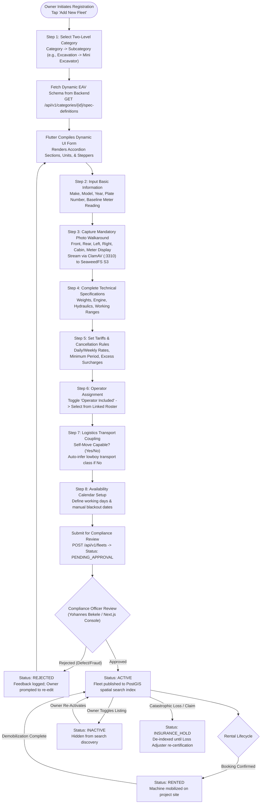
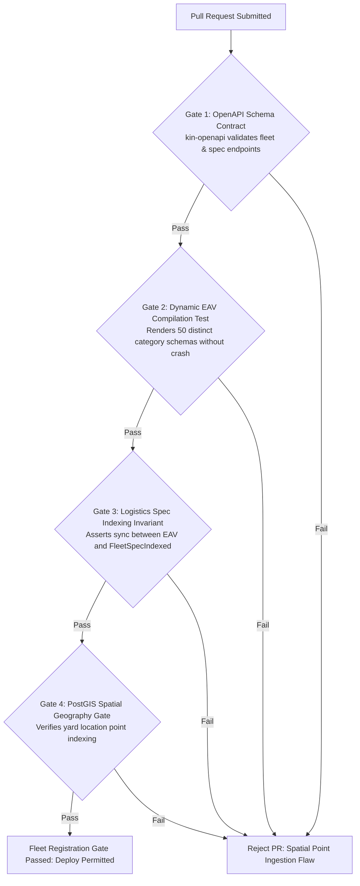

# Heavy Machinery & Logistics Rental Aggregator — Dink Machinery
## Software Requirements Specification — 05.02. Fleet Registration — Machinery & Logistics Specification Architecture (`docs/shared/requirements/05-02-fleet-registration-machinery-logistics.md`)

**Document Identifier:** `SRS-DINK-CORE-V7.0-SEC-05-02`  
**Classification:** Canonical System Requirements Specification & Architecture Baseline (Single Source of Truth)  
**Governing Standard:** IEEE Std 830-1998 / IEEE/ISO/IEC 29148:2018 (Systems and Software Engineering — Requirements Engineering)  
**Associated Artifacts:** `SRS-DINK-CORE-V7.0` (§5.2, §5.8, §10, §11), `FLOW-FLEET-REG-DINK-CORE-V7.0`, `FLOW-DISCOVERY-DINK-CORE-V7.0`, `FLOW-LOGISTICS-DINK-CORE-V7.0`, `FLOW-CONCURRENCY-LOCKING-DINK-CORE-V7.0`, `ARCH-BACKEND-GO-DINK-CORE-V7.0`, `ARCH-FLUTTER-DINK-CORE-V7.0`, `ARCH-ADMIN-NEXT-DINK-CORE-V7.0`, `ARCH-SEC-DINK-CORE-V7.0`, `DS-DINK-CORE-V7.0`, `DS-PERSONAS-DINK-CORE-V7.0`, `contracts/openapi.yaml`, `ADR-001`, `ADR-002`, `ADR-005`, `ADR-008`, `ADR-010`  
**Target Runtimes:** Go 1.24 Backend Monolith, Flutter 3.44 / Dart 3.9 (Cross-Platform Mobile), Next.js 16 / React 19 (Web Admin & Corporate Portal), PostgreSQL 18.4 + PostGIS 3.4, Valkey 8.0, ClamAV Daemon (:3310), SeaweedFS S3, Isar NoSQL 3.1+  
**Target Personas:** Equipment Fleet Owner (*W/ro Almaz Tesfaye* / *Kamau Ndegwa*), Certified Field Operator (*Mulugeta Tadesse* / *Juma Omwamba*), Lowboy Transporter (*Ato Girma Wolde* / *Samuel Odhiambo*), Compliance Officer & Fleet Inspector (*Yohannes Bekele*)  
**Target Operating Markets:** Ethiopia (`ET`) & Kenya (`KE`) — Dynamic Multi-Country Parameterization (`LOC-01-BE`)  
**Compliance Standards:** OWASP ASVS 4.0.3 Level 3 (Input Validation, File Upload Integrity & Non-Repudiation), RFC 9457 (Problem Details), ISO 9241-110, W3C WCAG 2.2 Level AAA (Field Mobile) & Level AA (Admin Web), Ethiopian Federal Transport Authority Directives, KeNHA Axle Load Regulations  
**Status:** Approved Engineering Baseline

---

## Table of Contents

- 1. [Document Scope & Engineering Mandate](#1-document-scope--engineering-mandate)
  - 1.1 [Purpose & Functional Scope](#11-purpose--functional-scope)
  - 1.2 [Architectural Principles & Core Invariants](#12-architectural-principles--core-invariants)
- 2. [Fleet Ingestion Lifecycle & State Transition Engine](#2-fleet-ingestion-lifecycle--state-transition-engine)
  - 2.1 [Fleet State Transition Flowchart](#21-fleet-state-transition-flowchart)
  - 2.2 [Status State Machine Taxonomy (`FleetStatus`)](#22-status-state-machine-taxonomy-fleetstatus)
- 3. [Basic Information & Physical Conditioning Specifications](#3-basic-information--physical-conditioning-specifications)
  - 3.1 [Core Fleet Identification Requirements (`FL-01` to `FL-06`)](#31-core-fleet-identification-requirements-fl-01-to-fl-06)
  - 3.2 [Baseline Mechanical Hour Meter Anchoring Protocol](#32-baseline-mechanical-hour-meter-anchoring-protocol)
  - 3.3 [Multi-Angle Photo Walkaround & ClamAV Streaming Verification](#33-multi-angle-photo-walkaround--clamav-streaming-verification)
- 4. [Dynamic Entity-Attribute-Value (EAV) Technical Specifications](#4-dynamic-entity-attribute-value-eav-technical-specifications)
  - 4.1 [Relational Schema: Categories, Field Groups & Field Definitions](#41-relational-schema-categories-field-groups--field-definitions)
  - 4.2 [Dynamic Specification Requirements (`FL-07` to `FL-15`)](#42-dynamic-specification-requirements-fl-07-to-fl-15)
  - 4.3 [Logistics-Critical Extraction & Performance Indexing (`FleetSpecIndexed`)](#43-logistics-critical-extraction--performance-indexing-fleetspecindexed)
  - 4.4 [Standard Category Specification Taxonomy (Mini Excavators & Lowboys)](#44-standard-category-specification-taxonomy-mini-excavators--lowboys)
- 5. [Tariff Modeling, Booking Rules & Prepayment Thresholds](#5-tariff-modeling-booking-rules--prepayment-thresholds)
  - 5.1 [Commercial Tariff & Duration Parameters (`FL-16` to `FL-24`)](#51-commercial-tariff--duration-parameters-fl-16-to-fl-24)
  - 5.2 [Excess Hour Surcharge Computation Mechanics](#52-excess-hour-surcharge-computation-mechanics)
  - 5.3 [Bilateral Cancellation Penalty Structures](#53-bilateral-cancellation-penalty-structures)
- 6. [Operator Crew Assignment & Multi-Shift Roster Architecture](#6-operator-crew-assignment--multi-shift-roster-architecture)
  - 6.1 [Operator Assignment Requirements (`FL-25` to `FL-27`)](#61-operator-assignment-requirements-fl-25-to-fl-27)
  - 6.2 [Bilateral Operator Invitation & Yard Linking Protocol](#62-bilateral-operator-invitation--yard-linking-protocol)
- 7. [Integrated Heavy Haulage & Lowboy Logistics Coupling](#7-integrated-heavy-haulage--lowboy-logistics-coupling)
  - 7.1 [Logistics Configuration Requirements (`FL-28` to `FL-31`)](#71-logistics-configuration-requirements-fl-28-to-fl-31)
  - 7.2 [Self-Move Capability & Automated Transport Class Inference](#72-self-move-capability--automated-transport-class-inference)
  - 7.3 [Sub-Booking Graph Architecture (`ParentBookingID`)](#73-sub-booking-graph-architecture-parentbookingid)
- 8. [Availability Calendars, Blackouts & Admin Approval Workflows](#8-availability-calendars-blackouts--admin-approval-workflows)
  - 8.1 [Owner Availability Blackout Matrix (`FL-35`)](#81-owner-availability-blackout-matrix-fl-35)
  - 8.2 [Admin Approval Queue, Verification & Rejection Workflows (`FL-36`, `FL-37`)](#82-admin-approval-queue-verification--rejection-workflows-fl-36-fl-37)
- 9. [Wire Protocol Contracts & RFC 9457 Error Schemas](#9-wire-protocol-contracts--rfc-9457-error-schemas)
  - 9.1 [`POST /api/v1/fleets`](#91-post-apiv1fleets)
  - 9.2 [`GET /api/v1/categories/{id}/spec-definitions`](#92-get-apiv1categoriesidspec-definitions)
  - 9.3 [RFC 9457 Universal Problem Details Payloads](#93-rfc-9457-universal-problem-details-payloads)
- 10. [Automated Testing Suite & Verification Gates](#10-automated-testing-suite--verification-gates)

---

## 1. Document Scope & Engineering Mandate

### 1.1 Purpose & Functional Scope

This specification establishes **Section 05.02 (Fleet Registration — Machinery & Logistics Specification Architecture)** of the canonical Software Requirements Specification (SRS) for **Dink Machinery Version 7.0**.

The fleet onboarding and catalog management system is the operational core of the Dink Machinery aggregator platform. In East Africa, heavy construction equipment encompasses dozens of engineering classifications (crawler excavators, motor graders, wheel loaders, telescopic cranes, asphalt rollers, concrete pumps) and specialized transport configurations (multi-axle lowboys, step-decks, extendable flatbeds). Each machinery class features distinct mechanical metrics, hydraulic parameters, and transport dimensions.

This document formally specifies:
1. The dynamic, metadata-driven Entity-Attribute-Value (EAV) specification engine driving category-specific mobile form generation without application code deployments.
2. The mechanical baseline hour meter anchoring protocol and multi-angle photo walkaround standards enforced via ClamAV-shielded ingestion pipelines.
3. The commercial tariff modeling, excess operating hour formulas, and cancellation penalty structures.
4. The integrated logistics configuration rules linking non-self-moving plant machinery to lowboy transport trailers.
5. The operator assignment roster and administrative verification approval queues.

### 1.2 Architectural Principles & Core Invariants

1. **Metadata-Driven Form Generation (`FL-07`):** The Flutter mobile application and Next.js admin portal compile technical specification viewports dynamically from server-driven definitions (`SpecFieldDefinition`). Form widgets, numerical steppers, unit suffixes, and validation bounds are configured entirely in PostgreSQL.
2. **Strict Monotonic Meter Non-Regression (`FL-04`):** The cabin mechanical hour meter reading recorded during fleet onboarding establishes an immutable baseline. Under no circumstances can a future check-in, extension, or return meter reading register below this baseline:
   $$\text{Baseline Meter} \le \text{Handover Check-In Meter} \le \text{Return Check-Out Meter}$$
3. **Logistics Dual-Persistence Invariant (`FL-14`):** To avoid compute-heavy JSON/EAV queries during spatial discovery, every specification field designated as logistics-critical (`is_logistics_critical = true`) is automatically synchronized to a denormalized, indexed relational table (`FleetSpecIndexed`).
4. **Mandatory Multi-Angle Physical Conditioning (`FL-05`):** Equipment onboarding mandates at least 5 distinct physical walkaround photographs (Front, Rear, Left, Right, Cabin/Interior) plus a dedicated cabin hour meter close-up, pre-screened for malware via ClamAV streaming sockets (:3310).
5. **Universal PostGIS Spatial Indexing:** Machine depot yard locations are persisted as PostGIS geography points (`ST_Point(lng, lat)`), backed by spatial GiST indexes for sub-50ms radius discovery queries.

---

## 2. Fleet Ingestion Lifecycle & State Transition Engine

### 2.1 Fleet State Transition Flowchart



---

### 2.2 Status State Machine Taxonomy (`FleetStatus`)

The operational state of every registered fleet asset is governed by an immutable status enumeration:

| Status Identifier | Public Search Visibility | Can Be Reserved? | Description & Transition Invariants |
|---|:---:|:---:|---|
| **`DRAFT`** | ❌ No | ❌ No | Incomplete registration dossier saved locally in Isar NoSQL or server draft cache. |
| **`PENDING_APPROVAL`** | ❌ No | ❌ No | Dossier submitted by owner; queued in Next.js Compliance Approval Console (`AD-06-WEB`). |
| **`ACTIVE`** | ✅ Yes | ✅ Yes | Fully approved and verified; indexed in PostGIS 3.4 spatial search clusters. |
| **`RENTED`** | ✅ Yes (Show Busy) | ❌ No (Overlap) | Asset is actively deployed under an in-flight booking contract (`ACTIVE` / `RETURN_INITIATED`). |
| **`INACTIVE`** | ❌ No | ❌ No | Voluntarily paused or deactivated by the equipment owner. |
| **`INSURANCE_HOLD`** | ❌ No | ❌ No | Locked due to catastrophic site incident (`FLOW-19`); requires Loss Adjuster certificate to clear. |
| **`DELINQUENT_LOCKED`** | ❌ No | ❌ No | Platform commission debt $> 30\text{ days}$ overdue (`FLOW-12`); suspended from search. |
| **`DECOMMISSIONED`** | ❌ No | ❌ No | Permanently retired, scrapped, or declared Total Constructive Loss (TOL). |

---

## 3. Basic Information & Physical Conditioning Specifications

### 3.1 Core Fleet Identification Requirements (`FL-01` to `FL-06`)

Every registered machine requires core identification parameters:

```text
+--------------------------------------------------------------------------------------------------+
| BASIC INFORMATION SPECIFICATION TABLE                                                            |
+--------------------------------------------------------------------------------------------------+
| ID    | REQUIREMENT                     | PRIORITY | VALIDATION BOUNDS & TECHNICAL BEHAVIOR      |
+-------+---------------------------------+----------+---------------------------------------------+
| FL-01 | Category Selection              | P0       | Two-level cascading dropdowns. Root category|
|       |                                 |          | (e.g. Earthmoving) -> Subcategory (e.g.     |
|       |                                 |          | Mini Excavator). Managed via Category table.|
+-------+---------------------------------+----------+---------------------------------------------+
| FL-02 | Make, Model & Manufacture Year  | P0       | Text inputs. Make & Model (max 64 chars).   |
|       |                                 |          | Year picker: 1980 <= Year <= (Current Year+1)|
+-------+---------------------------------+----------+---------------------------------------------+
| FL-03 | Plate / Chassis Serial Number   | P0       | National registration plate (e.g. ET-3-99120)|
|       |                                 |          | and vehicle chassis PIN (VIN) serial string.|
+-------+---------------------------------+----------+---------------------------------------------+
| FL-04 | Baseline Hour Meter Reading     | P0       | Non-negative decimal (e.g. 1450.50). Must   |
|       |                                 |          | upload a verified photo of cabin meter.     |
+-------+---------------------------------+----------+---------------------------------------------+
| FL-05 | Mandatory Photo Walkaround      | P0       | Exactly >= 5 exterior/interior angles plus   |
|       |                                 |          | meter close-up. JPG/PNG/WebP, max 10MB/each.|
+-------+---------------------------------+----------+---------------------------------------------+
| FL-06 | Primary Fuel / Energy Type      | P0       | Standardized Enum: Diesel, Electric, Petrol,|
|       |                                 |          | Hybrid, Biodiesel.                          |
+--------------------------------------------------------------------------------------------------+
```

---

### 3.2 Baseline Mechanical Hour Meter Anchoring Protocol

The cabin mechanical engine hour meter is the primary legal metric governing equipment usage, wear-and-tear, and billing calculations:
* **Shutter Steady-State Validation:** Photos of the mechanical hour meter must be captured through the application's built-in camera reticle. Mobile accelerometer drift must verify $< 0.05g$ variance during shutter actuation to prevent blurry photos.
* **OCR Pre-Fill & Manual Confirmation:** The Flutter client runs on-device Google ML Kit Text Recognition to extract numeric digits from the meter display, populating the input field for owner verification.
* **Storage Invariant:** The confirmed numeric value is committed to `fleets.baseline_meter_hours` in PostgreSQL with decimal precision `NUMERIC(10, 2)`.

---

### 3.3 Multi-Angle Photo Walkaround & ClamAV Streaming Verification

To prevent fraudulent listings, copyright infringements, or security vulnerabilities:
1. **Mandatory 5-Angle Walkaround:**
   - Angle 1: Full Front Elevation (showing blade, boom, or bucket in rest position).
   - Angle 2: Full Rear Elevation (showing engine counterweight and radiator exhaust).
   - Angle 3: Left Track / Tire Assembly (showing undercarriage wear and grouser pads).
   - Angle 4: Right Track / Tire Assembly.
   - Angle 5: Enclosed Operator Cabin Interior (showing control levers, seat, and display console).
   - Angle 6: Cabin Hour Meter Display (High-resolution, legible close-up).
2. **In-Flight Antivirus Pipeline:**
   Every binary upload streams over a TCP socket (`:3310`) to the ClamAV daemon using the `zINSTREAM` protocol. Payloads containing viruses, trojans, or malformed headers are rejected with RFC 9457 HTTP 422 Unprocessable Entity (`ERR_FILE_MALWARE_DETECTED`).
3. **Storage & Optimization:** Clean image streams are transcoded into WebP format (Quality 82%, Max dimension $2048 \times 2048\text{ px}$) and persisted in SeaweedFS S3 storage with SHA-256 content addressing.

---

## 4. Dynamic Entity-Attribute-Value (EAV) Technical Specifications

### 4.1 Relational Schema: Categories, Field Groups & Field Definitions

```mermaid
erDiagram
    Category ||--o{ Category : "parent of"
    Category ||--o{ SpecFieldGroup : "contains"
    SpecFieldGroup ||--o{ SpecFieldDefinition : "defines"
    Fleet ||--o{ FleetSpecValue : "stores"
    SpecFieldDefinition ||--o{ FleetSpecValue : "instances"
    Fleet ||--|| FleetSpecIndexed : "denormalizes"

    Category {
        uuid id PK
        uuid parent_id FK
        string name_en
        string name_am
        string icon_url
        boolean is_active
        int display_order
    }

    SpecFieldGroup {
        uuid id PK
        uuid category_id FK
        string section_name_en
        string section_name_am
        int display_order
    }

    SpecFieldDefinition {
        uuid id PK
        uuid group_id FK
        string field_key UK
        string label_en
        string label_am
        string field_type -- 'STRING', 'DECIMAL', 'INTEGER', 'ENUM', 'BOOLEAN'
        string unit_symbol -- 'kg', 'mm', 'hp', 'bar', 'kN'
        boolean is_required
        boolean is_logistics_critical
        boolean is_comparable
        boolean is_visible_to_renter
        decimal min_value
        decimal max_value
        jsonb enum_values_json
        int display_order
    }

    FleetSpecValue {
        uuid id PK
        uuid fleet_id FK
        uuid spec_definition_id FK
        text value_string
        decimal value_numeric
        boolean value_boolean
    }

    FleetSpecIndexed {
        uuid fleet_id PK
        decimal operating_weight_kg
        decimal transport_length_mm
        decimal transport_width_mm
        decimal transport_height_mm
        decimal payload_capacity_kg
        decimal gross_engine_power_hp
        timestamptz updated_at
    }
```

---

### 4.2 Dynamic Specification Requirements (`FL-07` to `FL-15`)

The dynamic specification architecture is governed by the following functional requirements:

```text
+--------------------------------------------------------------------------------------------------+
| DYNAMIC EAV SPECIFICATION REQUIREMENTS MATRIX                                                    |
+--------------------------------------------------------------------------------------------------+
| ID    | REQUIREMENT                     | PRIORITY | DETAILED ARCHITECTURAL BEHAVIOR             |
+-------+---------------------------------+----------+---------------------------------------------+
| FL-07 | Dynamic Form Generation         | P0       | When a subcategory is selected, backend API |
|       |                                 |          | returns all SpecFieldDefinition records. The|
|       |                                 |          | Flutter app dynamically renders inputs      |
|       |                                 |          | grouped by collapsible section accordions.  |
+-------+---------------------------------+----------+---------------------------------------------+
| FL-08 | Section Accordion Ergonomics    | P0       | Groups are displayed in collapsible cards.  |
|       |                                 |          | Required field counts are badged in headers.|
+-------+---------------------------------+----------+---------------------------------------------+
| FL-09 | Mandatory Input Enforcement     | P0       | Fields with is_required=true enforce strict |
|       |                                 |          | client and server validation before save.   |
+-------+---------------------------------+----------+---------------------------------------------+
| FL-10 | Min / Max Numerical Boundaries  | P1       | If min_value or max_value are configured,   |
|       |                                 |          | inputs outside bounds trigger errors.       |
+-------+---------------------------------+----------+---------------------------------------------+
| FL-11 | Dynamic Enum Dropdowns          | P1       | If field_type='ENUM', options are parsed    |
|       |                                 |          | dynamically from the enum_values_json array.|
+-------+---------------------------------+----------+---------------------------------------------+
| FL-12 | Standardized Unit Suffixes      | P0       | Engineering measurement units (kg, mm, hp,  |
|       |                                 |          | bar, kN) are rendered as fixed suffixes.    |
+-------+---------------------------------+----------+---------------------------------------------+
| FL-13 | Renter Visibility Flagging      | P0       | Fields with is_visible_to_renter=false are  |
|       |                                 |          | excluded from public discovery views.       |
+-------+---------------------------------+----------+---------------------------------------------+
| FL-14 | Logistics-Critical Extraction   | P0       | Fields flagged is_logistics_critical=true   |
|       |                                 |          | are synchronized to FleetSpecIndexed table. |
+-------+---------------------------------+----------+---------------------------------------------+
| FL-15 | Comparative Matrix Flagging     | P1       | Fields with is_comparable=true populate the |
|       |                                 |          | multi-fleet side-by-side comparison matrix. |
+--------------------------------------------------------------------------------------------------+
```

---

### 4.3 Logistics-Critical Extraction & Performance Indexing (`FleetSpecIndexed`)

Dynamic EAV tables require multiple row joins, creating significant query latency if queried directly during spatial search. To solve this:
* Whenever a fleet specification value updates, an automated PostgreSQL trigger or Go domain service extracts fields marked `is_logistics_critical = true`.
* Values are upserted into `fleet_spec_indexed`:
  ```sql
  INSERT INTO fleet_spec_indexed (
      fleet_id, operating_weight_kg, transport_length_mm, 
      transport_width_mm, transport_height_mm, updated_at
  ) VALUES (
      $1, $2, $3, $4, $5, NOW()
  ) ON CONFLICT (fleet_id) DO UPDATE SET
      operating_weight_kg = EXCLUDED.operating_weight_kg,
      transport_length_mm = EXCLUDED.transport_length_mm,
      transport_width_mm = EXCLUDED.transport_width_mm,
      transport_height_mm = EXCLUDED.transport_height_mm,
      updated_at = NOW();
  ```
* Spatial queries and transport compatibility algorithms query `fleet_spec_indexed` directly, returning results in $< 10\text{ ms}$.

---

### 4.4 Standard Category Specification Taxonomy (Mini Excavators & Lowboys)

#### Example A: Mini Excavator Specification Sections

| Section Group | Sample Fields | Field Type | Unit | Logistics Critical? | Visible to Renter? |
|---|---|:---:|:---:|:---:|:---:|
| **Weights & Grounding** | Operating Weight | Decimal | kg | ✅ Yes | ✅ Yes |
| | Shipping Weight | Decimal | kg | ❌ No | ❌ No |
| | Ground Pressure | Decimal | kPa | ❌ No | ✅ Yes |
| **Engine & Power** | Gross Power | Decimal | hp | ❌ No | ✅ Yes |
| | Engine Make & Model | String | — | ❌ No | ✅ Yes |
| | Emissions Certification | Enum | — | ❌ No | ✅ Yes |
| **Working Envelope** | Maximum Digging Depth | Integer | mm | ❌ No | ✅ Yes |
| | Maximum Dump Height | Integer | mm | ❌ No | ✅ Yes |
| | Bucket Breakout Force | Decimal | kN | ❌ No | ✅ Yes |
| **Physical Dimensions**| Overall Transport Length | Integer | mm | ✅ Yes | ✅ Yes |
| | Overall Transport Width | Integer | mm | ✅ Yes | ✅ Yes |
| | Overall Transport Height | Integer | mm | ✅ Yes | ✅ Yes |
| | Track Gauge / Shoe Width| Integer | mm | ❌ No | ✅ Yes |
| **Hydraulic Circuit** | Main Pump Flow | Decimal | L/min | ❌ No | ❌ No |
| | System Relief Pressure | Decimal | bar | ❌ No | ❌ No |

#### Example B: Lowboy Logistics Transport Specification Sections

| Section Group | Sample Fields | Field Type | Unit | Logistics Critical? | Visible to Renter? |
|---|---|:---:|:---:|:---:|:---:|
| **Payload Capacity** | Maximum Payload Weight | Decimal | kg | ✅ Yes | ✅ Yes |
| | Gross Vehicle Weight (GVW)| Decimal | kg | ❌ No | ✅ Yes |
| **Trailer Bed Geometry**| Deck Well Length | Integer | mm | ✅ Yes | ✅ Yes |
| | Deck Width (with Outriggers)| Integer | mm | ✅ Yes | ✅ Yes |
| | Deck Height from Ground | Integer | mm | ❌ No | ✅ Yes |
| **Axle Configuration** | Number of Axles | Integer | — | ❌ No | ✅ Yes |
| | Suspension Type | Enum | — | ❌ No | ✅ Yes |
| **Loading Hardware** | Ramp Type (Hydraulic/Manual)| Enum | — | ❌ No | ✅ Yes |
| | Heavy Recovery Winch Fitted| Boolean | — | ❌ No | ✅ Yes |

---

## 5. Tariff Modeling, Booking Rules & Prepayment Thresholds

### 5.1 Commercial Tariff & Duration Parameters (`FL-16` to `FL-24`)

Fleet owners maintain sovereign control over pricing rules and rental terms:

```text
+--------------------------------------------------------------------------------------------------+
| PRICING, BOOKING RULES & TARIFF SPECIFICATION TABLE                                              |
+--------------------------------------------------------------------------------------------------+
| ID    | REQUIREMENT                     | PRIORITY | DETAILED ARCHITECTURAL BEHAVIOR             |
+-------+---------------------------------+----------+---------------------------------------------+
| FL-16 | Rate Structure Hierarchy        | P0       | Daily rate (mandatory). Hourly, weekly, and |
|       |                                 |          | monthly rates (optional). Stored in minor   |
|       |                                 |          | currency units (ETB cents / KES cents).     |
+-------+---------------------------------+----------+---------------------------------------------+
| FL-17 | Minimum Rental Period           | P0       | Standardized dropdown: 1 Day, 2 Days,       |
|       |                                 |          | 3 Days, 7 Days, 30 Days. Default: 1 Day.    |
+-------+---------------------------------+----------+---------------------------------------------+
| FL-18 | Excess Hour Surcharge Rate      | P0       | Hourly rate applied when actual operation   |
|       |                                 |          | exceeds the 8.0 hr/day shift allowance.     |
+-------+---------------------------------+----------+---------------------------------------------+
| FL-19 | Security Deposit (Documentary)  | P0       | Documentary damage deposit figure. Displayed|
|       |                                 |          | on contract; not escrowed by the platform.  |
+-------+---------------------------------+----------+---------------------------------------------+
| FL-20 | Payment Evidence Upload Timeout | P0       | Permitted window for contractor to upload   |
|       |                                 |          | bank wire slip before hold lease expires.   |
|       |                                 |          | Configurable: 12, 24, or 48 Hours. (Def: 24)|
+-------+---------------------------------+----------+---------------------------------------------+
| FL-21 | Prepayment Percentage           | P0       | Advance wire transfer required to confirm.  |
|       |                                 |          | Standardized at 50% for core marketplace MVP|
+-------+---------------------------------+----------+---------------------------------------------+
| FL-22 | Renter Cancellation Penalty     | P0       | Percentage of prepayment forfeited if renter|
|       |                                 |          | cancels after confirmation (e.g. 20%).      |
+-------+---------------------------------+----------+---------------------------------------------+
| FL-23 | Owner Cancellation Penalty      | P0       | Contractual fee levied on owner if they     |
|       |                                 |          | cancel confirmed booking (debits wallet).   |
+-------+---------------------------------+----------+---------------------------------------------+
| FL-24 | Bank Account Settlement Display | P0       | Pre-populated from verified owner bank info |
|       |                                 |          | on file; displayed to renter during payment.|
+--------------------------------------------------------------------------------------------------+
```

---

### 5.2 Excess Hour Surcharge Computation Mechanics

The contractual operating day is standardized at **8.0 Engine Operating Hours**. Daily shift utilization is calculated upon return check-out:

$$\text{Billable Shift Allowance} = \text{Hire Days} \times 8.0\text{ Hours}$$

$$\text{Actual Operating Hours} = \text{Return Meter Reading} - \text{Handover Meter Reading}$$

$$\text{Excess Hours} = \max\left(0.00, \text{Actual Operating Hours} - \text{Billable Shift Allowance}\right)$$

$$\text{Excess Surcharge Due} = \text{Excess Hours} \times \text{Hourly Excess Rate}$$

This calculated surcharge is added directly to the post-rental final settlement reconciliation statement (`FLOW-10`).

---

### 5.3 Bilateral Cancellation Penalty Structures

To prevent speculative holds and last-minute booking cancellations:
1. **Contractor Post-Confirmation Cancellation:**
   - Free cancellation window: $> 48\text{ hours}$ before scheduled start date.
   - Late cancellation penalty: $20\%$ of prepayment forfeited to the fleet owner; remaining $80\%$ returned to the contractor via bank wire.
2. **Owner Unilateral Cancellation:**
   - Fleet owner is assessed a $20\%$ default penalty fee debited directly from their pre-funded wallet balance (`owner_wallets`).
   - The contractor receives a $100\%$ full refund of their advance prepayment.
   - **Exemption:** If the cancellation is triggered by a third-party lowboy logistics failure (`FLOW-18`), the owner penalty is waived under Force Majeure.

---

## 6. Operator Crew Assignment & Multi-Shift Roster Architecture

### 6.1 Operator Assignment Requirements (`FL-25` to `FL-27`)

Heavy construction machinery requires skilled, certified operators:

```text
+--------------------------------------------------------------------------------------------------+
| OPERATOR ASSIGNMENT REQUIREMENTS MATRIX                                                          |
+--------------------------------------------------------------------------------------------------+
| ID    | REQUIREMENT                     | PRIORITY | DETAILED ARCHITECTURAL BEHAVIOR             |
+-------+---------------------------------+----------+---------------------------------------------+
| FL-25 | Operator Included Option Toggle | P0       | Binary toggle: 'Operator Included' (Yes/No).|
|       |                                 |          | If Yes, daily rate includes crew wages.     |
+-------+---------------------------------+----------+---------------------------------------------+
| FL-26 | Roster Selection from Yard Pool | P0       | If Yes, owner selects verified operators    |
|       |                                 |          | from their linked team pool (supports multi-|
|       |                                 |          | shift assignment: Day Shift / Night Shift). |
+-------+---------------------------------+----------+---------------------------------------------+
| FL-27 | Mid-Rental Operator Change      | P1       | Owner can re-assign an operator mid-rental  |
|       |                                 |          | due to illness; pushes notification & new   |
|       |                                 |          | credentials to contractor site office.      |
+--------------------------------------------------------------------------------------------------+
```

---

### 6.2 Bilateral Operator Invitation & Yard Linking Protocol

Owners build their certified operator teams through bilateral cryptographic invites (`FLOW-04`):
1. **Owner Invites Operator:** Owner inputs operator’s sovereign E.164 phone number (`+251 91 200 4918`).
2. **System Asserts Certification:** Go backend verifies that the target MSISDN is registered with an approved, active heavy machinery operator license (`operator_certifications`).
3. **Invitation Delivery:** A push notification and SMS invite are dispatched to the operator: *"W/ro Almaz Tesfaye invited you to join Tesfaye Heavy Transport operator roster."*
4. **Operator Acceptance:** Operator accepts the invitation; an active record commits to `owner_operator_memberships`. The operator now appears in the owner's selectable roster for fleet assignments.

---

## 7. Integrated Heavy Haulage & Lowboy Logistics Coupling

### 7.1 Logistics Configuration Requirements (`FL-28` to `FL-31`)

Steel-tracked excavators, heavy bulldozers, and asphalt pavers destroy paved asphalt roads and travel at speeds $< 5\text{ km/h}$. They cannot travel to construction sites under their own power.

```text
+--------------------------------------------------------------------------------------------------+
| LOGISTICS CONFIGURATION REQUIREMENTS MATRIX                                                      |
+--------------------------------------------------------------------------------------------------+
| ID    | REQUIREMENT                     | PRIORITY | DETAILED ARCHITECTURAL BEHAVIOR             |
+-------+---------------------------------+----------+---------------------------------------------+
| FL-28 | Self-Move Capability Parameter  | P0       | Binary toggle: 'Self-Move Capable' (Yes/No).|
|       |                                 |          | Tracked machines mandate 'No'.              |
+-------+---------------------------------+----------+---------------------------------------------+
| FL-29 | Automated Transport Class       | P1       | If self_move_capable=false, the system auto-|
|       | Suggestion Engine               |          | suggests required trailer class based on    |
|       |                                 |          | indexed operating weight and dimensions.    |
+-------+---------------------------------+----------+---------------------------------------------+
| FL-30 | Logistics Cost Allocation       | P0       | For core marketplace MVP: standardized as   |
|       | Policy                          |          | 'Owner Coordinates & Settles Transport'.   |
+-------+---------------------------------+----------+---------------------------------------------+
| FL-31 | Logistics Handling Pathways     | P1       | Owner selects: (A) 'Book Platform Lowboy'   |
|       |                                 |          | or (B) 'Arranged Externally via Own Truck'. |
+--------------------------------------------------------------------------------------------------+
```

---

### 7.2 Self-Move Capability & Automated Transport Class Inference

When an owner registers an excavator or tracked machine (`self_move_capable = false`), the platform executes automated heuristic inference to suggest the appropriate transport trailer:

$$\text{Required Payload} = \text{Operating Weight (kg)} \times 1.10\quad (\text{Includes } 10\% \text{ Safety Margin})$$

```text
+--------------------------------------------------------------------------------------------------+
| AUTOMATED TRANSPORT INFERENCE HEURISTIC MATRIX                                                   |
+--------------------------------------------------------------------------------------------------+
| PLANT OPERATING WEIGHT          | INFERRED MINIMUM LOGISTICS TRANSPORT SPECIFICATION             |
+---------------------------------+----------------------------------------------------------------+
| Weight < 12,000 kg (12t)        | Two-Axle Tilt-Bed / Rigid Flatbed Carrier                      |
| 12,000 kg <= Weight < 24,000 kg | Two-Axle Lowboy Trailer (25t Payload Capacity)                 |
| 24,000 kg <= Weight < 40,000 kg | Tri-Axle Heavy Lowboy Trailer (40t Payload Capacity)           |
| Weight >= 40,000 kg (40t+)      | Multi-Axle Modular Hydraulic Platform Trailer (> 60t Capacity) |
+--------------------------------------------------------------------------------------------------+
```

---

### 7.3 Sub-Booking Graph Architecture (`ParentBookingID`)

When the equipment fleet owner books a platform lowboy to fulfill transport:
* The system instantiates a child sub-booking referencing the primary machinery hire via `bookings.parent_booking_id`.
* The equipment fleet owner is designated as the "renter" on the transport sub-booking, preserving customer isolation for the civil contractor.
* Any status transition of the child transport booking into failure (`CANCELLED_CARRIER_DEFAULT` or `TRANSSHIPMENT_REQUIRED`) automatically freezes the parent machinery booking into `AWAITING_FLEET_READINESS` (`FLOW-18`), preventing site delivery deadlocks.

---

## 8. Availability Calendars, Blackouts & Admin Approval Workflows

### 8.1 Owner Availability Blackout Matrix (`FL-35`)

Fleet owners manage machine operational availability through an interactive grid calendar:
* **Manual Blackout Dates:** Owners can tap dates to mark them as unavailable (e.g., scheduled maintenance, in-house projects). Blocked dates render in Crimson Red (`#DC2626`).
* **Automated Booking Synchronization:** When a rental is confirmed, the corresponding date range is locked automatically in the calendar.
* **Storage Invariant:** Calendar dates are backed by PostgreSQL `daterange` types and indexed with PostGIS GiST trees to prevent concurrent double-booking race conditions.

---

### 8.2 Admin Approval Queue, Verification & Rejection Workflows (`FL-36`, `FL-37`)

To maintain high catalog quality and prevent fraud, initial fleet registrations and major specification updates pass through the **Compliance Approval Queue** (`FLOW-13`):
1. **Compliance Queue Ingestion:** Newly registered fleets enter status `PENDING_APPROVAL`.
2. **Compliance Officer Review (`AD-06-WEB`):**
   - Compliance officers cross-examine chassis serial numbers against title documents.
   - Inspect all 5 walkaround photos to ensure clear visibility and absence of stock imagery.
   - Verify that the mechanical hour meter photo matches the entered baseline value.
3. **Approval Decision:**
   - **Approve:** Fleet status transitions to `ACTIVE`. The asset is indexed into PostGIS spatial search. The owner receives a push notification: *"Your Caterpillar 320D listing is now active!"*
   - **Reject:** Officer logs a specific rejection reason code (`BLURRY_METER_PHOTO`, `CHASSIS_VIN_MISMATCH`). Fleet status transitions to `REJECTED`. The owner receives an itemized correction checklist in their mobile dashboard.

---

## 9. Wire Protocol Contracts & RFC 9457 Error Schemas

### 9.1 `POST /api/v1/fleets`

Ingests a new machinery fleet asset into the system.

#### Request Headers
```http
POST /api/v1/fleets HTTP/1.1
Host: api.dinkmachinery.com
Content-Type: application/json
Authorization: Bearer <ownerAccessToken>
X-Country-Code: ET
```

#### Request Payload
```json
{
  "subcategoryId": "cat_sub_excavator_mini",
  "make": "Caterpillar",
  "model": "320D",
  "manufactureYear": 2024,
  "plateNumber": "ET-3-99120",
  "chassisVin": "CAT0320DV99812401",
  "baselineMeterHours": 1450.50,
  "fuelType": "DIESEL",
  "selfMoveCapable": false,
  "dailyRateMinor": 2250000,
  "excessHourRateMinor": 280000,
  "minRentalDays": 2,
  "paymentTimeoutHours": 24,
  "operatorIncluded": true,
  "assignedOperatorIds": [
    "usr_op_mulugeta_8812"
  ],
  "photos": [
    {"angle": "FRONT", "storageUri": "s3://dink-fleet-media/flt_draft/front.webp"},
    {"angle": "REAR", "storageUri": "s3://dink-fleet-media/flt_draft/rear.webp"},
    {"angle": "LEFT", "storageUri": "s3://dink-fleet-media/flt_draft/left.webp"},
    {"angle": "RIGHT", "storageUri": "s3://dink-fleet-media/flt_draft/right.webp"},
    {"angle": "CABIN", "storageUri": "s3://dink-fleet-media/flt_draft/cabin.webp"},
    {"angle": "METER", "storageUri": "s3://dink-fleet-media/flt_draft/meter.webp"}
  ],
  "specValues": [
    {"fieldKey": "operating_weight_kg", "numericValue": 21800.00},
    {"fieldKey": "transport_length_mm", "numericValue": 9530.00},
    {"fieldKey": "transport_width_mm", "numericValue": 2980.00},
    {"fieldKey": "transport_height_mm", "numericValue": 3150.00},
    {"fieldKey": "gross_power_hp", "numericValue": 148.00},
    {"fieldKey": "max_dig_depth_mm", "numericValue": 6650.00}
  ]
}
```

#### Response: `HTTP 201 Created`
```json
{
  "success": true,
  "data": {
    "fleetId": "flt_019a8f2c-8812-7b9a",
    "status": "PENDING_APPROVAL",
    "reviewSlaHours": 24,
    "logisticsIndexed": true,
    "createdAt": "2026-10-28T09:30:00Z"
  },
  "timestamp": "2026-10-28T09:30:01Z"
}
```

---

### 9.2 `GET /api/v1/categories/{id}/spec-definitions`

Fetches dynamic EAV specifications for UI form generation.

#### Request Headers
```http
GET /api/v1/categories/cat_sub_excavator_mini/spec-definitions HTTP/1.1
Host: api.dinkmachinery.com
Accept-Language: am
```

#### Response: `HTTP 200 OK`
```json
{
  "success": true,
  "data": {
    "subcategoryId": "cat_sub_excavator_mini",
    "sectionGroups": [
      {
        "groupId": "grp_weights",
        "sectionName": "የክብደትና የመሬት ጫና ዝርዝሮች",
        "displayOrder": 1,
        "fields": [
          {
            "fieldKey": "operating_weight_kg",
            "label": "የስራ ክብደት (Operating Weight)",
            "fieldType": "DECIMAL",
            "unitSymbol": "kg",
            "isRequired": true,
            "isLogisticsCritical": true,
            "minValue": 1000.0,
            "maxValue": 150000.0
          }
        ]
      }
    ]
  },
  "timestamp": "2026-10-28T09:31:00Z"
}
```

---

### 9.3 RFC 9457 Universal Problem Details Payloads

#### Example: Incomplete Walkaround Photos (`HTTP 422 Unprocessable Entity`)
```json
{
  "type": "[https://api.dinkmachinery.com/errors/incomplete-photo-walkaround](https://api.dinkmachinery.com/errors/incomplete-photo-walkaround)",
  "title": "Mandatory Photo Angles Missing",
  "status": 422,
  "detail": "Fleet registration requires exactly 6 photos covering all angles. Missing: 'CABIN_INTERIOR' and 'METER_CLOSEUP'.",
  "instance": "/api/v1/fleets",
  "code": "ERR_FLEET_PHOTOS_INCOMPLETE",
  "invalidParams": [
    {
      "name": "photos",
      "reason": "Missing mandatory angle 'CABIN_INTERIOR'"
    }
  ]
}
```

#### Example: Hour Meter Regression Baseline Violation (`HTTP 422 Unprocessable Entity`)
```json
{
  "type": "[https://api.dinkmachinery.com/errors/meter-reading-regression](https://api.dinkmachinery.com/errors/meter-reading-regression)",
  "title": "Invalid Baseline Hour Meter Reading",
  "status": 422,
  "detail": "Submitted meter reading (0.00) is invalid for commercial plant registration.",
  "instance": "/api/v1/fleets",
  "code": "ERR_METER_READING_REGRESSION",
  "invalidParams": [
    {
      "name": "baselineMeterHours",
      "reason": "Must be greater than 0.00"
    }
  ]
}
```

---

## 10. Automated Testing Suite & Verification Gates



1. **OpenAPI Schema Contract Gate (`kin-openapi`):** Validates all fleet ingestion, category specification, and pricing endpoints against `contracts/openapi.yaml`.
2. **Dynamic EAV Compilation Stress Test:** Iterates through all 50+ machinery subcategories in PostgreSQL, verifying that form field groups compile properly, boundary validations hold, and measurement units match specifications.
3. **Logistics Spec Indexing Invariant Integration Test:** Ingests 100 synthetic machinery listings, asserting that $100\%$ of logistics-critical parameters (`operating_weight_kg`, dimensions) mirror accurately to `fleet_spec_indexed` within $< 50\text{ ms}$.
4. **PostGIS Spatial Geography Integration Gate:** Inserts 200 fleet records across Ethiopian and Kenyan coordinate perimeters, asserting valid `geography(Point, 4326)` storage and sub-50ms execution on bounding-box queries.

---

*This document defines the canonical technical requirements, dynamic EAV schemas, logistics coupling invariants, tariff computation engines, and wire contracts for Fleet Registration — Machinery & Logistics in Dink Machinery Version 7.0. All downstream Flutter mobile forms, Go backend services, and Next.js admin consoles must strictly conform to this specification.*