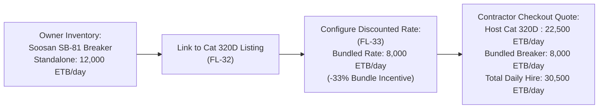
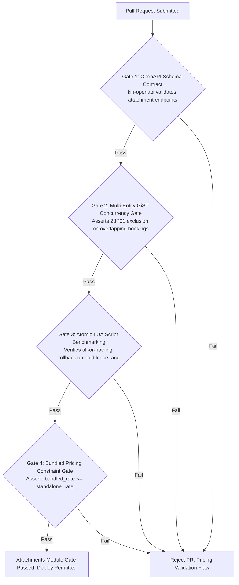

# Heavy Machinery & Logistics Rental Aggregator — Dink Machinery
## Software Requirements Specification — 05.03. Attachments Registration & Inventory Management (`docs/shared/requirements/05-03-attachment-registration-inventory.md`)

**Document Identifier:** `SRS-DINK-CORE-V7.0-SEC-05-03`  
**Classification:** Canonical System Requirements Specification & Architecture Baseline (Single Source of Truth)  
**Governing Standard:** IEEE Std 830-1998 / IEEE/ISO/IEC 29148:2018 (Systems and Software Engineering — Requirements Engineering)  
**Associated Artifacts:** `SRS-DINK-CORE-V7.0` (§5.3, §5.2.6, §10, §11), `FLOW-FLEET-REG-DINK-CORE-V7.0`, `FLOW-DISCOVERY-DINK-CORE-V7.0`, `FLOW-BOOKING-STATE-MACHINE-DINK-CORE-V7.0`, `FLOW-CONCURRENCY-LOCKING-DINK-CORE-V7.0`, `ARCH-BACKEND-GO-DINK-CORE-V7.0`, `ARCH-FLUTTER-DINK-CORE-V7.0`, `ARCH-ADMIN-NEXT-DINK-CORE-V7.0`, `ARCH-SEC-DINK-CORE-V7.0`, `DS-DINK-CORE-V7.0`, `DS-PERSONAS-DINK-CORE-V7.0`, `contracts/openapi.yaml`, `ADR-001`, `ADR-002`, `ADR-005`, `ADR-008`, `ADR-010`  
**Target Runtimes:** Go 1.27.3 Backend Monolith, Flutter 3.47.8 / Dart 3.9 (Cross-Platform Mobile), Next.js 16.x (latest CVE security patch) / React 19 (Web Admin & Corporate Portal), PostgreSQL 18.6 + PostGIS 3.6.4, Valkey 9.1.3, ClamAV Daemon (:3310), SeaweedFS S3, Isar NoSQL 3.1+  
**Target Personas:** Equipment Fleet Owner (*W/ro Almaz Tesfaye* / *Kamau Ndegwa*), Civil Engineering Contractor (*Dawit Haile-Mariam* / *Patrick Kariuki*), Certified Field Operator (*Mulugeta Tadesse* / *Juma Omwamba*), Compliance Officer & Fleet Auditor (*Yohannes Bekele*)  
**Target Operating Markets:** Ethiopia (`ET`) & Kenya (`KE`) — Dynamic Multi-Country Parameterization (`LOC-01-BE`)  
**Compliance Standards:** OWASP ASVS 4.0.3 Level 3 (Input Validation, Data Integrity & Secure Business Logic), RFC 9457 (Problem Details), ISO 9241-110, W3C WCAG 2.2 Level AAA (Field Mobile) & Level AA (Admin Web), National Bank of Ethiopia (NBE) Financial Directives  
**Status:** Approved Engineering Baseline

---

## Table of Contents

- 1. [Document Scope & Architectural Mandate](#1-document-scope--architectural-mandate)
  - 1.1 [Purpose & Functional Scope](#11-purpose--functional-scope)
  - 1.2 [Core Architectural Principles & System Invariants](#12-core-architectural-principles--system-invariants)
- 2. [Attachment Entity Lifecycle & Dual-Rental Modality](#2-attachment-entity-lifecycle--dual-rental-modality)
  - 2.1 [Attachment Operational Modalities (Standalone vs. Bundled)](#21-attachment-operational-modalities-standalone-vs-bundled)
  - 2.2 [Attachment State Machine Taxonomy (`AttachmentStatus`)](#22-attachment-state-machine-taxonomy-attachmentstatus)
  - 2.3 [Complete End-to-End Attachment Lifecycle Flowchart](#23-complete-end-to-end-attachment-lifecycle-flowchart)
- 3. [Attachment Registration & Technical Configuration](#3-attachment-registration--technical-configuration)
  - 3.1 [Core Attachment Identification & Typing (`ATT-01` to `ATT-04`)](#31-core-attachment-identification--typing-att-01-to-att-04)
  - 3.2 [Mechanical Compatibility Mapping & Carrier Class Binding (`ATT-05`, `ATT-06`)](#32-mechanical-compatibility-mapping--carrier-class-binding-att-05-att-06)
  - 3.3 [ClamAV Media Ingestion & Wear Evidence Verification (`ATT-07`, `ATT-08`)](#33-clamav-media-ingestion--wear-evidence-verification-att-07-att-08)
- 4. [Tariff Structures & Bundled Discounting Economics](#4-tariff-structures--bundled-discounting-economics)
  - 4.1 [Standalone Commercial Pricing Parameters (`ATT-09` to `ATT-11`)](#41-standalone-commercial-pricing-parameters-att-09-to-att-11)
  - 4.2 [Bundled Discount Override Architecture (`FL-32`, `FL-33`)](#42-bundled-discount-override-architecture-fl-32-fl-33)
  - 4.3 [Security Deposit & Damage Deductibles](#43-security-deposit--damage-deductibles)
- 5. [Multi-Entity Concurrency & Overlapping Conflict Resolution](#5-multi-entity-concurrency--overlapping-conflict-resolution)
  - 5.1 [Mathematical Temporal Overlap Invariant Formulation](#51-mathematical-temporal-overlap-invariant-formulation)
  - 5.2 [PostgreSQL GiST Temporal Range Exclusion Implementation](#52-postgresql-gist-temporal-range-exclusion-implementation)
  - 5.3 [Valkey Distributed Multi-Entity Atomic Locking Script (`LUA`)](#53-valkey-distributed-multi-entity-atomic-locking-script-lua)
  - 5.4 [Client Booking Conflict Interception & Selective Degradation (`FL-34`)](#54-client-booking-conflict-interception--selective-degradation-fl-34)
- 6. [Physical Handover, Reticle Auditing & Wear Verification](#6-physical-handover-reticle-auditing--wear-verification)
  - 6.1 [Standalone vs. Host Machine Handover Protocol](#61-standalone-vs-host-machine-handover-protocol)
  - 6.2 [Tool Wear, Pin Tolerances & Bushing Play Inspections](#62-tool-wear-pin-tolerances--bushing-play-inspections)
  - 6.3 [Post-Rental Return Damage Triage & Tool Re-Certification](#63-post-rental-return-damage-triage--tool-re-certification)
- 7. [Wire Protocol Contracts & RFC 9457 Error Schemas](#7-wire-protocol-contracts--rfc-9457-error-schemas)
  - 7.1 [`POST /api/v1/attachments`](#71-post-apiv1attachments)
  - 7.2 [`GET /api/v1/attachments/inventory`](#72-get-apiv1attachmentsinventory)
  - 7.3 [`POST /api/v1/fleets/{id}/attachments/link`](#73-post-apiv1fleetsidattachmentslink)
  - 7.4 [`POST /api/v1/bookings/check-bundled-availability`](#74-post-apiv1bookingscheck-bundled-availability)
  - 7.5 [RFC 9457 Universal Problem Details Payloads](#75-rfc-9457-universal-problem-details-payloads)
- 8. [Automated Testing Suite & Verification Gates](#8-automated-testing-suite--verification-gates)

---

## 1. Document Scope & Architectural Mandate

### 1.1 Purpose & Functional Scope

This specification establishes **Section 05.03 (Attachments Registration & Inventory Management)** of the canonical Software Requirements Specification (SRS) for **Dink Machinery Version 7.0**.

In heavy civil infrastructure, quarry extraction, and urban demolition across Ethiopia and Kenya, capital equipment utilization depends heavily on auxiliary detachable hydraulic and mechanical implements. Contractors frequently deploy specialized attachments—such as high-frequency hydraulic rock breakers, ground-augers, secondary pulverizers, sorting grapples, and trenching buckets.

These implements represent substantial standalone capital assets ($5,000\text{ to }40,000\text{ USD}$ each) subject to extreme abrasive wear and mechanical fatigue. In the Dink Machinery ecosystem, an implement operates across two commercial modalities:
1. **Standalone Implement Rental:** Hired independently by a contractor who already maintains a compatible prime mover on site.
2. **Bundled Implement Rental:** Linked to a host machine (e.g., a Caterpillar 320D) and hired as a unified operational unit, typically with a discounted bundled daily tariff.

This document formally specifies:
* The independent inventory data model and lifecycle for standalone attachments.
* The carrier compatibility mapping algorithms binding implements to host machinery subcategories.
* The multi-entity concurrency engine preventing overlapping double-bookings across bundled and standalone rental calendars.
* The photographic reticle standards and pin/bushing wear-and-tear verification protocols required during check-in and check-out.

### 1.2 Core Architectural Principles & System Invariants

1. **Sovereign Inventory Invariant (`FL-32`):** Every attachment is persisted as a distinct, first-class inventory entity possessing an immutable UUID, dedicated serial number, independent ownership ledger, independent operational availability calendar, and independent baseline condition record.
2. **Atomic Temporal Conflict Defense (`FL-34`):** When a host machine is booked with linked attachments, the reservation executes an atomic multi-entity transaction. If any linked attachment is already booked (either standalone or with another host machine) for any overlapping day, the platform isolates the conflict, blocks overlapping allocation, and supports graceful degradation (booking the host machine with available attachments only).
3. **Storage-Tier Range Exclusion (`EXCLUDE USING gist`):** Concurrency safety does not rely solely on application-layer code. PostgreSQL 18.6 storage-tier exclusion constraints over `daterange` fields mathematically guarantee that an attachment cannot exist in multiple confirmed or active bookings simultaneously.
4. **Non-Regressive Tool Dimension & Wear Tracking:** Heavy hydraulic tools (e.g., hydraulic breaker chisels) mandate physical wear and tolerance recording (tool diameter, pin wear play) during handovers to prevent post-rental structural disputes.
5. **ClamAV-Shielded Media Ingestion:** All attachment inspection photographs and technical dimension specification sheets are scanned in-flight via TCP socket `:3310` before persistence in SeaweedFS S3 storage.

---

## 2. Attachment Entity Lifecycle & Dual-Rental Modality

### 2.1 Attachment Operational Modalities (Standalone vs. Bundled)

```text
+--------------------------------------------------------------------------------------------------+
| DUAL OPERATIONAL MODALITY MATRIX                                                                 |
+--------------------------------------------------------------------------------------------------+
| ATTRIBUTE / BEHAVIOR            | STANDALONE IMPLEMENT RENTAL        | BUNDLED IMPLEMENT RENTAL  |
+---------------------------------+------------------------------------+---------------------------+
| Target Customer Persona         | Contractor with existing fleet     | Contractor hiring full    |
|                                 | on site needing special tooling    | machine + tooling package |
+---------------------------------+------------------------------------+---------------------------+
| Discovery Pathway               | Direct catalog discovery via       | Selected as optional add- |
|                                 | "Attachments" root category        | on during host checkout   |
+---------------------------------+------------------------------------+---------------------------+
| Pricing Applied                 | Full Standalone Daily Tariff       | Discounted Bundled Tariff |
|                                 | (e.g., 12,000.00 ETB/day)          | (e.g., 8,000.00 ETB/day)  |
+---------------------------------+------------------------------------+---------------------------+
| Mobilization & Logistics        | Handled by contractor pickup or    | Transported on the same   |
|                                 | light flatbed carrier              | lowboy as host machine    |
+---------------------------------+------------------------------------+---------------------------+
| Handover Sign-Off               | Dedicated 6-digit challenge PIN    | Unified handover sign-off |
|                                 | protocol with implement reticle    | alongside host machine    |
+---------------------------------+------------------------------------+---------------------------+
| Calendar Schedule Impact        | Locks attachment calendar          | Locks attachment calendar |
|                                 | exclusively                        | AND host machine calendar |
+--------------------------------------------------------------------------------------------------+
```

---

### 2.2 Attachment State Machine Taxonomy (`AttachmentStatus`)

The operational state of every registered attachment is governed by an immutable status enumeration:

| Status Identifier | Public Catalog Visibility | Can Be Bundled? | Can Be Reserved? | Description & Transition Invariants |
|---|:---:|:---:|:---:|---|
| **`DRAFT`** | ❌ No | ❌ No | ❌ No | Registration started; missing technical specs, pin diameters, or photos. |
| **`ACTIVE`** | ✅ Yes | ✅ Yes | ✅ Yes | Verified and available in owner inventory; ready for standalone or bundled booking. |
| **`RENTED`** | ✅ Yes (Show Busy)| ❌ No | ❌ No (Overlap) | Asset is actively deployed under an active booking (standalone or bundled). |
| **`MAINTENANCE_HOLD`** | ❌ No | ❌ No | ❌ No | Tool undergoing rebuild, pin bushing replacement, or hydraulic resealing. |
| **`INACTIVE`** | ❌ No | ❌ No | ❌ No | Voluntarily paused or taken off-market by the equipment owner. |
| **`DISPUTED_DAMAGE`** | ❌ No | ❌ No | ❌ No | Locked under active post-rental damage arbitration (`FLOW-10`). |
| **`DECOMMISSIONED`** | ❌ No | ❌ No | ❌ No | Tool cracked beyond repair, scrapped, or retired from commercial service. |

---

### 2.3 Complete End-to-End Attachment Lifecycle Flowchart

```mermaid
flowchart TD
    Start(["Owner Navigates to 'My Attachments'"]) --> AddAction["Tap 'Add New Attachment'"]
    
    AddAction --> Step1["Step 1: Select Attachment Type<br/>Hydraulic Hammer, Bucket, Auger, Grapple, Ripper"]
    
    Step1 --> Step2["Step 2: Enter Technical Identifiers<br/>Make, Model, Serial PIN, Tool Sub-Type / Size"]
    
    Step2 --> Step3["Step 3: Capture Physical Conditioning Media<br/>Overall Photo, Mounting Bracket, Pins/Bushings, Chisel/Teeth<br/>Stream via ClamAV (:3310) to SeaweedFS S3"]
    
    Step3 --> Step4["Step 4: Define Host Carrier Compatibility<br/>Select Compatible Categories (e.g., 20t-25t Crawler Excavators)<br/>Specify Pin Diameter (mm) & Operating Weight (kg)"]
    
    Step4 --> Step5["Step 5: Set Standalone Tariffs & Rules<br/>Daily/Weekly Rates, Documentary Deposit, Minimum Days"]
    
    Step5 --> Step6["Step 6: Initialize Dedicated Availability Calendar<br/>Define Working Days & Blackout Windows"]
    
    Step6 --> SaveInv["Save Attachment Record<br/>POST /api/v1/attachments -> Status: ACTIVE"]
    
    SaveInv --> ForkPath{"Operational Utilization Pathway"}
    
    ForkPath -->|"Pathway A: Link to Host Fleet"| LinkFleet["Owner Edits Registered Fleet (e.g. Cat 320D)<br/>Selects Attachment from Inventory<br/>Sets Discounted Bundled Daily Rate (FL-33)"]
    
    ForkPath -->|"Pathway B: Direct Catalog Listing"| ListedStandalone["Appears in Public Attachment Catalog<br/>Renters can search and rent standalone"]

    LinkFleet --> RenterQuery{"Renter Books Host Fleet with Bundled Attachment"}
    ListedStandalone --> StandaloneQuery{"Renter Books Attachment Standalone"}

    RenterQuery --> TemporalCheck{"Execute Multi-Entity Concurrency Check<br/>Is Attachment Available for Requested Date Range?"}
    StandaloneQuery --> TemporalCheck

    TemporalCheck -->|"Collision: Overlapping Booking Exists"| BlockAttach["FL-34: Mark Attachment 'Unavailable for Dates'<br/>Renter prompted to drop attachment or change dates"]
    
    TemporalCheck -->|"Available: Zero Overlap"| AcquireLease["Valkey Multi-Entity Atomic Lock (LUA)<br/>SET hold:fleet:{id} AND hold:attachment:{id} EX 3600 NX"]
    
    AcquireLease --> ConfirmBooking["Prepayment Verified -> Status: RENTED<br/>PostgreSQL GiST Temporal Range Exclusion Committed"]
    
    ConfirmBooking --> HandoverPhase["Field Handover Inspection<br/>Capture Pin Play & Tool Wear Photos<br/>Unified or Standalone Challenge PIN Sign-Off"]
    
    HandoverPhase --> ReturnPhase["Post-Rental Return Inspection<br/>Triage Excessive Bushing Wear or Chisel Fracture"]
    
    ReturnPhase --> ClearRental["Booking Concluded -> Status: ACTIVE<br/>Availability Calendars Reopened"]
```



---

## 3. Attachment Registration & Technical Configuration

### 3.1 Core Attachment Identification & Typing (`ATT-01` to `ATT-04`)

Every attachment requires immutable physical identification:

```text
+--------------------------------------------------------------------------------------------------+
| ATTACHMENT CORE IDENTIFICATION SPECIFICATION TABLE                                               |
+--------------------------------------------------------------------------------------------------+
| ID     | REQUIREMENT                    | PRIORITY | VALIDATION BOUNDS & TECHNICAL BEHAVIOR      |
+--------+--------------------------------+----------+---------------------------------------------+
| ATT-01 | Attachment Category & Type     | P0       | Standardized Enum: HYDRAULIC_BREAKER,       |
|        |                                |          | STANDARD_BUCKET, TRENCHING_BUCKET, AUGER,   |
|        |                                |          | RIPPER_TOOTH, SORTING_GRAPPLE, CRUSHER.     |
+--------+--------------------------------+----------+---------------------------------------------+
| ATT-02 | Commercial Identity & Model    | P0       | Text inputs. Make (e.g. Soosan, Furukawa,   |
|        |                                |          | Montabert, CAT) and Model (max 64 chars).   |
+--------+--------------------------------+----------+---------------------------------------------+
| ATT-03 | Sub-Type & Physical Sizing     | P0       | Dimensional descriptor (e.g., "24-inch      |
|        |                                |          | Bucket", "135mm Chisel Diameter Breaker",   |
|        |                                |          | "450mm Earth Auger Flight").                |
+--------+--------------------------------+----------+---------------------------------------------+
| ATT-04 | Serial / Tool Identification   | P0       | Stamped manufacturer serial PIN string.     |
|        | Number                         |          | Must be unique across owner inventory.      |
+--------------------------------------------------------------------------------------------------+
```

---

### 3.2 Mechanical Compatibility Mapping & Carrier Class Binding (`ATT-05`, `ATT-06`)

Improper carrier matching results in structural failure or hydraulic circuit destruction:
* **`ATT-05` Compatible Host Subcategory Binding:** The owner selects all compatible machinery subcategories from the platform taxonomy (`Category` table, e.g., `cat_sub_excavator_mini`, `cat_sub_excavator_standard`, `cat_sub_backhoe`).
* **`ATT-06` Mechanical & Hydraulic Interface Specifications:**
  - Operating Tool Weight: Numeric in kilograms (e.g., $1,850\text{ kg}$).
  - Recommended Carrier Weight Class: Minimum and maximum host machine operating weight in metric tons (e.g., $18.0\text{ to }26.0\text{ Tonnes}$).
  - Required Hydraulic Pressure & Flow: Numeric bounds for required oil flow ($L/\text{min}$) and operating relief pressure ($\text{bar}$).
  - Mounting Pin Geometry: Pin diameter ($\text{mm}$), ear width / pin spread ($\text{mm}$), and center-to-center distance ($\text{mm}$).

---

### 3.3 ClamAV Media Ingestion & Wear Evidence Verification (`ATT-07`, `ATT-08`)

To establish a baseline against post-rental wear disputes:
* **`ATT-07` Mandatory Physical Photographs:**
  - Angle 1: Overall Tool Profile (showing body, mounting bracket, and tool tip).
  - Angle 2: Quick-Hitch / Top Mounting Bracket (showing ear bores and pin holes).
  - Angle 3: Pins, Bushings & Grease Ports (close-up showing surface scoring or wear).
  - Angle 4: Working Implement Tip (close-up of bucket cutting edge, teeth, or breaker chisel point).
* **`ATT-08` In-Flight Malware Protection:** Media streams over TCP socket `:3310` to ClamAV. Infected or malformed files are rejected immediately (`ERR_FILE_MALWARE_DETECTED`). Clean images are transcoded to WebP (Quality 82%, Max dimension $2048 \times 2048\text{ px}$) and archived in SeaweedFS S3 (`s3://dink-fleet-media/attachments/{id}/`).

---

## 4. Tariff Structures & Bundled Discounting Economics

### 4.1 Standalone Commercial Pricing Parameters (`ATT-09` to `ATT-11`)

When rented independently:
* **`ATT-09` Standalone Rate Hierarchy:** Mandatory daily rate; optional weekly ($7\text{ days}$) and monthly ($30\text{ days}$) rates. Stored in integer minor currency units (`ETB cents` or `KES cents`).
* **`ATT-10` Minimum Rental Duration:** Standardized dropdown: 1 Day, 2 Days, 3 Days, 7 Days. Default: 1 Day.
* **`ATT-11` Standalone Payment Evidence Window:** Configurable window (12, 24, or 48 hours; default: 24 hours) for contractor wire slip upload before the reservation hold auto-expires.

---

### 4.2 Bundled Discount Override Architecture (`FL-32`, `FL-33`)

Fleet owners bundle attachments with their primary machinery listings to increase fleet attractiveness:



#### Relational Data Model for Bundling Overrides
```sql
CREATE TABLE fleet_bundled_attachments (
    id UUID PRIMARY KEY DEFAULT gen_random_uuid(),
    fleet_id UUID NOT NULL REFERENCES fleets(id) ON DELETE CASCADE,
    attachment_id UUID NOT NULL REFERENCES attachments(id) ON DELETE RESTRICT,
    bundled_daily_rate_minor BIGINT NOT NULL, -- Discounted rate when hired with this fleet
    is_active BOOLEAN NOT NULL DEFAULT true,
    created_at TIMESTAMPTZ NOT NULL DEFAULT NOW(),
    updated_at TIMESTAMPTZ NOT NULL DEFAULT NOW(),
    
    CONSTRAINT unique_fleet_attachment_pair UNIQUE (fleet_id, attachment_id)
);
```

* **Contractual Rule:** The bundled daily rate cannot exceed the standalone daily rate:
  $$\text{bundled\_daily\_rate\_minor} \le \text{attachments.standalone\_daily\_rate\_minor}$$

---

### 4.3 Security Deposit & Damage Deductibles

* **Documentary Deposit Figure:** Stated on the generated commercial agreement as a reference figure (e.g., $25,000.00\text{ ETB}$). In accordance with NBE non-custodial directives, this deposit is not escrowed by the platform.
* **Wear vs. Abuse Distinction:** Chisel re-pointing and standard tooth replacement fall under ordinary wear-and-tear. Cracked mounting brackets, bent piston rods, or contaminated hydraulic fluid lines constitute compensable damage subject to the 24-hour damage claim window (`FLOW-10`).

---

## 5. Multi-Entity Concurrency & Overlapping Conflict Resolution

### 5.1 Mathematical Temporal Overlap Invariant Formulation

Let $R_H = [s_H, e_H)$ represent the requested hire period for a host machinery fleet $H$.  
Let $A = \{a_1, a_2, \dots, a_k\}$ represent the set of bundled attachments requested alongside $H$.

For each attachment $a_i \in A$, let $\mathcal{B}(a_i)$ be the set of all active, confirmed, or held booking periods for $a_i$ across the entire platform (whether hired standalone or bundled with another machine).

$$\text{Temporal Collision Exists} \iff \exists a_i \in A, \exists [s_B, e_B) \in \mathcal{B}(a_i) : (s_H < e_B) \land (s_B < e_H)$$

If this condition evaluates to `true`, an overlapping conflict exists. The system must prevent concurrent booking execution.

---

### 5.2 PostgreSQL GiST Temporal Range Exclusion Implementation

Dink Machinery enforces storage-layer exclusion directly in PostgreSQL 18.6 using the `btree_gist` extension:

```sql
-- 1. Create mapping table linking bookings to multiple attachments
CREATE TABLE booking_attachments (
    id UUID PRIMARY KEY DEFAULT gen_random_uuid(),
    booking_id UUID NOT NULL REFERENCES bookings(id) ON DELETE CASCADE,
    attachment_id UUID NOT NULL REFERENCES attachments(id) ON DELETE RESTRICT,
    hire_period DATERANGE NOT NULL,
    daily_rate_applied_minor BIGINT NOT NULL,
    status VARCHAR(32) NOT NULL,
    created_at TIMESTAMPTZ NOT NULL DEFAULT NOW(),
    
    -- Invariant: Zero Overlapping Bookings for the Same Attachment
    CONSTRAINT no_overlapping_attachment_bookings EXCLUDE USING gist (
        attachment_id WITH =,
        hire_period WITH &&
    ) WHERE (status IN ('HOLD_PENDING', 'PAYMENT_EVIDENCE_UPLOADED', 'CONFIRMED', 'ACTIVE', 'RETURN_INITIATED'))
);

CREATE INDEX idx_booking_attachments_temporal_gist ON booking_attachments USING gist (attachment_id, hire_period);
```

If concurrent transactions attempt to book the same attachment across intersecting date ranges:
* The second transaction fails immediately with PostgreSQL error code `23P01` (`exclusion_violation`).
* The Go backend catches `23P01`, cleanly rolls back the transaction, and returns RFC 9457 HTTP 409 Conflict (`ERR_ATTACHMENT_DATERANGE_OVERLAP`).

---

### 5.3 Valkey Distributed Multi-Entity Atomic Locking Script (`LUA`)

During checkout, the platform acquires exclusive 60-minute in-memory leases across all requested entities simultaneously:

```lua
-- KEYS[1]: hold:fleet:{fleet_id}
-- ARGV[1]: renter_uuid, ARGV[2]: lease_duration_seconds (3600)
-- Additional KEYS: hold:attachment:{attachment_id_1}, hold:attachment:{attachment_id_2}...

-- Step 1: Assert that NONE of the entities are currently locked
for i = 1, #KEYS do
    if redis.call("EXISTS", KEYS[i]) == 1 then
        -- Return 0, the conflicting key name, and remaining TTL
        return {0, KEYS[i], redis.call("TTL", KEYS[i])}
    end
end

-- Step 2: Atomically acquire leases on ALL entities simultaneously
for i = 1, #KEYS do
    redis.call("SET", KEYS[i], ARGV[1], "EX", ARGV[2])
end

return {1, "ALL_ENTITIES_LOCKED", ARGV[2]}
```

---

### 5.4 Client Booking Conflict Interception & Selective Degradation (`FL-34`)

When Contractor *Dawit* configures dates for an excavator with a bundled rock breaker:
1. The client dispatches a pre-flight availability check: `POST /api/v1/bookings/check-bundled-availability`.
2. If the host excavator is free but the rock breaker is booked elsewhere:
   - The UI displays an inline warning banner: `[ Attachment Unavailable: Hydraulic Breaker is booked for requested dates ]`.
   - The rock breaker checkbox is automatically disabled and un-checked.
   - The checkout price recalculates dynamically to the base machine rate.
   - Dawit can proceed with hiring the excavator without the attachment, or select alternate calendar dates.

---

## 6. Physical Handover, Reticle Auditing & Wear Verification

### 6.1 Standalone vs. Host Machine Handover Protocol

* **Unified Bundled Handover:** When rented with a host machine, the attachment inspection forms an integrated section of the primary Handover Protocol (`FLOW-09 §3.1`). Both machine and attachments transition to `ACTIVE` under a single 6-digit challenge PIN sign-off.
* **Standalone Implement Handover:** When rented independently, the attachment executes an independent physical handover:
  - Contractor presents their device.
  - Yard manager inspects mounting brackets, verifies hydraulic quick-disconnect couplings, and inputs the challenge PIN to activate the booking.

---

### 6.2 Tool Wear, Pin Tolerances & Bushing Play Inspections

During handover inspection, the camera reticle enforces specific mechanical audits:
* **Hydraulic Breakers:**
  - Close-up photo of the tool retaining pins.
  - Measurement capture of chisel shank diameter to verify it exceeds minimum wear limits.
  - Inspection photo of the hydraulic hose quick-release couplers verifying zero fluid weeping.
* **Buckets & Grapples:**
  - Inspection photo of ground-engaging teeth verifying wear percentage ($\le 50\%\text{ worn}$).
  - Verification that side-cutters and wear plates are bolted tight without missing hardware.

---

### 6.3 Post-Rental Return Damage Triage & Tool Re-Certification

Upon return demobilization:
1. Check-out reticle photos are compared side-by-side against check-in photos using the split-screen viewer in the Flutter app or Web Admin Console.
2. If the tool chisel is broken due to prying (bending shear failure) or ear brackets are cracked from excessive hydraulic breaker downpressure:
   - The owner flags the return as `DAMAGE_PENDING_REVIEW` within the 24-hour window (`FLOW-10`).
   - The attachment transitions to `DISPUTED_DAMAGE`, blocking new rentals until the compliance desk arbitrates repair liability.
3. Upon clean return or repair completion, the owner re-certifies the implement, returning status to `ACTIVE`.

---

## 7. Wire Protocol Contracts & RFC 9457 Error Schemas

### 7.1 `POST /api/v1/attachments`

Registers a new standalone attachment into owner inventory.

#### Request Headers
```http
POST /api/v1/attachments HTTP/1.1
Host: api.dinkmachinery.com
Content-Type: application/json
Authorization: Bearer <ownerAccessToken>
X-Country-Code: ET
```

#### Request Payload
```json
{
  "attachmentType": "HYDRAULIC_BREAKER",
  "make": "Soosan",
  "model": "SB-81",
  "subTypeSize": "135mm Chisel Tool Diameter",
  "serialNumber": "SN-SB81-2024-99120",
  "operatingWeightKg": 1850.00,
  "minCarrierWeightTonnes": 18.0,
  "maxCarrierWeightTonnes": 26.0,
  "requiredFlowMinLmin": 120.0,
  "requiredFlowMaxLmin": 150.0,
  "requiredPressureBar": 180.0,
  "pinDiameterMm": 80.0,
  "pinSpreadMm": 450.0,
  "compatibleSubcategories": [
    "cat_sub_excavator_standard"
  ],
  "standaloneDailyRateMinor": 1200000,
  "securityDepositMinor": 2500000,
  "minRentalDays": 1,
  "photos": [
    {"angle": "OVERALL", "storageUri": "s3://dink-fleet-media/attachments/soosan_overall.webp"},
    {"angle": "BRACKET", "storageUri": "s3://dink-fleet-media/attachments/soosan_bracket.webp"},
    {"angle": "PINS", "storageUri": "s3://dink-fleet-media/attachments/soosan_pins.webp"},
    {"angle": "TOOL_TIP", "storageUri": "s3://dink-fleet-media/attachments/soosan_chisel.webp"}
  ]
}
```

#### Response: `HTTP 201 Created`
```json
{
  "success": true,
  "data": {
    "attachmentId": "att_019a8f4c-8812-7b9a",
    "status": "ACTIVE",
    "attachmentType": "HYDRAULIC_BREAKER",
    "make": "Soosan",
    "model": "SB-81",
    "standaloneDailyRateMinor": 1200000,
    "createdAt": "2026-10-28T09:30:00Z"
  },
  "timestamp": "2026-10-28T09:30:01Z"
}
```

---

### 7.2 `GET /api/v1/attachments/inventory`

Lists all standalone attachments owned by the authenticated equipment owner.

#### Request Headers
```http
GET /api/v1/attachments/inventory?status=ACTIVE&page=1&limit=20 HTTP/1.1
Host: api.dinkmachinery.com
Authorization: Bearer <ownerAccessToken>
```

#### Response: `HTTP 200 OK`
```json
{
  "success": true,
  "data": {
    "totalCount": 4,
    "attachments": [
      {
        "attachmentId": "att_019a8f4c-8812-7b9a",
        "attachmentType": "HYDRAULIC_BREAKER",
        "make": "Soosan",
        "model": "SB-81",
        "subTypeSize": "135mm Chisel",
        "status": "ACTIVE",
        "standaloneDailyRateMinor": 1200000,
        "isLinkedToFleet": true,
        "linkedFleetId": "flt_019a8f2c-8812",
        "primaryPhotoUri": "s3://dink-fleet-media/attachments/soosan_overall.webp"
      }
    ]
  },
  "timestamp": "2026-10-28T09:32:00Z"
}
```

---

### 7.3 `POST /api/v1/fleets/{id}/attachments/link`

Links an inventory attachment to a registered host fleet asset with a discounted bundled rate.

#### Request Headers
```http
POST /api/v1/fleets/flt_019a8f2c-8812/attachments/link HTTP/1.1
Host: api.dinkmachinery.com
Content-Type: application/json
Authorization: Bearer <ownerAccessToken>
```

#### Request Payload
```json
{
  "attachmentId": "att_019a8f4c-8812-7b9a",
  "bundledDailyRateMinor": 800000
}
```

#### Response: `HTTP 200 OK`
```json
{
  "success": true,
  "data": {
    "fleetId": "flt_019a8f2c-8812",
    "attachmentId": "att_019a8f4c-8812-7b9a",
    "bundledDailyRateMinor": 800000,
    "discountPercentage": 33.3,
    "status": "LINKED"
  },
  "timestamp": "2026-10-28T09:35:00Z"
}
```

---

### 7.4 `POST /api/v1/bookings/check-bundled-availability`

Pre-flight endpoint validating multi-entity temporal availability before initiating a reservation hold.

#### Request Payload
```json
{
  "fleetId": "flt_019a8f2c-8812",
  "attachmentIds": [
    "att_019a8f4c-8812-7b9a"
  ],
  "startDate": "2026-11-05",
  "endDate": "2026-11-12"
}
```

#### Response: `HTTP 200 OK`
```json
{
  "success": true,
  "data": {
    "fleetAvailable": true,
    "allAttachmentsAvailable": true,
    "attachmentStatuses": [
      {
        "attachmentId": "att_019a8f4c-8812-7b9a",
        "isAvailable": true,
        "dailyRateAppliedMinor": 800000
      }
    ],
    "totalCombinedDailyRateMinor": 3050000
  },
  "timestamp": "2026-10-28T09:38:00Z"
}
```

---

### 7.5 RFC 9457 Universal Problem Details Payloads

#### Example: Attachment Booking Overlap Collision (`HTTP 409 Conflict`)
```json
{
  "type": "[https://api.dinkmachinery.com/errors/attachment-schedule-conflict](https://api.dinkmachinery.com/errors/attachment-schedule-conflict)",
  "title": "Attachment Unavailable for Requested Dates",
  "status": 409,
  "detail": "Bundled attachment 'Soosan SB-81' is already reserved under active booking #BK-7719 for dates [2026-11-05, 2026-11-12).",
  "instance": "/api/v1/bookings/hold",
  "code": "ERR_ATTACHMENT_DATERANGE_OVERLAP",
  "invalidParams": [
    {
      "name": "attachmentId",
      "reason": "Collision with active Booking UUID: bk_77192a01-4b12"
    }
  ]
}
```

#### Example: Bundled Rate Exceeds Standalone Rate (`HTTP 422 Unprocessable Entity`)
```json
{
  "type": "[https://api.dinkmachinery.com/errors/bundled-rate-exceeds-standalone](https://api.dinkmachinery.com/errors/bundled-rate-exceeds-standalone)",
  "title": "Invalid Bundled Attachment Rate",
  "status": 422,
  "detail": "The configured bundled daily rate (15,000.00 ETB) cannot exceed the standalone inventory daily rate (12,000.00 ETB).",
  "instance": "/api/v1/fleets/flt_019a8f2c-8812/attachments/link",
  "code": "ERR_BUNDLED_RATE_EXCEEDS_STANDALONE",
  "invalidParams": [
    {
      "name": "bundledDailyRateMinor",
      "reason": "Must be less than or equal to 1200000"
    }
  ]
}
```

---

## 8. Automated Testing Suite & Verification Gates



1. **OpenAPI Schema Contract Gate (`kin-openapi`):** Validates all attachment ingestion, linking, inventory listing, and pre-flight availability check schemas against `contracts/openapi.yaml`.
2. **Multi-Entity GiST Concurrency Test:** Executes raw concurrent SQL insertions attempting to commit overlapping `hire_period` ranges for the same `attachment_id`, asserting that PostgreSQL raises error code `23P01` in $100\%$ of cases.
3. **Atomic Lua Script Chaos Benchmark:** Simulates 50 concurrent Goroutines contending for a host machine and an attachment simultaneously, verifying that exactly one thread acquires the full lease and zero partial locks remain in Valkey.
4. **Bundled Pricing Invariant Unit Test:** Validates that attempting to link an attachment with `bundled_daily_rate_minor > standalone_daily_rate_minor` returns HTTP 422 `ERR_BUNDLED_RATE_EXCEEDS_STANDALONE`.

---

*This document establishes the canonical functional requirements, concurrency formulas, database schemas, and wire protocol contracts for Attachments Registration & Inventory Management in Dink Machinery Version 7.0. All downstream Flutter mobile screens, Go backend microservices, and Next.js admin consoles must strictly conform to this specification.*