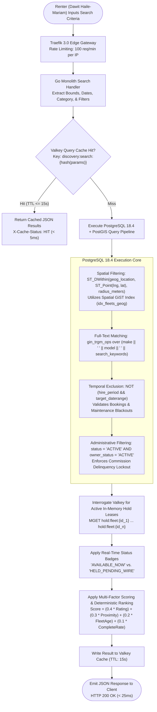
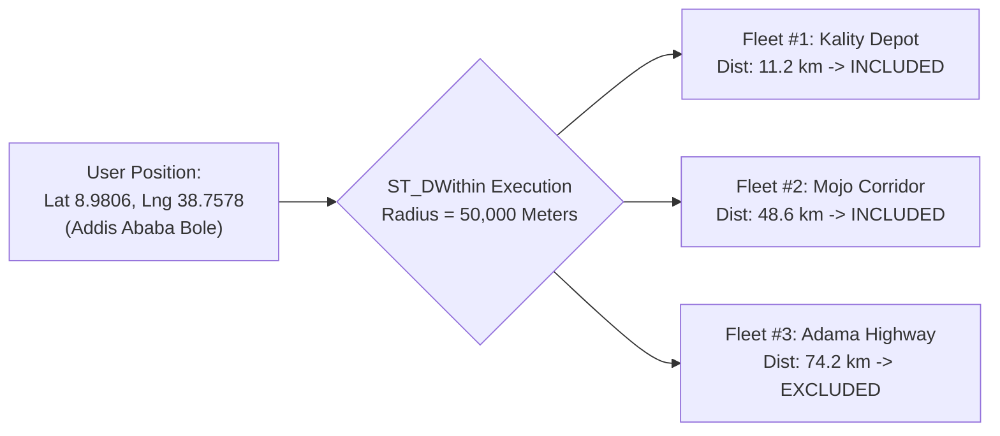
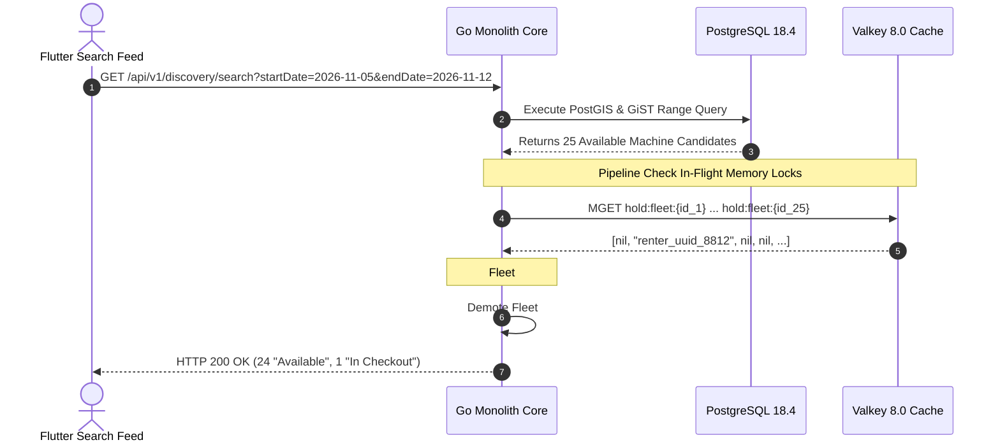
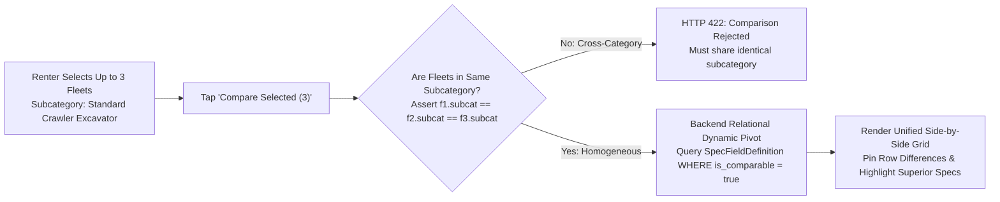
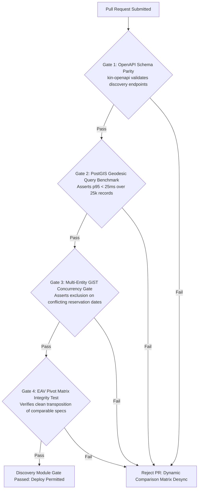

# Heavy Machinery & Logistics Rental Aggregator — Dink Machinery
## Software Requirements Specification — 05.04. Fleet Discovery, Spatial Search, Multi-Variable Filtering & Comparison Matrix (`docs/shared/requirements/05-04-fleet-discovery-search-comparison.md`)

**Document Identifier:** `SRS-DINK-CORE-V7.0-SEC-05-04`  
**Classification:** Canonical System Requirements Specification & Architecture Baseline (Single Source of Truth)  
**Governing Standard:** IEEE Std 830-1998 / IEEE/ISO/IEC 29148:2018 (Systems and Software Engineering — Requirements Engineering)  
**Associated Artifacts:** `SRS-DINK-CORE-V7.0` (§5.4, §10, §11), `FLOW-DISCOVERY-DINK-CORE-V7.0` (Interaction Flow 06), `FLOW-FLEET-REG-DINK-CORE-V7.0`, `FLOW-BOOKING-STATE-MACHINE-DINK-CORE-V7.0`, `FLOW-CONCURRENCY-LOCKING-DINK-CORE-V7.0`, `ARCH-BACKEND-GO-DINK-CORE-V7.0`, `ARCH-FLUTTER-DINK-CORE-V7.0`, `ARCH-ADMIN-NEXT-DINK-CORE-V7.0`, `ARCH-SEC-DINK-CORE-V7.0`, `DS-DINK-CORE-V7.0`, `DS-PERSONAS-DINK-CORE-V7.0`, `contracts/openapi.yaml`, `ADR-001`, `ADR-002`, `ADR-004`, `ADR-005`, `ADR-008`, `ADR-010`  
**Target Runtimes:** Go 1.24 Backend Monolith, Flutter 3.44 / Dart 3.9 (Cross-Platform Mobile), Next.js 16 / React 19 (Web Admin & Corporate Portal), PostgreSQL 18.4 + PostGIS 3.4, Valkey 8.0, ClamAV Daemon (:3310), SeaweedFS S3, Isar NoSQL 3.1+  
**Target Personas:** Civil Engineering Contractor (*Dawit Haile-Mariam* / *Patrick Kariuki*), Corporate Procurement Director (*Eng. Samuel Getachew*), Equipment Fleet Owner (*W/ro Almaz Tesfaye* / *Kamau Ndegwa*), Compliance Officer & Risk Auditor (*Yohannes Bekele*)  
**Target Operating Markets:** Ethiopia (`ET`) & Kenya (`KE`) — Dynamic Multi-Country Parameterization (`LOC-01-BE`)  
**Compliance Standards:** OWASP ASVS 4.0.3 Level 3 (Data Queries, Injection Defense & Access Control), RFC 9457 (Problem Details), ISO 9241-110, W3C WCAG 2.2 Level AAA (Field Mobile) & Level AA (Admin Web), National Bank of Ethiopia (NBE) Directives, Kenya Data Protection Act 2019  
**Status:** Approved Engineering Baseline

---

## Table of Contents

- 1. [Document Scope & Architectural Mandate](#1-document-scope--architectural-mandate)
  - 1.1 [Purpose & Functional Scope](#11-purpose--functional-scope)
  - 1.2 [Architectural Principles & Performance Invariants](#12-architectural-principles--performance-invariants)
- 2. [Discovery & Search Architecture Overview](#2-discovery--search-architecture-overview)
  - 2.1 [End-to-End Discovery Pipeline Flowchart](#21-end-to-end-discovery-pipeline-flowchart)
  - 2.2 [State Representation & Cache Invalidation Strategy](#22-state-representation--cache-invalidation-strategy)
- 3. [Core Search & Category Navigation Requirements](#3-core-search--category-navigation-requirements)
  - 3.1 [Visual Category & Subcategory Navigation (`SR-01`)](#31-visual-category--subcategory-navigation-sr-01)
  - 3.2 [Full-Text Trigram Search Engine (`SR-02`)](#32-full-text-trigram-search-engine-sr-02)
  - 3.3 [Multi-Faceted Parametric Filtering Engine (`SR-03`)](#33-multi-faceted-parametric-filtering-engine-sr-03)
  - 3.4 [Deterministic Ranking & Sorting Algorithms (`SR-04`)](#34-deterministic-ranking--sorting-algorithms-sr-04)
- 4. [Spatial Geodesic Indexing & Geofencing (PostGIS 3.4)](#4-spatial-geodesic-indexing--geofencing-postgis-34)
  - 4.1 [Geodesic Radius & Bounding-Box Viewport Calculations](#41-geodesic-radius--bounding-box-viewport-calculations)
  - 4.2 [PostGIS Spatial Query Structure & GiST Execution Plan](#42-postgis-spatial-query-structure--gist-execution-plan)
  - 4.3 [Regional Geofencing & Cross-Border Guardrails (`LOC-01-BE`)](#43-regional-geofencing--cross-border-guardrails-loc-01-be)
- 5. [Temporal Calendar Verification & Concurrency Pre-Flight](#5-temporal-calendar-verification--concurrency-pre-flight)
  - 5.1 [Calendar Availability Query Execution (`SR-07`)](#51-calendar-availability-query-execution-sr-07)
  - 5.2 [In-Flight Valkey Distributed Lease Pre-Flight Interception](#52-in-flight-valkey-distributed-lease-pre-flight-interception)
  - 5.3 [Conflict Diagnostics & Remediation Surfacing](#53-conflict-diagnostics--remediation-surfacing)
- 6. [Search Results Viewport & Comprehensive Fleet Dossier](#6-search-results-viewport--comprehensive-fleet-dossier)
  - 6.1 [Feed Result Card Specification (`SR-05`)](#61-feed-result-card-specification-sr-05)
  - 6.2 [Comprehensive Fleet Detail Page Dossier (`SR-06`)](#62-comprehensive-fleet-detail-page-dossier-sr-06)
  - 6.3 [Owner Trust Ledger, Ratings & Plant All-Risks Summary](#63-owner-trust-ledger-ratings--plant-all-risks-summary)
- 7. [Multi-Fleet Side-by-Side Comparison Engine](#7-multi-fleet-side-by-side-comparison-engine)
  - 7.1 [Comparison Selection & Dynamic Matrix Invariants (`SR-08`)](#71-comparison-selection--dynamic-matrix-invariants-sr-08)
  - 7.2 [EAV Comparable Field Dynamic Pivoting Architecture](#72-eav-comparable-field-dynamic-pivoting-architecture)
  - 7.3 [Exportable Matrix Payloads (PDF & Web Viewports)](#73-exportable-matrix-payloads-pdf--web-viewports)
- 8. [Wire Protocol Contracts & RFC 9457 Error Schemas](#8-wire-protocol-contracts--rfc-9457-error-schemas)
  - 8.1 [`GET /api/v1/discovery/search`](#81-get-apiv1discoverysearch)
  - 8.2 [`GET /api/v1/fleets/{id}/detail`](#82-get-apiv1fleetsiddetail)
  - 8.3 [`POST /api/v1/discovery/compare`](#83-post-apiv1discoverycompare)
  - 8.4 [RFC 9457 Universal Problem Details Payloads](#84-rfc-9457-universal-problem-details-payloads)
- 9. [Automated Testing Suite & Verification Gates](#9-automated-testing-suite--verification-gates)

---

## 1. Document Scope & Architectural Mandate

### 1.1 Purpose & Functional Scope

This specification establishes **Section 05.04 (Fleet Discovery, Spatial Search, Multi-Variable Filtering & Comparison Matrix)** of the canonical Software Requirements Specification (SRS) for **Dink Machinery Version 7.0**.

Civil infrastructure development across East Africa unfolds in logistically constrained environments. Sourcing a 30-ton hydraulic crawler excavator, an all-wheel-drive motor grader, or a tri-axle lowboy trailer has historically taken days of informal phone calls through unregulated intermediaries (*"delalas"*). Contractors face unpredictable pricing, unverifiable mechanical roadworthiness, and severe project delay penalties ($25,000.00\text{ to }60,000.00\text{ ETB/day}$).

This document establishes the technical blueprint for the discovery engine powering Dink Machinery:
1. High-throughput, sub-50ms spatial search querying machine depot locations via PostGIS 3.4 geography points (`ST_DWithin`, `ST_MakeEnvelope`).
2. Trigram-accelerated full-text lexical search indexing machinery makes, models, chassis specs, and regional locations in Amharic, Afaan Oromoo, Swahili, and English.
3. Parametric multi-filtering parsing pricing intervals, subcategories, crew options, fuel systems, and temporal calendar windows simultaneously.
4. Pre-flight concurrency detection interrogating volatile Valkey 8.0 hold leases (`SET ... NX EX 3600`) and PostgreSQL temporal range constraints (`daterange && daterange`).
5. A dynamic side-by-side comparison engine executing relational pivoting over EAV attributes flagged `is_comparable = true`.

### 1.2 Architectural Principles & Performance Invariants

1. **Sub-50ms Spatial Latency SLO (p95):** Geodesic distance and radius searches within a $50\text{ km}$ corridor across an active catalog of 25,000 machines must return p95 responses in $< 25\text{ ms}$ and p99 responses in $< 45\text{ ms}$.
2. **Denormalized Index Querying (`FleetSpecIndexed`):** Spatial discovery queries NEVER execute expensive multi-table joins against raw EAV tables (`FleetSpecValue`). All spatial, physical weight, dimensional, and tariff attributes are indexed in a flat, denormalized read model (`fleet_spec_indexed` and `fleet_search_index`).
3. **Strict Delinquency Exclusion Invariant (`FLOW-12`):** Machinery owned by fleet operators with an overdue commission balance exceeding 30 days is automatically filtered out from search results:
   $$\text{owner\_wallets.overdue\_balance\_minor} > 0 \land \text{delinquent\_since} < (\text{NOW}() - 30\text{ Days}) \implies \text{EXCLUDED}$$
4. **Immediate Availability Pre-Flight:** A listing badged as "Available" must reflect true real-time availability. The query must confirm that no overlapping confirmed booking exists in PostgreSQL and no unexpired reservation hold lease exists in Valkey.
5. **Fail-Safe Geospatial Fallback:** If client GPS hardware permissions are denied or satellite positioning drops out in deep river cuts, the spatial engine falls back to administrative town/woreda centroids (`woreda_centroids_et` / `county_centroids_ke`).

---

## 2. Discovery & Search Architecture Overview

### 2.1 End-to-End Discovery Pipeline Flowchart



---

### 2.2 State Representation & Cache Invalidation Strategy

* **Volatile Query Caching:** Due to the dynamic nature of equipment booking holds, spatial discovery query results are cached in Valkey for a maximum TTL of **$15\text{ seconds}$** (`discovery:search:{md5_hash}`).
* **Targeted Cache Invalidation:** The occurrence of any of the following events triggers immediate deletion of cached search results:
  1. A contractor acquires a 60-minute Valkey reservation lease (`FLOW-06`, `FLOW-07`).
  2. A booking transitions to `CONFIRMED`, `ACTIVE`, or `CANCELLED`.
  3. A fleet owner toggles listing availability or updates daily hire tariffs (`FLOW-05`).
  4. A fleet owner's wallet transitions into `DELINQUENT_LOCKED` status (`FLOW-12`).

---

## 3. Core Search & Category Navigation Requirements

### 3.1 Visual Category & Subcategory Navigation (`SR-01`)

```text
+--------------------------------------------------------------------------------------------------+
| VISUAL CATEGORY NAVIGATION SPECIFICATION TABLE                                                   |
+--------------------------------------------------------------------------------------------------+
| ID    | REQUIREMENT                    | PRIORITY | VALIDATION BOUNDS & TECHNICAL BEHAVIOR       |
+-------+--------------------------------+----------+----------------------------------------------+
| SR-01 | Cascading Taxonomy Navigation  | P0       | Home screen renders primary categories as an |
|       |                                |          | interactive responsive grid (2-col mobile,   |
|       |                                |          | 4-col tablet/web). Tapping opens subcategory |
|       |                                |          | drawers with localized labels & icon assets. |
+-------+--------------------------------+----------+----------------------------------------------+
```

* **Data Sourcing:** Backed directly by the hierarchical `Category` table (`parent_id IS NULL` for root categories, `parent_id = UUID` for subcategories).
* **Localized Taxonomy Cache:** Category hierarchies are cached indefinitely on client devices using Isar NoSQL and updated via differential synchronization (`ETag` validation).

---

### 3.2 Full-Text Trigram Search Engine (`SR-02`)

* **Trigram Indexing:** Accelerated via PostgreSQL extension `pg_trgm` on the denormalized text column `fleets.search_vector`:
  ```sql
  CREATE INDEX idx_fleets_search_vector_trgm 
  ON fleets USING gin (search_vector gin_trgm_ops);
  ```
* **Search Corpus Composition:** `search_vector` concatenates:
  $$\text{Make} \parallel \text{" "} \parallel \text{Model} \parallel \text{" "} \parallel \text{Subcategory Name} \parallel \text{" "} \parallel \text{Owner Trading Name} \parallel \text{" "} \parallel \text{Depot City}$$
* **Fuzzy Matching Tolerance:** Uses similarity threshold `similarity >= 0.35`, successfully forgiving regional spelling discrepancies and typos (e.g., matching *"Catarpillar"*, *"Caterpilar"*, or *"CAT 320"* to *"Caterpillar 320D"*).

---

### 3.3 Multi-Faceted Parametric Filtering Engine (`SR-03`)

The search pipeline supports arbitrary combinations of parametric filters:

```text
+--------------------------------------------------------------------------------------------------+
| PARAMETRIC SEARCH FILTER SPECIFICATION TABLE                                                     |
+--------------------------------------------------------------------------------------------------+
| FILTER PARAMETER       | WIRE QUERY KEY          | DATA TYPE / CONSTRAINTS                       |
+------------------------+-------------------------+-----------------------------------------------+
| Category Hierarchy     | categoryId,             | UUID (Matches Category.id or child sub-nodes) |
|                        | subcategoryId           |                                               |
+------------------------+-------------------------+-----------------------------------------------+
| Daily Rate Tariff      | minRateMinor,           | Non-negative integers (Minor currency cents); |
| Boundaries             | maxRateMinor            | minRateMinor <= maxRateMinor                  |
+------------------------+-------------------------+-----------------------------------------------+
| Operational Dates      | startDate, endDate      | ISO 8601 Date strings (YYYY-MM-DD);           |
|                        |                         | startDate >= TODAY, endDate > startDate       |
+------------------------+-------------------------+-----------------------------------------------+
| Spatial Radius Corridor| latitude, longitude,    | WGS-84 Decimals (-90 to +90, -180 to +180);   |
|                        | radiusKm                | radiusKm between 1.0 and 500.0 (Default: 50)  |
+------------------------+-------------------------+-----------------------------------------------+
| Operator Inclusion     | operatorIncluded        | Boolean ('true' = rate includes crew wages)   |
+------------------------+-------------------------+-----------------------------------------------+
| Primary Fuel System    | fuelType                | Enum: 'DIESEL', 'ELECTRIC', 'PETROL', 'HYBRID'|
+------------------------+-------------------------+-----------------------------------------------+
| Self-Move Logistics    | selfMoveCapable         | Boolean ('false' = requires lowboy transport) |
+------------------------+-------------------------+-----------------------------------------------+
| Minimum Owner Rating   | minRating               | Decimal between 1.0 and 5.0 (e.g., >= 4.5)    |
+--------------------------------------------------------------------------------------------------+
```

---

### 3.4 Deterministic Ranking & Sorting Algorithms (`SR-04`)

When multiple machines satisfy all parametric criteria, the result set is sorted deterministically:

1. **`RECOMMENDED` (Default Multi-Factor Scoring):**
   $$\text{Score} = (0.40 \times \mathcal{R}_{\text{owner}}) + (0.30 \times \mathcal{P}_{\text{proximity}}) + (0.20 \times \mathcal{U}_{\text{fleet}}) + (0.10 \times \mathcal{C}_{\text{completion}})$$
   - $\mathcal{R}_{\text{owner}}$: Normalized owner review score ($0.0\text{ to }1.0$).
   - $\mathcal{P}_{\text{proximity}}$: Inverse distance scalar ($1.0 - \frac{\text{Distance}}{\text{Search Radius}}$).
   - $\mathcal{U}_{\text{fleet}}$: Asset freshness factor ($1.0\text{ for brand new listings, degrading over age}$).
   - $\mathcal{C}_{\text{completion}}$: Historical booking fulfillment rate without owner cancellations.
2. **`PRICE_ASC` / `PRICE_DESC`:** Absolute sort over `fleets.daily_rate_minor`. Ties break on distance.
3. **`DISTANCE_ASC`:** Absolute sort over `ST_Distance(geog_location, user_point)`.
4. **`RATING_DESC`:** Absolute sort over `owner_aggregates.average_rating`. Ties break on total verified rental count.

---

## 4. Spatial Geodesic Indexing & Geofencing (PostGIS 3.4)

### 4.1 Geodesic Radius & Bounding-Box Viewport Calculations



* **Earth Curvature Geodesy:** All distance calculations are performed on the WGS 84 spheroidal model using PostGIS `geography(Point, 4326)`:
  $$\text{Distance} = \text{ST\_Distance}(\text{fleets.depot\_geog}, \text{ST\_SetSRID}(\text{ST\_Point}(\text{lng}, \text{lat}), 4326)::\text{geography})$$
* **Bounding-Box Map Pan Queries:** Interactive map viewports transmit bounding-box coordinates (`sw_lat`, `sw_lng`, `ne_lat`, `ne_lng`). Queries use `ST_MakeEnvelope`:
  ```sql
  WHERE fleets.depot_geog && ST_SetSRID(ST_MakeEnvelope(sw_lng, sw_lat, ne_lng, ne_lat, 4326), 4326)::geography
  ```

---

### 4.2 PostGIS Spatial Query Structure & GiST Execution Plan

To guarantee sub-50ms execution across large inventories, the storage layer utilizes spatial GiST indexing:

```sql
-- Production Search Query Blueprint
EXPLAIN ANALYZE
SELECT 
    f.id AS fleet_id,
    f.make,
    f.model,
    f.manufacture_year,
    f.daily_rate_minor,
    f.self_move_capable,
    f.operator_included,
    f.primary_photo_uri,
    ST_Distance(f.depot_geog, ST_SetSRID(ST_Point($1, $2), 4326)::geography) AS distance_meters,
    oa.average_rating,
    oa.total_rentals_count
FROM fleets f
JOIN fleet_spec_indexed fsi ON f.id = fsi.fleet_id
JOIN owner_aggregates oa ON f.owner_id = oa.owner_id
WHERE f.status = 'ACTIVE'
  AND f.subcategory_id = $3
  AND ST_DWithin(f.depot_geog, ST_SetSRID(ST_Point($1, $2), 4326)::geography, $4)
  AND f.daily_rate_minor BETWEEN $5 AND $6
  AND NOT EXISTS (
      -- Exclude overlapping bookings
      SELECT 1 FROM bookings b
      WHERE b.fleet_id = f.id
        AND b.hire_period && daterange($7, $8, '[)')
        AND b.status IN ('HOLD_PENDING', 'PAYMENT_EVIDENCE_UPLOADED', 'CONFIRMED', 'ACTIVE', 'RETURN_INITIATED')
  )
ORDER BY distance_meters ASC
LIMIT $9 OFFSET $10;
```

---

### 4.3 Regional Geofencing & Cross-Border Guardrails (`LOC-01-BE`)

* **Sovereign Boundary Enforcement:** Heavy construction equipment is registered under national customs regimes. Machines registered in Ethiopia (`ET`) cannot be hired for deployment within Kenya (`KE`), and vice versa.
* **Database Isolation:** Spatial queries automatically apply an indexed sovereign jurisdiction filter:
  ```sql
  AND f.country_code = $jurisdiction_code -- 'ET' or 'KE'
  ```
* **Geofencing Buffer:** Queries origin-located within $20\text{ km}$ of national borders do not return cross-border machinery unless the fleet asset explicitly maintains cross-border transit authorizations (`has_cross_border_permit = true`).

---

## 5. Temporal Calendar Verification & Concurrency Pre-Flight

### 5.1 Calendar Availability Query Execution (`SR-07`)

When a user specifies rental dates $[T_{\text{start}}, T_{\text{end}})$:
1. **PostgreSQL Relational Range Check:** The query filters against `bookings.hire_period` using the overlap operator `&&`.
2. **Owner Blackout Interrogation:** The query filters against `fleet_availability_blackouts` table, verifying that the requested window does not intersect scheduled maintenance or private contractor holds.
3. **Multi-Day Continuity:** The machine must be available for $100\%$ of the days within the requested range; partial overlaps mark the asset as unavailable for the range.

---

### 5.2 In-Flight Valkey Distributed Lease Pre-Flight Interception

PostgreSQL storage constraints guarantee disk-level isolation, but active checkouts in progress reside in memory:



---

### 5.3 Conflict Diagnostics & Remediation Surfacing

If a contractor navigates to a machine that was just locked by another party:
* The response payload includes conflict diagnostics:
  ```json
  {
    "isAvailable": false,
    "unavailableReason": "HELD_BY_ANOTHER_RENTER",
    "holdExpiresInSeconds": 1842,
    "nextAvailableDate": "2026-11-15",
    "alternativeFleetsNearby": ["flt_019a8f2c-9912", "flt_019a8f2c-3341"]
  }
  ```
* The UI offers a 1-tap action: `[ Join Standby Queue ]` (`FLOW-06`), enqueuing the contractor into a Valkey sorted set (`ZADD queue:fleet:{id} {timestamp} {user_id}`).

---

## 6. Search Results Viewport & Comprehensive Fleet Dossier

### 6.1 Feed Result Card Specification (`SR-05`)

Result cards rendered in Flutter feeds adhere to strict UI/UX standards (`DS-DINK-CORE-V7.0`):

```text
+--------------------------------------------------------------------------------------------------+
| RESULT FEED CARD UI LAYOUT SPECIFICATION                                                         |
+--------------------------------------------------------------------------------------------------+
| +----------------------------------------------------------------------------------------------+ |
| | [ Primary Photo Carousel (WebP, Aspect 16:9) ]           [ "AVAILABLE" / "HELD" Badge ]       |
| +----------------------------------------------------------------------------------------------+ |
| | Caterpillar 320D Hydraulic Excavator (2024)                     ★ 4.92 (38 Rentals)          |
| | 21.8 Tonnes Operating Weight • 148 HP Engine • 6.65m Dig Depth                               |
| | Kality Industrial Depot, Addis Ababa (11.2 km away)                                          |
| |                                                                                              |
| | [ Crew Included: Yes ]   [ Lowboy Required: Yes ]               22,500.00 ETB / Day          |
| +----------------------------------------------------------------------------------------------+ |
```

* **Tap Targets:** Every card maintains a minimum hit target of $56 \times 56\text{ dp}$ conforming to WCAG 2.2 Level AAA standards for heavy split-leather field glove actuation.
* **High-Contrast Readouts:** Tariffs and availability badges enforce contrast ratios $\ge 7.0:1$ against background cards for outdoor readability under direct sunlight ($> 85,000\text{ lux}$).

---

### 6.2 Comprehensive Fleet Detail Page Dossier (`SR-06`)

Navigating to a fleet detail page loads the complete operational dossier:

```text
+--------------------------------------------------------------------------------------------------+
| COMPREHENSIVE FLEET DOSSIER COMPONENT MATRIX                                                     |
+--------------------------------------------------------------------------------------------------+
| DOSSIER COMPONENT              | DETAILED SPECIFICATION & FUNCTIONAL BEHAVIOR                    |
+--------------------------------+-----------------------------------------------------------------+
| High-Resolution Media Gallery  | Full-width swipeable gallery showing all 5+ verified walkaround |
|                                | photos plus close-up cabin hour meter capture. Supports pinch   |
|                                | to zoom with WebP progressive loading.                          |
+--------------------------------+-----------------------------------------------------------------+
| EAV Technical Specifications   | Dynamic accordion sections rendering all visible parameters     |
| Accordion Groups               | (Weights, Working Ranges, Hydraulic Flow, Engine Output).       |
+--------------------------------+-----------------------------------------------------------------+
| Verified Fleet Owner Dossier   | Owner trading name, verification badge, depot address, years on |
|                                | platform, cumulative verified rentals count, and review metrics.|
+--------------------------------+-----------------------------------------------------------------+
| Comprehensive Insurance Status | Underwriting policy carrier (e.g., Awash Insurance), coverage  |
|                                | type (Plant All-Risks), deductible limit, and active status.    |
+--------------------------------+-----------------------------------------------------------------+
| Interactive Pricing Calculator | Dynamic computation widget: Days * Daily Rate + Transport Sub-  |
|                                | Booking Estimate + Excess Hour Tariff Breakdown.                |
+--------------------------------+-----------------------------------------------------------------+
| Operational Availability Matrix| Full-screen monthly grid view showing booked ranges, maintenance|
|                                | blackouts, and free windows with instant pre-flight validation. |
+--------------------------------------------------------------------------------------------------+
```

---

### 6.3 Owner Trust Ledger, Ratings & Plant All-Risks Summary

* **Verified Reviews Only:** Ratings are accepted exclusively from contractors who have completed a full rental lifecycle on that specific machine (`FLOW-10`). Unverified reviews are architecturally impossible.
* **Insurance Trust Shield:** Every fleet profile displays an official insurance certificate badge:
  ```text
  [🛡️ Plant All-Risks Insured • Policy #CPAR-ET-88192 • Insurer: Awash Insurance SC]
  ```
  Uninsured machinery or policies expiring within $< 7\text{ days}$ are barred from public search.

---

## 7. Multi-Fleet Side-by-Side Comparison Engine

### 7.1 Comparison Selection & Dynamic Matrix Invariants (`SR-08`)



* **Capacity Constraint:** The comparison buffer enforces an upper bound of **exactly 3 fleet assets**.
* **Taxonomic Homogeneity Invariant:** Fleets selected for comparison must belong to the **identical subcategory** (e.g., comparing a Caterpillar 320D against a Komatsu PC200 is permitted; comparing an Excavator against a Lowboy Trailer is rejected with HTTP 422 `ERR_NON_COMPARABLE_CATEGORIES`).

---

### 7.2 EAV Comparable Field Dynamic Pivoting Architecture

The comparison engine executes an automated database pivot over attributes flagged `is_comparable = true`:

```sql
SELECT 
    sfd.field_key,
    sfd.label_en,
    sfd.unit_symbol,
    MAX(CASE WHEN fsv.fleet_id = $fleet_id_1 THEN COALESCE(fsv.value_string, fsv.value_numeric::text) END) AS fleet_1_value,
    MAX(CASE WHEN fsv.fleet_id = $fleet_id_2 THEN COALESCE(fsv.value_string, fsv.value_numeric::text) END) AS fleet_2_value,
    MAX(CASE WHEN fsv.fleet_id = $fleet_id_3 THEN COALESCE(fsv.value_string, fsv.value_numeric::text) END) AS fleet_3_value
FROM spec_field_definitions sfd
JOIN fleet_spec_values fsv ON sfd.id = fsv.spec_definition_id
WHERE sfd.is_comparable = true
  AND fsv.fleet_id IN ($fleet_id_1, $fleet_id_2, $fleet_id_3)
GROUP BY sfd.field_key, sfd.label_en, sfd.unit_symbol, sfd.display_order
ORDER BY sfd.display_order ASC;
```

---

### 7.3 Exportable Matrix Payloads (PDF & Web Viewports)

* **Interactive Differences Toggle:** The UI features a toggle `[ Show Differences Only ]`, hiding all rows where values across all three machines are identical.
* **Corporate Export (Phase 2 `FLOW-14`):** Contractors can export the comparison matrix as an official signed PDF dossier (`GET /api/v1/discovery/compare/export-pdf`) to attach to enterprise procurement requisitions.

---

## 8. Wire Protocol Contracts & RFC 9457 Error Schemas

### 8.1 `GET /api/v1/discovery/search`

Executes spatial discovery, multi-variable filtering, and full-text querying.

#### Request Headers
```http
GET /api/v1/discovery/search?subcategoryId=cat_sub_excavator_std&lat=8.9806&lng=38.7578&radiusKm=50&startDate=2026-11-05&endDate=2026-11-12&minRateMinor=1500000&maxRateMinor=3500000&operatorIncluded=true&sortBy=RECOMMENDED&page=1&limit=20 HTTP/1.1
Host: api.dinkmachinery.com
Accept: application/json
Accept-Language: en
X-Country-Code: ET
```

#### Response: `HTTP 200 OK`
```json
{
  "success": true,
  "data": {
    "totalMatches": 42,
    "page": 1,
    "limit": 20,
    "searchCenter": {
      "latitude": 8.9806,
      "longitude": 38.7578,
      "radiusKm": 50.0
    },
    "results": [
      {
        "fleetId": "flt_019a8f2c-8812-7b9a",
        "make": "Caterpillar",
        "model": "320D",
        "manufactureYear": 2024,
        "dailyRateMinor": 2250000,
        "distanceMeters": 11240.5,
        "availabilityStatus": "AVAILABLE_NOW",
        "selfMoveCapable": false,
        "operatorIncluded": true,
        "primaryPhotoUri": "s3://dink-fleet-media/flt_019a8f2c-8812/front_thumb.webp",
        "owner": {
          "ownerId": "usr_018f6a9e-876b-7341",
          "tradingName": "Tesfaye Heavy Transport PLC",
          "averageRating": 4.92,
          "totalCompletedRentals": 38,
          "isVerified": true
        },
        "keySpecs": {
          "operatingWeightKg": 21800.0,
          "grossPowerHp": 148.0,
          "maxDigDepthMm": 6650
        }
      }
    ]
  },
  "timestamp": "2026-10-28T09:50:00Z"
}
```

---

### 8.2 `GET /api/v1/fleets/{id}/detail`

Retrieves the complete operational dossier for a single fleet listing.

#### Request Headers
```http
GET /api/v1/fleets/flt_019a8f2c-8812-7b9a/detail HTTP/1.1
Host: api.dinkmachinery.com
Accept-Language: am
```

#### Response: `HTTP 200 OK`
```json
{
  "success": true,
  "data": {
    "fleetId": "flt_019a8f2c-8812-7b9a",
    "make": "Caterpillar",
    "model": "320D",
    "manufactureYear": 2024,
    "plateNumber": "ET-3-99120",
    "baselineMeterHours": 1450.50,
    "dailyRateMinor": 2250000,
    "excessHourRateMinor": 280000,
    "minRentalDays": 2,
    "paymentTimeoutHours": 24,
    "selfMoveCapable": false,
    "operatorIncluded": true,
    "photos": [
      {"angle": "FRONT", "uri": "s3://dink-fleet-media/flt_019a8f2c-8812/front.webp"},
      {"angle": "REAR", "uri": "s3://dink-fleet-media/flt_019a8f2c-8812/rear.webp"},
      {"angle": "LEFT", "uri": "s3://dink-fleet-media/flt_019a8f2c-8812/left.webp"},
      {"angle": "RIGHT", "uri": "s3://dink-fleet-media/flt_019a8f2c-8812/right.webp"},
      {"angle": "CABIN", "uri": "s3://dink-fleet-media/flt_019a8f2c-8812/cabin.webp"},
      {"angle": "METER", "uri": "s3://dink-fleet-media/flt_019a8f2c-8812/meter.webp"}
    ],
    "insurance": {
      "provider": "Awash Insurance SC",
      "policyNumber": "CPAR-ET-881920",
      "coverageType": "COMPREHENSIVE_PLANT_ALL_RISKS",
      "status": "ACTIVE",
      "expiresAt": "2027-06-30"
    },
    "owner": {
      "ownerId": "usr_018f6a9e-876b-7341",
      "tradingName": "Tesfaye Heavy Transport PLC",
      "averageRating": 4.92,
      "totalCompletedRentals": 38,
      "memberSinceYear": 2024
    }
  },
  "timestamp": "2026-10-28T09:51:00Z"
}
```

---

### 8.3 `POST /api/v1/discovery/compare`

Pivots dynamic EAV attributes across up to 3 selected fleets for side-by-side comparison.

#### Request Payload
```json
{
  "fleetIds": [
    "flt_019a8f2c-8812-7b9a",
    "flt_019a8f2c-9914-4c12",
    "flt_019a8f2c-3341-1a09"
  ]
}
```

#### Response: `HTTP 200 OK`
```json
{
  "success": true,
  "data": {
    "subcategoryId": "cat_sub_excavator_std",
    "fleets": [
      {"id": "flt_019a8f2c-8812-7b9a", "title": "CAT 320D", "dailyRateMinor": 2250000},
      {"id": "flt_019a8f2c-9914-4c12", "title": "Komatsu PC200-8", "dailyRateMinor": 2100000},
      {"id": "flt_019a8f2c-3341-1a09", "title": "Hyundai R220LC-9", "dailyRateMinor": 2000000}
    ],
    "comparisonMatrix": [
      {
        "fieldKey": "operating_weight_kg",
        "label": "Operating Weight",
        "unit": "kg",
        "values": {
          "flt_019a8f2c-8812-7b9a": "21800",
          "flt_019a8f2c-9914-4c12": "20010",
          "flt_019a8f2c-3341-1a09": "21900"
        },
        "isDifferent": true
      },
      {
        "fieldKey": "gross_power_hp",
        "label": "Gross Engine Power",
        "unit": "hp",
        "values": {
          "flt_019a8f2c-8812-7b9a": "148",
          "flt_019a8f2c-9914-4c12": "147",
          "flt_019a8f2c-3341-1a09": "150"
        },
        "isDifferent": true
      }
    ]
  },
  "timestamp": "2026-10-28T09:52:00Z"
}
```

---

### 8.4 RFC 9457 Universal Problem Details Payloads

#### Example: Cross-Category Comparison Prohibited (`HTTP 422 Unprocessable Entity`)
```json
{
  "type": "[https://api.dinkmachinery.com/errors/non-comparable-categories](https://api.dinkmachinery.com/errors/non-comparable-categories)",
  "title": "Taxonomic Category Mismatch in Comparison",
  "status": 422,
  "detail": "Comparison matrix mandates identical subcategories. Cannot compare 'Mini Excavator' against 'Lowboy Trailer'.",
  "instance": "/api/v1/discovery/compare",
  "code": "ERR_NON_COMPARABLE_CATEGORIES",
  "invalidParams": [
    {
      "name": "fleetIds",
      "reason": "Fleet UUID flt_019a8f2c-3341-1a09 belongs to subcategory cat_sub_lowboy_heavy, conflicting with cat_sub_excavator_std."
    }
  ]
}
```

#### Example: Search Radius Exceeds Boundary Limit (`HTTP 400 Bad Request`)
```json
{
  "type": "[https://api.dinkmachinery.com/errors/invalid-search-radius](https://api.dinkmachinery.com/errors/invalid-search-radius)",
  "title": "Spatial Radius Boundary Out of Range",
  "status": 400,
  "detail": "Configured radiusKm parameter (650.0) exceeds maximum allowable platform limit of 500.0 km.",
  "instance": "/api/v1/discovery/search",
  "code": "ERR_SPATIAL_RADIUS_OUT_OF_BOUNDS",
  "invalidParams": [
    {
      "name": "radiusKm",
      "reason": "Must be less than or equal to 500.0"
    }
  ]
}
```

---

## 9. Automated Testing Suite & Verification Gates



1. **OpenAPI Schema Contract Gate (`kin-openapi`):** Validates all discovery query parameters, response structures, and RFC 9457 error contracts against `contracts/openapi.yaml`.
2. **PostGIS Geodesic Latency Benchmark:** Populates a staging database with 25,000 synthetic fleet records distributed across Ethiopia and Kenya. Executes 1,000 concurrent spatial radius queries, asserting p95 latency remains strictly $< 25\text{ ms}$.
3. **Temporal Range Exclusion Chaos Test:** Simulates 100 concurrent rental requests across overlapping date windows, verifying that PostgreSQL GiST exclusion indexes block $100\%$ of double-booking attempts.
4. **EAV Dynamic Comparison Pivoting Test:** Ingests three machines with distinct dynamic spec values, asserting that the comparison query transposes columns accurately, flags differences, and correctly handles nullable parameters.

---

*This document defines the canonical technical requirements, spatial query architectures, dynamic filtering algorithms, comparison engines, and wire contracts for Fleet Discovery, Search & Comparison in Dink Machinery Version 7.0. All downstream Flutter mobile search feeds, Go backend query microservices, and Next.js admin portals must strictly conform to this specification.*