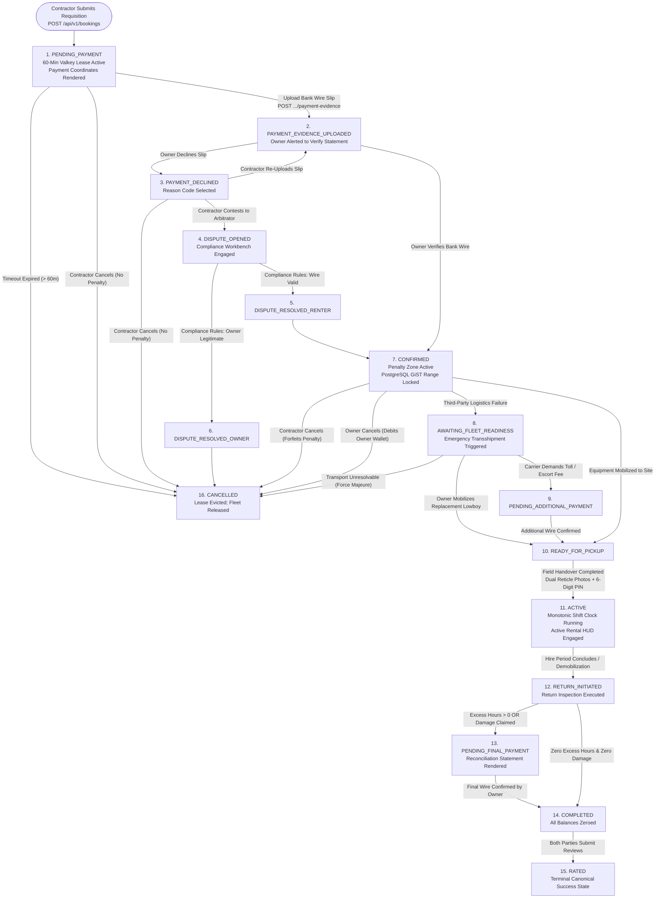
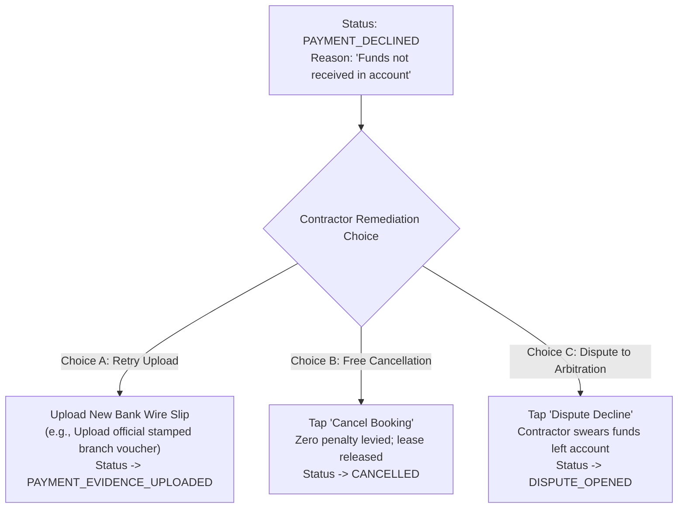
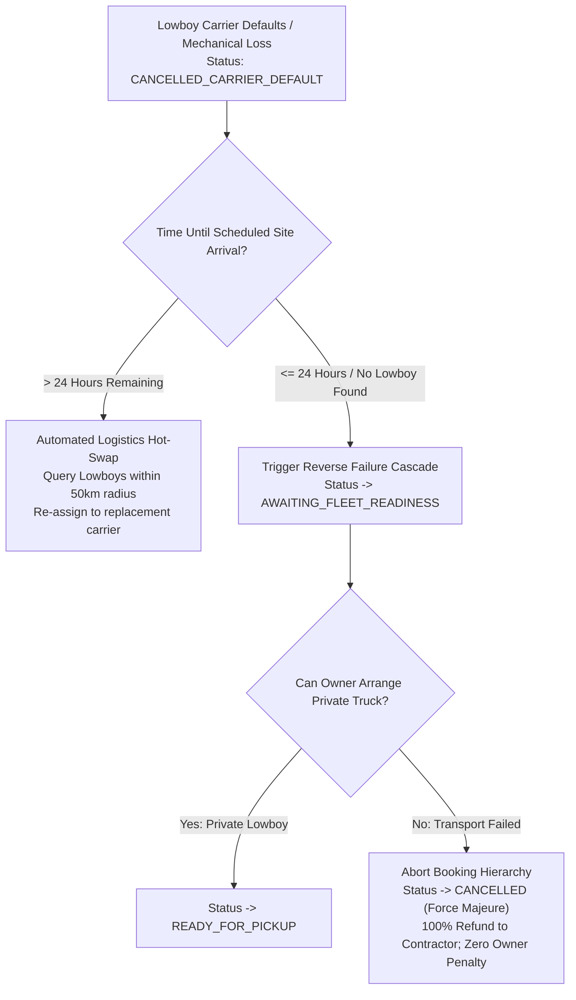
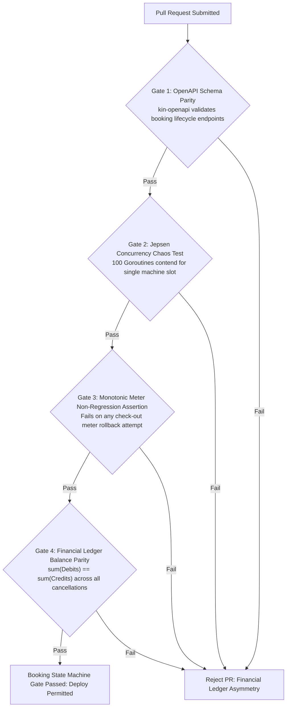

# Heavy Machinery & Logistics Rental Aggregator — Dink Machinery
## Software Requirements Specification — 05.05. Booking, Reservation & Lifecycle State Machine Architecture (`docs/shared/requirements/05-05-booking-reservation-flow.md`)

**Document Identifier:** `SRS-DINK-CORE-V7.0-SEC-05-05`  
**Classification:** Canonical System Requirements Specification & Architecture Baseline (Single Source of Truth)  
**Governing Standard:** IEEE Std 830-1998 / IEEE/ISO/IEC 29148:2018 (Systems and Software Engineering — Requirements Engineering)  
**Associated Artifacts:** `SRS-DINK-CORE-V7.0` (§5.5, §8, §10, §11), `FLOW-BOOKING-STATE-MACHINE-DINK-CORE-V7.0` (Interaction Flow 07), `FLOW-DISCOVERY-DINK-CORE-V7.0`, `FLOW-WIRE-DISPUTE-DINK-CORE-V7.0`, `FLOW-CONCURRENCY-LOCKING-DINK-CORE-V7.0`, `ARCH-BACKEND-GO-DINK-CORE-V7.0`, `ARCH-FLUTTER-DINK-CORE-V7.0`, `ARCH-ADMIN-NEXT-DINK-CORE-V7.0`, `ARCH-SEC-DINK-CORE-V7.0`, `DS-DINK-CORE-V7.0`, `DS-PERSONAS-DINK-CORE-V7.0`, `contracts/openapi.yaml`, `ADR-001`, `ADR-002`, `ADR-004`, `ADR-005`, `ADR-008`, `ADR-010`  
**Target Runtimes:** Go 1.27.3 Backend Monolith, Flutter 3.47.9 / Dart 3.9 (Cross-Platform Mobile), Next.js 16.x (latest CVE security patch) / React 19 (Web Admin & Corporate Portal), PostgreSQL 18.6 + PostGIS 3.6.4, Valkey 9.1.3, ClamAV Daemon (:3310), SeaweedFS S3, Isar NoSQL 3.1+  
**Target Personas:** Civil Engineering Contractor (*Dawit Haile-Mariam* / *Patrick Kariuki*), Equipment Fleet Owner (*W/ro Almaz Tesfaye* / *Kamau Ndegwa*), Certified Field Operator (*Mulugeta Tadesse* / *Juma Omwamba*), Compliance Officer & Arbitrator (*Yohannes Bekele*)  
**Target Operating Markets:** Ethiopia (`ET`) & Kenya (`KE`) — Dynamic Multi-Country Parameterization (`LOC-01-BE`)  
**Compliance Standards:** OWASP ASVS 4.0.3 Level 3 (Business Logic Integrity, Concurrency & Non-Repudiation), RFC 9457 (Problem Details), ISO 9241-110, W3C WCAG 2.2 Level AAA (Field Mobile) & Level AA (Admin Web), National Bank of Ethiopia (NBE) Financial Directives, Kenya Data Protection Act 2019  
**Status:** Approved Engineering Baseline

---

## Table of Contents

- 1. [Document Scope & Architectural Mandate](#1-document-scope--architectural-mandate)
  - 1.1 [Purpose & Functional Scope](#11-purpose--functional-scope)
  - 1.2 [Core Architectural Principles & Financial Invariants](#12-core-architectural-principles--financial-invariants)
- 2. [Canonical Booking State Machine & Lifecycle Topology](#2-canonical-booking-state-machine--lifecycle-topology)
  - 2.1 [Complete 16-State Lifecycle Flowchart](#21-complete-16-state-lifecycle-flowchart)
  - 2.2 [State Machine Status Taxonomy & Transitions](#22-state-machine-status-taxonomy--transitions)
  - 2.3 [Permitted Transitions Matrix](#23-permitted-transitions-matrix)
- 3. [Booking Requisition, Cost Quoting & Concurrency Hold Lease](#3-booking-requisition-cost-quoting--concurrency-hold-lease)
  - 3.1 [Date Selection & Temporal Feasibility Verification (`BK-01`, `BK-02`)](#31-date-selection--temporal-feasibility-verification-bk-01-bk-02)
  - 3.2 [Bundled Attachment Multi-Entity Selection (`BK-03`)](#32-bundled-attachment-multi-entity-selection-bk-03)
  - 3.3 [Deterministic Cost Quoting & Tariff Breakdown (`BK-04`)](#33-deterministic-cost-quoting--tariff-breakdown-bk-04)
  - 3.4 [Requisition Creation & Valkey 60-Minute Distributed Lease (`BK-05`)](#34-requisition-creation--valkey-60-minute-distributed-lease-bk-05)
  - 3.5 [Payment Coordinate Rendering & Dynamic Expiration Timers (`BK-06`)](#35-payment-coordinate-rendering--dynamic-expiration-timers-bk-06)
- 4. [Non-Custodial Bank Wire Settlement & Payment Verification Engine](#4-non-custodial-bank-wire-settlement--payment-verification-engine)
  - 4.1 [Payment Slip Ingestion & ClamAV Streaming Verification (`BK-07`)](#41-payment-slip-ingestion--clamav-streaming-verification-bk-07)
  - 4.2 [Payment Evidence State Transitions & Push Alerts (`BK-08`)](#42-payment-evidence-state-transitions--push-alerts-bk-08)
  - 4.3 [Fleet Owner Audit Workbench & Receipt Confirmation (`BK-09`, `BK-10`)](#43-fleet-owner-audit-workbench--receipt-confirmation-bk-09-bk-10)
  - 4.4 [Payment Decline Protocols & Reason Codes (`BK-11`)](#44-payment-decline-protocols--reason-codes-bk-11)
  - 4.5 [Renter Remediation & Multi-Choice Decision Pathways (`BK-12`)](#45-renter-remediation--multi-choice-decision-pathways-bk-12)
  - 4.6 [Compliance Arbitration & Dispute Resolution Docket (`BK-13`)](#46-compliance-arbitration--dispute-resolution-docket-bk-13)
- 5. [Bilateral Contractual Cancellation Engine](#5-bilateral-contractual-cancellation-engine)
  - 5.1 [Lifecycle Cancellation Matrix & Penalty Rules](#51-lifecycle-cancellation-matrix--penalty-rules)
  - 5.2 [Pre-Confirmation Free Cancellation Mechanics](#52-pre-confirmation-free-cancellation-mechanics)
  - 5.3 [Post-Confirmation Contractor Penalty Forfeiture](#53-post-confirmation-contractor-penalty-forfeiture)
  - 5.4 [Post-Confirmation Owner Default Wallet Debits](#54-post-confirmation-owner-default-wallet-debits)
  - 5.5 [Third-Party Logistics Failure Force Majeure Exemption (`FLOW-18`)](#55-third-party-logistics-failure-force-majeure-exemption-flow-18)
- 6. [Active Rental Handover, Shift HUD & Extension Protocols](#6-active-rental-handover-shift-hud--extension-protocols)
  - 6.1 [Pre-Rental Handover Inspection & Dual Challenge PIN (`AR-01`, `AR-02`)](#61-pre-rental-handover-inspection--dual-challenge-pin-ar-01-ar-02)
  - 6.2 [Active Rental HUD & Monotonic Shift Telemetry (`AR-03`)](#62-active-rental-hud--monotonic-shift-telemetry-ar-03)
  - 6.3 [Rental Duration Extension & Rate Differential Settlement (`AR-04`)](#63-rental-duration-extension--rate-differential-settlement-ar-04)
  - 6.4 [Mechanical Breakdown Incident Reporting & Shift Timer Pausing (`AR-05`)](#64-mechanical-breakdown-incident-reporting--shift-timer-pausing-ar-05)
- 7. [Return Demobilization, Damage Triage & Final Reconciliation](#7-return-demobilization-damage-triage--final-reconciliation)
  - 7.1 [Return Initiation & Check-Out Inspection Protocol (`RC-01`, `RC-02`)](#71-return-initiation--check-out-inspection-protocol-rc-01-rc-02)
  - 7.2 [Excess Operating Hour Calculation Formulation (`RC-03`)](#72-excess-operating-hour-calculation-formulation-rc-03)
  - 7.3 [24-Hour Itemized Damage Claim Docket (`RC-04`)](#73-24-hour-itemized-damage-claim-docket-rc-04)
  - 7.4 [Final Balance Reconciliation Statement (`RC-05`, `RC-06`)](#74-final-balance-reconciliation-statement-rc-05-rc-06)
  - 7.5 [Dual-Party Mutual Rating & Review Invariant (`RC-07`)](#75-dual-party-mutual-rating--review-invariant-rc-07)
- 8. [Integrated Logistics Sub-Booking & Reverse Cascades](#8-integrated-logistics-sub-booking--reverse-cascades)
  - 8.1 [Parent-Child Hierarchy Mapping (`ParentBookingID`)](#81-parent-child-hierarchy-mapping-parentbookingid)
  - 8.2 [Awaiting Fleet Readiness Operational State](#82-awaiting-fleet-readiness-operational-state)
  - 8.3 [Carrier Cancellation & Reverse Cascades Architecture](#83-carrier-cancellation--reverse-cascades-architecture)
- 9. [Wire Protocol Contracts & RFC 9457 Error Schemas](#9-wire-protocol-contracts--rfc-9457-error-schemas)
  - 9.1 [`POST /api/v1/bookings`](#91-post-apiv1bookings)
  - 9.2 [`POST /api/v1/bookings/{id}/payment-evidence`](#92-post-apiv1bookingsidpayment-evidence)
  - 9.3 [`POST /api/v1/bookings/{id}/verify-payment`](#93-post-apiv1bookingsidverify-payment)
  - 9.4 [`POST /api/v1/bookings/{id}/handover-sign`](#94-post-apiv1bookingsidhandover-sign)
  - 9.5 [`POST /api/v1/bookings/{id}/return-reconcile`](#95-post-apiv1bookingsidreturn-reconcile)
  - 9.6 [RFC 9457 Universal Problem Details Payloads](#96-rfc-9457-universal-problem-details-payloads)
- 10. [Automated Testing Suite & Verification Gates](#10-automated-testing-suite--verification-gates)

---

## 1. Document Scope & Architectural Mandate

### 1.1 Purpose & Functional Scope

This specification establishes **Section 05.05 (Booking, Reservation & Lifecycle State Machine Architecture)** of the canonical Software Requirements Specification (SRS) for **Dink Machinery Version 7.0**.

The booking and reservation lifecycle represents the core contractual engine of the Dink Machinery aggregator platform. Operating in Ethiopia and Kenya, the transaction architecture must bridge digital coordination with physical and financial realities:
* High capital equipment valuations ($100,000\text{ to }300,000\text{ USD}$ per machine).
* Severe liquidated damages for civil contractor site delays ($25,000.00\text{ to }60,000.00\text{ ETB/day}$).
* Direct, non-custodial commercial bank wire transfers compliant with National Bank of Ethiopia (NBE) regulatory frameworks.
* Disconnected field sites requiring offline check-in/check-out execution per `ADR-010`.

This document formally specifies:
1. The 16-state canonical booking lifecycle finite state machine (FSM).
2. The two-tier concurrency engine combining in-memory Valkey 9.1.3 hold leases with PostgreSQL 18.6 GiST temporal range exclusion constraints.
3. The peer-to-peer (P2P) bank wire evidence ingestion, verification, decline, and arbitration workflows.
4. The contractual cancellation penalty matrix, force majeure logistics exemptions, and wallet debt accounting.
5. The field handover protocol, monotonic hour meter tracking, 24-hour post-rental damage claiming, and final balance reconciliation statements.

### 1.2 Core Architectural Principles & Financial Invariants

1. **Non-Custodial Settlement Invariant (NBE Compliance):** Dink Machinery never acts as an escrow agent, never takes custody of gross rental funds, and never pools capital into platform-controlled holding accounts. All prepayments and final balances settle directly between commercial bank accounts via direct wire transfers (`FLOW-08`).
2. **Two-Tier Concurrency Hierarchy (`Zero Double-Booking Guarantee`):**
   - **Tier 1 (Volatile In-Memory Lease):** Valkey 9.1.3 enforces an exclusive, self-evicting 60-minute reservation lease (`SET hold:fleet:{id} {renter} EX 3600 NX`), providing immediate sub-millisecond feedback to competing contractors.
   - **Tier 2 (Relational Storage Invariant):** PostgreSQL 18.6 enforces physical disk exclusion via `EXCLUDE USING gist (fleet_id WITH =, hire_period WITH &&)`, mathematically preventing overlapping date allocations across concurrent transactions.
3. **Strict Monotonic Meter Non-Regression:** Mechanical engine hour meter readings logged during equipment check-out can never be less than the reading logged during check-in:
   $$\text{Baseline Meter} \le \text{Handover Check-In Meter} \le \text{Return Check-Out Meter}$$
4. **Idempotency Key Enforcement:** All mutation requests originating from mobile clients mandate a client-generated UUID v4 header (`Idempotency-Key`). Re-transmitted payloads due to intermittent cellular drops return cached responses without re-executing state transitions.
5. **Separation of Duties (SoD):** A single user cannot verify payment evidence or arbitrate disputes on a booking where they are a counterparty (`FLOW-04`, `FLOW-08`).

---

## 2. Canonical Booking State Machine & Lifecycle Topology

### 2.1 Complete 16-State Lifecycle Flowchart



---

### 2.2 State Machine Status Taxonomy & Transitions

The platform recognizes exactly 16 discrete booking states:

| # | Status Key | Description & Operational Perimeter | Cancellation Allowed? |
|---|---|---|:---:|
| 1 | **`PENDING_PAYMENT`** | Booking requisition created; 60-minute Valkey lease active; waiting for contractor wire slip. | ✅ Yes (Free) |
| 2 | **`PAYMENT_EVIDENCE_UPLOADED`** | Slip uploaded and scanned clean by ClamAV; queued in owner's verification dashboard. | ✅ Yes (Free) |
| 3 | **`PAYMENT_DECLINED`** | Owner rejected payment evidence (wrong amount, money not received, unreadable slip). | ✅ Yes (Free) |
| 4 | **`DISPUTE_OPENED`** | Contractor contested decline; compliance officer review docket active (`FLOW-13`). | ❌ No |
| 5 | **`DISPUTE_RESOLVED_RENTER`** | Compliance officer verified wire clearing; auto-transitions to `CONFIRMED`. | ❌ No |
| 6 | **`DISPUTE_RESOLVED_OWNER`** | Compliance officer confirmed non-receipt; auto-transitions to `CANCELLED`. | ❌ No |
| 7 | **`CONFIRMED`** | Prepayment verified; GiST temporal range locked; bilateral cancellation penalty active. | ⚠️ Yes (With Penalty) |
| 8 | **`AWAITING_FLEET_READINESS`** | Machine mobilized but transport failed or delayed; transshipment active (`FLOW-18`). | ⚠️ Force Majeure Only |
| 9 | **`PENDING_ADDITIONAL_PAYMENT`** | Supplementary logistical or route clearance fees required prior to site entry. | ⚠️ Force Majeure Only |
| 10 | **`READY_FOR_PICKUP`** | Machine arrived on site; ready for physical handover reticle walkaround. | ⚠️ Yes (With Penalty) |
| 11 | **`ACTIVE`** | Check-in verified via challenge PIN; shift meter running; Active Rental HUD engaged. | ❌ No (Early Return Only)|
| 12 | **`RETURN_INITIATED`** | Rental concluded; machine demobilized; return reticle audit completed. | ❌ No |
| 13 | **`PENDING_FINAL_PAYMENT`** | Post-rental statement shows excess shift hours or accepted damage due to owner. | ❌ No |
| 14 | **`COMPLETED`** | All financial obligations settled in full; mutual review prompt unlocked. | ❌ No |
| 15 | **`RATED`** | Both contractor and owner submitted 1-5 star ratings; terminal archived state. | ❌ No |
| 16 | **`CANCELLED`** | Booking aborted; Valkey leases evicted; calendar released back to search index. | ❌ Terminal State |

---

### 2.3 Permitted Transitions Matrix

```text
+----------------------------------------------------------------------------------------------------+
| CANONICAL BOOKING STATE TRANSITION MATRIX                                                          |
+------------------------------------+---------------------------------------------------------------+
| SOURCE STATE                       | PERMITTED TARGET STATES                                       |
+------------------------------------+---------------------------------------------------------------+
| 1. PENDING_PAYMENT                 | 2. PAYMENT_EVIDENCE_UPLOADED, 16. CANCELLED                    |
| 2. PAYMENT_EVIDENCE_UPLOADED       | 3. PAYMENT_DECLINED, 7. CONFIRMED, 16. CANCELLED               |
| 3. PAYMENT_DECLINED                | 2. PAYMENT_EVIDENCE_UPLOADED, 4. DISPUTE_OPENED, 16. CANCELLED|
| 4. DISPUTE_OPENED                  | 5. DISPUTE_RESOLVED_RENTER, 6. DISPUTE_RESOLVED_OWNER         |
| 5. DISPUTE_RESOLVED_RENTER         | 7. CONFIRMED                                                  |
| 6. DISPUTE_RESOLVED_OWNER          | 16. CANCELLED                                                 |
| 7. CONFIRMED                       | 8. AWAITING_FLEET_READINESS, 10. READY_FOR_PICKUP, 16. CANC   |
| 8. AWAITING_FLEET_READINESS        | 9. PEND_ADD_PAYMENT, 10. READY_FOR_PICKUP, 16. CANCELLED      |
| 9. PENDING_ADDITIONAL_PAYMENT      | 10. READY_FOR_PICKUP, 16. CANCELLED                           |
| 10. READY_FOR_PICKUP               | 11. ACTIVE, 16. CANCELLED                                     |
| 11. ACTIVE                         | 12. RETURN_INITIATED                                          |
| 12. RETURN_INITIATED               | 13. PENDING_FINAL_PAYMENT, 14. COMPLETED                       |
| 13. PENDING_FINAL_PAYMENT          | 14. COMPLETED                                                 |
| 14. COMPLETED                      | 15. RATED                                                     |
| 15. RATED                          | [Terminal State — No Outbound Transitions]                    |
| 16. CANCELLED                      | [Terminal State — No Outbound Transitions]                    |
+------------------------------------+---------------------------------------------------------------+
```

---

## 3. Booking Requisition, Cost Quoting & Concurrency Hold Lease

### 3.1 Date Selection & Temporal Feasibility Verification (`BK-01`, `BK-02`)

* **`BK-01` Date Range Bounds:**
  - Contractor selects inclusive start date $T_{\text{start}}$ and exclusive end date $T_{\text{end}}$.
  - Invariant: $T_{\text{start}} \ge \text{CURRENT\_DATE}$ (in market timezone, e.g., `Africa/Addis_Ababa`).
  - Invariant: $T_{\text{end}} > T_{\text{start}}$.
  - Duration: $\Delta_{\text{days}} = T_{\text{end}} - T_{\text{start}} \ge \text{fleets.min\_rental\_days}$.
* **`BK-02` Availability Verification:** The system confirms zero overlapping bookings in status `HOLD_PENDING`, `PAYMENT_EVIDENCE_UPLOADED`, `CONFIRMED`, `ACTIVE`, or `RETURN_INITIATED` using PostGIS GiST trees.

---

### 3.2 Bundled Attachment Multi-Entity Selection (`BK-03`)

* The mobile interface renders all attachments linked to the host fleet (`fleet_bundled_attachments`).
* Each attachment card displays its designated bundled daily rate (`bundled_daily_rate_minor`) and an operational checkbox.
* **Pre-Flight Conflict Filter:** If an attachment is booked elsewhere during $[T_{\text{start}}, T_{\text{end}})$, its checkbox is disabled with status:
  `[ Unavailable: Reserved by another site for requested dates ]`.
* The contractor can deselect any attachment, dynamically updating the quote.

---

### 3.3 Deterministic Cost Quoting & Tariff Breakdown (`BK-04`)

Before booking submission, the engine renders a comprehensive, deterministic financial quote:

$$\text{Base Hire Fee} = \Delta_{\text{days}} \times \text{fleets.daily\_rate\_minor}$$

$$\text{Attachments Fee} = \Delta_{\text{days}} \times \sum_{i=1}^{k} \text{attachment}_i\text{.bundled\_daily\_rate\_minor}$$

$$\text{Gross Rental Amount} = \text{Base Hire Fee} + \text{Attachments Fee}$$

$$\text{Mandatory Advance Prepayment (50\%)} = \lfloor \text{Gross Rental Amount} \times 0.50 \rfloor$$

$$\text{Estimated Remaining Balance} = \text{Gross Rental Amount} - \text{Mandatory Advance Prepayment}$$

* **Currency Precision:** Computed and stored entirely in integer minor units (`ETB cents` or `KES cents`).
* **Documentary Deposit:** Machine documentary deposit (e.g., $50,000.00\text{ ETB}$) is rendered as an informational note; it is not escrowed or added to the advance wire total.

---

### 3.4 Requisition Creation & Valkey 60-Minute Distributed Lease (`BK-05`)

Tapping `[ Request to Book ]` executes an atomic multi-entity reservation:
1. **Idempotency Enforcement:** Client supplies header `Idempotency-Key: <UUIDv4>`.
2. **Valkey Atomic Lock (`SET ... NX EX 3600`):**
   - Acquires lease on host machine: `hold:fleet:{fleet_id}`.
   - Acquires leases on all selected attachments: `hold:attachment:{att_id_1}` ... `hold:attachment:{att_id_k}`.
   - If any key exists, the Lua script aborts, returns HTTP 409 Conflict (`ERR_CONCURRENT_RESERVATION_COLLISION`), and offers the Standby Queue (`FLOW-06`).
3. **PostgreSQL Relational Commitment:**
   - A `bookings` row commits in status `PENDING_PAYMENT`.
   - Associated `booking_attachments` rows commit with status `HOLD_PENDING`.
   - `bookings.expires_at = NOW() + INTERVAL '60 minutes'` (or owner-configured timeout, default: 24h for corporate wire upload).

---

### 3.5 Payment Coordinate Rendering & Dynamic Expiration Timers (`BK-06`)

Upon creation, the contractor’s screen transitions to the **Payment Instructions Screen**:
* **Live Radial Countdown:** Animated timer displaying time remaining before lease expiration (e.g., `59:42`).
* **Verified Bank Coordinates:** Populated from the fleet owner’s verified profile (`bank_accounts`):
  - Beneficiary Bank Name (e.g., *Commercial Bank of Ethiopia / Awash Bank*).
  - Corporate Account Name (e.g., *Tesfaye Heavy Transport & Machinery Rental PLC*).
  - Bank Account Number / IBAN.
* **Instructional Notice:** *"Transfer exactly [Prepayment Amount] ETB directly to the account above via mobile banking or branch wire. Upload the transaction confirmation slip before the timer expires."*

---

## 4. Non-Custodial Bank Wire Settlement & Payment Verification Engine

### 4.1 Payment Slip Ingestion & ClamAV Streaming Verification (`BK-07`)

Contractors upload photographic evidence of bank wire execution (`FLOW-08`):
* **Capture Modality:** In-app camera capture or gallery selection (PNG/JPG/PDF, max $10\text{ MB}$).
* **Client Pre-Processing:** Crop and contrast adjustment reticle; optional transaction reference input.
* **In-Flight Antivirus Defense:** Bytes stream across TCP socket `:3310` to ClamAV. Infected payloads are rejected with HTTP 422 Unprocessable Entity (`ERR_FILE_MALWARE_DETECTED`).
* **S3 Persistence:** Clean artifacts are transcoded to WebP (Quality 82%) and persisted in SeaweedFS S3 (`s3://dink-payment-vault/bookings/{id}/prepayment_wire.webp`).

---

### 4.2 Payment Evidence State Transitions & Push Alerts (`BK-08`)

Upon upload completion:
* Database status transitions from `PENDING_PAYMENT` to `PAYMENT_EVIDENCE_UPLOADED`.
* The volatile Valkey hold lease TTL is automatically extended to **$24.0\text{ hours}$** (`EX 86400`) to grant the fleet owner adequate time to audit bank accounts.
* A high-priority P0 push notification and SMS are dispatched to the fleet owner:
  *"Dawit Haile-Mariam uploaded wire receipt for Cat 320D booking #BK-8812. Verify your bank balance within 24 hours."*

---

### 4.3 Fleet Owner Audit Workbench & Receipt Confirmation (`BK-09`, `BK-10`)

Fleet Owner *W/ro Almaz Tesfaye* opens her mobile or web management console:
* **`BK-09` Audit Interface:** Displays booking parameters, contractor details, claim amount ($112,500.00\text{ ETB}$), and the zoomable bank wire receipt image.
* **`BK-10` Confirmation Action:**
  - Owner taps `[ Confirm Payment Received ]`.
  - Status transitions to `CONFIRMED`.
  - **GiST Lock Enforcement:** PostgreSQL locks the calendar range permanently on disk.
  - **Commission Ledger Trigger:** The platform calculates commission (e.g., $10\% = 11,250.00\text{ ETB}$) and debits `owner_wallets` (`FLOW-12`).
  - Both parties receive push notifications and signed digital rental contract PDFs.
  - **Cancellation penalty window becomes legally active.**

---

### 4.4 Payment Decline Protocols & Reason Codes (`BK-11`)

If funds are missing from the owner’s bank statement, the owner taps `[ Decline Payment ]`. A mandatory reason code must be selected:
1. `FUNDS_NOT_RECEIVED_IN_ACCOUNT`: Bank statement shows zero corresponding credit.
2. `INCORRECT_AMOUNT_TRANSFERRED`: Transferred amount is less than required prepayment.
3. `UNREADABLE_SLIP_IMAGE`: Photo is blurry, truncated, or illegible.
4. `SUSPECTED_FRAUDULENT_RECEIPT`: Receipt displays signs of digital alteration or forged fonts.

Status transitions to `PAYMENT_DECLINED`. The contractor receives an immediate urgent alert.

---

### 4.5 Renter Remediation & Multi-Choice Decision Pathways (`BK-12`)

Contractor *Dawit* receives the decline notice and is presented with three mutually exclusive choices:



---

### 4.6 Compliance Arbitration & Dispute Resolution Docket (`BK-13`)

If the contractor opens a dispute (`FLOW-08 §3.3`):
* Status transitions to `DISPUTED_OPENED`.
* The machine calendar remains on hold, preventing third-party bookings.
* A dispute docket is assigned to Compliance Officer *Yohannes Bekele* in Next.js (`AD-06-WEB`).
* Both parties upload supplementary evidence (e.g., official bank statements, CBE branch transaction logs).
* **Binding Rulings:**
  - **Ruled for Renter:** Yohannes confirms valid wire clearance. Status transitions to `DISPUTE_RESOLVED_RENTER` $\rightarrow$ `CONFIRMED`.
  - **Ruled for Owner:** Yohannes confirms funds never cleared. Status transitions to `DISPUTE_RESOLVED_OWNER` $\rightarrow$ `CANCELLED`. The fleet is returned to search.

---

## 5. Bilateral Contractual Cancellation Engine

### 5.1 Lifecycle Cancellation Matrix & Penalty Rules

To prevent speculative locks and last-minute site abandonment:

```text
+--------------------------------------------------------------------------------------------------+
| BILATERAL CONTRACTUAL CANCELLATION MATRIX                                                        |
+------------------------------------+----------------+--------------------+-----------------------+
| BOOKING LIFECYCLE WINDOW           | CANCELLING ACTOR| FINANCIAL PENALTY  | SYSTEM ENFORCEMENT    |
+------------------------------------+----------------+--------------------+-----------------------+
| Before CONFIRMED                   | Contractor     | ZERO PENALTY (0%)  | Instant release;      |
| (Pending Payment / Evidence Upload)| or Owner       |                    | Valkey lease evicted. |
+------------------------------------+----------------+--------------------+-----------------------+
| After CONFIRMED                    | Contractor     | 20% FORFEITURE     | Owner retains 20% of  |
| (> 48h before start date)          |                | OF PREPAYMENT      | prepayment; 80% wire  |
|                                    |                |                    | refunded by owner.    |
+------------------------------------+----------------+--------------------+-----------------------+
| After CONFIRMED                    | Contractor     | 50% FORFEITURE     | Owner retains 50% of  |
| (<= 48h before start date)         |                | OF PREPAYMENT      | prepayment; 50% wire  |
|                                    |                |                    | refunded by owner.    |
+------------------------------------+----------------+--------------------+-----------------------+
| After CONFIRMED                    | Equipment      | 20% DEFAULT FEE    | Platform debits owner |
| (Any time post-confirmation)       | Owner          | LEVIED ON OWNER    | wallet; contractor    |
|                                    |                |                    | receives 100% refund. |
+------------------------------------+----------------+--------------------+-----------------------+
| Third-Party Logistics Transport    | Contractor     | ZERO PENALTY (0%)  | Force Majeure: 100%   |
| Failure (Flow 18)                  | or Owner       | MUTUAL EXONERATION | refund; platform      |
|                                    |                |                    | waives commissions.   |
+------------------------------------+----------------+--------------------+-----------------------+
| In-Flight Rental (ACTIVE)          | Neither Party  | CANCELLATION       | Treated as Early      |
|                                    |                | PROHIBITED         | Return Reconciliation.|
+--------------------------------------------------------------------------------------------------+
```

---

### 5.2 Pre-Confirmation Free Cancellation Mechanics

Before a booking reaches `CONFIRMED` status:
* Either party can tap `[ Cancel Booking ]`.
* No financial transactions have been validated; zero penalties apply.
* The system evicts the Valkey keys (`hold:fleet:{id}`), marks `bookings.status = 'CANCELLED'`, and broadcasts calendar release events.

---

### 5.3 Post-Confirmation Contractor Penalty Forfeiture

If Contractor *Dawit* cancels after booking confirmation:
1. Client displays an urgent red modal:
   ```text
   ⚠️ CONTRACT CANCELLATION WARNING
   Cancelling confirmed booking #BK-8812 incurs a contractual cancellation penalty of 20%:
   * Total Prepayment Settled : 112,500.00 ETB
   * Non-Refundable Penalty   :  22,500.00 ETB (Retained by Owner)
   * Refund Due to Your Bank  :  90,000.00 ETB
   Do you confirm cancellation?
   ```
2. Upon confirmation, status transitions to `CANCELLED`.
3. Fleet Owner *Almaz* is notified to wire $90,000.00\text{ ETB}$ back to Dawit's account within 3 business days.

---

### 5.4 Post-Confirmation Owner Default Wallet Debits

If Fleet Owner *Almaz* unilaterally cancels a confirmed booking:
1. The contractor is entitled to a $100\%$ full wire refund ($112,500.00\text{ ETB}$).
2. The platform levies a $20\%$ breach of contract penalty ($22,500.00\text{ ETB}$):
   - Debited directly from `owner_wallets` as an immutable debit entry (`TYPE_CANCELLATION_PENALTY`).
   - If the debit pushes the wallet balance into negative overdraft, the owner must clear the debt via bank wire (`FLOW-12`).
3. Almaz's public fleet reputation rating is penalized by $-0.25$ stars.

---

### 5.5 Third-Party Logistics Failure Force Majeure Exemption (`FLOW-18`)

If the booking includes mandatory lowboy transport and the carrier defaults or crashes mid-transit (`TRANSSHIPMENT_FAILED`):
* The failure is outside the direct control of both the contractor and the machine owner.
* The cancellation is classified as **Force Majeure**:
  - The contractor receives a $100\%$ refund of machine and freight prepayments.
  - The machine owner is exempt from default penalties.
  - Platform commissions previously debited are credited back to the owner's wallet (`TYPE_COMMISSION_RESTITUTION`).

---

## 6. Active Rental Handover, Shift HUD & Extension Protocols

### 6.1 Pre-Rental Handover Inspection & Dual Challenge PIN (`AR-01`, `AR-02`)

Before machinery operation begins on site:
* **`AR-01` Physical Handover Reticle:** Both parties inspect the machine. Certified Operator *Mulugeta* captures 4-point exterior photos, fluid levels, and a high-resolution close-up of the mechanical cabin hour meter (`1450.50`).
* **`AR-02` Challenge PIN Protocol:**
  - Owner's device displays a dynamic 6-digit challenge PIN generated via HMAC-SHA256 (`819-204`).
  - Contractor *Dawit* enters the PIN into his mobile application and applies his on-screen touch signature.
  - Status transitions to `ACTIVE`. The rental clock begins.

---

### 6.2 Active Rental HUD & Monotonic Shift Telemetry (`AR-03`)

During active rental, the contractor and owner home screens display the **Active Rental HUD**:
* **Live Shift Telemetry:** Displays current billable day, standard daily shift allowance ($8.0\text{ hrs/day}$), and recorded baseline engine hours.
* **Emergency Breakdown Action:** High-contrast crimson button: `[ ⚠️ Report Mechanical Breakdown ]`.
* **Extension Action:** Direct access to duration expansion: `[ ⏱️ Request Extension ]`.

---

### 6.3 Rental Duration Extension & Rate Differential Settlement (`AR-04`)

When project schedules require additional days:
1. Contractor requests new end date $T_{\text{new}}$ via mobile app.
2. System asserts that no third-party booking holds exist on that machine for $[T_{\text{end}}, T_{\text{new}})$.
3. System calculates the extension fee:
   $$\text{Extension Fee} = (T_{\text{new}} - T_{\text{end}}) \times \text{daily\_rate\_minor}$$
4. Owner receives an urgent push notification and approves the request.
5. Contractor uploads an additional bank wire slip covering the extension prepayment.
6. Once verified, `bookings.hire_period` expands dynamically in PostgreSQL.

---

### 6.4 Mechanical Breakdown Incident Reporting & Shift Timer Pausing (`AR-05`)

If hydraulic hoses burst or engine fault codes trigger on site:
1. Operator *Mulugeta* taps `[ Report Breakdown ]`.
2. Captures breakdown photos, fault code description, and current hour meter.
3. Submitting the incident immediately pauses the billable shift hour accumulation timer.
4. The owner receives an emergency P0 alert to dispatch field service mechanics within the statutory 4-hour SLA window.

---

## 7. Return Demobilization, Damage Triage & Final Reconciliation

### 7.1 Return Initiation & Check-Out Inspection Protocol (`RC-01`, `RC-02`)

Upon hire conclusion:
* **`RC-01` Demobilization Handshake:** Status transitions to `RETURN_INITIATED`.
* **`RC-02` Return Reticle Inspection:**
  - Operator captures final cabin hour meter reading (`1512.20`).
  - Enforces the **Monotonic Meter Non-Regression Invariant**:
    $$\text{Return Reading } (1512.20) \ge \text{Check-In Reading } (1450.50)$$
  - Captures 4-point walkaround photos documenting return condition.

---

### 7.2 Excess Operating Hour Calculation Formulation (`RC-03`)

The system computes excess operating hour utilization:

$$\text{Agreed Shift Allowance} = \Delta_{\text{days}} \times 8.0\text{ Hours} = 7 \times 8.0 = 56.0\text{ Hours}$$

$$\text{Actual Operating Hours} = 1512.20 - 1450.50 = 61.70\text{ Hours}$$

$$\text{Excess Operating Hours} = \max(0.00, 61.70 - 56.0) = 5.70\text{ Hours}$$

$$\text{Excess Surcharge Due} = 5.70\text{ Hours} \times 2,800.00\text{ ETB/Hour} = 15,960.00\text{ ETB}$$

---

### 7.3 24-Hour Itemized Damage Claim Docket (`RC-04`)

* Upon return inspection completion, a strict **24-hour statutory audit window** opens for the fleet owner.
* If physical damage occurred (e.g., cracked boom weldment, bent track pads), the owner files an itemized damage docket:
  - High-resolution damage photos.
  - Repair estimate quotation from an accredited dealer.
  - Claimed compensation amount.
* Contractor *Dawit* can:
  - `[ Accept Damage Claim ]`: Amount is added directly to final reconciliation statement.
  - `[ Dispute Damage Claim ]`: Escalates to platform compliance desk with baseline photo cross-examination (`FLOW-10 §3.4`).

---

### 7.4 Final Balance Reconciliation Statement (`RC-05`, `RC-06`)

At rental conclusion, the financial engine compiles the final accounting statement:

$$\text{Net Balance Due} = (\text{Base Hire Fee} + \text{Attachments Fee} + \text{Excess Surcharges} + \text{Accepted Damages}) - \text{Prepayment Settled}$$

* **If Net Balance $> 0$:**
  - Status transitions to `PENDING_FINAL_PAYMENT`.
  - Contractor transfers balance directly to owner bank coordinates and uploads receipt slip.
  - Owner confirms receipt $\rightarrow$ Status moves to `COMPLETED`.
* **If Net Balance $= 0$:**
  - Status transitions directly to `COMPLETED`.

---

### 7.5 Dual-Party Mutual Rating & Review Invariant (`RC-07`)

* Once `COMPLETED`, both contractor and owner are prompted to submit mutual ratings ($1.0\text{ to }5.0\text{ Stars}$) and text reviews.
* **Double-Blind Review Invariant:** Neither party can see the counterparty's rating until both have submitted, or until 14 days have elapsed.
* Once both reviews are submitted, status transitions to `RATED` (terminal state).

---

## 8. Integrated Logistics Sub-Booking & Reverse Cascades

### 8.1 Parent-Child Hierarchy Mapping (`ParentBookingID`)

Heavy tracked excavators (`self_move_capable = false`) require transport trailers:
* The primary equipment hire serves as the root booking (`bookings.id`).
* When the owner books a lowboy transport trailer on the platform, a child booking is instantiated with `bookings.parent_booking_id = root_id`.
* The equipment fleet owner is designated as the "renter" on the transport sub-booking, preserving customer isolation for the civil contractor.

---

### 8.2 Awaiting Fleet Readiness Operational State

If equipment transport is delayed:
* Status transitions to `AWAITING_FLEET_READINESS`.
* Machine operational billing remains frozen.
* If transport tolls or special escort permits require additional fees, status moves temporarily to `PENDING_ADDITIONAL_PAYMENT` until settled.

---

### 8.3 Carrier Cancellation & Reverse Cascades Architecture



---

## 9. Wire Protocol Contracts & RFC 9457 Error Schemas

### 9.1 `POST /api/v1/bookings`

Creates a new booking requisition and acquires exclusive Valkey distributed hold leases.

#### Request Headers
```http
POST /api/v1/bookings HTTP/1.1
Host: api.dinkmachinery.com
Content-Type: application/json
Authorization: Bearer <renterAccessToken>
Idempotency-Key: 99182a01-4b12-4f9a-8812-7b9a4c10bc21
X-Country-Code: ET
```

#### Request Payload
```json
{
  "fleetId": "flt_019a8f2c-8812-7b9a",
  "startDate": "2026-11-05",
  "endDate": "2026-11-12",
  "attachmentIds": [
    "att_019a8f4c-8812-7b9a"
  ],
  "siteLocation": {
    "latitude": 8.5412,
    "longitude": 39.2718,
    "siteName": "Mojo-Meki Highway Expansion Site B"
  }
}
```

#### Response: `HTTP 201 Created`
```json
{
  "success": true,
  "data": {
    "bookingId": "bk_019a8f60-9912-7b9a",
    "status": "PENDING_PAYMENT",
    "grossAmountMinor": 21350000,
    "prepaymentRequiredMinor": 10675000,
    "currency": "ETB",
    "leaseExpiresAt": "2026-10-28T12:18:00Z",
    "paymentCoordinates": {
      "bankName": "Commercial Bank of Ethiopia",
      "accountName": "Tesfaye Heavy Transport & Machinery Rental PLC",
      "accountNumber": "1000192841029",
      "branchName": "Kality Industrial Branch"
    }
  },
  "timestamp": "2026-10-28T11:18:01Z"
}
```

---

### 9.2 `POST /api/v1/bookings/{id}/payment-evidence`

Submits bank wire deposit slip image to initiate owner verification.

#### Request Headers
```http
POST /api/v1/bookings/bk_019a8f60-9912-7b9a/payment-evidence HTTP/1.1
Host: api.dinkmachinery.com
Content-Type: multipart/form-data
Authorization: Bearer <renterAccessToken>
```

#### Multipart Form Body
* `transactionReference`: String (`"CBE-FT-99482103"`)
* `wireSlipDocument`: Binary Image (Scanned in-flight via ClamAV socket `:3310`)
* `notes`: String (`"Prepayment of 106,750 ETB transferred from Haile-Mariam Construction CBE account"`)

#### Response: `HTTP 200 OK`
```json
{
  "success": true,
  "data": {
    "bookingId": "bk_019a8f60-9912-7b9a",
    "status": "PAYMENT_EVIDENCE_UPLOADED",
    "ownerVerificationSlaHours": 24,
    "uploadedAt": "2026-10-28T11:30:00Z"
  },
  "timestamp": "2026-10-28T11:30:01Z"
}
```

---

### 9.3 `POST /api/v1/bookings/{id}/verify-payment`

Fleet owner confirms or declines bank wire receipt.

#### Request Headers
```http
POST /api/v1/bookings/bk_019a8f60-9912-7b9a/verify-payment HTTP/1.1
Host: api.dinkmachinery.com
Content-Type: application/json
Authorization: Bearer <ownerAccessToken>
```

#### Request Payload
```json
{
  "decision": "CONFIRM",
  "bankStatementReference": "STMT-CBE-20261028-9948",
  "confirmedAmountMinor": 10675000
}
```

#### Response: `HTTP 200 OK`
```json
{
  "success": true,
  "data": {
    "bookingId": "bk_019a8f60-9912-7b9a",
    "status": "CONFIRMED",
    "cancellationPenaltyActive": true,
    "confirmedAt": "2026-10-28T11:45:00Z"
  },
  "timestamp": "2026-10-28T11:45:01Z"
}
```

---

### 9.4 `POST /api/v1/bookings/{id}/handover-sign`

Submits physical handover reticle photos, hour meter, and 6-digit challenge PIN.

#### Request Payload
```json
{
  "challengePin": "819204",
  "checkInMeterHours": 1450.50,
  "inspectionPhotos": [
    {"angle": "FRONT", "uri": "s3://dink-inspection-media/bk_8812/in_front.webp"},
    {"angle": "REAR", "uri": "s3://dink-inspection-media/bk_8812/in_rear.webp"},
    {"angle": "METER", "uri": "s3://dink-inspection-media/bk_8812/in_meter.webp"}
  ],
  "contractorSignatureBase64": "data:image/png;base64,iVBORw0KGgoAAA..."
}
```

#### Response: `HTTP 200 OK`
```json
{
  "success": true,
  "data": {
    "bookingId": "bk_019a8f60-9912-7b9a",
    "status": "ACTIVE",
    "activatedAt": "2026-11-05T08:00:00Z"
  },
  "timestamp": "2026-11-05T08:00:01Z"
}
```

---

### 9.5 `POST /api/v1/bookings/{id}/return-reconcile`

Submits return check-out meter reading and executes final reconciliation.

#### Request Payload
```json
{
  "checkOutMeterHours": 1512.20,
  "inspectionPhotos": [
    {"angle": "METER", "uri": "s3://dink-inspection-media/bk_8812/out_meter.webp"}
  ],
  "acceptedDamageMinor": 0
}
```

#### Response: `HTTP 200 OK`
```json
{
  "success": true,
  "data": {
    "bookingId": "bk_019a8f60-9912-7b9a",
    "status": "PENDING_FINAL_PAYMENT",
    "excessHours": 5.70,
    "excessHourSurchargeMinor": 1596000,
    "netFinalBalanceDueMinor": 12271000,
    "currency": "ETB"
  },
  "timestamp": "2026-11-12T17:00:00Z"
}
```

---

### 9.6 RFC 9457 Universal Problem Details Payloads

#### Example: Hour Meter Regression Violation (`HTTP 422 Unprocessable Entity`)
```json
{
  "type": "[https://api.dinkmachinery.com/errors/meter-reading-regression](https://api.dinkmachinery.com/errors/meter-reading-regression)",
  "title": "Hour Meter Reading Regression Rejected",
  "status": 422,
  "detail": "Return meter reading (1420.00) cannot be less than handover check-in reading (1450.50). Potential meter tampering detected.",
  "instance": "/api/v1/bookings/bk_019a8f60-9912-7b9a/return-reconcile",
  "code": "ERR_METER_READING_REGRESSION",
  "invalidParams": [
    {
      "name": "checkOutMeterHours",
      "reason": "Submitted reading 1420.00 is less than check-in floor 1450.50"
    }
  ]
}
```

#### Example: Concurrent Hold Lease Collision (`HTTP 409 Conflict`)
```json
{
  "type": "[https://api.dinkmachinery.com/errors/concurrent-reservation-collision](https://api.dinkmachinery.com/errors/concurrent-reservation-collision)",
  "title": "Machine Currently Held Under Checkout Lease",
  "status": 409,
  "detail": "Fleet #CAT-320D is currently locked under an active 60-minute payment hold by another contractor. Join the Standby Queue to reserve your place.",
  "instance": "/api/v1/bookings",
  "code": "ERR_CONCURRENT_RESERVATION_COLLISION",
  "invalidParams": [
    {
      "name": "fleetId",
      "reason": "Active Valkey lease hold:fleet:flt_019a8f2c-8812-7b9a exists (TTL: 1842s)"
    }
  ]
}
```

---

## 10. Automated Testing Suite & Verification Gates



1. **OpenAPI Schema Contract Gate (`kin-openapi`):** Validates all booking creation, payment evidence upload, verification, handover, and return reconciliation contracts against `contracts/openapi.yaml`.
2. **Jepsen-Style Concurrency Chaos Benchmark (`FLOW-16`):** Spawns 100 concurrent worker threads attempting to reserve the identical fleet asset and bundled attachments across overlapping dates. Asserts that exactly 1 thread secures the reservation and 99 receive clean RFC 9457 HTTP 409 Conflict responses.
3. **Monotonic Meter Non-Regression Integration Test:** Executes 50 synthetic check-in and check-out cycles with varying random meter values. Verifies that any submission where $\text{CheckOutMeter} < \text{CheckInMeter}$ is rejected with HTTP 422 `ERR_METER_READING_REGRESSION`.
4. **Bilateral Cancellation Financial Ledger Gate:** Simulates 100 cancellations across pre-confirmation, post-confirmation contractor forfeiture, post-confirmation owner default, and force majeure logistics failures. Asserts that all double-entry ledger entries maintain $100\%$ zero-penny parity ($\sum \text{Debits} = \sum \text{Credits}$).

---

*This document establishes the canonical functional requirements, state machine topology, non-custodial bank settlement protocols, concurrency algorithms, and wire contracts for Booking, Reservation & Lifecycle Architecture in Dink Machinery Version 7.0. All downstream Flutter mobile workflows, Go backend domain controllers, and Next.js admin consoles must strictly conform to this specification.*