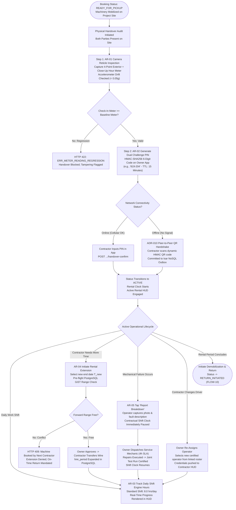
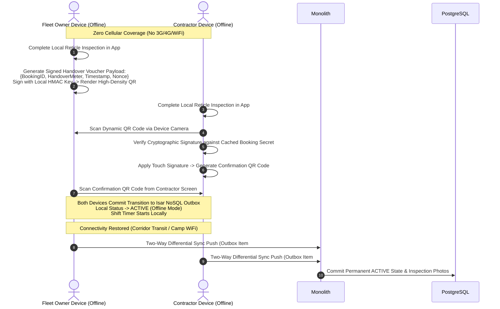
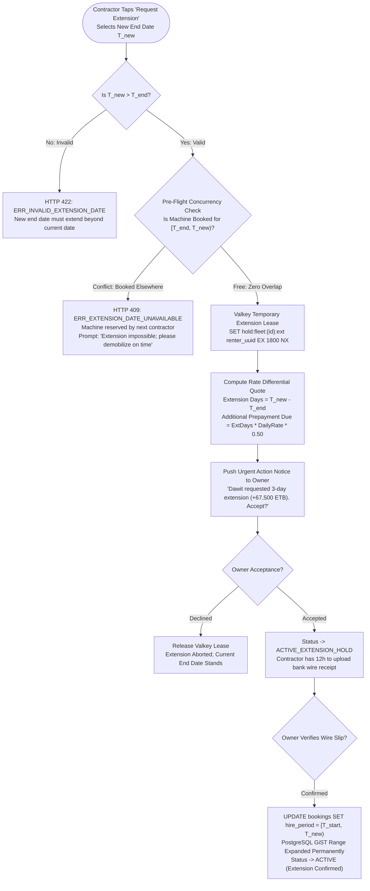
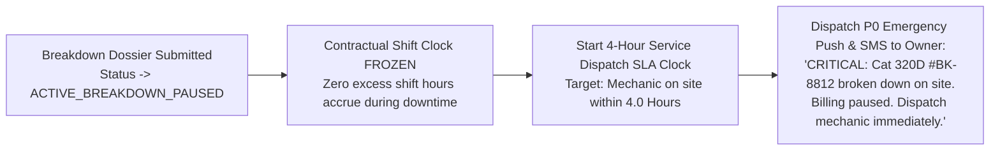
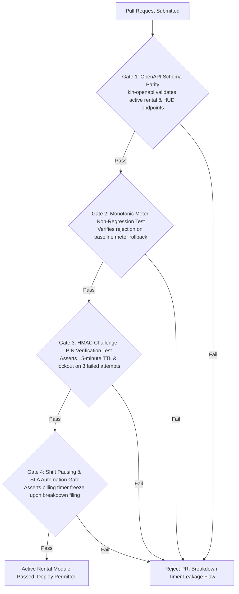

# Heavy Machinery & Logistics Rental Aggregator — Dink Machinery
## Software Requirements Specification — 05.06. Active Rental Management, Shift Telemetry, Breakdown & Extension Architecture (`docs/shared/requirements/05-06-active-rental-management.md`)

**Document Identifier:** `SRS-DINK-CORE-V7.0-SEC-05-06`  
**Classification:** Canonical System Requirements Specification & Architecture Baseline (Single Source of Truth)  
**Governing Standard:** IEEE Std 830-1998 / IEEE/ISO/IEC 29148:2018 (Systems and Software Engineering — Requirements Engineering)  
**Associated Artifacts:** `SRS-DINK-CORE-V7.0` (§5.6, §8, §10, §11), `FLOW-ACTIVE-RENTAL-DINK-CORE-V7.0` (Interaction Flow 09), `FLOW-BOOKING-STATE-MACHINE-DINK-CORE-V7.0`, `FLOW-INSURANCE-CLAIM-DINK-CORE-V7.0`, `ARCH-BACKEND-GO-DINK-CORE-V7.0`, `ARCH-FLUTTER-DINK-CORE-V7.0`, `ARCH-ADMIN-NEXT-DINK-CORE-V7.0`, `ARCH-SEC-DINK-CORE-V7.0`, `DS-DINK-CORE-V7.0`, `DS-PERSONAS-DINK-CORE-V7.0`, `contracts/openapi.yaml`, `ADR-001`, `ADR-002`, `ADR-005`, `ADR-008`, `ADR-010`  
**Target Runtimes:** Go 1.24 Backend Monolith, Flutter 3.44 / Dart 3.9 (Cross-Platform Mobile), Next.js 16 / React 19 (Web Admin & Corporate Portal), PostgreSQL 18.4 + PostGIS 3.4, Valkey 8.0, ClamAV Daemon (:3310), SeaweedFS S3, Isar NoSQL 3.1+  
**Target Personas:** Certified Field Operator (*Mulugeta Tadesse* / *Juma Omwamba*), Civil Engineering Contractor (*Dawit Haile-Mariam* / *Patrick Kariuki*), Fleet Owner & Yard Manager (*W/ro Almaz Tesfaye* / *Kamau Ndegwa*), Compliance Officer & Arbitrator (*Yohannes Bekele*)  
**Target Operating Markets:** Ethiopia (`ET`) & Kenya (`KE`) — Dynamic Multi-Country Parameterization (`LOC-01-BE`)  
**Compliance Standards:** OWASP ASVS 4.0.3 Level 3 (Business Logic Integrity, Concurrency & Cryptographic Attestation), RFC 9457 (Problem Details), ISO 9241-110, W3C WCAG 2.2 Level AAA (Field Mobile) & Level AA (Admin Web), National Bank of Ethiopia (NBE) Directives, Kenya Data Protection Act 2019  
**Status:** Approved Engineering Baseline

---

## Table of Contents

- 1. [Document Scope & Architectural Mandate](#1-document-scope--architectural-mandate)
  - 1.1 [Purpose & Functional Scope](#11-purpose--functional-scope)
  - 1.2 [Core Architectural Principles & Operational Invariants](#12-core-architectural-principles--operational-invariants)
- 2. [Active Rental State Sub-Machine & Operational Topology](#2-active-rental-state-sub-machine--operational-topology)
  - 2.1 [Active Rental Execution Lifecycle Flowchart](#21-active-rental-execution-lifecycle-flowchart)
  - 2.2 [State Representation & Operational Milestones](#22-state-representation--operational-milestones)
- 3. [Pre-Rental Handover Inspection & Dual Challenge PIN Verification](#3-pre-rental-handover-inspection--dual-challenge-pin-verification)
  - 3.1 [Multi-Angle Camera Reticle Inspection & Hour Meter Capture (`AR-01`)](#31-multi-angle-camera-reticle-inspection--hour-meter-capture-ar-01)
  - 3.2 [Cryptographic Dual Challenge PIN Protocol (`AR-02`)](#32-cryptographic-dual-challenge-pin-protocol-ar-02)
  - 3.3 [Offline Peer-to-Peer QR Handshake Fallback (`ADR-010`)](#33-offline-peer-to-peer-qr-handshake-fallback-adr-010)
- 4. [Active Rental Heads-Up Display (HUD) & Live Shift Telemetry](#4-active-rental-heads-up-display-hud--live-shift-telemetry)
  - 4.1 [High-Contrast Field HUD Viewport Specification (`AR-03`)](#41-high-contrast-field-hud-viewport-specification-ar-03)
  - 4.2 [Daily Shift Allocation & Cumulative Hour Engine ($8.0\text{ hrs/day}$)](#42-daily-shift-allocation--cumulative-hour-engine-80text-hrsday)
  - 4.3 [Mid-Rental Operator Re-Assignment Roster Workflow](#43-mid-rental-operator-re-assignment-roster-workflow)
- 5. [Rental Extension Engine & Rate Differential Settlement](#5-rental-extension-engine--rate-differential-settlement)
  - 5.1 [Extension Request Submission & Concurrency Checks (`AR-04`)](#51-extension-request-submission--concurrency-checks-ar-04)
  - 5.2 [Rate Differential Financial Accounting & Prepayment Ingestion](#52-rate-differential-financial-accounting--prepayment-ingestion)
  - 5.3 [GiST Temporal Range Expansion in PostgreSQL 18.4](#53-gist-temporal-range-expansion-in-postgresql-184)
- 6. [Mechanical Breakdown, Stoppage Logging & Timer Pausing](#6-mechanical-breakdown-stoppage-logging--timer-pausing)
  - 6.1 [Mechanical Breakdown Logging & Photo Ingestion (`AR-05`)](#61-mechanical-breakdown-logging--photo-ingestion-ar-05)
  - 6.2 [Automated Shift Timer Pausing & SLA Clocks](#62-automated-shift-timer-pausing--sla-clocks)
  - 6.3 [Owner Field Service Mechanics & Resolution Certification](#63-owner-field-service-mechanics--resolution-certification)
- 7. [Wire Protocol Contracts & RFC 9457 Error Schemas](#7-wire-protocol-contracts--rfc-9457-error-schemas)
  - 7.1 [`POST /api/v1/bookings/{id}/handover-inspect`](#71-post-apiv1bookingsidhandover-inspect)
  - 7.2 [`POST /api/v1/bookings/{id}/handover-confirm`](#72-post-apiv1bookingsidhandover-confirm)
  - 7.3 [`GET /api/v1/bookings/{id}/hud`](#73-get-apiv1bookingsidhud)
  - 7.4 [`POST /api/v1/bookings/{id}/extend`](#74-post-apiv1bookingsidextend)
  - 7.5 [`POST /api/v1/bookings/{id}/breakdown`](#75-post-apiv1bookingsidbreakdown)
  - 7.6 [RFC 9457 Universal Problem Details Payloads](#76-rfc-9457-universal-problem-details-payloads)
- 8. [Automated Testing Suite & Verification Gates](#8-automated-testing-suite--verification-gates)

---

## 1. Document Scope & Architectural Mandate

### 1.1 Purpose & Functional Scope

This specification establishes **Section 05.06 (Active Rental Management, Shift Telemetry, Breakdown & Extension Architecture)** of the canonical Software Requirements Specification (SRS) for **Dink Machinery Version 7.0**.

The operational phase of heavy machinery plant hire takes place in severe physical environments across Ethiopia and Kenya: deep quarry excavations, highway earthworks, and foundation trenches. These sites feature intense solar glare ($> 85,000\text{ lux}$), extreme mechanical vibration, heavy dust, split-leather safety glove usage, and frequent zero-connectivity cellular dead-zones.

This document formally specifies:
1. The physical handover protocol requiring dual-party photographic reticle audits and cryptographic challenge PIN verification before a rental transitions to `ACTIVE`.
2. The high-contrast, glove-accessible Active Rental Heads-Up Display (HUD) presenting real-time shift countdowns, assigned operator dossiers, and telemetry timers.
3. The monotonic engine hour tracking model based on the standard East African commercial baseline of **8.0 Billable Engine Hours per Day**.
4. The mid-rental duration extension engine verifying future availability and settling incremental bank wire prepayments.
5. The field breakdown logging pipeline pausing shift accumulation timers and enforcing 4-hour technical dispatch SLAs.

### 1.2 Core Architectural Principles & Operational Invariants

1. **Strict Monotonic Meter Floor Invariant (`AR-01`):** The mechanical hour meter reading captured at handover check-in forms an immutable floor for the active booking. The handover reading can never be lower than the certified onboarding baseline:
   $$\text{Baseline Meter (Fleet)} \le \text{Check-In Meter (Handover)} \le \text{Current Shift Meter} \le \text{Return Meter (Check-Out)}$$
2. **Cryptographic Dual-Party Verification (`AR-02`):** Transitioning a booking into `ACTIVE` requires physical co-presence attested via a dynamic 6-digit challenge PIN (derived via HMAC-SHA256) generated on the equipment owner's device and entered into the contractor's device, or an offline cryptographic QR handshake per `ADR-010`.
3. **Equatorial High-Glare UI Ergonometrics (`DS-DINK-CORE-V7.0`):** The Active Rental HUD enforces high-contrast palettes ($\ge 7.0:1$ ratio), bold status indicators, and large minimum touch targets ($56 \times 56\text{ dp}$) to enable reliable operation by operators wearing leather work gloves under direct sunlight.
4. **Immediate Shift Pausing on Mechanical Breakdown (`AR-05`):** Submitting a photo-documented mechanical breakdown immediately halts the contractual shift meter clock, preventing civil contractors from being billed for idle machine downtime caused by hydraulic or mechanical failures.
5. **Atomic Extension Temporal Locking (`AR-04`):** Requesting a rental extension triggers an atomic lock on the forward date range $[T_{\text{end}}, T_{\text{new}})$ in Valkey and PostgreSQL, preventing competing reservations while wire prepayment is cleared.

---

## 2. Active Rental State Sub-Machine & Operational Topology

### 2.1 Active Rental Execution Lifecycle Flowchart



---

### 2.2 State Representation & Operational Milestones

During the active operational phase, the booking state transitions across discrete technical milestones:

| Status Key | Operational Meaning | System Perimeter & Automated Actions |
|---|---|---|
| **`READY_FOR_PICKUP`** | Machine arrived at site / yard. | Awaiting joint reticle inspection and challenge PIN entry. |
| **`ACTIVE`** | Equipment formally handed over. | Shift timer active; Active Rental HUD rendered; daily 8h allowances accrue. |
| **`ACTIVE_BREAKDOWN_PAUSED`** | Mechanical breakdown reported. | Shift hour accumulation frozen; 4-hour owner field service repair SLA clock running. |
| **`ACTIVE_EXTENSION_HOLD`** | Extension requested & approved. | Forward temporal range locked; awaiting wire slip upload for incremental rental fee. |
| **`RETURN_INITIATED`** | Hire duration reached or return called. | Operating clock terminated; return check-out reticle inspection unlocked (`FLOW-10`). |

---

## 3. Pre-Rental Handover Inspection & Dual Challenge PIN Verification

### 3.1 Multi-Angle Camera Reticle Inspection & Hour Meter Capture (`AR-01`)

Before equipment custody transfers to the contractor, a joint physical inspection must be completed:
* **Accelerometer-Stabilized Camera Reticle:**
  - Photographs must be captured directly through the mobile application reticle. Gallery uploads are strictly prohibited to prevent forged or outdated condition photos.
  - Device accelerometer sensors verify $< 0.05g$ variance during shutter actuation, eliminating motion blur.
* **Mandatory Handover Inspection Angles:**
  1. Cabin Mechanical Hour Meter (high-resolution close-up capturing all odometer drums / digital segments).
  2. Front Working Equipment (boom, arm, bucket, or blade positioned in resting ground contact).
  3. Undercarriage / Tires (left and right track assemblies, sprockets, idlers, or pneumatic tires).
  4. Engine Compartment & Hydraulic Pumps (fluid levels, engine bay cleanliness, hydraulic line integrity).
  5. Operator Cabin Interior (seat, safety glass, control levers, display gauges).
* **Automated Meter Digit Recognition:** The client executes on-device text recognition to pre-fill the meter reading, which the operator manually reviews and confirms.
* **Non-Regression Validation:** The system asserts:
  $$\text{check\_in\_meter\_hours} \ge \text{fleets.baseline\_meter\_hours}$$
  Any lower value triggers immediate transaction termination with RFC 9457 HTTP 422 Unprocessable Entity (`ERR_METER_READING_REGRESSION`).

---

### 3.2 Cryptographic Dual Challenge PIN Protocol (`AR-02`)

To prove physical co-presence without requiring dedicated external hardware:

```text
+--------------------------------------------------------------------------------------------------+
| DUAL CHALLENGE PIN PROTOCOL SPECIFICATION                                                        |
+--------------------------------------------------------------------------------------------------+
| STEP | ACTOR            | TECHNICAL ACTION & CRYPTOGRAPHIC BEHAVIOR                              |
+------+------------------+------------------------------------------------------------------------+
| 1    | Equipment Owner  | Taps "Generate Handover PIN" on fleet management console.              |
|      | or Yard Manager  | System generates a dynamic 6-digit numeric PIN:                        |
|      |                  | PIN = Truncate6(HMAC-SHA256(SecretKey, BookingID || Nonce || TimeSlot))|
|      |                  | Displayed in bold high-contrast font with 15-minute validity window.   |
+------+------------------+------------------------------------------------------------------------+
| 2    | Civil Contractor | Inspects machinery, reviews uploaded handover inspection photos, and   |
|      | or Site Engineer | physically enters the 6-digit PIN on their own mobile device.          |
+------+------------------+------------------------------------------------------------------------+
| 3    | Civil Contractor | Applies digital touch signature on the touchscreen sign-off canvas.   |
|      |                  | Submits payload: POST /api/v1/bookings/{id}/handover-confirm.          |
+------+------------------+------------------------------------------------------------------------+
| 4    | Backend Monolith | Validates PIN authenticity and time window. Transitions status to      |
|      |                  | ACTIVE. Emits WebSocket/SSE event to both devices to unlock HUD.       |
+--------------------------------------------------------------------------------------------------+
```

---

### 3.3 Offline Peer-to-Peer QR Handshake Fallback (`ADR-010`)

When machinery handovers occur in remote river culverts or deep quarries with zero cellular data coverage:



---

## 4. Active Rental Heads-Up Display (HUD) & Live Shift Telemetry

### 4.1 High-Contrast Field HUD Viewport Specification (`AR-03`)

Once a rental is active, the home screen transforms into the **Active Rental HUD**:

```text
+--------------------------------------------------------------------------------------------------+
| ACTIVE RENTAL HEADS-UP DISPLAY (HUD) VIEWPORT LAYOUT                                             |
+--------------------------------------------------------------------------------------------------+
| +----------------------------------------------------------------------------------------------+ |
| | [ 🟢 ACTIVE RENTAL: DAY 3 OF 7 ]                                         Booking #BK-8812    |
| +----------------------------------------------------------------------------------------------+ |
| | Caterpillar 320D Hydraulic Excavator (2024)                    Plate: ET-3-99120             |
| | Job Site: Mojo-Meki Highway Expansion Site B                   Depot: Kality Yard            |
| +----------------------------------------------------------------------------------------------+ |
| | SHIFT ENGINE TELEMETRY                                                                       |
| | Baseline Handover Meter: 1,450.50 hrs                          Allowed Shift Quota: 56.0 hrs |
| | Shift Hours Remaining Today: 3.5 hrs                           Excess Accumulation: 0.0 hrs  |
| | [ Progress Bar: 4.5 / 8.0 Hours Completed Today (56%) ]                                      |
| +----------------------------------------------------------------------------------------------+ |
| | CERTIFIED OPERATOR ON DUTY                                                                   |
| | Mulugeta Tadesse (Class IV Heavy Plant)                        📞 Call Operator              |
| | License: ET-MUDCO-OP-44912 [✓ Verified]                        Shift: Day (07:00 - 17:00)    |
| +----------------------------------------------------------------------------------------------+ |
| | QUICK ACTION CONTROLS (56x56 dp Hit Targets)                                                 |
| | [ ⏱️ REQUEST DURATION EXTENSION ]           [ ⚠️ REPORT MECHANICAL BREAKDOWN ]               |
| +----------------------------------------------------------------------------------------------+ |
```

* **Color Palette & Accessibility:** Background strictly Neutral Dark `#111827`, Status Accents in Signal Amber `#F59E0B` and Safety Green `#10B981`, with contrast ratios $\ge 7.0:1$.
* **Touch Targets:** Large, padded touch areas ($\ge 56 \times 56\text{ dp}$) prevent accidental mis-taps in vibrating equipment cabs.

---

### 4.2 Daily Shift Allocation & Cumulative Hour Engine ($8.0\text{ hrs/day}$)

The contractual working day across East African civil construction is standardized at **8.0 Billable Engine Hours per Calendar Day**:
* **Cumulative Shift Quota Formulation:**
  $$\text{Contractual Hour Allowance} = \Delta_{\text{days}} \times 8.0\text{ Hours}$$
* **Shift Pacing Telemetry:** The HUD displays real-time operational pacing:
  $$\text{Pacing Status} = \frac{\text{Current Elapsed Hours}}{\text{Elapsed Rental Days} \times 8.0}$$
  - $\le 1.0$: Standard operational pacing (Green).
  - $> 1.0$: Over-shift operation warning (Amber: *"Excess hours will incur surcharges upon return"*).

---

### 4.3 Mid-Rental Operator Re-Assignment Roster Workflow

If an assigned operator falls ill or is re-allocated:
1. Fleet Owner taps `[ Manage Crew ]` on the fleet management screen.
2. Selects an alternate verified operator from their linked roster (`owner_operator_memberships`).
3. The platform verifies that the new operator holds active certifications for that specific machine category.
4. An urgent notification is pushed to the contractor's site manager:
   *"Operator updated: Mulugeta Tadesse replaced by Juma Omwamba (License #KE-NTSA-88192). Effective immediately."*
5. The contractor's HUD updates live via Server-Sent Events (SSE).

---

## 5. Rental Extension Engine & Rate Differential Settlement

### 5.1 Extension Request Submission & Concurrency Checks (`AR-04`)

When project site delays demand additional machine operating days:



---

### 5.2 Rate Differential Financial Accounting & Prepayment Ingestion

The extension quote enforces standard marketplace tariff structures:

$$\text{Extension Days} = T_{\text{new}} - T_{\text{end}}$$

$$\text{Incremental Gross Fee} = \text{Extension Days} \times (\text{fleets.daily\_rate\_minor} + \sum \text{bundled\_attachments\_rate\_minor})$$

$$\text{Incremental Prepayment Due (50\%)} = \lfloor \text{Incremental Gross Fee} \times 0.50 \rfloor$$

* **Settlement Rail:** Contractor executes a direct P2P commercial bank wire transfer directly to the owner's bank account on file.
* **Timeout Boundary:** The contractor must upload the wire slip within **12 hours** of owner approval; failure automatically releases the forward reservation hold.

---

### 5.3 GiST Temporal Range Expansion in PostgreSQL 18.4

Once the extension prepayment is verified by the equipment owner, the relational range is expanded within an ACID transaction:

```sql
BEGIN;

-- 1. Assert no concurrent overlap has been committed
SELECT id FROM bookings
WHERE fleet_id = $fleet_id
  AND id != $booking_id
  AND hire_period && daterange($current_end_date, $new_end_date, '[)')
  AND status IN ('HOLD_PENDING', 'PAYMENT_EVIDENCE_UPLOADED', 'CONFIRMED', 'ACTIVE', 'RETURN_INITIATED')
FOR UPDATE;

-- 2. Expand booking range
UPDATE bookings
SET hire_period = daterange(lower(hire_period), $new_end_date, '[)'),
    gross_amount_minor = gross_amount_minor + $incremental_gross_minor,
    prepayment_amount_minor = prepayment_amount_minor + $incremental_prepay_minor,
    updated_at = NOW()
WHERE id = $booking_id;

-- 3. Expand bundled attachments ranges
UPDATE booking_attachments
SET hire_period = daterange(lower(hire_period), $new_end_date, '[)')
WHERE booking_id = $booking_id;

COMMIT;
```

---

## 6. Mechanical Breakdown, Stoppage Logging & Timer Pausing

### 6.1 Mechanical Breakdown Logging & Photo Ingestion (`AR-05`)

Heavy earthmoving machinery is subject to severe mechanical fatigue (blown hydraulic seals, snapped track chains, cooling system ruptures). When a breakdown occurs:
1. Operator or site engineer taps `[ ⚠️ Report Mechanical Breakdown ]` on the Active Rental HUD.
2. Form fields capture:
   - Breakdown Timestamp (auto-populated via server/GPS time).
   - Machine Fault Category (Engine, Hydraulic Circuit, Electrical, Undercarriage, Structural, Boom/Bucket).
   - Fault Description & Operational Impact.
   - Diagnostic Trouble Codes (DTC) visible on cab digital console.
   - Current Mechanical Hour Meter Reading.
   - Mandatory Photos of damaged component and cab error display.
3. Media streams over TCP socket `:3310` to ClamAV, is transcoded to WebP, and stored in SeaweedFS S3 (`s3://dink-incident-media/breakdowns/{id}/`).

---

### 6.2 Automated Shift Timer Pausing & SLA Clocks

Submitting a verified breakdown triggers automated operational protections:



* **Contractor Billing Protection:** If a machine remains disabled for $> 4.0\text{ hours}$ during a scheduled working day, the rental duration is automatically compensated by extending the end date by 1 full day at zero additional charge, or deducting $1.0\text{ daily rate}$ from the post-rental final reconciliation statement.

---

### 6.3 Owner Field Service Mechanics & Resolution Certification

Once repairs are executed on site:
1. Fleet owner's field mechanic conducts a joint mechanical test run alongside the operator.
2. Mechanic taps `[ Certify Repair Complete ]` in the mobile console:
   - Captures photos of replaced parts / welded assembly.
   - Logs resolution notes and replacement fluid specs.
   - Operator counter-signs the repair sign-off docket.
3. The booking status transitions back to `ACTIVE`.
4. The contractual shift meter clock resumes accumulation.

---

## 7. Wire Protocol Contracts & RFC 9457 Error Schemas

### 7.1 `POST /api/v1/bookings/{id}/handover-inspect`

Submits photographic reticle walkaround photos and check-in mechanical hour meter reading.

#### Request Headers
```http
POST /api/v1/bookings/bk_019a8f60-9912-7b9a/handover-inspect HTTP/1.1
Host: api.dinkmachinery.com
Content-Type: application/json
Authorization: Bearer <operatorAccessToken>
Idempotency-Key: 77182a01-4b12-4f9a-8812-7b9a4c10bc21
```

#### Request Payload
```json
{
  "checkInMeterHours": 1450.50,
  "inspectionPhotos": [
    {"angle": "METER_CLOSEUP", "storageUri": "s3://dink-inspection-media/bk_8812/meter_in.webp"},
    {"angle": "FRONT_ELEVATION", "storageUri": "s3://dink-inspection-media/bk_8812/front_in.webp"},
    {"angle": "REAR_ELEVATION", "storageUri": "s3://dink-inspection-media/bk_8812/rear_in.webp"},
    {"angle": "LEFT_TRACK", "storageUri": "s3://dink-inspection-media/bk_8812/left_in.webp"},
    {"angle": "RIGHT_TRACK", "storageUri": "s3://dink-inspection-media/bk_8812/right_in.webp"},
    {"angle": "CABIN_INTERIOR", "storageUri": "s3://dink-inspection-media/bk_8812/cabin_in.webp"}
  ],
  "fluidLevelsOk": true,
  "safetyGlassIntact": true,
  "notes": "Handover executed on site. Minor scratch on right counterweight noted."
}
```

#### Response: `HTTP 200 OK`
```json
{
  "success": true,
  "data": {
    "bookingId": "bk_019a8f60-9912-7b9a",
    "status": "READY_FOR_PICKUP",
    "meterVerified": true,
    "photosIngestedCount": 6,
    "inspectedAt": "2026-11-05T07:45:00Z"
  },
  "timestamp": "2026-11-05T07:45:01Z"
}
```

---

### 7.2 `POST /api/v1/bookings/{id}/handover-confirm`

Contractor enters dynamic challenge PIN and submits touch signature to activate the booking.

#### Request Payload
```json
{
  "challengePin": "819204",
  "touchSignatureBase64": "data:image/png;base64,iVBORw0KGgoAAAANSUhEUgAA...",
  "contractorLocation": {
    "latitude": 8.5412,
    "longitude": 39.2718
  }
}
```

#### Response: `HTTP 200 OK`
```json
{
  "success": true,
  "data": {
    "bookingId": "bk_019a8f60-9912-7b9a",
    "status": "ACTIVE",
    "activatedAt": "2026-11-05T08:00:00Z",
    "shiftBaselineMeterHours": 1450.50,
    "allocatedShiftHoursTotal": 56.0
  },
  "timestamp": "2026-11-05T08:00:01Z"
}
```

---

### 7.3 `GET /api/v1/bookings/{id}/hud`

Retrieves real-time operational telemetry and shift pacing data for the Active Rental HUD.

#### Request Headers
```http
GET /api/v1/bookings/bk_019a8f60-9912-7b9a/hud HTTP/1.1
Host: api.dinkmachinery.com
Authorization: Bearer <renterAccessToken>
```

#### Response: `HTTP 200 OK`
```json
{
  "success": true,
  "data": {
    "bookingId": "bk_019a8f60-9912-7b9a",
    "status": "ACTIVE",
    "fleet": {
      "id": "flt_019a8f2c-8812-7b9a",
      "title": "Caterpillar 320D",
      "plateNumber": "ET-3-99120"
    },
    "operator": {
      "id": "usr_op_mulugeta_8812",
      "fullName": "Mulugeta Tadesse",
      "phoneNumber": "+251911200491",
      "licenseClass": "Class IV Hydraulic Excavator"
    },
    "shiftTelemetry": {
      "currentRentalDay": 3,
      "totalRentalDays": 7,
      "handoverBaselineHours": 1450.50,
      "accumulatedHoursToday": 4.5,
      "allowedHoursPerDay": 8.0,
      "excessHoursTotal": 0.0,
      "shiftTimerPaused": false
    },
    "quickActionsEnabled": {
      "canExtend": true,
      "canReportBreakdown": true,
      "canInitiateReturn": true
    }
  },
  "timestamp": "2026-11-07T14:30:00Z"
}
```

---

### 7.4 `POST /api/v1/bookings/{id}/extend`

Submits a rental extension request for forward dates.

#### Request Payload
```json
{
  "newEndDate": "2026-11-15"
}
```

#### Response: `HTTP 200 OK`
```json
{
  "success": true,
  "data": {
    "bookingId": "bk_019a8f60-9912-7b9a",
    "extensionDays": 3,
    "additionalGrossMinor": 6750000,
    "incrementalPrepaymentRequiredMinor": 3375000,
    "currency": "ETB",
    "ownerApprovalRequired": true,
    "status": "ACTIVE_EXTENSION_PENDING_OWNER"
  },
  "timestamp": "2026-11-07T14:35:00Z"
}
```

---

### 7.5 `POST /api/v1/bookings/{id}/breakdown`

Logs an on-site mechanical stoppage and halts the billable shift hour accumulation clock.

#### Request Payload
```json
{
  "faultCategory": "HYDRAULIC_CIRCUIT",
  "faultDescription": "Main boom hydraulic hose ruptured under load; severe hydraulic oil pressure loss.",
  "diagnosticTroubleCodes": ["DTC-HYD-4912"],
  "currentHourMeter": 1472.80,
  "incidentPhotos": [
    "s3://dink-incident-media/breakdowns/bk_8812/burst_hose.webp",
    "s3://dink-incident-media/breakdowns/bk_8812/cab_error_screen.webp"
  ]
}
```

#### Response: `HTTP 200 OK`
```json
{
  "success": true,
  "data": {
    "incidentId": "inc_019a8f80-4b12",
    "bookingId": "bk_019a8f60-9912-7b9a",
    "status": "ACTIVE_BREAKDOWN_PAUSED",
    "shiftTimerPausedAt": "2026-11-07T15:10:00Z",
    "ownerSlaDeadline": "2026-11-07T19:10:00Z"
  },
  "timestamp": "2026-11-07T15:10:01Z"
}
```

---

### 7.6 RFC 9457 Universal Problem Details Payloads

#### Example: Hour Meter Regression at Handover (`HTTP 422 Unprocessable Entity`)
```json
{
  "type": "[https://api.dinkmachinery.com/errors/meter-reading-regression](https://api.dinkmachinery.com/errors/meter-reading-regression)",
  "title": "Invalid Handover Hour Meter Reading",
  "status": 422,
  "detail": "Submitted handover check-in reading (1,420.00 hrs) cannot be less than the certified machine baseline (1,450.50 hrs). Potential meter rollback detected.",
  "instance": "/api/v1/bookings/bk_019a8f60-9912-7b9a/handover-inspect",
  "code": "ERR_METER_READING_REGRESSION",
  "invalidParams": [
    {
      "name": "checkInMeterHours",
      "reason": "Submitted reading 1420.00 is less than fleet baseline 1450.50"
    }
  ]
}
```

#### Example: Handover Challenge PIN Mismatch (`HTTP 401 Unauthorized`)
```json
{
  "type": "[https://api.dinkmachinery.com/errors/invalid-handover-pin](https://api.dinkmachinery.com/errors/invalid-handover-pin)",
  "title": "Handover Verification PIN Incorrect",
  "status": 401,
  "detail": "Submitted 6-digit challenge PIN does not match the active authorization token. 2 verification attempts remaining.",
  "instance": "/api/v1/bookings/bk_019a8f60-9912-7b9a/handover-confirm",
  "code": "ERR_CHALLENGE_PIN_MISMATCH"
}
```

---

## 8. Automated Testing Suite & Verification Gates



1. **OpenAPI Schema Contract Gate (`kin-openapi`):** Validates all handover inspection, confirmation, HUD telemetry, duration extension, and breakdown endpoints against `contracts/openapi.yaml`.
2. **Monotonic Meter Non-Regression Integration Test:** Executes 50 handover inspections with varying random meter values. Verifies that any submission where $\text{CheckInMeter} < \text{BaselineMeter}$ is rejected with HTTP 422 `ERR_METER_READING_REGRESSION`.
3. **HMAC-SHA256 Challenge PIN Benchmark:** Simulates 100 PIN verification attempts, asserting that expired tokens ($> 15\text{ minutes}$) return HTTP 401 `ERR_PIN_EXPIRED` and the 3rd consecutive failed attempt triggers a 30-minute lockout.
4. **Mechanical Breakdown Timer State Gate:** Ingests a simulated breakdown report, asserting that the Go domain service freezes shift hour accumulation in PostgreSQL and starts the 4-hour SLA clock in $< 100\text{ ms}$.

---

*This document establishes the canonical functional requirements, state machine topology, cryptographic handover protocols, shift telemetry formulas, and wire contracts for Active Rental Management in Dink Machinery Version 7.0. All downstream Flutter mobile viewports, Go backend microservices, and Next.js admin consoles must strictly conform to this specification.*