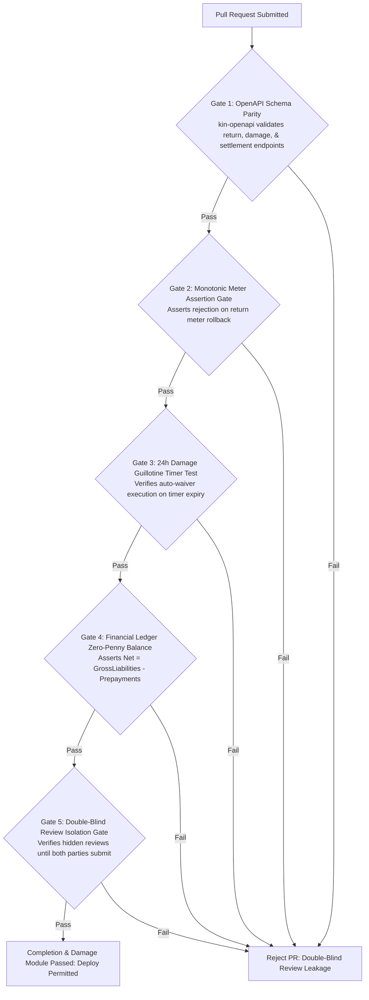

# Heavy Machinery & Logistics Rental Aggregator — Dink Machinery
## Software Requirements Specification — 05.07. Rental Completion, Demobilization, Damage Triage & Settlement Reconciliation (`docs/shared/requirements/05-07-rental-completion-return-damage.md`)

**Document Identifier:** `SRS-DINK-CORE-V7.0-SEC-05-07`  
**Classification:** Canonical System Requirements Specification & Architecture Baseline (Single Source of Truth)  
**Governing Standard:** IEEE Std 830-1998 / IEEE/ISO/IEC 29148:2018 (Systems and Software Engineering — Requirements Engineering)  
**Associated Artifacts:** `SRS-DINK-CORE-V7.0` (§5.7, §8, §10, §11), `FLOW-RETURN-INSPECTION-DINK-CORE-V7.0` (Interaction Flow 10), `FLOW-BOOKING-STATE-MACHINE-DINK-CORE-V7.0`, `FLOW-INSURANCE-CLAIM-DINK-CORE-V7.0`, `FLOW-WIRE-DISPUTE-DINK-CORE-V7.0`, `ARCH-BACKEND-GO-DINK-CORE-V7.0`, `ARCH-FLUTTER-DINK-CORE-V7.0`, `ARCH-ADMIN-NEXT-DINK-CORE-V7.0`, `ARCH-SEC-DINK-CORE-V7.0`, `DS-DINK-CORE-V7.0`, `DS-PERSONAS-DINK-CORE-V7.0`, `contracts/openapi.yaml`, `ADR-001`, `ADR-002`, `ADR-005`, `ADR-008`, `ADR-010`  
**Target Runtimes:** Go 1.27.3 Backend Monolith, Flutter 3.47.9 / Dart 3.9 (Cross-Platform Mobile), Next.js 16.x (latest CVE security patch) / React 19 (Web Admin & Corporate Portal), PostgreSQL 18.6 + PostGIS 3.6.4, Valkey 9.1.3, ClamAV Daemon (:3310), SeaweedFS S3, Isar NoSQL 3.1+  
**Target Personas:** Civil Engineering Contractor (*Dawit Haile-Mariam* / *Patrick Kariuki*), Equipment Fleet Owner (*W/ro Almaz Tesfaye* / *Kamau Ndegwa*), Certified Field Operator (*Mulugeta Tadesse* / *Juma Omwamba*), Compliance Officer & Damage Arbitrator (*Yohannes Bekele*)  
**Target Operating Markets:** Ethiopia (`ET`) & Kenya (`KE`) — Dynamic Multi-Country Parameterization (`LOC-01-BE`)  
**Compliance Standards:** OWASP ASVS 4.0.3 Level 3 (Business Logic Integrity, Financial Settlement Non-Repudiation & Cryptographic Attestation), RFC 9457 (Problem Details), ISO 9241-110, W3C WCAG 2.2 Level AAA (Field Mobile) & Level AA (Admin Web), National Bank of Ethiopia (NBE) Financial Directives, Kenya Data Protection Act 2019  
**Status:** Approved Engineering Baseline

---

## Table of Contents

- 1. [Document Scope & Architectural Mandate](#1-document-scope--architectural-mandate)
  - 1.1 [Purpose & Functional Scope](#11-purpose--functional-scope)
  - 1.2 [Core Architectural Principles & Operational Invariants](#12-core-architectural-principles--operational-invariants)
- 2. [Rental Completion State Sub-Machine & Settlement Topology](#2-rental-completion-state-sub-machine--settlement-topology)
  - 2.1 [Rental Completion & Return Lifecycle Flowchart](#21-rental-completion--return-lifecycle-flowchart)
  - 2.2 [State Sub-Machine Taxonomy & Operational Milestones](#22-state-sub-machine-taxonomy--operational-milestones)
- 3. [Demobilization & Return Reticle Inspection Protocol](#3-demobilization--return-reticle-inspection-protocol)
  - 3.1 [Automated & Manual Return Initiation (`RC-01`)](#31-automated--manual-return-initiation-rc-01)
  - 3.2 [Check-Out Reticle Photo Auditing & Hour Meter Capture (`RC-02`)](#32-check-out-reticle-photo-auditing--hour-meter-capture-rc-02)
  - 3.3 [Strict Monotonic Non-Regression Validation Engine](#33-strict-monotonic-non-regression-validation-engine)
  - 3.4 [Split-Screen Handover vs. Return Condition Comparison](#34-split-screen-handover-vs-return-condition-comparison)
- 4. [Engine Shift Telemetry & Excess Hour Surcharge Mechanics](#4-engine-shift-telemetry--excess-hour-surcharge-mechanics)
  - 4.1 [Standard Shift Allowance Model ($8.0\text{ hrs/day}$) Formulation](#41-standard-shift-allowance-model-80text-hrsday-formulation)
  - 4.2 [Deduction of Documented Mechanical Breakdown Hours](#42-deduction-of-documented-mechanical-breakdown-hours)
  - 4.3 [Excess Hour Tariff Billing Calculation (`RC-03`)](#43-excess-hour-tariff-billing-calculation-rc-03)
- 5. [Post-Rental Damage Triage, Claim Dockets & Arbitration](#5-post-rental-damage-triage-claim-dockets--arbitration)
  - 5.1 [Statutory 24-Hour Damage Audit Window (`RC-04`)](#51-statutory-24-hour-damage-audit-window-rc-04)
  - 5.2 [Ordinary Operational Wear vs. Compensable Structural Damage](#52-ordinary-operational-wear-vs-compensable-structural-damage)
  - 5.3 [Itemized Damage Claim Docket Assembly](#53-itemized-damage-claim-docket-assembly)
  - 5.4 [Contractor Response Modalities (Acceptance vs. Dispute)](#54-contractor-response-modalities-acceptance-vs-dispute)
  - 5.5 [Compliance Officer Damage Arbitration Workbench (`FLOW-10 §3.4`, `FLOW-13`)](#55-compliance-officer-damage-arbitration-workbench-flow-10-34-flow-13)
  - 5.6 [Catastrophic Loss Transition to CPAR Insurance Claim (`FLOW-19`)](#56-catastrophic-loss-transition-to-cpar-insurance-claim-flow-19)
- 6. [Final Balance Reconciliation Statement & Direct P2P Settlement](#6-final-balance-reconciliation-statement--direct-p2p-settlement)
  - 6.1 [Universal Mathematical Reconciliation Formulation (`RC-05`)](#61-universal-mathematical-reconciliation-formulation-rc-05)
  - 6.2 [Direct P2P Final Wire Execution & Slip Verification (`RC-06`)](#62-direct-p2p-final-wire-execution--slip-verification-rc-06)
  - 6.3 [Prepayment Exceeds Final Balance (Owner Refund Obligation)](#63-prepayment-exceeds-final-balance-owner-refund-obligation)
  - 6.4 [Zero-Balance Auto-Completion Invariant](#64-zero-balance-auto-completion-invariant)
- 7. [Reputation Trust Ledger & Mutual Double-Blind Review Engine](#7-reputation-trust-ledger--mutual-double-blind-review-engine)
  - 7.1 [Double-Blind Review Invariant (`RC-07`)](#71-double-blind-review-invariant-rc-07)
  - 7.2 [Multi-Factor Rating Aggregation Formulation](#72-multi-factor-rating-aggregation-formulation)
  - 7.3 [Terminal Archival State Transition (`COMPLETED` $\rightarrow$ `RATED`)](#73-terminal-archival-state-transition-completed-rightarrow-rated)
- 8. [Wire Protocol Contracts & RFC 9457 Error Schemas](#8-wire-protocol-contracts--rfc-9457-error-schemas)
  - 8.1 [`POST /api/v1/bookings/{id}/return-initiate`](#81-post-apiv1bookingsidreturn-initiate)
  - 8.2 [`POST /api/v1/bookings/{id}/return-inspect`](#82-post-apiv1bookingsidreturn-inspect)
  - 8.3 [`POST /api/v1/bookings/{id}/damage-claims`](#83-post-apiv1bookingsiddamage-claims)
  - 8.4 [`POST /api/v1/bookings/{id}/damage-claims/{claimId}/respond`](#84-post-apiv1bookingsiddamage-claimsclaimidrespond)
  - 8.5 [`POST /api/v1/bookings/{id}/final-reconcile`](#85-post-apiv1bookingsidfinal-reconcile)
  - 8.6 [`POST /api/v1/bookings/{id}/reviews`](#86-post-apiv1bookingsidreviews)
  - 8.7 [RFC 9457 Universal Problem Details Payloads](#87-rfc-9457-universal-problem-details-payloads)
- 9. [Automated Testing Suite & Verification Gates](#9-automated-testing-suite--verification-gates)

---

## 1. Document Scope & Architectural Mandate

### 1.1 Purpose & Functional Scope

This specification establishes **Section 05.07 (Rental Completion, Demobilization, Damage Triage & Settlement Reconciliation)** of the canonical Software Requirements Specification (SRS) for **Dink Machinery Version 7.0**.

In the East African civil engineering and heavy logistics sectors, the conclusion of an equipment rental contract is historically the most contentious operational phase. Informal machinery rentals frequently dissolve into bitter post-rental disputes over:
* Unverified engine shift hours operated during nighttime highway paving.
* Unaccounted idle machine downtime caused by hydraulic burst hoses or fuel injector failures.
* Preexisting undercarriage cracks or structural boom weld fatigue unfairly attributed to the last contractor.
* Unrecovered final balance payments, unreturned security deposits, or predatory damage assessments.

This document formally establishes the technical, photographic, mathematical, and legal mechanisms governing:
1. The transition of active bookings into demobilization and physical return reticle auditing.
2. The mathematical computation of billable operating hours against the standard **8.0 Engine Operating Hours per Day** allowance.
3. The strict **24-hour statutory audit window** for filing itemized damage claims, bounded by cryptographic pre-rental baseline reticles.
4. The final balance reconciliation accounting statement enforcing peer-to-peer (P2P) non-custodial bank settlement under National Bank of Ethiopia (NBE) regulatory directives.
5. The double-blind reputation rating system archiving completed contracts into the permanent trust ledger.

### 1.2 Core Architectural Principles & Operational Invariants

1. **Strict Monotonic Meter Non-Regression Floor (`RC-02`):** The final engine hour meter reading recorded during check-out return cannot, under any mathematical or operational permutation, register below the baseline reading logged during physical handover check-in:
   $$\text{Handover Check-In Meter} \le \text{Return Check-Out Meter}$$
   Any submitted reading violating this inequality aborts the transaction immediately with RFC 9457 HTTP 422 Unprocessable Entity (`ERR_METER_READING_REGRESSION`).
2. **Statutory 24-Hour Damage Guillotine (`RC-04`):** Following the submission of the return reticle inspection, the fleet owner has an exact 24-hour window ($86,400\text{ seconds}$) to file an itemized damage claim docket. If no docket is lodged before the timer expires, the platform executes an automated legal waiver, locking compensable damage at $0.00\text{ ETB}$ and releasing the contractor from further structural liability.
3. **Double-Entry Financial Statement Balance (`RC-05`):** The final reconciliation calculation is fully deterministic. All gross contract rates, bundled implement tariffs, verified excess operating hours, accepted physical damage liabilities, and previously settled prepayments resolve to a single final net balance figure stored in integer minor currency units (`ETB cents` or `KES cents`).
4. **Non-Custodial Settlement Execution (`RC-06`):** The platform never pools, intermediates, or escrows final balance funds. Settlement balances flow directly between commercial bank accounts via peer-to-peer wire rails (e.g., Commercial Bank of Ethiopia, Awash Bank, Safaricom M-PESA Paybill), validated via ClamAV-screened transaction confirmation slips.
5. **Double-Blind Reputation Isolation (`RC-07`):** Neither the contractor nor the fleet owner can inspect the counterparty's submitted review score or commentary until both parties have finalized and submitted their respective reviews, or until the 14-day statutory review window has elapsed.

---

## 2. Rental Completion State Sub-Machine & Settlement Topology

### 2.1 Rental Completion & Return Lifecycle Flowchart

```mermaid
flowchart TD
    ActiveState(["Status: ACTIVE<br/>Rental Duration Concludes or Early Return Called"]) --> TriggerReturn["Trigger Demobilization<br/>Automated Cron at T_end OR Manual Tap"]
    
    TriggerReturn --> ReturnInit["12. RETURN_INITIATED<br/>Operating Clock Stopped<br/>Return Reticle Audit Unlocked"]
    
    ReturnInit --> ReturnInspect["Step 1: RC-02 Execute Return Reticle Inspection<br/>Capture 4-Point Exterior + Final Hour Meter<br/>Accelerometer Drift Verified (< 0.05g)"]
    
    ReturnInspect --> AssertNonRegression{"Is Return Meter >= Handover Meter?"}
    AssertNonRegression -->|"No: Regression Violation"| RegressError["HTTP 422: ERR_METER_READING_REGRESSION<br/>Tampering Flagged; Resubmission Mandated"]
    RegressError --> ReturnInspect
    
    AssertNonRegression -->|"Yes: Valid Reading"| ComputeHours["Step 2: RC-03 Compute Excess Engine Hours<br/>Actual Hours = Return Meter - Handover Meter<br/>Deduct Documented Breakdown Stoppages<br/>Excess Hours = max(0, Net Actual - (Days * 8.0))"]
    
    ComputeHours --> Open24hWindow["Step 3: Open Statutory 24-Hour Damage Audit Window<br/>Valkey Timer Set: 86,400 Seconds<br/>Owner Alerted to Inspect Asset"]
    
    Open24hWindow --> OwnerDamageAction{"Owner Lodges Damage Claim<br/>Within 24 Hours?"}
    
    OwnerDamageAction -->|"No: Timer Expires"| ZeroDamage["Auto-Waiver Executed<br/>Damage Liability Locked at 0.00 ETB"]
    OwnerDamageAction -->|"Yes: Claim Submitted"| DamageDocket["RC-04 Assemble Itemized Damage Docket<br/>Photos, Dealer Repair Quote, Claimed Amount"]
    
    DamageDocket --> ContractorResponse{"Contractor Decision on Damage"}
    ContractorResponse -->|"Accepts Liability"| AcceptedDamage["Damage Added to Final Balance Statement"]
    ContractorResponse -->|"Contests Claim"| DisputeWorkbench["FLOW-10 §3.4 Compliance Arbitration<br/>Officer (Yohannes Bekele) Reviews Baseline Diff<br/>Issues Binding Legal Ruling"]
    DisputeWorkbench --> AcceptedDamage
    
    ZeroDamage --> FinalReconcile["Step 4: RC-05 Compile Final Reconciliation Statement<br/>Net Balance = Base + Attachments + Excess + Damage - Prepay"]
    AcceptedDamage --> FinalReconcile
    
    FinalReconcile --> BalanceEvaluation{"Is Net Balance Due > 0?"}
    
    BalanceEvaluation -->|"Yes: Net Due to Owner"| PendingFinalPay["13. PENDING_FINAL_PAYMENT<br/>Contractor Wires Net Balance to Owner Bank<br/>Uploads CBE / Awash Transfer Slip"]
    
    PendingFinalPay --> OwnerVerifySlip{"Owner Confirms Wire Receipt?"}
    OwnerVerifySlip -->|"Confirmed"| StateCompleted["14. COMPLETED<br/>All Balances Reconciled to Zero"]
    OwnerVerifySlip -->|"Declined / Dispute"| WireDispute["Compliance Wire Dispute Arbitration (FLOW-08)"]
    WireDispute --> StateCompleted
    
    BalanceEvaluation -->|"No: Exactly 0.00 ETB"| StateCompleted
    BalanceEvaluation -->|"Negative: Owner Owes Refund"| OwnerRefund["Owner Wires Overpayment Refund to Contractor<br/>Uploads Wire Slip -> Status -> COMPLETED"]
    OwnerRefund --> StateCompleted
    
    StateCompleted --> DoubleBlindRating["Step 5: RC-07 Double-Blind Review Engine<br/>Both Parties Submit 1-5 Star Ratings + Text Feedback"]
    
    DoubleBlindRating --> StateRated(["15. RATED<br/>Terminal Archival State; Reviews Published"])
```



---

### 2.2 State Sub-Machine Taxonomy & Operational Milestones

The completion and demobilization sub-machine governs the terminal stages of the rental contract:

| Status Key | Operational Perimeter | Automated Triggers & Invariants |
|---|---|---|
| **`RETURN_INITIATED`** | Rental duration expired or early return declared. | Operating clock frozen; shift meters stopped; return reticle unlocked. |
| **`DAMAGE_PENDING_REVIEW`** | Return reticle inspection uploaded; owner evaluating wear. | 24-hour countdown running in Valkey; final reconciliation blocked. |
| **`DAMAGE_DISPUTED`** | Contractor contested owner's damage claim. | Docket assigned to Compliance Officer *Yohannes Bekele* (`AD-06-WEB`). |
| **`PENDING_FINAL_PAYMENT`** | Final reconciliation statement approved; balance due. | Renter has 24h to wire excess hours and accepted damages directly to owner. |
| **`COMPLETED`** | All ledger line items cleared to zero. | Contractual obligations extinguished; rating prompt unlocked. |
| **`RATED`** | Both parties submitted ratings or 14-day window closed. | Terminal canonical state; aggregate owner/renter reputations updated. |

---

## 3. Demobilization & Return Reticle Inspection Protocol

### 3.1 Automated & Manual Return Initiation (`RC-01`)

The transition into demobilization occurs via two distinct pathways:
1. **Automated Cron Trigger:** Exactly at $T_{\text{end}}$ (scheduled rental end date and time, e.g., `2026-11-12T17:00:00+03:00`), the Go backend scheduler updates `bookings.status` from `ACTIVE` to `RETURN_INITIATED`.
2. **Early Return Manual Initiation:** If civil earthworks conclude ahead of schedule, the contractor or operator can tap `[ Initiate Early Return ]` on the Active Rental HUD. The system issues a confirmation warning and immediately halts the operational clock.

---

### 3.2 Check-Out Reticle Photo Auditing & Hour Meter Capture (`RC-02`)

Before machinery leaves the job site, Certified Operator *Mulugeta Tadesse* must execute the formal **Check-Out Reticle Inspection**:
* **Live Camera Reticle Mandate:** Photos must be captured live through the camera reticle; gallery uploads are strictly disabled to eliminate fraudulent, historical, or stock photography.
* **Accelerometer Steady-State Control:** The Flutter application interrogates device inertial sensors, verifying $< 0.05g$ variance during shutter actuation to ensure razor-sharp focus on serial numbers and dial faces.
* **Mandatory Return Inspection Perspectives:**
  1. Cabin Mechanical Hour Meter (high-resolution macro photo displaying all drums and numeric tumblers).
  2. Front Working Implement (excavator bucket teeth, cutting edges, or breaker chisel).
  3. Undercarriage / Tracks / Tires (left and right track chains, sprockets, grouser shoes, and idler wheels).
  4. Rear Counterweight & Engine Hood (verifying absence of rear-impact collision fractures).
  5. Hydraulic Circuit & Main Valve Block (documenting absence of fresh, weeping hydraulic fluid leaks).
  6. Operator Enclosed Cabin Interior (verifying intact safety glass, control joysticks, and clean dashboard gauges).

---

### 3.3 Strict Monotonic Non-Regression Validation Engine

The engine hour meter reading logged at check-out return represents the legally binding measure of engine runtime:
* **Client-Side Digit Extraction:** The Flutter client executes Google ML Kit Text Recognition on-device to pre-fill the numeric meter reading (`1512.20`).
* **Non-Regression Verification:**
  The Go backend executes a hard assertion against the certified handover check-in meter reading:
  $$\text{check\_out\_meter\_hours} \ge \text{bookings.check\_in\_meter\_hours}$$
* **Exception Trapping:** If an operator mistakenly or fraudulently inputs a lower reading (e.g., `1420.00` when check-in was `1450.50`), the transaction aborts with **RFC 9457 HTTP 422 Unprocessable Entity**:
  ```json
  {
    "type": "[https://api.dinkmachinery.com/errors/meter-reading-regression](https://api.dinkmachinery.com/errors/meter-reading-regression)",
    "title": "Invalid Return Hour Meter Reading",
    "status": 422,
    "detail": "Return meter reading (1,420.00 hrs) cannot be less than handover check-in reading (1,450.50 hrs). Potential meter tampering detected.",
    "code": "ERR_METER_READING_REGRESSION"
  }
  ```

---

### 3.4 Split-Screen Handover vs. Return Condition Comparison

To prevent subjective disputes, the Next.js admin portal and Flutter mobile apps provide a synchronized **Split-Screen Inspection Viewer**:
* The screen renders pre-rental handover check-in photos on the left and post-rental check-out photos on the right.
* Supports unified pinch-to-zoom and synchronized pan controls, enabling inspectors to cross-examine identical angles (e.g., comparing track shoe wear or hydraulic cylinder rod scoring) with pixel-level precision.

---

## 4. Engine Shift Telemetry & Excess Hour Surcharge Mechanics

### 4.1 Standard Shift Allowance Model ($8.0\text{ hrs/day}$) Formulation

Commercial machinery rental agreements in East Africa are priced upon a standard single-shift operational envelope:
* **Standard Shift Base:** **8.0 Engine Operating Hours per Calendar Day**.
* **Contractual Operating Allowance Formulation:**
  $$\mathcal{H}_{\text{agreed}} = \Delta_{\text{days}} \times 8.0\text{ Hours}$$
  *Example:* A 7-day crawler excavator hire grants a cumulative operating allowance of:
  $$\mathcal{H}_{\text{agreed}} = 7 \times 8.0 = 56.0\text{ Engine Hours}$$

---

### 4.2 Deduction of Documented Mechanical Breakdown Hours

Contractors must never be penalized for hours when equipment was disabled due to mechanical failure:
* The system queries `booking_incidents` for all verified mechanical breakdowns submitted during the rental (`status = 'RESOLVED'` or `'CERTIFIED'`).
* For each breakdown, the system calculates downtime duration:
  $$\mathcal{D}_{\text{breakdown}} = \sum_{j=1}^{m} (T_{\text{resolved}, j} - T_{\text{reported}, j})$$
* If breakdown downtime deprived the contractor of scheduled shift working hours, the contractual allowance is adjusted or downtime hours are credited directly against accumulated operational runtime:
  $$\mathcal{H}_{\text{actual\_net}} = (\text{check\_out\_meter\_hours} - \text{check\_in\_meter\_hours}) - \mathcal{H}_{\text{breakdown\_credit}}$$

---

### 4.3 Excess Hour Tariff Billing Calculation (`RC-03`)

If the actual net engine operating hours exceed the agreed shift allowance, an excess shift surcharge is computed:

$$\mathcal{H}_{\text{excess}} = \max\left(0.00, \mathcal{H}_{\text{actual\_net}} - \mathcal{H}_{\text{agreed}}\right)$$

$$\mathcal{S}_{\text{excess\_minor}} = \lfloor \mathcal{H}_{\text{excess}} \times \text{fleets.excess\_hour\_rate\_minor} \rfloor$$

```text
+--------------------------------------------------------------------------------------------------+
| WORKED EXCESS HOUR CALCULATION EXAMPLE                                                           |
+------------------------------------+-------------------------------------------------------------+
| Contract Hire Duration             | 7 Calendar Days (2026-11-05 to 2026-11-12)                   |
| Contractual Shift Allowance        | 7 Days * 8.0 Hours = 56.00 Allowed Engine Hours             |
| Handover Check-In Meter Reading    | 1,450.50 Engine Hours                                       |
| Return Check-Out Meter Reading     | 1,512.20 Engine Hours                                       |
| Gross Operating Hours Logged       | 1,512.20 - 1,450.50 = 61.70 Engine Hours                    |
| Breakdown Downtime Credited        | 0.00 Hours (Zero stoppages logged)                          |
| Net Billable Excess Hours          | max(0.00, 61.70 - 56.00) = 5.70 Excess Operating Hours     |
| Fleet Excess Hourly Surcharge Rate | 2,800.00 ETB / Hour (280,000 Minor Units)                   |
| Total Excess Hour Surcharge Due    | 5.70 * 2,800.00 ETB = 15,960.00 ETB (1,596,000 Minor Units) |
+------------------------------------+-------------------------------------------------------------+
```
This calculated figure ($\mathcal{S}_{\text{excess\_minor}}$) is automatically committed as an immutable line item on the final balance reconciliation statement.

---

## 5. Post-Rental Damage Triage, Claim Dockets & Arbitration

### 5.1 Statutory 24-Hour Damage Audit Window (`RC-04`)

Upon submission of the return reticle inspection, equipment physical custody returns to the fleet owner:
* **Automated Valkey Countdown Lease:** The platform starts an immutable 24-hour audit countdown timer:
  ```text
  SET damage_window:booking:{booking_id} "OPEN" EX 86400
  ```
* **Statutory Guillotine Invariant:** If the 24-hour window elapses without the fleet owner submitting an itemized damage claim docket, the key expires. The Go backend executes an automated waiver trigger:
  ```sql
  UPDATE bookings 
  SET damage_claim_waived = true, 
      accepted_damage_minor = 0 
  WHERE id = $booking_id AND damage_claim_submitted = false;
  ```
  The damage liability is legally extinguished, and the booking transitions directly to final balance reconciliation.

---

### 5.2 Ordinary Operational Wear vs. Compensable Structural Damage

To eliminate frivolous and predatory damage claims, the platform codifies explicit physical failure taxonomy:

```text
+--------------------------------------------------------------------------------------------------+
| PHYSICAL DAMAGE CLASSIFICATION TAXONOMY MATRIX                                                   |
+------------------------------------+------------------------------------+------------------------+
| COMPONENT CATEGORY                 | ORDINARY OPERATIONAL WEAR-AND-TEAR | COMPENSABLE STRUCTURAL |
|                                    | (NON-BILLABLE / OWNER'S ACCOUNT)   | DAMAGE (RENTER LIABLE) |
+------------------------------------+------------------------------------+------------------------+
| Ground-Engaging Tools (GET)        | Routine abrasion of bucket teeth;  | Missing teeth due to   |
| & Implement Tips                   | blunt chisel tip; minor scratches. | fracture; snapped shank|
+------------------------------------+------------------------------------+------------------------+
| Undercarriage & Track Assembly     | Normal track chain elongation;     | Thrown track derailment|
|                                    | wear on carrier roller surfaces.   | causing cracked idler. |
+------------------------------------+------------------------------------+------------------------+
| Hydraulic Cylinders & Circuit      | Minor weeping around dust wipers;  | Deep gouges on chrome  |
|                                    | routine hydraulic filter loading.  | rod; crushed lines.    |
+------------------------------------+------------------------------------+------------------------+
| Structural Boom, Arm & Chassis     | Surface paint scuffs; minor dirt   | Bent arm weldments;    |
|                                    | accumulation in chassis wells.     | sheared pivot pins.    |
+------------------------------------+------------------------------------+------------------------+
| Enclosed Operator Cabin            | Dust accumulation on floor mats;   | Smashed safety glass;  |
|                                    | routine surface wear on seat.      | broken display console.|
+--------------------------------------------------------------------------------------------------+
```

---

### 5.3 Itemized Damage Claim Docket Assembly

If compensable structural damage occurred, Fleet Owner *W/ro Almaz Tesfaye* lodges a formal claim via `POST /api/v1/bookings/{id}/damage-claims`:
* **Claimant Itemization:**
  - Structural Component Category (Boom, Arm, Hydraulic System, Undercarriage, Cab Glass, Engine).
  - Detailed Text Narrative detailing operating abuse or collision event.
  - Photographic Evidence: At least 3 high-resolution photos highlighting component damage.
  - Certified Repair Estimate Document: PDF or photo of an official quotation from an authorized equipment dealer (e.g., *Ries Engineering CAT Ethiopia* or *Mantrac Kenya*).
  - Claimed Monetary Compensation Amount ($\mathcal{D}_{\text{claimed\_minor}}$).
* Status transitions to `DAMAGE_PENDING_REVIEW`. Contractor *Dawit* receives an immediate urgent push and SMS notification.

---

### 5.4 Contractor Response Modalities (Acceptance vs. Dispute)

Contractor *Dawit Haile-Mariam* inspects the damage claim docket on his mobile device and has two mutually exclusive options:
1. **Accept Damage Liability (`ACCEPT`):**
   - Dawit acknowledges site responsibility (e.g., a rock excavator tip struck a trench wall, shattering a cab window).
   - The claimed damage amount ($\mathcal{D}_{\text{claimed\_minor}}$) is marked as accepted ($\mathcal{D}_{\text{accepted\_minor}}$) and injected into the final reconciliation statement.
   - Status moves to `PENDING_FINAL_PAYMENT`.
2. **Dispute Damage Claim (`DISPUTE`):**
   - Dawit asserts that the crack was preexisting or constitutes ordinary wear-and-tear.
   - Submits counter-narrative and highlights pre-rental handover reticle photos proving baseline defects.
   - Status transitions to `DAMAGE_DISPUTED`. The dossier escalates directly to platform arbitration.

---

### 5.5 Compliance Officer Damage Arbitration Workbench (`FLOW-10 §3.4`, `FLOW-13`)

When a damage claim is contested, it enters the **Compliance Arbitration Workbench** in the Next.js web console (`AD-06-WEB`):
* **Compliance Officer Assignment:** Assigned to Compliance Officer *Yohannes Bekele*.
* **Digital Dossier Review:**
  - Synchronized split-screen review comparing Check-In Walkaround Photos (`AR-01`) against Return Damage Photos (`RC-04`).
  - Inspection of dealer repair quotation for inflated parts/labor markups.
  - Cross-examination of operator daily shift breakdown logs (`AR-05`).
* **Binding Administrative Rulings:**
  - **Uphold Claim in Full:** Yohannes rules that the damage resulted from renter abuse. Full claimed amount becomes billable.
  - **Split Adjusted Liability:** Yohannes adjusts the claim (e.g., reduces claim from $45,000.00\text{ ETB}$ to $28,000.00\text{ ETB}$ to account for preexisting component depreciation).
  - **Dismiss Claim in Full:** Yohannes confirms defect was documented during initial check-in or constitutes ordinary wear. Damage liability is set to $0.00\text{ ETB}$.
* The ruling is legally binding under Dink Machinery Terms of Service §14. Status moves to `PENDING_FINAL_PAYMENT`.

---

### 5.6 Catastrophic Loss Transition to CPAR Insurance Claim (`FLOW-19`)

If physical damage exceeds $75\%$ of asset value or represents structural machine rollover, fire destruction, or site collapse:
* The claim is classified as **Catastrophic Loss**.
* The platform automatically trips the **Life-Safety & Insurance Ingestion Pipeline** (`FLOW-19`).
* The fleet listing is immediately marked `INSURANCE_HOLD`, de-indexing it from PostGIS search.
* A formal Comprehensive Plant All-Risks (CPAR) insurance dossier is generated and transmitted to the underwriter (e.g., *Awash Insurance SC* or *Kenyan Alliance Insurance*), transferring claim adjudication to an accredited Independent Loss Adjuster.

---

## 6. Final Balance Reconciliation Statement & Direct P2P Settlement

### 6.1 Universal Mathematical Reconciliation Formulation (`RC-05`)

At the conclusion of the rental lifecycle, the financial engine evaluates the complete transaction ledger and compiles the deterministic **Final Balance Reconciliation Statement**:

$$\mathcal{B}_{\text{gross}} = (\Delta_{\text{days}} \times \text{daily\_rate\_minor}) + \sum_{i=1}^{k} (\Delta_{\text{days}} \times \text{attachment}_i\text{.bundled\_rate\_minor})$$

$$\mathcal{L}_{\text{total\_due}} = \mathcal{B}_{\text{gross}} + \mathcal{S}_{\text{excess\_minor}} + \mathcal{D}_{\text{accepted\_minor}}$$

$$\mathcal{F}_{\text{net\_balance\_minor}} = \mathcal{L}_{\text{total\_due}} - \mathcal{P}_{\text{prepayment\_settled\_minor}}$$

```text
+--------------------------------------------------------------------------------------------------+
| COMPREHENSIVE FINAL BALANCE RECONCILIATION STATEMENT (BK-8812)                                   |
+------------------------------------------------------------------+-------------------------------+
| ACCOUNTING ITEM / TRANSACTION COMPONENT                          | AMOUNT (ETB / MINOR UNITS)    |
+------------------------------------------------------------------+-------------------------------+
| Base Machine Hire Fee (7 Days @ 22,500.00 ETB/Day)               | 157,500.00 ETB  (15,750,000)  |
| Bundled Rock Breaker Fee (7 Days @ 8,000.00 ETB/Day)             |  56,000.00 ETB   (5,600,000)  |
| Excess Shift Runtime Surcharge (5.70 Hours @ 2,800.00 ETB/Hour)  |  15,960.00 ETB   (1,596,000)  |
| Accepted Post-Rental Damage Liability (Cab Glass Repair)         |   8,500.00 ETB     (850,000)  |
+------------------------------------------------------------------+-------------------------------+
| GROSS CONTRACT LIABILITIES TOTAL                                 | 237,960.00 ETB  (23,796,000)  |
+------------------------------------------------------------------+-------------------------------+
| LESS: 50% Advance Wire Prepayment Previously Confirmed           | -106,750.00 ETB (10,675,000)  |
+------------------------------------------------------------------+-------------------------------+
| FINAL NET BALANCE SETTLEMENT DUE TO OWNER                        | 131,210.00 ETB  (13,121,000)  |
+------------------------------------------------------------------+-------------------------------+
```

---

### 6.2 Direct P2P Final Wire Execution & Slip Verification (`RC-06`)

Where $\mathcal{F}_{\text{net\_balance\_minor}} > 0$:
1. Status transitions to `PENDING_FINAL_PAYMENT`.
2. The contractor's mobile interface renders the owner's verified commercial banking coordinates alongside the exact net balance due ($131,210.00\text{ ETB}$).
3. Contractor *Dawit* executes the direct electronic wire transfer and uploads the transaction confirmation slip (`POST /api/v1/bookings/{id}/final-payment-evidence`).
4. The file streams across TCP socket `:3310` to ClamAV, is verified clean, and is archived in SeaweedFS S3.
5. Fleet Owner *Almaz* verifies credit in her commercial bank statement and taps `[ Confirm Final Balance Received ]`.
6. Status transitions to `COMPLETED`.

---

### 6.3 Prepayment Exceeds Final Balance (Owner Refund Obligation)

If an early return occurs and unused days reduce gross liabilities such that $\mathcal{F}_{\text{net\_balance\_minor}} < 0$:
* The final statement indicates a **Net Refund Due to Contractor**:
  $$\mathcal{R}_{\text{refund\_minor}} = \vert{}\mathcal{F}_{\text{net\_balance\_minor}}\vert{}$$
* Fleet Owner *Almaz* is contractually obligated to transfer the refund back to Dawit's verified bank account within 3 business days.
* Almaz uploads the refund wire slip; once Dawit confirms receipt, the booking transitions to `COMPLETED`.

---

### 6.4 Zero-Balance Auto-Completion Invariant

Where $\mathcal{F}_{\text{net\_balance\_minor}} = 0$:
* If the rental operated exactly within the $56.0\text{ hr}$ shift allowance, zero damage occurred, and the initial prepayment equaled total liabilities ($100\%$ full advance payment model):
* The system bypasses `PENDING_FINAL_PAYMENT` entirely and transitions `bookings.status` **directly to `COMPLETED`**.

---

## 7. Reputation Trust Ledger & Mutual Double-Blind Review Engine

### 7.1 Double-Blind Review Invariant (`RC-07`)

To eliminate retaliatory rating distortion and protect marketplace transparency:
* When a booking reaches `COMPLETED`, both parties are prompted to rate the counterparty ($1.0\text{ to }5.0\text{ Stars}$) and provide qualitative operational reviews.
* **Double-Blind Storage Invariant:** Submitted reviews are persisted in `booking_reviews` with `is_published = false`.
* Reviews are automatically un-blinded and published to public profiles (`is_published = true`) only when:
  1. Both parties have finalized and submitted their respective reviews, **OR**
  2. The statutory 14-day review submission window ($1,209,600\text{ seconds}$) expires.

---

### 7.2 Multi-Factor Rating Aggregation Formulation

Submitted ratings are aggregated into sovereign profile scorecards across specialized operational dimensions:

#### Contractor Rating Dimensions (Scored by Owner)
* Promptness of Financial Settlement (Weight: $40\%$).
* Equipment Care & Safe Site Operation (Weight: $30\%$).
* Operator Working Conditions & Site Support (Weight: $20\%$).
* Communication & Demobilization Punctuality (Weight: $10\%$).

#### Equipment Owner Rating Dimensions (Scored by Contractor)
* Mechanical Machine Roadworthiness & Uptime (Weight: $40\%$).
* Accuracy of Catalog Specs & Tool Condition (Weight: $30\%$).
* Operator Skill, Professionalism & Punctuality (Weight: $20\%$).
* Communication & Settlement Fairness (Weight: $10\%$).

$$\text{Profile Rating} = \frac{\sum_{k=1}^{N} \text{Score}_k}{N}$$

---

### 7.3 Terminal Archival State Transition (`COMPLETED` $\rightarrow$ `RATED`)

* Upon publication of the mutual reviews, `bookings.status` transitions from `COMPLETED` to `RATED`.
* `RATED` is an immutable, terminal canonical state. The booking record is locked against any further mutations and archived in the PostgreSQL historical warehouse.

---

## 8. Wire Protocol Contracts & RFC 9457 Error Schemas

### 8.1 `POST /api/v1/bookings/{id}/return-initiate`

Initiates machinery demobilization and transitions status to `RETURN_INITIATED`.

#### Request Headers
```http
POST /api/v1/bookings/bk_019a8f60-9912-7b9a/return-initiate HTTP/1.1
Host: api.dinkmachinery.com
Content-Type: application/json
Authorization: Bearer <contractorAccessToken>
Idempotency-Key: 88124a01-4b12-4f9a-8812-7b9a4c10bc21
```

#### Request Payload
```json
{
  "reason": "SCHEDULED_DURATION_CONCLUDED",
  "actualDemobilizationDate": "2026-11-12T16:30:00+03:00"
}
```

#### Response: `HTTP 200 OK`
```json
{
  "success": true,
  "data": {
    "bookingId": "bk_019a8f60-9912-7b9a",
    "status": "RETURN_INITIATED",
    "returnInspectionUnlocked": true,
    "initiatedAt": "2026-11-12T16:30:01Z"
  },
  "timestamp": "2026-11-12T16:30:01Z"
}
```

---

### 8.2 `POST /api/v1/bookings/{id}/return-inspect`

Submits check-out reticle walkaround photos and final mechanical engine hour meter reading.

#### Request Headers
```http
POST /api/v1/bookings/bk_019a8f60-9912-7b9a/return-inspect HTTP/1.1
Host: api.dinkmachinery.com
Content-Type: application/json
Authorization: Bearer <operatorAccessToken>
Idempotency-Key: 99123b02-5c23-4e8b-9912-8c0b5d21cd32
```

#### Request Payload
```json
{
  "checkOutMeterHours": 1512.20,
  "inspectionPhotos": [
    {"angle": "METER_CLOSEUP", "storageUri": "s3://dink-inspection-media/bk_8812/out_meter.webp"},
    {"angle": "FRONT_ELEVATION", "storageUri": "s3://dink-inspection-media/bk_8812/out_front.webp"},
    {"angle": "REAR_ELEVATION", "storageUri": "s3://dink-inspection-media/bk_8812/out_rear.webp"},
    {"angle": "LEFT_TRACK", "storageUri": "s3://dink-inspection-media/bk_8812/out_left.webp"},
    {"angle": "RIGHT_TRACK", "storageUri": "s3://dink-inspection-media/bk_8812/out_right.webp"},
    {"angle": "CABIN_INTERIOR", "storageUri": "s3://dink-inspection-media/bk_8812/out_cabin.webp"}
  ],
  "undercarriageCondition": "GOOD",
  "hydraulicLeaksObserved": false,
  "notes": "Return check-out inspection completed on site. Machine clean and fully operational."
}
```

#### Response: `HTTP 200 OK`
```json
{
  "success": true,
  "data": {
    "bookingId": "bk_019a8f60-9912-7b9a",
    "checkOutMeterHours": 1512.20,
    "handoverCheckInMeterHours": 1450.50,
    "grossOperatingHours": 61.70,
    "allowedShiftHours": 56.00,
    "excessOperatingHours": 5.70,
    "excessHourSurchargeMinor": 1596000,
    "damageAuditWindowExpiresAt": "2026-11-13T17:00:00Z"
  },
  "timestamp": "2026-11-12T17:00:01Z"
}
```

---

### 8.3 `POST /api/v1/bookings/{id}/damage-claims`

Fleet owner lodges an itemized post-rental physical damage claim docket.

#### Request Headers
```http
POST /api/v1/bookings/bk_019a8f60-9912-7b9a/damage-claims HTTP/1.1
Host: api.dinkmachinery.com
Content-Type: application/json
Authorization: Bearer <ownerAccessToken>
Idempotency-Key: 11234c03-6d34-5f9c-0023-9d1c6e32de43
```

#### Request Payload
```json
{
  "componentCategory": "CABIN_GLASS",
  "description": "Right-side operator cabin safety glass shattered due to heavy rock impact on site.",
  "claimedAmountMinor": 850000,
  "currency": "ETB",
  "photos": [
    "s3://dink-damage-media/bk_8812/shattered_glass_01.webp",
    "s3://dink-damage-media/bk_8812/shattered_glass_02.webp"
  ],
  "repairQuotationUri": "s3://dink-damage-media/bk_8812/ries_engineering_quote_4491.pdf"
}
```

#### Response: `HTTP 201 Created`
```json
{
  "success": true,
  "data": {
    "claimId": "clm_019a8f90-8812-7b9a",
    "bookingId": "bk_019a8f60-9912-7b9a",
    "claimedAmountMinor": 850000,
    "status": "DAMAGE_PENDING_REVIEW",
    "renterResponseDeadline": "2026-11-14T17:00:00Z"
  },
  "timestamp": "2026-11-12T18:15:00Z"
}
```

---

### 8.4 `POST /api/v1/bookings/{id}/damage-claims/{claimId}/respond`

Contractor accepts or disputes claimed damage liability.

#### Request Payload
```json
{
  "decision": "ACCEPT",
  "notes": "Acknowledged site mishap. Rock fragment impact confirmed by site supervisor."
}
```

#### Response: `HTTP 200 OK`
```json
{
  "success": true,
  "data": {
    "claimId": "clm_019a8f90-8812-7b9a",
    "decisionApplied": "ACCEPT",
    "acceptedDamageMinor": 850000,
    "status": "PENDING_FINAL_PAYMENT"
  },
  "timestamp": "2026-11-12T19:00:00Z"
}
```

---

### 8.5 `POST /api/v1/bookings/{id}/final-reconcile`

Compiles the definitive final balance statement and generates settlement invoices.

#### Request Headers
```http
POST /api/v1/bookings/bk_019a8f60-9912-7b9a/final-reconcile HTTP/1.1
Host: api.dinkmachinery.com
Authorization: Bearer <ownerAccessToken>
```

#### Response: `HTTP 200 OK`
```json
{
  "success": true,
  "data": {
    "bookingId": "bk_019a8f60-9912-7b9a",
    "currency": "ETB",
    "breakdown": {
      "baseHireGrossMinor": 15750000,
      "attachmentsGrossMinor": 5600000,
      "excessHoursSurchargeMinor": 1596000,
      "acceptedDamageMinor": 850000,
      "totalGrossLiabilitiesMinor": 23796000,
      "prepaymentSettledMinor": 10675000,
      "netFinalBalanceDueMinor": 13121000
    },
    "settlementStatus": "PENDING_FINAL_PAYMENT",
    "paymentCoordinates": {
      "bankName": "Commercial Bank of Ethiopia",
      "accountName": "Tesfaye Heavy Transport & Machinery Rental PLC",
      "accountNumber": "1000192841029",
      "branchName": "Kality Industrial Branch"
    }
  },
  "timestamp": "2026-11-12T19:30:00Z"
}
```

---

### 8.6 `POST /api/v1/bookings/{id}/reviews`

Submits operational scorecard ratings and qualitative review commentary.

#### Request Payload
```json
{
  "targetUserId": "usr_018f6a9e-876b-7341",
  "overallRating": 5,
  "dimensionScores": {
    "machineRoadworthiness": 5,
    "operatorProfessionalism": 5,
    "specAccuracy": 5,
    "communicationFairness": 4
  },
  "reviewText": "Excellent Caterpillar 320D. Hydraulics were responsive, zero downtime on site, and Operator Mulugeta was highly skilled in trench grading."
}
```

#### Response: `HTTP 201 Created`
```json
{
  "success": true,
  "data": {
    "reviewId": "rev_019a8fa0-9912",
    "bookingId": "bk_019a8f60-9912-7b9a",
    "isPublished": false,
    "message": "Review submitted successfully. Will be published once the counterparty submits their review or after 14 days."
  },
  "timestamp": "2026-11-13T10:00:00Z"
}
```

---

### 8.7 RFC 9457 Universal Problem Details Payloads

#### Example: Hour Meter Reading Regression at Return (`HTTP 422 Unprocessable Entity`)
```json
{
  "type": "[https://api.dinkmachinery.com/errors/meter-reading-regression](https://api.dinkmachinery.com/errors/meter-reading-regression)",
  "title": "Invalid Return Hour Meter Reading",
  "status": 422,
  "detail": "Submitted return meter reading (1,420.00 hrs) cannot be less than the check-in handover reading (1,450.50 hrs). Potential odometer rollback detected.",
  "instance": "/api/v1/bookings/bk_019a8f60-9912-7b9a/return-inspect",
  "code": "ERR_METER_READING_REGRESSION",
  "invalidParams": [
    {
      "name": "checkOutMeterHours",
      "reason": "Submitted value 1420.00 is strictly below the check-in reading of 1450.50"
    }
  ]
}
```

#### Example: Damage Claim Lodged Past Statutory 24-Hour Window (`HTTP 410 Gone`)
```json
{
  "type": "[https://api.dinkmachinery.com/errors/damage-claim-window-expired](https://api.dinkmachinery.com/errors/damage-claim-window-expired)",
  "title": "Damage Claim Window Expired",
  "status": 410,
  "detail": "The statutory 24-hour post-rental damage audit window expired at 2026-11-13T17:00:00Z. Physical damage liability has been legally waived.",
  "instance": "/api/v1/bookings/bk_019a8f60-9912-7b9a/damage-claims",
  "code": "ERR_DAMAGE_WINDOW_EXPIRED"
}
```

---

## 9. Automated Testing Suite & Verification Gates



1. **OpenAPI Schema Contract Gate (`kin-openapi`):** Validates all return initiation, check-out reticle inspection, damage claim lodging, final reconciliation, and review submission contracts against `contracts/openapi.yaml`.
2. **Monotonic Meter Non-Regression Integration Test:** Executes 50 check-out return inspections with varying meter values. Asserts that any submission where $\text{CheckOutMeter} < \text{CheckInMeter}$ is rejected with HTTP 422 `ERR_METER_READING_REGRESSION`.
3. **Statutory 24-Hour Damage Window Expiry Test:** Advances the system test clock by $86,401\text{ seconds}$, verifying that PostgreSQL triggers execute the automated damage waiver and subsequent claim attempts return HTTP 410 `ERR_DAMAGE_WINDOW_EXPIRED`.
4. **Deterministic Reconciliation Ledger Test:** Simulates 100 final balance calculations across complex edge cases (zero excess hours, high damage claims, early returns where prepayment exceeds liabilities). Verifies that $\sum \text{Debits} = \sum \text{Credits}$ with zero-penny precision across all ledger accounts.
5. **Double-Blind Review Isolation Gate:** Simulates Party A submitting a review and asserts that querying Party B's profile returns zero trace of Party A's rating or text until Party B submits their review.

---

*This document establishes the canonical functional requirements, state machine transitions, photographic inspection standards, excess shift telemetry formulas, damage arbitration workflows, and wire protocol contracts for Rental Completion, Demobilization, Damage Triage & Settlement Reconciliation in Dink Machinery Version 7.0. All downstream Flutter mobile workflows, Go backend domain controllers, and Next.js admin consoles must strictly conform to this specification.*