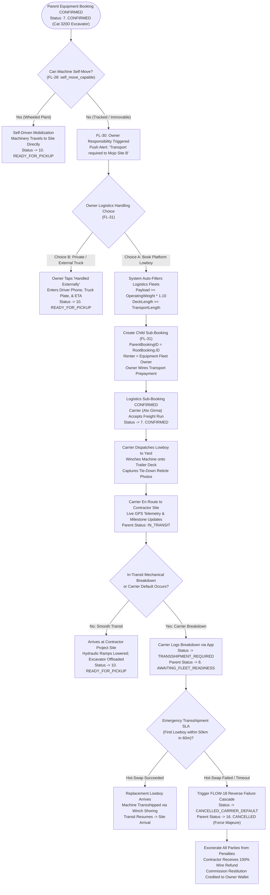
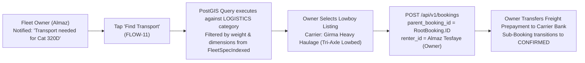
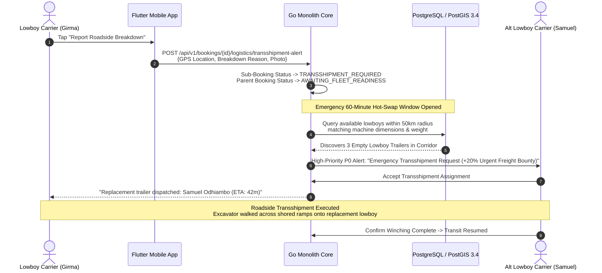
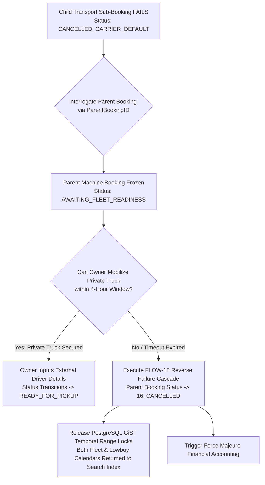
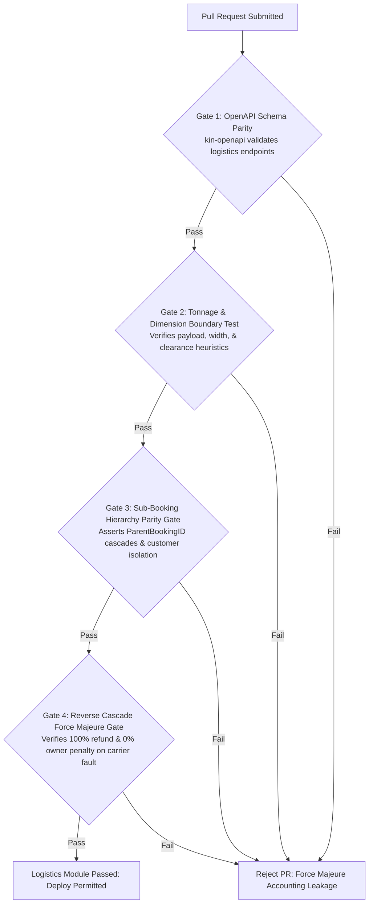

# Heavy Machinery & Logistics Rental Aggregator — Dink Machinery
## Software Requirements Specification — 05.08. Logistics Transport Integration, Sub-Bookings & Reverse Cascades Architecture (`docs/shared/requirements/05-08-logistics-transport-integration.md`)

**Document Identifier:** `SRS-DINK-CORE-V7.0-SEC-05-08`  
**Classification:** Canonical System Requirements Specification & Architecture Baseline (Single Source of Truth)  
**Governing Standard:** IEEE Std 830-1998 / IEEE/ISO/IEC 29148:2018 (Systems and Software Engineering — Requirements Engineering)  
**Associated Artifacts:** `SRS-DINK-CORE-V7.0` (§5.2.5, §5.8, §10, §11), `FLOW-LOGISTICS-DINK-CORE-V7.0` (Interaction Flow 11), `FLOW-REVERSE-CASCADE-DINK-CORE-V7.0` (Interaction Flow 18), `FLOW-FLEET-REG-DINK-CORE-V7.0`, `FLOW-BOOKING-STATE-MACHINE-DINK-CORE-V7.0`, `ARCH-BACKEND-GO-DINK-CORE-V7.0`, `ARCH-FLUTTER-DINK-CORE-V7.0`, `ARCH-ADMIN-NEXT-DINK-CORE-V7.0`, `ARCH-SEC-DINK-CORE-V7.0`, `DS-DINK-CORE-V7.0`, `DS-PERSONAS-DINK-CORE-V7.0`, `contracts/openapi.yaml`, `ADR-001`, `ADR-002`, `ADR-005`, `ADR-008`, `ADR-010`  
**Target Runtimes:** Go 1.24 Backend Monolith, Flutter 3.44 / Dart 3.9 (Cross-Platform Mobile), Next.js 16 / React 19 (Web Admin & Corporate Portal), PostgreSQL 18.4 + PostGIS 3.4, Valkey 8.0, ClamAV Daemon (:3310), SeaweedFS S3, Isar NoSQL 3.1+  
**Target Personas:** Lowboy Transporter (*Ato Girma Wolde* / *Samuel Odhiambo*), Equipment Fleet Owner (*W/ro Almaz Tesfaye* / *Kamau Ndegwa*), Civil Engineering Contractor (*Dawit Haile-Mariam* / *Patrick Kariuki*), Compliance Officer & Route Arbitrator (*Yohannes Bekele*)  
**Target Operating Markets:** Ethiopia (`ET`) & Kenya (`KE`) — Dynamic Multi-Country Parameterization (`LOC-01-BE`)  
**Compliance Standards:** OWASP ASVS 4.0.3 Level 3 (Business Logic Integrity, Concurrency & Cryptographic Attestation), RFC 9457 (Problem Details), ISO 9241-110, W3C WCAG 2.2 Level AAA (Field Mobile) & Level AA (Admin Web), Ethiopian Federal Transport Authority Directives, KeNHA Axle Load Regulations  
**Status:** Approved Engineering Baseline

---

## Table of Contents

- 1. [Document Scope & Architectural Mandate](#1-document-scope--architectural-mandate)
  - 1.1 [Purpose & Functional Scope](#11-purpose--functional-scope)
  - 1.2 [Core Architectural Principles & Freight Invariants](#12-core-architectural-principles--freight-invariants)
- 2. [Heavy Logistics State Machine & Sub-Booking Topology](#2-heavy-logistics-state-machine--sub-booking-topology)
  - 2.1 [Parent-Child Booking Lifecycle Flowchart](#21-parent-child-booking-lifecycle-flowchart)
  - 2.2 [State Sub-Machine Taxonomy & Operational Milestones](#22-state-sub-machine-taxonomy--operational-milestones)
  - 2.3 [Permitted Transitions Matrix](#23-permitted-transitions-matrix)
- 3. [Self-Move Evaluation & Dimensional Transport Matching](#3-self-move-evaluation--dimensional-transport-matching)
  - 3.1 [Self-Move Capability Evaluation (`FL-28`)](#31-self-move-capability-evaluation-fl-28)
  - 3.2 [Automated Trailer Class Heuristic Engine (`FL-29`)](#32-automated-trailer-class-heuristic-engine-fl-29)
  - 3.3 [Volumetric & Tonnage Matching Formulation (`FleetSpecIndexed`)](#33-volumetric--tonnage-matching-formulation-fleetspecindexed)
  - 3.4 [Abnormal Wide Load & Route Clearance Parameters](#34-abnormal-wide-load--route-clearance-parameters)
- 4. [Sub-Booking Architecture & Execution Pathways](#4-sub-booking-architecture--execution-pathways)
  - 4.1 [Logistics Responsibility & Commercial Models (`FL-30`)](#41-logistics-responsibility--commercial-models-fl-30)
  - 4.2 [Pathway A: In-Platform Sub-Booking (`ParentBookingID`) (`FL-31`)](#42-pathway-a-in-platform-sub-booking-parentbookingid-fl-31)
  - 4.3 [Pathway B: External Private Transport Declaration](#43-pathway-b-external-private-transport-declaration)
  - 4.4 [Pass-Through Freight Commission Discount Invariant ($2.5\%$)](#44-pass-through-freight-commission-discount-invariant-25)
- 5. [Carrier Dispatch, Transit Telemetry & Transshipment Protocols](#5-carrier-dispatch-transit-telemetry--transshipment-protocols)
  - 5.1 [Carrier Dispatch Workbench & Load Winching Inspection](#51-carrier-dispatch-workbench--load-winching-inspection)
  - 5.2 [In-Transit Route Milestones & Telemetry Sync](#52-in-transit-route-milestones--telemetry-sync)
  - 5.3 [Mid-Transit Breakdown & Emergency Roadside Transshipment Protocol](#53-mid-transit-breakdown--emergency-roadside-transshipment-protocol)
- 6. [Reverse Cascades & Force Majeure Exemption Engine](#6-reverse-cascades--force-majeure-exemption-engine)
  - 6.1 [Carrier Default & Mechanical Failure Detection](#61-carrier-default--mechanical-failure-detection)
  - 6.2 [Awaiting Fleet Readiness Operational Freezing](#62-awaiting-fleet-readiness-operational-freezing)
  - 6.3 [Automated Reverse Failure Cascade Protocol](#63-automated-reverse-failure-cascade-protocol)
  - 6.4 [Force Majeure Mutual Party Exoneration & Commission Restitution](#64-force-majeure-mutual-party-exoneration--commission-restitution)
- 7. [Wire Protocol Contracts & RFC 9457 Error Schemas](#7-wire-protocol-contracts--rfc-9457-error-schemas)
  - 7.1 [`POST /api/v1/bookings/{id}/logistics/match`](#71-post-apiv1bookingsidlogisticsmatch)
  - 7.2 [`POST /api/v1/bookings/{id}/logistics/sub-booking`](#72-post-apiv1bookingsidlogisticssub-booking)
  - 7.3 [`POST /api/v1/bookings/{id}/logistics/external-transport`](#73-post-apiv1bookingsidlogisticsexternal-transport)
  - 7.4 [`POST /api/v1/bookings/{id}/logistics/transshipment-alert`](#74-post-apiv1bookingsidlogisticstransshipment-alert)
  - 7.5 [`POST /api/v1/bookings/{id}/logistics/reverse-cascade`](#75-post-apiv1bookingsidlogisticsreverse-cascade)
  - 7.6 [RFC 9457 Universal Problem Details Payloads](#76-rfc-9457-universal-problem-details-payloads)
- 8. [Automated Testing Suite & Verification Gates](#8-automated-testing-suite--verification-gates)

---

## 1. Document Scope & Architectural Mandate

### 1.1 Purpose & Functional Scope

This specification establishes **Section 05.08 (Logistics Transport Integration, Sub-Bookings & Reverse Cascades Architecture)** of the canonical Software Requirements Specification (SRS) for **Dink Machinery Version 7.0**.

In the East African civil engineering and infrastructure landscape, plant machinery and heavy transport are fundamentally interdependent. Steel-tracked crawler excavators, track-type bulldozers, vibratory soil compactors, and asphalt pavers are legally and mechanically barred from traveling over paved national road networks under their own power. These units operate at crawl speeds ($< 5\text{ km/h}$) and cause severe pavement destruction. They require specialized heavy haulage logistics—primarily multi-axle lowboy trailers, step-decks, and modular hydraulic platform transporters.

Historically, informal heavy machinery rental brokerages treat freight transport as a disconnected, uncoordinated transaction. A contractor hires an excavator only to find the asset stranded in an industrial depot for days because no suitable lowboy transporter is available. Conversely, when a transport truck breaks down on a remote mountain pass, the machinery booking remains in limbo, triggering commercial disputes and project delay penalties ($25,000.00\text{ to }60,000.00\text{ ETB/day}$).

This document establishes the architecture for heavy logistics integration:
1. Modeling specialized heavy transport not as an external side-system, but as an integrated first-class fleet classification (`LOGISTICS` category).
2. The dynamic dimensional and tonnage matching engine binding prime movers to lowboy trailers via denormalized parameters (`FleetSpecIndexed`).
3. The parent-child sub-booking architecture (`ParentBookingID`) managing freight billing, mobilization milestones, and customer isolation.
4. The roadside emergency transshipment coordination protocol for in-transit mechanical failures.
5. The automated reverse failure cascade engine enforcing mutual contractual exoneration under Force Majeure when freight delivery is impossible.

### 1.2 Core Architectural Principles & Freight Invariants

1. **Logistics as a First-Class Fleet Invariant (§5.8):** Logistics carriers, prime movers, multi-axle lowboys, step-decks, and flatbed trailers are ingested, cataloged, verified, and discovered using the universal `fleets` table. They maintain independent availability calendars, spatial PostGIS depot points, and technical specifications (`payload_capacity_kg`, `deck_well_length_mm`, `deck_width_mm`, `axle_count`).
2. **Customer Isolation via Sub-Booking Hierarchy (`FL-31`):** When lowboy transport is booked on-platform to fulfill an equipment rental, the system instantiates a sub-booking bound via `bookings.parent_booking_id`. The equipment fleet owner acts as the "renter" on the transport sub-booking, keeping the transport contract separate from the civil contractor.
3. **Pass-Through Freight Commission Discount Invariant ($2.5\%$):** To prevent punitive double-commissioning on mandatory machinery mobilization, platform service revenue on linked logistics sub-bookings is discounted to a flat **$2.5\%$ administrative fee** (compared to standard $10.0\%$ machinery commission).
4. **Strict Dimensional & Weight Compliance Guardrails:** A lowboy transport trailer cannot be paired with a machine if the machine's operating weight exceeds the trailer's certified payload capacity, or if transport dimensions exceed legal corridor thresholds without designated escort parameters.
5. **Reverse Cascade Force Majeure Exemption (`FLOW-18`):** If a lowboy transport carrier defaults or breaks down and no roadside transshipment can be secured within the designated SLA window, the platform triggers an automated reverse failure cascade. The parent equipment booking freezes, both contractor and owner are exonerated from bilateral cancellation penalties, and all previously debited platform commissions are credited back to the owner's wallet.

---

## 2. Heavy Logistics State Machine & Sub-Booking Topology

### 2.1 Parent-Child Booking Lifecycle Flowchart



---

### 2.2 State Sub-Machine Taxonomy & Operational Milestones

The logistics lifecycle introduces specialized sub-machine states operating in parent-child synchronization:

| Status Key | Context | Operational Meaning & Invariants |
|---|---|---|
| **`CONFIRMED`** | Sub-Booking | Lowboy carrier confirmed freight run; pre-funded freight prepayment verified. |
| **`DISPATCHED`** | Sub-Booking | Prime mover mobilized from carrier depot to equipment owner's yard. |
| **`LOADING_INSPECTION`** | Sub-Booking | Machine winched onto lowboy bed; tie-down lashings and ramps inspected. |
| **`IN_TRANSIT`** | Parent & Sub | Machine en route along national highway corridor; live telemetry tracking. |
| **`TRANSSHIPMENT_REQUIRED`**| Sub-Booking | Prime mover or trailer suffered mechanical loss; emergency replacement needed. |
| **`AWAITING_FLEET_READINESS`**| Parent Booking| Equipment delivery stalled due to freight failure; machinery billing paused. |
| **`PENDING_ADDITIONAL_PAYMENT`**| Parent Booking| Police escort or abnormal load bridge clearance fees required before transit. |
| **`CANCELLED_CARRIER_DEFAULT`**| Sub-Booking | Logistics carrier breached agreement; triggers reverse failure cascade. |

---

### 2.3 Permitted Transitions Matrix

```text
+----------------------------------------------------------------------------------------------------+
| LOGISTICS & REVERSE CASCADE TRANSITION MATRIX                                                      |
+------------------------------------+---------------------------------------------------------------+
| SOURCE STATE                       | PERMITTED TARGET STATES                                       |
+------------------------------------+---------------------------------------------------------------+
| 7. CONFIRMED (Sub-Booking)         | DISPATCHED, CANCELLED_CARRIER_DEFAULT                         |
| DISPATCHED                         | LOADING_INSPECTION, CANCELLED_CARRIER_DEFAULT                 |
| LOADING_INSPECTION                 | IN_TRANSIT, CANCELLED_CARRIER_DEFAULT                         |
| IN_TRANSIT                         | READY_FOR_PICKUP, TRANSSHIPMENT_REQUIRED                      |
| TRANSSHIPMENT_REQUIRED             | IN_TRANSIT (Transshipped), CANCELLED_CARRIER_DEFAULT          |
| 8. AWAITING_FLEET_READINESS (Parent)| 9. PENDING_ADDITIONAL_PAYMENT, 10. READY_FOR_PICKUP, 16. CANC  |
| 9. PENDING_ADDITIONAL_PAYMENT      | 10. READY_FOR_PICKUP, 16. CANCELLED                           |
| CANCELLED_CARRIER_DEFAULT          | [Terminal State — Triggers Reverse Cascade on Parent]         |
+------------------------------------+---------------------------------------------------------------+
```

---

## 3. Self-Move Evaluation & Dimensional Transport Matching

### 3.1 Self-Move Capability Evaluation (`FL-28`)

During fleet registration, the equipment owner sets the binary attribute `self_move_capable` (§5.2.5):
* **`self_move_capable = true`:** Assigned to pneumatic-tired machinery certified for public roadway travel (e.g., wheeled backhoe loaders, motor graders, mobile rough-terrain truck cranes). These units travel directly to site under their own engine power.
* **`self_move_capable = false`:** Mandatory setting for all steel-tracked plant equipment (crawler excavators, track bulldozers, track loaders, asphalt milling machines) and heavy drum rollers. The platform marks logistics transport as **strictly mandatory** before the machine can transition to `ACTIVE`.

---

### 3.2 Automated Trailer Class Heuristic Engine (`FL-29`)

When an immovable machine is registered, the platform applies an automated heuristic recommendation engine to infer the required transport trailer classification:

$$\mathcal{P}_{\text{min\_payload}} = \text{fleets.operating\_weight\_kg} \times 1.10\quad (\text{Includes } 10\% \text{ Dynamic Lashing Safety Margin})$$

```text
+--------------------------------------------------------------------------------------------------+
| AUTOMATED TRAILER CLASS HEURISTIC MATRIX (FL-29)                                                 |
+---------------------------------+-----------------------+----------------------------------------+
| PLANT OPERATING WEIGHT CLASS    | RECOMMENDED TRAILER   | TRAILER AXLE & DECK CONFIGURATION      |
+---------------------------------+-----------------------+----------------------------------------+
| Weight < 12,000 kg (12 Tonnes)  | Rigid Tilt-Tray /     | Two-Axle Rigid Flatbed Carrier;        |
|                                 | Step-Deck Trailer     | Mechanical loading ramps.              |
+---------------------------------+-----------------------+----------------------------------------+
| 12,000 kg <= Weight < 24,000 kg | Two-Axle Lowboy       | Low-bed well deck; 25-ton capacity;    |
| (12 to 24 Tonnes)               | Trailer (Heavy Lowbed)| Rear spring-assisted fold-down ramps.  |
+---------------------------------+-----------------------+----------------------------------------+
| 24,000 kg <= Weight < 40,000 kg | Tri-Axle Heavy Lowboy | Drop-deck well; 40-ton payload rating; |
| (24 to 40 Tonnes)               | Trailer               | Hydraulic fold-down loading ramps.     |
+---------------------------------+-----------------------+----------------------------------------+
| Weight >= 40,000 kg (40t+)      | Modular Multi-Axle    | Hydraulic platform trailer (4+ axles); |
|                                 | Transporter           | Detachable gooseneck front-loading.    |
+--------------------------------------------------------------------------------------------------+
```

---

### 3.3 Volumetric & Tonnage Matching Formulation (`FleetSpecIndexed`)

When a machine hire is confirmed, the system executes an automated spatial and dimensional compatibility query against `fleet_spec_indexed` to discover available lowboy trailers:

$$\text{Payload Feasibility} \iff \text{trailer.payload\_capacity\_kg} \ge (\text{machine.operating\_weight\_kg} + \sum \text{attachment.weight\_kg})$$

$$\text{Length Feasibility} \iff \text{trailer.deck\_well\_length\_mm} \ge \text{machine.transport\_length\_mm}$$

$$\text{Width Feasibility} \iff (\text{trailer.deck\_width\_mm} + \text{trailer.outriggers\_extension\_mm}) \ge \text{machine.transport\_width\_mm}$$

$$\text{Height Feasibility} \iff (\text{trailer.deck\_height\_ground\_mm} + \text{machine.transport\_height\_mm}) \le \mathcal{H}_{\text{corridor\_clearance}}$$

Where standard East African bridge corridor clearance $\mathcal{H}_{\text{corridor\_clearance}} = 4,500\text{ mm}$ ($4.50\text{ m}$).

---

### 3.4 Abnormal Wide Load & Route Clearance Parameters

If overall transit width exceeds $3,000\text{ mm}$ ($3.0\text{ m}$) or gross combined weight exceeds national highway axle limits:
* The system flags the booking: `ABNORMAL_LOAD_ESCORT_REQUIRED`.
* The transport listing displays statutory regulatory warnings:
  - Movement permitted during daylight hours only ($06:00\text{ to }18:00$).
  - Mandatory lead and chase escort safety vehicles equipped with amber strobe beacons.
  - Certified route clearance permit required from the Ethiopian Federal Transport Authority or KeNHA.
* Any required escort fees are calculated as an explicit line item under `PENDING_ADDITIONAL_PAYMENT`.

---

## 4. Sub-Booking Architecture & Execution Pathways

### 4.1 Logistics Responsibility & Commercial Models (`FL-30`)

In accordance with the core marketplace specification (§5.2.5, §5.8):
* **Owner Pays Principle (`FL-30`):** The equipment fleet owner is commercially and operationally responsible for coordinating machinery mobilization and demobilization. 
* The equipment daily hire tariff charged to the civil contractor is inclusive of site delivery or carries a separate, transparent logistics surcharge paid to the owner.
* The equipment owner contracts directly with the logistics carrier, protecting the civil contractor from multi-vendor disputes.

---

### 4.2 Pathway A: In-Platform Sub-Booking (`ParentBookingID`) (`FL-31`)



#### Relational Data Model for Sub-Bookings
```sql
ALTER TABLE bookings 
ADD COLUMN parent_booking_id UUID NULL 
REFERENCES bookings(id) ON DELETE RESTRICT;

CREATE INDEX idx_bookings_parent_hierarchy 
ON bookings (parent_booking_id) 
WHERE parent_booking_id IS NOT NULL;
```

* **Customer Isolation:** Civil Contractor *Dawit* only sees that his machine is `IN_TRANSIT` with live GPS tracking. Contractor *Dawit* has no contractual privity or payment obligations toward Carrier *Ato Girma*.
* **Unified Lifecycle Linkage:** If the parent booking is cancelled before confirmation, all associated draft sub-bookings are automatically terminated.

---

### 4.3 Pathway B: External Private Transport Declaration

If the equipment owner operates their own private prime mover or maintains an existing off-platform freight agreement:
* The owner taps `[ Handled Externally via Own Truck ]` (§5.8).
* No sub-booking record is instantiated in PostgreSQL.
* The owner inputs required operational dispatch metadata:
  - Transport Carrier / Driver Full Name.
  - Driver Sovereign E.164 Phone Number (`+251 91 199 4812`).
  - Prime Mover Registration Plate Number (`ET-3-88190`).
  - Estimated Date and Time of Site Arrival (ETA).
* The contractor's Active Rental HUD renders the driver's contact card with a 1-tap dial action.

---

### 4.4 Pass-Through Freight Commission Discount Invariant ($2.5\%$)

Heavy freight logistics operates on thin fuel and maintenance margins. To encourage platform carrier adoption and prevent cost inflation:
* **Commission Rate Override:** When a booking row satisfies `parent_booking_id IS NOT NULL` and the fleet belongs to the `LOGISTICS` category:
  $$\text{Commission Rate} = \mathbf{2.5\%}\quad (\text{Reduced from standard } 10.0\%)$$
* **Ledger Invariant:** The Go commission service debits the lowboy carrier's wallet (`owner_wallets`) at exactly $2.5\%$ of the gross freight hire value upon confirmation (`FLOW-12`).

---

## 5. Carrier Dispatch, Transit Telemetry & Transshipment Protocols

### 5.1 Carrier Dispatch Workbench & Load Winching Inspection

Before the lowboy leaves the owner's depot yard:
1. Lowboy Carrier *Ato Girma* backs the trailer into the yard loading bay and lowers the rear ramps.
2. The excavator crawls onto the lowboy bed or is winched up via recovery cables.
3. Carrier *Ato Girma* executes the **Winching & Lashing Reticle Inspection**:
   - Photo Angle 1: Overall Rig Profile (excavator centered in lowboy well).
   - Photo Angle 2: Heavy Chain Binders / Turnbuckles (4-point cross-lashing on track frames).
   - Photo Angle 3: Excavator Boom/Arm Lowered and Pinned (boom rest resting firmly on trailer deck).
   - Photo Angle 4: Hydraulic Folding Ramps Secured in Upright Travel Lock.
4. Images stream to ClamAV socket `:3310`, transcode to WebP, and save to SeaweedFS S3. Sub-booking transitions to `IN_TRANSIT`.

---

### 5.2 In-Transit Route Milestones & Telemetry Sync

During highway transit (e.g., Kality Industrial Depot to Mojo Site B):
* The carrier's mobile application streams periodic GPS coordinates via WebSocket / HTTP background location services.
* **Geofence Milestone Engine:** As the transport crosses designated corridor waypoints, automated push updates are dispatched:
  - Milestone 1: *"Lowboy departed depot yard. En route on expressway."*
  - Milestone 2: *"Freight cleared regional weighbridge check. ETA 45 minutes."*
  - Milestone 3: *"Lowboy arrived at project site entrance."*

---

### 5.3 Mid-Transit Breakdown & Emergency Roadside Transshipment Protocol

If the prime mover blows an engine or the trailer suffers structural axle failure:



---

## 6. Reverse Cascades & Force Majeure Exemption Engine

### 6.1 Carrier Default & Mechanical Failure Detection

An operational transport failure occurs when:
1. Lowboy carrier initiates an unprovoked cancellation after sub-booking confirmation (`CANCELLED_CARRIER_DEFAULT`).
2. Lowboy carrier suffers a roadside breakdown and the emergency transshipment hot-swap fails to secure a replacement trailer within the statutory **$60\text{ minute}$** SLA window.
3. Severe national corridor blockades, bridge collapses, or security force road closures render physical access impossible.

---

### 6.2 Awaiting Fleet Readiness Operational Freezing

Whenever transport integrity is compromised:
* The parent machinery booking freezes immediately into **`AWAITING_FLEET_READINESS`** (§5.8).
* **Shift Clock Invariant:** The operational engine shift timer is frozen at $0.0\text{ hours}$. Under no circumstances can rental day charges accumulate against the contractor while the equipment is stranded in transit.

---

### 6.3 Automated Reverse Failure Cascade Protocol

When transport failure is permanently certified (`transshipment_failed = true`):



---

### 6.4 Force Majeure Mutual Party Exoneration & Commission Restitution

Because transport failure is outside the direct fault of both the civil contractor and the machinery fleet owner:
1. **Contractor Exoneration:** Contractor *Dawit* receives an immediate $100\%$ full refund of his machine advance wire prepayment ($106,750.00\text{ ETB}$).
2. **Owner Exoneration:** Fleet Owner *Almaz* is completely exempt from the standard $20\%$ unilateral cancellation default penalty (§5.2.3 `FL-23`).
3. **Platform Commission Restitution:** The platform automatically reverses previously debited service commissions:
   ```sql
   INSERT INTO owner_wallet_transactions (
       id, wallet_id, booking_id, transaction_type, amount_minor, description
   ) VALUES (
       gen_random_uuid(), $owner_wallet_id,$parent_booking_id, 
       'COMMISSION_RESTITUTION', $original_commission_minor, 
       'Force Majeure commission reversal due to third-party carrier default #BK-SUB-9912'
   );
   ```
4. **Defaulting Carrier Sanctions:** The defaulting lowboy carrier is assessed a contractual default penalty debited from their wallet, and their platform reputation rating drops by $-0.50$ stars.

---

## 7. Wire Protocol Contracts & RFC 9457 Error Schemas

### 7.1 `POST /api/v1/bookings/{id}/logistics/match`

Queries compatible lowboy logistics transport fleets matching the parent machine's indexed specifications.

#### Request Headers
```http
POST /api/v1/bookings/bk_019a8f60-9912-7b9a/logistics/match HTTP/1.1
Host: api.dinkmachinery.com
Content-Type: application/json
Authorization: Bearer <ownerAccessToken>
```

#### Request Payload
```json
{
  "searchRadiusKm": 75,
  "pickupDate": "2026-11-05T06:00:00+03:00"
}
```

#### Response: `HTTP 200 OK`
```json
{
  "success": true,
  "data": {
    "parentBookingId": "bk_019a8f60-9912-7b9a",
    "machineSpecs": {
      "operatingWeightKg": 21800.0,
      "transportLengthMm": 9530,
      "transportWidthMm": 2980,
      "transportHeightMm": 3150
    },
    "requiredMinimumPayloadKg": 23980.0,
    "matchingCarriersCount": 3,
    "availableLogisticsFleets": [
      {
        "fleetId": "flt_019a8f90-1123-4a12",
        "make": "Sinotruk",
        "model": "Howo 6x4 with Tri-Axle Lowbed",
        "ownerTradingName": "Girma Heavy Haulage PLC",
        "payloadCapacityKg": 40000.0,
        "deckWellLengthMm": 11000,
        "dailyRateMinor": 1800000,
        "distanceFromDepotMeters": 8420.0,
        "averageRating": 4.95
      }
    ]
  },
  "timestamp": "2026-10-28T12:00:00Z"
}
```

---

### 7.2 `POST /api/v1/bookings/{id}/logistics/sub-booking`

Instantiates an in-platform logistics sub-booking linked via `ParentBookingID`.

#### Request Headers
```http
POST /api/v1/bookings/bk_019a8f60-9912-7b9a/logistics/sub-booking HTTP/1.1
Host: api.dinkmachinery.com
Content-Type: application/json
Authorization: Bearer <ownerAccessToken>
Idempotency-Key: 44192b01-5c12-4f9a-9912-8c0b5d21cd32
```

#### Request Payload
```json
{
  "logisticsFleetId": "flt_019a8f90-1123-4a12",
  "pickupDateTime": "2026-11-05T06:30:00+03:00",
  "originCoordinates": {
    "latitude": 8.9124,
    "longitude": 38.7412,
    "depotName": "Kality Industrial Depot"
  },
  "destinationCoordinates": {
    "latitude": 8.5412,
    "longitude": 39.2718,
    "siteName": "Mojo-Meki Highway Expansion Site B"
  }
}
```

#### Response: `HTTP 201 Created`
```json
{
  "success": true,
  "data": {
    "subBookingId": "bk_sub_019a8f95-4412",
    "parentBookingId": "bk_019a8f60-9912-7b9a",
    "status": "CONFIRMED",
    "freightHireFeeMinor": 3600000,
    "platformCommissionRate": 0.025,
    "commissionOwedMinor": 90000,
    "carrierContact": {
      "fullName": "Ato Girma Wolde",
      "phoneNumber": "+251911449120"
    }
  },
  "timestamp": "2026-10-28T12:05:00Z"
}
```

---

### 7.3 `POST /api/v1/bookings/{id}/logistics/external-transport`

Registers external private transport details when not using an in-platform carrier.

#### Request Payload
```json
{
  "carrierName": "Private In-House Fleet",
  "driverFullName": "Tadesse Bekele",
  "driverPhoneNumber": "+251911884912",
  "primeMoverPlateNumber": "ET-3-44192",
  "estimatedArrivalDateTime": "2026-11-05T08:00:00+03:00"
}
```

#### Response: `HTTP 200 OK`
```json
{
  "success": true,
  "data": {
    "parentBookingId": "bk_019a8f60-9912-7b9a",
    "status": "READY_FOR_PICKUP",
    "externalTransportRegistered": true
  },
  "timestamp": "2026-10-28T12:10:00Z"
}
```

---

### 7.4 `POST /api/v1/bookings/{id}/logistics/transshipment-alert`

Logs an emergency in-transit breakdown and initiates roadside transshipment matching.

#### Request Payload
```json
{
  "currentLocation": {
    "latitude": 8.7214,
    "longitude": 39.0112
  },
  "failureCategory": "PRIME_MOVER_ENGINE_BLOWN",
  "failureDescription": "Turbocharger shaft sheared; prime mover completely disabled on expressway shoulder.",
  "photos": [
    "s3://dink-incident-media/transshipment/bk_sub_4412/engine_damage.webp"
  ]
}
```

#### Response: `HTTP 200 OK`
```json
{
  "success": true,
  "data": {
    "subBookingId": "bk_sub_019a8f95-4412",
    "parentBookingId": "bk_019a8f60-9912-7b9a",
    "subBookingStatus": "TRANSSHIPMENT_REQUIRED",
    "parentBookingStatus": "AWAITING_FLEET_READINESS",
    "hotSwapSlaDeadline": "2026-11-05T10:45:00Z",
    "transshipmentBountyMinor": 720000
  },
  "timestamp": "2026-11-05T09:45:00Z"
}
```

---

### 7.5 `POST /api/v1/bookings/{id}/logistics/reverse-cascade`

Triggers formal reverse failure cascade and aborts the booking hierarchy under Force Majeure.

#### Request Headers
```http
POST /api/v1/bookings/bk_019a8f60-9912-7b9a/logistics/reverse-cascade HTTP/1.1
Host: api.dinkmachinery.com
Authorization: Bearer <systemOrAdminToken>
```

#### Response: `HTTP 200 OK`
```json
{
  "success": true,
  "data": {
    "parentBookingId": "bk_019a8f60-9912-7b9a",
    "subBookingId": "bk_sub_019a8f95-4412",
    "resolution": "FORCE_MAJEURE_CANCELLATION",
    "renterRefundDueMinor": 10675000,
    "ownerPenaltyLeviedMinor": 0,
    "ownerCommissionRestitutionMinor": 1067500,
    "parentStatus": "CANCELLED",
    "subStatus": "CANCELLED_CARRIER_DEFAULT"
  },
  "timestamp": "2026-11-05T10:50:00Z"
}
```

---

### 7.6 RFC 9457 Universal Problem Details Payloads

#### Example: Machine Tonnage Exceeds Trailer Payload (`HTTP 422 Unprocessable Entity`)
```json
{
  "type": "[https://api.dinkmachinery.com/errors/trailer-payload-exceeded](https://api.dinkmachinery.com/errors/trailer-payload-exceeded)",
  "title": "Machine Weight Exceeds Lowboy Payload Rating",
  "status": 422,
  "detail": "Selected lowboy trailer payload capacity (22,000 kg) is insufficient for machine operating weight (21,800 kg) with safety margin (requires 23,980 kg).",
  "instance": "/api/v1/bookings/bk_8812/logistics/sub-booking",
  "code": "ERR_TRAILER_PAYLOAD_INSUFFICIENT",
  "invalidParams": [
    {
      "name": "logisticsFleetId",
      "reason": "Payload rating 22000 kg is less than minimum required 23980 kg"
    }
  ]
}
```

#### Example: Transport Transshipment SLA Expired (`HTTP 410 Gone`)
```json
{
  "type": "[https://api.dinkmachinery.com/errors/transshipment-sla-expired](https://api.dinkmachinery.com/errors/transshipment-sla-expired)",
  "title": "Roadside Transshipment Window Expired",
  "status": 410,
  "detail": "The 60-minute emergency transshipment hot-swap window expired without securing an alternate trailer. Reverse cascade triggered.",
  "instance": "/api/v1/bookings/bk_8812/logistics/transshipment-alert",
  "code": "ERR_TRANSSHIPMENT_TIMEOUT"
}
```

---

## 8. Automated Testing Suite & Verification Gates



1. **OpenAPI Schema Contract Gate (`kin-openapi`):** Validates all logistics matching, sub-booking creation, external transport registration, transshipment alerting, and reverse cascade endpoints against `contracts/openapi.yaml`.
2. **Dimensional & Tonnage Matching Stress Test:** Evaluates 500 combinations of machinery models and lowboy trailers. Asserts that $100\%$ of oversized or overweight pairings are rejected with HTTP 422 `ERR_TRAILER_PAYLOAD_INSUFFICIENT` or `ERR_TRAILER_DECK_TOO_SHORT`.
3. **Sub-Booking Hierarchy Integration Gate:** Instantiates a parent booking and child sub-booking. Verifies that canceling the parent automatically cascades across child sub-bookings, while customer details remain isolated from the carrier.
4. **Reverse Cascade Force Majeure Financial Parity Gate:** Simulates carrier mechanical failure under packet drop conditions. Verifies that upon transshipment SLA expiration, the Go domain engine executes the reverse cascade, restores $100\%$ of contractor funds, waives owner default penalties, and credits commission restitution in $< 150\text{ ms}$.

---

*This document establishes the canonical functional requirements, state machine topology, dimensional matching algorithms, sub-booking architectures, and reverse cascade protocols for Logistics Transport Integration in Dink Machinery Version 7.0. All downstream Flutter mobile workflows, Go backend microservices, and Next.js admin consoles must strictly conform to this specification.*
```