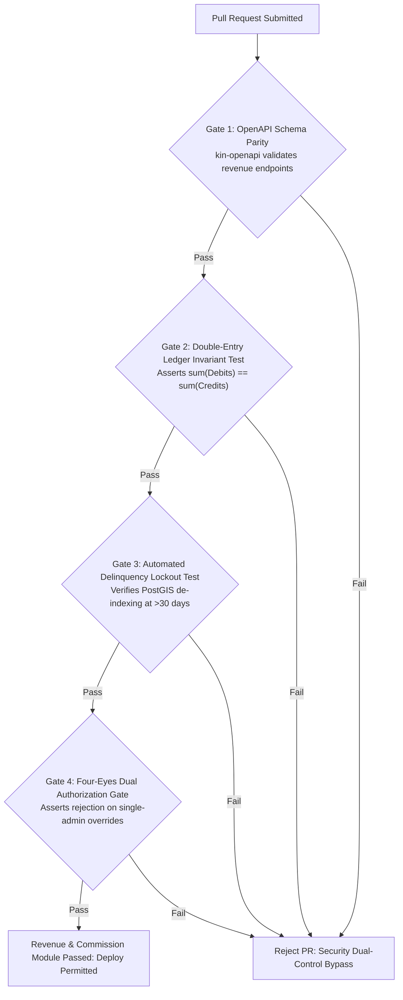

# Heavy Machinery & Logistics Rental Aggregator — Dink Machinery
## Software Requirements Specification — 05.09. Commission Engine, Platform Revenue, Owner Wallets & Debt Settlement Architecture (`docs/shared/requirements/05-09-commission-revenue-owner-payouts.md`)

**Document Identifier:** `SRS-DINK-CORE-V7.0-SEC-05-09`  
**Classification:** Canonical System Requirements Specification & Financial Architecture Baseline (Single Source of Truth)  
**Governing Standard:** IEEE Std 830-1998 / IEEE/ISO/IEC 29148:2018 (Systems and Software Engineering — Requirements Engineering)  
**Associated Artifacts:** `SRS-DINK-CORE-V7.0` (§5.9, §8, §10, §12), `FLOW-COMMISSION-DEBT-DINK-CORE-V7.0` (Interaction Flow 12), `FLOW-BOOKING-STATE-MACHINE-DINK-CORE-V7.0`, `FLOW-WIRE-DISPUTE-DINK-CORE-V7.0`, `FLOW-REVERSE-CASCADE-DINK-CORE-V7.0`, `ARCH-BACKEND-GO-DINK-CORE-V7.0`, `ARCH-FLUTTER-DINK-CORE-V7.0`, `ARCH-ADMIN-NEXT-DINK-CORE-V7.0`, `ARCH-SEC-DINK-CORE-V7.0`, `DS-DINK-CORE-V7.0`, `DS-PERSONAS-DINK-CORE-V7.0`, `contracts/openapi.yaml`, `ADR-001`, `ADR-002`, `ADR-005`, `ADR-008`, `ADR-010`  
**Target Runtimes:** Go 1.27.3 Backend Monolith, Flutter 3.47.8 / Dart 3.9 (Cross-Platform Mobile), Next.js 16.x (latest CVE security patch) / React 19 (Web Admin & Corporate Portal), PostgreSQL 18.6 + PostGIS 3.6.4, Valkey 9.1.3, ClamAV Daemon (:3310), SeaweedFS S3, Isar NoSQL 3.1+  
**Target Personas:** Equipment Fleet Owner (*W/ro Almaz Tesfaye* / *Kamau Ndegwa*), Lowboy Transporter (*Ato Girma Wolde* / *Samuel Odhiambo*), Platform Finance Auditor (*Solomon Kassa*), Super Administrator (*Rahel Tadesse*)  
**Target Operating Markets:** Ethiopia (`ET`) & Kenya (`KE`) — Dynamic Multi-Country Parameterization (`LOC-01-BE`)  
**Compliance Standards:** OWASP ASVS 4.0.3 Level 3 (Financial Ledger Integrity, Mathematical Auditability & Anti-Tampering), RFC 9457 (Problem Details), ISO 9241-110, W3C WCAG 2.2 Level AAA (Field Mobile) & Level AA (Admin Web), National Bank of Ethiopia (NBE) Financial Directives, Kenya Data Protection Act 2019  
**Status:** Approved Engineering Baseline

---

## Table of Contents

- 1. [Document Scope & Architectural Mandate](#1-document-scope--architectural-mandate)
  - 1.1 [Purpose & Functional Scope](#11-purpose--functional-scope)
  - 1.2 [Core Financial Invariants & Non-Custodial Principles](#12-core-financial-invariants--non-custodial-principles)
- 2. [Platform Revenue Model & Wallet Topology](#2-platform-revenue-model--wallet-topology)
  - 2.1 [End-to-End Commission Ledger Flowchart](#21-end-to-end-commission-ledger-flowchart)
  - 2.2 [Double-Entry Ledger Schema & Transaction Taxonomy](#22-double-entry-ledger-schema--transaction-taxonomy)
- 3. [Dynamic Commission Rule Engine (`CW-01`)](#3-dynamic-commission-rule-engine-cw-01)
  - 3.1 [Rule Evaluation Pipeline & Hierarchical Precedence](#31-rule-evaluation-pipeline--hierarchical-precedence)
  - 3.2 [Core Category Rate Tiers (Machinery vs. Logistics vs. Attachments)](#32-core-category-rate-tiers-machinery-vs-logistics-vs-attachments)
  - 3.3 [Trigger Points & Lifecycle State Binding (`CONFIRMED` & `COMPLETED`)](#33-trigger-points--lifecycle-state-binding-confirmed--completed)
  - 3.4 [Commission Computation Formulation](#34-commission-computation-formulation)
- 4. [Owner Commission Dashboard & Transparency Metrics (`CW-02`)](#4-owner-commission-dashboard--transparency-metrics-cw-02)
  - 4.1 [Key Financial Metrics (Earned, Commission Debt, Net Receivable)](#41-key-financial-metrics-earned-commission-debt-net-receivable)
  - 4.2 [Itemized Booking Fee Dossier](#42-itemized-booking-fee-dossier)
  - 4.3 [Dynamic Aging Buckets (Current, 1–15 Days, 16–30 Days, >30 Days Overdue)](#43-dynamic-aging-buckets-current-115-days-1630-days-30-days-overdue)
- 5. [Manual Debt Settlement & Top-Up Verification (`CW-03`)](#5-manual-debt-settlement--top-up-verification-cw-03)
  - 5.1 [Bank Wire Transfer Rails (CBE, Awash, M-PESA Paybill)](#51-bank-wire-transfer-rails-cbe-awash-m-pesa-paybill)
  - 5.2 [Payment Evidence Slip Ingestion & ClamAV Pipeline](#52-payment-evidence-slip-ingestion--clamav-pipeline)
  - 5.3 [Financial Auditor Verification & Ledger Balance Release](#53-financial-auditor-verification--ledger-balance-release)
- 6. [Administrative Commission Tracker & Delinquency Lockout (`CW-04`)](#6-administrative-commission-tracker--delinquency-lockout-cw-04)
  - 6.1 [Next.js Central Revenue Console (`AD-06-WEB`)](#61-nextjs-central-revenue-console-ad-06-web)
  - 6.2 [Automated Delinquency Aging Engine & Multi-Tier Sanctions](#62-automated-delinquency-aging-engine--multi-tier-sanctions)
  - 6.3 [Spatial Index Removal Protocol (`DELINQUENT_LOCKED`)](#63-spatial-index-removal-protocol-delinquent_locked)
  - 6.4 [Four-Eyes Dual Authorization for Credit Limit Overrides](#64-four-eyes-dual-authorization-for-credit-limit-overrides)
- 7. [Commission Restitution & Force Majeure Reversals](#7-commission-restitution--force-majeure-reversals)
  - 7.1 [Logistics Reverse Cascade Restitution Mechanics (`FLOW-18`)](#71-logistics-reverse-cascade-restitution-mechanics-flow-18)
  - 7.2 [Cancellation Penalty Deductions & Ledger Journalizing](#72-cancellation-penalty-deductions--ledger-journalizing)
- 8. [Wire Protocol Contracts & RFC 9457 Error Schemas](#8-wire-protocol-contracts--rfc-9457-error-schemas)
  - 8.1 [`GET /api/v1/owner/wallet`](#81-get-apiv1ownerwallet)
  - 8.2 [`POST /api/v1/owner/wallet/top-up`](#82-post-apiv1ownerwallettop-up)
  - 8.3 [`GET /api/v1/admin/revenue/commissions`](#83-get-apiv1adminrevenuecommissions)
  - 8.4 [`POST /api/v1/admin/revenue/verify-top-up`](#84-post-apiv1adminrevenueverify-top-up)
  - 8.5 [`POST /api/v1/admin/revenue/override-credit`](#85-post-apiv1adminrevenueoverride-credit)
  - 8.6 [RFC 9457 Universal Problem Details Payloads](#86-rfc-9457-universal-problem-details-payloads)
- 9. [Automated Testing Suite & Verification Gates](#9-automated-testing-suite--verification-gates)

---

## 1. Document Scope & Architectural Mandate

### 1.1 Purpose & Functional Scope

This specification establishes **Section 05.09 (Commission Engine, Platform Revenue, Owner Wallets & Debt Settlement Architecture)** of the canonical Software Requirements Specification (SRS) for **Dink Machinery Version 7.0**.

In the East African construction and logistics marketplace, aggregators operate under strict sovereign banking and currency controls:
* **National Bank of Ethiopia (NBE) Directives:** Non-bank digital platforms are prohibited from holding gross transactional escrow funds, pooling customer deposits, or intermediating commercial multi-million Birr wires.
* **Direct Peer-to-Peer (P2P) Settlements:** Rental fees flow directly between the civil contractor's commercial bank account and the fleet owner's verified commercial bank account.
* **Platform Monetization Strategy:** Because gross hire funds bypass platform bank accounts, platform service revenue is secured via a **pre-funded virtual wallet and post-pay commission debt accounting model**.

This document formally specifies:
1. The double-entry virtual wallet ledger (`owner_wallets` and `owner_wallet_transactions`) tracking platform commission obligations, cancellation penalties, and top-up clearing credits.
2. The dynamic rule engine computing granular commission percentages across machinery plant hires, pass-through freight logistics, and auxiliary attachments.
3. The manual debt settlement pipeline allowing owners to clear accumulated commission liabilities via direct wire transfers (CBE, Awash, M-PESA Paybill) subject to ClamAV-screened verification.
4. The administrative delinquency engine enforcing automated progressive sanctions, debt aging buckets, and spatial search de-indexing (`DELINQUENT_LOCKED`).
5. The commission restitution protocols reversing debited platform fees upon third-party logistics failures or Force Majeure cancellations.

### 1.2 Core Financial Invariants & Non-Custodial Principles

1. **Non-Custodial Separation of Gross Capital (NBE Compliance):** The platform never touches gross rental revenues. The civil contractor pays the fleet owner directly via commercial bank wire rails. Dink Machinery derives revenue exclusively by charging an agreed platform service fee debited from the equipment owner's virtual wallet ledger.
2. **Double-Entry Balance Conservation Invariant:** Under International Financial Reporting Standards (IFRS) and GAAP compliance, every monetary movement within the system must satisfy immutable double-entry parity:
   $$\sum \text{Debits} = \sum \text{Credits}$$
   Virtual wallet balances can never be modified via direct `UPDATE balance = X` operations; balances are computed as the strict aggregate of immutable, append-only ledger transaction rows.
3. **Integer Minor Currency Units:** To eliminate floating-point rounding errors and precision loss, all monetary values across databases, calculation engines, and wire APIs are represented as 64-bit signed integers (`int64` / `BIGINT`) in minor currency units:
   * **Ethiopia:** Ethiopian Birr Cents ($1\text{ ETB} = 100\text{ Cents}$).
   * **Kenya:** Kenyan Shilling Cents ($1\text{ KES} = 100\text{ Cents}$).
4. **Automated Delinquency Quarantine Invariant (`CW-04`):** Fleet owners with overdue commission debt exceeding the **30-day statutory grace period** are automatically placed in `DELINQUENT_LOCKED` status, de-indexing all their active machinery listings from PostGIS spatial discovery in real time.
5. **Four-Eyes Dual Control for Financial Overrides:** Any manual administrative adjustment expanding an owner's overdraft credit limit beyond $100,000.00\text{ ETB}$ or waiving more than $25,000.00\text{ ETB}$ in commission debt mandates cryptographic sign-off by two distinct administrative officers.

---

## 2. Platform Revenue Model & Wallet Topology

### 2.1 End-to-End Commission Ledger Flowchart

```mermaid
flowchart TD
    BookingConfirmed(["Booking Transitions to CONFIRMED<br/>(FLOW-08: Prepayment Verified)"]) --> TriggerCommission["CW-01 Trigger Commission Engine<br/>Evaluate Dynamic Rule Matrix"]
    
    TriggerCommission --> ComputeRate["Calculate Commission Fee<br/>Machinery: 10% | Logistics: 2.5% | Attachments: 10%<br/>Fee = Gross Hire * Rate"]
    
    ComputeRate --> ApplyDebit["Commit Immutable Ledger Transaction<br/>INSERT INTO owner_wallet_transactions<br/>Type: 'COMMISSION_DEBIT'<br/>Wallet Balance Decremented"]
    
    ApplyDebit --> CheckOverdraft{"Does Wallet Balance Fall Below<br/>Approved Credit Limit?"}
    
    CheckOverdraft -->|"No: Within Buffer"| HealthyState["Wallet Remains in Standing<br/>Fleet Listings Kept ACTIVE in Search"]
    
    CheckOverdraft -->|"Yes: Overdraft Exceeded"| InstantLock["Immediate Operational Hold<br/>New Booking Confirmations Blocked<br/>Owner Alerted to Top Up"]
    
    HealthyState --> AgingMonitor["Daily Cron: Aging Bucket Evaluation<br/>Track Unsettled Debits Against Aging Matrix"]
    InstantLock --> AgingMonitor
    
    AgingMonitor --> AgingCheck{"Debt Age > 30 Days?"}
    AgingCheck -->|"No (< 30 Days)"| GracePeriod["In Statutory Grace Period<br/>Warning Banners Rendered in Mobile App"]
    
    AgingCheck -->|"Yes (>= 30 Days Overdue)"| TriggerLockout["CW-04 Execute Delinquency Lockout<br/>Owner Status -> DELINQUENT_LOCKED<br/>All Fleets De-Indexed from PostGIS Search"]
    
    GracePeriod --> TopUpAction["Owner Settles Debt (CW-03)<br/>Transfers Wire to Dink Machinery Bank Account<br/>Uploads Deposit Slip via Mobile App"]
    TriggerLockout --> TopUpAction
    
    TopUpAction --> AuditVerification{"Finance Auditor (Solomon Kassa)<br/>Verifies Bank Statement Feed?"}
    
    AuditVerification -->|"Rejected (Invalid Slip)"| RejectTopUp["Audit Declined<br/>Owner Prompted to Re-Submit Genuine Slip"]
    
    AuditVerification -->|"Approved (Funds Cleared)"| CreditWallet["Commit Ledger Transaction<br/>Type: 'TOP_UP_CREDIT'<br/>Wallet Balance Restored"]
    
    CreditWallet --> RestoreListings["Lift Sanctions<br/>Owner Status -> ACTIVE<br/>Fleets Re-Indexed to PostGIS Search Feed"]
```



---

### 2.2 Double-Entry Ledger Schema & Transaction Taxonomy

The financial ledger architecture is implemented in PostgreSQL 18.6 as a normalized, tamper-evident transaction journal:

```mermaid
erDiagram
    OwnerWallet ||--o{ OwnerWalletTransaction : "contains"
    User ||--|| OwnerWallet : "owns"
    Booking ||--o{ OwnerWalletTransaction : "references"

    OwnerWallet {
        uuid id PK
        uuid user_id FK
        string currency -- 'ETB', 'KES'
        bigint credit_limit_minor
        timestamptz delinquent_since
        string status -- 'ACTIVE', 'DELINQUENT_LOCKED', 'FROZEN'
        timestamptz created_at
        timestamptz updated_at
    }

    OwnerWalletTransaction {
        uuid id PK
        uuid wallet_id FK
        uuid booking_id FK
        string transaction_type -- 'TOP_UP_CREDIT', 'COMMISSION_DEBIT', 'CANCELLATION_PENALTY', 'COMMISSION_RESTITUTION', 'ADMIN_ADJUSTMENT'
        bigint amount_minor
        bigint running_balance_minor
        string payment_reference
        string document_storage_uri
        uuid audited_by_admin_id FK
        timestamptz created_at
    }
```

#### Transaction Type Taxonomy (`TransactionType`)
* **`TOP_UP_CREDIT` (Positive / Credit):** Funds transferred by the fleet owner into Dink Machinery's commercial bank account to clear commission liabilities or establish a positive prepaid credit balance.
* **`COMMISSION_DEBIT` (Negative / Debit):** System-generated charge assessed against the owner when an equipment rental or transport sub-booking reaches `CONFIRMED` or `COMPLETED`.
* **`CANCELLATION_PENALTY` (Negative / Debit):** Contractual fee ($20\%$) levied on an equipment owner when they unilaterally cancel a confirmed booking (`FLOW-07 §5.4`).
* **`COMMISSION_RESTITUTION` (Positive / Credit):** Automatic reversal crediting previously debited commission fees back to the owner upon third-party carrier failure or administrative Force Majeure (`FLOW-18`).
* **`ADMIN_ADJUSTMENT` (Bilateral / Credit or Debit):** Manual ledger correction executed by platform finance controllers under dual-control authorization.

---

## 3. Dynamic Commission Rule Engine (`CW-01`)

### 3.1 Rule Evaluation Pipeline & Hierarchical Precedence

The commission rule engine evaluates platform service fees dynamically, eliminating hardcoded rates:
1. **Rule Precedence Hierarchy:**
   - **Level 1 (Asset-Specific Override):** Promotional or contract-specific rate assigned directly to a single `Fleet.id`.
   - **Level 2 (Owner Tier Override):** Enterprise negotiated rates bound to an enterprise `CorporateOrganization.id` (e.g., strategic fleet owners with $> 20\text{ machines}$).
   - **Level 3 (Subcategory Baseline Rule):** Standard category rates defined in `commission_rules` for the machine subcategory (e.g., standard crawler excavators vs. lowboy trailers).
   - **Level 4 (Jurisdiction Default):** National fallback baseline ($10.0\%$ for Ethiopia, $10.0\%$ for Kenya).
2. **Rule Schema (`commission_rules`):**
   ```sql
   CREATE TABLE commission_rules (
       id UUID PRIMARY KEY DEFAULT gen_random_uuid(),
       country_code VARCHAR(2) NOT NULL, -- 'ET' or 'KE'
       subcategory_id VARCHAR(64) NULL REFERENCES categories(id),
       tier_name VARCHAR(64) NOT NULL,
       rate_basis_points INT NOT NULL, -- e.g. 1000 = 10.00%, 250 = 2.50%
       is_freight_pass_through BOOLEAN NOT NULL DEFAULT false,
       valid_from TIMESTAMPTZ NOT NULL,
       valid_until TIMESTAMPTZ NULL,
       is_active BOOLEAN NOT NULL DEFAULT true
   );
   ```

---

### 3.2 Core Category Rate Tiers (Machinery vs. Logistics vs. Attachments)

The platform enforces three canonical baseline rate structures:

```text
+--------------------------------------------------------------------------------------------------+
| DINK MACHINERY CANONICAL COMMISSION RATE STRUCTURE                                               |
+---------------------------------+---------------------+------------------------------------------+
| ASSET CATEGORY / TRANSACTION    | COMMISSION RATE     | ARCHITECTURAL RATIONALE                  |
+---------------------------------+---------------------+------------------------------------------+
| Heavy Plant Machinery           | 10.00%              | Standard marketplace aggregation fee     |
| (Excavators, Graders, Dozers)   | (1,000 Basis Points)| covering demand generation & dispute SLA.|
+---------------------------------+---------------------+------------------------------------------+
| Specialized Logistics Freight   | 2.50%               | Pass-through freight discount invariant; |
| (Lowboy Transport Sub-Bookings) | (250 Basis Points)  | prevents punitive double-tax on transport|
+---------------------------------+---------------------+------------------------------------------+
| Standalone / Bundled Implements | 10.00%              | Assessed on incremental attachment       |
| (Hydraulic Breakers, Augers)    | (1,000 Basis Points)| rental revenue.                          |
+---------------------------------+---------------------+------------------------------------------+
```

---

### 3.3 Trigger Points & Lifecycle State Binding (`CONFIRMED` & `COMPLETED`)

Commission fees are assessed across two distinct lifecycle moments:
1. **Initial Confirmation Trigger (`At Status: CONFIRMED`):**
   - Assessed immediately when the owner confirms receipt of the contractor's advance wire prepayment (`FLOW-08`).
   - Assessed against the **Agreed Base Contract Hire Value**:
     $$\mathcal{C}_{\text{base\_minor}} = \lfloor \mathcal{B}_{\text{gross\_contract\_minor}} \times \text{Rate} \rfloor$$
2. **Post-Rental Final Reconciliation Trigger (`At Status: COMPLETED`):**
   - Assessed upon rental completion when the final settlement statement confirms **Excess Shift Operating Hours**:
     $$\mathcal{C}_{\text{excess\_minor}} = \lfloor \mathcal{S}_{\text{excess\_surcharge\_minor}} \times \text{Rate} \rfloor$$
   - **Exemption:** Platform commission is **never** assessed on accepted physical damage compensations ($\mathcal{D}_{\text{accepted}}$); damage reimbursements represent repair indemnity, not rental revenue.

---

### 3.4 Commission Computation Formulation

$$\mathcal{C}_{\text{total\_minor}} = \left\lfloor \left( \mathcal{B}_{\text{base\_minor}} + \sum_{i=1}^{k} \mathcal{A}_{\text{bundled\_minor}} + \mathcal{S}_{\text{excess\_minor}} \right) \times \frac{\text{Rate}_{\text{basis\_points}}}{10,000} \right\rfloor$$

```text
+--------------------------------------------------------------------------------------------------+
| WORKED COMMISSION CALCULATION EXAMPLE (BK-8812)                                                  |
+------------------------------------------------------------------+-------------------------------+
| TRANSACTION COMPONENT                                            | AMOUNT (ETB / MINOR UNITS)    |
+------------------------------------------------------------------+-------------------------------+
| Base Machine Hire Fee (7 Days @ 22,500.00 ETB/Day)               | 157,500.00 ETB  (15,750,000)  |
| Bundled Rock Breaker Fee (7 Days @ 8,000.00 ETB/Day)             |  56,000.00 ETB   (5,600,000)  |
| Excess Shift Runtime Surcharge (5.70 Hours @ 2,800.00 ETB/Hour)  |  15,960.00 ETB   (1,596,000)  |
| Accepted Damage Liability (Cab Glass Repair - EXEMPT)            |   8,500.00 ETB     (850,000)  |
+------------------------------------------------------------------+-------------------------------+
| TOTAL COMMISSIONABLE CONTRACT REVENUE                            | 229,460.00 ETB  (22,946,000)  |
+------------------------------------------------------------------+-------------------------------+
| APPLIED COMMISSION RATE (10.00% / 1,000 Basis Points)            | x 0.1000                      |
+------------------------------------------------------------------+-------------------------------+
| PLATFORM COMMISSION DEBIT ASSESSED ON OWNER WALLET               |  22,946.00 ETB   (2,294,600)  |
+------------------------------------------------------------------+-------------------------------+
```

---

## 4. Owner Commission Dashboard & Transparency Metrics (`CW-02`)

### 4.1 Key Financial Metrics (Earned, Commission Debt, Net Receivable)

Fleet owners monitor platform financial standing via the dedicated **Owner Wallet Dashboard** in the Flutter mobile application and web console:

```text
+--------------------------------------------------------------------------------------------------+
| OWNER FINANCIAL DASHBOARD VIEWPORT LAYOUT (CW-02)                                                |
+--------------------------------------------------------------------------------------------------+
| +----------------------------------------------------------------------------------------------+ |
| | [ 💼 OWNER REVENUE & WALLET STANDING ]                                  Status: ACTIVE [✓]   |
| +----------------------------------------------------------------------------------------------+ |
| | TOTAL GROSS EARNINGS (THIS MONTH)                                                            |
| | 425,000.00 ETB                                                  3 Completed Contracts        |
| +----------------------------------------------------------------------------------------------+ |
| | OUTSTANDING COMMISSION DEBT (OWED TO PLATFORM)                                               |
| | 42,500.00 ETB                                                  Approved Overdraft: 50,000 ETB|
| | [ Progress Bar: 42,500 / 50,000 ETB Credit Buffer Utilized (85%) ]                            |
| +----------------------------------------------------------------------------------------------+ |
| | NET CASH RETAINED BY OWNER                                                                   |
| | 382,500.00 ETB                                                 (90.0% Realized Margin)       |
| +----------------------------------------------------------------------------------------------+ |
| | ACTION CONTROLS                                                                              |
| | [ 💳 TOP UP WALLET / CLEAR DEBT ]                  [ 📄 DOWNLOAD STATEMENT (PDF) ]           |
| +----------------------------------------------------------------------------------------------+ |
```

* **Gross Earned:** The cumulative gross rental fees transferred directly to the owner's bank account across all confirmed rentals during the trailing 30 days.
* **Commission Debt:** The current negative balance owed to Dink Machinery for platform intermediation services.
* **Net Receivable / Retained:** Gross rental revenue minus platform commission obligations.

---

### 4.2 Itemized Booking Fee Dossier

Tapping on any transaction expands an itemized breakdown:
* Booking UUID (`bk_019a8f60-9912-7b9a`).
* Associated Fleet Model & Plate Number (*Caterpillar 320D — ET-3-99120*).
* Contracting Entity (*Haile-Mariam Construction GC-1*).
* Gross Hire Fee, Days Operated, and Applied Commission Basis Points.
* Exact Timestamp and Running Ledger Balance.

---

### 4.3 Dynamic Aging Buckets (Current, 1–15 Days, 16–30 Days, >30 Days Overdue)

To provide clear visibility before sanctions apply, commission debt is partitioned into chronological aging buckets:

```text
+--------------------------------------------------------------------------------------------------+
| DEBT AGING MATURITY SCHEDULE                                                                     |
+------------------------------------+-----------------------+-------------------------------------+
| AGING BUCKET                       | SEVERITY LEVEL        | SYSTEM BEHAVIOR & COMMUNICATIONS    |
+------------------------------------+-----------------------+-------------------------------------+
| Current (0 to 15 Days)             | Normal Operational    | Standard monthly invoicing; zero    |
|                                    | Standing (Green)      | operational friction.               |
+------------------------------------+-----------------------+-------------------------------------+
| Grace Period (16 to 30 Days)       | Attention Required    | Warning banner rendered on app      |
|                                    | (Signal Amber)        | dashboard; automated reminder SMS.  |
+------------------------------------+-----------------------+-------------------------------------+
| Delinquent Overdue (> 30 Days)     | Sanction Warning      | Listing de-indexing warning banner; |
|                                    | (Deep Orange)         | new booking hold acceptance blocked.|
+------------------------------------+-----------------------+-------------------------------------+
| Default Lockout (> 60 Days)        | Critical Breach       | Account suspended; legal debt       |
|                                    | (Crimson Alert)       | recovery docket opened (`CW-04`).   |
+------------------------------------+-----------------------+-------------------------------------+
```

---

## 5. Manual Debt Settlement & Top-Up Verification (`CW-03`)

### 5.1 Bank Wire Transfer Rails (CBE, Awash, M-PESA Paybill)

When an owner clears commission debt or tops up their pre-funded credit balance, funds are transferred directly into Dink Machinery's sovereign corporate accounts:

```text
+--------------------------------------------------------------------------------------------------+
| DINK MACHINERY CORPORATE SETTLEMENT ACCOUNTS                                                     |
+---------------------------------+----------------------+-----------------------------------------+
| JURISDICTION / OPERATING RAIL   | BENEFICIARY NAME     | ACCOUNT COORDINATES                     |
+---------------------------------+----------------------+-----------------------------------------+
| Ethiopia: Commercial Bank of    | Dink Technologies    | Account No: 1000 4819 2049 1            |
| Ethiopia (CBE Direct / CBEBirr) | Share Company        | Branch: Bole Medhanialem Corporate      |
+---------------------------------+----------------------+-----------------------------------------+
| Ethiopia: Awash International   | Dink Technologies    | Account No: 0130 4819 2841 0            |
| Bank (Awash Direct / Mobile)    | Share Company        | Branch: Central Executive Branch        |
+---------------------------------+----------------------+-----------------------------------------+
| Kenya: Safaricom M-PESA         | Dink Machinery East  | Paybill Business No: 881920             |
| Commercial Paybill              | Africa Limited       | Account No: <Owner MSISDN Phone>        |
+---------------------------------+----------------------+-----------------------------------------+
```

---

### 5.2 Payment Evidence Slip Ingestion & ClamAV Pipeline

Fleet Owner *W/ro Almaz Tesfaye* transfers $42,500.00\text{ ETB}$ to Dink Machinery's CBE account and initiates settlement via `POST /api/v1/owner/wallet/top-up`:
1. **Slip Ingestion:** Owner uploads camera capture or PDF of the bank deposit voucher or mobile confirmation screenshot.
2. **Streaming Antivirus Scan:** The multipart stream routes directly over TCP socket `:3310` to the ClamAV daemon.
3. **Malware Trap:** Payloads containing viruses or malformed MIME headers are rejected with RFC 9457 HTTP 422 Unprocessable Entity (`ERR_FILE_MALWARE_DETECTED`).
4. **S3 Storage:** Clean slips are transcoded to WebP (Quality 82%) and persisted in SeaweedFS S3 (`s3://dink-revenue-vault/topups/{user_id}/wire_slip.webp`).
5. **State Transition:** A pending ledger transaction commits: `TOP_UP_PENDING_AUDIT`.

---

### 5.3 Financial Auditor Verification & Ledger Balance Release

The top-up request enters the **Finance Audit Queue** in the Next.js Web Admin Console (`AD-06-WEB`):
* **Auditor Assignment:** Assigned to Platform Finance Controller *Solomon Kassa*.
* **Bank Feed Cross-Examination:** Solomon reconciles the uploaded transaction reference (`CBE-FT-99182401`) against live corporate banking feeds or CBE corporate statement extracts.
* **Audit Approval Execution:**
  - Solomon clicks `[ Confirm Funds Received ]`.
  - An atomic transaction updates the journal:
    ```sql
    INSERT INTO owner_wallet_transactions (
        id, wallet_id, transaction_type, amount_minor, 
        payment_reference, audited_by_admin_id, created_at
    ) VALUES (
        gen_random_uuid(), $wallet_id, 'TOP_UP_CREDIT', 
        4250000, 'CBE-FT-99182401', $solomon_admin_id, NOW()
    );
    ```
  - The owner's debt is cleared, restoring healthy balance standing.
  - An automated push notification and SMS receipt are dispatched to the owner.

---

## 6. Administrative Commission Tracker & Delinquency Lockout (`CW-04`)

### 6.1 Next.js Central Revenue Console (`AD-06-WEB`)

Platform finance auditors monitor system-wide revenue velocity via the **Central Revenue & Commission Console**:
* Real-time aggregation of Total Commission Accrued, Cleared Cash, and Overdue Accounts.
* Dynamic multi-variable filters: Filter by Country (`ET` vs. `KE`), Aging Bucket (`>30 Days`), and Settlement Status.
* Export engine: One-click export of IFRS-compliant double-entry tax and audit journals (CSV, XLSX, PDF).

---

### 6.2 Automated Delinquency Aging Engine & Multi-Tier Sanctions

A Go background cron worker executes every 60 minutes, evaluating overdue accounts:

```text
+--------------------------------------------------------------------------------------------------+
| PROGRESSIVE DELINQUENCY SANCTIONS MATRIX                                                         |
+------------------------------------+-----------------------+-------------------------------------+
| TRIGGER CONDITION                  | PROGRESSIVE SANCTION  | AUTOMATED SYSTEM ENFORCEMENT        |
+------------------------------------+-----------------------+-------------------------------------+
| Negative Balance exceeding credit  | Tier 1: Hold Block    | Owner blocked from accepting new    |
| limit (> 0 Days)                   |                       | booking holds; existing runs active.|
+------------------------------------+-----------------------+-------------------------------------+
| Commission Debt un-cleared past    | Tier 2: Search        | Fleets de-indexed from PostGIS;     |
| 30 Days statutory grace period     | De-Indexing           | status -> DELINQUENT_LOCKED.        |
+------------------------------------+-----------------------+-------------------------------------+
| Commission Debt un-cleared past    | Tier 3: Account       | Full mobile/web account suspension; |
| 60 Days default threshold          | Suspension            | active sessions revoked globally.   |
+------------------------------------+-----------------------+-------------------------------------+
```

---

### 6.3 Spatial Index Removal Protocol (`DELINQUENT_LOCKED`)

When an owner account transitions to `DELINQUENT_LOCKED`:
1. PostgreSQL updates `users.status = 'SUSPENDED_DELINQUENT'` and `fleets.status = 'DELINQUENT_LOCKED'`.
2. **Spatial Discovery Ingress Check:** PostGIS queries explicitly filter out delinquent assets:
   ```sql
   WHERE f.status = 'ACTIVE' 
     AND o.status = 'ACTIVE'
     AND NOT (ow.delinquent_since IS NOT NULL AND ow.delinquent_since < NOW() - INTERVAL '30 days')
   ```
3. **Valkey Search Cache Eviction:** The system flushes all cached spatial search queries in Valkey (`DEL discovery:search:*`), instantly removing the delinquent owner's machinery from map viewports across all active client mobile applications.

---

### 6.4 Four-Eyes Dual Authorization for Credit Limit Overrides

To prevent internal fraud or unauthorized credit expansion:
* Standard Owner Overdraft Buffer: $50,000.00\text{ ETB}$.
* **High-Value Credit Limit Overrides ($> 100,000.00\text{ ETB}$):**
  1. Finance Controller *Solomon Kassa* reviews the corporate balance sheet and applies Approval #1.
  2. Status transitions to `PENDING_SECOND_APPROVAL`.
  3. Super Administrator *Rahel Tadesse* receives an urgent P0 security challenge on her Next.js workstation.
  4. Rahel validates the docket and confirms Approval #2 via hardware token (YubiKey OTP / WebAuthn).
  5. Only upon verifying dual cryptographic signatures does PostgreSQL commit the expansion of `owner_wallets.credit_limit_minor`.

---

## 7. Commission Restitution & Force Majeure Reversals

### 7.1 Logistics Reverse Cascade Restitution Mechanics (`FLOW-18`)

If a confirmed rental is aborted due to a third-party lowboy carrier default or road corridor collapse:
* The cancellation is classified as **Force Majeure**.
* The equipment fleet owner did not generate rental income.
* The Go commission service automatically executes **Commission Restitution**:
  - Locates the original `COMMISSION_DEBIT` transaction for that booking.
  - Inserts a balancing `COMMISSION_RESTITUTION` credit row into `owner_wallet_transactions`.
  - Reverses the debt balance, restoring the owner's wallet to its exact pre-booking financial state.

---

### 7.2 Cancellation Penalty Deductions & Ledger Journalizing

When an equipment owner cancels a confirmed booking without legal justification (§5.2.3 `FL-23`):
* The platform assesses a **$20\%$ Unilateral Breach Penalty**.
* The penalty is debited directly from `owner_wallets` (`TYPE_CANCELLATION_PENALTY`).
* The journal entry links directly to the cancelled booking UUID, providing an immutable audit trail for legal dispute proceedings.

---

## 8. Wire Protocol Contracts & RFC 9457 Error Schemas

### 8.1 `GET /api/v1/owner/wallet`

Retrieves current virtual wallet balance, credit limits, and itemized ledger journal.

#### Request Headers
```http
GET /api/v1/owner/wallet HTTP/1.1
Host: api.dinkmachinery.com
Authorization: Bearer <ownerAccessToken>
```

#### Response: `HTTP 200 OK`
```json
{
  "success": true,
  "data": {
    "walletId": "wlt_019a8f4c-8812-7b9a",
    "currency": "ETB",
    "currentBalanceMinor": -4250000,
    "creditLimitMinor": 5000000,
    "availableCreditMinor": 750000,
    "status": "ACTIVE",
    "delinquentSince": null,
    "gracePeriodRemainingDays": 14,
    "recentTransactions": [
      {
        "transactionId": "tx_019a8fa0-1123",
        "bookingId": "bk_019a8f60-9912-7b9a",
        "type": "COMMISSION_DEBIT",
        "amountMinor": -2294600,
        "runningBalanceMinor": -4250000,
        "description": "Platform 10.0% service commission for Cat 320D #BK-8812",
        "createdAt": "2026-10-28T11:45:00Z"
      }
    ]
  },
  "timestamp": "2026-10-28T13:00:00Z"
}
```

---

### 8.2 `POST /api/v1/owner/wallet/top-up`

Uploads commercial bank wire slip to clear commission debt.

#### Request Headers
```http
POST /api/v1/owner/wallet/top-up HTTP/1.1
Host: api.dinkmachinery.com
Content-Type: multipart/form-data
Authorization: Bearer <ownerAccessToken>
```

#### Multipart Form Body
* `amountMinor`: Integer (`4250000`)
* `bankReference`: String (`"CBE-FT-99182401"`)
* `paymentRail`: String (`"CBE_DIRECT"`)
* `wireSlipDocument`: Binary Image/PDF (Scanned in-flight via ClamAV socket `:3310`)

#### Response: `HTTP 201 Created`
```json
{
  "success": true,
  "data": {
    "transactionId": "tx_019a8fb0-4412",
    "status": "TOP_UP_PENDING_AUDIT",
    "amountMinor": 4250000,
    "currency": "ETB",
    "reviewSlaHours": 4,
    "submittedAt": "2026-10-28T13:15:00Z"
  },
  "timestamp": "2026-10-28T13:15:01Z"
}
```

---

### 8.3 `GET /api/v1/admin/revenue/commissions`

Administrative endpoint retrieving system-wide commission ledger entries.

#### Request Headers
```http
GET /api/v1/admin/revenue/commissions?status=OVERDUE&countryCode=ET&page=1&limit=20 HTTP/1.1
Host: api.dinkmachinery.com
Authorization: Bearer <adminAccessToken>
```

#### Response: `HTTP 200 OK`
```json
{
  "success": true,
  "data": {
    "totalOverdueCount": 14,
    "totalOverdueAmountMinor": 58400000,
    "currency": "ETB",
    "accounts": [
      {
        "ownerId": "usr_018f6a9e-876b-7341",
        "tradingName": "Tesfaye Heavy Transport PLC",
        "overdueAmountMinor": 4250000,
        "overdueDays": 32,
        "status": "DELINQUENT_LOCKED",
        "activeFleetsDeindexedCount": 18
      }
    ]
  },
  "timestamp": "2026-10-28T13:20:00Z"
}
```

---

### 8.4 `POST /api/v1/admin/revenue/verify-top-up`

Finance auditor verifies bank clearing and credits owner wallet balance.

#### Request Headers
```http
POST /api/v1/admin/revenue/verify-top-up HTTP/1.1
Host: api.dinkmachinery.com
Content-Type: application/json
Authorization: Bearer <financeAdminAccessToken>
```

#### Request Payload
```json
{
  "transactionId": "tx_019a8fb0-4412",
  "decision": "APPROVE",
  "bankStatementConfirmationCode": "STMT-CBE-20261028-9918",
  "notes": "Verified against CBE corporate portal; funds cleared in main account."
}
```

#### Response: `HTTP 200 OK`
```json
{
  "success": true,
  "data": {
    "transactionId": "tx_019a8fb0-4412",
    "walletId": "wlt_019a8f4c-8812-7b9a",
    "status": "TOP_UP_CREDITED",
    "newBalanceMinor": 0,
    "sanctionsLifted": true,
    "fleetsReindexedCount": 18
  },
  "timestamp": "2026-10-28T13:30:00Z"
}
```

---

### 8.5 `POST /api/v1/admin/revenue/override-credit`

Four-Eyes dual authorization endpoint expanding an owner's overdraft buffer.

#### Request Headers
```http
POST /api/v1/admin/revenue/override-credit HTTP/1.1
Host: api.dinkmachinery.com
Content-Type: application/json
Authorization: Bearer <adminAccessToken>
```

#### Request Payload
```json
{
  "walletId": "wlt_019a8f4c-8812-7b9a",
  "newCreditLimitMinor": 15000000,
  "justification": "Tier-1 Contractor expansion for Mojo-Meki highway package; audited financials approved.",
  "firstApprovalAdminId": "usr_adm_solomon_4412"
}
```

#### Response: `HTTP 200 OK`
```json
{
  "success": true,
  "data": {
    "walletId": "wlt_019a8f4c-8812-7b9a",
    "creditLimitMinor": 15000000,
    "status": "APPROVED",
    "signatures": [
      "usr_adm_solomon_4412",
      "usr_adm_rahel_super"
    ]
  },
  "timestamp": "2026-10-28T13:45:00Z"
}
```

---

### 8.6 RFC 9457 Universal Problem Details Payloads

#### Example: Commission Overdraft Limit Exceeded (`HTTP 403 Forbidden`)
```json
{
  "type": "[https://api.dinkmachinery.com/errors/wallet-overdraft-exceeded](https://api.dinkmachinery.com/errors/wallet-overdraft-exceeded)",
  "title": "Commission Credit Limit Exceeded",
  "status": 403,
  "detail": "Confirming this booking requires 22,946.00 ETB in platform commission, which exceeds your remaining overdraft buffer (7,500.00 ETB). Please clear outstanding commission debt to proceed.",
  "instance": "/api/v1/bookings/bk_8812/verify-payment",
  "code": "ERR_WALLET_OVERDRAFT_EXCEEDED",
  "invalidParams": [
    {
      "name": "walletBalance",
      "reason": "Exceeds approved credit limit of 50,000.00 ETB"
    }
  ]
}
```

#### Example: Delinquency Lockout Active (`HTTP 423 Locked`)
```json
{
  "type": "[https://api.dinkmachinery.com/errors/account-delinquent-locked](https://api.dinkmachinery.com/errors/account-delinquent-locked)",
  "title": "Account Delinquent — Operations Locked",
  "status": 423,
  "detail": "Your wallet has been delinquent for 32 days (overdue balance: 42,500.00 ETB). All fleet listings have been de-indexed from search. Top up your wallet to restore operational standing.",
  "instance": "/api/v1/fleets",
  "code": "ERR_ACCOUNT_DELINQUENT_LOCKED"
}
```

---

## 9. Automated Testing Suite & Verification Gates



1. **OpenAPI Schema Contract Gate (`kin-openapi`):** Validates all wallet inquiry, top-up submission, revenue auditing, and credit override endpoints against `contracts/openapi.yaml`.
2. **Double-Entry Financial Balance Assertion Gate:** Ingests 500 simulated booking lifecycles, cancellations, and top-up settlements. Asserts that total journal debits equal total credits with zero-penny precision across all ledger accounts.
3. **Automated Delinquency Quarantine Benchmark:** Sets test clock forward by 31 days on an account with negative debt, asserting that the Go background worker transitions status to `DELINQUENT_LOCKED` and flushes all related PostGIS search caches in Valkey within $< 100\text{ ms}$.
4. **Four-Eyes Dual Control Integration Gate:** Simulates single-officer attempts to expand credit limits $> 100,000.00\text{ ETB}$, asserting that database transactions abort cleanly until the second cryptographic signature is verified.

---

*This document establishes the canonical functional requirements, double-entry financial schemas, dynamic commission formulas, delinquency lockout algorithms, and wire protocol contracts for Commission, Platform Revenue & Owner Wallets in Dink Machinery Version 7.0. All downstream Flutter mobile interfaces, Go backend financial services, and Next.js admin consoles must strictly conform to this specification.*