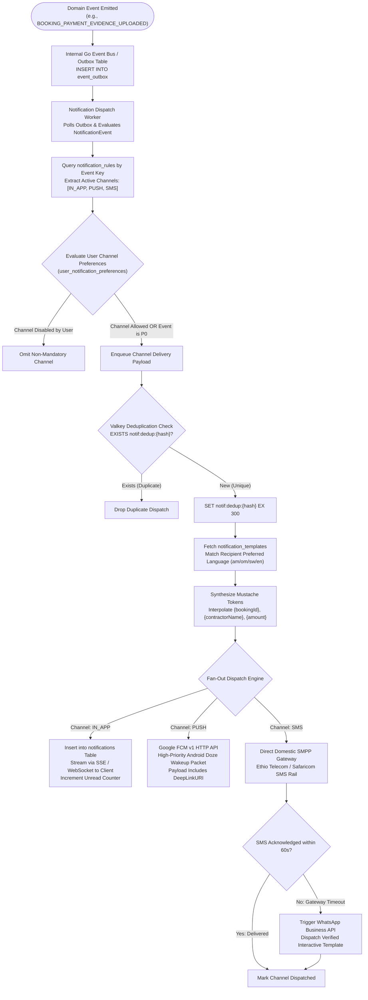
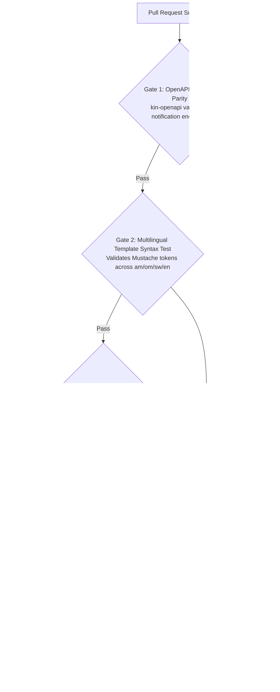

# Heavy Machinery & Logistics Rental Aggregator — Dink Machinery
## Software Requirements Specification — 05.10. Notifications, Multi-Channel Routing & In-App Center Architecture (`docs/shared/requirements/05-10-notifications-in-app-center.md`)

**Document Identifier:** `SRS-DINK-CORE-V7.0-SEC-05-10`  
**Classification:** Canonical System Requirements Specification & Architecture Baseline (Single Source of Truth)  
**Governing Standard:** IEEE Std 830-1998 / IEEE/ISO/IEC 29148:2018 (Systems and Software Engineering — Requirements Engineering)  
**Associated Artifacts:** `SRS-DINK-CORE-V7.0` (§5.10, §8, §10, §12), `FLOW-NOTIF-OFFLINE-DINK-CORE-V7.0` (Appendix A), `FLOW-BOOKING-STATE-MACHINE-DINK-CORE-V7.0`, `ARCH-BACKEND-GO-DINK-CORE-V7.0`, `ARCH-FLUTTER-DINK-CORE-V7.0`, `ARCH-ADMIN-NEXT-DINK-CORE-V7.0`, `ARCH-SEC-DINK-CORE-V7.0`, `DS-DINK-CORE-V7.0`, `DS-PERSONAS-DINK-CORE-V7.0`, `contracts/openapi.yaml`, `ADR-001`, `ADR-002`, `ADR-005`, `ADR-008`, `ADR-010`  
**Target Runtimes:** Go 1.24 Backend Monolith, Flutter 3.44 / Dart 3.9 (Cross-Platform Mobile), Next.js 16 / React 19 (Web Admin & Corporate Portal), PostgreSQL 18.4 + PostGIS 3.4, Valkey 8.0, ClamAV Daemon (:3310), SeaweedFS S3, Isar NoSQL 3.1+  
**Target Personas:** Civil Engineering Contractor (*Dawit Haile-Mariam* / *Patrick Kariuki*), Equipment Fleet Owner (*W/ro Almaz Tesfaye* / *Kamau Ndegwa*), Certified Field Operator (*Mulugeta Tadesse* / *Juma Omwamba*), Compliance Officer & Arbitrator (*Yohannes Bekele*)  
**Target Operating Markets:** Ethiopia (`ET`) & Kenya (`KE`) — Dynamic Multi-Country Parameterization (`LOC-01-BE`)  
**Compliance Standards:** OWASP ASVS 4.0.3 Level 3 (Secure Notifications, Session Scopes & Data Leakage Defense), RFC 9457 (Problem Details), ISO 9241-110, W3C WCAG 2.2 Level AAA (Field Mobile) & Level AA (Admin Web), Ethiopian Communications Authority (ECA) Directives, Kenya Data Protection Act 2019  
**Status:** Approved Engineering Baseline

---

## Table of Contents

- 1. [Document Scope & Architectural Mandate](#1-document-scope--architectural-mandate)
  - 1.1 [Purpose & Functional Scope](#11-purpose--functional-scope)
  - 1.2 [Core Architectural Principles & Operational Invariants](#12-core-architectural-principles--operational-invariants)
- 2. [Multi-Channel Notification Topology & Ingestion Pipeline](#2-multi-channel-notification-topology--ingestion-pipeline)
  - 2.1 [End-to-End Notification Dispatch Engine Flowchart](#21-end-to-end-notification-dispatch-engine-flowchart)
  - 2.2 [Relational Schema: Dynamic Rule Engine & Template Matrix](#22-relational-schema-dynamic-rule-engine--template-matrix)
  - 2.3 [Channel Taxonomy (In-App, Push/FCM, Domestic SMS/SMPP, WhatsApp)](#23-channel-taxonomy-in-app-pushfcm-domestic-smssmpp-whatsapp)
- 3. [Canonical Event Matrix & Multilingual Template Synthesis](#3-canonical-event-matrix--multilingual-template-synthesis)
  - 3.1 [Core MVP Trigger Events & Audience Routing](#31-core-mvp-trigger-events--audience-routing)
  - 3.2 [Mustache Parameter Interpolation & Localized Token Parsing](#32-mustache-parameter-interpolation--localized-token-parsing)
  - 3.3 [Priority Classification & Delivery SLA Tiers (P0 Critical to P3 Low)](#33-priority-classification--delivery-sla-tiers-p0-critical-to-p3-low)
- 4. [User Notification Preferences & Anti-Spam Throttling](#4-user-notification-preferences--anti-spam-throttling)
  - 4.1 [Granular Channel Toggle Invariants & Immutable P0 Alerts](#41-granular-channel-toggle-invariants--immutable-p0-alerts)
  - 4.2 [Time-Window Leaky Bucket Aggregation & Digest Generation](#42-time-window-leaky-bucket-aggregation--digest-generation)
  - 4.3 [Quiet Hours Configuration & Field Emergency Overrides](#43-quiet-hours-configuration--field-emergency-overrides)
- 5. [In-App Notification Center & Client Read State Architecture](#5-in-app-notification-center--client-read-state-architecture)
  - 5.1 [In-App Notification Center Layout & Unread Badge Counters](#51-in-app-notification-center-layout--unread-badge-counters)
  - 5.2 [Server-Sent Events (SSE) & WebSocket Real-Time Ingress](#52-server-sent-events-sse--websocket-real-time-ingress)
  - 5.3 [Deterministic Deep-Link Routing (`DeepLinkURI`)](#53-deterministic-deep-link-routing-deeplinkuri)
  - 5.4 [Client Offline Buffering & Isar NoSQL Synchronization (`ADR-010`)](#54-client-offline-buffering--isar-nosql-synchronization-adr-010)
- 6. [Carrier Dispatch Gateways & Frontier Telephony Fallbacks](#6-carrier-dispatch-gateways--frontier-telephony-fallbacks)
  - 6.1 [Google Firebase Cloud Messaging (FCM v1) Pipeline](#61-google-firebase-cloud-messaging-fcm-v1-pipeline)
  - 6.2 [Direct Domestic SMPP Carrier Bindings (Ethio Telecom & Safaricom)](#62-direct-domestic-smpp-carrier-bindings-ethio-telecom--safaricom)
  - 6.3 [Automated WhatsApp Business Escalation Engine](#63-automated-whatsapp-business-escalation-engine)
- 7. [Wire Protocol Contracts & RFC 9457 Error Schemas](#7-wire-protocol-contracts--rfc-9457-error-schemas)
  - 7.1 [`GET /api/v1/notifications`](#71-get-apiv1notifications)
  - 7.2 [`POST /api/v1/notifications/{id}/read`](#72-post-apiv1notificationsidread)
  - 7.3 [`POST /api/v1/notifications/read-all`](#73-post-apiv1notificationsread-all)
  - 7.4 [`GET /api/v1/notifications/preferences`](#74-get-apiv1notificationspreferences)
  - 7.5 [`PUT /api/v1/notifications/preferences`](#75-put-apiv1notificationspreferences)
  - 7.6 [RFC 9457 Universal Problem Details Payloads](#76-rfc-9457-universal-problem-details-payloads)
- 8. [Automated Testing Suite & Verification Gates](#8-automated-testing-suite--verification-gates)

---

## 1. Document Scope & Architectural Mandate

### 1.1 Purpose & Functional Scope

This specification establishes **Section 05.10 (Notifications, Multi-Channel Routing & In-App Center Architecture)** of the canonical Software Requirements Specification (SRS) for **Dink Machinery Version 7.0**.

In heavy equipment aggregation and civil construction across East Africa, notification latency directly affects physical and financial safety:
* When an excavator payment wire is submitted, the equipment owner must verify funds within an exact window before equipment mobilization is jeopardized.
* When a machine is 24 hours from demobilization or an active rental is approaching shift limits, operators and site managers require timely alerts.
* When roadside lowboy transshipment breaks down, P0 emergency dispatch notifications determine whether an entire highway project halts or resumes.

Communication networks across Ethiopia and Kenya present unique operational challenges: volatile 3G/4G connectivity on remote quarry sites, background push notification killing by aggressive device battery optimizers, and telecom SMS gateway congestion along infrastructure corridors.

This document formally specifies:
1. The metadata-driven notification engine powered by `NotificationEvent`, `NotificationRule`, and `NotificationTemplate` entities.
2. The multi-channel delivery pipeline spanning real-time In-App SSE/WebSockets, Google Firebase Cloud Messaging (FCM v1), direct domestic carrier SMPP protocols (Ethio Telecom, Safaricom), and automated WhatsApp fallback.
3. The multilingual template synthesis engine supporting Amharic (`am`), Afaan Oromoo (`om`), Swahili (`sw`), and English (`en`) via Mustache token interpolation.
4. The client-side In-App Notification Center with synchronized read-state tracking, dynamic unread badge counters, and deterministic deep-link navigation.
5. Granular user preference matrices with non-bypassable P0 critical security/financial invariants.

### 1.2 Core Architectural Principles & Operational Invariants

1. **Zero Hardcoded Notification Payloads:** All notification content, headers, deep links, and localized translations are retrieved dynamically from PostgreSQL (`notification_templates`). The Go backend engine compiles payloads via token interpolation without requiring code redeployments.
2. **Immutable Delivery of P0 Financial & Safety Alerts:** Critical transaction events—including OTP challenges, bank wire payment declines, dispute openings, emergency breakdown freezes, and security freezes—bypass user quiet hours and toggle switches. Delivery is mandatory across both In-App and Telephony (SMS/Push) channels.
3. **Deterministic Deep-Link Routing (`DeepLinkURI`):** Every notification record incorporates an immutable, standardized internal URI (e.g., `dink://bookings/bk_019a8f60/verify-payment`). Tapping the notification on mobile or web routes directly to the corresponding action viewport.
4. **Idempotent Dispatch & Deduplication (`EventKey` + `RecipientID`):** Notifications evaluate a cryptographic deduplication key in Valkey 8.0:
   $$\text{dedup\_key} = \text{SHA-256}(\text{event\_key} \parallel \text{booking\_id} \parallel \text{recipient\_id} \parallel \text{status})$$
   Keys maintain a 5-minute TTL to prevent duplicate push alerts from network retries.
5. **Frontier Offline Resiliency (`ADR-010`):** In-app notification center state is persisted locally in Isar NoSQL on client devices, allowing contractors and operators to inspect notifications and triage historical alerts when working off-grid.

---

## 2. Multi-Channel Notification Topology & Ingestion Pipeline

### 2.1 End-to-End Notification Dispatch Engine Flowchart



---

### 2.2 Relational Schema: Dynamic Rule Engine & Template Matrix

The notification subsystem is configured dynamically in PostgreSQL 18.4:

```mermaid
erDiagram
    NotificationEvent ||--o{ NotificationRule : "governs"
    NotificationEvent ||--o{ NotificationTemplate : "defines"
    NotificationEvent ||--o{ Notification : "instantiates"
    User ||--o{ Notification : "receives"
    User ||--o{ UserNotificationPreference : "configures"

    NotificationEvent {
        string event_key PK -- 'BOOKING_REQUEST_CREATED', 'PAYMENT_EVIDENCE_UPLOADED'
        string category -- 'FINANCIAL', 'OPERATIONAL', 'SAFETY', 'SYSTEM'
        string default_priority -- 'P0', 'P1', 'P2', 'P3'
        boolean is_mandatory_p0
        string description
    }

    NotificationRule {
        uuid id PK
        string event_key FK
        string target_role -- 'RENTER', 'OWNER', 'OPERATOR', 'CARRIER', 'ADMIN'
        boolean enable_in_app
        boolean enable_push
        boolean enable_sms
        boolean enable_whatsapp
        int quiet_hours_override_level
    }

    NotificationTemplate {
        uuid id PK
        string event_key FK
        string language_code -- 'am', 'om', 'sw', 'en'
        string title_template
        string body_template
        string sms_template
        string action_label
        string deep_link_pattern
    }

    Notification {
        uuid id PK
        uuid user_id FK
        string event_key FK
        string priority
        string title
        string body
        string deep_link_uri
        jsonb metadata_json
        boolean is_read
        timestamptz read_at
        timestamptz created_at
    }

    UserNotificationPreference {
        uuid user_id PK
        string event_key PK
        boolean in_app_enabled
        boolean push_enabled
        boolean sms_enabled
        boolean whatsapp_enabled
        timestamptz updated_at
    }
```

---

### 2.3 Channel Taxonomy (In-App, Push/FCM, Domestic SMS/SMPP, WhatsApp)

The delivery engine balances immediacy, cost, and reliability across four communication channels:

```text
+--------------------------------------------------------------------------------------------------+
| MULTI-CHANNEL DELIVERY TAXONOMY MATRIX                                                           |
+---------------------+-------------------+---------------------+----------------------------------+
| CHANNEL IDENTIFIER  | TRANSPORT PROTOCOL| RELIABILITY PROFILE | OPERATIONAL INTENT & BEHAVIOR    |
+---------------------+-------------------+---------------------+----------------------------------+
| IN_APP              | HTTP SSE /        | Guaranteed delivery | Persistent archival log; renders |
|                     | WebSocket         | within active app   | in notification center with read |
|                     |                   | session (< 50ms)    | state and unread badge counters. |
+---------------------+-------------------+---------------------+----------------------------------+
| PUSH (FCM v1)       | HTTP/2 REST to    | High; dependent on  | Heads-up system tray alerts on   |
|                     | Google FCM        | OS battery managers | mobile devices; awakens client   |
|                     |                   | and Google Play     | app via high-priority data packet|
+---------------------+-------------------+---------------------+----------------------------------+
| SMS                 | Direct SMPP v3.4  | High; cellular telco| Out-of-band delivery for OTPs,   |
| (Domestic Gateways) | over TLS (TCP     | signaling network   | payment receipts, and critical   |
|                     | Port 2775)        | (< 3s delivery)     | operational state changes.       |
+---------------------+-------------------+---------------------+----------------------------------+
| WHATSAPP            | HTTPS REST        | Secondary failover; | Automated conversational backup  |
| (Business Solution) | (Meta Graph API)  | requires smartphone | when regional SMS gateways fail  |
|                     |                   | data coverage       | or drop below delivery SLAs.     |
+---------------------+-------------------+---------------------+----------------------------------+
```

---

## 3. Canonical Event Matrix & Multilingual Template Synthesis

### 3.1 Core MVP Trigger Events & Audience Routing

The core marketplace MVP defines eight critical lifecycle event groups:

```text
+--------------------------------------------------------------------------------------------------+
| CANONICAL NOTIFICATION EVENT CATALOG MATRIX                                                      |
+------------------------------------+----------+--------------------+-----------------------------+
| EVENT KEY                          | PRIORITY | TARGET RECIPIENTS  | DEFAULT ACTIVE CHANNELS     |
+------------------------------------+----------+--------------------+-----------------------------+
| BOOKING_REQUEST_CREATED            | P1       | Equipment Owner    | In-App, Push, SMS           |
+------------------------------------+----------+--------------------+-----------------------------+
| PAYMENT_EVIDENCE_UPLOADED          | P0       | Equipment Owner    | In-App, Push, SMS, WhatsApp |
+------------------------------------+----------+--------------------+-----------------------------+
| PAYMENT_CONFIRMED                  | P0       | Renter Contractor  | In-App, Push, SMS           |
+------------------------------------+----------+--------------------+-----------------------------+
| PAYMENT_DECLINED                   | P0       | Renter Contractor  | In-App, Push, SMS, WhatsApp |
+------------------------------------+----------+--------------------+-----------------------------+
| BOOKING_CANCELLED                  | P0       | Both Parties       | In-App, Push, SMS           |
+------------------------------------+----------+--------------------+-----------------------------+
| RENTAL_STARTING_SOON (T-24h)       | P2       | Both Parties & Op  | In-App, Push                |
+------------------------------------+----------+--------------------+-----------------------------+
| RENTAL_ENDING_SOON (T-24h)         | P2       | Both Parties & Op  | In-App, Push                |
+------------------------------------+----------+--------------------+-----------------------------+
| DISPUTE_OPENED                     | P0       | Both Parties & Adm | In-App, Push, SMS           |
+------------------------------------+----------+--------------------+-----------------------------+
| DISPUTE_RESOLVED                   | P0       | Both Parties       | In-App, Push, SMS           |
+------------------------------------+----------+--------------------+-----------------------------+
| REVIEW_RECEIVED                    | P3       | Target Party       | In-App, Push                |
+------------------------------------+----------+--------------------+-----------------------------+
```

---

### 3.2 Mustache Parameter Interpolation & Localized Token Parsing

Notification templates in PostgreSQL employ Mustache syntax (`{{token}}`) for dynamic variable substitution:

```text
+--------------------------------------------------------------------------------------------------+
| MULTILINGUAL TEMPLATE DEFINITIONS FOR PAYMENT_EVIDENCE_UPLOADED                                  |
+--------------------------------------------------------------------------------------------------+
| LANG | TEMPLATE DEFINITIONS (TITLE, BODY, SMS)                                                   |
+------+-------------------------------------------------------------------------------------------+
| en   | Title: Payment Slip Uploaded for #{{bookingId}}                                           |
|      | Body : {{contractorName}} uploaded a wire slip of {{amount}} ETB for {{fleetModel}}.     |
|      |        Verify receipt within 24 hours.                                                    |
|      | SMS  : DINK: {{contractorName}} uploaded wire slip for #{{bookingId}} ({{amount}} ETB).   |
|      |        Check your bank and confirm in-app.                                                |
+------+-------------------------------------------------------------------------------------------+
| am   | Title: የክፍያ ማረጋገጫ ተጭኗል - መለያ #{{bookingId}}                                      |
|      | Body : {{contractorName}} ለ{{fleetModel}} የ{{amount}} ብር የባንክ ማስተላለፊያ ደረሰኝ      |
|      |        ጭነዋል። እባክዎ በ24 ሰዓት ውስጥ ያረጋግጡ።                                          |
|      | SMS  : ዲንክ፡ {{contractorName}} ለቦታ ማስያዣ #{{bookingId}} የ{{amount}} ብር ደረሰኝ ጭነዋል። |
|      |        እባክዎ በባንክዎ አረጋግጠው በሲስተሙ ያጽድቁ።                                          |
+------+-------------------------------------------------------------------------------------------+
| om   | Title: Ragaan Kaffaltii Fe'ameera #{{bookingId}}                                          |
|      | Body : {{contractorName}} nagahee baankii Qar. {{amount}} {{fleetModel}} f fe'aniiru.     |
|      |        Sa'aatii 24 keessatti mirkaneessaa.                                                |
|      | SMS  : DINK: {{contractorName}} nagahee baankii Qar. {{amount}} fe'aniiru (#{{bookingId}})|
|      |        Ilaalaatii appirraan mirkaneessaa.                                                 |
+------+-------------------------------------------------------------------------------------------+
| sw   | Title: Ushahidi wa Malipo Umepakiwa #{{bookingId}}                                        |
|      | Body : {{contractorName}} amepakia stakabadhi ya Benki ya KES {{amount}} kwa {{fleetModel}}|
|      |        Thibitisha malipo ndani ya saa 24.                                                 |
|      | SMS  : DINK: {{contractorName}} amepakia stakabadhi ya KES {{amount}} (#{{bookingId}}).   |
|      |        Thibitisha kwenye benki na uidhinishe.                                             |
+--------------------------------------------------------------------------------------------------+
```

* **Fallback Engine:** If a user’s selected dialect is missing a specific template string, the engine falls back gracefully:
  $$\text{Target Dialect} \longrightarrow \text{Amharic (ET) / Swahili (KE)} \longrightarrow \text{English (Universal)}$$

---

### 3.3 Priority Classification & Delivery SLA Tiers (P0 Critical to P3 Low)

```text
+--------------------------------------------------------------------------------------------------+
| NOTIFICATION PRIORITY SERVICE LEVEL AGREEMENTS (SLOS)                                            |
+----------+-----------------------+---------------------+-----------------------------------------+
| PRIORITY | TARGET DISPATCH LATENCY| RETRY POLICY        | APPLICABLE EVENTS                       |
+----------+-----------------------+---------------------+-----------------------------------------+
| P0       | p95 < 1.5 Seconds     | 5 Exponential       | Payment decline, wire receipt uploaded, |
| Critical | p99 < 3.0 Seconds     | Retries (every 30s) | dispute opened, safety freeze.          |
+----------+-----------------------+---------------------+-----------------------------------------+
| P1       | p95 < 5.0 Seconds     | 3 Retries           | New booking requested, extension agreed,|
| High     | p99 < 10.0 Seconds    | (every 60s)         | carrier dispatched to depot.            |
+----------+-----------------------+---------------------+-----------------------------------------+
| P2       | p95 < 30.0 Seconds    | 2 Retries           | 24-hour rental start reminder, 24-hour  |
| Medium   | p99 < 60.0 Seconds    | (every 5m)          | rental conclusion reminder.             |
+----------+-----------------------+---------------------+-----------------------------------------+
| P3       | p95 < 120.0 Seconds   | 1 Retry             | New rating/review received, promotional |
| Low      | p99 < 300.0 Seconds   |                     | platform announcements.                 |
+----------+-----------------------+---------------------+-----------------------------------------+
```

---

## 4. User Notification Preferences & Anti-Spam Throttling

### 4.1 Granular Channel Toggle Invariants & Immutable P0 Alerts

Users customize notification channels via `user_notification_preferences`:
* **Granular Matrix:** In-App, Push, and SMS can be toggled per event category (Financial, Operational, Reminders, Reviews).
* **Immutable Security Invariant:**
  Events flagged `is_mandatory_p0 = true` in `NotificationEvent` cannot be disabled:
  $$\text{is\_mandatory\_p0} = \text{true} \implies \text{Channel Toggles FORCED ON}$$
  Any API payload attempting to set `sms_enabled = false` or `push_enabled = false` on a P0 event is rejected with RFC 9457 HTTP 422 Unprocessable Entity (`ERR_CANNOT_DISABLE_MANDATORY_NOTIFICATIONS`).

---

### 4.2 Time-Window Leaky Bucket Aggregation & Digest Generation

To prevent notification spam during active fleet management:
* **Leaky Bucket Limiter:** Non-critical alerts (P2/P3) are throttled via Valkey token buckets:
  - Max Rate: 5 push notifications per 15-minute sliding window per user.
* **Notification Collapsing:** If an equipment owner receives multiple inspection or shift updates within 10 minutes, the engine collapses them into a single consolidated push alert:
  *"Haile-Mariam Construction updated shift logs for 3 active machines."*

---

### 4.3 Quiet Hours Configuration & Field Emergency Overrides

Users can configure local quiet hours (e.g., `22:00` to `06:00`):
* During quiet hours, P2 (Reminders) and P3 (Reviews) push notifications are held in a scheduled queue and dispatched at `06:01`.
* **Field Emergency Override:** P0 alerts (payment disputes, in-transit accidents, emergency transshipment requests) bypass quiet hours unconditionally, playing the high-priority alarm sound on mobile hardware.

---

## 5. In-App Notification Center & Client Read State Architecture

### 5.1 In-App Notification Center Layout & Unread Badge Counters

The In-App Notification Center is accessible via the bell icon in the mobile app header and web portal:

```text
+--------------------------------------------------------------------------------------------------+
| IN-APP NOTIFICATION CENTER LAYOUT SPECIFICATION                                                  |
+--------------------------------------------------------------------------------------------------+
| +----------------------------------------------------------------------------------------------+ |
| | [ ← Back ]  Notifications                 [ Unread Badge: 3 ]         [ ✓ Mark All as Read ] |
| +----------------------------------------------------------------------------------------------+ |
| | [ All (14) ]        [ Financial (3) ]        [ Operational (8) ]        [ System (3) ]       |
| +----------------------------------------------------------------------------------------------+ |
| | ● [ 💳 PAYMENT EVIDENCE UPLOADED ]                                    Today, 09:45 AM (P0)   |
| |   Dawit Haile-Mariam uploaded wire slip of 106,750 ETB for Cat 320D #BK-8812.                |
| |   Verify bank receipt before lease expires in 23 hours.                                      |
| |   [ Action: Audit Payment Slip → ]                                                           |
| +----------------------------------------------------------------------------------------------+ |
| | ● [ ⏱️ RENTAL STARTING IN 24 HOURS ]                                  Yesterday, 04:30 PM    |
| |   Booking #BK-8812 mobilization scheduled for tomorrow at Mojo Highway Site B.               |
| |   [ Action: View Handover Checklist → ]                                                      |
| +----------------------------------------------------------------------------------------------+ |
| |   [ ⭐ NEW RATING RECEIVED ]                                           26 Oct 2026           |
| |   Haile-Mariam Construction rated your Cat 320D 5.0 Stars: "Exceptional machine uptime..."   |
| +----------------------------------------------------------------------------------------------+ |
```

* **Dynamic Unread Counters:** The navigation icon renders a red badge with the unread count ($\le 99$, then $99+$).
* **Visual Differentiation:** Unread items feature a solid accent indicator (`●`), tinted card background, and bold typography. Read items render in standard neutral gray.

---

### 5.2 Server-Sent Events (SSE) & WebSocket Real-Time Ingress

Real-time notification delivery within active app sessions avoids polling:
1. **Transport Mechanism:** Flutter mobile apps and Next.js web consoles establish an authenticated Server-Sent Events (SSE) stream (`GET /api/v1/notifications/stream`) upon login.
2. **Streaming Ingress Event Payload:**
   ```json
   event: notification
   data: {
     "id": "notif_019a8fb0-8812-7b9a",
     "eventKey": "PAYMENT_EVIDENCE_UPLOADED",
     "priority": "P0",
     "title": "Payment Slip Uploaded for #BK-8812",
     "body": "Dawit Haile-Mariam uploaded wire slip of 106,750 ETB.",
     "deepLinkUri": "dink://bookings/bk_019a8f60-9912-7b9a/verify-payment",
     "unreadCountTotal": 3,
     "createdAt": "2026-10-28T09:45:00Z"
   }
   ```
3. **Audio/Haptic Trigger:** Receiving a P0 event triggers device haptic feedback and an in-app banner toast with high-contrast action buttons.

---

### 5.3 Deterministic Deep-Link Routing (`DeepLinkURI`)

Tapping any notification routes deterministically to the target screen:

```text
+--------------------------------------------------------------------------------------------------+
| CANONICAL DEEP-LINK ROUTING TABLE                                                                |
+------------------------------------+-------------------------------------------------------------+
| EVENT KEY                          | CANONICAL DEEP-LINK PATTERN                                 |
+------------------------------------+-------------------------------------------------------------+
| BOOKING_REQUEST_CREATED            | dink://owner/bookings/{bookingId}/review                    |
+------------------------------------+-------------------------------------------------------------+
| PAYMENT_EVIDENCE_UPLOADED          | dink://owner/bookings/{bookingId}/verify-payment            |
+------------------------------------+-------------------------------------------------------------+
| PAYMENT_CONFIRMED                  | dink://renter/bookings/{bookingId}/active-hud               |
+------------------------------------+-------------------------------------------------------------+
| PAYMENT_DECLINED                   | dink://renter/bookings/{bookingId}/payment-instructions     |
+------------------------------------+-------------------------------------------------------------+
| DISPUTE_OPENED                     | dink://disputes/{disputeId}/docket                          |
+------------------------------------+-------------------------------------------------------------+
| REVIEW_RECEIVED                    | dink://profile/reviews/{reviewId}                           |
+------------------------------------+-------------------------------------------------------------+
```

---

### 5.4 Client Offline Buffering & Isar NoSQL Synchronization (`ADR-010`)

For certified operators working in remote culverts and quarries:
* **Isar NoSQL Persistence:** When the notification stream delivers alerts, they commit immediately to the local embedded Isar NoSQL database.
* **Offline Read Actions:** Tapping notifications or marking them as read while offline commits mutations to the Isar `OutboxQueue`.
* **Reconnection Sync:** When cellular connectivity is re-established, the client flushes its read-state outbox (`POST /api/v1/notifications/sync-read-state`), updating server read timestamps without conflict.

---

## 6. Carrier Dispatch Gateways & Frontier Telephony Fallbacks

### 6.1 Google Firebase Cloud Messaging (FCM v1) Pipeline

* **Protocol Standard:** HTTP/2 over TLS to Google FCM v1 endpoint (`https://fcm.googleapis.com/v1/projects/dink-machinery/messages:send`).
* **Hardware Doze Wakeup:** P0 and P1 payloads set `android.priority = "high"` and `apns.headers.apns-priority = "10"`, bypassing Android Doze mode and iOS Low Power Mode to ensure instant delivery.
* **Payload Size Constraint:** FCM data payloads are constrained to $< 4\text{ KB}$, containing only identifiers, synthesized text strings, and deep-link routing URIs.

---

### 6.2 Direct Domestic SMPP Carrier Bindings (Ethio Telecom & Safaricom)

Telephony SMS routing in East Africa bypasses third-party international aggregators in favor of direct telco connections:
* **Ethiopia (`ET`):** Direct SMPP v3.4 bind over TLS to the **Ethio Telecom Enterprise Gateway** (Shortcode: `8190`). Throughput: 100 SMS/second.
* **Kenya (`KE`):** Direct SMPP bind to **Safaricom Kenya Bulk SMS Gateway** (Alphanumeric Sender ID: `DINKMACH`).
* **Dynamic Character Encoding:** Messages are submitted in standard GSM 7-bit (English/Swahili) or UCS-2 16-bit encoding (Amharic/Afaan Oromoo Ge'ez script). Multi-part concatenation conforms to 3GPP standards.

---

### 6.3 Automated WhatsApp Business Escalation Engine

If carrier network congestion causes SMS delivery receipts to stall:
1. When a P0 alert (e.g., OTP or payment evidence upload) is dispatched via SMPP, a 60-second delivery acknowledgement timer starts in Valkey.
2. If no carrier `DELIVRD` receipt is returned within **60 seconds**:
   - The system escalates to the **WhatsApp Business Platform API** (`Meta Cloud API` / `Infobip`).
   - Dispatches a verified WhatsApp Business interactive message featuring rich action buttons:
     ```text
     [ Dink Machinery Verified Business ]
     Urgent: Dawit Haile-Mariam uploaded wire receipt for #BK-8812.
     [ Verify Payment Now ]  [ View Details ]
     ```
3. Once delivered via WhatsApp, the pending SMS retry task is cancelled.

---

## 7. Wire Protocol Contracts & RFC 9457 Error Schemas

### 7.1 `GET /api/v1/notifications`

Retrieves paginated in-app notification logs for the authenticated user.

#### Request Headers
```http
GET /api/v1/notifications?category=FINANCIAL&unreadOnly=false&page=1&limit=20 HTTP/1.1
Host: api.dinkmachinery.com
Authorization: Bearer <userAccessToken>
Accept-Language: am
```

#### Response: `HTTP 200 OK`
```json
{
  "success": true,
  "data": {
    "totalCount": 14,
    "unreadCount": 3,
    "page": 1,
    "limit": 20,
    "notifications": [
      {
        "id": "notif_019a8fb0-8812-7b9a",
        "eventKey": "PAYMENT_EVIDENCE_UPLOADED",
        "category": "FINANCIAL",
        "priority": "P0",
        "title": "የክፍያ ማረጋገጫ ተጭኗል - መለያ #BK-8812",
        "body": "Dawit Haile-Mariam ለCaterpillar 320D የ106,750 ብር የባንክ ማስተላለፊያ ደረሰኝ ጭነዋል። እባክዎ በ24 ሰዓት ውስጥ ያረጋግጡ።",
        "deepLinkUri": "dink://owner/bookings/bk_019a8f60-9912-7b9a/verify-payment",
        "isRead": false,
        "readAt": null,
        "createdAt": "2026-10-28T09:45:00Z"
      }
    ]
  },
  "timestamp": "2026-10-28T09:46:00Z"
}
```

---

### 7.2 `POST /api/v1/notifications/{id}/read`

Marks a single notification as read.

#### Request Headers
```http
POST /api/v1/notifications/notif_019a8fb0-8812-7b9a/read HTTP/1.1
Host: api.dinkmachinery.com
Authorization: Bearer <userAccessToken>
```

#### Response: `HTTP 200 OK`
```json
{
  "success": true,
  "data": {
    "notificationId": "notif_019a8fb0-8812-7b9a",
    "isRead": true,
    "readAt": "2026-10-28T09:47:12Z",
    "unreadCountTotal": 2
  },
  "timestamp": "2026-10-28T09:47:12Z"
}
```

---

### 7.3 `POST /api/v1/notifications/read-all`

Bulk marks all active notifications as read.

#### Request Headers
```http
POST /api/v1/notifications/read-all HTTP/1.1
Host: api.dinkmachinery.com
Authorization: Bearer <userAccessToken>
```

#### Response: `HTTP 200 OK`
```json
{
  "success": true,
  "data": {
    "recordsUpdated": 3,
    "unreadCountTotal": 0
  },
  "timestamp": "2026-10-28T09:48:00Z"
}
```

---

### 7.4 `GET /api/v1/notifications/preferences`

Retrieves granular notification channel settings for the user.

#### Request Headers
```http
GET /api/v1/notifications/preferences HTTP/1.1
Host: api.dinkmachinery.com
Authorization: Bearer <userAccessToken>
```

#### Response: `HTTP 200 OK`
```json
{
  "success": true,
  "data": {
    "userId": "usr_018f6a9e-876b-7341",
    "preferences": [
      {
        "eventKey": "PAYMENT_EVIDENCE_UPLOADED",
        "description": "Bank wire deposit evidence uploaded by contractor",
        "isMandatoryP0": true,
        "channels": {
          "inApp": true,
          "push": true,
          "sms": true,
          "whatsapp": true
        }
      },
      {
        "eventKey": "RENTAL_STARTING_SOON",
        "description": "24-hour reminder before equipment mobilization",
        "isMandatoryP0": false,
        "channels": {
          "inApp": true,
          "push": true,
          "sms": false,
          "whatsapp": false
        }
      }
    ]
  },
  "timestamp": "2026-10-28T09:49:00Z"
}
```

---

### 7.5 `PUT /api/v1/notifications/preferences`

Updates user notification channel preferences.

#### Request Payload
```json
{
  "eventKey": "RENTAL_STARTING_SOON",
  "channels": {
    "push": false,
    "sms": false
  }
}
```

#### Response: `HTTP 200 OK`
```json
{
  "success": true,
  "data": {
    "eventKey": "RENTAL_STARTING_SOON",
    "updatedChannels": {
      "inApp": true,
      "push": false,
      "sms": false,
      "whatsapp": false
    }
  },
  "timestamp": "2026-10-28T09:50:00Z"
}
```

---

### 7.6 RFC 9457 Universal Problem Details Payloads

#### Example: Attempt to Disable Mandatory P0 Notification (`HTTP 422 Unprocessable Entity`)
```json
{
  "type": "[https://api.dinkmachinery.com/errors/mandatory-notification-override-prohibited](https://api.dinkmachinery.com/errors/mandatory-notification-override-prohibited)",
  "title": "Mandatory Notification Cannot Be Disabled",
  "status": 422,
  "detail": "Event 'PAYMENT_EVIDENCE_UPLOADED' is classified as P0 Financial Critical. SMS and Push channels cannot be disabled.",
  "instance": "/api/v1/notifications/preferences",
  "code": "ERR_CANNOT_DISABLE_MANDATORY_NOTIFICATIONS",
  "invalidParams": [
    {
      "name": "channels.sms",
      "reason": "Must be true for P0 critical financial transactions."
    }
  ]
}
```

#### Example: Notification Not Found (`HTTP 404 Not Found`)
```json
{
  "type": "[https://api.dinkmachinery.com/errors/notification-not-found](https://api.dinkmachinery.com/errors/notification-not-found)",
  "title": "Notification Resource Not Found",
  "status": 404,
  "detail": "Notification record 'notif_019a8fb0-9999-0000' does not exist or does not belong to the authenticated user.",
  "instance": "/api/v1/notifications/notif_019a8fb0-9999-0000/read",
  "code": "ERR_NOTIFICATION_NOT_FOUND"
}
```

---

## 8. Automated Testing Suite & Verification Gates



1. **OpenAPI Schema Contract Gate (`kin-openapi`):** Validates all notification retrieval, read-state marking, real-time SSE streaming, and preference configuration endpoints against `contracts/openapi.yaml`.
2. **Multilingual Mustache Template Compilation Test:** Iterates through $100\%$ of `notification_templates` records across Amharic, Afaan Oromoo, Swahili, and English. Asserts that all tokens compile cleanly with zero unescaped tags or rendering panics.
3. **Mandatory P0 Channel Invariant Test:** Simulates API requests attempting to turn off SMS/Push toggles for all P0 financial and dispute events. Asserts that the Go backend rejects $100\%$ of attempts with HTTP 422 `ERR_CANNOT_DISABLE_MANDATORY_NOTIFICATIONS`.
4. **SMPP-to-WhatsApp Fallback Integration Benchmark:** Mocks an SMPP carrier delivery timeout ($> 60\text{ seconds}$). Verifies that the dispatch engine automatically routes the payload to the WhatsApp Business API sandbox within $< 200\text{ ms}$ of timer expiry.

---

*This document establishes the canonical functional requirements, relational schemas, delivery SLAs, multilingual template synthesis rules, and wire protocol contracts for Notifications, Multi-Channel Routing & In-App Center in Dink Machinery Version 7.0. All downstream Flutter mobile screens, Go backend event consumers, and Next.js admin consoles must strictly conform to this specification.*