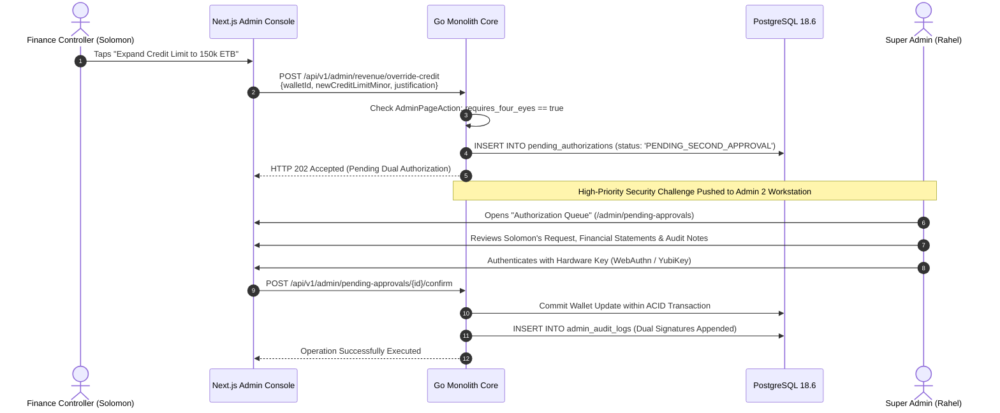
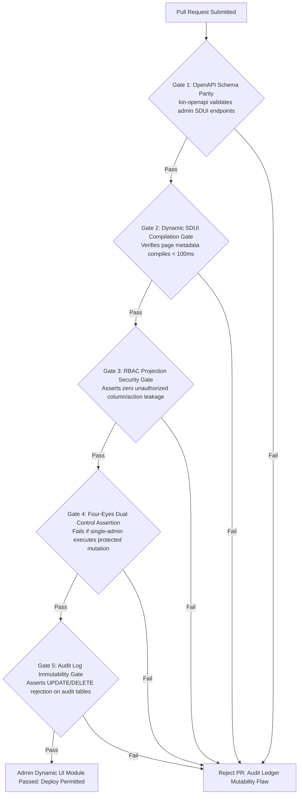

# Heavy Machinery & Logistics Rental Aggregator — Dink Machinery
## Software Requirements Specification — 05.11. Admin Dashboard, Dynamic UI Engine & Role-Based Access Control Architecture (`docs/shared/requirements/05-11-admin-dashboard-dynamic-ui-engine.md`)

**Document Identifier:** `SRS-DINK-CORE-V7.0-SEC-05-11`  
**Classification:** Canonical System Requirements Specification & Architecture Baseline (Single Source of Truth)  
**Governing Standard:** IEEE Std 830-1998 / IEEE/ISO/IEC 29148:2018 (Systems and Software Engineering — Requirements Engineering)  
**Associated Artifacts:** `SRS-DINK-CORE-V7.0` (§5.11, §10, §11, §12), `FLOW-ADMIN-CONSOLE-DINK-CORE-V7.0` (Interaction Flow 13), `FLOW-OWNER-KYC-DINK-CORE-V7.0`, `FLOW-FLEET-REG-DINK-CORE-V7.0`, `FLOW-WIRE-DISPUTE-DINK-CORE-V7.0`, `FLOW-COMMISSION-DEBT-DINK-CORE-V7.0`, `ARCH-BACKEND-GO-DINK-CORE-V7.0`, `ARCH-ADMIN-NEXT-DINK-CORE-V7.0`, `ARCH-SEC-DINK-CORE-V7.0`, `DS-DINK-CORE-V7.0`, `DS-PERSONAS-DINK-CORE-V7.0`, `contracts/openapi.yaml`, `ADR-001`, `ADR-002`, `ADR-005`, `ADR-008`, `ADR-010`  
**Target Runtimes:** Next.js 16.x (latest CVE security patch) / React 19 (Web Admin Portal), Go 1.27.3 Backend Monolith, PostgreSQL 18.6 + PostGIS 3.6.4, Valkey 9.1.3, ClamAV Daemon (:3310), SeaweedFS S3, Isar NoSQL 3.1+  
**Target Personas:** Super Administrator (*Rahel Tadesse*), Compliance Officer & Arbitrator (*Yohannes Bekele*), Finance Controller & Revenue Auditor (*Solomon Kassa*), Fleet Inspector & Catalog Manager (*Ato Tewodros Mengistu*)  
**Target Operating Markets:** Ethiopia (`ET`) & Kenya (`KE`) — Dynamic Multi-Country Parameterization (`LOC-01-BE`)  
**Compliance Standards:** OWASP ASVS 4.0.3 Level 3 (Role-Based Access Control, Administrative Audit Logging, Four-Eyes Authorization & Session Management), RFC 9457 (Problem Details), ISO 9241-110, W3C WCAG 2.2 Level AA (Admin Web), National Bank of Ethiopia (NBE) Financial Directives, Kenya Data Protection Act 2019  
**Status:** Approved Engineering Baseline

---

## Table of Contents

- 1. [Document Scope & Architectural Mandate](#1-document-scope--architectural-mandate)
  - 1.1 [Purpose & Functional Scope](#11-purpose--functional-scope)
  - 1.2 [Core Architectural Principles & Engine Invariants](#12-core-architectural-principles--engine-invariants)
- 2. [Dynamic UI Engine Topology & Metadata Compilation](#2-dynamic-ui-engine-topology--metadata-compilation)
  - 2.1 [Server-Driven UI (SDUI) Compilation Pipeline](#21-server-driven-ui-sdui-compilation-pipeline)
  - 2.2 [Relational Schema: Dynamic Layouts, Columns & Actions](#22-relational-schema-dynamic-layouts-columns--actions)
  - 2.3 [Client-Side Generic UI Renderer (Next.js 16.x (latest CVE security patch) / React 19)](#23-client-side-generic-ui-renderer-nextjs-16--react-19)
- 3. [Role-Based Access Control (RBAC) & Administrative Identity](#3-role-based-access-control-rbac--administrative-identity)
  - 3.1 [Hierarchical RBAC Model (`Role`, `Permission`, `RolePermission`)](#31-hierarchical-rbac-model-role-permission-rolepermission)
  - 3.2 [Canonical Internal Admin Roles & Scopes](#32-canonical-internal-admin-roles--scopes)
  - 3.3 [Stateless ECDSA Scoped JWT Verification & Middleware Gates](#33-stateless-ecdsa-scoped-jwt-verification--middleware-gates)
  - 3.4 [Four-Eyes Dual Control Authorization Engine](#34-four-eyes-dual-control-authorization-engine)
- 4. [Core MVP Administrative Workbenches & Workflows](#4-core-mvp-administrative-workbenches--workflows)
  - 4.1 [Workbench 1: Owner KYC & Trade License Approval Queue](#41-workbench-1-owner-kyc--trade-license-approval-queue)
  - 4.2 [Workbench 2: Fleet Roadworthiness & Photo Walkaround Queue](#42-workbench-2-fleet-roadworthiness--photo-walkaround-queue)
  - 4.3 [Workbench 3: User Governance, Quarantine & Sanctions Management](#43-workbench-3-user-governance-quarantine--sanctions-management)
  - 4.4 [Workbench 4: Wire Transfer Contestations & Damage Dispute Arbitration](#44-workbench-4-wire-transfer-contestations--damage-dispute-arbitration)
  - 4.5 [Workbench 5: Central Commission Ledger & Delinquency Tracking](#45-workbench-5-central-commission-ledger--delinquency-tracking)
  - 4.6 [Workbench 6: Category Taxonomy & EAV Spec Template Manager](#46-workbench-6-category-taxonomy--eav-spec-template-manager)
  - 4.7 [Workbench 7: RBAC Role & Permission Matrix Editor](#47-workbench-7-rbac-role--permission-matrix-editor)
- 5. [Dynamic Table Engine, Filtering & Batch Mutations](#5-dynamic-table-engine-filtering--batch-mutations)
  - 5.1 [Dynamic Column Rendering & Custom Cell Formatters](#51-dynamic-column-rendering--custom-cell-formatters)
  - 5.2 [Server-Driven Parametric Filter Engine](#52-server-driven-parametric-filter-engine)
  - 5.3 [Declarative Actions, Modals & Side-Sheet Drawers](#53-declarative-actions-modals--side-sheet-drawers)
  - 5.4 [Audit Trail Journaling & Immutable Tamper-Evident Logs](#54-audit-trail-journaling--immutable-tamper-evident-logs)
- 6. [Wire Protocol Contracts & RFC 9457 Error Schemas](#6-wire-protocol-contracts--rfc-9457-error-schemas)
  - 6.1 [`GET /api/v1/admin/navigation`](#61-get-apiv1adminnavigation)
  - 6.2 [`GET /api/v1/admin/pages/{slug}/config`](#62-get-apiv1adminpagesslugconfig)
  - 6.3 [`GET /api/v1/admin/pages/{slug}/data`](#63-get-apiv1adminpagesslugdata)
  - 6.4 [`POST /api/v1/admin/actions/execute`](#64-post-apiv1adminactionsexecute)
  - 6.5 [RFC 9457 Universal Problem Details Payloads](#65-rfc-9457-universal-problem-details-payloads)
- 7. [Automated Testing Suite & Verification Gates](#7-automated-testing-suite--verification-gates)

---

## 1. Document Scope & Architectural Mandate

### 1.1 Purpose & Functional Scope

This specification establishes **Section 05.11 (Admin Dashboard, Dynamic UI Engine & Role-Based Access Control Architecture)** of the canonical Software Requirements Specification (SRS) for **Dink Machinery Version 7.0**.

In managing a multi-million-dollar heavy machinery and logistics aggregator across Ethiopia and Kenya, administrative operations are critical to organizational integrity:
* Compliance officers must cross-examine commercial trade licenses, tax identification numbers (TIN), and national Kebele IDs against government databases within a 24-hour SLA.
* Fleet inspectors must audit physical machinery walkarounds, verify cabin mechanical hour meters, and certify structural condition before equipment enters PostGIS spatial search clusters.
* Arbitrators must resolve payment wire declines, adjudicate post-rental damage dockets, and render legally binding decisions.
* Finance controllers must track double-entry commission ledgers, enforce debt aging sanctions, and quarantine delinquent accounts.

To accommodate frequent legislative shifts, evolving machine taxonomies, and strict separation of duties (SoD), hardcoded administrative interfaces are completely prohibited. 

This document formally specifies:
1. The Server-Driven UI (SDUI) architecture rendering navigation trees, pages, table columns, filter panels, and modal action drawers dynamically from database schemas.
2. The granular Role-Based Access Control (RBAC) engine filtering administrative capabilities at the database and API gateway tiers.
3. The Seven Canonical MVP Administrative Workbenches providing focused consoles for KYC, fleet validation, user governance, disputes, commissions, EAV templates, and permissions.
4. The Four-Eyes dual-authorization protocol governing destructive or high-liability administrative mutations.
5. The immutable, append-only administrative audit ledger tracking all compliance and financial interventions.

### 1.2 Core Architectural Principles & Engine Invariants

1. **Zero Hardcoded Admin UI Invariant:** No page route, navigation sidebar link, table header, or action button may be hardcoded into the Next.js application codebase. The frontend admin client is a generic runtime engine compiling its visual hierarchy entirely from `AdminPage`, `AdminSidebarItem`, `AdminTableConfig`, `AdminTableColumn`, and `AdminAction` records.
2. **Strict RBAC Projection Invariant:** An administrative officer only receives the metadata and data records for which their active cryptographic role possesses explicit permissions. Database queries filter out unauthorized columns, navigation routes, and action definitions before serialization.
3. **Four-Eyes Dual Control for Financial & Security Overrides:** Destructive actions—such as expanding an owner's commission overdraft beyond $100,000.00\text{ ETB}$, waiving $> 25,000.00\text{ ETB}$ in platform debt, permanently terminating accounts, or altering cryptographic master configurations—mandate two distinct administrative signatures.
4. **Immutable Append-Only Audit Logging:** Every administrative mutation, state transition, and dispute ruling is written synchronously to `admin_audit_logs`. Logs capture the acting admin's UUID, IP address, user-agent, before/after JSON state snapshots, and cryptographic HMAC signatures. Logs are immutable; deletion or update operations are blocked at the PostgreSQL trigger level.
5. **Sub-100ms Metadata Compilation SLO:** Compiling the entire page layout schema, table configuration, permitted actions, and active filters for an administrative view must execute in $< 100\text{ ms}$ (p95) on the Next.js App Router edge server.

---

## 2. Dynamic UI Engine Topology & Metadata Compilation

### 2.1 Server-Driven UI (SDUI) Compilation Pipeline

```mermaid
flowchart TD
    AdminUser(["Admin User (Yohannes Bekele) Navigates to Admin Route<br/>(e.g., /admin/disputes)"]) --> NextAppRouter["Next.js 16 App Router (Server Component)<br/>Extracts Bearer Token from Secure Cookie"]
    
    NextAppRouter --> AuthMiddleware["Go Monolith Ingress Gateway<br/>Validates ECDSA P-256 JWT & Active Permissions"]
    
    AuthMiddleware --> FetchNavConfig["Step 1: Compile Dynamic Navigation<br/>Query AdminSidebarItem WHERE Role Has Permission<br/>Builds Collapsible Sidebar Tree"]
    
    FetchNavConfig --> FetchPageConfig["Step 2: Compile Page Definition<br/>Query AdminPage & AdminPageSection by Slug<br/>Extract Layout Type: 'TABLE', 'SPLIT_VIEW', 'DETAIL'"]
    
    FetchPageConfig --> FetchTableConfig["Step 3: Compile Table & Action Schemas<br/>Query AdminTableColumn, AdminAction, AdminPageAction<br/>Filters Out Columns/Buttons Lacking User Scopes"]
    
    FetchTableConfig --> FetchDataset["Step 4: Execute Parametric Data Query<br/>Query Target Relational Table (e.g., disputes)<br/>Applies RBAC Scopes, Filters, Sorting & Pagination"]
    
    FetchDataset --> AssembleSDUI["Step 5: Assemble Unified SDUI Payload<br/>JSON contains: Layout + Columns + Actions + Rows"]
    
    AssembleSDUI --> RenderEngine["Next.js Generic Dynamic Engine<br/>Renders High-Density Tailwind Data Grid<br/>Mounts Role-Authorized Action Buttons"]
    
    RenderEngine --> AdminViewport(["Rendered Admin Workbench Viewport<br/>Interactive Filters, Split-Screen Viewers, Action Modals"])
```



---

### 2.2 Relational Schema: Dynamic Layouts, Columns & Actions

The administrative layout and action configuration is stored across eight normalized tables in PostgreSQL 18.6:

```mermaid
erDiagram
    AdminSidebarItem ||--o{ AdminPage : "links to"
    AdminPage ||--o{ AdminPageSection : "contains"
    AdminPage ||--o{ AdminPageAction : "mounts"
    AdminAction ||--o{ AdminPageAction : "instances"
    AdminPage ||--o{ AdminTableConfig : "configures"
    AdminTableConfig ||--o{ AdminTableColumn : "defines"
    Permission ||--o{ AdminPage : "protects"
    Permission ||--o{ AdminAction : "restricts"

    AdminSidebarItem {
        uuid id PK
        uuid parent_id FK
        string label_en
        string label_am
        string icon_name
        string target_route
        string required_permission FK
        int display_order
        boolean is_active
    }

    AdminPage {
        uuid id PK
        string page_slug UK -- 'owner-kyc', 'fleet-approval', 'disputes'
        string title_en
        string title_am
        string layout_type -- 'TABLE', 'SPLIT_DIFF', 'DASHBOARD_GRID', 'FORM'
        string primary_data_endpoint
        string required_permission FK
        boolean requires_four_eyes
    }

    AdminPageSection {
        uuid id PK
        uuid page_id FK
        string section_key
        string section_title_en
        string component_type -- 'DATA_TABLE', 'METRIC_CARDS', 'SPLIT_VIEWER'
        int display_order
    }

    AdminTableConfig {
        uuid id PK
        uuid page_id FK
        string entity_name -- 'users', 'fleets', 'disputes', 'bookings'
        string default_sort_column
        string default_sort_direction -- 'ASC', 'DESC'
        int page_size_default
        boolean enable_export
        boolean enable_batch_actions
    }

    AdminTableColumn {
        uuid id PK
        uuid table_config_id FK
        string field_key
        string header_label_en
        string header_label_am
        string data_type -- 'STRING', 'CURRENCY', 'BADGE', 'DATE', 'IMAGE_THUMB', 'ACTION_DROPDOWN'
        string badge_variant_map_json
        string required_permission FK
        boolean is_sortable
        boolean is_filterable
        int display_order
    }

    AdminAction {
        uuid id PK
        string action_key UK -- 'APPROVE_KYC', 'REJECT_KYC', 'OVERRIDE_CREDIT'
        string label_en
        string label_am
        string button_style -- 'PRIMARY', 'DANGER', 'WARNING', 'OUTLINE'
        string execution_endpoint
        string http_method -- 'POST', 'PUT', 'DELETE'
        string modal_form_schema_json
        string required_permission FK
        boolean requires_confirmation
        boolean requires_justification
        boolean requires_four_eyes
    }

    AdminPageAction {
        uuid id PK
        uuid page_id FK
        uuid action_id FK
        string placement -- 'PAGE_HEADER', 'ROW_LEVEL', 'BATCH_SELECTION'
        int display_order
    }
```

---

### 2.3 Client-Side Generic UI Renderer (Next.js 16.x (latest CVE security patch) / React 19)

The Next.js 16 Web Admin Console implements a dynamic component factory pattern:
1. **Dynamic Grid Factory:** Evaluates `AdminTableColumn.data_type` and injects specialized cell renderers:
   - `CURRENCY`: Formats integer minor units into formatted strings (`22,500.00 ETB` / `34,000.00 KES`).
   - `BADGE`: Maps status strings (`ACTIVE`, `PENDING`, `DELINQUENT_LOCKED`) to high-contrast accessible tokens.
   - `IMAGE_THUMB`: Renders zoomable, WebP thumbnails fetched from SeaweedFS S3.
   - `DATE`: Formats UTC timestamps to local market time (`Africa/Addis_Ababa` / `Africa/Nairobi`).
2. **Action Dispatcher:** Tapping a row action reads `AdminAction.modal_form_schema_json`. If the action requires user input (e.g., selecting rejection reasons or entering audit notes), the client renders a dynamic modal sheet before dispatching the payload to the API.

---

## 3. Role-Based Access Control (RBAC) & Administrative Identity

### 3.1 Hierarchical RBAC Model (`Role`, `Permission`, `RolePermission`)

The security foundation implements fine-grained RBAC conforming to OWASP ASVS Level 3:
* **Permissions (`permissions`):** Atomic operational scopes structured as `domain.entity.action` (e.g., `kyc.owner.approve`, `finance.credit.override`, `dispute.ruling.execute`).
* **Roles (`roles`):** Named collections of permissions representing functional administrative duties.
* **Role Assignment (`user_roles`):** Associates users with roles across national jurisdictions (`country_code = 'ET'`, `'KE'`, or `'ALL'`).

---

### 3.2 Canonical Internal Admin Roles & Scopes

The system establishes five pre-configured administrative roles:

```text
+--------------------------------------------------------------------------------------------------+
| DINK MACHINERY INTERNAL ADMINISTRATIVE ROLES MATRIX                                              |
+----------------------+--------------------+------------------------------------------------------+
| ROLE IDENTIFIER      | PRINCIPAL PERSONA  | PERMITTED OPERATIONAL SCOPE & WORKBENCHES            |
+----------------------+--------------------+------------------------------------------------------+
| SUPER_ADMIN          | Rahel Tadesse      | Full system control; manage roles, permissions,      |
|                      |                    | dynamic UI configurations, and cryptographic keys.   |
+----------------------+--------------------+------------------------------------------------------+
| COMPLIANCE_OFFICER   | Yohannes Bekele    | KYC approval queue, Trade License verification,      |
|                      |                    | dispute arbitration workbench, and fraud freezes.    |
+----------------------+--------------------+------------------------------------------------------+
| FLEET_INSPECTOR      | Ato Tewodros       | Machinery approval queue, photo walkaround audits,   |
|                      | Mengistu           | meter baseline verification, and EAV spec catalogs.  |
+----------------------+--------------------+------------------------------------------------------+
| FINANCE_CONTROLLER   | Solomon Kassa      | Commission tracking, bank wire top-up verification,  |
|                      |                    | debt delinquency overrides, and financial exports.   |
+----------------------+--------------------+------------------------------------------------------+
| SUPPORT_AGENT        | Customer Care Desk | Read-only user management, active booking telemetry,  |
|                      |                    | notification dispatch auditing, and ticket triage.   |
+----------------------+--------------------+------------------------------------------------------+
```

---

### 3.3 Stateless ECDSA Scoped JWT Verification & Middleware Gates

Administrative access requires elevated authentication tokens:
* **Asymmetric Algorithm:** `ES256` (ECDSA Curve P-256 with SHA-256).
* **Claims Structure:**
  ```json
  {
    "sub": "usr_adm_yohannes_4412",
    "iss": "[https://api.dinkmachinery.com](https://api.dinkmachinery.com)",
    "aud": "dink-admin-console",
    "exp": 1730113800,
    "role": "COMPLIANCE_OFFICER",
    "jurisdiction": "ET",
    "permissions": [
      "kyc.owner.read",
      "kyc.owner.approve",
      "kyc.owner.reject",
      "dispute.ruling.execute",
      "dispute.docket.read"
    ],
    "mfa_verified": true
  }
  ```
* **Edge Enforcement:** Traefik ingress gateways and Go middleware assert that the required permission string is present in the `permissions` array before passing requests to domain handlers.

---

### 3.4 Four-Eyes Dual Control Authorization Engine

For operations involving significant financial liability or permanent data alteration:



---

## 4. Core MVP Administrative Workbenches & Workflows

### 4.1 Workbench 1: Owner KYC & Trade License Approval Queue

* **Slug:** `/admin/owner-kyc`
* **Target Actor:** Compliance Officer *Yohannes Bekele*
* **Functional Scope:**
  - Aggregates all users in `kyc_status = 'PENDING'` with role `EQUIPMENT_OWNER` or `LOGISTICS_CARRIER`.
  - Side-by-Side Verification Viewer: Renders live facial reticle selfie on the left and Kebele ID / Passport document on the right with synchronized zoom controls.
  - Ministry Verification: Validates the 10-digit Tax Identification Number (TIN) and scanned commercial Trade License against Ministry of Trade records.
  - Actions:
    - `[ Approve KYC ]`: Transitions user to `kyc_status = 'VERIFIED'`. Unlocks fleet listing capabilities.
    - `[ Reject KYC ]`: Opens modal requiring specific rejection tags (`BLURRY_DOCUMENT_CAPTURE`, `EXPIRED_TRADE_LICENSE`, `NAME_TIN_MISMATCH`) and auditor remediation guidance.

---

### 4.2 Workbench 2: Fleet Roadworthiness & Photo Walkaround Queue

* **Slug:** `/admin/fleet-approvals`
* **Target Actor:** Fleet Inspector *Ato Tewodros Mengistu*
* **Functional Scope:**
  - Lists machinery listings in status `PENDING_APPROVAL`.
  - Multi-Angle Walkaround Carousel: Full-screen inspection of all 5 mandatory angles (Front, Rear, Left, Right, Cabin).
  - Baseline Hour Meter Close-Up: Cross-examines the photo of the cabin mechanical hour meter against the entered numeric baseline (`1450.50`).
  - Serial PIN & Title Check: Validates chassis serial VIN against ownership title documents.
  - Actions:
    - `[ Approve Fleet ]`: Transitions status to `ACTIVE`. Indexes machine into PostGIS spatial search.
    - `[ Reject Fleet ]`: Transitions status to `REJECTED`. Dispatches itemized defect checklist to owner dashboard.

---

### 4.3 Workbench 3: User Governance, Quarantine & Sanctions Management

* **Slug:** `/admin/users`
* **Target Actor:** Compliance Officer & Super Admin
* **Functional Scope:**
  - Universal full-text search across all user entities by MSISDN, Full Name, Company, or TIN.
  - Detailed Identity Dossier: Visualizes account status (`ACTIVE`, `DELINQUENT_LOCKED`, `SUSPENDED_SECURITY_FREEZE`), linked fleet counts, cumulative transaction volumes, and rating averages.
  - Governance Actions:
    - `[ 1-Tap Security Freeze ]`: Terminates active JWT sessions globally via Valkey token version increment and locks all active booking holds.
    - `[ Re-Activate User ]`: Restores suspended accounts following compliance resolution.

---

### 4.4 Workbench 4: Wire Transfer Contestations & Damage Dispute Arbitration

* **Slug:** `/admin/disputes`
* **Target Actor:** Compliance Officer & Arbitrator *Yohannes Bekele*
* **Functional Scope:**
  - Central docket for payment wire contestations (`FLOW-08`) and post-rental damage disputes (`FLOW-10`).
  - Dispute Docket Viewer:
    - Displays booking timeline, claim value, and communication logs.
    - Renders split-screen comparison of Handover Check-In photos vs. Return Check-Out damage photos.
    - Ingests accredited dealer repair estimates (e.g., Ries Engineering CAT).
  - Binding Adjudication Rulings:
    - `[ Rule in Favor of Renter ]`: Confirms wire cleared or dismisses damage claim as ordinary wear.
    - `[ Rule in Favor of Owner ]`: Upholds payment decline or awards compensable damage settlement.
    - `[ Split Adjusted Ruling ]`: Enters custom adjusted liability amount.

---

### 4.5 Workbench 5: Central Commission Ledger & Delinquency Tracking

* **Slug:** `/admin/revenue`
* **Target Actor:** Finance Controller *Solomon Kassa*
* **Functional Scope:**
  - Live revenue telemetry: Total Commission Accrued, Cleared Cash, and Overdue Debt.
  - Chronological Aging Dashboard: Partitions delinquent accounts across aging buckets (Current, 1–15 Days, 16–30 Days, >30 Days Overdue).
  - Bank Top-Up Audit Queue: Inspects bank wire deposit slips uploaded by owners (`CW-03`), reconciling them against corporate bank statements.
  - Actions:
    - `[ Verify Top-Up ]`: Credits owner wallet and restores active search indexing.
    - `[ Override Credit Buffer ]`: Initiates Four-Eyes dual control credit line expansion.

---

### 4.6 Workbench 6: Category Taxonomy & EAV Spec Template Manager

* **Slug:** `/admin/spec-templates`
* **Target Actor:** Super Admin & Catalog Manager
* **Functional Scope:**
  - Two-Level Category Tree Editor: Create, reorder, and translate root categories and subcategories (`am`, `om`, `sw`, `en`).
  - Spec Field Group Editor: Configure collapsible section accordions (e.g., "Weights", "Hydraulics", "Working Envelope").
  - Dynamic Attribute Definition:
    - Configure field keys, input types (`DECIMAL`, `INTEGER`, `STRING`, `ENUM`, `BOOLEAN`), units (`kg`, `mm`, `hp`, `bar`), and boundary ranges (`min_value`, `max_value`).
    - Flag attributes: `is_required`, `is_logistics_critical`, `is_comparable`, `is_visible_to_renter`.

---

### 4.7 Workbench 7: RBAC Role & Permission Matrix Editor

* **Slug:** `/admin/rbac`
* **Target Actor:** Super Administrator *Rahel Tadesse* (Restricted)
* **Functional Scope:**
  - Interactive Matrix Editor: Roles mapped on columns, atomic permissions on rows.
  - 1-Tap Permission Toggling: Dynamic assignment of scopes with instant database synchronization.
  - Administrative User Role Binding: Assign administrative roles to vetted staff accounts across country jurisdictions (`ET` / `KE`).

---

## 5. Dynamic Table Engine, Filtering & Batch Mutations

### 5.1 Dynamic Column Rendering & Custom Cell Formatters

The Next.js dynamic table engine compiles table columns dynamically from `AdminTableColumn`:

```text
+--------------------------------------------------------------------------------------------------+
| DYNAMIC COLUMN FORMATTER BEHAVIOR MATRIX                                                         |
+---------------------+-----------------------+----------------------------------------------------+
| FORMATTER TYPE      | SOURCE FIELD VALUE    | COMPILED UI RENDERING                              |
+---------------------+-----------------------+----------------------------------------------------+
| CURRENCY            | 2294600 (Minor Units) | 22,946.00 ETB (Bold font, aligned right)           |
+---------------------+-----------------------+----------------------------------------------------+
| BADGE               | 'DELINQUENT_LOCKED'   | [ Locked: Debt Overdue ] (Signal Red #DC2626)      |
+---------------------+-----------------------+----------------------------------------------------+
| DATE                | 2026-10-28T11:45:00Z  | 28 Oct 2026, 02:45 PM (EAT)                        |
+---------------------+-----------------------+----------------------------------------------------+
| IMAGE_THUMB         | s3://.../front.webp   | 48x48 rounded thumbnail with click-to-zoom modal   |
+---------------------+-----------------------+----------------------------------------------------+
| DUAL_USER           | {renter_id, owner_id} | Stacked entity links with role badges              |
+--------------------------------------------------------------------------------------------------+
```

---

### 5.2 Server-Driven Parametric Filter Engine

Table search and filtering parameters are synthesized dynamically:
* Text Search Filter: Debounced (300ms) full-text query sent as `q=search_term`.
* Date Range Filter: Calendar picker dispatching ISO date strings `from` and `to`.
* Status Filter: Multi-select dropdown populated from database enumerations.
* Country Scope Filter: Dropdown bound to the admin user's permitted jurisdictions (`ET` / `KE`).

---

### 5.3 Declarative Actions, Modals & Side-Sheet Drawers

Row-level actions are bound declaratively:
* **Inline Actions:** Displayed directly on table rows (e.g., `[ View Dossier ]`).
* **Dropdown Actions:** Grouped under an ellipsis menu (`...`) for secondary options.
* **Side-Sheet Inspection Drawer:** Tapping a record opens a slide-over drawer displaying entity details, document previews, and action buttons without leaving the primary table view.

---

### 5.4 Audit Trail Journaling & Immutable Tamper-Evident Logs

Every mutation executed across administrative workbenches generates an immutable record:

```sql
CREATE TABLE admin_audit_logs (
    id UUID PRIMARY KEY DEFAULT gen_random_uuid(),
    admin_user_id UUID NOT NULL REFERENCES users(id),
    role_at_execution VARCHAR(64) NOT NULL,
    action_key VARCHAR(64) NOT NULL,
    target_entity_type VARCHAR(64) NOT NULL, -- 'USER', 'FLEET', 'BOOKING', 'DISPUTE'
    target_entity_id UUID NOT NULL,
    ip_address INET NOT NULL,
    user_agent TEXT NOT NULL,
    before_state_json JSONB NULL,
    after_state_json JSONB NOT NULL,
    justification TEXT NULL,
    secondary_authorizer_id UUID NULL REFERENCES users(id),
    signature_hmac VARCHAR(64) NOT NULL,
    created_at TIMESTAMPTZ NOT NULL DEFAULT NOW()
);

-- Invariant: Database Rule Blocking Any Mutation of Audit Logs
CREATE RULE prevent_audit_update AS ON UPDATE TO admin_audit_logs DO INSTEAD NOTHING;
CREATE RULE prevent_audit_delete AS ON DELETE TO admin_audit_logs DO INSTEAD NOTHING;
```

---

## 6. Wire Protocol Contracts & RFC 9457 Error Schemas

### 6.1 `GET /api/v1/admin/navigation`

Compiles the authorized dynamic sidebar navigation tree for the authenticated administrator.

#### Request Headers
```http
GET /api/v1/admin/navigation HTTP/1.1
Host: api.dinkmachinery.com
Authorization: Bearer <adminAccessToken>
Accept-Language: en
```

#### Response: `HTTP 200 OK`
```json
{
  "success": true,
  "data": {
    "adminUser": {
      "id": "usr_adm_yohannes_4412",
      "fullName": "Yohannes Bekele",
      "role": "COMPLIANCE_OFFICER",
      "jurisdiction": "ET"
    },
    "sidebarTree": [
      {
        "id": "nav_kyc",
        "label": "Compliance Verification",
        "icon": "shield-check",
        "route": "/admin/owner-kyc",
        "badgeCount": 7
      },
      {
        "id": "nav_disputes",
        "label": "Dispute Resolution",
        "icon": "scale",
        "route": "/admin/disputes",
        "badgeCount": 2
      },
      {
        "id": "nav_users",
        "label": "User Directory",
        "icon": "users",
        "route": "/admin/users",
        "badgeCount": 0
      }
    ]
  },
  "timestamp": "2026-10-28T14:00:00Z"
}
```

---

### 6.2 `GET /api/v1/admin/pages/{slug}/config`

Fetches dynamic page layout metadata, table columns, and permitted actions for a specific workbench.

#### Request Headers
```http
GET /api/v1/admin/pages/owner-kyc/config HTTP/1.1
Host: api.dinkmachinery.com
Authorization: Bearer <adminAccessToken>
```

#### Response: `HTTP 200 OK`
```json
{
  "success": true,
  "data": {
    "pageSlug": "owner-kyc",
    "title": "Owner KYC & Trade License Verification Queue",
    "layoutType": "TABLE",
    "tableConfig": {
      "entityName": "users",
      "defaultSortColumn": "submitted_at",
      "defaultSortDirection": "ASC",
      "pageSize": 20,
      "columns": [
        {
          "fieldKey": "full_name",
          "headerLabel": "Legal Entity / Owner Name",
          "dataType": "STRING",
          "isSortable": true
        },
        {
          "fieldKey": "phone_number",
          "headerLabel": "Phone (E.164)",
          "dataType": "STRING",
          "isSortable": false
        },
        {
          "fieldKey": "tin_number",
          "headerLabel": "TIN Number",
          "dataType": "STRING",
          "isSortable": true
        },
        {
          "fieldKey": "kyc_status",
          "headerLabel": "Verification Status",
          "dataType": "BADGE",
          "isSortable": true
        }
      ]
    },
    "actions": [
      {
        "actionKey": "APPROVE_KYC",
        "label": "Approve Verification",
        "buttonStyle": "PRIMARY",
        "requiresConfirmation": true,
        "requiresJustification": false
      },
      {
        "actionKey": "REJECT_KYC",
        "label": "Reject Dossier",
        "buttonStyle": "DANGER",
        "requiresConfirmation": true,
        "requiresJustification": true,
        "modalFormSchema": {
          "type": "object",
          "properties": {
            "rejectionReason": {
              "type": "string",
              "enum": [
                "BLURRY_DOCUMENT_CAPTURE",
                "EXPIRED_TRADE_LICENSE",
                "NAME_TIN_MISMATCH",
                "SUSPECTED_FORGED_DOCUMENT"
              ]
            },
            "auditorNotes": {"type": "string"}
          },
          "required": ["rejectionReason", "auditorNotes"]
        }
      }
    ]
  },
  "timestamp": "2026-10-28T14:01:00Z"
}
```

---

### 6.3 `GET /api/v1/admin/pages/{slug}/data`

Fetches paginated data records matching the dynamic page definition.

#### Request Headers
```http
GET /api/v1/admin/pages/owner-kyc/data?page=1&limit=20&status=PENDING HTTP/1.1
Host: api.dinkmachinery.com
Authorization: Bearer <adminAccessToken>
```

#### Response: `HTTP 200 OK`
```json
{
  "success": true,
  "data": {
    "totalCount": 7,
    "page": 1,
    "limit": 20,
    "records": [
      {
        "id": "usr_018f6a9e-876b-7341",
        "full_name": "Tesfaye Heavy Transport PLC",
        "phone_number": "+251911442910",
        "tin_number": "0048192041",
        "kyc_status": "PENDING",
        "submitted_at": "2026-10-28T10:15:00Z",
        "documents": {
          "tradeLicenseUri": "s3://dink-kyc-vault/users/usr_018f/trade_license.webp",
          "facialPhotoUri": "s3://dink-kyc-vault/users/usr_018f/selfie.webp",
          "idDocumentUri": "s3://dink-kyc-vault/users/usr_018f/kebele_front.webp"
        }
      }
    ]
  },
  "timestamp": "2026-10-28T14:02:00Z"
}
```

---

### 6.4 `POST /api/v1/admin/actions/execute`

Executes a server-driven administrative action.

#### Request Headers
```http
POST /api/v1/admin/actions/execute HTTP/1.1
Host: api.dinkmachinery.com
Content-Type: application/json
Authorization: Bearer <adminAccessToken>
Idempotency-Key: 55192a01-4b12-4f9a-8812-7b9a4c10bc21
```

#### Request Payload
```json
{
  "actionKey": "REJECT_KYC",
  "targetEntityId": "usr_018f6a9e-876b-7341",
  "formData": {
    "rejectionReason": "EXPIRED_TRADE_LICENSE",
    "auditorNotes": "Commercial trade license expired on 2026-08-31. Please upload current renewed business license."
  }
}
```

#### Response: `HTTP 200 OK`
```json
{
  "success": true,
  "data": {
    "actionKey": "REJECT_KYC",
    "targetEntityId": "usr_018f6a9e-876b-7341",
    "status": "EXECUTED",
    "auditLogId": "log_019a8fb5-4412",
    "executedAt": "2026-10-28T14:05:00Z"
  },
  "timestamp": "2026-10-28T14:05:01Z"
}
```

---

### 6.5 RFC 9457 Universal Problem Details Payloads

#### Example: Four-Eyes Secondary Authorization Required (`HTTP 202 Accepted / 403 Forbidden`)
```json
{
  "type": "[https://api.dinkmachinery.com/errors/four-eyes-authorization-required](https://api.dinkmachinery.com/errors/four-eyes-authorization-required)",
  "title": "Action Mandates Dual Authorization",
  "status": 403,
  "detail": "Action 'OVERRIDE_CREDIT' exceeding 100,000.00 ETB requires secondary confirmation by a Super Administrator. Request queued under authorization ticket #AUTH-8819.",
  "instance": "/api/v1/admin/actions/execute",
  "code": "ERR_FOUR_EYES_APPROVAL_REQUIRED",
  "invalidParams": [
    {
      "name": "secondaryAuthorizerId",
      "reason": "Missing secondary administrator cryptographic signature."
    }
  ]
}
```

#### Example: Insufficient RBAC Permission Scope (`HTTP 403 Forbidden`)
```json
{
  "type": "[https://api.dinkmachinery.com/errors/insufficient-permission](https://api.dinkmachinery.com/errors/insufficient-permission)",
  "title": "Access Denied — Missing Permission Scope",
  "status": 403,
  "detail": "Authenticated role 'FLEET_INSPECTOR' lacks required permission 'kyc.owner.approve' to execute action 'APPROVE_KYC'.",
  "instance": "/api/v1/admin/actions/execute",
  "code": "ERR_RBAC_PERMISSION_DENIED"
}
```

---

## 7. Automated Testing Suite & Verification Gates



1. **OpenAPI Schema Contract Gate (`kin-openapi`):** Validates all navigation retrieval, dynamic page config, data queries, and action execution contracts against `contracts/openapi.yaml`.
2. **Dynamic SDUI Compilation Latency Benchmark:** Compiles all seven canonical MVP workbenches across varying role personas, asserting p95 compilation completes in $< 100\text{ ms}$.
3. **RBAC Projection Security Gate:** Simulates queries across distinct role tokens (`SUPPORT_AGENT` vs. `COMPLIANCE_OFFICER`), asserting that restricted columns and action definitions are stripped from the response payload before serialization.
4. **Four-Eyes Dual Control Integration Test:** Attempts to execute credit limit expansion and commission debt waivers with a single administrator token. Asserts that transactions are queued as pending and rejected if executed without the second authorized signature.
5. **Audit Log Immutability Test:** Attempts raw SQL `UPDATE` and `DELETE` commands against `admin_audit_logs`, asserting that PostgreSQL rules block modifications and maintain $100\%$ tamper-evident integrity.

---

*This document establishes the canonical functional requirements, server-driven UI architectures, RBAC permission models, four-eyes authorization protocols, and wire protocol contracts for the Admin Dashboard & Dynamic UI Engine in Dink Machinery Version 7.0. All downstream Next.js administrative web viewports, Go backend gateway controllers, and PostgreSQL database schemas must strictly conform to this specification.*