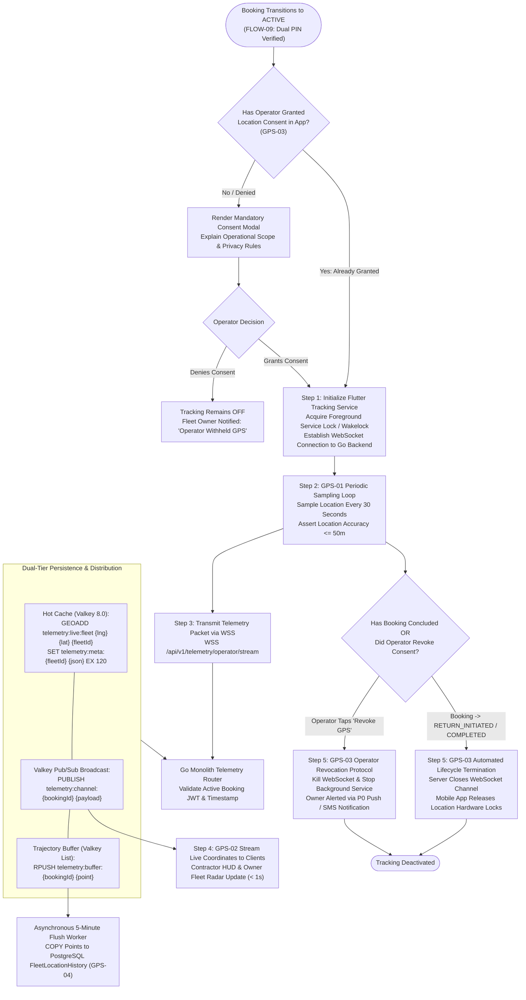
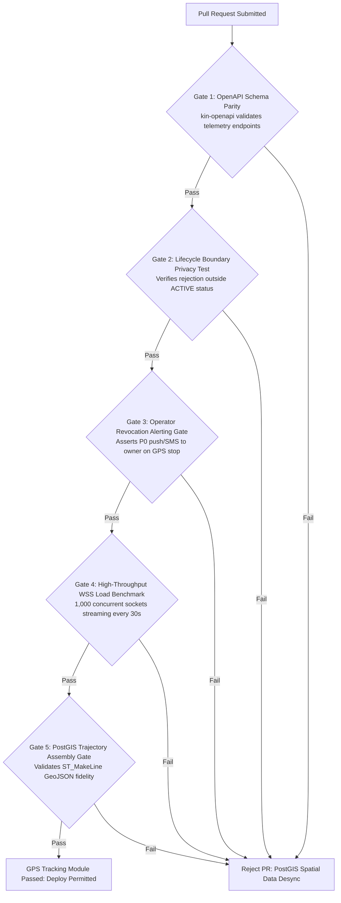

# Heavy Machinery & Logistics Rental Aggregator — Dink Machinery
## Software Requirements Specification — 05.12. Operator GPS Tracking, Real-Time Location Sharing & Privacy Architecture (`docs/shared/requirements/05-12-operator-gps-tracking.md`)

**Document Identifier:** `SRS-DINK-CORE-V7.0-SEC-05-12`  
**Classification:** Canonical System Requirements Specification & Architecture Baseline (Single Source of Truth)  
**Governing Standard:** IEEE Std 830-1998 / IEEE/ISO/IEC 29148:2018 (Systems and Software Engineering — Requirements Engineering)  
**Associated Artifacts:** `SRS-DINK-CORE-V7.0` (§5.12, §8, §9, §10), `FLOW-ACTIVE-RENTAL-DINK-CORE-V7.0` (Interaction Flow 09), `FLOW-BOOKING-STATE-MACHINE-DINK-CORE-V7.0`, `FLOW-INSURANCE-CLAIM-DINK-CORE-V7.0`, `ARCH-BACKEND-GO-DINK-CORE-V7.0`, `ARCH-FLUTTER-DINK-CORE-V7.0`, `ARCH-ADMIN-NEXT-DINK-CORE-V7.0`, `ARCH-SEC-DINK-CORE-V7.0`, `DS-DINK-CORE-V7.0`, `DS-PERSONAS-DINK-CORE-V7.0`, `contracts/openapi.yaml`, `ADR-001`, `ADR-002`, `ADR-005`, `ADR-008`, `ADR-010`  
**Target Runtimes:** Go 1.24 Backend Monolith, Flutter 3.44 / Dart 3.9 (Cross-Platform Mobile), Next.js 16 / React 19 (Web Admin & Corporate Portal), PostgreSQL 18.4 + PostGIS 3.4, Valkey 8.0, ClamAV Daemon (:3310), SeaweedFS S3, Isar NoSQL 3.1+  
**Target Personas:** Certified Field Operator (*Mulugeta Tadesse* / *Juma Omwamba*), Civil Engineering Contractor (*Dawit Haile-Mariam* / *Patrick Kariuki*), Equipment Fleet Owner (*W/ro Almaz Tesfaye* / *Kamau Ndegwa*), Compliance Officer & Arbitrator (*Yohannes Bekele*)  
**Target Operating Markets:** Ethiopia (`ET`) & Kenya (`KE`) — Dynamic Multi-Country Parameterization (`LOC-01-BE`)  
**Compliance Standards:** OWASP ASVS 4.0.3 Level 3 (Data Privacy, Cryptographic Storage & Session Boundaries), RFC 9457 (Problem Details), ISO 9241-110, W3C WCAG 2.2 Level AAA (Field Mobile) & Level AA (Admin Web), Ethiopian Communications Authority (ECA) Directives, Kenya Data Protection Act 2019 (Part IV — Processing of Location Data)  
**Status:** Approved Engineering Baseline

---

## Table of Contents

- 1. [Document Scope & Architectural Mandate](#1-document-scope--architectural-mandate)
  - 1.1 [Purpose & Functional Scope](#11-purpose--functional-scope)
  - 1.2 [Core Architectural Principles & Privacy Invariants](#12-core-architectural-principles--privacy-invariants)
- 2. [GPS Tracking State Machine & Lifecycle Topology](#2-gps-tracking-state-machine--lifecycle-topology)
  - 2.1 [End-to-End Tracking Lifecycle Flowchart](#21-end-to-end-tracking-lifecycle-flowchart)
  - 2.2 [State Sub-Machine Taxonomy & Operational Milestones](#22-state-sub-machine-taxonomy--operational-milestones)
  - 2.3 [Permitted Transitions Matrix](#23-permitted-transitions-matrix)
- 3. [Operator Location Ingestion & Telemetry Pipeline (`GPS-01`)](#3-operator-location-ingestion--telemetry-pipeline-gps-01)
  - 3.1 [Mobile Foreground & Background Telemetry Ingestion](#31-mobile-foreground--background-telemetry-ingestion)
  - 3.2 [30-Second Sampling Invariant & Battery-Aware Throttling](#32-30-second-sampling-invariant--battery-aware-throttling)
  - 3.3 [Real-Time WebSocket Ingestion Gateway & Valkey Hot Storage](#33-real-time-websocket-ingestion-gateway--valkey-hot-storage)
  - 3.4 [PostGIS Spatial Point Ingestion & Trajectory Buffering](#34-postgis-spatial-point-ingestion--trajectory-buffering)
- 4. [Real-Time Map Visibility & Multi-Party Map HUD (`GPS-02`)](#4-real-time-map-visibility--multi-party-map-hud-gps-02)
  - 4.1 [Contractor Real-Time Map HUD Viewport Specification](#41-contractor-real-time-map-hud-viewport-specification)
  - 4.2 [Owner Fleet Radar & Geofence Boundary Monitoring](#42-owner-fleet-radar--geofence-boundary-monitoring)
  - 4.3 [Admin Live Fleet Monitoring & Compliance Map Overlay](#43-admin-live-fleet-monitoring--compliance-map-overlay)
- 5. [Privacy Perimeter, Operator Consent & Revocation (`GPS-03`)](#5-privacy-perimeter-operator-consent--revocation-gps-03)
  - 5.1 [Strict Lifecycle Bound Tracking (`ACTIVE` to `COMPLETED`)](#51-strict-lifecycle-bound-tracking-active-to-completed)
  - 5.2 [Informed Consent Attestation & Operating Privacy Banners](#52-informed-consent-attestation--operating-privacy-banners)
  - 5.3 [Operator Voluntary Revocation Protocol & Instant Owner Alerting](#53-operator-voluntary-revocation-protocol--instant-owner-alerting)
  - 5.4 [Data Minimization & Sovereign Location Privacy Laws](#54-data-minimization--sovereign-location-privacy-laws)
- 6. [Historical Trajectory Storage & Dispute Forensics (`GPS-04`)](#6-historical-trajectory-storage--dispute-forensics-gps-04)
  - 6.1 [PostgreSQL PostGIS Relational Schema (`FleetLocationHistory`)](#61-postgresql-postgis-relational-schema-fleetlocationhistory)
  - 6.2 [Partitioning Strategy & Spatial Index Optimization (GiST)](#62-partitioning-strategy--spatial-index-optimization-gist)
  - 6.3 [Dispute Reconstruction & Site Boundary Geofence Auditing](#63-dispute-reconstruction--site-boundary-geofence-auditing)
  - 6.4 [Statutory Retention & Cryptographic Anonymization Schedules](#64-statutory-retention--cryptographic-anonymization-schedules)
- 7. [Wire Protocol Contracts & RFC 9457 Error Schemas](#7-wire-protocol-contracts--rfc-9457-error-schemas)
  - 7.1 [`WSS /api/v1/telemetry/operator/stream`](#71-wss-apiv1telemetryoperatorstream)
  - 7.2 [`GET /api/v1/bookings/{id}/tracking/live`](#72-get-apiv1bookingsidtrackinglive)
  - 7.3 [`POST /api/v1/bookings/{id}/tracking/consent`](#73-post-apiv1bookingsidtrackingconsent)
  - 7.4 [`POST /api/v1/bookings/{id}/tracking/revoke`](#74-post-apiv1bookingsidtrackingrevoke)
  - 7.5 [`GET /api/v1/bookings/{id}/tracking/history`](#75-get-apiv1bookingsidtrackinghistory)
  - 7.6 [RFC 9457 Universal Problem Details Payloads](#76-rfc-9457-universal-problem-details-payloads)
- 8. [Automated Testing Suite & Verification Gates](#8-automated-testing-suite--verification-gates)

---

## 1. Document Scope & Architectural Mandate

### 1.1 Purpose & Functional Scope

This specification establishes **Section 05.12 (Operator GPS Tracking, Real-Time Location Sharing & Privacy Architecture)** of the canonical Software Requirements Specification (SRS) for **Dink Machinery Version 7.0**.

In heavy civil engineering, infrastructure earthworks, and specialized freight transit across Ethiopia and Kenya, physical equipment location is directly tied to capital protection, operational safety, and contract fulfillment:
* Civil contractors renting multi-ton crawler excavators or wheel loaders must verify that equipment has arrived at the designated project job site (e.g., *Mojo-Meki Highway Expansion Site B*) and remains within agreed operational cut boundaries.
* Equipment fleet owners require continuous verification of asset safety to prevent unauthorized moonlighting, illegal sub-leasing, or border departures.
* Field operations are conducted by certified operators using personal or corporate mobile devices. Transmitting location pings from an operator's mobile device introduces sensitive personal privacy and legal compliance obligations under the **Kenya Data Protection Act 2019** and the **Ethiopian Communications Authority (ECA) Data Protection Directives**.

This document formally specifies:
1. The real-time mobile location telemetry pipeline streaming GPS coordinates every 30 seconds over persistent WebSockets to the Go backend monolith[cite: 1.2].
2. The high-performance spatial cache layer in Valkey 8.0 providing sub-millisecond real-time location reads to authorized renters and fleet owners[cite: 1.2].
3. The privacy framework restricting location sampling strictly to the temporal window between booking status `ACTIVE` and `COMPLETED`, backed by operator consent and unilateral revocation protocols[cite: 1.2].
4. The historical trajectory persistence engine in PostgreSQL 18.4 + PostGIS 3.4 (`FleetLocationHistory`) enabling spatial analytics, site geofencing verification, and dispute forensic reconstruction[cite: 1.2].

### 1.2 Core Architectural Principles & Privacy Invariants

1. **Strict Temporal Privacy Boundary Invariant (`GPS-03`):** Location tracking from the operator's mobile application is architecturally permitted **if and only if** the corresponding booking is in `ACTIVE` status[cite: 1.2]. The tracking pipeline cannot be activated prior to formal check-in handover (`AR-02`), and terminates immediately upon return check-out initiation (`RETURN_INITIATED` / `COMPLETED`)[cite: 1.2].
2. **Operator Sovereignty & Revocation Right (`GPS-03`):** The operator retains the continuous, unilateral legal right to revoke location tracking permissions from their mobile device at any time[cite: 1.2]. Revocation terminates the telemetry socket and immediately alerts the fleet owner via high-priority push and SMS channels[cite: 1.2].
3. **Data Minimization & Geofenced Ingress:** Telemetry packets capture only operational location data (Latitude, Longitude, Altitude, Speed, Heading, Accuracy, Timestamp, Battery Level). Ambient audio, camera feeds, and background network traffic sniffing are strictly prohibited.
4. **PostGIS Geodesic Spatial Integrity (WGS 84):** All coordinate pairs are validated against the EPSG:4326 spheroidal coordinate reference system (`geography(Point, 4326)`). Points registering excessive dilution of precision ($\text{accuracy} > 50\text{ meters}$) or impossible physical velocities ($> 140\text{ km/h}$ for plant machinery) are quarantined as erroneous GPS drift.
5. **Separation of Real-Time vs. Analytical Storage:** To prevent high-write telemetry ingestion from impacting primary transactional relational queries, hot coordinate streams are cached in Valkey geospatial indexes (`GEOADD`), and flushed to partitioned PostgreSQL relational storage in asynchronous 5-minute batched transactions.

---

## 2. GPS Tracking State Machine & Lifecycle Topology

### 2.1 End-to-End Tracking Lifecycle Flowchart



---

### 2.2 State Sub-Machine Taxonomy & Operational Milestones

The operational status of the GPS tracking engine is decoupled from, but bounded by, the primary booking lifecycle state machine:

| Tracking Status Key | Operational Meaning | System Perimeter & Automated Actions |
|---|---|---|
| **`UNINITIALIZED`** | Machine not yet active or operator unassigned. | GPS hardware completely dormant; socket closed. |
| **`CONSENT_PENDING`** | Booking transitioned to `ACTIVE`; awaiting operator opt-in. | Mobile app displays high-contrast permission prompt. |
| **`TRACKING_ACTIVE`** | Operator consented; location streaming every 30s[cite: 1.2]. | Foreground service active; live coordinates updating in Valkey[cite: 1.2]. |
| **`PAUSED_OFFLINE`** | Mobile device entered cellular dead-zone or quarry trench. | Points buffered in local Isar NoSQL; UI displays "Reconnecting". |
| **`REVOKED_OPERATOR`** | Operator explicitly disabled tracking via privacy toggle[cite: 1.2]. | Tracking halted; fleet owner sent immediate security alert[cite: 1.2]. |
| **`TERMINATED_COMPLETED`**| Rental ended (`RETURN_INITIATED` / `COMPLETED`)[cite: 1.2]. | Hardware release enforced; socket permanently closed by server[cite: 1.2]. |

---

### 2.3 Permitted Transitions Matrix

```text
+----------------------------------------------------------------------------------------------------+
| GPS TRACKING STATE TRANSITION MATRIX                                                               |
+------------------------------------+---------------------------------------------------------------+
| SOURCE STATE                       | PERMITTED TARGET STATES                                       |
+------------------------------------+---------------------------------------------------------------+
| UNINITIALIZED                      | CONSENT_PENDING                                               |
| CONSENT_PENDING                    | TRACKING_ACTIVE, REVOKED_OPERATOR                             |
| TRACKING_ACTIVE                    | PAUSED_OFFLINE, REVOKED_OPERATOR, TERMINATED_COMPLETED        |
| PAUSED_OFFLINE                     | TRACKING_ACTIVE, REVOKED_OPERATOR, TERMINATED_COMPLETED        |
| REVOKED_OPERATOR                   | CONSENT_PENDING, TERMINATED_COMPLETED                         |
| TERMINATED_COMPLETED               | [Terminal State — Cannot Transition Back]                     |
+------------------------------------+---------------------------------------------------------------+
```

---

## 3. Operator Location Ingestion & Telemetry Pipeline (`GPS-01`)

### 3.1 Mobile Foreground & Background Telemetry Ingestion

Operating heavy machinery requires the operator's mobile device to transmit continuous coordinates even when the phone is locked or running other diagnostic applications:
* **Android Implementation:** Runs as a native **Foreground Service** displaying a persistent, non-dismissible notification in the Android system drawer:
  ```text
  [ 📍 Dink Machinery Active Tracking ]
  Transmitting job-site telemetry for Caterpillar 320D (#BK-8812).
  Location sharing active per rental agreement.
  ```
* **iOS Implementation:** Leverages the iOS `CoreLocation` framework with `UIBackgroundModes` configured for `location`. Utilizes `showsBackgroundLocationIndicator = true` to maintain full statutory transparency.
* **Wakelock Management:** Employs energy-optimized partial wakelocks to ensure GPS chipsets remain responsive in cab vibration mounts without triggering extreme thermal runaway.

---

### 3.2 30-Second Sampling Invariant & Battery-Aware Throttling

To balance tracking resolution with field battery longevity:
* **Standard Operating Cadence:** Telemetry pings are collected and transmitted at an exact interval of **30 Seconds** ($\pm 2\text{ seconds}$)[cite: 1.2].
* **Distance Filter Optimization:** If the machine's speed registers $< 0.5\text{ km/h}$ for $> 5\text{ minutes}$ (machine parked or stationary idling), the mobile client dynamically drops sampling frequency to **60 seconds**, conserving battery reserves on remote sites without AC charging points.
* **Accuracy Threshold:** Points with horizontal dilution of precision $> 50\text{ meters}$ are discarded from mapping displays to prevent erratic trajectory jumping.

---

### 3.3 Real-Time WebSocket Ingestion Gateway & Valkey Hot Storage

Coordinate streams are ingested via dedicated, long-lived secure WebSockets (`WSS`):
1. **Connection Authentication:** Sockets authenticate upon handshake using short-lived ECDSA P-256 JWTs passed in headers or initial query tokens.
2. **Sub-Millisecond Valkey Ingestion:**
   Upon receiving a valid JSON telemetry frame, the Go ingestion worker executes an atomic pipeline:
   ```text
   GEOADD telemetry:live:fleets 38.7578 8.9806 "flt_019a8f2c-8812"
   SET telemetry:meta:flt_019a8f2c-8812 '{"bookingId":"bk_8812","speed":1.2,"heading":180,"battery":85,"updatedAt":1730113800}' EX 120
   PUBLISH telemetry:booking:bk_8812 '{"fleetId":"flt_019a8f2c-8812","lat":8.9806,"lng":38.7578,"speed":1.2}'
   ```
3. **Hot Cache Eviction Invariant:** If no telemetry is received for $120\text{ seconds}$ (4 missed cycles), the Valkey metadata key expires, automatically flagging the asset as `OFFLINE_STALLED` on consumer viewports.

---

### 3.4 PostGIS Spatial Point Ingestion & Trajectory Buffering

To prevent database connection pool exhaustion from high-frequency single-row inserts:
* Incoming coordinate points are appended to an in-memory queue or Valkey list (`telemetry:buffer:{bookingId}`).
* An asynchronous Go background flush routine runs every **5 minutes**, batch-inserting buffered points directly into `fleet_location_history` using PostgreSQL `COPY` syntax.
* Points are ingested as native PostGIS geography points:
  ```sql
  ST_SetSRID(ST_Point(longitude, latitude), 4326)::geography
  ```

---

## 4. Real-Time Map Visibility & Multi-Party Map HUD (`GPS-02`)

### 4.1 Contractor Real-Time Map HUD Viewport Specification

Contractor *Dawit Haile-Mariam* monitors active equipment through the embedded **Contractor Fleet Map** in the Flutter mobile application[cite: 1.2]:

```text
+--------------------------------------------------------------------------------------------------+
| CONTRACTOR REAL-TIME MAP VIEWPORT LAYOUT (GPS-02)                                                |
+--------------------------------------------------------------------------------------------------+
| +----------------------------------------------------------------------------------------------+ |
| | [ ← Back ]  Active Machinery Location Tracker                        Booking #BK-8812        |
| +----------------------------------------------------------------------------------------------+ |
| | +------------------------------------------------------------------------------------------+ | |
| | |                                                                                          | | |
| | |                     [ 📍 Current Fleet Position: Lat 8.5412, Lng 39.2718 ]               | | |
| | |                                 Caterpillar 320D (Speed: 2.1 km/h)                       | | |
| | |                                                                                          | | |
| | |        ------------------------- (Geofence Boundary: Mojo Site B)                        | | |
| | |                                                                                          | | |
| | +------------------------------------------------------------------------------------------+ | |
| +----------------------------------------------------------------------------------------------+ |
| | TELEMETRY STATUS BAR                                                                         |
| | Last Ping: 8 seconds ago [🟢 Live Stream]                   Accuracy: ± 4.2 meters          |
| | Current Location: Mojo-Meki Highway Expansion Site B (Within Contractual Cut Corridor)       |
| +----------------------------------------------------------------------------------------------+ |
| | OPERATOR CONTACT CARD                                                                        |
| | Operator on Duty: Mulugeta Tadesse                          📞 Call Operator                 |
| | GPS Status: Tracking Active (Consented)                     Battery: 84% ⚡                   |
| +----------------------------------------------------------------------------------------------+ |
```

* **Map Marker Styling:** Custom SVG vector icon representing the specific machine subcategory (e.g., crawler excavator, motor grader), rotating dynamically according to the reported compass heading ($0^{\circ}\text{ to }360^{\circ}$).
* **Smooth Position Interpolation:** The Flutter map viewport utilizes linear dead-reckoning interpolation to animate the marker smoothly between 30-second ping arrivals.

---

### 4.2 Owner Fleet Radar & Geofence Boundary Monitoring

Equipment Fleet Owner *W/ro Almaz Tesfaye* monitors her entire machinery inventory via the **Fleet Radar Viewport**[cite: 1.2]:
* **Multi-Asset Radar:** Displays real-time pins for all active rentals across Ethiopia and Kenya simultaneously.
* **Geofence Breach Alerts:** If a machine's GPS coordinates drift $> 5.0\text{ km}$ outside the contractual project site perimeter, the platform triggers an immediate P0 push notification:
  ```text
  ⚠️ GEOFENCE BREACH WARNING
  Caterpillar 320D (#ET-3-99120) has moved outside Mojo Highway Site B.
  Current Distance from Site: 6.8 km.
  Verify operational deployment with operator immediately.
  ```

---

### 4.3 Admin Live Fleet Monitoring & Compliance Map Overlay

Compliance officers in the Next.js Web Admin Console (`AD-06-WEB`) access a global operational map:
* Visualizes real-time machine concentrations along key national infrastructure corridors (e.g., Addis Ababa–Adama Expressway, LAPSSET corridor).
* Color-codes markers by operational state: Active Working (Green), Roadside Transit (Blue), Mechanical Breakdown Paused (Red), Offline Stalled (Gray).

---

## 5. Privacy Perimeter, Operator Consent & Revocation (`GPS-03`)

### 5.1 Strict Lifecycle Bound Tracking (`ACTIVE` to `COMPLETED`)

To ensure compliance with global data protection frameworks and prevent continuous tracking of operators during personal time[cite: 1.2]:
* **Tracking Window Activation:** The Go backend accepts and routes telemetry packets **only after** the booking transitions to `ACTIVE` via the dual challenge PIN sign-off (`AR-02`)[cite: 1.2].
* **Tracking Window Termination:** The moment the booking transitions to `RETURN_INITIATED`, `PENDING_FINAL_PAYMENT`, or `COMPLETED`, the Go server terminates the WebSocket connection with close code `1000 Normal Closure` and discards any subsequent pings[cite: 1.2].

---

### 5.2 Informed Consent Attestation & Operating Privacy Banners

Before initial telemetry activation, the Flutter app displays the **Operator Privacy Consent Contract**:
* **Explicit Disclosures:**
  1. Identifies who can see the location: Civil Contractor and Fleet Owner exclusively[cite: 1.2].
  2. States exact usage purposes: Site safety verification, shift hour verification, and theft prevention[cite: 1.2].
  3. Discloses retention period: Coordinates archived for 180 days for dispute resolution, then scrubbed[cite: 1.2].
* **Consent Recording:** The operator taps `[ I Agree & Enable Location Sharing ]`, recording `operator_id`, `booking_id`, `timestamp`, and `device_model` in `operator_tracking_consents`.

---

### 5.3 Operator Voluntary Revocation Protocol & Instant Owner Alerting

In compliance with statutory privacy laws, location sharing can never be forced involuntarily[cite: 1.2]:
1. Operator taps `[ 🛑 Stop Sharing Location ]` on the active shift HUD[cite: 1.2].
2. A high-contrast warning modal appears:
   ```text
   ⚠️ REVOKE LOCATION SHARING?
   Stopping location tracking notifies the equipment owner immediately and may constitute a breach of your site operating dispatch rules.
   Are you sure you want to stop tracking?
   ```
3. If confirmed:
   - Mobile app kills foreground service and releases GPS hardware locks.
   - Dispatches revocation event: `POST /api/v1/bookings/{id}/tracking/revoke`.
   - Fleet Owner receives an immediate high-priority P0 push alert and SMS[cite: 1.2]:
     *"CRITICAL: Operator Mulugeta Tadesse disabled GPS tracking for Cat 320D #BK-8812. Contact site office."*[cite: 1.2]
   - Contractor map HUD marks the fleet marker as `LOCATION_HIDDEN_BY_OPERATOR`.

---

### 5.4 Data Minimization & Sovereign Location Privacy Laws

In accordance with the **Kenya Data Protection Act 2019** (Part IV) and the **Ethiopian Communications Authority (ECA) Directives**:
* Location data is classified as sensitive personal data.
* Coordinates are never sold, monetized, or shared with third-party advertising networks.
* The system enforces role-based access control (RBAC): third-party contractors cannot query historical trajectories of machines they do not actively rent.

---

## 6. Historical Trajectory Storage & Dispute Forensics (`GPS-04`)

### 6.1 PostgreSQL PostGIS Relational Schema (`FleetLocationHistory`)

Historical location records are persisted in a normalized, PostGIS-enabled relational table[cite: 1.2]:

```sql
CREATE TABLE fleet_location_history (
    id UUID PRIMARY KEY DEFAULT gen_random_uuid(),
    booking_id UUID NOT NULL REFERENCES bookings(id) ON DELETE CASCADE,
    fleet_id UUID NOT NULL REFERENCES fleets(id) ON DELETE CASCADE,
    operator_id UUID NOT NULL REFERENCES users(id) ON DELETE RESTRICT,
    coordinate GEOGRAPHY(POINT, 4326) NOT NULL,
    altitude_meters NUMERIC(6, 2) NULL,
    speed_kmh NUMERIC(5, 2) NULL,
    heading_degrees NUMERIC(5, 2) NULL,
    accuracy_meters NUMERIC(5, 2) NOT NULL,
    battery_level_percent INT NULL,
    recorded_at TIMESTAMPTZ NOT NULL,
    created_at TIMESTAMPTZ NOT NULL DEFAULT NOW()
) PARTITION BY RANGE (recorded_at);
```

---

### 6.2 Partitioning Strategy & Spatial Index Optimization (GiST)

Because telemetry ingestion generates millions of records annually across commercial fleets:
* **Monthly Range Partitioning:** `fleet_location_history` is partitioned by calendar month:
  ```sql
  CREATE TABLE fleet_location_history_2026_11 
  PARTITION OF fleet_location_history 
  FOR VALUES FROM ('2026-11-01 00:00:00+00') TO ('2026-12-01 00:00:00+00');
  ```
* **Spatial & Temporal Composite Indexes:**
  ```sql
  CREATE INDEX idx_fleet_loc_hist_geom_gist 
  ON fleet_location_history USING gist (coordinate);

  CREATE INDEX idx_fleet_loc_hist_booking_time 
  ON fleet_location_history (booking_id, recorded_at ASC);
  ```

---

### 6.3 Dispute Reconstruction & Site Boundary Geofence Auditing

When a contractor contests billing or an owner alleges unauthorized equipment operation[cite: 1.2]:
* **Spatial Replay Engine:** Compliance officers in Next.js reconstruct the machinery's precise operating timeline using the `ST_MakeLine` PostGIS spatial aggregator[cite: 1.2]:
  ```sql
  SELECT ST_AsGeoJSON(ST_MakeLine(coordinate::geometry ORDER BY recorded_at ASC)) 
  FROM fleet_location_history 
  WHERE booking_id = $booking_id;
  ```
* **Operational Verification:** Validates whether the machine actually operated at the contracted bridge site or was moved to an unauthorized third-party quarry, providing conclusive evidence for dispute rulings (`FLOW-10 §3.4`)[cite: 1.2].

---

### 6.4 Statutory Retention & Cryptographic Anonymization Schedules

* **Active Retention:** Complete raw coordinate breadcrumbs are retained for **180 Days** post-rental completion to support statutory dispute arbitration and insurance audits[cite: 1.2].
* **Automated Data Purge:** A monthly cron worker executes automated data minimization:
  - Trajectory points older than 180 days are condensed into simplified daily centroid polygons (`ST_ConvexHull`).
  - Raw point records are purged from the database, decoupling operator identity from permanent geographic history.

---

## 7. Wire Protocol Contracts & RFC 9457 Error Schemas

### 7.1 `WSS /api/v1/telemetry/operator/stream`

Persistent bidirectional WebSocket endpoint for high-frequency location streaming from the operator's mobile application[cite: 1.2].

#### Handshake Headers
```http
GET /api/v1/telemetry/operator/stream HTTP/1.1
Host: api.dinkmachinery.com
Upgrade: websocket
Connection: Upgrade
Sec-WebSocket-Key: dGhlIHNhbXBsZSBub25jZQ==
Sec-WebSocket-Version: 13
Authorization: Bearer <operatorAccessToken>
X-App-Version: 7.0.0
```

#### Client Inbound Telemetry Frame (Every 30 Seconds)[cite: 1.2]
```json
{
  "bookingId": "bk_019a8f60-9912-7b9a",
  "fleetId": "flt_019a8f2c-8812-7b9a",
  "latitude": 8.541240,
  "longitude": 39.271810,
  "altitude": 1842.5,
  "speedKmh": 2.1,
  "heading": 184.5,
  "accuracyMeters": 4.2,
  "batteryPercent": 84,
  "isCharging": false,
  "clientTimestamp": "2026-11-06T11:24:30.000Z"
}
```

#### Server Acknowledgment Frame
```json
{
  "status": "ACK",
  "sequenceId": 4812,
  "serverTimestamp": "2026-11-06T11:24:30.120Z"
}
```

---

### 7.2 `GET /api/v1/bookings/{id}/tracking/live`

Retrieves current live position and recent breadcrumb trail for an active rental[cite: 1.2].

#### Request Headers
```http
GET /api/v1/bookings/bk_019a8f60-9912-7b9a/tracking/live HTTP/1.1
Host: api.dinkmachinery.com
Authorization: Bearer <renterOrOwnerAccessToken>
```

#### Response: `HTTP 200 OK`
```json
{
  "success": true,
  "data": {
    "bookingId": "bk_019a8f60-9912-7b9a",
    "fleetId": "flt_019a8f2c-8812-7b9a",
    "trackingStatus": "TRACKING_ACTIVE",
    "currentPosition": {
      "latitude": 8.541240,
      "longitude": 39.271810,
      "speedKmh": 2.1,
      "heading": 184.5,
      "accuracyMeters": 4.2,
      "lastPingTimestamp": "2026-11-06T11:24:30Z",
      "ageSeconds": 8
    },
    "siteBoundary": {
      "geofenceName": "Mojo-Meki Highway Expansion Site B",
      "radiusMeters": 5000,
      "isWithinGeofence": true
    },
    "operator": {
      "fullName": "Mulugeta Tadesse",
      "phoneNumber": "+251911200491"
    }
  },
  "timestamp": "2026-11-06T11:24:38Z"
}
```

---

### 7.3 `POST /api/v1/bookings/{id}/tracking/consent`

Submits operator cryptographic consent for location telemetry[cite: 1.2].

#### Request Payload
```json
{
  "consentGranted": true,
  "deviceInfo": {
    "model": "Tecno Camon 30 Premier",
    "osVersion": "Android 15",
    "appVersion": "7.0.0"
  }
}
```

#### Response: `HTTP 200 OK`
```json
{
  "success": true,
  "data": {
    "bookingId": "bk_019a8f60-9912-7b9a",
    "trackingAuthorized": true,
    "authorizedAt": "2026-11-05T08:05:00Z"
  },
  "timestamp": "2026-11-05T08:05:01Z"
}
```

---

### 7.4 `POST /api/v1/bookings/{id}/tracking/revoke`

Operator revokes location tracking consent during an active rental[cite: 1.2].

#### Request Payload
```json
{
  "revocationReason": "OPERATOR_DISCRETION",
  "notes": "Shift ended early for maintenance."
}
```

#### Response: `HTTP 200 OK`
```json
{
  "success": true,
  "data": {
    "bookingId": "bk_019a8f60-9912-7b9a",
    "trackingStatus": "REVOKED_OPERATOR",
    "ownerAlertDispatched": true,
    "revokedAt": "2026-11-06T15:30:00Z"
  },
  "timestamp": "2026-11-06T15:30:01Z"
}
```

---

### 7.5 `GET /api/v1/bookings/{id}/tracking/history`

Retrieves historical trajectory points for dispute arbitration and site auditing[cite: 1.2].

#### Request Headers
```http
GET /api/v1/bookings/bk_019a8f60-9912-7b9a/tracking/history?from=2026-11-05T00:00:00Z&to=2026-11-06T23:59:59Z HTTP/1.1
Host: api.dinkmachinery.com
Authorization: Bearer <adminOrOwnerAccessToken>
```

#### Response: `HTTP 200 OK`
```json
{
  "success": true,
  "data": {
    "bookingId": "bk_019a8f60-9912-7b9a",
    "pointsCount": 1842,
    "geojson": {
      "type": "LineString",
      "coordinates": [
        [39.271810, 8.541240, 1842.5],
        [39.271890, 8.541310, 1842.0],
        [39.272010, 8.541450, 1841.8]
      ]
    }
  },
  "timestamp": "2026-11-07T09:00:00Z"
}
```

---

### 7.6 RFC 9457 Universal Problem Details Payloads

#### Example: Telemetry Ingestion Outside Active Window (`HTTP 409 Conflict`)
```json
{
  "type": "[https://api.dinkmachinery.com/errors/tracking-lifecycle-violation](https://api.dinkmachinery.com/errors/tracking-lifecycle-violation)",
  "title": "GPS Ingestion Prohibited for Booking State",
  "status": 409,
  "detail": "Location telemetry rejected. Booking #BK-8812 is currently in status 'RETURN_INITIATED'. Tracking is restricted strictly to ACTIVE rentals.",
  "instance": "/api/v1/telemetry/operator/stream",
  "code": "ERR_TRACKING_LIFECYCLE_INVALID"
}
```

#### Example: Dilution of Precision Accuracy Rejection (`HTTP 422 Unprocessable Entity`)
```json
{
  "type": "[https://api.dinkmachinery.com/errors/inaccurate-gps-point](https://api.dinkmachinery.com/errors/inaccurate-gps-point)",
  "title": "GPS Coordinate Accuracy Insufficient",
  "status": 422,
  "detail": "Submitted location point has an accuracy variance of ±84.5 meters, exceeding the platform maximum allowable threshold of 50.0 meters.",
  "instance": "/api/v1/telemetry/operator/stream",
  "code": "ERR_GPS_ACCURACY_TOO_LOW",
  "invalidParams": [
    {
      "name": "accuracyMeters",
      "reason": "Must be less than or equal to 50.0"
    }
  ]
}
```

---

## 8. Automated Testing Suite & Verification Gates



1. **OpenAPI Schema Contract Gate (`kin-openapi`):** Validates all live tracking queries, consent submissions, revocation actions, and trajectory history endpoints against `contracts/openapi.yaml`.
2. **Lifecycle Privacy Boundary Assertion Test:** Simulates telemetry submissions across non-active booking states (`CONFIRMED`, `RETURN_INITIATED`, `COMPLETED`), verifying that the Go backend rejects $100\%$ of packets with HTTP 409 `ERR_TRACKING_LIFECYCLE_INVALID`.
3. **Operator Revocation Security Alerting Test:** Invokes the revocation endpoint and verifies that:
   - WebSocket streaming closes immediately.
   - Valkey metadata key is deleted.
   - An urgent P0 push notification and SMS dispatch task is queued for the equipment owner within $< 50\text{ ms}$.
4. **WebSocket High-Throughput Load Benchmark:** Simulates 1,000 concurrent operator connections transmitting coordinates every 30 seconds for 10 minutes. Asserts that server CPU usage remains $< 25\%$ and p99 ingestion latency into Valkey remains $< 2.0\text{ ms}$.
5. **PostGIS Trajectory LineString Assertion Gate:** Ingests 200 synthetic breadcrumbs, asserting that `ST_MakeLine` compiles a topologically valid GeoJSON geometry with zero coordinate degradation.

---

*This document establishes the canonical functional requirements, spatial ingestion pipelines, privacy lifecycle bounds, revocation protocols, and wire contracts for Operator GPS Tracking in Dink Machinery Version 7.0. All downstream Flutter mobile location services, Go backend WebSocket controllers, and Next.js admin consoles must strictly conform to this specification.*