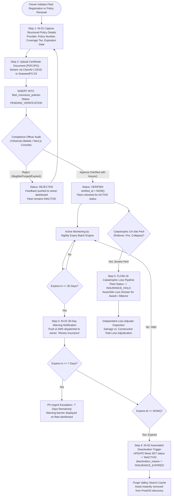
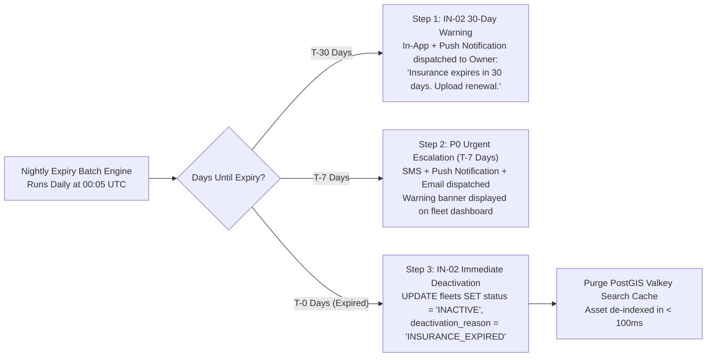
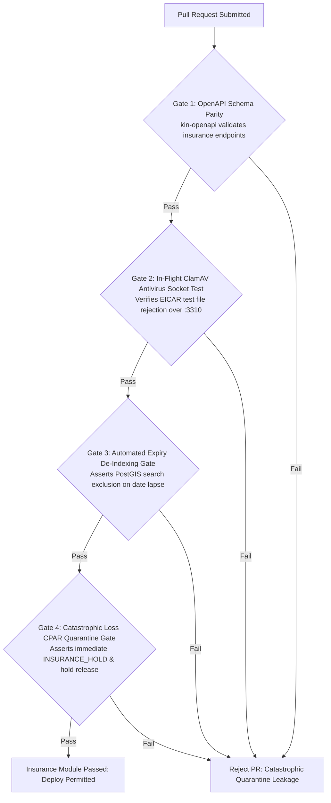

# Heavy Machinery & Logistics Rental Aggregator — Dink Machinery
## Software Requirements Specification — 05.13. Insurance Document Management, Policy Lifecycles & CPAR Claims Integration (`docs/shared/requirements/05-13-insurance-document-management.md`)

**Document Identifier:** `SRS-DINK-CORE-V7.0-SEC-05-13`  
**Classification:** Canonical System Requirements Specification & Architecture Baseline (Single Source of Truth)  
**Governing Standard:** IEEE Std 830-1998 / IEEE/ISO/IEC 29148:2018 (Systems and Software Engineering — Requirements Engineering)  
**Associated Artifacts:** `SRS-DINK-CORE-V7.0` (§5.13, §8, §10, §12), `FLOW-INSURANCE-CLAIM-DINK-CORE-V7.0` (Interaction Flow 19), `FLOW-FLEET-REG-DINK-CORE-V7.0`, `FLOW-DISCOVERY-DINK-CORE-V7.0`, `FLOW-BOOKING-STATE-MACHINE-DINK-CORE-V7.0`, `ARCH-BACKEND-GO-DINK-CORE-V7.0`, `ARCH-FLUTTER-DINK-CORE-V7.0`, `ARCH-ADMIN-NEXT-DINK-CORE-V7.0`, `ARCH-SEC-DINK-CORE-V7.0`, `DS-DINK-CORE-V7.0`, `DS-PERSONAS-DINK-CORE-V7.0`, `contracts/openapi.yaml`, `ADR-001`, `ADR-002`, `ADR-005`, `ADR-008`, `ADR-010`  
**Target Runtimes:** Go 1.27.3 Backend Monolith, Flutter 3.47.9 / Dart 3.9 (Cross-Platform Mobile), Next.js 16.x (latest CVE security patch) / React 19 (Web Admin & Corporate Portal), PostgreSQL 18.6 + PostGIS 3.6.4, Valkey 9.1.3, ClamAV Daemon (:3310), SeaweedFS S3, Isar NoSQL 3.1+  
**Target Personas:** Equipment Fleet Owner (*W/ro Almaz Tesfaye* / *Kamau Ndegwa*), Civil Engineering Contractor (*Dawit Haile-Mariam* / *Patrick Kariuki*), Compliance Officer & Insurance Auditor (*Yohannes Bekele*), Certified Loss Adjuster & Underwriter Desk (*Awash Insurance SC* / *Kenyan Alliance Insurance*)  
**Target Operating Markets:** Ethiopia (`ET`) & Kenya (`KE`) — Dynamic Multi-Country Parameterization (`LOC-01-BE`)  
**Compliance Standards:** OWASP ASVS 4.0.3 Level 3 (Cryptographic Document Ingestion, Anti-Tampering & Lifecycle Integrity), RFC 9457 (Problem Details), ISO 9241-110, W3C WCAG 2.2 Level AAA (Field Mobile) & Level AA (Admin Web), National Bank of Ethiopia (NBE) Insurance Directives, Insurance Regulatory Authority (IRA Kenya) Regulations  
**Status:** Approved Engineering Baseline

---

## Table of Contents

- 1. [Document Scope & Architectural Mandate](#1-document-scope--architectural-mandate)
  - 1.1 [Purpose & Functional Scope](#11-purpose--functional-scope)
  - 1.2 [Core Architectural Principles & Insurance Invariants](#12-core-architectural-principles--insurance-invariants)
- 2. [Insurance Policy State Machine & Document Lifecycle](#2-insurance-policy-state-machine--document-lifecycle)
  - 2.1 [End-to-End Policy Verification & Expiry Flowchart](#21-end-to-end-policy-verification--expiry-flowchart)
  - 2.2 [State Sub-Machine Taxonomy (`InsurancePolicyStatus`)](#22-state-sub-machine-taxonomy-insurancepolicystatus)
  - 2.3 [Permitted Policy Transitions Matrix](#23-permitted-policy-transitions-matrix)
- 3. [Structured Certificate Ingestion & Document Verification (`IN-01`)](#3-structured-certificate-ingestion--document-verification-in-01)
  - 3.1 [Policy Data Capture & Carrier Normalization](#31-policy-data-capture--carrier-normalization)
  - 3.2 [Coverage Tier Taxonomy (CPAR, Comprehensive, Third-Party)](#32-coverage-tier-taxonomy-cpar-comprehensive-third-party)
  - 3.3 [ClamAV Antivirus Socket & SeaweedFS Storage Pipeline](#33-clamav-antivirus-socket--seaweedfs-storage-pipeline)
  - 3.4 [Administrative Policy Audit Workbench (`AD-06-WEB`)](#34-administrative-policy-audit-workbench-ad-06-web)
- 4. [Automated Expiry Monitoring & Operational De-Indexing (`IN-02`)](#4-automated-expiry-monitoring--operational-de-indexing-in-02)
  - 4.1 [Nightly Expiry Batch Engine Architecture](#41-nightly-expiry-batch-engine-architecture)
  - 4.2 [30-Day and 7-Day Progressive Expiry Alert Escalation](#42-30-day-and-7-day-progressive-expiry-alert-escalation)
  - 4.3 [Automated Listing Deactivation (`INACTIVE: Insurance Expired`)](#43-automated-listing-deactivation-inactive-insurance-expired)
  - 4.4 [Valkey Spatial Cache Purge & PostGIS Exclusion Invariant](#44-valkey-spatial-cache-purge--postgis-exclusion-invariant)
- 5. [Contractor Transparency & Public Trust Shield (`IN-03`)](#5-contractor-transparency--public-trust-shield-in-03)
  - 5.1 [Fleet Detail Trust Shield Badge Layout](#51-fleet-detail-trust-shield-badge-layout)
  - 5.2 [Coverage Verification Modal & Policy Scope Disclosures](#52-coverage-verification-modal--policy-scope-disclosures)
  - 5.3 [Search Feed Trust Filtering & Underwriter Attestations](#53-search-feed-trust-filtering--underwriter-attestations)
- 6. [Catastrophic Loss Transition & CPAR Insurance Claim Protocol](#6-catastrophic-loss-transition--cpar-insurance-claim-protocol)
  - 6.1 [Trigger Criteria for Catastrophic Loss Claims (`FLOW-19`)](#61-trigger-criteria-for-catastrophic-loss-claims-flow-19)
  - 6.2 [Operational Freezing & Fleet `INSURANCE_HOLD` Quarantine](#62-operational-freezing--fleet-insurance_hold-quarantine)
  - 6.3 [Independent Loss Adjuster Dossier Assembly & Webhook Ingress](#63-independent-loss-adjuster-dossier-assembly--webhook-ingress)
- 7. [Wire Protocol Contracts & RFC 9457 Error Schemas](#7-wire-protocol-contracts--rfc-9457-error-schemas)
  - 7.1 [`POST /api/v1/fleets/{id}/insurance`](#71-post-apiv1fleetsidinsurance)
  - 7.2 [`GET /api/v1/fleets/{id}/insurance`](#72-get-apiv1fleetsidinsurance)
  - 7.3 [`POST /api/v1/admin/insurance/{policyId}/verify`](#73-post-apiv1admininsurancepolicyidverify)
  - 7.4 [`POST /api/v1/bookings/{id}/insurance-claim`](#74-post-apiv1bookingsidinsurance-claim)
  - 7.5 [RFC 9457 Universal Problem Details Payloads](#75-rfc-9457-universal-problem-details-payloads)
- 8. [Automated Testing Suite & Verification Gates](#8-automated-testing-suite--verification-gates)

---

## 1. Document Scope & Architectural Mandate

### 1.1 Purpose & Functional Scope

This specification establishes **Section 05.13 (Insurance Document Management, Policy Lifecycles & CPAR Claims Integration)** of the canonical Software Requirements Specification (SRS) for **Dink Machinery Version 7.0**.

In the East African construction and mining sectors, heavy earthmoving and logistics equipment represent massive capital investments ($100,000\text{ to }300,000\text{ USD}$ per machine). Operating high-tonnage plant machinery in harsh geological environments (quarry blasting, foundation excavation, river-bridge shoring) exposes assets to major perils:
* Structural rollover and chassis fracture.
* Total fire destruction from engine bay electrical short-circuits.
* Landslide buryings, flash flood submersion, and quarry wall collapses.
* Third-party civil liability, structural property impacts, and public bodily injury.

Operating machinery without active, verified commercial insurance coverage creates unacceptable financial insolvency risks for civil contractors and equipment fleet owners alike.

This document formally specifies:
1. The structured ingestion, ClamAV malware screening, and administrative verification of insurance policy documents during fleet onboarding and annual renewal (`IN-01`).
2. The automated batch monitoring engine tracking policy expiration, executing progressive owner reminders, and automatically de-indexing expired assets from PostGIS spatial search (`IN-02`).
3. The public insurance disclosure badge engine displaying verified policy numbers, underwriting carriers, and expiration boundaries directly on fleet detail viewports (`IN-03`).
4. The transition pipeline from active rental incidents to formal **Comprehensive Plant All-Risks (CPAR)** insurance dossiers for Independent Loss Adjuster inspection (`FLOW-19`).

### 1.2 Core Architectural Principles & Insurance Invariants

1. **Mandatory Valid Policy Invariant (`IN-01`, `IN-02`):** A machinery or logistics fleet asset cannot achieve or maintain status `ACTIVE` in PostGIS spatial search clusters without an active, verified insurance policy whose expiration date is strictly in the future:
   $$\text{fleets.status} = \text{'ACTIVE'} \implies \exists \text{policy} : (\text{policy.status} = \text{'VERIFIED'} \land \text{policy.expires\_at} > \text{NOW}())$$
2. **Automated Expiry De-Indexing Invariant (`IN-02`):** Exactly at $\text{expires\_at}$ midnight, an un-renewed fleet asset is automatically transitioned to `status = 'INACTIVE'` with `deactivation_reason = 'INSURANCE_EXPIRED'`. The asset is purged from Valkey search caches in $< 100\text{ ms}$.
3. **Structured Underwriting Metadata Capture:** Uploading raw document images without structured, queryable metadata is prohibited. The ingestion engine requires normalized fields: Underwriter Name, Policy Number, Coverage Type, Sum Insured, Deductible Excess, and Expiration Date.
4. **Catastrophic Loss Isolation Perimeter (`FLOW-19`):** When a machine suffers an on-site structural failure exceeding $75\%$ of asset value or involving bodily injury, the asset transitions immediately to `INSURANCE_HOLD`, blocking all future booking holds until a certified Loss Adjuster inspection clearance certificate is committed to the database.
5. **ClamAV-Shielded Document Storage:** Every insurance policy certificate (PDF, JPG, PNG) must pass in-flight virus and malware inspection over TCP socket `:3310` before persistence in SeaweedFS S3 storage.

---

## 2. Insurance Policy State Machine & Document Lifecycle

### 2.1 End-to-End Policy Verification & Expiry Flowchart



---

### 2.2 State Sub-Machine Taxonomy (`InsurancePolicyStatus`)

Every insurance policy record in PostgreSQL is governed by an immutable state enumeration:

| Status Key | Public Search Visibility | Can Fleet Be Rented? | Operational Description & Invariants |
|---|:---:|:---:|---|
| **`PENDING_VERIFICATION`** | ❌ No | ❌ No | Policy submitted by owner; queued in Next.js Compliance Console (`AD-06-WEB`). |
| **`VERIFIED`** | ✅ Yes | ✅ Yes | Policy cross-examined and approved by compliance; trust badge unlocked on mobile app. |
| **`EXPIRED`** | ❌ No | ❌ No | Expiration date reached; fleet automatically de-indexed from spatial discovery. |
| **`REJECTED`** | ❌ No | ❌ No | Policy certificate invalid, forged, illegible, or policy number not found in insurer records. |
| **`SUPERSEDED`** | ❌ No | ❌ No | Replaced by an approved, active renewal policy. Archived for legal compliance history. |
| **`CLAIM_PENDING`** | ❌ No | ❌ No | Active catastrophic loss investigation underway; asset quarantined under `INSURANCE_HOLD`. |

---

### 2.3 Permitted Policy Transitions Matrix

```text
+----------------------------------------------------------------------------------------------------+
| INSURANCE POLICY STATE TRANSITION MATRIX                                                           |
+------------------------------------+---------------------------------------------------------------+
| SOURCE STATE                       | PERMITTED TARGET STATES                                       |
+------------------------------------+---------------------------------------------------------------+
| PENDING_VERIFICATION               | VERIFIED, REJECTED                                            |
| VERIFIED                           | EXPIRED, SUPERSEDED, CLAIM_PENDING                            |
| EXPIRED                            | SUPERSEDED (When owner submits and verifies renewal)          |
| REJECTED                           | PENDING_VERIFICATION (When owner re-uploads corrected docket) |
| CLAIM_PENDING                      | VERIFIED (If repaired & re-certified), SUPERSEDED             |
| SUPERSEDED                         | [Terminal Historical State — No Outbound Transitions]         |
+------------------------------------+---------------------------------------------------------------+
```

---

## 3. Structured Certificate Ingestion & Document Verification (`IN-01`)

### 3.1 Policy Data Capture & Carrier Normalization

During initial fleet onboarding (`FLOW-05`) or dedicated policy renewal, the fleet owner inputs structured underwriting parameters:

```text
+--------------------------------------------------------------------------------------------------+
| STRUCTURED INSURANCE CAPTURE SPECIFICATION (IN-01)                                               |
+------------------------+-------------------+-----------------------------------------------------+
| FIELD PARAMETER        | DATA TYPE         | VALIDATION BOUNDS & TECHNICAL BEHAVIOR              |
+------------------------+-------------------+-----------------------------------------------------+
| Insurance Carrier Name | Enum / String     | Selected from accredited regional underwriters:     |
|                        |                   | Ethiopia: Awash Insurance, Nyala, Africa Insurance,  |
|                        |                   | NICE, Ethiopian Insurance Corporation (EIC).        |
|                        |                   | Kenya: Kenyan Alliance, Jubilee, APA, Britam.       |
+------------------------+-------------------+-----------------------------------------------------+
| Policy Number          | String (Max 64)   | Official policy/certificate string issued by insurer|
|                        |                   | (e.g., CPAR-ET-2026-994812). Regex validated.      |
+------------------------+-------------------+-----------------------------------------------------+
| Coverage Classification| Enum              | CPAR (Comprehensive Plant All-Risks),               |
|                        |                   | COMMERCIAL_COMPREHENSIVE, THIRD_PARTY_LIABILITY.    |
+------------------------+-------------------+-----------------------------------------------------+
| Sum Insured            | BigInt (Minor)    | Total insured asset valuation in minor currency     |
|                        |                   | (e.g., 25,000,000.00 ETB = 2,500,000,000 Cents).    |
+------------------------+-------------------+-----------------------------------------------------+
| Deductible / Excess    | BigInt (Minor)    | Contractual policy excess payable per incident      |
|                        |                   | (e.g., 50,000.00 ETB = 5,000,000 Cents).            |
+------------------------+-------------------+-----------------------------------------------------+
| Policy Effective Date  | ISO 8601 Date     | YYYY-MM-DD; must be <= CURRENT_DATE.                |
+------------------------+-------------------+-----------------------------------------------------+
| Policy Expiration Date | ISO 8601 Date     | YYYY-MM-DD; must be strictly > CURRENT_DATE.        |
+--------------------------------------------------------------------------------------------------+
```

---

### 3.2 Coverage Tier Taxonomy (CPAR, Comprehensive, Third-Party)

The platform categorizes machinery insurance into three standardized coverage profiles:
1. **Comprehensive Plant All-Risks (CPAR) [Tier 1 — Gold Standard]:**
   - Covers accidental physical damage, overturning, operational collision, boom collapse, landslide burying, engine fire, flood, and theft.
   - Includes third-party property damage and bodily injury arising from machine operations on site.
   - Mandatory for heavy excavators, mobile cranes, and bulldozers operating on tier-1 highway projects.
2. **Commercial Comprehensive Machinery [Tier 2 — Standard]:**
   - Covers accidental damage, vehicle collision, and transit damage on lowboy trailers. Excludes underground subsidence and explosive blasting risks.
3. **Third-Party Liability Only [Tier 3 — Minimum Statutory]:**
   - Covers bodily injury and property damage to third parties caused by machine operation. Zero physical damage protection for the machine itself.
   - Requires explicit renter risk acceptance disclosure during booking checkout (`FLOW-06`).

---

### 3.3 ClamAV Antivirus Socket & SeaweedFS Storage Pipeline

Certificate upload files (PDF documents, scanned JPG/PNG images) pass through an in-flight security boundary:

```text
Client Multipart Upload -> Traefik Ingress Gateway -> Go Monolith Stream Reader
                                                            |
                                               TCP Socket :3310 (zINSTREAM)
                                                            v
                                                  ClamAV Malware Daemon
                                                            |
                                        +-------------------+-------------------+
                                        | Clean (OK)                            | Infected (Virus)
                                        v                                       v
                             Strip Metadata / Re-Encode              Abort Transaction (HTTP 422)
                             Persist to SeaweedFS S3 Vault           Log Security Incident
                             s3://dink-insurance-vault/{fleet_id}/   Return ERR_FILE_MALWARE_DETECTED
```

* **Zero Local Spooling:** Uploaded bytes stream directly from the HTTP reader across TCP socket `:3310` to ClamAV, preventing un-scanned binaries from touching local application disks.
* **Storage Invariant:** Clean certificates are archived in an encrypted, non-public SeaweedFS S3 bucket (`s3://dink-insurance-vault/fleets/{id}/policy_{policyId}.pdf`) accessible only via short-lived pre-signed URLs.

---

### 3.4 Administrative Policy Audit Workbench (`AD-06-WEB`)

Every uploaded insurance certificate enters the **Insurance Compliance Approval Queue** in Next.js:
* **Compliance Workbench Viewport:** Compliance Officer *Yohannes Bekele* inspects the certificate PDF in the embedded document viewer.
* **Carrier Verification Checklist:**
  - Policyholder legal entity matches fleet owner legal name.
  - Machinery chassis PIN (VIN) and engine serial number match fleet registration records.
  - Policy expiration date is accurately recorded.
  - For tier-1 accounts, Yohannes verifies policy validity directly via underwriter corporate portals or phone verification desks.
* **Adjudication Decisions:**
  - **Approve:** Transitions policy to `VERIFIED`. If the fleet was awaiting insurance verification, fleet status transitions to `ACTIVE`.
  - **Reject:** Opens rejection modal requiring structured rejection reasons (`EXPIRED_DOCUMENT_UPLOADED`, `CHASSIS_VIN_MISMATCH`, `UNACCREDITED_UNDERWRITER`, `ILLEGIBLE_DOCUMENT_SCAN`). The owner receives an immediate push notification with remediation instructions.

---

## 4. Automated Expiry Monitoring & Operational De-Indexing (`IN-02`)

### 4.1 Nightly Expiry Batch Engine Architecture

The platform runs an automated, scheduled background cron job across all registered fleets:
* **Execution Cadence:** Every night at **`00:05:00 UTC`** (`03:05 EAT`).
* **Relational Query Scope:**
  ```sql
  SELECT f.id AS fleet_id, f.owner_id, f.make, f.model, p.id AS policy_id, p.policy_number, p.expires_at,
         (p.expires_at::date - CURRENT_DATE) AS days_until_expiry
  FROM fleets f
  JOIN fleet_insurance_policies p ON f.id = p.fleet_id
  WHERE p.status = 'VERIFIED'
    AND p.is_current = true
    AND p.expires_at::date <= (CURRENT_DATE + INTERVAL '30 days');
  ```

---

### 4.2 30-Day and 7-Day Progressive Expiry Alert Escalation

The monitoring engine enforces progressive multi-channel alerts:



* **T-30 Days Alert:** P2 In-App and Push notification. Renders an amber status chip on the owner's fleet card.
* **T-7 Days Alert:** P0 SMS and High-Priority Push alert:
  ```text
  URGENT: Insurance for Caterpillar 320D (#ET-3-99120) expires in 7 days (2026-11-15).
  Upload renewal certificate now to avoid automated de-listing from search.
  ```

---

### 4.3 Automated Listing Deactivation (`INACTIVE: Insurance Expired`)

When the cron job detects `p.expires_at::date < CURRENT_DATE`:
1. Policy record transitions from `VERIFIED` to `EXPIRED`.
2. Machine record transitions:
   ```sql
   UPDATE fleets 
   SET status = 'INACTIVE', 
       deactivation_reason = 'INSURANCE_EXPIRED',
       updated_at = NOW()
   WHERE id = $fleet_id AND status = 'ACTIVE';
   ```
3. An audit event is logged in `admin_audit_logs` (`ACTOR: SYSTEM_CRON`, `REASON: POLICY_EXPIRED`).
4. **Active Rental Exemption:** If the machine is currently deployed under an active in-flight booking contract (`status = 'RENTED'`), the rental continues to its scheduled conclusion, but the machine is blocked from receiving any new forward reservation holds until renewed.

---

### 4.4 Valkey Spatial Cache Purge & PostGIS Exclusion Invariant

* **Sub-100ms Cache Invalidation:** The deactivation trigger immediately flushes all spatial discovery cache keys in Valkey:
  ```text
  DEL discovery:search:*
  ```
* **PostGIS Query Invariant:** Spatial radius discovery queries enforce an active policy join condition:
  ```sql
  WHERE f.status = 'ACTIVE'
    AND EXISTS (
        SELECT 1 FROM fleet_insurance_policies ip
        WHERE ip.fleet_id = f.id
          AND ip.status = 'VERIFIED'
          AND ip.is_current = true
          AND ip.expires_at > NOW()
    )
  ```
  Uninsured machinery cannot appear in contractor search feeds under any query condition.

---

## 5. Contractor Transparency & Public Trust Shield (`IN-03`)

### 5.1 Fleet Detail Trust Shield Badge Layout

When civil contractors discover equipment on the platform, verified insurance credentials are displayed prominently on the **Fleet Detail Viewport** (`DS-DINK-CORE-V7.0`):

```text
+--------------------------------------------------------------------------------------------------+
| FLEET DETAIL INSURANCE TRUST SHIELD VIEWPORT LAYOUT (IN-03)                                      |
+--------------------------------------------------------------------------------------------------+
| +----------------------------------------------------------------------------------------------+ |
| | Caterpillar 320D Hydraulic Excavator (2024)                    Plate: ET-3-99120             |
| +----------------------------------------------------------------------------------------------+ |
| | [ 🛡️ VERIFIED INSURANCE TRUST SHIELD ]                                                       |
| | Coverage Type : Comprehensive Plant All-Risks (CPAR) [✓ Tier 1 Gold]                         |
| | Underwriter   : Awash Insurance Company S.C.                                                 |
| | Policy Number : CPAR-ET-2026-994812                                                          |
| | Validity      : Active (Valid until 30 June 2027 • 245 Days Remaining)                        |
| |                                                                                              |
| | [ 📄 View Coverage Summary & Deductibles ]                                                   |
| +----------------------------------------------------------------------------------------------+ |
```

* **Visual Trust Cue:** High-contrast emerald badge (`#10B981`) with official underwriter branding icon.
* **Zero Policy Document Exposure:** Raw policy documents and private corporate policyholder tax filings are **never** exposed to the public; only sanitized structured underwriting terms are presented.

---

### 5.2 Coverage Verification Modal & Policy Scope Disclosures

Tapping `[ View Coverage Summary & Deductibles ]` opens a secure bottom sheet modal detailing:
* Insured peril scope: Fire, Rollover, Submersion, Collision, Operational Damage.
* Standard incident deductible: (e.g., *"Contractor liable for first 50,000.00 ETB of repair costs per claim in accordance with platform rental agreement"*).
* Territorial limit: Within the recognized sovereign borders of Ethiopia or Kenya.

---

### 5.3 Search Feed Trust Filtering & Underwriter Attestations

Contractors can refine spatial search feeds via dedicated insurance filter toggles (`FLOW-06`):
* `[X] CPAR Comprehensive Insured Only`: Filters search results to display exclusively Tier-1 CPAR certified machinery.
* Search result feed cards display an inline micro-shield token: `[🛡️ CPAR Insured]`, enabling contractors to verify asset protection before tapping into the detailed dossier.

---

## 6. Catastrophic Loss Transition & CPAR Insurance Claim Protocol

### 6.1 Trigger Criteria for Catastrophic Loss Claims (`FLOW-19`)

If an on-site equipment disaster occurs, standard post-rental damage deposit triage (`FLOW-10`) is bypassed in favor of formal **CPAR Insurance Ingestion**:

```text
+--------------------------------------------------------------------------------------------------+
| CATASTROPHIC LOSS CLAIM ELIGIBILITY MATRIX                                                       |
+------------------------+-------------------------------------------------------------------------+
| PERIL CATEGORY         | QUALIFYING CRITERIA FOR CPAR ESCALATION                                 |
+------------------------+-------------------------------------------------------------------------+
| Structural Rollover    | Machine tipped down embankment, slope rollover, or boom collapse       |
| & Overturn             | causing chassis twisting or operator cabin crushing.                    |
+------------------------+-------------------------------------------------------------------------+
| Total Fire Destruction | Engine compartment thermal runaway, electrical fire, or fuel tank blaze |
|                        | resulting in constructive total loss.                                   |
+------------------------+-------------------------------------------------------------------------+
| Geological Inundation  | Quarry high-wall collapse, trench burial, landslide engulfment, or      |
|                        | river flash-flood submersion.                                           |
+------------------------+-------------------------------------------------------------------------+
| Severe Third-Party     | Machine collision with public structures, vehicles, or site incidents   |
| Liability Event        | involving worker bodily injury or fatality.                             |
+--------------------------------------------------------------------------------------------------+
```

---

### 6.2 Operational Freezing & Fleet `INSURANCE_HOLD` Quarantine

When a Catastrophic Loss incident is reported:
1. Status transitions:
   - `bookings.status = 'ACTIVE_BREAKDOWN_PAUSED'` $\longrightarrow$ Operational billing frozen immediately.
   - `fleets.status = 'INSURANCE_HOLD'` $\longrightarrow$ Machine quarantined and permanently de-indexed from PostGIS search.
2. All forward reservation holds on that fleet asset are automatically cancelled under Force Majeure (`FLOW-18`), and advance prepayments are returned in full to awaiting contractors.

---

### 6.3 Independent Loss Adjuster Dossier Assembly & Webhook Ingress

The platform compiles an encrypted **Comprehensive Insurance Loss Dossier**:
* Handover Baseline Photos (`AR-01`) showing pre-rental condition.
* Incident Photos and GPS Telemetry breadcrumbs proving exact site location at the time of the event (`GPS-01`).
* Cabin Hour Meter reading at time of stoppage.
* Police Incident Report document and operator formal statement.
* Certified Underwriting Policy Certificate (`IN-01`).
* **Underwriter Transmission:** Dossier is transmitted securely via authenticated REST webhook to the underwriting carrier's claims desk (e.g., *Awash Insurance Claims Portal*), assigning the case to an accredited Independent Loss Adjuster for physical site inspection.

---

## 7. Wire Protocol Contracts & RFC 9457 Error Schemas

### 7.1 `POST /api/v1/fleets/{id}/insurance`

Uploads and registers an insurance policy certificate for a fleet asset.

#### Request Headers
```http
POST /api/v1/fleets/flt_019a8f2c-8812-7b9a/insurance HTTP/1.1
Host: api.dinkmachinery.com
Content-Type: multipart/form-data
Authorization: Bearer <ownerAccessToken>
Idempotency-Key: 33182a01-4b12-4f9a-8812-7b9a4c10bc21
```

#### Multipart Form Body
* `carrierName`: String (`"Awash Insurance Company S.C."`)
* `policyNumber`: String (`"CPAR-ET-2026-994812"`)
* `coverageType`: String (`"CPAR"`)
* `sumInsuredMinor`: Integer (`2500000000`)
* `deductibleMinor`: Integer (`5000000`)
* `effectiveDate`: String (`"2026-07-01"`)
* `expirationDate`: String (`"2027-06-30"`)
* `certificateDocument`: Binary File (PDF/JPG/PNG, scanned in-flight via ClamAV socket `:3310`)

#### Response: `HTTP 201 Created`
```json
{
  "success": true,
  "data": {
    "policyId": "pol_019a8fc0-8812-7b9a",
    "fleetId": "flt_019a8f2c-8812-7b9a",
    "carrierName": "Awash Insurance Company S.C.",
    "policyNumber": "CPAR-ET-2026-994812",
    "coverageType": "CPAR",
    "expirationDate": "2027-06-30",
    "status": "PENDING_VERIFICATION",
    "submittedAt": "2026-10-28T14:30:00Z"
  },
  "timestamp": "2026-10-28T14:30:01Z"
}
```

---

### 7.2 `GET /api/v1/fleets/{id}/insurance`

Retrieves sanitized insurance disclosure data for fleet detail views.

#### Request Headers
```http
GET /api/v1/fleets/flt_019a8f2c-8812-7b9a/insurance HTTP/1.1
Host: api.dinkmachinery.com
Accept-Language: en
```

#### Response: `HTTP 200 OK`
```json
{
  "success": true,
  "data": {
    "fleetId": "flt_019a8f2c-8812-7b9a",
    "isInsured": true,
    "policy": {
      "carrierName": "Awash Insurance Company S.C.",
      "policyNumber": "CPAR-ET-2026-994812",
      "coverageType": "CPAR",
      "coverageDescription": "Comprehensive Plant All-Risks (Covers Collision, Overturn, Fire, Flood, and Third-Party Liability)",
      "expirationDate": "2027-06-30",
      "daysUntilExpiry": 245,
      "standardDeductibleMinor": 5000000,
      "currency": "ETB",
      "isVerified": true
    }
  },
  "timestamp": "2026-10-28T14:31:00Z"
}
```

---

### 7.3 `POST /api/v1/admin/insurance/{policyId}/verify`

Administrative endpoint for compliance officers to approve or reject insurance credentials.

#### Request Headers
```http
POST /api/v1/admin/insurance/pol_019a8fc0-8812-7b9a/verify HTTP/1.1
Host: api.dinkmachinery.com
Content-Type: application/json
Authorization: Bearer <complianceAdminAccessToken>
```

#### Request Payload
```json
{
  "decision": "APPROVE",
  "verificationSource": "AWASH_PORTAL_API_CONFIRMATION",
  "auditorNotes": "Cross-examined policy number against Awash corporate broker ledger; chassis VIN match confirmed."
}
```

#### Response: `HTTP 200 OK`
```json
{
  "success": true,
  "data": {
    "policyId": "pol_019a8fc0-8812-7b9a",
    "status": "VERIFIED",
    "fleetStatus": "ACTIVE",
    "verifiedBy": "usr_adm_yohannes_4412",
    "verifiedAt": "2026-10-28T14:35:00Z"
  },
  "timestamp": "2026-10-28T14:35:01Z"
}
```

---

### 7.4 `POST /api/v1/bookings/{id}/insurance-claim`

Initiates an emergency Catastrophic Loss claim and transitions fleet to `INSURANCE_HOLD`.

#### Request Payload
```json
{
  "perilCategory": "STRUCTURAL_ROLLOVER",
  "incidentDescription": "Machine overturned into embankment during heavy rain; boom sheared and cab crushed.",
  "incidentLocation": {
    "latitude": 8.5412,
    "longitude": 39.2718
  },
  "policeReportUri": "s3://dink-insurance-vault/incidents/bk_8812/police_report.pdf",
  "incidentPhotos": [
    "s3://dink-incident-media/bk_8812/rollover_01.webp",
    "s3://dink-incident-media/bk_8812/rollover_02.webp"
  ]
}
```

#### Response: `HTTP 201 Created`
```json
{
  "success": true,
  "data": {
    "claimDocketId": "clm_cpar_019a8fd0-1123",
    "bookingId": "bk_019a8f60-9912-7b9a",
    "fleetStatus": "INSURANCE_HOLD",
    "bookingStatus": "ACTIVE_BREAKDOWN_PAUSED",
    "dossierTransmittedToInsurer": true,
    "underwriterClaimTrackingNumber": "AWASH-CPAR-CLAIM-44910",
    "registeredAt": "2026-10-28T14:40:00Z"
  },
  "timestamp": "2026-10-28T14:40:01Z"
}
```

---

### 7.5 RFC 9457 Universal Problem Details Payloads

#### Example: Submitted Policy Certificate Already Expired (`HTTP 422 Unprocessable Entity`)
```json
{
  "type": "[https://api.dinkmachinery.com/errors/expired-insurance-policy](https://api.dinkmachinery.com/errors/expired-insurance-policy)",
  "title": "Invalid Policy Expiration Date",
  "status": 422,
  "detail": "The submitted policy expiration date (2026-08-31) is in the past. An active, forward-dated certificate is required to list equipment.",
  "instance": "/api/v1/fleets/flt_8812/insurance",
  "code": "ERR_INSURANCE_POLICY_EXPIRED",
  "invalidParams": [
    {
      "name": "expirationDate",
      "reason": "Must be strictly greater than CURRENT_DATE (2026-10-28)"
    }
  ]
}
```

#### Example: Antivirus Shield Ingestion Rejection (`HTTP 422 Unprocessable Entity`)
```json
{
  "type": "[https://api.dinkmachinery.com/errors/malware-detected](https://api.dinkmachinery.com/errors/malware-detected)",
  "title": "Malware Ingestion Shield Triggered",
  "status": 422,
  "detail": "Uploaded certificate document 'insurance_policy.pdf' failed ClamAV antivirus stream inspection. Binary stream rejected.",
  "instance": "/api/v1/fleets/flt_8812/insurance",
  "code": "ERR_FILE_MALWARE_DETECTED",
  "invalidParams": [
    {
      "name": "certificateDocument",
      "reason": "Infected with signature Trojan.PDF.Exploit-8812"
    }
  ]
}
```

---

## 8. Automated Testing Suite & Verification Gates



1. **OpenAPI Schema Contract Gate (`kin-openapi`):** Validates all insurance submission, retrieval, verification, and catastrophic loss claim contracts against `contracts/openapi.yaml`.
2. **In-Flight ClamAV Socket Integration Test:** Streams the standard `EICAR` antivirus test signature to `POST /api/v1/fleets/{id}/insurance` across TCP socket `:3310`. Asserts that the Go backend returns HTTP 422 `ERR_FILE_MALWARE_DETECTED` with zero file remnants committed to SeaweedFS S3.
3. **Automated Expiry Deactivation Benchmark:** Advances the staging database clock past a policy's `expires_at` date and invokes the nightly cron routine. Asserts that:
   - Machine status updates to `INACTIVE`.
   - `deactivation_reason` is set to `INSURANCE_EXPIRED`.
   - Valkey spatial caches are purged in $< 100\text{ ms}$.
   - Subsequent PostGIS spatial radius queries return zero occurrences of the expired machine.
4. **Catastrophic Loss Quarantine Test:** Ingests a simulated Catastrophic Loss claim, asserting that the fleet transitions to `INSURANCE_HOLD`, active booking billing pauses, and all forward reservation holds are refunded under Force Majeure.

---

*This document establishes the canonical functional requirements, document lifecycle states, automated expiry monitoring algorithms, public trust shield viewports, and wire protocol contracts for Insurance Document Management in Dink Machinery Version 7.0. All downstream Flutter mobile interfaces, Go backend domain services, and Next.js admin consoles must strictly conform to this specification.*