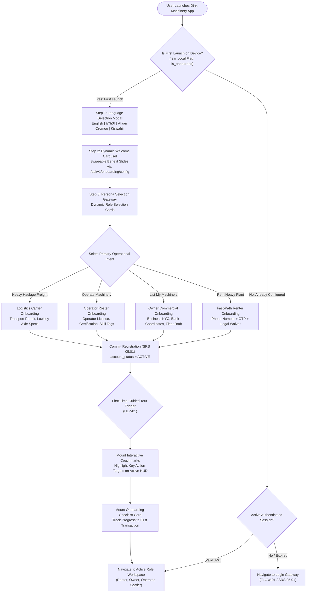
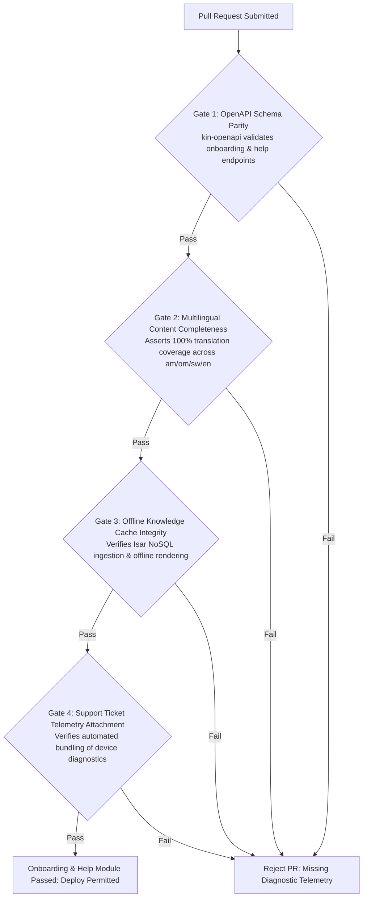

# Heavy Machinery & Logistics Rental Aggregator — Dink Machinery
## Software Requirements Specification — 05.14. User Onboarding, Dynamic Role Selection, In-App Guidance & Support Architecture (`docs/shared/requirements/05-14-user-onboarding-help.md`)

**Document Identifier:** `SRS-DINK-CORE-V7.0-SEC-05-14`  
**Classification:** Canonical System Requirements Specification & User Onboarding Baseline (Single Source of Truth)  
**Governing Standard:** IEEE Std 830-1998 / IEEE/ISO/IEC 29148:2018 (Systems and Software Engineering — Requirements Engineering)  
**Associated Artifacts:** `SRS-DINK-CORE-V7.0` (§5.1, §5.14, §8, §10, §12), `FLOW-ENTRY-DINK-CORE-V7.0` (Interaction Flow 01), `FLOW-NOTIF-OFFLINE-DINK-CORE-V7.0`, `FLOW-BOOKING-STATE-MACHINE-DINK-CORE-V7.0`, `ARCH-BACKEND-GO-DINK-CORE-V7.0`, `ARCH-FLUTTER-DINK-CORE-V7.0`, `ARCH-ADMIN-NEXT-DINK-CORE-V7.0`, `ARCH-SEC-DINK-CORE-V7.0`, `DS-DINK-CORE-V7.0`, `DS-PERSONAS-DINK-CORE-V7.0`, `contracts/openapi.yaml`, `ADR-001`, `ADR-002`, `ADR-005`, `ADR-008`, `ADR-010`  
**Target Runtimes:** Go 1.24 Backend Monolith, Flutter 3.44 / Dart 3.9 (Cross-Platform Mobile), Next.js 16 / React 19 (Web Admin & Corporate Portal), PostgreSQL 18.4 + PostGIS 3.4, Valkey 8.0, ClamAV Daemon (:3310), SeaweedFS S3, Isar NoSQL 3.1+  
**Target Personas:** Civil Engineering Contractor (*Dawit Haile-Mariam* / *Patrick Kariuki*), Equipment Fleet Owner (*W/ro Almaz Tesfaye* / *Kamau Ndegwa*), Certified Field Operator (*Mulugeta Tadesse* / *Juma Omwamba*), Lowboy Transporter (*Ato Girma Wolde* / *Samuel Odhiambo*), Support Agent & First-Level Help Desk (*Hiwot Alemu*)  
**Target Operating Markets:** Ethiopia (`ET`) & Kenya (`KE`) — Dynamic Multi-Country Parameterization (`LOC-01-BE`)  
**Compliance Standards:** OWASP ASVS 4.0.3 Level 3 (Authentication Integrity, Session Boundaries & Data Minimization), RFC 9457 (Problem Details), ISO 9241-110, W3C WCAG 2.2 Level AAA (Field Mobile) & Level AA (Admin Web), Ethiopian Communications Authority (ECA) Directives, Kenya Data Protection Act 2019  
**Status:** Approved Engineering Baseline

---

## Table of Contents

- 1. [Document Scope & Architectural Mandate](#1-document-scope--architectural-mandate)
  - 1.1 [Purpose & Functional Scope](#11-purpose--functional-scope)
  - 1.2 [Core Architectural Principles & UX Invariants](#12-core-architectural-principles--ux-invariants)
- 2. [User Onboarding & Persona Entry Topology](#2-user-onboarding--persona-entry-topology)
  - 2.1 [Onboarding & Dynamic Role Selection Flowchart](#21-onboarding--dynamic-role-selection-flowchart)
  - 2.2 [State Sub-Machine Taxonomy (`OnboardingState`)](#22-state-sub-machine-taxonomy-onboardingstate)
  - 2.3 [Permitted Onboarding Transitions Matrix](#23-permitted-onboarding-transitions-matrix)
- 3. [Dynamic Multi-Persona Registration Pathways (`ONB-01` to `ONB-04`)](#3-dynamic-multi-persona-registration-pathways-onb-01-to-onb-04)
  - 3.1 [First-Launch Splash & Language Selection (`ONB-01`)](#31-first-launch-splash--language-selection-onb-01)
  - 3.2 [Persona Gateway: Dynamic Role Cards (`ONB-02`)](#32-persona-gateway-dynamic-role-cards-onb-02)
  - 3.3 [Renter Contractor Fast-Path Registration (`REG-R01`)](#33-renter-contractor-fast-path-registration-reg-r01)
  - 3.4 [Equipment Fleet Owner Commercial Onboarding (`REG-O01`)](#34-equipment-fleet-owner-commercial-onboarding-reg-o01)
  - 3.5 [Certified Operator Skill & Roster Onboarding (`REG-OP01`)](#35-certified-operator-skill--roster-onboarding-reg-op01)
  - 3.6 [Lowboy Logistics Transporter Registration (`REG-L01`)](#36-lowboy-logistics-transporter-registration-reg-l01)
- 4. [Interactive Walkthroughs & Role-Specific Tooltips (`HLP-01`, `HLP-02`)](#4-interactive-walkthroughs--role-specific-tooltips-hlp-01-hlp-02)
  - 4.1 [Post-Registration Guided Product Tours](#41-post-registration-guided-product-tours)
  - 4.2 [Contextual Feature Coachmarks & Glove-Friendly Dismissal](#42-contextual-feature-coachmarks--glove-friendly-dismissal)
  - 4.3 [Dynamic Checklist Progress Engine (`OnboardingChecklist`)](#43-dynamic-checklist-progress-engine-onboardingchecklist)
- 5. [In-App Knowledge Base, FAQ & Video Walkthrough Engine (`HLP-03`)](#5-in-app-knowledge-base-faq--video-walkthrough-engine-hlp-03)
  - 5.1 [Dynamic Article & FAQ Schema Architecture](#51-dynamic-article--faq-schema-architecture)
  - 5.2 [Multilingual Content Parsing & Localized Media Streaming](#52-multilingual-content-parsing--localized-media-streaming)
  - 5.3 [Offline Knowledge Vault via Isar NoSQL (`ADR-010`)](#53-offline-knowledge-vault-via-isar-nosql-adr-010)
- 6. [Support Desk Integration & First-Level Triage (`HLP-04`)](#6-support-desk-integration--first-level-triage-hlp-04)
  - 6.1 [Direct Telephony Hotlines & WhatsApp Click-to-Chat](#61-direct-telephony-hotlines--whatsapp-click-to-chat)
  - 6.2 [In-App Support Ticket Logging & Contextual Telemetry Attachment](#62-in-app-support-ticket-logging--contextual-telemetry-attachment)
  - 6.3 [First-Level Admin Support Queue Integration (`AD-06-WEB`)](#63-first-level-admin-support-queue-integration-ad-06-web)
- 7. [Wire Protocol Contracts & RFC 9457 Error Schemas](#7-wire-protocol-contracts--rfc-9457-error-schemas)
  - 7.1 [`GET /api/v1/onboarding/config`](#71-get-apiv1onboardingconfig)
  - 7.2 [`POST /api/v1/onboarding/complete-step`](#72-post-apiv1onboardingcomplete-step)
  - 7.3 [`GET /api/v1/help/topics`](#73-get-apiv1helptopics)
  - 7.4 [`POST /api/v1/support/tickets`](#74-post-apiv1supporttickets)
  - 7.5 [RFC 9457 Universal Problem Details Payloads](#75-rfc-9457-universal-problem-details-payloads)
- 8. [Automated Testing Suite & Verification Gates](#8-automated-testing-suite--verification-gates)

---

## 1. Document Scope & Architectural Mandate

### 1.1 Purpose & Functional Scope

This specification establishes **Section 05.14 (User Onboarding, Dynamic Role Selection, In-App Guidance & Support Architecture)** of the canonical Software Requirements Specification (SRS) for **Dink Machinery Version 7.0**.

In the East African civil engineering and heavy logistics sectors, user demographics range widely in digital literacy, language proficiency, and operational requirements:
* Senior civil contractors managing multi-million-dollar infrastructure sites require rapid discovery, verifiable bank coordinates, and streamlined compliance verification without UI friction.
* Traditional depot yard managers and independent machinery fleet owners need clear, structured guidance to ingest machine specifications, configure tariffs, and verify bank payments.
* Heavy plant operators and lowboy truck drivers work in rugged field conditions with high solar glare ($> 85,000\text{ lux}$), requiring large touch targets ($56 \times 56\text{ dp}$), local language support (Amharic, Afaan Oromoo, Swahili, English), and offline knowledge access.

This document formally specifies:
1. The dynamic persona gateway routing new users into tailored onboarding journeys based on their commercial role.
2. The interactive walkthroughs, coachmarks, and task checklists that guide users through identity verification, fleet listing, and booking execution.
3. The multilingual in-app knowledge base and video repository delivering self-service help without continuous internet connectivity (`ADR-010`).
4. The first-level support desk architecture connecting users to tier-1 support agents via direct telephony, WhatsApp, and in-app diagnostic ticketing.

### 1.2 Core Architectural Principles & UX Invariants

1. **Progressive Disclosure Invariant (`ONB-02`):** Users are never presented with irrelevant forms or configurations outside their active operational scope. Renters see search and booking tools; fleet owners see catalog and wallet management; operators see inspection reticles and shift telemetry.
2. **Dynamic Server-Driven Onboarding Content:** All splash slides, role descriptions, knowledge base articles, FAQs, and support hotlines are stored in PostgreSQL and delivered via JSON endpoints. No copy, hotline numbers, or tutorial video URLs are hardcoded in Flutter or Next.js codebases.
3. **Equatorial High-Glare & Work-Glove Ergonometrics (`DS-DINK-CORE-V7.0`):** All onboarding controls, walkthrough tooltips, and support actions maintain high contrast ($\ge 7.0:1$) and minimum tap targets of $56 \times 56\text{ dp}$ to support field operation with heavy leather work gloves under direct sunlight.
4. **Frontier Offline Knowledge Caching (`ADR-010`):** Core operational guidance—including pre-rental reticle walkaround guides, emergency breakdown procedures, and wire transfer payment instructions—is pre-cached in local Isar NoSQL storage upon app installation for offline retrieval in remote quarries.
5. **Zero-Friction Role Switching:** Users possessing multiple capabilities (e.g., an equipment owner who also hires lowboy trailers, or an owner who operates their own backhoe) can switch operational viewports within a single authenticated account without logging out or maintaining multiple accounts.

---

## 2. User Onboarding & Persona Entry Topology

### 2.1 Onboarding & Dynamic Role Selection Flowchart



---

### 2.2 State Sub-Machine Taxonomy (`OnboardingState`)

Every user account maintains a trackable onboarding lifecycle state:

| Status Key | Operational Scope | Access Boundary & Unlocked Features |
|---|---|---|
| **`UNINITIALIZED`** | First app launch before language or role selection. | Public marketing splash slides and language toggles only. |
| **`ROLE_SELECTED`** | User chose operational persona; registration in flight. | Role-specific registration input forms. |
| **`OTP_VERIFIED`** | MSISDN ownership validated; basic account created. | Catalog search and public fleet viewports. |
| **`KYC_PENDING`** | Commercial credentials submitted; awaiting audit. | Read-only access to drafted listings and quotes. |
| **`PROFILE_COMPLETED`** | Profile complete; initial guided tour in progress. | Full operational capabilities for selected role. |
| **`ONBOARDING_DISMISSED`**| User completed or skipped all interactive walkthroughs. | Standard active dashboard; help center accessible on demand. |

---

### 2.3 Permitted Onboarding Transitions Matrix

```text
+----------------------------------------------------------------------------------------------------+
| ONBOARDING STATE TRANSITION MATRIX                                                                 |
+------------------------------------+---------------------------------------------------------------+
| SOURCE STATE                       | PERMITTED TARGET STATES                                       |
+------------------------------------+---------------------------------------------------------------+
| UNINITIALIZED                      | ROLE_SELECTED                                                 |
| ROLE_SELECTED                      | OTP_VERIFIED, UNINITIALIZED (Back navigation)                 |
| OTP_VERIFIED                       | KYC_PENDING (Owner/Carrier), PROFILE_COMPLETED (Renter)       |
| KYC_PENDING                        | PROFILE_COMPLETED (Upon KYC approval), KYC_PENDING (Re-edit)  |
| PROFILE_COMPLETED                  | ONBOARDING_DISMISSED                                          |
| ONBOARDING_DISMISSED               | PROFILE_COMPLETED (If user triggers 'Restart Tutorial')       |
+------------------------------------+---------------------------------------------------------------+
```

---

## 3. Dynamic Multi-Persona Registration Pathways (`ONB-01` to `ONB-04`)

### 3.1 First-Launch Splash & Language Selection (`ONB-01`)

On initial launch, the application loads a clean, accessible entry screen:
* **Immediate Sovereign Language Selection:** Before displaying text, the user can choose their preferred dialect:
  - `English` (Default international business baseline).
  - `አማርኛ` (Amharic — Official federal working language of Ethiopia).
  - `Afaan Oromoo` (Oromo — Widely spoken regional language across Ethiopian infrastructure corridors).
  - `Kiswahili` (Swahili — Primary regional lingua franca for Kenya operations).
* **Dynamic Welcome Carousel:** Fetches slides from `GET /api/v1/onboarding/config`:
  - Slide 1: *"Verified Heavy Machinery across Ethiopia & Kenya — Zero Broker Markups."*
  - Slide 2: *"Integrated Heavy Logistics — Lowboy Transport Paired to Equipment Hires."*
  - Slide 3: *"Deterministic Trust — Non-Custodial Bank Transfers & Verified Hour Meters."*
* **Bypass Option:** Experienced users can tap `[ Skip to Login ]` at any time.

---

### 3.2 Persona Gateway: Dynamic Role Cards (`ONB-02`)

Tapping `[ Get Started ]` displays the **Persona Selection Gateway**:

```text
+--------------------------------------------------------------------------------------------------+
| DYNAMIC ROLE SELECTION GATEWAY LAYOUT (ONB-02)                                                   |
+--------------------------------------------------------------------------------------------------+
| +----------------------------------------------------------------------------------------------+ |
| | Select how you want to use Dink Machinery:                                                   | |
| +----------------------------------------------------------------------------------------------+ |
| | [ 🏗️ RENT MACHINERY ]                                                    (Civil Contractor) | |
| | Source excavators, dozers, and cranes within 50km. Pre-screened operators, upfront pricing.    | |
| +----------------------------------------------------------------------------------------------+ |
| | [ 🚜 LIST MY FLEET ]                                                     (Equipment Owner)  | |
| | Maximize plant utilization. Guaranteed shift hour tracking, verified P2P bank payments.       | |
| +----------------------------------------------------------------------------------------------+ |
| | [ 👷 I OPERATE MACHINERY ]                                               (Certified Operator)| |
| | Build your digital operator profile. Join top fleet rosters, transparent daily shift logs.   | |
| +----------------------------------------------------------------------------------------------+ |
| | [ 🚛 SPECIALIZED LOGISTICS ]                                             (Lowboy Carrier)   | |
| | Provide heavy freight haulage. Guaranteed machinery transport runs, pass-through rates.      | |
| +----------------------------------------------------------------------------------------------+ |
```

---

### 3.3 Renter Contractor Fast-Path Registration (`REG-R01`)

For civil contractors, engineering project managers, and individual builders:
* **Minimal Input Perimeter:** Full Name, Sovereign E.164 Mobile Phone (`+251 9...` / `+254 7...`), Master Password.
* **Telephony Verification:** 6-digit cryptographic SMS OTP challenge (TTL: $300\text{ seconds}$, Max 3 attempts per SRS 05.01).
* **Legal Acceptance:** Mandatory single-tap checkbox: `[X] I agree to the Dink Machinery Rental Terms of Service and Liability Waiver`.
* **Instant Activation:** Account status transitions directly to `ACTIVE`. Contractor enters the PostGIS spatial search feed immediately.

---

### 3.4 Equipment Fleet Owner Commercial Onboarding (`REG-O01`)

For plant hire companies, depot yard managers, and individual machinery owners:
* **Identity & Corporate Capture:** Full Name, Phone Number, Company / Trading PLC Name, Tax Identification Number (TIN).
* **Commercial Settlement Coordinates:** Registered Bank Name (dropdown of CBE, Awash, Dashen, KCB, Equity), Account Holder Name, Bank Account Number / IBAN.
* **Document Dossier Upload:** Scanned Trade License and Insurance Certificate (scanned in-flight via ClamAV socket `:3310`).
* **First Fleet Asset Drafting:** Prompts owner to register their first machine immediately (`FLOW-05`), pre-populating yard coordinates using device GPS.
* **Compliance Queuing:** Account enters `kyc_status = 'PENDING'` for Compliance Officer audit within the 24-hour SLA.

---

### 3.5 Certified Operator Skill & Roster Onboarding (`REG-OP01`)

For certified plant machinery operators:
* **Personal & License Data:** Full Name, Mobile Phone Number, National ID / Kebele Number.
* **Heavy Plant Certifications:** Multi-image upload of vocational qualification certificates, driver's license endorsements (Class IV / Grade A).
* **Standardized Skill Tagging:** Multi-select checkboxes matching platform categories:
  `[X] Crawler Excavator  [X] Motor Grader  [X] Wheel Loader  [ ] Rough-Terrain Crane`
* **Instant Pool Placement:** Operator profile activates immediately, allowing equipment owners to discover and invite the operator to their yard roster via phone number search (`FLOW-04`).

---

### 3.6 Lowboy Logistics Transporter Registration (`REG-L01`)

For heavy haulage fleet operators and prime mover owners:
* **Transport Permitting:** Scanned Commercial Freight Carrier Permit and National Transport Safety Authority (NTSA) / Federal Transport Authority credentials.
* **Trailer Asset Drafting:** Ingests prime mover details, lowboy deck well length, deck width, tare weight, and maximum certified payload capacity in kilograms (`FLOW-05`).
* **Pass-Through Commission Acceptance:** Owner signs agreement binding freight runs to the platform's discounted $2.5\%$ administrative pass-through rate (SRS 05.08).

---

## 4. Interactive Walkthroughs & Role-Specific Tooltips (`HLP-01`, `HLP-02`)

### 4.1 Post-Registration Guided Product Tours

Upon initial authentication, the application initializes a persona-specific guided tour (`HLP-01`):

```text
+--------------------------------------------------------------------------------------------------+
| GUIDED PRODUCT TOUR MATRIX BY PERSONA                                                            |
+----------------------+--------------------+------------------------------------------------------+
| PERSONA ROLE         | TOUR IDENTIFIER    | KEY HIGHLIGHTED WORKFLOW MILESTONES                  |
+----------------------+--------------------+------------------------------------------------------+
| Civil Contractor     | tour_renter_core   | 1. How to filter by 50km radius and machine weight.  |
|                      |                    | 2. Understanding the 50% advance wire hold.          |
|                      |                    | 3. Handover challenge PIN entry on site.             |
+----------------------+--------------------+------------------------------------------------------+
| Equipment Owner      | tour_owner_core    | 1. How to add and price machinery listings.          |
|                      |                    | 2. Verifying bank wire slips within 24 hours.        |
|                      |                    | 3. Tracking commission debt in the virtual wallet.   |
+----------------------+--------------------+------------------------------------------------------+
| Certified Operator   | tour_operator_core | 1. Using the camera reticle for meter close-ups.     |
|                      |                    | 2. Monitoring the 8.0 hr/day shift pacing HUD.       |
|                      |                    | 3. Instant reporting of on-site mechanical faults.   |
+----------------------+--------------------+------------------------------------------------------+
```

---

### 4.2 Contextual Feature Coachmarks & Glove-Friendly Dismissal

* **Non-Modal Coachmarks:** Features requiring explanation use animated spotlight coachmarks pointing to UI targets with a high-contrast explanation bubble.
* **Glove-Friendly Interaction:** Dismissing coachmarks or advancing tutorial steps uses a large, prominent button:
  `[ Got It / Next (56x56 dp) ]`. Swiping anywhere on the screen also advances the tour.
* **Non-Intrusive Invariant:** Completed coachmarks write an entry to local Isar NoSQL (`dismissed_coachmarks`). Tours are never repeated unless explicitly re-triggered from the Help Center.

---

### 4.3 Dynamic Checklist Progress Engine (`OnboardingChecklist`)

To gamify and guide complex setups (e.g., Fleet Owner setup), the home screen displays a collapsible **Onboarding Checklist Card**:

```text
+--------------------------------------------------------------------------------------------------+
| ONBOARDING CHECKLIST COMPONENT LAYOUT                                                            |
+--------------------------------------------------------------------------------------------------+
| +----------------------------------------------------------------------------------------------+ |
| | [ 📋 GETTING STARTED: 3 OF 4 COMPLETED (75%) ]                                               | |
| | [ Progress Bar: =====================================--------- ]                             | |
| +----------------------------------------------------------------------------------------------+ |
| | [✓] Verify Phone Number (Completed)                                                          | |
| | [✓] Submit Commercial Trade License (Verified)                                               | |
| | [✓] Register Primary Bank Account Coordinates (Verified)                                     | |
| | [ ] List Your First Heavy Plant Asset                                  [ Complete Now → ]    | |
| +----------------------------------------------------------------------------------------------+ |
```

---

## 5. In-App Knowledge Base, FAQ & Video Walkthrough Engine (`HLP-03`)

### 5.1 Dynamic Article & FAQ Schema Architecture

The knowledge repository is modeled in PostgreSQL and serialized via REST endpoints:

```mermaid
erDiagram
    HelpCategory ||--o{ HelpArticle : "contains"
    HelpArticle ||--o{ HelpArticleTranslation : "localizes"
    HelpArticle ||--o{ HelpFeedback : "evaluates"

    HelpCategory {
        uuid id PK
        string category_key -- 'BOOKINGS', 'PAYMENTS', 'INSPECTIONS', 'LOGISTICS'
        string icon_name
        int display_order
    }

    HelpArticle {
        uuid id PK
        uuid category_id FK
        string target_role -- 'ALL', 'RENTER', 'OWNER', 'OPERATOR'
        string video_storage_uri
        boolean is_featured
        int view_count
    }

    HelpArticleTranslation {
        uuid id PK
        uuid article_id FK
        string language_code -- 'en', 'am', 'om', 'sw'
        string title
        text content_markdown
        jsonb faq_pairs_json
    }

    HelpFeedback {
        uuid id PK
        uuid article_id FK
        uuid user_id FK
        boolean was_helpful
        text feedback_text
        timestamptz created_at
    }
```

---

### 5.2 Multilingual Content Parsing & Localized Media Streaming

* **Markdown Rendering:** Knowledge base articles are authored in standard Markdown and compiled into native Flutter rich text viewports supporting localized headings, bold highlights, and warning callouts.
* **Short Video Guides:** Articles feature embedded high-efficiency WebM / H.265 walkthrough videos ($30\text{ to }60\text{ seconds}$) demonstrating critical field procedures (e.g., *"How to capture a clear hour meter photo"*, *"How to enter the 6-digit handover PIN"*).
* **Audio Voiceovers:** In emerging markets with varying literacy levels, articles feature an audio playback action: `[ 🔊 Listen in Amharic / Afaan Oromoo ]`, streaming compressed AAC audio recordings.

---

### 5.3 Offline Knowledge Vault via Isar NoSQL (`ADR-010`)

When machinery operates in deep riverbeds or remote highway camps without cellular signal:
* All published `HelpArticleTranslation` text and step-by-step handover illustrations are synchronized to the client's local Isar NoSQL database upon installation and subsequent online syncs.
* Tapping `[ Help & Guides ]` while offline renders the complete operational library without network latency.

---

## 6. Support Desk Integration & First-Level Triage (`HLP-04`)

### 6.1 Direct Telephony Hotlines & WhatsApp Click-to-Chat

When on-site equipment issues require immediate human intervention:

```text
+--------------------------------------------------------------------------------------------------+
| EMERGENCY SUPPORT DISPATCH MODES (HLP-04)                                                        |
+------------------------+-------------------+-----------------------------------------------------+
| SUPPORT CHANNEL        | TARGET RECIPIENT  | OPERATIONAL BOUNDS & AVAILABILITY                   |
+------------------------+-------------------+-----------------------------------------------------+
| Dedicated Voice Hotline| Dink Help Desk    | Toll-free national shortcode (e.g., 8190 in ET).    |
| (Interactive Voice)    | Tier-1 Support    | Available 06:00 to 22:00 EAT. 1-tap dial action.    |
+------------------------+-------------------+-----------------------------------------------------+
| WhatsApp Interactive   | Official Verified | Direct deep-link: [https://wa.me/251911442910?text=](https://wa.me/251911442910?text=)  |
| Click-to-Chat          | Business Channel  | Pre-populates Booking ID and machine plate number.  |
+------------------------+-------------------+-----------------------------------------------------+
| In-App Diagnostic      | Compliance & Tech | Asynchronous structured support ticket queue.       |
| Ticket Logging         | Support Desk      | Attached diagnostic logs, battery, and GPS breadcrumb|
+------------------------+-------------------+-----------------------------------------------------+
```

---

### 6.2 In-App Support Ticket Logging & Contextual Telemetry Attachment

When submitting a ticket via `POST /api/v1/support/tickets`:
* **User Input:** Category dropdown (`PAYMENT_DISPUTE`, `APP_CRASH`, `UNRESPONSIVE_COUNTERPARTY`, `SAFETY_HAZARD`), Subject text, Description narrative, optional photo attachments.
* **Automated Telemetry Payload:** The mobile client automatically bundles operational diagnostic metadata:
  ```json
  {
    "deviceModel": "Tecno Camon 30 Premier",
    "osVersion": "Android 15",
    "appVersion": "7.0.0",
    "networkState": "HSPA_PLUS_4G",
    "batteryLevelPercent": 82,
    "activeBookingId": "bk_019a8f60-9912-7b9a",
    "lastKnownCoordinates": {"lat": 8.5412, "lng": 39.2718}
  }
  ```

---

### 6.3 First-Level Admin Support Queue Integration (`AD-06-WEB`)

Submitted tickets route directly to the **First-Level Support Queue** in Next.js:
* **Tier-1 Help Desk Workbench:** Support Agent *Hiwot Alemu* reviews the ticket, inspects attached booking parameters, and views the user's active screen state.
* **Escalation Hierarchy:**
  - Standard operational questions are resolved directly by Tier-1 agents.
  - Wire payment disputes escalate to Compliance Officer *Yohannes Bekele* (`Tier 2`).
  - Severe SDK or cryptographic authentication anomalies escalate to the Engineering Technical Lead (`Tier 3`).

---

## 7. Wire Protocol Contracts & RFC 9457 Error Schemas

### 7.1 `GET /api/v1/onboarding/config`

Retrieves dynamic onboarding slides, role definitions, and localized system configuration.

#### Request Headers
```http
GET /api/v1/onboarding/config HTTP/1.1
Host: api.dinkmachinery.com
Accept-Language: am
X-Country-Code: ET
```

#### Response: `HTTP 200 OK`
```json
{
  "success": true,
  "data": {
    "supportedLanguages": [
      {"code": "en", "label": "English"},
      {"code": "am", "label": "አማርኛ"},
      {"code": "om", "label": "Afaan Oromoo"},
      {"code": "sw", "label": "Kiswahili"}
    ],
    "welcomeSlides": [
      {
        "slideId": "slide_01",
        "title": "የከባድ ማሽነሪዎች ዲጂታል የገበያ ቦታ",
        "description": "ኤክስካቫተሮች፣ ዶዘሮች እና ሎውቦይ ተሽከርካሪዎችን ያለ ደላላ በቀጥታ ይከራዩ።",
        "imageUri": "s3://dink-static/onboarding/slide_excavator.webp"
      }
    ],
    "personaRoles": [
      {
        "roleKey": "RENTER",
        "title": "ማሽነሪ መከራየት እፈልጋለሁ",
        "subtitle": "የግንባታ ተቋራጭ ወይም የግል ፕሮጀክት መሪ",
        "icon": "hard-hat"
      },
      {
        "roleKey": "EQUIPMENT_OWNER",
        "title": "የማሽነሪ ባለቤት ነኝ",
        "subtitle": "የግል ወይም የድርጅት ከባድ ማሽነሪዎችን ማከራየት",
        "icon": "truck"
      }
    ]
  },
  "timestamp": "2026-10-28T14:45:00Z"
}
```

---

### 7.2 `POST /api/v1/onboarding/complete-step`

Updates user onboarding checklist and guided tour progress.

#### Request Headers
```http
POST /api/v1/onboarding/complete-step HTTP/1.1
Host: api.dinkmachinery.com
Content-Type: application/json
Authorization: Bearer <userAccessToken>
```

#### Request Payload
```json
{
  "completedStepKey": "TOUR_RENTER_CORE_DISMISSED",
  "deviceTimestamp": "2026-10-28T14:46:00Z"
}
```

#### Response: `HTTP 200 OK`
```json
{
  "success": true,
  "data": {
    "userId": "usr_018f6a9e-876b-7341",
    "onboardingStatus": "PROFILE_COMPLETED",
    "remainingChecklistItems": 0,
    "onboardingFullyCompleted": true
  },
  "timestamp": "2026-10-28T14:46:01Z"
}
```

---

### 7.3 `GET /api/v1/help/topics`

Retrieves localized knowledge base categories, articles, and frequently asked questions.

#### Request Headers
```http
GET /api/v1/help/topics?category=INSPECTIONS HTTP/1.1
Host: api.dinkmachinery.com
Accept-Language: am
Authorization: Bearer <userAccessToken>
```

#### Response: `HTTP 200 OK`
```json
{
  "success": true,
  "data": {
    "category": "INSPECTIONS",
    "title": "የማሽነሪ ርክክብ እና የሰዓት ቆጣሪ አጠቃቀም",
    "articles": [
      {
        "articleId": "art_meter_inspection_01",
        "title": "የማሽነሪ የሰዓት ቆጣሪ (Hour Meter) ፎቶ እንዴት ይነሳል?",
        "summary": "ግልጽ እና ተቀባይነት ያለው የሰዓት ቆጣሪ ፎቶ ለማንሳት መከተል ያለብዎት መመሪያዎች።",
        "videoUri": "s3://dink-static/help/videos/hour_meter_guide.mp4",
        "audioUri": "s3://dink-static/help/audio/hour_meter_amharic.aac",
        "readTimeMinutes": 2
      }
    ]
  },
  "timestamp": "2026-10-28T14:47:00Z"
}
```

---

### 7.4 `POST /api/v1/support/tickets`

Submits an in-app diagnostic support ticket.

#### Request Headers
```http
POST /api/v1/support/tickets HTTP/1.1
Host: api.dinkmachinery.com
Content-Type: application/json
Authorization: Bearer <userAccessToken>
Idempotency-Key: 99182a01-4b12-4f9a-8812-7b9a4c10bc21
```

#### Request Payload
```json
{
  "category": "PAYMENT_DISPUTE",
  "subject": "Payment slip declined by owner Almaz Tesfaye",
  "description": "Transferred 106,750 ETB via CBE mobile banking. Transaction ID CBE-FT-99482103. Owner declined stating funds not seen.",
  "bookingId": "bk_019a8f60-9912-7b9a",
  "deviceTelemetry": {
    "deviceModel": "Samsung Galaxy S24 Ultra",
    "osVersion": "Android 16",
    "appVersion": "7.0.0",
    "network": "4G_LTE"
  }
}
```

#### Response: `HTTP 201 Created`
```json
{
  "success": true,
  "data": {
    "ticketId": "tkt_019a8fe0-8812",
    "status": "OPEN",
    "priority": "HIGH",
    "assignedTier": "TIER_1_SUPPORT",
    "targetResponseHours": 2,
    "createdAt": "2026-10-28T14:48:00Z"
  },
  "timestamp": "2026-10-28T14:48:01Z"
}
```

---

### 7.5 RFC 9457 Universal Problem Details Payloads

#### Example: Invalid Onboarding Step Transition (`HTTP 422 Unprocessable Entity`)
```json
{
  "type": "[https://api.dinkmachinery.com/errors/invalid-onboarding-step](https://api.dinkmachinery.com/errors/invalid-onboarding-step)",
  "title": "Onboarding Step Sequence Invalid",
  "status": 422,
  "detail": "Cannot complete step 'FLEET_REGISTRATION' before primary identity verification ('OTP_VERIFIED') is finalized.",
  "instance": "/api/v1/onboarding/complete-step",
  "code": "ERR_ONBOARDING_SEQUENCE_VIOLATION",
  "invalidParams": [
    {
      "name": "completedStepKey",
      "reason": "Prerequisite step 'OTP_VERIFICATION' is incomplete."
    }
  ]
}
```

#### Example: Support Hotline Service Unavailable (`HTTP 503 Service Unavailable`)
```json
{
  "type": "[https://api.dinkmachinery.com/errors/telephony-gateway-offline](https://api.dinkmachinery.com/errors/telephony-gateway-offline)",
  "title": "Voice Support Gateway Unavailable",
  "status": 503,
  "detail": "National shortcode hotline telephony integration is undergoing scheduled maintenance. Please use WhatsApp Click-to-Chat or submit an in-app ticket.",
  "instance": "/api/v1/support/hotline",
  "code": "ERR_SUPPORT_GATEWAY_DOWN"
}
```

---

## 8. Automated Testing Suite & Verification Gates



1. **OpenAPI Schema Contract Gate (`kin-openapi`):** Validates all onboarding configuration, walkthrough progress, knowledge base retrieval, and support ticketing schemas against `contracts/openapi.yaml`.
2. **Multilingual Content Completeness Test:** Scans the entire `HelpArticleTranslation` and onboarding splash database tables, asserting that $100\%$ of active articles possess complete translations across Amharic, Afaan Oromoo, Swahili, and English with zero placeholder strings.
3. **Offline Knowledge Cache Test (`ADR-010`):** Simulates a completely severed network state in the Flutter test harness, asserting that all core handover guides and emergency FAQ entries render cleanly from embedded Isar NoSQL storage in $< 50\text{ ms}$.
4. **Diagnostic Support Ticket Ingestion Test:** Submits a synthetic ticket payload, verifying that the Go backend correctly extracts and validates attached device models, battery levels, active booking UUIDs, and network telemetry into the administrative ticket docket.

---

*This document establishes the canonical functional requirements, persona onboarding topologies, interactive guidance engines, knowledge repository schemas, and wire contracts for User Onboarding, Dynamic Role Selection, In-App Guidance & Support in Dink Machinery Version 7.0. All downstream Flutter mobile screens, Go backend onboarding services, and Next.js admin consoles must strictly conform to this specification.*