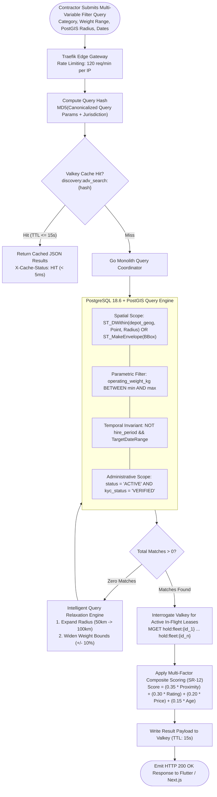
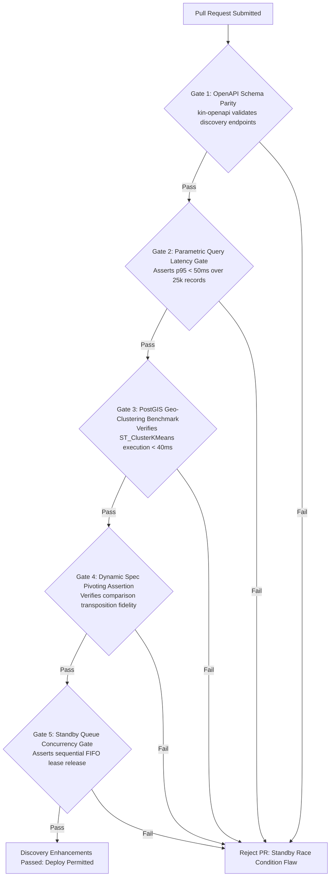

# Heavy Machinery & Logistics Rental Aggregator — Dink Machinery
## Software Requirements Specification — 05.15. Advanced Search & Discovery Enhancements (`docs/shared/requirements/05-15-search-discovery-enhancements.md`)

**Document Identifier:** `SRS-DINK-CORE-V7.0-SEC-05-15`  
**Classification:** Canonical System Requirements Specification & Discovery Baseline (Single Source of Truth)  
**Governing Standard:** IEEE Std 830-1998 / IEEE/ISO/IEC 29148:2018 (Systems and Software Engineering — Requirements Engineering)  
**Associated Artifacts:** `SRS-DINK-CORE-V7.0` (§5.4, §5.15, §10, §11), `FLOW-DISCOVERY-DINK-CORE-V7.0` (Interaction Flow 06), `FLOW-CONCURRENCY-LOCKING-DINK-CORE-V7.0`, `ARCH-BACKEND-GO-DINK-CORE-V7.0`, `ARCH-FLUTTER-DINK-CORE-V7.0`, `ARCH-ADMIN-NEXT-DINK-CORE-V7.0`, `ARCH-SEC-DINK-CORE-V7.0`, `DS-DINK-CORE-V7.0`, `DS-PERSONAS-DINK-CORE-V7.0`, `contracts/openapi.yaml`, `ADR-001`, `ADR-002`, `ADR-004`, `ADR-005`, `ADR-008`, `ADR-010`  
**Target Runtimes:** Go 1.27.3 Backend Monolith, Flutter 3.47.8 / Dart 3.9 (Cross-Platform Mobile), Next.js 16.x (latest CVE security patch) / React 19 (Web Admin & Corporate Portal), PostgreSQL 18.6 + PostGIS 3.6.4, Valkey 9.1.3, ClamAV Daemon (:3310), SeaweedFS S3, Isar NoSQL 3.1+  
**Target Personas:** Civil Engineering Contractor (*Dawit Haile-Mariam* / *Patrick Kariuki*), Project Procurement Director (*Eng. Samuel Getachew*), Equipment Fleet Owner (*W/ro Almaz Tesfaye* / *Kamau Ndegwa*), Compliance Officer & Route Auditor (*Yohannes Bekele*)  
**Target Operating Markets:** Ethiopia (`ET`) & Kenya (`KE`) — Dynamic Multi-Country Parameterization (`LOC-01-BE`)  
**Compliance Standards:** OWASP ASVS 4.0.3 Level 3 (Search Injection Defense, Rate Limiting & Resource Protection), RFC 9457 (Problem Details), ISO 9241-110, W3C WCAG 2.2 Level AAA (Field Mobile) & Level AA (Admin Web), National Bank of Ethiopia (NBE) Directives, Kenya Data Protection Act 2019  
**Status:** Approved Engineering Baseline

---

## Table of Contents

- 1. [Document Scope & Architectural Mandate](#1-document-scope--architectural-mandate)
  - 1.1 [Purpose & Functional Scope](#11-purpose--functional-scope)
  - 1.2 [Core Architectural Principles & Performance Invariants](#12-core-architectural-principles--performance-invariants)
- 2. [Search & Discovery State Lifecycle](#2-search--discovery-state-lifecycle)
  - 2.1 [Enhanced Spatial & Geospatial Search Topology Flowchart](#21-enhanced-spatial--geospatial-search-topology-flowchart)
  - 2.2 [Query Execution Lifecycle & Cache Tier Invariants](#22-query-execution-lifecycle--cache-tier-invariants)
- 3. [Advanced Parametric & Multi-Faceted Query Engine (`SR-09` to `SR-12`)](#3-advanced-parametric--multi-faceted-query-engine-sr-09-to-sr-12)
  - 3.1 [Dynamic Range Sliders & Exact Numeric Boundary Filtering (`SR-09`)](#31-dynamic-range-sliders--exact-numeric-boundary-filtering-sr-09)
  - 3.2 [Operational Attribute Faceting & Multi-Select Tags (`SR-10`)](#32-operational-attribute-faceting--multi-select-tags-sr-10)
  - 3.3 [Attachment Compatibility Cross-Matching (`SR-11`)](#33-attachment-compatibility-cross-matching-sr-11)
  - 3.4 [Multi-Factor Composite Ranking & Machine Reputation Scenarios (`SR-12`)](#34-multi-factor-composite-ranking--machine-reputation-scenarios-sr-12)
- 4. [Spatial Geo-Clustering & Dynamic Viewport Ingress (PostGIS 3.6.4)](#4-spatial-geo-clustering--dynamic-viewport-ingress-postgis-34)
  - 4.1 [Server-Side K-Means Spatial Geo-Clustering (`ST_ClusterKMeans`)](#41-server-side-k-means-spatial-geo-clustering-st_clusterkmeans)
  - 4.2 [Dynamic Bounding-Box (BBox) Map Pan & Zoom Ingress](#42-dynamic-bounding-box-bbox-map-pan--zoom-ingress)
  - 4.3 [Infrastructure Corridor Polyline Proximity Filtering](#43-infrastructure-corridor-polyline-proximity-filtering)
  - 4.4 [Administrative Woreda/County Centroid Fallbacks](#44-administrative-woredacounty-centroid-fallbacks)
- 5. [Interactive Comparison Engine & Dynamic Spec Matrix](#5-interactive-comparison-engine--dynamic-spec-matrix)
  - 5.1 [Comparison Buffer Management & Strict Taxonomic Homogeneity](#51-comparison-buffer-management--strict-taxonomic-homogeneity)
  - 5.2 [Relational Dynamic Pivoting over `is_comparable` Spec Fields](#52-relational-dynamic-pivoting-over-is_comparable-spec-fields)
  - 5.3 [Client-Side Diff Highlighting & Outlier Visualization](#53-client-side-diff-highlighting--outlier-visualization)
  - 5.4 [Exportable Technical Procurement Dossier (PDF/Print Viewport)](#54-exportable-technical-procurement-dossier-pdfprint-viewport)
- 6. [Saved Searches, Standby Alerts & Search Analytics](#6-saved-searches-standby-alerts--search-analytics)
  - 6.1 [Persistent Saved Search Criteria & Automated Matching](#61-persistent-saved-search-criteria--automated-matching)
  - 6.2 [Availability Standby Queue & Push Re-Engagement](#62-availability-standby-queue--push-re-engagement)
  - 6.3 [Search Query Telemetry & Regional Demand Analytics](#63-search-query-telemetry--regional-demand-analytics)
- 7. [Wire Protocol Contracts & RFC 9457 Error Schemas](#7-wire-protocol-contracts--rfc-9457-error-schemas)
  - 7.1 [`GET /api/v1/discovery/search/advanced`](#71-get-apiv1discoverysearchadvanced)
  - 7.2 [`GET /api/v1/discovery/map/clusters`](#72-get-apiv1discoverymapclusters)
  - 7.3 [`POST /api/v1/discovery/compare/matrix`](#73-post-apiv1discoverycomparematrix)
  - 7.4 [`POST /api/v1/discovery/saved-searches`](#74-post-apiv1discoverysaved-searches)
  - 7.5 [RFC 9457 Universal Problem Details Payloads](#75-rfc-9457-universal-problem-details-payloads)
- 8. [Automated Testing Suite & Verification Gates](#8-automated-testing-suite--verification-gates)

---

## 1. Document Scope & Architectural Mandate

### 1.1 Purpose & Functional Scope

This specification establishes **Section 05.15 (Advanced Search & Discovery Enhancements)** of the canonical Software Requirements Specification (SRS) for **Dink Machinery Version 7.0**.

Sourcing heavy plant machinery and multi-axle freight equipment across Ethiopia and Kenya involves complex engineering constraints:
* Civil contractors cannot simply rent an "excavator"; they must source specific mechanical ratings (e.g., operating weight $\ge 21.0\text{ tons}$, maximum digging depth $\ge 6.5\text{ meters}$, hydraulic flow rate $\ge 150\text{ L/min}$) compatible with local quarry geology or road cut depths.
* Equipment must be geographically proximate to the construction site or transportable within strict lowboy bridge clearances ($< 4.5\text{ m}$) along national infrastructure corridors (Addis Ababa–Adama Expressway, Modjo–Hawassa, LAPSSET).
* Contractors need transparent tools to compare mechanical metrics across manufacturers (e.g., Caterpillar 320D vs. Komatsu PC200-8 vs. Hyundai R220LC-9) and secure availability guarantees without speculative delays.

This document extends the baseline discovery mechanisms defined in SRS 05.04, formally establishing:
1. High-granularity parametric spec search filtering across continuous numerical intervals and multi-select tags.
2. Server-side spatial geo-clustering (`ST_ClusterKMeans`) and bounding-box map viewports for high-density machinery yards.
3. Linear corridor proximity search calculating equipment transit distance along national highway centerlines.
4. An expanded side-by-side comparison engine executing relational pivoting over dynamic EAV attributes flagged `is_comparable = true`.
5. Saved search alert dispatchers and standby queue re-engagement pipelines.

### 1.2 Core Architectural Principles & Performance Invariants

1. **Sub-50ms Dynamic Query Latency SLO (p95):** Complex multi-variable queries (category, price interval, date range, spatial radius, and dynamic specs) executing against an active catalog of 25,000 machines must return in $< 50\text{ ms}$ (p95) and $< 80\text{ ms}$ (p99).
2. **Denormalized Index Isolation (`fleet_spec_indexed`):** Numerical and dimensional filters query denormalized relational search columns (`fleet_spec_indexed`) rather than raw EAV entity-attribute-value tables (`fleet_spec_values`), eliminating computational overhead during multi-parameter scans.
3. **Strict Bounding-Box Density Capping:** When the client map viewport zooms out to regional levels (e.g., all of Ethiopia/Kenya), the server groups pins using `ST_ClusterKMeans` into a maximum of **60 cluster centroids** to maintain smooth 60fps rendering in Flutter and React Mapbox viewports.
4. **Real-Time Hold Lease Interrogation:** Listings returned by advanced queries must reflect live in-memory Valkey 9.1.3 hold leases (`MGET hold:fleet:{id}`). Assets held in checkout by other contractors are badged as `HELD_PENDING_WIRE` rather than falsely presented as unencumbered.
5. **Zero-Result Intelligent Relaxation:** If an overly specific search returns zero matches, the engine automatically relaxes constraints in a deterministic order (expanding search radius from $50\text{ km} \rightarrow 100\text{ km}$, then broadening weight tolerance by $\pm 10\%$) while informing the user of the applied adjustments.

---

## 2. Search & Discovery State Lifecycle

### 2.1 Enhanced Spatial & Geospatial Search Topology Flowchart



---

### 2.2 Query Execution Lifecycle & Cache Tier Invariants

Advanced discovery queries operate across a three-tier cache architecture:
1. **L1 Client-Side HTTP Cache:** Flutter client caches static filter definitions (`SpecFieldDefinition`) locally in Isar NoSQL, invalidating via `ETag` validation.
2. **L2 Edge Valkey Hot Query Cache:** Parameterized discovery queries are cached with a **15-second TTL** (`discovery:adv_search:{hash}`). Real-time booking actions (prepayment upload, hold release) evict matching patterns immediately.
3. **L3 Database Materialized Views:** Highly aggregated search facets (available machine counts per subcategory and region) refresh every 10 minutes via `REFRESH MATERIALIZED VIEW CONCURRENTLY mv_fleet_category_facets`.

---

## 3. Advanced Parametric & Multi-Faceted Query Engine (`SR-09` to `SR-12`)

### 3.1 Dynamic Range Sliders & Exact Numeric Boundary Filtering (`SR-09`)

For plant machinery where physical capacity governs site safety, the engine supports continuous numeric range filters:

```text
+--------------------------------------------------------------------------------------------------+
| NUMERIC PARAMETRIC RANGE FILTER MATRIX (SR-09)                                                   |
+------------------------+-------------------+-------+---------------------------------------------+
| SPECIFICATION METRIC   | DATABASE FIELD    | UNIT  | SUPPORTED FILTER OPERATORS                  |
+------------------------+-------------------+-------+---------------------------------------------+
| Operating Plant Weight | operating_weight_ | kg    | minWeightKg, maxWeightKg                    |
|                        | kg                |       | (e.g., 20,000 to 25,000 kg)                 |
+------------------------+-------------------+-------+---------------------------------------------+
| Maximum Digging Depth  | max_dig_depth_mm  | mm    | minDigDepthMm, maxDigDepthMm                |
|                        |                   |       | (e.g., >= 6,500 mm)                         |
+------------------------+-------------------+-------+---------------------------------------------+
| Gross Engine Output    | gross_power_hp    | hp    | minPowerHp, maxPowerHp                      |
|                        |                   |       | (e.g., >= 140 hp)                           |
+------------------------+-------------------+-------+---------------------------------------------+
| Lowboy Payload Capacity| payload_capacity_ | kg    | minPayloadKg                                |
|                        | kg                |       | (e.g., >= 40,000 kg)                        |
+------------------------+-------------------+-------+---------------------------------------------+
| Daily Hire Rate Tariff | daily_rate_minor  | Cents | minDailyRateMinor, maxDailyRateMinor        |
|                        |                   |       | (e.g., 1,500,000 to 3,000,000 ETB Cents)    |
+--------------------------------------------------------------------------------------------------+
```

---

### 3.2 Operational Attribute Faceting & Multi-Select Tags (`SR-10`)

Renters can apply multi-select operational attributes simultaneously:
* **`operatorIncluded` (Boolean):** Filters for listings inclusive of certified operator wages.
* **`selfMoveCapable` (Boolean):** Distinguishes road-drivable machines from units requiring lowboy transport.
* **`fuelType` (Multi-Select Enum):** `DIESEL`, `ELECTRIC`, `PETROL`, `HYBRID`.
* **`emissionsStandard` (Multi-Select Enum):** `TIER_2`, `TIER_3`, `STAGE_V` (for corporate ESG audits).
* **`cabinType` (Enum):** `ENCLOSED_AC`, `OPEN_CANOPY`, `FOPS_ROPS_CERTIFIED`.

---

### 3.3 Attachment Compatibility Cross-Matching (`SR-11`)

When a contractor selects a host machine, the engine discovers all compatible standalone attachments available within the operational radius:
* Queries `attachments` matching the machine's `subcategory_id` via `compatible_subcategories`.
* Asserts pin diameter and operating hydraulic relief pressure compatibility:
  $$\text{machine.hydraulic\_pressure\_bar} \ge \text{attachment.required\_pressure\_bar}$$
  $$\text{machine.hydraulic\_flow\_lmin} \ge \text{attachment.required\_flow\_min\_lmin}$$
* Displays compatible implements as selectable add-on tiles directly within the machine detail view.

---

### 3.4 Multi-Factor Composite Ranking & Machine Reputation Scenarios (`SR-12`)

When sorting by `RECOMMENDED` (default), the ranking algorithm evaluates four weighted dimensions:

$$\mathcal{S}_{\text{composite}} = (0.35 \times \mathcal{P}_{\text{proximity}}) + (0.30 \times \mathcal{R}_{\text{rating}}) + (0.20 \times \mathcal{F}_{\text{tariff}}) + (0.15 \times \mathcal{A}_{\text{uptime}})$$

```text
+--------------------------------------------------------------------------------------------------+
| COMPOSITE RANKING WEIGHTING MATRIX                                                               |
+------------------------+--------+----------------------------------------------------------------+
| COMPONENT SCALAR       | WEIGHT | MATHEMATICAL FORMULATION & NORMALIZATION                       |
+------------------------+--------+----------------------------------------------------------------+
| Proximity Factor (P)   | 35%    | 1.0 - (GeodesicDistance / SearchRadius)                        |
|                        |        | Clamped between 0.0 and 1.0.                                   |
+------------------------+--------+----------------------------------------------------------------+
| Owner Reputation (R)   | 30%    | (AverageRating / 5.0) * log10(TotalCompletedRentals + 1)       |
|                        |        | Normalized against catalog maximum rating.                     |
+------------------------+--------+----------------------------------------------------------------+
| Price Competitiveness  | 20%    | 1.0 - ((DailyRate - SubcategoryMin) / SubcategoryRange)        |
| Factor (F)             |        | Rewards market-competitive pricing.                            |
+------------------------+--------+----------------------------------------------------------------+
| Asset Uptime History   | 15%    | TotalOperatingDays / (TotalOperatingDays + BreakdownDowntime)  |
| Factor (A)             |        | Penalizes machinery with frequent on-site breakdown reports.   |
+--------------------------------------------------------------------------------------------------+
```

---

## 4. Spatial Geo-Clustering & Dynamic Viewport Ingress (PostGIS 3.6.4)

### 4.1 Server-Side K-Means Spatial Geo-Clustering (`ST_ClusterKMeans`)

To render thousands of machinery depot locations smoothly on mobile maps, the server clusters points dynamically:

```sql
SELECT 
    cluster_id,
    COUNT(*) AS fleet_count,
    ST_AsGeoJSON(ST_Centroid(ST_Collect(depot_geog::geometry)))::jsonb AS centroid_geojson,
    MIN(daily_rate_minor) AS min_rate_minor,
    MAX(daily_rate_minor) AS max_rate_minor,
    jsonb_agg(jsonb_build_object('id', id, 'title', title, 'rate', daily_rate_minor)) 
        FILTER (WHERE rank <= 3) AS top_sample_fleets
FROM (
    SELECT 
        id, make || ' ' || model AS title, daily_rate_minor, depot_geog,
        ST_ClusterKMeans(depot_geog::geometry, $target_clusters) OVER () AS cluster_id,
        ROW_NUMBER() OVER (PARTITION BY ST_ClusterKMeans(depot_geog::geometry, $target_clusters) OVER () ORDER BY daily_rate_minor ASC) AS rank
    FROM fleets
    WHERE status = 'ACTIVE' 
      AND country_code = $country_code
      AND subcategory_id = $subcategory_id
) clustered
GROUP BY cluster_id;
```

---

### 4.2 Dynamic Bounding-Box (BBox) Map Pan & Zoom Ingress

As the user pans and zooms the interactive map:
* The client transmits bounding-box coordinates: `swLat`, `swLng`, `neLat`, `neLng`, and current `zoomLevel` ($1\text{ to }18$).
* **Zoom-Dependent Partitioning:**
  - **Zoom Level $1\text{ to }8$ (National / Regional):** Returns clustered centroids via `ST_ClusterKMeans` ($K \le 40$).
  - **Zoom Level $9\text{ to }13$ (Metropolitan / Sub-City):** Returns localized clusters ($K \le 80$).
  - **Zoom Level $\ge 14$ (Depot Yard / Street Level):** Disables clustering, returning individual fleet pins with exact depot coordinates.

---

### 4.3 Infrastructure Corridor Polyline Proximity Filtering

Major infrastructure projects follow linear transport routes. Contractors can filter machinery along highway corridors:
* The client passes a corridor polyline (GeoJSON `LineString`) and buffer distance (e.g., $15\text{ km}$):
  ```sql
  WHERE ST_DWithin(
      fleets.depot_geog,
      ST_GeogFromGeoJSON($corridor_geojson),
      15000 -- 15,000 meters buffer
  )
  ```
* Discovers machinery positioned along the mobilization route, minimizing deadhead lowboy transport costs.

---

### 4.4 Administrative Woreda/County Centroid Fallbacks

If a field device cannot acquire satellite GPS lock (e.g., deep foundation trench or mountainous terrain):
* The user selects their administrative jurisdiction:
  - **Ethiopia:** Region $\rightarrow$ Zone $\rightarrow$ Woreda (e.g., *Oromia $\rightarrow$ East Shewa $\rightarrow$ Ada'a*).
  - **Kenya:** County $\rightarrow$ Sub-County (e.g., *Machakos $\rightarrow$ Mavoko*).
* The query anchors search coordinates to pre-compiled administrative centroids (`woreda_centroids_et` / `county_centroids_ke`).

---

## 5. Interactive Comparison Engine & Dynamic Spec Matrix

### 5.1 Comparison Buffer Management & Strict Taxonomic Homogeneity

Contractors evaluate machinery by adding candidate assets to a volatile comparison drawer:
* **Buffer Constraint:** Exactly **2 to 3 fleets** can be compared simultaneously.
* **Taxonomic Homogeneity Invariant:** Fleets in the comparison buffer must belong to the **identical subcategory** (e.g., comparing three 20-ton crawler excavators is valid; comparing an excavator against an asphalt roller is rejected with HTTP 422 `ERR_NON_COMPARABLE_CATEGORIES`).

---

### 5.2 Relational Dynamic Pivoting over `is_comparable` Spec Fields

The engine transposes dynamic specification values into a side-by-side comparison matrix:

```sql
SELECT 
    sfd.field_key,
    sfd.label_en,
    sfd.label_am,
    sfd.unit_symbol,
    f_comp.val_1,
    f_comp.val_2,
    f_comp.val_3,
    (f_comp.val_1 IS DISTINCT FROM f_comp.val_2 OR f_comp.val_2 IS DISTINCT FROM f_comp.val_3) AS is_different
FROM spec_field_definitions sfd
CROSS JOIN LATERAL (
    SELECT 
        MAX(CASE WHEN fsv.fleet_id = $fleet_id_1 THEN COALESCE(fsv.value_numeric::text, fsv.value_string) END) AS val_1,
        MAX(CASE WHEN fsv.fleet_id = $fleet_id_2 THEN COALESCE(fsv.value_numeric::text, fsv.value_string) END) AS val_2,
        MAX(CASE WHEN fsv.fleet_id = $fleet_id_3 THEN COALESCE(fsv.value_numeric::text, fsv.value_string) END) AS val_3
    FROM fleet_spec_values fsv
    WHERE fsv.spec_definition_id = sfd.id
) f_comp
WHERE sfd.is_comparable = true
  AND sfd.group_id IN (SELECT id FROM spec_field_groups WHERE category_id = $subcategory_id)
ORDER BY sfd.display_order ASC;
```

---

### 5.3 Client-Side Diff Highlighting & Outlier Visualization

The comparison grid in Flutter and Next.js highlights key operational differences:

```text
+--------------------------------------------------------------------------------------------------+
| SIDE-BY-SIDE SPECIFICATION COMPARISON MATRIX VIEWPORT                                            |
+--------------------------+-----------------------+-----------------------+-----------------------+
| SPECIFICATION ATTRIBUTE  | CATERPILLAR 320D      | KOMATSU PC200-8       | HYUNDAI R220LC-9      |
+--------------------------+-----------------------+-----------------------+-----------------------+
| Daily Hire Rate          | 22,500.00 ETB         | 21,000.00 ETB [Best]  | 20,000.00 ETB [Best]  |
| Operating Weight         | 21,800 kg             | 20,010 kg             | 21,900 kg [Max]       |
| Gross Engine Power       | 148 hp                | 147 hp                | 150 hp [Max]          |
| Max Digging Depth        | 6,650 mm              | 6,620 mm              | 6,730 mm [Max]        |
| Distance from Site       | 11.2 km [Closest]     | 48.6 km               | 74.2 km               |
| Owner Rating             | ★ 4.92 (38 Rentals)   | ★ 4.75 (14 Rentals)   | ★ 4.88 (22 Rentals)   |
| Lowboy Transport Needed? | Yes (Lowbed Required) | Yes (Lowbed Required) | Yes (Lowbed Required) |
+--------------------------+-----------------------+-----------------------+-----------------------+
| ACTION CONTROLS          | [ Book Cat 320D → ]   | [ Book PC200-8 → ]    | [ Book R220LC-9 → ]   |
+--------------------------+-----------------------+-----------------------+-----------------------+
```

* **Interactive Differences Filter:** Toggle `[ Show Differences Only ]` dynamically hides rows where values across all three machines are identical.
* **Highlight Tags:** Automatically tags maximum capability values (e.g., `[Max]`, `[Deepest]`, `[Closest]`) to speed up equipment selection.

---

### 5.4 Exportable Technical Procurement Dossier (PDF/Print Viewport)

For corporate contractors requiring formal paperwork for joint-venture procurement boards:
* Generates a signed, branded PDF comparison dossier (`GET /api/v1/discovery/compare/export-pdf`).
* Includes machine photos, serial VINs, verified hour meters, insurance policy summaries, and the complete technical comparison table.

---

## 6. Saved Searches, Standby Alerts & Search Analytics

### 6.1 Persistent Saved Search Criteria & Automated Matching

When a contractor searches for equipment currently unavailable in their target area:
1. User taps `[ 🔔 Save Search & Alert Me ]`.
2. The system stores criteria in `user_saved_searches` (Subcategory, Radius, Price Ceiling, Required Specs).
3. When an equipment owner lists a new machine or a machine completes an existing rental:
   - Go background workers evaluate matching saved searches.
   - Dispatches a P1 notification: *"New 20t Excavator available within 25km of your project site."*

---

### 6.2 Availability Standby Queue & Push Re-Engagement

If an asset is locked under an active 60-minute checkout hold by another party (`FLOW-06`):
* The contractor can tap `[ Join Standby Queue ]`.
* The user's ID is appended to a Valkey sorted set:
  ```text
  ZADD queue:standby:fleet:{fleet_id} {timestamp} {user_id}
  ```
* If the primary contractor's payment hold expires without wire upload:
  - System evicts the hold.
  - Automatically notifies the next standby contractor via high-priority push, granting them an exclusive 30-minute reservation window.

---

### 6.3 Search Query Telemetry & Regional Demand Analytics

Discovery queries emit anonymized telemetry events to `search_query_analytics`:
* Tracked Parameters: Searched Subcategory, Target Woreda/County, Radius, Price Ceiling, Result Count, and Session ID.
* Enables platform operators to detect regional equipment shortages (e.g., high demand for 40-ton lowboys in Hawassa with zero local supply), guiding fleet onboarding outreach.

---

## 7. Wire Protocol Contracts & RFC 9457 Error Schemas

### 7.1 `GET /api/v1/discovery/search/advanced`

Executes high-granularity parametric and spatial search across machinery inventory.

#### Request Headers
```http
GET /api/v1/discovery/search/advanced?subcategoryId=cat_sub_excavator_std&lat=8.9806&lng=38.7578&radiusKm=50&minWeightKg=20000&maxWeightKg=25000&minDigDepthMm=6500&startDate=2026-11-05&endDate=2026-11-12&operatorIncluded=true&sortBy=RECOMMENDED&page=1&limit=20 HTTP/1.1
Host: api.dinkmachinery.com
Accept: application/json
Accept-Language: am
X-Country-Code: ET
```

#### Response: `HTTP 200 OK`
```json
{
  "success": true,
  "data": {
    "totalMatches": 18,
    "page": 1,
    "limit": 20,
    "relaxedQueryApplied": false,
    "results": [
      {
        "fleetId": "flt_019a8f2c-8812-7b9a",
        "make": "Caterpillar",
        "model": "320D",
        "manufactureYear": 2024,
        "dailyRateMinor": 2250000,
        "distanceMeters": 11240.5,
        "availabilityStatus": "AVAILABLE_NOW",
        "compositeScore": 0.892,
        "specs": {
          "operatingWeightKg": 21800.0,
          "maxDigDepthMm": 6650,
          "grossPowerHp": 148.0
        },
        "owner": {
          "tradingName": "Tesfaye Heavy Transport PLC",
          "averageRating": 4.92,
          "totalCompletedRentals": 38
        }
      }
    ]
  },
  "timestamp": "2026-10-28T14:50:00Z"
}
```

---

### 7.2 `GET /api/v1/discovery/map/clusters`

Returns server-side clustered map pins for high-density spatial viewports.

#### Request Headers
```http
GET /api/v1/discovery/map/clusters?subcategoryId=cat_sub_excavator_std&swLat=8.4000&swLng=38.4000&neLat=9.2000&neLng=39.1000&zoomLevel=11 HTTP/1.1
Host: api.dinkmachinery.com
```

#### Response: `HTTP 200 OK`
```json
{
  "success": true,
  "data": {
    "zoomLevel": 11,
    "clusteringApplied": true,
    "clustersCount": 4,
    "clusters": [
      {
        "clusterId": 1,
        "fleetCount": 12,
        "centroid": {
          "latitude": 8.9124,
          "longitude": 38.7412
        },
        "minDailyRateMinor": 1800000,
        "maxDailyRateMinor": 2500000,
        "sampleFleetNames": ["CAT 320D", "Komatsu PC200", "Hyundai R220"]
      }
    ]
  },
  "timestamp": "2026-10-28T14:51:00Z"
}
```

---

### 7.3 `POST /api/v1/discovery/compare/matrix`

Pivots dynamic EAV specification attributes across up to 3 selected fleets.

#### Request Headers
```http
POST /api/v1/discovery/compare/matrix HTTP/1.1
Host: api.dinkmachinery.com
Content-Type: application/json
Accept-Language: am
```

#### Request Payload
```json
{
  "fleetIds": [
    "flt_019a8f2c-8812-7b9a",
    "flt_019a8f2c-9914-4c12",
    "flt_019a8f2c-3341-1a09"
  ]
}
```

#### Response: `HTTP 200 OK`
```json
{
  "success": true,
  "data": {
    "subcategoryId": "cat_sub_excavator_std",
    "fleets": [
      {"id": "flt_019a8f2c-8812-7b9a", "title": "CAT 320D", "dailyRateMinor": 2250000},
      {"id": "flt_019a8f2c-9914-4c12", "title": "Komatsu PC200-8", "dailyRateMinor": 2100000},
      {"id": "flt_019a8f2c-3341-1a09", "title": "Hyundai R220LC-9", "dailyRateMinor": 2000000}
    ],
    "comparisonAttributes": [
      {
        "fieldKey": "max_dig_depth_mm",
        "label": "ከፍተኛ የመቆፈር ጥልቀት (Max Dig Depth)",
        "unit": "mm",
        "values": {
          "flt_019a8f2c-8812-7b9a": "6650",
          "flt_019a8f2c-9914-4c12": "6620",
          "flt_019a8f2c-3341-1a09": "6730"
        },
        "isDifferent": true,
        "bestValueKey": "flt_019a8f2c-3341-1a09"
      }
    ]
  },
  "timestamp": "2026-10-28T14:52:00Z"
}
```

---

### 7.4 `POST /api/v1/discovery/saved-searches`

Creates a persistent saved search alert.

#### Request Payload
```json
{
  "subcategoryId": "cat_sub_excavator_std",
  "searchRadiusKm": 50,
  "targetCoordinates": {
    "latitude": 8.5412,
    "longitude": 39.2718
  },
  "maxDailyRateMinor": 2500000,
  "minOperatingWeightKg": 20000,
  "alertChannels": ["IN_APP", "PUSH"]
}
```

#### Response: `HTTP 201 Created`
```json
{
  "success": true,
  "data": {
    "savedSearchId": "sch_019a8ff0-4412",
    "status": "ACTIVE",
    "createdAt": "2026-10-28T14:53:00Z"
  },
  "timestamp": "2026-10-28T14:53:01Z"
}
```

---

### 7.5 RFC 9457 Universal Problem Details Payloads

#### Example: Cross-Category Comparison Prohibited (`HTTP 422 Unprocessable Entity`)
```json
{
  "type": "[https://api.dinkmachinery.com/errors/non-comparable-categories](https://api.dinkmachinery.com/errors/non-comparable-categories)",
  "title": "Cross-Category Comparison Prohibited",
  "status": 422,
  "detail": "Comparison matrix mandates identical machinery subcategories. Cannot compare 'Standard Excavator' against 'Lowboy Trailer'.",
  "instance": "/api/v1/discovery/compare/matrix",
  "code": "ERR_NON_COMPARABLE_CATEGORIES",
  "invalidParams": [
    {
      "name": "fleetIds",
      "reason": "Fleet flt_019a8f2c-3341-1a09 belongs to subcategory cat_sub_lowboy_heavy, conflicting with cat_sub_excavator_std."
    }
  ]
}
```

#### Example: Comparison Buffer Exceeded (`HTTP 400 Bad Request`)
```json
{
  "type": "[https://api.dinkmachinery.com/errors/comparison-limit-exceeded](https://api.dinkmachinery.com/errors/comparison-limit-exceeded)",
  "title": "Comparison Buffer Exceeded",
  "status": 400,
  "detail": "Cannot compare more than 3 fleet assets simultaneously. Exactly 2 or 3 fleets must be selected.",
  "instance": "/api/v1/discovery/compare/matrix",
  "code": "ERR_COMPARISON_LIMIT_EXCEEDED"
}
```

---

## 8. Automated Testing Suite & Verification Gates



1. **OpenAPI Schema Contract Gate (`kin-openapi`):** Validates all advanced search, geo-clustering, matrix comparison, and saved search endpoints against `contracts/openapi.yaml`.
2. **Parametric Latency Stress Benchmark:** Executes 1,000 multi-variable queries against a PostgreSQL database seeded with 25,000 synthetic fleet assets. Asserts that p95 response time remains strictly $< 50\text{ ms}$.
3. **PostGIS K-Means Clustering Performance Test:** Executes `ST_ClusterKMeans` queries across national bounding boxes, verifying that cluster generation and GeoJSON serialization complete in $< 40\text{ ms}$.
4. **Dynamic Comparison Matrix Pivoting Test:** Evaluates comparison transposition across three machines with varying nullable parameters, asserting that differences are accurately flagged and measurement unit symbols match schema definitions.
5. **Standby Queue Concurrency Benchmark:** Simulates 50 users queuing for a held machine. When the primary hold expires, asserts that the next user in FIFO sequence receives an exclusive lease without race conditions.

---

*This document establishes the canonical functional requirements, spatial clustering algorithms, dynamic parametric filtering rules, comparison matrix schemas, and wire contracts for Advanced Search & Discovery Enhancements in Dink Machinery Version 7.0. All downstream Flutter mobile search feeds, Go backend query microservices, and Next.js admin portals must strictly conform to this specification.*