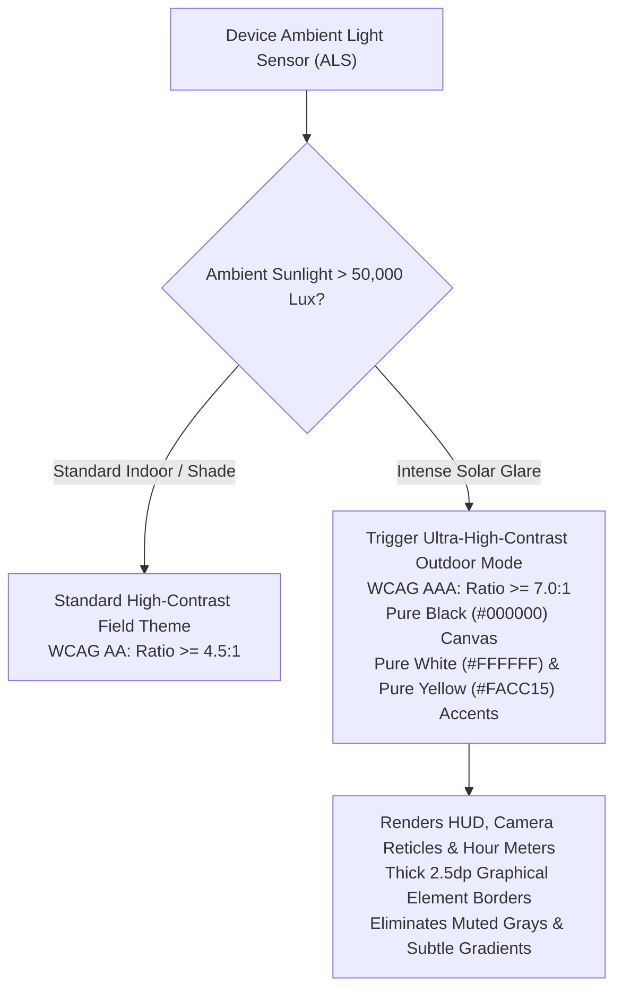
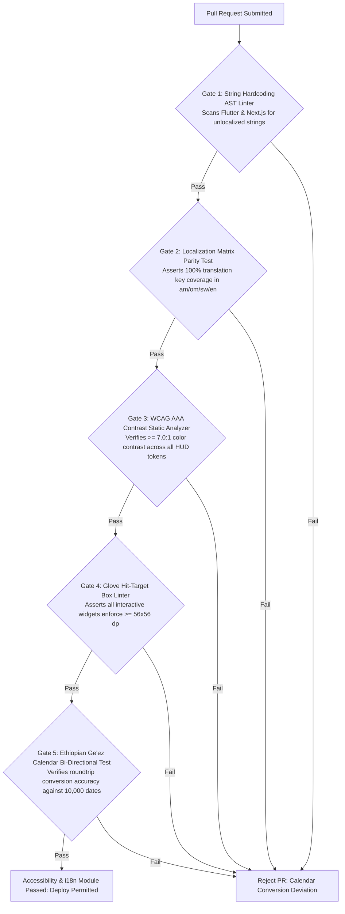

# Heavy Machinery & Logistics Rental Aggregator — Dink Machinery
## Software Requirements Specification — 05.16. Accessibility (a11y), Internationalisation (i18n), Localisation (l10n) & Field Ergonometrics (`docs/shared/requirements/05-16-accessibility-internationalisation.md`)

**Document Identifier:** `SRS-DINK-CORE-V7.0-SEC-05-16`  
**Classification:** Canonical System Requirements Specification & Ergonomic/Linguistic Baseline (Single Source of Truth)  
**Governing Standard:** IEEE Std 830-1998 / IEEE/ISO/IEC 29148:2018 (Systems and Software Engineering — Requirements Engineering)  
**Associated Artifacts:** `SRS-DINK-CORE-V7.0` (§5.1, §5.10, §5.14, §5.16, §10, §12), `FLOW-ENTRY-DINK-CORE-V7.0`, `FLOW-ACTIVE-RENTAL-DINK-CORE-V7.0`, `FLOW-NOTIF-OFFLINE-DINK-CORE-V7.0`, `ARCH-BACKEND-GO-DINK-CORE-V7.0`, `ARCH-FLUTTER-DINK-CORE-V7.0`, `ARCH-ADMIN-NEXT-DINK-CORE-V7.0`, `ARCH-SEC-DINK-CORE-V7.0`, `DS-DINK-CORE-V7.0`, `DS-PERSONAS-DINK-CORE-V7.0`, `contracts/openapi.yaml`, `ADR-001`, `ADR-002`, `ADR-005`, `ADR-008`, `ADR-010`  
**Target Runtimes:** Flutter 3.47.9 / Dart 3.9 (Cross-Platform Mobile), Next.js 16.x (latest CVE security patch) / React 19 (Web Admin & Corporate Portal), Go 1.27.3 Backend Monolith, PostgreSQL 18.6 + PostGIS 3.6.4, Valkey 9.1.3, ClamAV Daemon (:3310), SeaweedFS S3, Isar NoSQL 3.1+  
**Target Personas:** Certified Field Operator (*Mulugeta Tadesse* / *Juma Omwamba*), Civil Engineering Contractor (*Dawit Haile-Mariam* / *Patrick Kariuki*), Equipment Fleet Owner (*W/ro Almaz Tesfaye* / *Kamau Ndegwa*), Lowboy Transporter (*Ato Girma Wolde* / *Samuel Odhiambo*), Compliance Officer & Accessibility Auditor (*Yohannes Bekele*)  
**Target Operating Markets:** Ethiopia (`ET`) & Kenya (`KE`) — Dynamic Multi-Country Parameterization (`LOC-01-BE`)  
**Compliance Standards:** W3C Web Content Accessibility Guidelines (WCAG) 2.2 Level AAA (Mobile Field HUD) & Level AA (Web Admin), ISO 9241-110 (Ergonomics of Human-System Interaction), ISO 9241-210 (Human-Centred Design), ISO 639-1 / BCP 47 Language Tags, Unicode 16.0 (Ethiopic Extended Script Block U+1200–U+137F & U+2D80–U+2DDF), Ethiopian Communications Authority (ECA) Accessibility Guidelines, Kenya National Commission for Persons with Disabilities (NCPWD) Standards  
**Status:** Approved Engineering Baseline

---

## Table of Contents

- 1. [Document Scope & Architectural Mandate](#1-document-scope--architectural-mandate)
  - 1.1 [Purpose & Functional Scope](#11-purpose--functional-scope)
  - 1.2 [Core Engineering Invariants & Ergonometric Guardrails](#12-core-engineering-invariants--ergonometric-guardrails)
- 2. [Linguistic Architecture & Translation Matrix (i18n / l10n)](#2-linguistic-architecture--translation-matrix-i18n--l10n)
  - 2.1 [Sovereign Language Topology & BCP 47 Language Tags](#21-sovereign-language-topology--bcp-47-language-tags)
  - 2.2 [Relational Schema: Dynamic Localization & Translation Keys](#22-relational-schema-dynamic-localization--translation-keys)
  - 2.3 [Ethiopic Script Font Rendering, Baselines & Input Ergonomics](#23-ethiopic-script-font-rendering-baselines--input-ergonomics)
  - 2.4 [Differential Sync Pipeline & Client-Side Isar Caching (`ADR-010`)](#24-differential-sync-pipeline--client-side-isar-caching-adr-010)
- 3. [Temporal, Numerical & Fiscal Formats (`LOC-01-BE`)](#3-temporal-numerical--fiscal-formats-loc-01-be)
  - 3.1 [Ethiopian Calendar (Ge'ez) vs. Gregorian Calendar Sync](#31-ethiopian-calendar-geez-vs-gregorian-calendar-sync)
  - 3.2 [Timekeeping Models: Ethiopian 12-Hour Inverted vs. Standard EAT](#32-timekeeping-models-ethiopian-12-hour-inverted-vs-standard-eat)
  - 3.3 [Dual-Currency Formatting & Minor Unit Invariants (ETB vs. KES)](#33-dual-currency-formatting--minor-unit-invariants-etb-vs-kes)
  - 3.4 [Metric Engineering Units & Suffix Display Standards](#34-metric-engineering-units--suffix-display-standards)
- 4. [Field Accessibility & Harsh Environment Ergonometrics (a11y)](#4-field-accessibility--harsh-environment-ergonometrics-a11y)
  - 4.1 [WCAG 2.2 Level AAA Equatorial Solar Glare Contrast Engine ($\ge 7.0:1$)](#41-wcag-22-level-aaa-equatorial-solar-glare-contrast-engine-ge-701)
  - 4.2 [Glove-Friendly Interaction Targets ($56 \times 56\text{ dp}$ Minimum Hit Box)](#42-glove-friendly-interaction-targets-56-times-56text-dp-minimum-hit-box)
  - 4.3 [Dynamic Text Scaling, Font Reflow & Truncation Invariants](#43-dynamic-text-scaling-font-reflow--truncation-invariants)
  - 4.4 [Haptic Feedback & High-Noise Acoustic Alerting Pipeline](#44-haptic-feedback--high-noise-acoustic-alerting-pipeline)
- 5. [Assistive Technology & Multi-Modal Field Interaction](#5-assistive-technology--multi-modal-field-interaction)
  - 5.1 [Semantic Trees, Screen Readers (TalkBack / VoiceOver) & ARIA](#51-semantic-trees-screen-readers-talkback--voiceover--aria)
  - 5.2 [Illiteracy Mitigation: Compressed Audio Prompts (Amharic & Afaan Oromoo)](#52-illiteracy-mitigation-compressed-audio-prompts-amharic--afaan-oromoo)
  - 5.3 [Color-Blind Safe Palette Mapping (Protanopia, Deuteranopia, Tritanopia)](#53-color-blind-safe-palette-mapping-protanopia-deuteranopia-tritanopia)
- 6. [Wire Protocol Contracts & RFC 9457 Error Schemas](#6-wire-protocol-contracts--rfc-9457-error-schemas)
  - 6.1 [`GET /api/v1/localization/bundle/{lang}`](#61-get-apiv1localizationbundlelang)
  - 6.2 [`GET /api/v1/localization/date-convert`](#62-get-apiv1localizationdate-convert)
  - 6.3 [`POST /api/v1/localization/audit-missing`](#63-post-apiv1localizationaudit-missing)
  - 6.4 [RFC 9457 Universal Problem Details Payloads](#64-rfc-9457-universal-problem-details-payloads)
- 7. [Automated Testing Suite & Verification Gates](#7-automated-testing-suite--verification-gates)

---

## 1. Document Scope & Architectural Mandate

### 1.1 Purpose & Functional Scope

This specification establishes **Section 05.16 (Accessibility, Internationalisation, Localisation & Field Ergonometrics)** of the canonical Software Requirements Specification (SRS) for **Dink Machinery Version 7.0**.

Dink Machinery operates across the frontier heavy civil construction and transport ecosystems of Ethiopia and Kenya. Physical deployment environments feature extreme operational characteristics:
* Excavation pits, road cuts, and open-pit quarries encounter intense equatorial direct sunlight ($> 85,000\text{ lux}$), washing out low-contrast smartphone displays.
* Certified plant operators (*Mulugeta Tadesse*, *Juma Omwamba*) operate hydraulic equipment with cabin vibrations ($1\text{ to }20\text{ Hz}$) while wearing thick split-leather safety work gloves, rendering standard $44 \times 44\text{ dp}$ mobile touch targets completely unusable.
* Operator and driver demographics range across four major regional languages—Amharic (`am`), Afaan Oromoo (`om`), Swahili (`sw`), and English (`en`)—with varied literacy levels and script systems (Ethiopic Fidel vs. Latin).
* Ethiopia operates under sovereign temporal and numerical norms: the 13-month Ethiopian Calendar (*Ge'ez Calendar*, 7 to 8 years behind Gregorian), the 12-hour inverted diurnal timekeeping model (counting dawn at 01:00 / 07:00 EAT), and double-entry Birr accounting.

This document formally specifies:
1. The linguistic internationalisation (i18n) and localization (l10n) engine delivering zero hardcoded copy, dynamic Ge'ez script font rendering, and differential offline translation bundles.
2. The sovereign temporal and calendar conversion engines bridging Ethiopian Ge'ez dates and diurnal timekeeping with standard UTC/Gregorian database storage.
3. The W3C WCAG 2.2 Level AAA field accessibility system enforcing high-contrast equatorial palettes ($\ge 7.0:1$) and $56 \times 56\text{ dp}$ glove-friendly tap boxes.
4. Screen reader semantics, multi-modal audio prompts for low-literacy operators, and color-blind safe telemetry indicators.

### 1.2 Core Engineering Invariants & Ergonometric Guardrails

1. **Zero Hardcoded String Invariant:** No user-facing text, label, error description, metric suffix, or notification header may be hardcoded into Flutter client widgets or Next.js React templates. Every string must be resolved via a namespaced translation key (`i18n.translate(key, params)`).
2. **WCAG 2.2 Level AAA Solar Contrast Invariant:** All field-critical UI viewports—including the Active Rental HUD (`FLOW-09`), Handover Reticle Camera (`FLOW-10`), Emergency Breakdown Reporter (`FLOW-09 §3.3`), and PIN Authorization Canvas—must maintain a contrast ratio of strictly $\ge 7.0:1$ for normal text and $\ge 4.5:1$ for heavy graphical borders against background canvases.
3. **Glove-Friendly Tap Target Floor ($56 \times 56\text{ dp}$):** Every interactive button, selector, checkbox, reticle shutter trigger, and tab item on mobile must provide an effective hit-test box of at least **$56 \times 56\text{ device-independent pixels (dp)}$**, padded with a minimum $8\text{ dp}$ physical margin to prevent accidental dual-touch actuation in vibrating cabs.
4. **Internal UTC / Gregorian Data Model Storage Invariant:** Irrespective of user display language, input modality, or calendar selection, all timestamps, rental date ranges, and ledger records are transmitted across APIs and committed to PostgreSQL 18.6 strictly in UTC ISO 8601 format (`YYYY-MM-DDTHH:mm:ssZ`) and Gregorian `daterange` brackets. Dual-calendar conversion occurs strictly at presentation and ingestion boundaries.
5. **Ethiopic Script Font Rendering Fidelity:** Ethiopic characters (Unicode block U+1200–U+137F) must be rendered using open-source, hint-optimized typefaces (*Noto Sans Ethiopic* or *Abyssinica SIL*). The typography engine must maintain vertical line-height metrics that prevent diacritic clashing and line-height jitter across localized switchers.

---

## 2. Linguistic Architecture & Translation Matrix (i18n / l10n)

### 2.1 Sovereign Language Topology & BCP 47 Language Tags

Dink Machinery natively supports four core languages across its target markets:

```text
+--------------------------------------------------------------------------------------------------+
| DINK MACHINERY CANONICAL LANGUAGE SUPPORT MATRIX                                                 |
+---------------------+-------------+----------------+--------------------+------------------------+
| LANGUAGE NAME       | BCP 47 TAG  | SCRIPT SYSTEM  | TEXT DIRECTION     | TARGET MARKET PERIMETER|
+---------------------+-------------+----------------+--------------------+------------------------+
| English             | en-US       | Latin (ISO 8859| Left-to-Right (LTR)| International, Kenya,  |
| (Baseline)          |             | -1)            |                    | Corporate Enterprise   |
+---------------------+-------------+----------------+--------------------+------------------------+
| Amharic             | am-ET       | Ethiopic Fidel | Left-to-Right (LTR)| Ethiopia Federal,      |
| (አማርኛ)              |             | (Unicode 16.0) |                    | Addis Ababa, National  |
+---------------------+-------------+----------------+--------------------+------------------------+
| Afaan Oromoo        | om-ET       | Latin (Qubee   | Left-to-Right (LTR)| Ethiopia Regional      |
| (Oromo)             |             | Alphabet)      |                    | (Oromia Corridor)      |
+---------------------+-------------+----------------+--------------------+------------------------+
| Kiswahili           | sw-KE       | Latin          | Left-to-Right (LTR)| Kenya National,        |
| (Swahili)           |             |                |                    | East African Freight   |
+---------------------+-------------+----------------+--------------------+------------------------+
```

* **Fallback Cascade Hierarchy:** If a localized translation key is missing in a specific regional dialect, the translation resolution engine cascades deterministically:
  $$\text{Selected Dialect } (\text{om-ET} / \text{sw-KE}) \longrightarrow \text{Market Lingua Franca } (\text{am-ET} / \text{sw-KE}) \longrightarrow \text{English } (\text{en-US})$$

---

### 2.2 Relational Schema: Dynamic Localization & Translation Keys

Translation catalogs are persisted in PostgreSQL 18.6, allowing platform compliance officers to adjust terminology dynamically without triggering mobile application store deployments:

```mermaid
erDiagram
    LocalizationNamespace ||--o{ LocalizationKey : "contains"
    LocalizationKey ||--o{ LocalizationTranslation : "materializes"

    LocalizationNamespace {
        uuid id PK
        string namespace_key UK -- 'hud', 'auth', 'specs', 'errors', 'booking'
        string description
        timestamptz updated_at
    }

    LocalizationKey {
        uuid id PK
        uuid namespace_id FK
        string full_key UK -- 'hud.shift.elapsed_hours', 'errors.meter_regression'
        string description
        string parameter_schema_json -- '["hours", "max_hours"]'
    }

    LocalizationTranslation {
        uuid id PK
        uuid key_id FK
        string language_code -- 'en', 'am', 'om', 'sw'
        text translated_text
        string audio_storage_uri NULL
        boolean is_verified
        timestamptz updated_at
    }
```

---

### 2.3 Ethiopic Script Font Rendering, Baselines & Input Ergonomics

Rendering Ge'ez characters (Fidel) on mobile and web viewports introduces distinct typographic requirements:
* **Glyph Complexity & Line Heights:** Ethiopic characters contain intricate horizontal cross-strokes and vowel diacritics. Flutter's `TextStyle` must enforce a baseline `height` factor of **$1.45$** (compared to $1.20$ for Latin fonts) to eliminate diacritic clipping in compact data tables.
* **On-Device Soft Keyboard Accommodation:** In Ethiopia, operators utilize soft keyboards (e.g., *FynGeez*, *Google Gboard Ethiopic*) requiring multi-tap consonant-to-vowel expansion. Form inputs must disable aggressive auto-capitalization and continuous auto-correct spellcheck filters that intercept Ethiopic input composition.
* **Typographic Sizing Parity:** Because Ethiopic characters are visually denser than Latin characters, body typography rendered in Amharic must be scaled up by **$+1.0\text{ sp}$** relative to English to preserve identical visual legibility:
  $$\text{FontSize}_{\text{am}} = \text{FontSize}_{\text{en}} + 1.0\text{ sp}$$

---

### 2.4 Differential Sync Pipeline & Client-Side Isar Caching (`ADR-010`)

To support instantaneous language switching and offline field operation:
1. **Initial Hydration:** The mobile application ships with an embedded local Isar NoSQL database containing baseline translation bundles for all four languages.
2. **Differential Delta Synchronization:** Upon establishing network connectivity, the client calls `GET /api/v1/localization/bundle/{lang}?since={last_updated_at}`.
3. **ETag & Byte Optimization:** Unaltered translation bundles return `HTTP 304 Not Modified`. Bundles are gzip-compressed, transferring typical incremental deltas in $< 12\text{ KB}$.
4. **Zero-Lag Language Switching:** Tapping a language in settings applies the new bundle in memory in $< 16\text{ ms}$ (one display frame) without restarting the Flutter activity.

---

## 3. Temporal, Numerical & Fiscal Formats (`LOC-01-BE`)

### 3.1 Ethiopian Calendar (Ge'ez) vs. Gregorian Calendar Sync

Ethiopia officially observes the **Ge'ez (Ethiopian) Calendar**:
* **Calendar Structure:** 12 months of exactly 30 days each, followed by a 13th month (*Pagumē*) of 5 days (6 days in a leap year). The calendar is 7 years and 8 months behind the Gregorian calendar.
* **Dual-Calendar UI Synchronization:**
  - In Ethiopian localization mode (`LOC-01-BE = ET`), all date pickers render an interactive dual calendar.
  - The calendar picker displays the Gregorian date alongside the primary Ethiopian date (e.g., *Tikimt 18, 2019 [28 Oct 2026]*).
* **Mathematical Conversion Formulation:**
  The backend provides deterministic conversion routines implementing the algorithm established by the Ethiopian Computer Science Association:

$$\text{JDN} = \text{GregorianToJDN}(Y_G, M_G, D_G)$$

$$Y_E = \left\lfloor \frac{4 \times (\text{JDN} - 1723856) + 1463}{1461} \right\rfloor$$

$$\text{JDN}_0 = 1723856 + 365 \times (Y_E - 1) + \left\lfloor \frac{Y_E}{4} \right\rfloor$$

$$M_E = \left\lfloor \frac{\text{JDN} - \text{JDN}_0}{30} \right\rfloor + 1, \quad D_E = (\text{JDN} - \text{JDN}_0) \pmod{30} + 1$$

---

### 3.2 Timekeeping Models: Ethiopian 12-Hour Inverted vs. Standard EAT

Time interpretation on civil infrastructure sites differs across borders:
* **East Africa Time (EAT — UTC+3):** Standard international 24-hour notation (`14:30 EAT`).
* **Ethiopian Diurnal Timekeeping:** Daily time resets at dawn ($06:00\text{ EAT} \equiv 12:00\text{ Local Ethiopian Time}$).
  - $07:00\text{ EAT} \equiv 1:00\text{ Qen (Morning Daytime)}$
  - $19:00\text{ EAT} \equiv 1:00\text{ Maset (Evening Nighttime)}$
* **Display Requirement:** When Amharic or Afaan Oromoo is selected, shift times, rental start windows, and breakdown stoppage timestamps display standard 24-hour EAT alongside diurnal local time:
  ```text
  14:30 EAT (ከሰዓት በኋላ 8:30)
  ```
  This eliminates catastrophic 6-hour shift misunderstandings between site foremen and machine operators.

---

### 3.3 Dual-Currency Formatting & Minor Unit Invariants (ETB vs. KES)

Monetary calculations adhere strictly to national banking formats:

```text
+--------------------------------------------------------------------------------------------------+
| FISCAL LOCALIZATION SPECIFICATION MATRIX                                                         |
+---------------------+-------------------+---------------------+----------------------------------+
| ATTRIBUTE           | ETHIOPIAN BIRR    | KENYAN SHILLING     | TECHNICAL IMPLEMENTATION         |
+---------------------+-------------------+---------------------+----------------------------------+
| ISO 4217 Currency   | ETB               | KES                 | Stored in DB as ISO code string  |
+---------------------+-------------------+---------------------+----------------------------------+
| Minor Unit Factor   | 100 Cents = 1 Birr| 100 Cents = 1 KSh   | Database integer representation: |
|                     |                   |                     | 22,500.00 ETB = 2,250,000 Minor  |
+---------------------+-------------------+---------------------+----------------------------------+
| Native Display      | ብር (Amharic)      | KSh (Swahili)       | Localized currency prefix/suffix |
| Prefix / Symbol     | ETB (Latin)       | KES (English)       | rendered via ICU NumberFormatter |
+---------------------+-------------------+---------------------+----------------------------------+
| Decimal & Grouping  | Comma grouping,   | Comma grouping,     | ICU Pattern: `#,##0.00`          |
| Separators          | Period decimal:   | Period decimal:     | `2,250,000` -> `22,500.00 ETB`   |
|                     | 22,500.00 ብር      | KSh 34,000.00       |                                  |
+--------------------------------------------------------------------------------------------------+
```

---

### 3.4 Metric Engineering Units & Suffix Display Standards

Heavy machinery specifications adhere strictly to the International System of Units (SI Metric):
* **Operating Weight:** Metric kilograms (`kg`) or metric tonnes (`t`).
* **Dimensions:** Millimeters (`mm`) for transport height/width; meters (`m`) for digging depths.
* **Engine Power:** Metric horsepower (`hp`) or kilowatts (`kW`).
* **Hydraulic Metrics:** Liters per minute (`L/min`) for pump flow; bar (`bar`) for circuit relief pressure.
* **Torque & Force:** Kilonewtons (`kN`) for bucket breakout force; Newton-meters (`N·m`) for engine torque.
* **Suffix Localization:** Unit suffixes are localized dynamically:
  - English: `21,800 kg` | `148 hp`
  - Amharic: `21,800 ኪ.ግ` | `148 የፈረስ ጉልበት`

---

## 4. Field Accessibility & Harsh Environment Ergonometrics (a11y)

### 4.1 WCAG 2.2 Level AAA Equatorial Solar Glare Contrast Engine ($\ge 7.0:1$)

Under direct equatorial sunlight ($> 85,000\text{ lux}$), standard mobile user interfaces experience severe contrast wash-out. Dink Machinery enforces **W3C WCAG 2.2 Level AAA** contrast requirements across all field operational viewports:



#### Contrast Ratio Invariants by UI Component
* **Active Status Badges & HUD Timers:** Minimum contrast ratio of **$8.2:1$** against background cards.
* **Camera Reticle Viewfinder Target Lines:** 3.0dp solid high-visibility Safety Yellow (`#FACC15`) with a 1.0dp drop-shadow to guarantee edge visibility against asphalt, red clay soil, and polished steel undercarriage surfaces.
* **Disabled States:** Minimum contrast ratio of **$4.5:1$** (exceeding standard WCAG exceptions for disabled controls).

---

### 4.2 Glove-Friendly Interaction Targets ($56 \times 56\text{ dp}$ Minimum Hit Box)

Heavy plant operators frequently wear split-leather, canvas, or rubberized rigging gloves:
* **The $56\text{ dp}$ Interactive Floor:** The visual representation of a button may be smaller (e.g., a $40\text{ dp}$ circular icon), but its Flutter `GestureDetector` / `InkWell` hit-test perimeter must be padded to at least **$56 \times 56\text{ dp}$**:
  ```dart
  // Flutter Canonical Glove-Friendly Touch Target Implementation
  Widget wrapGloveFriendlyHitTarget({required Widget child, required VoidCallback onTap}) {
    return Container(
      constraints: const BoxConstraints(minWidth: 56.0, minHeight: 56.0),
      alignment: Alignment.center,
      child: child,
    );
  }
  ```
* **Physical Target Separation:** Interactive elements must maintain a minimum physical clearance margin of **$8\text{ dp}$** to eliminate accidental dual-touch execution in vibrating cabs.

---

### 4.3 Dynamic Text Scaling, Font Reflow & Truncation Invariants

Operators and field managers frequently configure system display settings to enlarged text sizes ($150\%\text{ to }200\%$ scaling):
* **Zero Text Truncation on Critical Telemetry:** Important operational data (Hour Meter Digits, Total Price, Prepayment Amount, Challenge PIN, Booking ID) is forbidden from utilizing text truncation ellipsis (`TextOverflow.ellipsis`).
* **Vertical Reflow Guarantee:** Layouts must utilize vertical reflow (`Wrap`, `ListView`, or auto-expanding flex containers). When text scales up to $200\%$, table cells and cards expand vertically without clipping content.

---

### 4.4 Haptic Feedback & High-Noise Acoustic Alerting Pipeline

Highway construction, rock crushing, and earth compaction generate high ambient acoustic noise ($85\text{ to }115\text{ dBA}$):
* **Tactile Haptic Attestation:** Every critical state transition (camera shutter click, challenge PIN acceptance, breakdown report submission) fires a distinct **heavy tactile haptic pattern** using the device vibration motor:
  - *Success Confirmation:* Double-pulse heavy haptic (`[30ms sleep, 80ms buzz, 50ms sleep, 80ms buzz]`).
  - *Error / Rejection:* Continuous warning rumble (`[250ms buzz]`).
* **High-Decibel Audio Cues:** Critical P0 notifications play a penetrating dual-frequency frequency-modulated acoustic chime ($2.5\text{ kHz}$ to $4.0\text{ kHz}$), cutting through diesel engine low-frequency rumble.

---

## 5. Assistive Technology & Multi-Modal Field Interaction

### 5.1 Semantic Trees, Screen Readers (TalkBack / VoiceOver) & ARIA

All mobile widgets and web admin elements expose rich semantic accessibility metadata:
* **Flutter Semantics Tree:**
  - Every custom component wraps its tree in a `Semantics` widget providing explicit labels, hints, and state descriptions in the active localized language.
  - *Example:* Instead of reading an unlabelled image, Google TalkBack announces:
    ```text
    "Caterpillar 320D Excavator. Verified CPAR Insured. Status: Available Now. Daily Rate: 22,500 Birr. Double tap to view specifications."
    ```
* **Web Admin ARIA Conformance:** Next.js admin dashboards adhere strictly to W3C WAI-ARIA 1.2:
  - Dynamic tables declare `role="table"`, `aria-colindex`, and `aria-rowindex`.
  - Live inspection feeds declare `aria-live="polite"` for non-disruptive screen reader updates.

---

### 5.2 Illiteracy Mitigation: Compressed Audio Prompts (Amharic & Afaan Oromoo)

To empower operators with limited formal textual literacy:
* **Audio Voiceover Integration:** Critical inspection workflows, check-in instructions, and breakdown filing guides feature an inline audio playback action:
  ```text
  [ 🔊 አዳምጥ (Listen in Amharic) ]    [ 🔊 Dhaggeeffadhaa (Listen in Afaan Oromoo) ]
  ```
* **Low-Bitrate Audio Caching:** Spoken instructions are compressed using high-efficiency AAC-HE encoding ($24\text{ kbps}$ mono, average file size $< 120\text{ KB}$) and cached locally in Isar NoSQL for instantaneous offline playback.

---

### 5.3 Color-Blind Safe Palette Mapping (Protanopia, Deuteranopia, Tritanopia)

Operational telemetry states never rely exclusively on color to convey meaning:

```text
+--------------------------------------------------------------------------------------------------+
| MULTI-MODAL ACCESSIBLE STATUS PALETTE MAPPING                                                    |
+---------------------+-------------------+-------------------+------------------------------------+
| OPERATIONAL STATE   | CANONICAL COLOR   | SHAPE / ICON CUE  | TEXTUAL TOKEN DISPLAY              |
+---------------------+-------------------+-------------------+------------------------------------+
| Available / Normal  | Safety Green      | Solid Circle [●]  | [ AVAILABLE_NOW ]                  |
| Operation           | (#10B981)         |                   |                                    |
+---------------------+-------------------+-------------------+------------------------------------+
| Checkout Hold /     | Signal Amber      | Warning Triangle  | [ HELD_PENDING_WIRE ]              |
| Attention Required  | (#F59E0B)         | [▲]               |                                    |
+---------------------+-------------------+-------------------+------------------------------------+
| Mechanical Failure /| Crimson Red       | Octagon / Hexagon | [ STOPPED_BREAKDOWN ]              |
| Delinquent Lock     | (#DC2626)         | [■]               |                                    |
+---------------------+-------------------+-------------------+------------------------------------+
| Offline Stalled /   | Neutral Slate     | Dashed Circle [○] | [ OFFLINE_STALLED ]                |
| Decommissioned      | (#64748B)         |                   |                                    |
+--------------------------------------------------------------------------------------------------+
```

---

## 6. Wire Protocol Contracts & RFC 9457 Error Schemas

### 6.1 `GET /api/v1/localization/bundle/{lang}`

Retrieves complete or differential localization string catalogs for client hydration.

#### Request Headers
```http
GET /api/v1/localization/bundle/am?since=2026-10-01T00:00:00Z HTTP/1.1
Host: api.dinkmachinery.com
Accept: application/json
Accept-Encoding: gzip
```

#### Response: `HTTP 200 OK`
```json
{
  "success": true,
  "data": {
    "languageCode": "am",
    "version": "7.0.24",
    "updatedAt": "2026-10-28T08:30:00Z",
    "isFullBundle": false,
    "strings": {
      "hud.shift.title": "የስራ ሰዓት ቆጣሪ",
      "hud.shift.elapsed_hours": "{{hours}} ሰዓት ተጠናቋል (ከ {{max_hours}} ሰዓት)",
      "hud.shift.excess_warning": "ማስጠንቀቂያ፡ ከተፈቀደው 8.0 ሰዓት በላይ እየሰሩ ነው",
      "handover.pin.instructions": "የማሽነሪውን ባለቤት ባለ 6-አሃዝ ፒን ኮድ እዚህ ያስገቡ",
      "errors.meter_regression": "የተመዘገበው የሰዓት ቆጣሪ ቁጥር ከዚህ ቀደም ከነበረው ሊያንስ አይችልም"
    }
  },
  "timestamp": "2026-10-28T09:00:00Z"
}
```

---

### 6.2 `GET /api/v1/localization/date-convert`

Converts Gregorian timestamps to Ethiopian Ge'ez calendar coordinates with diurnal time formatting.

#### Request Headers
```http
GET /api/v1/localization/date-convert?isoTimestamp=2026-10-28T14:30:00Z&targetLang=am HTTP/1.1
Host: api.dinkmachinery.com
```

#### Response: `HTTP 200 OK`
```json
{
  "success": true,
  "data": {
    "gregorianIso": "2026-10-28T14:30:00Z",
    "ethiopianDate": {
      "year": 2019,
      "month": 2,
      "monthName": "ጥቅምት",
      "day": 18,
      "formattedDate": "ጥቅምት 18 ቀን 2019 ዓ.ም"
    },
    "diurnalTime": {
      "eat24Hour": "17:30 EAT",
      "ethiopian12Hour": "11:30 ከሰዓት በኋላ",
      "period": "ከሰዓት በኋላ"
    },
    "compositeFormatted": "ጥቅምት 18 ቀን 2019 ዓ.ም ከሰዓት 11:30 (17:30 EAT)"
  },
  "timestamp": "2026-10-28T14:30:01Z"
}
```

---

### 6.3 `POST /api/v1/localization/audit-missing`

Internal developer and audit endpoint scanning for untranslated keys across registered namespaces.

#### Request Headers
```http
POST /api/v1/localization/audit-missing HTTP/1.1
Host: api.dinkmachinery.com
Authorization: Bearer <complianceAdminToken>
```

#### Response: `HTTP 200 OK`
```json
{
  "success": true,
  "data": {
    "totalKeysChecked": 842,
    "missingTranslations": [
      {
        "fullKey": "specs.hydraulic.secondary_relief_bar",
        "missingLanguages": ["om", "sw"]
      }
    ],
    "coveragePercentage": {
      "en": 100.0,
      "am": 100.0,
      "om": 99.88,
      "sw": 99.88
    }
  },
  "timestamp": "2026-10-28T09:05:00Z"
}
```

---

### 6.4 RFC 9457 Universal Problem Details Payloads

#### Example: Unsupported Locale Language Code (`HTTP 400 Bad Request`)
```json
{
  "type": "[https://api.dinkmachinery.com/errors/unsupported-locale](https://api.dinkmachinery.com/errors/unsupported-locale)",
  "title": "Unsupported Language Tag",
  "status": 400,
  "detail": "Language tag 'fr-FR' is not supported. Supported BCP 47 locales are: 'en-US', 'am-ET', 'om-ET', and 'sw-KE'.",
  "instance": "/api/v1/localization/bundle/fr-FR",
  "code": "ERR_LOCALE_NOT_SUPPORTED",
  "invalidParams": [
    {
      "name": "lang",
      "reason": "Must be one of: en, am, om, sw"
    }
  ]
}
```

#### Example: Invalid Ethiopian Calendar Conversion Bounds (`HTTP 422 Unprocessable Entity`)
```json
{
  "type": "[https://api.dinkmachinery.com/errors/calendar-conversion-out-of-bounds](https://api.dinkmachinery.com/errors/calendar-conversion-out-of-bounds)",
  "title": "Date Conversion Out of Supported Epoch Range",
  "status": 422,
  "detail": "The submitted Gregorian date (1885-05-12) precedes the supported conversion epoch (1970 to 2099).",
  "instance": "/api/v1/localization/date-convert",
  "code": "ERR_DATE_CONVERSION_EPOCH_OVERFLOW"
}
```

---

## 7. Automated Testing Suite & Verification Gates



1. **AST String Extraction & Hardcoding Linter Gate:** Static analysis scans all Dart files in `/lib` and TypeScript/TSX files in `/src`, failing the build if raw user-facing string literals are passed to visual widgets without `i18n.translate()`.
2. **Translation Key Parity Integration Test:** Compares `LocalizationKey` tables across all four language columns, asserting $100\%$ key existence with zero empty translation strings.
3. **Automated WCAG 2.2 Level AAA Contrast Gate:** Evaluates all hex color pairings across Light, Dark, and High-Contrast Solar modes in the design system (`DS-DINK-CORE-V7.0`), asserting mathematical contrast ratios $\ge 7.0:1$ for all text tokens.
4. **Interactive Hit-Target Box Linter:** Interrogates the Flutter widget tree using golden widget tests, asserting that every `InkWell`, `GestureDetector`, and `IconButton` has a minimum hit-test bounds box of $56.0 \times 56.0\text{ dp}$.
5. **Bi-Directional Calendar Conversion Fuzzing Gate:** Converts 10,000 random Gregorian dates between 2000-01-01 and 2050-12-31 into Ethiopian Ge'ez calendar coordinates and back to Gregorian, asserting zero drift ($\text{Day Deviation} = 0$).

---

*This document establishes the canonical functional requirements, linguistic architectures, calendar conversion formulations, field ergonometrics, and wire protocol contracts for Accessibility, Internationalisation, Localisation & Field Ergonometrics in Dink Machinery Version 7.0. All downstream Flutter mobile interfaces, Next.js admin dashboards, Go backend services, and PostgreSQL translation tables must strictly conform to this specification.*