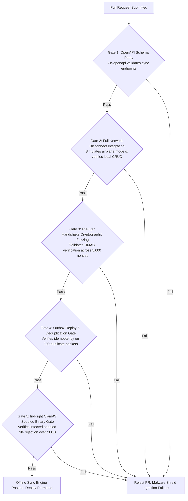

# Heavy Machinery & Logistics Rental Aggregator — Dink Machinery
## Software Requirements Specification — 05.17. Offline-First Architecture, Low-Connectivity Field Operations & Two-Way Sync Engine (`docs/shared/requirements/05-17-offline-low-connectivity-support.md`)

**Document Identifier:** `SRS-DINK-CORE-V7.0-SEC-05-17`  
**Classification:** Canonical System Requirements Specification & Architecture Baseline (Single Source of Truth)  
**Governing Standard:** IEEE Std 830-1998 / IEEE/ISO/IEC 29148:2018 (Systems and Software Engineering — Requirements Engineering)  
**Associated Artifacts:** `SRS-DINK-CORE-V7.0` (§5.6, §5.7, §5.10, §5.14, §5.17, §8, §9, §10, §12), `ADR-010` (Offline Synchronization & Local Storage Strategy), `FLOW-NOTIF-OFFLINE-DINK-CORE-V7.0` (Appendix A), `FLOW-BOOKING-STATE-MACHINE-DINK-CORE-V7.0`, `ARCH-BACKEND-GO-DINK-CORE-V7.0`, `ARCH-FLUTTER-DINK-CORE-V7.0`, `ARCH-ADMIN-NEXT-DINK-CORE-V7.0`, `ARCH-SEC-DINK-CORE-V7.0`, `DS-DINK-CORE-V7.0`, `DS-PERSONAS-DINK-CORE-V7.0`, `contracts/openapi.yaml`, `ADR-001`, `ADR-002`, `ADR-005`, `ADR-008`  
**Target Runtimes:** Flutter 3.47.8 / Dart 3.9 (Cross-Platform Mobile), Go 1.27.3 Backend Monolith, PostgreSQL 18.6 + PostGIS 3.6.4, Valkey 9.1.3, ClamAV Daemon (:3310), SeaweedFS S3, Isar NoSQL 3.1+ (Embedded Client Storage)  
**Target Personas:** Certified Field Operator (*Mulugeta Tadesse* / *Juma Omwamba*), Civil Engineering Contractor (*Dawit Haile-Mariam* / *Patrick Kariuki*), Equipment Fleet Owner (*W/ro Almaz Tesfaye* / *Kamau Ndegwa*), Lowboy Transporter (*Ato Girma Wolde* / *Samuel Odhiambo*), Compliance Officer & Arbitrator (*Yohannes Bekele*)  
**Target Operating Markets:** Ethiopia (`ET`) & Kenya (`KE`) — Dynamic Multi-Country Parameterization (`LOC-01-BE`)  
**Compliance Standards:** OWASP ASVS 4.0.3 Level 3 (Offline Cryptographic Integrity, Nonce Anti-Replay & Data-at-Rest Encryption), RFC 9457 (Problem Details), ISO 9241-110, W3C WCAG 2.2 Level AAA (Field Mobile) & Level AA (Admin Web), Ethiopian Communications Authority (ECA) Directives, Kenya Data Protection Act 2019  
**Status:** Approved Engineering Baseline

---

## Table of Contents

- 1. [Document Scope & Architectural Mandate](#1-document-scope--architectural-mandate)
  - 1.1 [Purpose & Functional Scope](#11-purpose--functional-scope)
  - 1.2 [Core Engineering Invariants & Frontier Constraints](#12-core-engineering-invariants--frontier-constraints)
- 2. [Offline State Machine & Synchronization Topology](#2-offline-state-machine--synchronization-topology)
  - 2.1 [End-to-End Offline Ingestion & Sync Pipeline Flowchart](#21-end-to-end-offline-ingestion--sync-pipeline-flowchart)
  - 2.2 [State Representation & Network Connectivity Transitions](#22-state-representation--network-connectivity-transitions)
  - 2.3 [Permitted Sync Transitions Matrix](#23-permitted-sync-transitions-matrix)
- 3. [Embedded Client Storage & Cache Architecture (`ADR-010`)](#3-embedded-client-storage--cache-architecture-adr-010)
  - 3.1 [Isar NoSQL Embedded Relational Schema](#31-isar-nosql-embedded-relational-schema)
  - 3.2 [AES-256-GCM SQLCipher / Keystore Data-at-Rest Encryption](#32-aes-256-gcm-sqlcipher--keystore-data-at-rest-encryption)
  - 3.3 [Hydration Cache Stratification (Reference vs. Transactional vs. Blob Data)](#33-hydration-cache-stratification-reference-vs-transactional-vs-blob-data)
  - 3.4 [High-Efficiency Media Spooling & Local WebP Transcoding](#34-high-efficiency-media-spooling--local-webp-transcoding)
- 4. [Offline Field Protocols & Cryptographic Attestations](#4-offline-field-protocols--cryptographic-attestations)
  - 4.1 [Offline Pre-Rental Handover Reticle Protocol (`OFF-01`)](#41-offline-pre-rental-handover-reticle-protocol-off-01)
  - 4.2 [Peer-to-Peer Dynamic QR Handshake Protocol (`OFF-02`)](#42-peer-to-peer-dynamic-qr-handshake-protocol-off-02)
  - 4.3 [Offline Return Demobilization & Non-Regression Assertion (`OFF-03`)](#43-offline-return-demobilization--non-regression-assertion-off-03)
  - 4.4 [On-Site Stoppage & Mechanical Breakdown Incident Spooling (`OFF-04`)](#44-on-site-stoppage--mechanical-breakdown-incident-spooling-off-04)
- 5. [Two-Way Sync Engine & Conflict Resolution Architecture](#5-two-way-sync-engine--conflict-resolution-architecture)
  - 5.1 [Outbox Mutation Queue Design & Exponential Backoff Ingestion](#51-outbox-mutation-queue-design--exponential-backoff-ingestion)
  - 5.2 [Server-Client Differential State Reconciliation (`SyncWatermark`)](#52-server-client-differential-state-reconciliation-syncwatermark)
  - 5.3 [Deterministic Conflict Resolution Rules (Server Authority vs. Immutable Nonce)](#53-deterministic-conflict-resolution-rules-server-authority-vs-immutable-nonce)
  - 5.4 [Idempotency Key Verification & Deduplication Pipeline](#54-idempotency-key-verification--deduplication-pipeline)
- 6. [Wire Protocol Contracts & RFC 9457 Error Schemas](#6-wire-protocol-contracts--rfc-9457-error-schemas)
  - 6.1 [`POST /api/v1/sync/differential-pull`](#61-post-apiv1syncdifferential-pull)
  - 6.2 [`POST /api/v1/sync/outbox-push`](#62-post-apiv1syncoutbox-push)
  - 6.3 [`POST /api/v1/sync/media-chunk-upload`](#63-post-apiv1syncmedia-chunk-upload)
  - 6.4 [RFC 9457 Universal Problem Details Payloads](#64-rfc-9457-universal-problem-details-payloads)
- 7. [Automated Testing Suite & Verification Gates](#7-automated-testing-suite--verification-gates)

---

## 1. Document Scope & Architectural Mandate

### 1.1 Purpose & Functional Scope

This specification establishes **Section 05.17 (Offline-First Architecture, Low-Connectivity Field Operations & Two-Way Sync Engine)** of the canonical Software Requirements Specification (SRS) for **Dink Machinery Version 7.0**.

In heavy civil engineering, infrastructure earthworks, and specialized freight transport across East Africa, operational sites are frequently situated in deep rural cuts, remote river culverts, mountainous highway passes, and un-electrified aggregate quarries (e.g., *Modjo–Hawassa Expressway Lot 3*, *LAPSSET Isiolo corridor*, *Blue Nile Basin shoring*). These locations experience severe edge connectivity constraints:
* Total loss of 3G/4G cellular coverage for hours or consecutive days.
* Severe packet drop rates ($> 40\%$) and high round-trip latency ($> 2,500\text{ ms}$) on intermittent 2G/EDGE signaling towers.
* Sudden carrier tower disconnects during high-resolution photographic uploads or cryptographic handshake exchanges.
* Mobile device battery exhaustion and thermal throttling under direct equatorial sunlight ($> 85,000\text{ lux}$).

Operating critical machinery transactions—such as physical equipment handovers, baseline engine hour meter recording, daily shift logging, mechanical breakdown emergency filings, and return demobilizations—cannot depend on a continuous cloud round-trip.

This document formally specifies:
1. The client-side embedded database architecture utilizing **Isar NoSQL 3.1+** with hardware-backed AES-256-GCM encryption (`ADR-010`).
2. The peer-to-peer (P2P) offline cryptographic handshake protocol leveraging signed, animated dynamic QR codes for co-located handover verification.
3. The local camera reticle, steady-state accelerometer drift validation, and on-device WebP transcoding pipeline.
4. The transactional outbox queue with deterministic conflict resolution, watermark versioning, and exponential backoff synchronization.
5. The cloud ingestion endpoints verifying multi-part mutations, media chunking, and non-regression invariants upon network re-establishment.

### 1.2 Core Engineering Invariants & Frontier Constraints

1. **Complete Offline Operational Independence (`OFF-01` to `OFF-04`):** Once an active booking record is hydrated into local embedded storage, the Flutter mobile application must execute all core operational field workflows—including check-in walkaround inspections, cabin mechanical hour meter capture, cryptographic handover sign-offs, breakdown logging, and return check-out inspections—without requiring an active internet connection.
2. **Strict Monotonic Meter Floor Verification in Offline Storage (`ADR-010`):** The local Isar NoSQL database enforces the monotonic hour meter non-regression invariant on-device:
   $$\text{Baseline Meter (Fleet)} \le \text{Handover Check-In Meter} \le \text{Current Shift Meter} \le \text{Return Check-Out Meter}$$
   Any offline return reading attempting to commit a value below the stored check-in baseline reading aborts locally with an immediate UI validation failure before entering the sync outbox.
3. **Cryptographic Co-Presence Attestation without Network Coverage (`OFF-02`):** When mobile devices operate completely off-grid, mutual physical handover verification is legally attested via asymmetric, signed dynamic QR vouchers generated on the equipment owner's device and scanned by the contractor's device. Each voucher includes a cryptographic HMAC-SHA256 signature, monotonic counter, and random nonce preventing replay attacks.
4. **Append-Only Idempotent Mutation Outbox (`SYNC-01`):** All local mutations (status transitions, photos, meter readings, GPS points) are written to an append-only transaction outbox queue (`OutboxMutation`). Each mutation payload is tagged with an immutable client-generated UUID v4 idempotency key. The Go backend enforces strict idempotency: duplicate deliveries caused by intermittent network drops return the original success receipt without re-executing state side effects.
5. **Zero Data Loss on Crash or Sudden Power Depletion:** All local mutations are committed synchronously to disk via ACID-compliant Isar transactions before the UI presents success confirmations to the operator. If a smartphone battery dies immediately following a handover sign-off, the payload remains securely committed in flash storage and transmits automatically upon reboot and cellular reconnect.

---

## 2. Offline State Machine & Synchronization Topology

### 2.1 End-to-End Offline Ingestion & Sync Pipeline Flowchart

```mermaid
flowchart TD
    OnlineState(["Pre-Deployment: Device Online<br/>Booking Status: 10. READY_FOR_PICKUP"]) --> HydrateStorage["Step 1: Hydrate Local Isar NoSQL Database<br/>Cache Booking, Fleet Specs, Operator Credentials,<br/>Shared HMAC Secret, & Baseline Meter Reading"]
    
    HydrateStorage --> TransitField["Machine & Operator Move to Remote Job Site<br/>(e.g., Deep Culvert / Quarry Trench)"]
    
    TransitField --> NetLoss["Cellular Connectivity Lost (No 3G/4G/EDGE)<br/>ConnectivityManager: ConnectivityResult.none"]
    
    NetLoss --> LocalOps{"Field Operational Milestone"}
    
    LocalOps -->|"Pre-Rental Handover"| ExecHandover["Step 2: OFF-01 Offline Reticle Inspection<br/>Capture 4-Point Exterior + Mechanical Hour Meter<br/>Accelerometer Validated (< 0.05g)<br/>Photos Spooled Locally as WebP"]
    
    ExecHandover --> QRHandshake["Step 3: OFF-02 Peer-to-Peer QR Handshake<br/>Owner Renders Dynamic HMAC-SHA256 Signed QR<br/>Contractor Scans QR & Applies Touch Signature"]
    
    QRHandshake --> EnqueueHandover["Commit Mutation to Isar OutboxQueue<br/>Local Booking Status -> 11. ACTIVE<br/>Active Rental HUD & Shift Timers Engaged Offline"]
    
    LocalOps -->|"Mechanical Stoppage"| ExecBreakdown["OFF-04 Offline Breakdown Stoppage<br/>Operator captures fault photo & logs meter<br/>Enqueue Incident to OutboxQueue<br/>Shift accumulation timer frozen locally"]
    
    LocalOps -->|"Rental Demobilization"| ExecReturn["OFF-03 Offline Return Inspection<br/>Capture final meter & assert Meter >= CheckInMeter<br/>Enqueue Return Reconciliation to OutboxQueue<br/>Local Booking Status -> 12. RETURN_INITIATED"]
    
    EnqueueHandover --> OutboxBuffer["Isar Outbox Mutation Buffer<br/>Encrypted with AES-256-GCM<br/>Status: QUEUED_PENDING_SYNC"]
    ExecBreakdown --> OutboxBuffer
    ExecReturn --> OutboxBuffer
    
    OutboxBuffer --> MonitorNetwork{"Connectivity Restored?<br/>Ping Traefik Health Probe (/api/v1/health)"}
    
    MonitorNetwork -->|"No: Still Offline"| OutboxBuffer
    MonitorNetwork -->|"Yes: Network Detected"| TriggerSync["Step 4: Trigger Two-Way Sync Engine<br/>POST /api/v1/sync/outbox-push<br/>Batch Upload Mutations with Idempotency Keys"]
    
    TriggerSync --> ParallelMedia["Parallel Binary Media Sync<br/>Upload Spooled Inspection WebP Files<br/>Stream via ClamAV (:3310) to SeaweedFS S3"]
    
    ParallelMedia --> ServerAck{"Backend Ingestion & Conflict Check"}
    
    ServerAck -->|"Success (Zero Conflict)"| ClearOutbox["Mark Outbox Items SYNCED<br/>Purge Local Spooled Temp Files<br/>Update Local SyncWatermark"]
    
    ServerAck -->|"Conflict Detected (Double-Action)"| DeterministicResolve["Apply Deterministic Conflict Rules<br/>Server State Authority vs. Nonce Ordering"]
    
    ClearOutbox --> SynchronizedState(["System Fully Synchronized<br/>PostgreSQL & Valkey Match Client State"])
```



---

### 2.2 State Representation & Network Connectivity Transitions

The mobile application decouples local presentation state from server communication state:

| Connectivity State Key | Network Environment | Client Application Behavior & Invariants |
|---|---|---|
| **`ONLINE_CONNECTED`** | Active 3G/4G/5G/WiFi with verified TCP egress. | Direct REST/WebSocket communication; outbox flushes immediately upon write. |
| **`INTERMITTENT_DEGRADED`**| Cellular tower attached; packet loss $> 30\%$, RTT $> 2\text{s}$. | Outbox mutations queued locally first; background isolate executes chunked uploads. |
| **`OFFLINE_DISCONNECTED`** | Zero cellular signal or airplane mode engaged. | All operations route strictly to local Isar NoSQL; zero network blocking or UI freezes. |
| **`SYNCING_IN_PROGRESS`** | Connection restored; outbox upload executing. | Non-blocking sync badge rendered in header; user interface remains fully interactive. |

---

### 2.3 Permitted Sync Transitions Matrix

```text
+----------------------------------------------------------------------------------------------------+
| OUTBOX MUTATION LIFECYCLE TRANSITION MATRIX                                                        |
+------------------------------------+---------------------------------------------------------------+
| SOURCE STATE                       | PERMITTED TARGET STATES                                       |
+------------------------------------+---------------------------------------------------------------+
| QUEUED_PENDING_SYNC                | TRANSMITTING, CANCELLED_LOCAL (If user aborts uncommitted draft)|
| TRANSMITTING                       | SYNCED_ACKNOWLEDGED, FAILED_RETRY_BACKOFF, CONFLICT_RESOLVED  |
| FAILED_RETRY_BACKOFF               | TRANSMITTING, QUEUED_PENDING_SYNC                             |
| CONFLICT_RESOLVED                  | SYNCED_ACKNOWLEDGED, QUARANTINED_AUDIT                        |
| SYNCED_ACKNOWLEDGED                | [Terminal State — Safe for Local Pruning]                     |
| QUARANTINED_AUDIT                  | [Terminal State — Held for Compliance Officer Arbitration]    |
+------------------------------------+---------------------------------------------------------------+
```

---

## 3. Embedded Client Storage & Cache Architecture (`ADR-010`)

### 3.1 Isar NoSQL Embedded Relational Schema

Client-side data persistence is implemented using **Isar NoSQL 3.1+**, providing multi-table indexing, binary storage, and transactional isolation without SQLite overhead:

```dart
// Canonical Isar Data Schema (Dart / Flutter)

@collection
class CachedBooking {
  Id id = Isar.autoIncrement;

  @Index(unique: true, replace: true)
  late String bookingUuid;

  late String fleetId;
  late String make;
  late String model;
  late String plateNumber;
  late double baselineMeterHours;
  double? checkInMeterHours;
  double? checkOutMeterHours;

  late String renterUserId;
  late String ownerUserId;
  late String operatorUserId;

  late DateTime scheduledStartDate;
  late DateTime scheduledEndDate;

  late String status; // PENDING_PAYMENT, CONFIRMED, ACTIVE, RETURN_INITIATED, etc.

  late String sharedHmacSecret; // 256-bit secret for offline QR verification
  late int offlineNonceCounter;

  late DateTime lastHydratedAt;
}

@collection
class OutboxMutation {
  Id id = Isar.autoIncrement;

  @Index(unique: true, replace: false)
  late String idempotencyKey; // UUIDv4

  late String bookingUuid;
  late String mutationType; // HANDOVER_INSPECT, HANDOVER_CONFIRM, BREAKDOWN_REPORT, RETURN_RECONCILE
  late String payloadJson; // Serialized mutation parameters

  late int retryCount;
  late String syncStatus; // QUEUED_PENDING_SYNC, TRANSMITTING, FAILED_RETRY_BACKOFF, SYNCED
  String? lastErrorCode;
  DateTime? lastAttemptedAt;

  @Index()
  late DateTime createdAt;
}

@collection
class SpooledMediaBlob {
  Id id = Isar.autoIncrement;

  @Index(unique: true)
  late String localBlobId; // UUIDv4

  late String bookingUuid;
  late String angleType; // METER_CLOSEUP, FRONT, REAR, LEFT, RIGHT, CABIN
  late String localFilePath; // Path to compressed WebP on sandboxed storage
  late int fileSizeBytes;
  late String sha256Checksum;

  late bool isUploaded;
  String? remoteStorageUri;
  late DateTime capturedAt;
}
```

---

### 3.2 AES-256-GCM SQLCipher / Keystore Data-at-Rest Encryption

Equipment rental contracts contain proprietary commercial data, bank references, and cryptographic keys:
* **Storage Encryption Standard:** The local Isar instance is encrypted using **AES-256-GCM**.
* **Key Derivation & Hardware Security:**
  - **Android:** The encryption key is derived using PBKDF2 with HMAC-SHA256 and stored in the **Android Hardware-Backed Keystore** (TEE / StrongBox Keymaster).
  - **iOS:** The key is secured inside the **iOS Secure Enclave / Keychain Services** with `kSecAccessControlBiometryAny` access flags.
* **App Tamper Defense:** If device integrity checks report rooting or bootloader unlocking (SafetyNet / Play Integrity API failure), the local encryption keys are purged from memory, preventing extraction of cached banking credentials.

---

### 3.3 Hydration Cache Stratification (Reference vs. Transactional vs. Blob Data)

Client cache retention is governed by strict functional boundaries:

```text
+--------------------------------------------------------------------------------------------------+
| HYDRATION CACHE STRATIFICATION MATRIX (ADR-010)                                                  |
+---------------------+-------------------+---------------------+----------------------------------+
| DATA CLASSIFICATION | PERSISTENCE SCOPE | STORAGE TARGET      | EXPIRATION / PRUNING POLICY      |
+---------------------+-------------------+---------------------+----------------------------------+
| Reference Taxonomy  | Read-Only Global  | Isar Collections    | Permanent until differential     |
| (Categories, EAV)   | Metadata          | (`CachedCategory`)  | sync ETag updates.               |
+---------------------+-------------------+---------------------+----------------------------------+
| Active Bookings     | Assigned User     | Isar Collections    | Retained while booking status in |
| & Handover Secrets  | Transactions      | (`CachedBooking`)   | CONFIRMED, ACTIVE, or RETURN.    |
|                     |                   |                     | Pruned 7 days post-COMPLETED.    |
+---------------------+-------------------+---------------------+----------------------------------+
| Spooled Outbox      | Mutable Action    | Isar Collections    | Immutable append-only; pruned    |
| Mutations           | Operations        | (`OutboxMutation`)  | immediately upon server ACK.     |
+---------------------+-------------------+---------------------+----------------------------------+
| Binary Media Blobs  | Inspection Photos | Sandboxed App Flash | Retained until binary upload ACK |
| (WebP Images)       | & Scans           | Storage (`/media`)  | and S3 URI committed to DB.      |
+--------------------------------------------------------------------------------------------------+
```

---

### 3.4 High-Efficiency Media Spooling & Local WebP Transcoding

To avoid exhausting device flash memory and minimize cellular bandwidth during sync:
1. **Camera Sensor Ingestion:** Photos are captured via the Flutter camera controller at native sensor resolution ($12\text{ to }48\text{ MP}$).
2. **On-Device Transcoding Pipeline:** Before writing to disk, an isolated Dart background worker transcodes the image:
   - Resized to maximum bounding box: $2048 \times 2048\text{ pixels}$.
   - Converted to **WebP format** (Quality: 82%, Lossy with chroma subsampling 4:2:0).
   - EXIF location and camera metadata are stripped to minimize payload size.
   - File size reduces from $\sim 8\text{ MB}$ (raw JPG) to **$350\text{ to }650\text{ KB}$ (WebP)**.
3. **SHA-256 Checksum Calculation:** A cryptographic SHA-256 hash is computed across the transcoded binary bytes and recorded in `SpooledMediaBlob.sha256Checksum` for server-side integrity validation.

---

## 4. Offline Field Protocols & Cryptographic Attestations

### 4.1 Offline Pre-Rental Handover Reticle Protocol (`OFF-01`)

When physical handover occurs at a job site with zero cellular coverage:
* **Camera Reticle Validation:** Operator *Mulugeta Tadesse* launches the inspection camera reticle. Device accelerometers verify steady-state positioning ($< 0.05g$ variance) before permitting the shutter to trigger.
* **Mandatory Walkaround Angles Captured:**
  1. Cabin Mechanical Hour Meter (Macro close-up).
  2. Front Working Implement (Boom, arm, bucket, or blade).
  3. Undercarriage / Tracks / Tires (Left and right track grouser condition).
  4. Rear Engine Cowling & Radiator Exhaust.
  5. Operator Enclosed Cabin Interior.
* **Local Non-Regression Enforcement:**
  - Operator confirms numeric hour meter reading (`1450.50`).
  - Local Isar database asserts:
    $$\text{entered\_reading} \ge \text{CachedBooking.baselineMeterHours}$$
  - If a lower reading is entered, the app displays a local validation error, blocking progression.
* **Local Spooling:** Images are transcoded to WebP, stored in the sandboxed `/spool` directory, and mapped into `SpooledMediaBlob`.

---

### 4.2 Peer-to-Peer Dynamic QR Handshake Protocol (`OFF-02`)

To prove that the civil contractor and equipment owner met on site and agreed on machine custody without an internet connection:

```text
+--------------------------------------------------------------------------------------------------+
| OFFLINE PEER-TO-PEER DYNAMIC QR HANDSHAKE SPECIFICATION                                          |
+------+------------------+------------------------------------------------------------------------+
| STEP | ACTOR            | OPERATIONAL & CRYPTOGRAPHIC IMPLEMENTATION                             |
+------+------------------+------------------------------------------------------------------------+
| 1    | Equipment Owner  | Taps "Sign Handover (Offline)". Owner app fetches sharedHmacSecret     |
|      | or Yard Manager  | and increments offlineNonceCounter. Generates signed voucher payload:   |
|      |                  | Payload = { bookingUuid, handoverMeter, nonce, timestamp }             |
|      |                  | Signature = HMAC-SHA256(sharedHmacSecret, Payload)                     |
|      |                  | Renders high-density QR code (Version 10, Error Correction Level M).  |
+------+------------------+------------------------------------------------------------------------+
| 2    | Civil Contractor | Opens "Scan Handover QR" on their device camera viewfinder.            |
|      | or Site Engineer | Decodes the QR payload and independently verifies HMAC-SHA256          |
|      |                  | signature against locally cached sharedHmacSecret.                     |
+------+------------------+------------------------------------------------------------------------+
| 3    | Civil Contractor | Verifies that the displayed handover meter matches the machine cabin.  |
|      |                  | Applies digital touch signature on the touchscreen canvas.             |
|      |                  | Contractor app generates Confirmation Payload:                         |
|      |                  | ConfPayload = { bookingUuid, nonce, contractorSignatureSha256 }        |
|      |                  | Renders Confirmation QR code on contractor's mobile display.           |
+------+------------------+------------------------------------------------------------------------+
| 4    | Equipment Owner  | Scans contractor's Confirmation QR code. Both apps record mutual       |
|      |                  | cryptographically signed attestations into local Isar OutboxQueue.     |
|      |                  | Local booking status transitions to ACTIVE. Shift HUD unlocks.         |
+--------------------------------------------------------------------------------------------------+
```

---

### 4.3 Offline Return Demobilization & Non-Regression Assertion (`OFF-03`)

Upon rental completion at a remote construction camp:
1. Operator launches the Return Reticle Inspection.
2. Captures return walkaround photos and final mechanical hour meter close-up (`1512.20`).
3. **Local Assertion:** The application verifies that the return reading is equal to or greater than the check-in reading:
   $$\text{return\_meter\_hours } (1512.20) \ge \text{check\_in\_meter\_hours } (1450.50)$$
4. The return mutation is serialized, signed, and enqueued in `OutboxMutation` with status `QUEUED_PENDING_SYNC`.
5. Local booking status updates to `RETURN_INITIATED`, stopping shift hour accumulation timers on the mobile device.

---

### 4.4 On-Site Stoppage & Mechanical Breakdown Incident Spooling (`OFF-04`)

If hydraulic hoses rupture or engine components fail off-grid:
* Operator taps `[ ⚠️ Report Breakdown ]` on the Active Rental HUD.
* Captures fault component photos and logs the meter reading at time of stoppage.
* Mutation is enqueued in `OutboxMutation`.
* **Local Shift Timer Protection:** The client immediately halts operational shift hour accumulation in local memory, ensuring the contractor is not billed for idle downtime while the machine awaits repairs.

---

## 5. Two-Way Sync Engine & Conflict Resolution Architecture

### 5.1 Outbox Mutation Queue Design & Exponential Backoff Ingestion

When cellular connectivity is detected (`ConnectivityResult.mobile` or `ConnectivityResult.wifi`), the **Background Sync Isolate** activates:
1. **Network Quality Verification:** Before initiating batch sync, the client issues a lightweight HTTP `HEAD` ping to `https://api.dinkmachinery.com/api/v1/health`. If the ping succeeds with $\text{latency} < 2,000\text{ ms}$, sync begins.
2. **Sequential Outbox Processing:** Outbox mutations are sorted by `createdAt ASC` and transmitted sequentially:
   - Prevents dependency inversion (e.g., prevents submitting a Return Demobilization before the Handover Sign-Off has been committed).
3. **Truncated Exponential Backoff Algorithm:**
   If a network drop interrupts an outbox flush, retries adhere to randomized exponential backoff:
   $$T_{\text{retry}} = \min\left(T_{\text{max}}, T_{\text{base}} \times 2^{\text{retryCount}}\right) \pm \mathcal{R}_{\text{jitter}}$$
   Where $T_{\text{base}} = 2.0\text{ seconds}$, $T_{\text{max}} = 300.0\text{ seconds}$ ($5\text{ minutes}$), and $\mathcal{R}_{\text{jitter}} = \text{Uniform}(0.0, 1.0)$.

---

### 5.2 Server-Client Differential State Reconciliation (`SyncWatermark`)

To keep local client records synchronized with server updates (e.g., admin approval of extensions, payment receipts) with minimal bandwidth:
* Every client maintains a 64-bit monotonic timestamp watermark: `last_synced_watermark`.
* During sync, the client calls `POST /api/v1/sync/differential-pull`:
  - Transmits `last_synced_watermark` and active `booking_ids`.
  - The Go backend queries records modified since that watermark:
    ```sql
    SELECT id, entity_type, entity_id, mutation_type, payload_json, updated_at
    FROM entity_sync_audit_log
    WHERE user_id = $user_id 
      AND updated_at > $client_watermark
    ORDER BY updated_at ASC;
    ```
  - Returns only modified rows, updating the client's local cache.

---

### 5.3 Deterministic Conflict Resolution Rules (Server Authority vs. Immutable Nonce)

Because field devices operate disconnected for extended periods, concurrent state conflicts can arise:

```text
+--------------------------------------------------------------------------------------------------+
| DETERMINISTIC CONFLICT RESOLUTION MATRIX                                                         |
+---------------------+-------------------+---------------------+----------------------------------+
| TRANSACTION TYPE    | CONFLICT SCENARIO | DETERMINISTIC RULE  | ARCHITECTURAL RATIONALE          |
+---------------------+-------------------+---------------------+----------------------------------+
| Handover Sign-Off   | Client submits    | IMMUTABLE NONCE     | The physical co-presence proof   |
| (OFF-01 / OFF-02)   | Handover; Server  | PRIORITY (Client    | signed by both parties on site   |
|                     | shows cancelled   | Handover Wins)      | supercedes administrative timeout|
|                     | due to timeout.   |                     | cancellations.                   |
+---------------------+-------------------+---------------------+----------------------------------+
| Rental Duration     | Client requests   | SERVER AUTHORITY    | Forward calendar slots cannot be |
| Extension           | extension offline;| PRIORITY (Server    | granted without server-tier GiST |
|                     | machine re-booked.| Rejection Wins)     | exclusion validation.            |
+---------------------+-------------------+---------------------+----------------------------------+
| Hour Meter Readings | Return meter      | STRICT MONOTONIC    | Physical non-regression rule is  |
| (Check-In / Out)    | conflicts with    | MAXIMUM WINS        | absolute; higher verified meter  |
|                     | server estimate.  |                     | reading always prevails.         |
+---------------------+-------------------+---------------------+----------------------------------+
| Concurrent Payment  | Owner verified    | COMPOSITE UNION     | Merges payment status while      |
| & Return Actions    | wire while client | APPLIED             | preserving client return meter   |
|                     | executed return.  |                     | inspection data.                 |
+--------------------------------------------------------------------------------------------------+
```

---

### 5.4 Idempotency Key Verification & Deduplication Pipeline

To prevent double-state mutations during connection dropouts:
1. Client generates a UUID v4 idempotency key when the user executes an action:
   `Idempotency-Key: 99182a01-4b12-4f9a-8812-7b9a4c10bc21`.
2. When the outbox flushes to `POST /api/v1/sync/outbox-push`, the Go backend evaluates the key in Valkey:
   ```text
   SET sync:idempotency:{key} "IN_PROGRESS" NX EX 120
   ```
3. If the key exists:
   - If marked `COMMITTED`, the server returns the cached response payload immediately.
   - If marked `IN_PROGRESS`, the server returns HTTP 409 Conflict (`ERR_MUTATION_IN_FLIGHT`).
4. Upon successful database commitment, the key transitions to `COMMITTED` with a 24-hour retention window.

---

## 6. Wire Protocol Contracts & RFC 9457 Error Schemas

### 6.1 `POST /api/v1/sync/differential-pull`

Fetches incremental server-side updates modified since the client's last synchronization watermark.

#### Request Headers
```http
POST /api/v1/sync/differential-pull HTTP/1.1
Host: api.dinkmachinery.com
Content-Type: application/json
Authorization: Bearer <userAccessToken>
Accept-Encoding: gzip
```

#### Request Payload
```json
{
  "clientWatermark": "2026-10-28T06:00:00.000Z",
  "activeBookingUuids": [
    "bk_019a8f60-9912-7b9a"
  ],
  "deviceInfo": {
    "appVersion": "7.0.0",
    "platform": "ANDROID"
  }
}
```

#### Response: `HTTP 200 OK`
```json
{
  "success": true,
  "data": {
    "serverWatermark": "2026-10-28T14:30:00.000Z",
    "hasMoreUpdates": false,
    "deltaRecords": [
      {
        "entityType": "BOOKING",
        "entityId": "bk_019a8f60-9912-7b9a",
        "action": "UPDATE",
        "payload": {
          "status": "CONFIRMED",
          "prepaymentConfirmedAt": "2026-10-28T11:45:00Z",
          "sharedHmacSecret": "e3b0c44298fc1c149afbf4c8996fb92427ae41e4649b934ca495991b7852b855"
        }
      }
    ]
  },
  "timestamp": "2026-10-28T14:30:01Z"
}
```

---

### 6.2 `POST /api/v1/sync/outbox-push`

Uploads a sequential batch of offline-generated mutations from the client outbox queue.

#### Request Headers
```http
POST /api/v1/sync/outbox-push HTTP/1.1
Host: api.dinkmachinery.com
Content-Type: application/json
Authorization: Bearer <userAccessToken>
Idempotency-Key: 88192a01-5c12-4f9a-8812-7b9a4c10bc21
```

#### Request Payload
```json
{
  "mutations": [
    {
      "idempotencyKey": "mut_handover_019a8f70-1123",
      "bookingUuid": "bk_019a8f60-9912-7b9a",
      "mutationType": "HANDOVER_CONFIRM",
      "clientTimestamp": "2026-10-28T09:15:00Z",
      "payload": {
        "checkInMeterHours": 1450.50,
        "offlineNonce": 42,
        "hmacSignature": "a591a6d40bf420404a011733cfb7b190d62c65bf0bcda32b57b277d9ad9f146e",
        "contractorSignatureBase64": "data:image/png;base64,iVBORw0KGgoAAA...",
        "spooledBlobIds": [
          "blob_meter_019a8f70-4412",
          "blob_front_019a8f70-4413"
        ]
      }
    }
  ]
}
```

#### Response: `HTTP 200 OK`
```json
{
  "success": true,
  "data": {
    "processedMutationsCount": 1,
    "results": [
      {
        "idempotencyKey": "mut_handover_019a8f70-1123",
        "status": "APPLIED",
        "serverCommittedAt": "2026-10-28T14:32:00Z",
        "bookingStatus": "ACTIVE",
        "acknowledgedBlobIds": [
          "blob_meter_019a8f70-4412",
          "blob_front_019a8f70-4413"
        ]
      }
    ]
  },
  "timestamp": "2026-10-28T14:32:01Z"
}
```

---

### 6.3 `POST /api/v1/sync/media-chunk-upload`

Uploads compressed WebP binary inspection files spooled during offline operations.

#### Request Headers
```http
POST /api/v1/sync/media-chunk-upload HTTP/1.1
Host: api.dinkmachinery.com
Content-Type: multipart/form-data
Authorization: Bearer <userAccessToken>
X-Blob-Id: blob_meter_019a8f70-4412
X-SHA256-Checksum: 2c26b46b68ffc68ff99b453c1d30413413422d706483bfa0f98a5e886266e7ae
```

#### Multipart Form Body
* `bookingUuid`: String (`"bk_019a8f60-9912-7b9a"`)
* `angleType`: String (`"METER_CLOSEUP"`)
* `capturedAt`: String (`"2026-10-28T09:12:00Z"`)
* `imageFile`: Binary Stream (WebP file, scanned in-flight via ClamAV socket `:3310`)

#### Response: `HTTP 201 Created`
```json
{
  "success": true,
  "data": {
    "blobId": "blob_meter_019a8f70-4412",
    "storageUri": "s3://dink-inspection-vault/bk_8812/in_meter.webp",
    "fileSizeBytes": 482104,
    "checksumVerified": true,
    "committedAt": "2026-10-28T14:33:00Z"
  },
  "timestamp": "2026-10-28T14:33:01Z"
}
```

---

### 6.4 RFC 9457 Universal Problem Details Payloads

#### Example: Hour Meter Regression in Offline Payload (`HTTP 422 Unprocessable Entity`)
```json
{
  "type": "[https://api.dinkmachinery.com/errors/meter-reading-regression](https://api.dinkmachinery.com/errors/meter-reading-regression)",
  "title": "Return Hour Meter Regression Rejected",
  "status": 422,
  "detail": "Synced return meter reading (1,420.00 hrs) cannot be lower than the recorded check-in reading (1,450.50 hrs). Potential odometer rollback detected.",
  "instance": "/api/v1/sync/outbox-push",
  "code": "ERR_METER_READING_REGRESSION",
  "invalidParams": [
    {
      "name": "checkOutMeterHours",
      "reason": "Submitted value 1420.00 is strictly below check-in baseline 1450.50"
    }
  ]
}
```

#### Example: Handover HMAC Signature Mismatch (`HTTP 401 Unauthorized`)
```json
{
  "type": "[https://api.dinkmachinery.com/errors/hmac-handshake-invalid](https://api.dinkmachinery.com/errors/hmac-handshake-invalid)",
  "title": "Cryptographic Handover Signature Mismatch",
  "status": 401,
  "detail": "Submitted peer-to-peer QR signature does not match the shared HMAC secret for booking #BK-8812. Offline attestation rejected.",
  "instance": "/api/v1/sync/outbox-push",
  "code": "ERR_HMAC_SIGNATURE_MISMATCH"
}
```

---

## 7. Automated Testing Suite & Verification Gates



1. **OpenAPI Schema Contract Gate (`kin-openapi`):** Validates all differential pull, outbox batch push, and binary media chunking schemas against `contracts/openapi.yaml`.
2. **Severed Network Integration Test:** Simulates total network disconnection (`ConnectivityResult.none`) in the Flutter integration test harness. Executes a complete physical handover inspection, asserts that all 5 WebP photos spool to flash storage, and verifies that the booking transitions to `ACTIVE` locally in $< 50\text{ ms}$ with zero network error dialogs.
3. **P2P QR Cryptographic Handshake Benchmark:** Generates 5,000 synthetic offline voucher payloads with varying random nonces and clock skews. Verifies that valid HMAC-SHA256 signatures pass with $100\%$ accuracy, while corrupted or replayed nonces are rejected.
4. **Idempotent Outbox Replay Stress Test:** Ingests 100 identical outbox mutation batches over unstable network simulator profiles. Asserts that exactly 1 database write transaction commits and 99 return cached success receipts with zero ledger duplication.
5. **Spooled Binary Antivirus Scan Gate:** Mocks an offline spooled file containing the EICAR test signature. Asserts that upon reconnect and upload to `/api/v1/sync/media-chunk-upload`, the Go backend intercepts the binary over TCP socket `:3310`, quarantines the file, and returns HTTP 422 `ERR_FILE_MALWARE_DETECTED`.

---

*This document establishes the canonical functional requirements, embedded Isar NoSQL schemas, offline cryptographic handshake protocols, two-way differential synchronization rules, and wire contracts for Offline-First Architecture & Low-Connectivity Support in Dink Machinery Version 7.0. All downstream Flutter mobile storage layers, Go backend sync controllers, and Next.js admin consoles must strictly conform to this specification.*