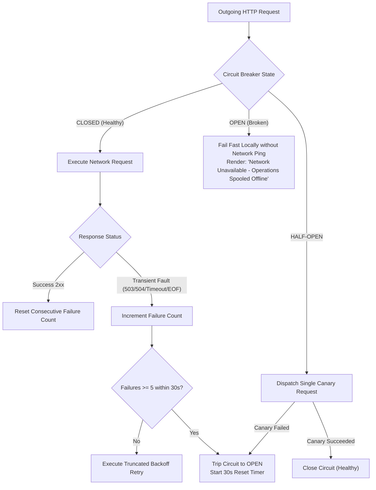
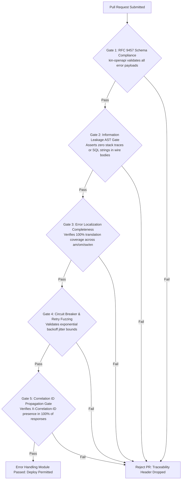

# Heavy Machinery & Logistics Rental Aggregator — Dink Machinery
## Software Requirements Specification — 05.18. Error Handling, Resilience & User Feedback Architecture (`docs/shared/requirements/05-18-error-handling-user-feedback.md`)

**Document Identifier:** `SRS-DINK-CORE-V7.0-SEC-05-18`  
**Classification:** Canonical System Requirements Specification & Resilience Baseline (Single Source of Truth)  
**Governing Standard:** IEEE Std 830-1998 / IEEE/ISO/IEC 29148:2018 (Systems and Software Engineering — Requirements Engineering)  
**Associated Artifacts:** `SRS-DINK-CORE-V7.0` (§5.6, §5.7, §5.10, §5.14, §5.16, §5.17, §5.18, §8, §10, §12), `RFC 9457` (Problem Details for HTTP APIs), `FLOW-NOTIF-OFFLINE-DINK-CORE-V7.0`, `FLOW-BOOKING-STATE-MACHINE-DINK-CORE-V7.0`, `ARCH-BACKEND-GO-DINK-CORE-V7.0`, `ARCH-FLUTTER-DINK-CORE-V7.0`, `ARCH-ADMIN-NEXT-DINK-CORE-V7.0`, `ARCH-SEC-DINK-CORE-V7.0`, `DS-DINK-CORE-V7.0`, `DS-PERSONAS-DINK-CORE-V7.0`, `contracts/openapi.yaml`, `ADR-001`, `ADR-002`, `ADR-005`, `ADR-008`, `ADR-010`  
**Target Runtimes:** Go 1.24 Backend Monolith, Flutter 3.44 / Dart 3.9 (Cross-Platform Mobile), Next.js 16 / React 19 (Web Admin & Corporate Portal), PostgreSQL 18.4 + PostGIS 3.4, Valkey 8.0, ClamAV Daemon (:3310), SeaweedFS S3, Isar NoSQL 3.1+  
**Target Personas:** Certified Field Operator (*Mulugeta Tadesse* / *Juma Omwamba*), Civil Engineering Contractor (*Dawit Haile-Mariam* / *Patrick Kariuki*), Equipment Fleet Owner (*W/ro Almaz Tesfaye* / *Kamau Ndegwa*), Lowboy Transporter (*Ato Girma Wolde* / *Samuel Odhiambo*), Compliance Officer & Arbitrator (*Yohannes Bekele*)  
**Target Operating Markets:** Ethiopia (`ET`) & Kenya (`KE`) — Dynamic Multi-Country Parameterization (`LOC-01-BE`)  
**Compliance Standards:** OWASP ASVS 4.0.3 Level 3 (Error Handling, Sensitive Data Leakage Defense & Logging Architecture), RFC 9457 (Problem Details for HTTP APIs), ISO 9241-110, W3C WCAG 2.2 Level AAA (Field Mobile) & Level AA (Admin Web), Ethiopian Communications Authority (ECA) Directives, Kenya Data Protection Act 2019  
**Status:** Approved Engineering Baseline

---

## Table of Contents

- 1. [Document Scope & Architectural Mandate](#1-document-scope--architectural-mandate)
  - 1.1 [Purpose & Functional Scope](#11-purpose--functional-scope)
  - 1.2 [Core Architectural Principles & Error Defense Invariants](#12-core-architectural-principles--error-defense-invariants)
- 2. [RFC 9457 Universal Problem Details Standard](#2-rfc-9457-universal-problem-details-standard)
  - 2.1 [Wire Protocol Envelope Schema](#21-wire-protocol-envelope-schema)
  - 2.2 [Canonical Machine-Readable Error Codes Taxonomy](#22-canonical-machine-readable-error-codes-taxonomy)
  - 2.3 [Localized Problem Details Synthesis & i18n Mapping](#23-localized-problem-details-synthesis--i18n-mapping)
- 3. [Client-Side Error Presentation & Feedback Modalities](#3-client-side-error-presentation--feedback-modalities)
  - 3.1 [Field-Optimized Feedback Hierarchy (Snackbars, Modals, Full-Screen Shields)](#31-field-optimized-feedback-hierarchy-snackbars-modals-full-screen-shields)
  - 3.2 [Actionable Guidance & One-Tap Remediation Pathways](#32-actionable-guidance--one-tap-remediation-pathways)
  - 3.3 [Glove-Friendly Recovery Interactions & High-Contrast Visual Cues](#33-glove-friendly-recovery-interactions--high-contrast-visual-cues)
  - 3.4 [Haptic Feedback & Acoustic Alerting for Critical Failures](#34-haptic-feedback--acoustic-alerting-for-critical-failures)
- 4. [Network Resilience, Retries & Offline Fallback](#4-network-resilience-retries--offline-fallback)
  - 4.1 [Transient Fault Detection & Circuit Breaker Architecture](#41-transient-fault-detection--circuit-breaker-architecture)
  - 4.2 [Truncated Exponential Backoff with Jitter Formulation](#42-truncated-exponential-backoff-with-jitter-formulation)
  - 4.3 [Degraded Network Ingress & Offline State Banners](#43-degraded-network-ingress--offline-state-banners)
  - 4.4 [Optimistic UI Mutation Rollback Engine](#44-optimistic-ui-mutation-rollback-engine)
- 5. [Domain-Specific Error Handlers & Boundary Invariants](#5-domain-specific-error-handlers--boundary-invariants)
  - 5.1 [Booking Concurrency Collisions & Standby Queue Promotion](#51-booking-concurrency-collisions--standby-queue-promotion)
  - 5.2 [Monotonic Meter Rollback Violations & Anti-Tampering Shield](#52-monotonic-meter-rollback-violations--anti-tampering-shield)
  - 5.3 [Financial Ledger Settlement & Wire Evidence Rejections](#53-financial-ledger-settlement--wire-evidence-rejections)
  - 5.4 [Malware Ingestion Traps & Media Transcoding Failures](#54-malware-ingestion-traps--media-transcoding-failures)
- 6. [Observability, Sentry Integration & Administrative Triage](#6-observability-sentry-integration--administrative-triage)
  - 6.1 [Structured Error Logging Pipeline & Redaction Architecture](#61-structured-error-logging-pipeline--redaction-architecture)
  - 6.2 [Correlation ID (`X-Correlation-ID`) & Distributed Trace Propagation](#62-correlation-id-x-correlation-id--distributed-trace-propagation)
  - 6.3 [Sentry DSN Routing & Anonymized Crash Reporting](#63-sentry-dsn-routing--anonymized-crash-reporting)
  - 6.4 [Next.js Central System Health & Triage Workbench (`AD-06-WEB`)](#64-nextjs-central-system-health--triage-workbench-ad-06-web)
- 7. [Wire Protocol Contracts & RFC 9457 Payloads](#7-wire-protocol-contracts--rfc-9457-payloads)
  - 7.1 [Field Validation Failure Payload (`HTTP 422`)](#71-field-validation-failure-payload-http-422)
  - 7.2 [Concurrency Collision Payload (`HTTP 409`)](#72-concurrency-collision-payload-http-409)
  - 7.3 [Authentication Token Expiration Payload (`HTTP 401`)](#73-authentication-token-expiration-payload-http-401)
  - 7.4 [Administrative Delinquency Lockout Payload (`HTTP 423`)](#74-administrative-delinquency-lockout-payload-http-423)
  - 7.5 [Downstream Third-Party Gateway Timeout Payload (`HTTP 504`)](#75-downstream-third-party-gateway-timeout-payload-http-504)
- 8. [Automated Testing Suite & Verification Gates](#8-automated-testing-suite--verification-gates)

---

## 1. Document Scope & Architectural Mandate

### 1.1 Purpose & Functional Scope

This specification establishes **Section 05.18 (Error Handling, Resilience & User Feedback Architecture)** of the canonical Software Requirements Specification (SRS) for **Dink Machinery Version 7.0**.

In heavy machinery aggregation and civil logistics across Ethiopia and Kenya, the impact of software failures directly intersects with commercial liability and field safety:
* When a mobile network drops during an excavator handover in a remote riverbed quarry, displaying a generic `"Something went wrong"` screen strands multi-ton machinery, triggers site delay penalties ($25,000.00\text{ to }60,000.00\text{ ETB/day}$), and erodes user trust.
* When a civil contractor's 50% advance wire slip is rejected, cryptic database errors or blank screens create financial panic regarding capital location.
* In vibrating machinery cabs under blinding equatorial sunlight ($> 85,000\text{ lux}$), operators using split-leather work gloves cannot decipher dense stack traces, tiny warning alerts, or ambiguous confirmation dialogs.

This document establishes the architecture for system errors, edge recovery, and feedback:
1. Standardizing all API error payloads under **RFC 9457 (Problem Details for HTTP APIs)**, enriched with localized, human-actionable guidance in Amharic, Afaan Oromoo, Swahili, and English.
2. The client-side feedback hierarchy in Flutter and Next.js, enforcing high-contrast, glove-friendly recovery pathways.
3. Network fault detection, circuit breakers, truncated exponential backoff, and optimistic UI rollbacks.
4. Domain-specific exception handling across state machines, monotonic hour meters, and financial ledgers.
5. Structured observability, distributed trace propagation, Sentry triage, and administrative error monitoring.

### 1.2 Core Architectural Principles & Error Defense Invariants

1. **Universal RFC 9457 Compliance:** Every non-$2\text{xx}$ HTTP response emitted by the Go backend monolith, Traefik edge proxies, or Next.js server actions must conform strictly to RFC 9457 using `Content-Type: application/problem+json`. Raw text error responses, empty bodies, and non-standard JSON envelopes are strictly barred.
2. **Zero Information Leakage Invariant (OWASP ASVS 4.0.3 §13.2):** Internal stack traces, raw SQL queries, database table schemas, internal hostnames, and cryptographic keys must never be exposed across public API wire responses. Public `detail` attributes must provide sanitized, human-comprehensible remediation instructions.
3. **Actionable Remediation Invariant:** An error message without a path to recovery is a defective system state. Every client-facing error must provide at least one concrete action (e.g., `[ Retry Connection ]`, `[ Edit Wire Reference ]`, `[ View Standby Queue ]`, `[ Call Toll-Free Support ]`).
4. **Correlation Traceability:** Every error instance generates or inherits an immutable correlation identifier (`X-Correlation-ID: UUIDv4`). This identifier is propagated across all Go microservices, database transaction logs, and client problem responses, enabling instant diagnostic retrieval.
5. **Field Ergonometric Parity (`DS-DINK-CORE-V7.0`):** Error recovery actions on mobile must provide a minimum hit box of **$56 \times 56\text{ dp}$** and satisfy **WCAG 2.2 Level AAA** contrast ($\ge 7.0:1$) against dark backgrounds, preventing operational abandonment during harsh environmental conditions.

---

## 2. RFC 9457 Universal Problem Details Standard

### 2.1 Wire Protocol Envelope Schema

All API error responses implement the standardized RFC 9457 contract:

```json
{
  "type": "[https://api.dinkmachinery.com/errors/concurrency-reservation-collision](https://api.dinkmachinery.com/errors/concurrency-reservation-collision)",
  "title": "Machine Currently Held Under Checkout Lease",
  "status": 409,
  "detail": "Caterpillar 320D #ET-3-99120 was locked by another contractor 4 minutes ago. You can join the Standby Queue to reserve your priority.",
  "instance": "/api/v1/bookings",
  "code": "ERR_CONCURRENT_RESERVATION_COLLISION",
  "correlationId": "cor_019a8fe0-8812-7b9a-bc21-4491204812aa",
  "timestamp": "2026-10-28T12:00:00Z",
  "invalidParams": [
    {
      "name": "fleetId",
      "reason": "Active lease hold:fleet:flt_019a8f2c-8812-7b9a exists (TTL: 3342s)"
    }
  ],
  "links": {
    "remediationAction": "JOIN_STANDBY_QUEUE",
    "supportContact": "tel:8190"
  }
}
```

#### JSON Field Specifications
* **`type` (URI, Required):** Absolute URI referencing documentation for the error condition.
* **`title` (String, Required):** Short, human-readable summary of the problem type (does not change across instances of the same error).
* **`status` (Integer, Required):** HTTP status code emitted by the server (`400`, `401`, `403`, `404`, `409`, `422`, `423`, `500`, `503`, `504`).
* **`detail` (String, Required):** Localized, context-specific narrative explaining the exact occurrence and actionable remedy.
* **`instance` (URI, Required):** Relative request URI that generated the error.
* **`code` (String, Required):** Machine-readable internal error token used for client-side programmatic branching.
* **`correlationId` (String, Required):** Immutable UUID linking client feedback to server logs.
* **`invalidParams` (Array, Optional):** Array of specific parameter-level validation errors (mandatory for `HTTP 422`).
* **`links` (Object, Optional):** Contextual hypermedia action triggers directing client-side routing.

---

### 2.2 Canonical Machine-Readable Error Codes Taxonomy

```text
+--------------------------------------------------------------------------------------------------+
| DINK MACHINERY CANONICAL ERROR CODES TAXONOMY                                                    |
+-------------------------------------+------------+-----------------------------------------------+
| INTERNAL ERROR CODE (`code`)        | HTTP CODE  | FUNCTIONAL DOMAIN & OCCURRENCE PERIMETER      |
+-------------------------------------+------------+-----------------------------------------------+
| ERR_UNAUTHENTICATED_TOKEN_EXPIRED   | 401 Unauth | JWT expired or cryptographic signature failed.|
| ERR_CHALLENGE_PIN_MISMATCH          | 401 Unauth | Handover HMAC 6-digit challenge PIN incorrect.|
| ERR_INSUFFICIENT_RBAC_PERMISSIONS   | 403 Forbid | User role lacks required permission scope.    |
| ERR_WALLET_OVERDRAFT_EXCEEDED       | 403 Forbid | Commission debt exceeds approved credit limit.|
| ERR_RESOURCE_NOT_FOUND              | 404 NotFnd | Booking, fleet, or user UUID not found.       |
| ERR_CONCURRENT_RESERVATION_COLLISION| 409 Confl  | Active Valkey hold lease on requested fleet.  |
| ERR_TEMPORAL_CALENDAR_OVERLAP       | 409 Confl  | PostgreSQL GiST range intersection detected.  |
| ERR_MUTATION_IN_FLIGHT              | 409 Confl  | Duplicate idempotency key currently running.  |
| ERR_DAMAGE_WINDOW_EXPIRED           | 410 Gone   | Statutory 24h damage audit window elapsed.    |
| ERR_METER_READING_REGRESSION        | 422 Unproc | Check-out meter less than check-in baseline.  |
| ERR_FILE_MALWARE_DETECTED           | 422 Unproc | In-flight ClamAV daemon detected virus stream.|
| ERR_INVALID_TAX_TIN_FORMAT          | 422 Unproc | Ethiopian 10-digit TIN checksum mismatch.     |
| ERR_ACCOUNT_DELINQUENT_LOCKED       | 423 Locked | Overdue commission debt >30 days; search lock.|
| ERR_INTERNAL_SERVER_EXCEPTION       | 500 Server | Uncaught application panic or database fault. |
| ERR_THIRD_PARTY_CARRIER_TIMEOUT     | 504 TimeOut| Downstream Ethio Telecom / Safaricom gateway. |
+--------------------------------------------------------------------------------------------------+
```

---

### 2.3 Localized Problem Details Synthesis & i18n Mapping

The Go backend synthesizes localized `detail` and `title` text dynamically using the client's `Accept-Language` header:
* **Translation Injection:** The error middleware intercepts internal error tokens and matches them against `LocalizationKey` entries in the `errors` namespace (SRS 05.16).
* **Token Parameterization:** Parameters (e.g., `{meter}`, `{amount}`, `{minDays}`) are bound into Mustache strings:
  - English: `"Return meter (1,420.00) cannot be less than check-in reading (1,450.50)."`
  - Amharic: `"የተመዘገበው የሰዓት ቆጣሪ (1,420.00) ከርክክብ መነሻ ቁጥር (1,450.50) ሊያንስ አይችልም።"`
  - Afaan Oromoo: `"Lakkoofsi sa'aatii deebii (1,420.00) isa fuudhaa (1,450.50) gadi ta'uu hin danda'u."`
  - Swahili: `"Kipimo cha kurudi (1,420.00) hakiwezi kuwa chini ya kile cha kuanzia (1,450.50)."`

---

## 3. Client-Side Error Presentation & Feedback Modalities

### 3.1 Field-Optimized Feedback Hierarchy (Snackbars, Modals, Full-Screen Shields)

The Flutter mobile application routes errors to one of three visual presentation tiers based on operational severity:

```text
+--------------------------------------------------------------------------------------------------+
| CLIENT-SIDE FEEDBACK PRESENTATION HIERARCHY                                                      |
+---------------------+-------------------+---------------------+----------------------------------+
| FEEDBACK TIER       | HTTP & ERROR KEYS | COMPONENT RENDERING | OPERATIONAL BEHAVIOR             |
+---------------------+-------------------+---------------------+----------------------------------+
| Transient Toast     | 400 Validation,   | High-contrast dark  | Non-blocking; floats at bottom;  |
| / Snackbar          | Network Reconnect | snackbar with white | auto-dismisses after 4.0s or     |
|                     |                   | text & amber action | dismissed via manual swipe.      |
+---------------------+-------------------+---------------------+----------------------------------+
| Contextual Bottom   | 409 Collision,    | Modal bottom sheet  | Blocks active view; requires user|
| Sheet Drawer        | 422 Meter Floor,  | with warning icon,  | selection (e.g., [ Join Queue ]  |
|                     | 401 PIN Mismatch  | explanation, & 2 CTAs| or [ Edit Meter Input ]).        |
+---------------------+-------------------+---------------------+----------------------------------+
| Full-Screen Error   | 423 Delinquent,   | Dedicated full-page | Complete UI takeover; persistent |
| Shield              | 500 Crash,        | viewport; dark      | correlation ID display; 1-tap    |
|                     | 403 Banned Account| background, CTA     | support hotline dial action.     |
+---------------------+-------------------+---------------------+----------------------------------+
```

---

### 3.2 Actionable Guidance & One-Tap Remediation Pathways

Error presentation components are strictly bound to remediation dispatchers:
* **Concurrency Collision (`ERR_CONCURRENT_RESERVATION_COLLISION`):**
  Renders modal: *"Machine Currently Held by Another Contractor"* $\longrightarrow$ Action Button: `[ Join Standby Queue (Priority 1) ]`.
* **Meter Reading Regression (`ERR_METER_READING_REGRESSION`):**
  Renders sheet: *"Check-Out Reading Lower Than Check-In"* $\longrightarrow$ Action Button: `[ Re-Launch Camera Reticle & Inspect ]`.
* **Delinquent Account Lockout (`ERR_ACCOUNT_DELINQUENT_LOCKED`):**
  Renders full-screen shield: *"Account Suspended: Overdue Commission"* $\longrightarrow$ Action Button: `[ Top Up Wallet via CBE Mobile Banking ]`.

---

### 3.3 Glove-Friendly Recovery Interactions & High-Contrast Visual Cues

To ensure usability in vibrating machinery cabs and muddy work sites:
* **Visual Styling:** High-contrast Pure Black (`#000000`) canvas with Safety Yellow (`#FACC15`) and Signal Red (`#DC2626`) accents ($\ge 7.0:1$ WCAG AAA contrast).
* **Hit Target Sizing:** Dismiss and retry buttons enforce a strict minimum size of **$56 \times 56\text{ dp}$** with an $8\text{ dp}$ clearance margin.
* **Non-Relational Multi-Modal Cues:** Every error state renders both an explicit geometric icon (e.g., warning triangle, locked padlock) and textual description to support color-blind and low-literacy operators.

---

### 3.4 Haptic Feedback & Acoustic Alerting for Critical Failures

When a critical error occurs:
* **Tactile Rumble:** The Flutter client engages device vibration motors using a distinctive 300ms double-pulse haptic pattern:
  ```dart
  HapticFeedback.heavyImpact();
  await Future.delayed(const Duration(milliseconds: 100));
  HapticFeedback.heavyImpact();
  ```
* **Acoustic Penetration:** In noisy excavator operating cabs ($85\text{ to }115\text{ dBA}$), P0 validation errors play a sharp, frequency-modulated alert chime ($2.5\text{ kHz}$ to $4.0\text{ kHz}$) cutting through low-frequency engine rumbles.

---

## 4. Network Resilience, Retries & Offline Fallback

### 4.1 Transient Fault Detection & Circuit Breaker Architecture

The Flutter client network layer (encapsulating Dart `Dio` / `Http`) implements an automated circuit breaker:



---

### 4.2 Truncated Exponential Backoff with Jitter Formulation

When retrying idempotent mutations across volatile cellular networks, requests adhere to randomized exponential backoff:

$$T_{\text{backoff}} = \min\left(T_{\text{max}}, T_{\text{base}} \times 2^{\text{attempt}}\right) + \mathcal{R}_{\text{jitter}}$$

Where:
* $T_{\text{base}} = 1.5\text{ seconds}$
* $T_{\text{max}} = 60.0\text{ seconds}$
* $\mathcal{R}_{\text{jitter}} = \text{UniformRandom}(0.0, 1.0)\text{ seconds}$
* **Max Attempts:** 4 automatic retries before falling back to the offline outbox queue.

---

### 4.3 Degraded Network Ingress & Offline State Banners

When cellular connectivity degrades or severs completely:
* **Non-Disruptive Header Banner:** An amber, high-contrast banner slides into view below the app bar:
  ```text
  [ ⚠️ Offline Mode: Working Off-Grid. Mutations Spooled to Local Outbox. ]
  ```
* **Read-Only Degradation:** Search viewports switch to reading cached results from local Isar NoSQL storage (`ADR-010`).
* **Non-Blocking Operation:** Handover walkarounds and shift tracking continue uninterrupted, spooling records to local flash memory.

---

### 4.4 Optimistic UI Mutation Rollback Engine

When the client performs optimistic updates (e.g., tapping `[ Confirm Payment ]` immediately updates the local UI):
* The client records an in-memory snapshot of the pre-mutation state.
* If the server responds with a non-$2\text{xx}$ error (e.g., HTTP 409 Conflict):
  1. The UI animates smoothly back to the original state.
  2. The local Isar cache reverts the uncommitted transaction.
  3. A bottom sheet modal appears explaining why the action could not be completed on the server.

---

## 5. Domain-Specific Error Handlers & Boundary Invariants

### 5.1 Booking Concurrency Collisions & Standby Queue Promotion

When two contractors attempt to book the identical machine simultaneously:
* The second request encounters a Valkey hold lease and triggers an atomic rollback:
  ```text
  HTTP 409 Conflict (code: ERR_CONCURRENT_RESERVATION_COLLISION)
  ```
* The UI catches this code specifically and displays the **Standby Queue Promotion Sheet**:
  - *"Contractor Patrick Kariuki has an active 60-minute payment hold on this Caterpillar 320D."*
  - *"Join the Standby Queue. If Patrick fails to upload wire confirmation within 56 minutes, this machine will be offered exclusively to you for 30 minutes."*

---

### 5.2 Monotonic Meter Rollback Violations & Anti-Tampering Shield

If an operator attempts to submit a return hour meter lower than check-in:
* Caught both client-side in Isar NoSQL and server-side in Go:
  ```text
  HTTP 422 Unprocessable Entity (code: ERR_METER_READING_REGRESSION)
  ```
* Prevents silent failure or generic database errors.
* Displays side-by-side verification: Handover Photo & Reading (`1450.50`) vs. Entered Return Reading (`1420.00`).
* Flushes an audit flag to the administrative compliance console: `POTENTIAL_METER_TAMPERING_FLAGGED`.

---

### 5.3 Financial Ledger Settlement & Wire Evidence Rejections

When an equipment owner declines an uploaded bank transfer slip (`FLOW-08`):
* System enforces structured rejection codes (`FUNDS_NOT_RECEIVED`, `INCORRECT_AMOUNT`, `UNREADABLE_SLIP`).
* Contractor receives a P0 alert containing the exact reason code and three remediation buttons:
  1. `[ Upload Clearer Stamped Voucher ]` (Re-initiates verification).
  2. `[ Cancel Booking (Zero Penalty) ]` (Releases hold cleanly).
  3. `[ Open Dispute to Compliance Desk ]` (Escalates to arbitration).

---

### 5.4 Malware Ingestion Traps & Media Transcoding Failures

When a contractor uploads an infected PDF or corrupted image:
* In-flight ClamAV daemon (:3310) detects the threat and terminates the TCP socket.
* Returns `HTTP 422 Unprocessable Entity (code: ERR_FILE_MALWARE_DETECTED)`.
* Client renders clear guidance: *"Security Alert: The uploaded document failed virus scanning. Please upload an original document directly from your camera or bank portal."*
* Zero corrupted bytes touch SeaweedFS S3 storage.

---

## 6. Observability, Sentry Integration & Administrative Triage

### 6.1 Structured Error Logging Pipeline & Redaction Architecture

Every system failure is recorded in JSON format by the Go structured logging engine (`uber-go/zap`):

```json
{
  "level": "error",
  "timestamp": "2026-10-28T12:00:00.124Z",
  "correlationId": "cor_019a8fe0-8812-7b9a-bc21-4491204812aa",
  "caller": "booking/service.go:412",
  "message": "concurrency reservation lease collision detected",
  "errorCode": "ERR_CONCURRENT_RESERVATION_COLLISION",
  "userId": "usr_018f6a9e-876b-7341",
  "bookingId": "bk_019a8f60-9912-7b9a",
  "fleetId": "flt_019a8f2c-8812-7b9a",
  "ipAddress": "197.156.88.12",
  "userAgent": "DinkMachinery/7.0.0 (Android 15; Tecno Camon 30)",
  "errorDetails": "Valkey key hold:fleet:flt_8812 exists with TTL 3342s"
}
```

* **Automated PII Redaction:** Passwords, national Kebele ID numbers, full bank account numbers, and JWT tokens are automatically redacted via regex before writing to log buffers.

---

### 6.2 Correlation ID (`X-Correlation-ID`) & Distributed Trace Propagation

* Ingress edge proxies (Traefik) generate a unique `X-Correlation-ID` header if not provided by the client.
* Propagated across HTTP request headers, Go context objects (`context.Context`), database query comment tags, and external API requests.
* When a user contacts the call center, they can quote the 6-character short-code suffix rendered on their error screen (e.g., `REF: 4812AA`), allowing support agents to instantly locate the exact server stack trace in OpenSearch / Sentry.

---

### 6.3 Sentry DSN Routing & Anonymized Crash Reporting

* Uncaught exceptions on mobile (Flutter `FlutterError.onError`) and web (Next.js Global Error Boundary) stream to an on-premise or managed **Sentry** instance.
* Captures device model, OS version, free memory, battery percentage, active booking state, and the last 10 breadcrumb user actions.
* User personal data is anonymized; users are identified exclusively by their system UUID.

---

### 6.4 Next.js Central System Health & Triage Workbench (`AD-06-WEB`)

Platform engineering and compliance staff monitor live error rates via the **Central System Health Dashboard**:
* Real-time charts tracking HTTP $4\text{xx}$ and $5\text{xx}$ error velocity per minute.
* Filter by Error Code, Target Jurisdiction (`ET` vs. `KE`), and Carrier Rail (CBE, Ethio Telecom, Safaricom).
* One-click deep link to correlated Sentry traces and PostgreSQL transaction audit logs.

---

## 7. Wire Protocol Contracts & RFC 9457 Payloads

### 7.1 Field Validation Failure Payload (`HTTP 422`)

Emitted when client form inputs fail strict domain validation bounds.

#### Response Headers
```http
HTTP/1.1 422 Unprocessable Entity
Content-Type: application/problem+json
X-Correlation-ID: cor_019a8fe0-8812-7b9a-bc21-4491204812aa
```

#### Response Body
```json
{
  "type": "[https://api.dinkmachinery.com/errors/invalid-field-payload](https://api.dinkmachinery.com/errors/invalid-field-payload)",
  "title": "Field Validation Failed",
  "status": 422,
  "detail": "The submitted registration form contains 2 invalid fields. Please review highlighted inputs.",
  "instance": "/api/v1/auth/register-owner",
  "code": "ERR_INVALID_FIELD_PAYLOAD",
  "correlationId": "cor_019a8fe0-8812-7b9a-bc21-4491204812aa",
  "timestamp": "2026-10-28T12:05:00Z",
  "invalidParams": [
    {
      "name": "tinNumber",
      "reason": "Ethiopian Tax Identification Number must be exactly 10 numeric digits."
    },
    {
      "name": "bankAccountNumber",
      "reason": "Commercial Bank of Ethiopia account numbers must be exactly 13 digits."
    }
  ]
}
```

---

### 7.2 Concurrency Collision Payload (`HTTP 409`)

Emitted when two contractors attempt to claim the identical fleet asset.

#### Response Headers
```http
HTTP/1.1 409 Conflict
Content-Type: application/problem+json
X-Correlation-ID: cor_019a8fe0-9914-4c12-8812-7b9a4c10bc21
```

#### Response Body
```json
{
  "type": "[https://api.dinkmachinery.com/errors/concurrent-reservation-collision](https://api.dinkmachinery.com/errors/concurrent-reservation-collision)",
  "title": "Asset Currently Held Under Checkout Lease",
  "status": 409,
  "detail": "This machine is currently locked under an active 60-minute payment hold by another contractor. Join the Standby Queue to reserve your priority.",
  "instance": "/api/v1/bookings",
  "code": "ERR_CONCURRENT_RESERVATION_COLLISION",
  "correlationId": "cor_019a8fe0-9914-4c12-8812-7b9a4c10bc21",
  "timestamp": "2026-10-28T12:06:00Z",
  "links": {
    "standbyQueueEndpoint": "/api/v1/bookings/standby-queue",
    "fleetId": "flt_019a8f2c-8812-7b9a"
  }
}
```

---

### 7.3 Authentication Token Expiration Payload (`HTTP 401`)

Emitted when access tokens expire during active mobile session interaction.

#### Response Headers
```http
HTTP/1.1 401 Unauthorized
Content-Type: application/problem+json
WWW-Authenticate: Bearer error="invalid_token", error_description="The access token expired"
X-Correlation-ID: cor_019a8fe0-3341-1a09-8812-7b9a4c10bc21
```

#### Response Body
```json
{
  "type": "[https://api.dinkmachinery.com/errors/unauthenticated-token-expired](https://api.dinkmachinery.com/errors/unauthenticated-token-expired)",
  "title": "Authentication Token Expired",
  "status": 401,
  "detail": "Your session has expired. Please refresh your credentials or sign in again.",
  "instance": "/api/v1/owner/wallet",
  "code": "ERR_UNAUTHENTICATED_TOKEN_EXPIRED",
  "correlationId": "cor_019a8fe0-3341-1a09-8812-7b9a4c10bc21",
  "timestamp": "2026-10-28T12:07:00Z"
}
```

---

### 7.4 Administrative Delinquency Lockout Payload (`HTTP 423`)

Emitted when an owner attempts catalog mutations while under a delinquency freeze.

#### Response Headers
```http
HTTP/1.1 423 Locked
Content-Type: application/problem+json
X-Correlation-ID: cor_019a8fe0-7712-4f9a-8812-7b9a4c10bc21
```

#### Response Body
```json
{
  "type": "[https://api.dinkmachinery.com/errors/account-delinquent-locked](https://api.dinkmachinery.com/errors/account-delinquent-locked)",
  "title": "Account Delinquent — Operations Locked",
  "status": 423,
  "detail": "Your wallet has an unsettled commission debt of 42,500.00 ETB overdue for 32 days. All fleet listings are de-indexed. Top up your wallet to clear sanctions.",
  "instance": "/api/v1/fleets/flt_019a8f2c-8812-7b9a",
  "code": "ERR_ACCOUNT_DELINQUENT_LOCKED",
  "correlationId": "cor_019a8fe0-7712-4f9a-8812-7b9a4c10bc21",
  "timestamp": "2026-10-28T12:08:00Z",
  "links": {
    "topUpInstructions": "/api/v1/owner/wallet/top-up-coordinates"
  }
}
```

---

### 7.5 Downstream Third-Party Gateway Timeout Payload (`HTTP 504`)

Emitted when domestic telecom SMS gateways experience network outages.

#### Response Headers
```http
HTTP/1.1 504 Gateway Timeout
Content-Type: application/problem+json
X-Correlation-ID: cor_019a8fe0-4412-4a12-8812-7b9a4c10bc21
```

#### Response Body
```json
{
  "type": "[https://api.dinkmachinery.com/errors/third-party-carrier-timeout](https://api.dinkmachinery.com/errors/third-party-carrier-timeout)",
  "title": "Telecom Carrier Gateway Timeout",
  "status": 504,
  "detail": "Ethio Telecom SMS signaling gateway failed to acknowledge OTP dispatch within 30 seconds. System automatically escalating to WhatsApp fallback.",
  "instance": "/api/v1/auth/request-otp",
  "code": "ERR_THIRD_PARTY_CARRIER_TIMEOUT",
  "correlationId": "cor_019a8fe0-4412-4a12-8812-7b9a4c10bc21",
  "timestamp": "2026-10-28T12:09:00Z"
}
```

---

## 8. Automated Testing Suite & Verification Gates



1. **RFC 9457 Schema Compliance Gate (`kin-openapi`):** Validates all error responses emitted by Go handlers against `contracts/openapi.yaml`, asserting that `type`, `title`, `status`, `detail`, `code`, and `correlationId` are strictly present.
2. **Information Leakage Static AST Gate:** Scans the entire codebase to assert that raw error objects (`err.Error()`, SQL drivers, panic traces) are never passed directly to API serializers without wrapping in a sanitized domain problem constructor.
3. **Multilingual Error Localization Test:** Evaluates all registered `ERR_*` tokens across Amharic, Afaan Oromoo, Swahili, and English localization dictionaries, verifying that zero translation fallbacks are triggered on core error flows.
4. **Circuit Breaker & Backoff Fuzzing Benchmark:** Simulates 500 transient 503 and network timeout scenarios against the client network layer, asserting that backoff intervals adhere to exponential jitter formulas and the circuit breaker trips open after 5 consecutive faults in $< 30\text{ seconds}$.
5. **Correlation ID End-to-End Tracing Gate:** Dispatches synthetic requests with and without `X-Correlation-ID` headers, verifying that $100\%$ of error logs and client responses contain matching, traceable UUIDs.

---

*This document establishes the canonical functional requirements, wire protocol schemas, feedback presentation hierarchies, network resilience algorithms, and observability contracts for Error Handling, Resilience & User Feedback in Dink Machinery Version 7.0. All downstream Flutter mobile widgets, Go backend domain services, and Next.js admin consoles must strictly conform to this specification.*