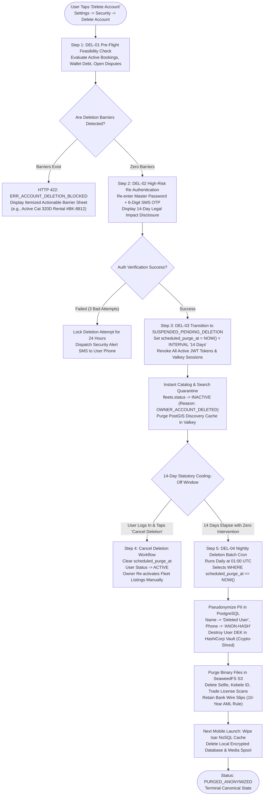
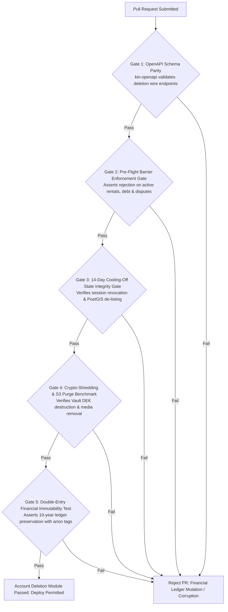

# Heavy Machinery & Logistics Rental Aggregator — Dink Machinery
## Software Requirements Specification — 05.19. Account Deletion, Right to Erasure & Data Retention Architecture (`docs/shared/requirements/05-19-account-deletion.md`)

**Document Identifier:** `SRS-DINK-CORE-V7.0-SEC-05-19`  
**Classification:** Canonical System Requirements Specification & Data Governance Baseline (Single Source of Truth)  
**Governing Standard:** IEEE Std 830-1998 / IEEE/ISO/IEC 29148:2018 (Systems and Software Engineering — Requirements Engineering)  
**Associated Artifacts:** `SRS-DINK-CORE-V7.0` (§5.1, §5.9, §5.10, §5.11, §5.13, §5.17, §5.18, §8, §10, §12), `FLOW-ENTRY-DINK-CORE-V7.0` (Interaction Flow 01), `FLOW-BOOKING-STATE-MACHINE-DINK-CORE-V7.0`, `FLOW-COMMISSION-DEBT-DINK-CORE-V7.0`, `ARCH-BACKEND-GO-DINK-CORE-V7.0`, `ARCH-FLUTTER-DINK-CORE-V7.0`, `ARCH-ADMIN-NEXT-DINK-CORE-V7.0`, `ARCH-SEC-DINK-CORE-V7.0`, `DS-DINK-CORE-V7.0`, `DS-PERSONAS-DINK-CORE-V7.0`, `contracts/openapi.yaml`, `ADR-001`, `ADR-002`, `ADR-005`, `ADR-008`, `ADR-010`  
**Target Runtimes:** Go 1.27.3 Backend Monolith, Flutter 3.47.8 / Dart 3.9 (Cross-Platform Mobile), Next.js 16.x (latest CVE security patch) / React 19 (Web Admin & Corporate Portal), PostgreSQL 18.6 + PostGIS 3.6.4, Valkey 9.1.3, ClamAV Daemon (:3310), SeaweedFS S3, Isar NoSQL 3.1+  
**Target Personas:** Civil Engineering Contractor (*Dawit Haile-Mariam* / *Patrick Kariuki*), Equipment Fleet Owner (*W/ro Almaz Tesfaye* / *Kamau Ndegwa*), Certified Field Operator (*Mulugeta Tadesse* / *Juma Omwamba*), Compliance Officer & Data Protection Officer (*Yohannes Bekele*), Finance Controller & Revenue Auditor (*Solomon Kassa*)  
**Target Operating Markets:** Ethiopia (`ET`) & Kenya (`KE`) — Dynamic Multi-Country Parameterization (`LOC-01-BE`)  
**Compliance Standards:** OWASP ASVS 4.0.3 Level 3 (Data Purging, Cryptographic Erasure & Audit Trail Immutability), Apple App Store Review Guidelines §5.1.1(v) (Account Deletion Requirement), Google Play Policy (User Data Deletion), Kenya Data Protection Act 2019 (§40 Right to Erasure / Rectification), Ethiopian Communications Authority (ECA) Data Protection Directives, National Bank of Ethiopia (NBE) Financial Record Retention Directives (10-Year Statutory Floor), Kenya Revenue Authority (KRA) Tax Retention Laws  
**Status:** Approved Engineering Baseline

---

## Table of Contents

- 1. [Document Scope & Architectural Mandate](#1-document-scope--architectural-mandate)
  - 1.1 [Purpose & Functional Scope](#11-purpose--functional-scope)
  - 1.2 [Core Legal & Architectural Invariants](#12-core-legal--architectural-invariants)
- 2. [Account Deletion Finite State Machine & Lifecycle Topology](#2-account-deletion-finite-state-machine--lifecycle-topology)
  - 2.1 [End-to-End Erasure Lifecycle Flowchart](#21-end-to-end-erasure-lifecycle-flowchart)
  - 2.2 [State Representation & Operational Milestones](#22-state-representation--operational-milestones)
  - 2.3 [Permitted Transitions Matrix](#23-permitted-transitions-matrix)
- 3. [Pre-Flight Deletion Feasibility Verification (`DEL-01`)](#3-pre-flight-deletion-feasibility-verification-del-01)
  - 3.1 [Active Rental Contract Barrier](#31-active-rental-contract-barrier)
  - 3.2 [Unsettled Financial Liabilities & Commission Debt Barrier](#32-unsettled-financial-liabilities--commission-debt-barrier)
  - 3.3 [Open Damage Disputes & Compliance Docket Barrier](#33-open-damage-disputes--compliance-docket-barrier)
  - 3.4 [Comprehensive Pre-Flight Check Engine & Error Aggregation](#34-comprehensive-pre-flight-check-engine--error-aggregation)
- 4. [Identity Re-Authentication & Multi-Factor Confirmation (`DEL-02`)](#4-identity-re-authentication--multi-factor-confirmation-del-02)
  - 4.1 [High-Risk Re-Authentication Challenge](#41-high-risk-re-authentication-challenge)
  - 4.2 [Dual-Channel Cryptographic OTP / Biometric Attestation](#42-dual-channel-cryptographic-otp--biometric-attestation)
  - 4.3 [Mandatory Informed Legal Consent & Impact Disclosure](#43-mandatory-informed-legal-consent--impact-disclosure)
- 5. [Statutory 14-Day Cooling-Off Period & Account Freeze (`DEL-03`)](#5-statutory-14-day-cooling-off-period--account-freeze-del-03)
  - 5.1 [Immediate Operational Freeze (`SUSPENDED_PENDING_DELETION`)](#51-immediate-operational-freeze-suspended_pending_deletion)
  - 5.2 [Catalog De-Listing & PostGIS Spatial Cache Invalidation](#52-catalog-de-listing--postgis-spatial-cache-invalidation)
  - 5.3 [Operator Roster & Organization Dismantling](#53-operator-roster--organization-dismantling)
  - 5.4 [Voluntary Cancellation & Account Restoration Workflow](#54-voluntary-cancellation--account-restoration-workflow)
- 6. [Data Anonymization, Cryptographic Erasure & Statutory Retention (`DEL-04`)](#6-data-anonymization-cryptographic-erasure--statutory-retention-del-04)
  - 6.1 [PII Scrubbing vs. Statutory Fiscal Retention (NBE / KRA 10-Year Floor)](#61-pii-scrubbing-vs-statutory-fiscal-retention-nbe--kra-10-year-floor)
  - 6.2 [PostgreSQL Pseudonymization & Cryptographic Erasure Pipeline](#62-postgresql-pseudonymization--cryptographic-erasure-pipeline)
  - 6.3 [SeaweedFS S3 Blob Destruction & Facial Media Scrubbing](#63-seaweedfs-s3-blob-destruction--facial-media-scrubbing)
  - 6.4 [Edge Valkey Session Purging & Mobile Isar NoSQL Wipeout (`ADR-010`)](#64-edge-valkey-session-purging--mobile-isar-nosql-wipeout-adr-010)
- 7. [Administrative Oversight, DPO Auditing & Apple/Google Compliance](#7-administrative-oversight-dpo-auditing--applegoogle-compliance)
  - 7.1 [Next.js DPO Data Governance Console (`AD-06-WEB`)](#71-nextjs-dpo-data-governance-console-ad-06-web)
  - 7.2 [Apple App Store Review Guidelines §5.1.1(v) Conformance](#72-apple-app-store-review-guidelines-511v-conformance)
  - 7.3 [Google Play User Data Policy Compliance](#73-google-play-user-data-policy-compliance)
  - 7.4 [Tamper-Evident Erasure Audit Ledger](#74-tamper-evident-erasure-audit-ledger)
- 8. [Wire Protocol Contracts & RFC 9457 Error Schemas](#8-wire-protocol-contracts--rfc-9457-error-schemas)
  - 8.1 [`GET /api/v1/user/account-deletion/preflight`](#81-get-apiv1useraccount-deletionpreflight)
  - 8.2 [`POST /api/v1/user/account-deletion/initiate`](#82-post-apiv1useraccount-deletioninitiate)
  - 8.3 [`POST /api/v1/user/account-deletion/confirm`](#83-post-apiv1useraccount-deletionconfirm)
  - 8.4 [`POST /api/v1/user/account-deletion/cancel`](#84-post-apiv1useraccount-deletioncancel)
  - 8.5 [`GET /api/v1/admin/governance/deletion-dockets`](#85-get-apiv1admingovernancedeletion-dockets)
  - 8.6 [RFC 9457 Universal Problem Details Payloads](#86-rfc-9457-universal-problem-details-payloads)
- 9. [Automated Testing Suite & Verification Gates](#9-automated-testing-suite--verification-gates)

---

## 1. Document Scope & Architectural Mandate

### 1.1 Purpose & Functional Scope

This specification establishes **Section 05.19 (Account Deletion, Right to Erasure & Data Retention Architecture)** of the canonical Software Requirements Specification (SRS) for **Dink Machinery Version 7.0**.

In a specialized industrial and fintech aggregator operating heavy plant machinery rentals and direct peer-to-peer (P2P) bank settlements, deleting a user account is not a simple `DELETE FROM users WHERE id = X` SQL statement. The data deletion architecture must reconcile conflicting statutory mandates:
* **User Privacy Rights:** Kenya Data Protection Act 2019 (§40 Right to Erasure), Ethiopian Communications Authority (ECA) Data Protection Directives, and mobile application distribution mandates (Apple App Store Review Guidelines §5.1.1(v) and Google Play Data Safety policies requiring accessible, in-app self-service account deletion).
* **Statutory Financial Retention:** The National Bank of Ethiopia (NBE) Anti-Money Laundering (AML) directives, Kenya Revenue Authority (KRA) tax statutes, and Ethiopian Ministry of Revenues regulations mandating that all commercial transactions, bank wire confirmation slips, invoice reconciliation ledgers, and contract audits be retained in an immutable, auditable format for a minimum of **10 Years**.
* **Operational Contractual Integrity:** A civil engineering contractor or fleet owner cannot evade active equipment contracts, outstanding damage claims, or virtual wallet commission debts simply by deleting their profile.

This document formally specifies:
1. The 5-stage Account Deletion state machine and automated pre-flight dependency validator.
2. The high-assurance identity re-authentication protocol utilizing dual-channel cryptographic OTP verification.
3. The 14-day statutory cooling-off period during which an account is operationalized as `SUSPENDED_PENDING_DELETION`.
4. The batch pseudonymization and irreversible cryptographic erasure pipeline decoupling personally identifiable information (PII) from immutable financial ledgers.
5. The local client-side Isar NoSQL database wipeout and SeaweedFS binary blob destruction protocols.

### 1.2 Core Legal & Architectural Invariants

1. **Self-Service In-App Parity Invariant (Apple/Google Compliance):** Account deletion must be initiated natively within the Flutter mobile application (Settings $\rightarrow$ Security $\rightarrow$ Delete Account) without forcing the user to send an email, submit an external web form, or call a customer support hotline.
2. **Zero Financial Evasion Invariant (`DEL-01`):** An account cannot transition to deletion eligibility if the user possesses:
   - Any in-flight booking contract in non-terminal states (`PENDING_PAYMENT`, `PAYMENT_EVIDENCE_UPLOADED`, `CONFIRMED`, `ACTIVE`, `RETURN_INITIATED`, `PENDING_FINAL_PAYMENT`, or `DISPUTE_OPENED`).
   - Any negative virtual wallet balance (commission debt owed to Dink Machinery).
   - Any open damage claim docket, pending insurance claim, or administrative compliance freeze.
3. **Double-Entry Financial Immutability Invariant (NBE / KRA Compliance):** Under no circumstance may transaction rows in `owner_wallet_transactions`, `bookings`, `booking_reconciliations`, or `admin_audit_logs` be physically deleted (`DROP` / `DELETE`). Financial records are permanently preserved, with all associated counterparty user attributes irreversibly pseudonymized into generic synthetic hashes (`ANON-USER-XXXXX`).
4. **Permanent Cryptographic Key Destruction (Crypto-Shredding):** Any encrypted user PII stored at rest in PostgreSQL (e.g., Kebele ID, passport number, personal tax TIN) is encrypted using a unique, user-specific Data Encryption Key (DEK). Irreversible deletion is achieved by destroying the user's DEK in HashiCorp Vault / KMS, rendering historical raw database backups permanently unreadable.
5. **Immediate Edge Search Invalidation:** Exactly at the moment deletion is confirmed (`SUSPENDED_PENDING_DELETION`), all active machinery listings owned by the user are marked `INACTIVE`, all PostGIS spatial search caches in Valkey 9.1.3 are evicted, and all active JWT sessions are revoked globally via Valkey token blacklisting.

---

## 2. Account Deletion Finite State Machine & Lifecycle Topology

### 2.1 End-to-End Erasure Lifecycle Flowchart



---

### 2.2 State Representation & Operational Milestones

The user identity lifecycle accommodates deletion across five discrete states:

| Status Key | Public Search Visibility | Can User Log In? | Operational Definition & System Behavior |
|---|:---:|:---:|---|
| **`ACTIVE`** | ✅ Normal | ✅ Yes | Standard operating account in full compliance. |
| **`DELETION_PENDING_VERIFICATION`** | ❌ No | ✅ Yes | User requested deletion; pre-flight passed; awaiting OTP verification. |
| **`SUSPENDED_PENDING_DELETION`** | ❌ Hidden | ⚠️ Restore Only | 14-day statutory cooling-off window; listings hidden; all sessions revoked. |
| **`PURGED_ANONYMIZED`** | ❌ Scrubbed | ❌ No | PII destroyed; fiscal records pseudonymized; terminal state. |
| **`REJECTED_BLOCKED`** | ✅ Normal | ✅ Yes | Pre-flight failed due to legal/financial barriers; deletion denied. |

---

### 2.3 Permitted Transitions Matrix

```text
+----------------------------------------------------------------------------------------------------+
| ACCOUNT DELETION STATE TRANSITION MATRIX                                                           |
+------------------------------------+---------------------------------------------------------------+
| SOURCE STATE                       | PERMITTED TARGET STATES                                       |
+------------------------------------+---------------------------------------------------------------+
| ACTIVE                             | DELETION_PENDING_VERIFICATION, REJECTED_BLOCKED               |
| REJECTED_BLOCKED                   | ACTIVE (When user dismisses barrier error sheet)              |
| DELETION_PENDING_VERIFICATION      | SUSPENDED_PENDING_DELETION, ACTIVE (If user cancels challenge)|
| SUSPENDED_PENDING_DELETION         | ACTIVE (If user logs in and restores within 14 days),         |
|                                    | PURGED_ANONYMIZED (When 14-day timer expires)                 |
| PURGED_ANONYMIZED                  | [Terminal Canonical State — No Outbound Transitions]          |
+------------------------------------+---------------------------------------------------------------+
```

---

## 3. Pre-Flight Deletion Feasibility Verification (`DEL-01`)

### 3.1 Active Rental Contract Barrier

An account cannot be deleted while participating in active heavy plant operations:
* **Renter / Contractor Barrier:** Any booking where `renter_id = user_id` and `status` is not in terminal states (`COMPLETED`, `CANCELLED`, `RATED`). If an excavator is actively operating on site, the contractor's identity must remain legally accessible.
* **Equipment Owner Barrier:** Any booking where `owner_id = user_id` and `status` is not in terminal states. Machine owners cannot withdraw custody while machinery is deployed under contractual hire.
* **Certified Operator Barrier:** Any active booking where `operator_id = user_id` and the machine is in status `ACTIVE`. The operator cannot delete their profile while operating plant machinery on site.

---

### 3.2 Unsettled Financial Liabilities & Commission Debt Barrier

To prevent financial evasion and platform fraud:
* **Owner Virtual Wallet Debt:** The system checks `owner_wallets.current_balance_minor`. If $\text{balance} < 0$, the account is blocked:
  ```sql
  SELECT current_balance_minor 
  FROM owner_wallets 
  WHERE user_id = $user_id AND current_balance_minor < 0;
  ```
  The owner must execute a bank wire top-up (`CW-03` / SRS 05.09) to clear all commission liabilities before deletion eligibility is granted.
* **Unsettled Post-Rental Reconciliation:** If a booking concluded with an outstanding final balance statement (`PENDING_FINAL_PAYMENT`), the debtor cannot delete their profile until the counterparty confirms wire settlement.

---

### 3.3 Open Damage Disputes & Compliance Docket Barrier

* **Open Compliance Dockets:** If the user is party to any open arbitration docket in `booking_disputes` (`status = 'DISPUTE_OPENED'`), deletion is blocked until Compliance Officer *Yohannes Bekele* issues a binding legal ruling.
* **Pending Insurance Investigation:** If any fleet asset owned by the user is under `INSURANCE_HOLD` due to a Catastrophic Loss claim (`FLOW-19` / SRS 05.13), account deletion is blocked until underwriter loss adjusters finalize their report.

---

### 3.4 Comprehensive Pre-Flight Check Engine & Error Aggregation

When the user taps `[ Delete Account ]`, the backend evaluates all barriers within a single read transaction:

```sql
-- Comprehensive Deletion Pre-Flight Evaluation Routine
WITH active_contracts AS (
    SELECT COUNT(*) AS active_count
    FROM bookings
    WHERE (renter_id = $user_id OR owner_id = $user_id)
      AND status NOT IN ('COMPLETED', 'CANCELLED', 'RATED')
),
wallet_debts AS (
    SELECT COALESCE(SUM(current_balance_minor), 0) AS total_debt
    FROM owner_wallets
    WHERE user_id = $user_id AND current_balance_minor < 0
),
open_disputes AS (
    SELECT COUNT(*) AS dispute_count
    FROM booking_disputes d
    JOIN bookings b ON d.booking_id = b.id
    WHERE (b.renter_id = $user_id OR b.owner_id = $user_id)
      AND d.status = 'DISPUTE_OPENED'
)
SELECT 
    active_contracts.active_count,
    wallet_debts.total_debt,
    open_disputes.dispute_count
FROM active_contracts, wallet_debts, open_disputes;
```

If any barrier evaluates positive, the transaction halts with **RFC 9457 HTTP 422 Unprocessable Entity (`ERR_ACCOUNT_DELETION_BLOCKED`)**, returning an itemized list of blocking reasons.

---

## 4. Identity Re-Authentication & Multi-Factor Confirmation (`DEL-02`)

### 4.1 High-Risk Re-Authentication Challenge

Because account deletion results in the irreversible revocation of commercial ratings, historical records, and fleet listings:
* Deletion is classified as an **OWASP ASVS Level 3 High-Risk Administrative Event**.
* The user's active session token cannot be used alone. The mobile client presents a high-assurance confirmation viewport demanding password re-entry.

---

### 4.2 Dual-Channel Cryptographic OTP / Biometric Attestation

To prevent unauthorized deletion via lost, stolen, or unlocked mobile devices:
1. **Password Verification:** User re-enters their master account password.
2. **Out-of-Band SMS OTP Challenge:**
   - The Go backend generates a dynamic, cryptographically random 6-digit numeric token:
     $$\text{OTP} = \text{Truncate6}\left(\text{HMAC-SHA256}(\text{ServerSecret}, \text{UserID} \parallel \text{Timestamp} \parallel \text{Nonce})\right)$$
   - Dispatched via direct domestic telecom SMPP gateway (Ethio Telecom Shortcode `8190` or Safaricom `DINKMACH`).
   - Validity Window: Exactly **$300\text{ seconds}$** ($5\text{ minutes}$); maximum 3 failed attempts before 24-hour lockout.
3. **Biometric Signature (Mobile Native):** If the device supports Touch ID / Face ID / Android BiometricPrompt, the user confirms via biometric signature to unlock keystore authorization.

---

### 4.3 Mandatory Informed Legal Consent & Impact Disclosure

Before entering the SMS OTP, the client renders the **Statutory Deletion Disclosure Sheet**:

```text
+--------------------------------------------------------------------------------------------------+
| STATUTORY ACCOUNT DELETION IMPACT DISCLOSURE (DEL-02)                                            |
+--------------------------------------------------------------------------------------------------+
| ⚠️ IRREVERSIBLE ACTION WARNING                                                                    |
| Please read this carefully before proceeding with account deletion:                             |
|                                                                                                  |
| 1. 14-Day Cooling-Off Window: Your account will be frozen immediately. You have 14 days to log in |
|    and cancel this request. On 11 November 2026, deletion becomes permanent and irreversible.    |
|                                                                                                  |
| 2. Permanent Loss of Reputation: Your verified contractor/owner ratings (★ 4.92), completed hire |
|    history, and verification badges will be permanently erased and cannot be restored.           |
|                                                                                                  |
| 3. Fleet De-Listing: All 18 registered machinery listings will be permanently removed from the   |
|    Dink Machinery search catalog.                                                                |
|                                                                                                  |
| 4. Statutory Tax Retention: In accordance with National Bank of Ethiopia and Kenya Revenue       |
|    Authority directives, completed financial wire vouchers, commission receipts, and tax records|
|    must be retained for 10 years in anonymized format.                                           |
|                                                                                                  |
| [X] I understand and accept these legal consequences.                                            |
| [ PROCEED TO OTP VERIFICATION (56x56 dp) ]                                                       |
+--------------------------------------------------------------------------------------------------+
```

---

## 5. Statutory 14-Day Cooling-Off Period & Account Freeze (`DEL-03`)

### 5.1 Immediate Operational Freeze (`SUSPENDED_PENDING_DELETION`)

Upon successful submission of the deletion confirmation OTP:
* The user's database record updates immediately:
  ```sql
  UPDATE users 
  SET status = 'SUSPENDED_PENDING_DELETION',
      scheduled_purge_at = NOW() + INTERVAL '14 days',
      updated_at = NOW()
  WHERE id = $user_id;
  ```
* **Global Token Revocation:** The system immediately revokes all active JWT access and refresh tokens by incrementing the user's `token_version` in PostgreSQL and flushing matching session keys from Valkey 9.1.3:
  ```text
  DEL session:user:{user_id}:*
  ```

---

### 5.2 Catalog De-Listing & PostGIS Spatial Cache Invalidation

If the deleting user is an Equipment Fleet Owner or Logistics Carrier:
1. All associated fleet assets transition to inactive:
   ```sql
   UPDATE fleets 
   SET status = 'INACTIVE', 
       deactivation_reason = 'OWNER_ACCOUNT_DELETED',
       updated_at = NOW()
   WHERE owner_id = $user_id AND status = 'ACTIVE';
   ```
2. **Sub-100ms Cache Flush:** Valkey spatial discovery cache keys are evicted immediately (`DEL discovery:search:*`), removing the owner's equipment from contractor map feeds across Ethiopia and Kenya in real time.

---

### 5.3 Operator Roster & Organization Dismantling

* If the user is an equipment owner, all active operator invitations and linked roster associations (`owner_operator_memberships`) are severed. Assigned operators are notified that the fleet owner's account has been deactivated.
* If the user is an operator, their profile is decoupled from all yard rosters and removed from the certified operator public directory.

---

### 5.4 Voluntary Cancellation & Account Restoration Workflow

During the 14-day statutory grace period, users can change their mind:
1. User opens the mobile app or web portal and logs in with their credentials.
2. The authentication engine recognizes status `SUSPENDED_PENDING_DELETION` and intercepts the login:
   ```text
   +----------------------------------------------------------------------------------------------+
   | ACCOUNT SCHEDULED FOR DELETION                                                               |
   | Your account is scheduled to be permanently purged in 9 days (11 November 2026).             |
   | Would you like to cancel deletion and restore your operational profile?                      |
   |                                                                                              |
   | [ CANCEL DELETION & RESTORE ACCOUNT ]            [ LOG OUT (KEEP SCHEDULED DELETION) ]       |
   +----------------------------------------------------------------------------------------------+
   ```
3. Tapping `[ Cancel Deletion ]` triggers `POST /api/v1/user/account-deletion/cancel`:
   - Requires secondary SMS OTP verification.
   - Sets `users.status = 'ACTIVE'` and clears `scheduled_purge_at`.
   - Fleet listings remain `INACTIVE` until the owner manually reviews and republishes them.

---

## 6. Data Anonymization, Cryptographic Erasure & Statutory Retention (`DEL-04`)

### 6.1 PII Scrubbing vs. Statutory Fiscal Retention (NBE / KRA 10-Year Floor)

The core compliance challenge in heavy equipment aggregation is balancing data privacy with anti-money laundering and tax retention statutes:

```text
+--------------------------------------------------------------------------------------------------+
| DATA RETENTION & ANONYMIZATION REGULATORY MATRIX                                                 |
+---------------------+-------------------+---------------------+----------------------------------+
| DATA CLASSIFICATION | STATUTORY MANDATE | SYSTEM RETENTION    | PERMANENT ERASURE BEHAVIOR       |
|                     |                   | PERIOD              | (AFTER 14-DAY COOLING-OFF)       |
+---------------------+-------------------+---------------------+----------------------------------+
| User Personal PII   | Kenya DPA 2019 /  | 14 Days             | Permanently scrubbed / encrypted |
| (Name, Phone, Pass, | ECA Directives    | (Cooling-Off Window)| DEK destroyed via Vault.         |
| Facial Selfies, ID) | (Right to Erasure)|                     | Replaced with synthetic hashes.  |
+---------------------+-------------------+---------------------+----------------------------------+
| Financial Wire Slips| NBE Financial     | 10 Years            | Retained in encrypted archive;   |
| & Bank Statements   | Directives / KRA  | (Immutable Audit    | linked to anonymized user hash;  |
| (Prepayment, Settle)| Tax Regulations   | Ledger Floor)       | restricted to audit personnel.   |
+---------------------+-------------------+---------------------+----------------------------------+
| Machine Shift Logs  | Contractual & Civil| 5 Years             | Anonymized; machine runtime and  |
| & Hour Meter Photos | Liability Defense | (Commercial Code)   | breakdown records preserved.     |
+---------------------+-------------------+---------------------+----------------------------------+
| Historical Reviews  | Marketplace Trust | Permanent           | Review text scrubbed of PII;     |
| & Star Ratings      | Continuity        | (Anonymized Score)  | displays as "Deleted User".      |
+---------------------+-------------------+---------------------+----------------------------------+
```

---

### 6.2 PostgreSQL Pseudonymization & Cryptographic Erasure Pipeline

On Day 15, the automated deletion batch worker (`DEL-04`) executes the irreversible pseudonymization routine within an ACID transaction:

```sql
BEGIN;

-- 1. Generate unique synthetic identity hash
WITH anonymized_identity AS (
    SELECT 'ANON-' || UPPER(SUBSTRING(MD5(RANDOM()::TEXT), 1, 10)) AS anon_tag
)
-- 2. Scrub core user PII attributes
UPDATE users
SET full_name = 'Deleted User (' || anon_tag || ')',
    phone_number = '+251000' || LPAD((RANDOM() * 1000000)::INT::TEXT, 6, '0'),
    email = anon_tag || '@deleted.dinkmachinery.com',
    password_hash = '$2a$12$DELETED_ACCOUNT_IMPOSSIBLE_HASH_VALUE_0000000000',
    tin_number = NULL,
    profile_photo_url = NULL,
    status = 'PURGED_ANONYMIZED',
    updated_at = NOW()
FROM anonymized_identity
WHERE users.id = $user_id AND users.status = 'SUSPENDED_PENDING_DELETION';

-- 3. Scrub sensitive verification records
UPDATE user_verifications
SET id_document_uri = NULL,
    selfie_photo_uri = NULL,
    trade_license_uri = NULL,
    national_id_number = NULL,
    updated_at = NOW()
WHERE user_id = $user_id;

-- 4. Scrub GPS telemetry breadcrumbs
DELETE FROM operator_tracking_consents WHERE operator_id = $user_id;

-- 5. Anonymize reviews text
UPDATE booking_reviews
SET review_text = '[User account deleted - review commentary removed in accordance with data privacy policy]'
WHERE reviewer_id = $user_id;

COMMIT;
```

* **Crypto-Shredding Execution:** The user's individual Data Encryption Key (DEK) registered under `vault/keys/users/{user_id}` is revoked and permanently destroyed in HashiCorp Vault. Even if raw database backups are restored, historical encrypted fields cannot be decrypted.

---

### 6.3 SeaweedFS S3 Blob Destruction & Facial Media Scrubbing

The deletion worker triggers asynchronous storage cleanup against SeaweedFS S3:
* **Destroyed Objects:**
  - Facial selfie verification images (`s3://dink-kyc-vault/users/{id}/selfie.webp`).
  - Scanned Kebele ID / Passport images (`s3://dink-kyc-vault/users/{id}/kebele_*.webp`).
  - Scanned Commercial Trade Licenses (`s3://dink-kyc-vault/users/{id}/trade_license.webp`).
* **Preserved Financial Objects:** Bank wire transfer slips (`s3://dink-payment-vault/bookings/{id}/wire_slip.webp`) are retained in an immutable, restricted-access compliance bucket to fulfill NBE 10-year AML compliance. Access is restricted strictly to licensed auditors.

---

### 6.4 Edge Valkey Session Purging & Mobile Isar NoSQL Wipeout (`ADR-010`)

* **Edge Cache Purge:** All Valkey cache entries associated with the user are flushed:
  - `user:profile:{id}`
  - `owner:wallet:{id}`
  - `operator:status:{id}`
  - `notif:unread:{id}`
* **Client-Side Isar Wipeout:** When the Flutter app on the user's device next contacts the server (or attempts login), the server returns HTTP 401 Unauthorized with error code `ERR_ACCOUNT_PURGED_PERMANENTLY`. The client interceptor catches this code and executes a complete local data purge:
  ```dart
  // Client-Side Complete Wipeout Routine
  await isar.writeTxn(() async {
    await isar.clear(); // Purge all Isar collections
  });
  await secureStorage.deleteAll(); // Destroy AES-256-GCM encryption keys
  final spoolDir = await getApplicationDocumentsDirectory();
  await spoolDir.delete(recursive: true); // Delete all cached WebP files
  ```

---

## 7. Administrative Oversight, DPO Auditing & Apple/Google Compliance

### 7.1 Next.js DPO Data Governance Console (`AD-06-WEB`)

Platform Compliance Officers and Data Protection Officers (DPO) monitor account lifecycle events via the **Data Governance & Erasure Console**:
* Tracks real-time volume of Deletion Requests, Pending Cool-Offs, and Completed Anonymizations.
* Review Dockets: Provides compliance verification verifying that zero active rentals or debts existed prior to deletion execution.
* Rejection Audits: Logs instances where deletion was blocked due to active contracts or fraud investigations.

---

### 7.2 Apple App Store Review Guidelines §5.1.1(v) Conformance

Apple App Store Review Guidelines mandate: *"If your app supports account creation, you must also offer account deletion within the app."*
* **Native In-App Placement:** Deletion is accessible directly inside the Flutter app under `Settings -> Security & Privacy -> Delete Account`.
* **Zero External Redirects:** Does not redirect the user to a external browser or web form.
* **Immediate Confirmation:** Confirms completion directly in the mobile viewport.

---

### 7.3 Google Play User Data Policy Compliance

Google Play policies require apps allowing account creation to provide a documented deletion pathway:
* **Public Web Deletion URL:** In addition to in-app deletion, Dink Machinery provides a public web portal (`https://dinkmachinery.com/account/delete`) where users who have uninstalled the app can request account deletion via verified SMS OTP.
* **Transparent Data Retention Disclosures:** The deletion page clearly discloses which data is erased immediately (PII, photos, location logs) and which data is retained under financial statutory law (bank transaction records for 10 years).

---

### 7.4 Tamper-Evident Erasure Audit Ledger

Every deletion event writes an immutable, append-only record to `data_erasure_audit_log`:

```sql
CREATE TABLE data_erasure_audit_log (
    id UUID PRIMARY KEY DEFAULT gen_random_uuid(),
    original_user_id UUID NOT NULL,
    anonymized_tag VARCHAR(64) NOT NULL,
    requested_at TIMESTAMPTZ NOT NULL,
    confirmed_at TIMESTAMPTZ NOT NULL,
    cooling_off_days INT NOT NULL DEFAULT 14,
    purged_at TIMESTAMPTZ NOT NULL DEFAULT NOW(),
    crypto_keys_shredded BOOLEAN NOT NULL DEFAULT true,
    s3_blobs_purged_count INT NOT NULL,
    retained_fiscal_records_count INT NOT NULL,
    dpo_audit_signature VARCHAR(64) NOT NULL
);

-- Invariant: Database Rule Blocking Any Mutation of Erasure Logs
CREATE RULE prevent_erasure_audit_update AS ON UPDATE TO data_erasure_audit_log DO INSTEAD NOTHING;
CREATE RULE prevent_erasure_audit_delete AS ON DELETE TO data_erasure_audit_log DO INSTEAD NOTHING;
```

---

## 8. Wire Protocol Contracts & RFC 9457 Error Schemas

### 8.1 `GET /api/v1/user/account-deletion/preflight`

Evaluates whether the authenticated user is eligible to initiate account deletion.

#### Request Headers
```http
GET /api/v1/user/account-deletion/preflight HTTP/1.1
Host: api.dinkmachinery.com
Authorization: Bearer <userAccessToken>
Accept: application/json
Accept-Language: am
```

#### Response: `HTTP 200 OK` (Eligible)
```json
{
  "success": true,
  "data": {
    "isEligibleForDeletion": true,
    "activeContractsCount": 0,
    "walletDebtMinor": 0,
    "openDisputesCount": 0,
    "coolingOffDurationDays": 14,
    "warningNotice": "መለያዎ ለ14 ቀናት ታግዶ ከቆየ በኋላ በቋሚነት ይሰረዛል። (Your account will be suspended for 14 days before permanent deletion.)"
  },
  "timestamp": "2026-10-28T15:00:00Z"
}
```

---

### 8.2 `POST /api/v1/user/account-deletion/initiate`

Requests deletion and triggers the out-of-band SMS OTP challenge.

#### Request Headers
```http
POST /api/v1/user/account-deletion/initiate HTTP/1.1
Host: api.dinkmachinery.com
Content-Type: application/json
Authorization: Bearer <userAccessToken>
Idempotency-Key: 11232a01-4b12-4f9a-8812-7b9a4c10bc21
```

#### Request Payload
```json
{
  "passwordConfirmation": "CorrectMasterPassword123#",
  "reasonCategory": "NO_LONGER_OPERATING_MACHINERY",
  "optionalFeedback": "Completed highway construction contract; retiring business operations."
}
```

#### Response: `HTTP 200 OK`
```json
{
  "success": true,
  "data": {
    "status": "DELETION_PENDING_VERIFICATION",
    "otpDeliveryChannel": "SMS",
    "maskedPhoneNumber": "+251 91 **** *12",
    "otpExpiresInSeconds": 300,
    "resendAvailableInSeconds": 60
  },
  "timestamp": "2026-10-28T15:01:00Z"
}
```

---

### 8.3 `POST /api/v1/user/account-deletion/confirm`

Submits the SMS OTP, entering the 14-day statutory cooling-off state.

#### Request Headers
```http
POST /api/v1/user/account-deletion/confirm HTTP/1.1
Host: api.dinkmachinery.com
Content-Type: application/json
Authorization: Bearer <userAccessToken>
Idempotency-Key: 22342b02-5c23-4e8b-9912-8c0b5d21cd32
```

#### Request Payload
```json
{
  "otpCode": "819204",
  "acknowledgedLegalDisclosures": true
}
```

#### Response: `HTTP 200 OK`
```json
{
  "success": true,
  "data": {
    "status": "SUSPENDED_PENDING_DELETION",
    "scheduledPurgeDate": "2026-11-11T15:02:00Z",
    "message": "Account successfully frozen. You have 14 days to cancel this request by logging in.",
    "allSessionsRevoked": true
  },
  "timestamp": "2026-10-28T15:02:00Z"
}
```

---

### 8.4 `POST /api/v1/user/account-deletion/cancel`

Cancels scheduled deletion and restores the account during the cooling-off window.

#### Request Headers
```http
POST /api/v1/user/account-deletion/cancel HTTP/1.1
Host: api.dinkmachinery.com
Content-Type: application/json
Authorization: Bearer <temporaryRestoreToken>
```

#### Request Payload
```json
{
  "confirmRestoration": true
}
```

#### Response: `HTTP 200 OK`
```json
{
  "success": true,
  "data": {
    "status": "ACTIVE",
    "scheduledPurgeDate": null,
    "message": "Account deletion cancelled. Your account has been restored to active operational standing.",
    "republishedFleetCount": 0,
    "actionRequired": "Please review and manually re-activate your machinery listings in the Fleet Manager."
  },
  "timestamp": "2026-10-28T15:05:00Z"
}
```

---

### 8.5 `GET /api/v1/admin/governance/deletion-dockets`

Administrative endpoint for DPO personnel to review deletion queues and anonymization logs.

#### Request Headers
```http
GET /api/v1/admin/governance/deletion-dockets?status=PENDING_PURGE&page=1&limit=20 HTTP/1.1
Host: api.dinkmachinery.com
Authorization: Bearer <dpoAdminAccessToken>
```

#### Response: `HTTP 200 OK`
```json
{
  "success": true,
  "data": {
    "totalPendingPurgeCount": 3,
    "page": 1,
    "limit": 20,
    "dockets": [
      {
        "userId": "usr_018f6a9e-876b-7341",
        "userName": "Tesfaye Heavy Transport PLC",
        "userRole": "EQUIPMENT_OWNER",
        "requestedAt": "2026-10-28T15:02:00Z",
        "scheduledPurgeAt": "2026-11-11T15:02:00Z",
        "coolingOffDaysRemaining": 14,
        "preflightAuditVerified": true,
        "affectedFleetCount": 18
      }
    ]
  },
  "timestamp": "2026-10-28T15:10:00Z"
}
```

---

### 8.6 RFC 9457 Universal Problem Details Payloads

#### Example: Account Deletion Blocked by Active Rental (`HTTP 422 Unprocessable Entity`)
```json
{
  "type": "[https://api.dinkmachinery.com/errors/account-deletion-blocked](https://api.dinkmachinery.com/errors/account-deletion-blocked)",
  "title": "Account Deletion Cannot Proceed",
  "status": 422,
  "detail": "Account deletion is legally blocked. You have 1 active equipment rental (#BK-8812) currently operating on site. Deletion can only be requested after all machinery is returned and reconciled.",
  "instance": "/api/v1/user/account-deletion/initiate",
  "code": "ERR_ACCOUNT_DELETION_BLOCKED",
  "correlationId": "cor_019a8fe0-8812-7b9a-bc21-4491204812aa",
  "timestamp": "2026-10-28T15:01:05Z",
  "invalidParams": [
    {
      "name": "activeBookings",
      "reason": "Booking bk_019a8f60-9912-7b9a is currently in status ACTIVE"
    }
  ],
  "links": {
    "activeBookingDossier": "/api/v1/bookings/bk_019a8f60-9912-7b9a"
  }
}
```

#### Example: Account Deletion Blocked by Commission Debt (`HTTP 422 Unprocessable Entity`)
```json
{
  "type": "[https://api.dinkmachinery.com/errors/account-deletion-blocked](https://api.dinkmachinery.com/errors/account-deletion-blocked)",
  "title": "Outstanding Platform Commission Debt",
  "status": 422,
  "detail": "Account deletion blocked. Your wallet has an outstanding commission debt of 42,500.00 ETB. Please clear outstanding liabilities via bank wire top-up before deleting your account.",
  "instance": "/api/v1/user/account-deletion/initiate",
  "code": "ERR_ACCOUNT_DELETION_BLOCKED",
  "correlationId": "cor_019a8fe0-9914-4c12-8812-7b9a4c10bc21",
  "timestamp": "2026-10-28T15:01:10Z",
  "invalidParams": [
    {
      "name": "walletDebtMinor",
      "reason": "Outstanding negative balance: -4250000 minor units (42,500.00 ETB)"
    }
  ],
  "links": {
    "walletTopUpCoordinates": "/api/v1/owner/wallet/top-up"
  }
}
```

---

## 9. Automated Testing Suite & Verification Gates



1. **OpenAPI Schema Contract Gate (`kin-openapi`):** Validates all account deletion pre-flight, initiation, OTP confirmation, cancellation, and DPO audit schemas against `contracts/openapi.yaml`.
2. **Pre-Flight Barrier Integration Gate:** Seeds a staging database with accounts under varying conditions: active rentals, negative wallet overdrafts, open dispute dockets, and clean accounts. Asserts that $100\%$ of encumbered accounts are rejected with HTTP 422 `ERR_ACCOUNT_DELETION_BLOCKED`, while unencumbered accounts proceed to OTP challenge.
3. **Cooling-Off Quarantine & Invalidation Test:** Invokes deletion confirmation, asserting that:
   - User transitions to `SUSPENDED_PENDING_DELETION`.
   - All Valkey session tokens are revoked in $< 20\text{ ms}$.
   - All owned fleet listings update to `INACTIVE`.
   - PostGIS search radius queries return zero occurrences of the owner's equipment.
4. **Crypto-Shredding & Storage Purge Verification Test:** Executes the Day 15 deletion batch job on test records. Asserts that:
   - User PII is scrubbed and replaced with synthetic `ANON-XXXXX` hashes.
   - User DEK in HashiCorp Vault is destroyed, rendering historical encrypted fields permanently unrecoverable.
   - S3 facial and KYC document blobs are deleted, while financial wire receipts are retained in the compliance archive.
5. **Financial Ledger Immutability Gate:** Attempts raw SQL assertions against `owner_wallet_transactions` and `booking_reconciliations` post-deletion. Verifies that $100\%$ of transaction records remain intact with zero-penny double-entry balance parity ($\sum \text{Debits} = \sum \text{Credits}$).

---

*This document establishes the canonical functional requirements, state machine topology, legal compliance boundaries, cryptographic erasure pipelines, and wire protocol contracts for Account Deletion, Right to Erasure & Data Retention in Dink Machinery Version 7.0. All downstream Flutter mobile settings screens, Go backend identity services, and Next.js admin consoles must strictly conform to this specification.*