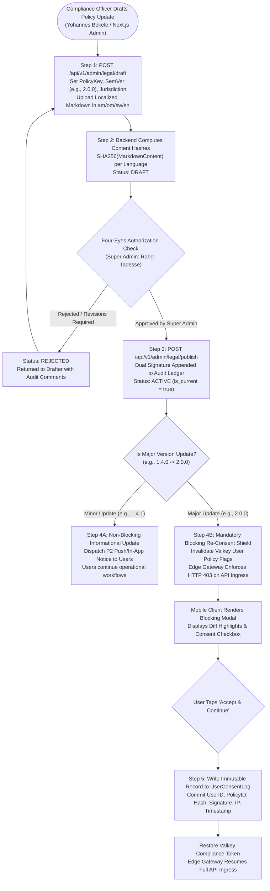
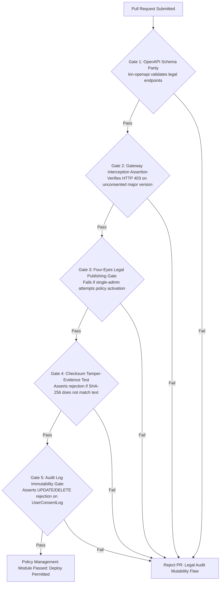

# Heavy Machinery & Logistics Rental Aggregator — Dink Machinery
## Software Requirements Specification — 05.20. Policy, Legal Terms & Mandatory User Consent Architecture (`docs/shared/requirements/05-20-policy-terms-management.md`)

**Document Identifier:** `SRS-DINK-CORE-V7.0-SEC-05-20`  
**Classification:** Canonical System Requirements Specification & Legal Compliance Baseline (Single Source of Truth)  
**Governing Standard:** IEEE Std 830-1998 / IEEE/ISO/IEC 29148:2018 (Systems and Software Engineering — Requirements Engineering)  
**Associated Artifacts:** `SRS-DINK-CORE-V7.0` (§5.1, §5.5, §5.9, §5.10, §5.11, §5.13, §5.14, §5.16, §5.17, §5.18, §5.19, §8, §10, §12), `FLOW-ENTRY-DINK-CORE-V7.0`, `FLOW-BOOKING-STATE-MACHINE-DINK-CORE-V7.0`, `FLOW-WIRE-DISPUTE-DINK-CORE-V7.0`, `ARCH-BACKEND-GO-DINK-CORE-V7.0`, `ARCH-FLUTTER-DINK-CORE-V7.0`, `ARCH-ADMIN-NEXT-DINK-CORE-V7.0`, `ARCH-SEC-DINK-CORE-V7.0`, `DS-DINK-CORE-V7.0`, `DS-PERSONAS-DINK-CORE-V7.0`, `contracts/openapi.yaml`, `ADR-001`, `ADR-002`, `ADR-005`, `ADR-008`, `ADR-010`  
**Target Runtimes:** Go 1.24 Backend Monolith, Flutter 3.44 / Dart 3.9 (Cross-Platform Mobile), Next.js 16 / React 19 (Web Admin & Corporate Portal), PostgreSQL 18.4 + PostGIS 3.4, Valkey 8.0, ClamAV Daemon (:3310), SeaweedFS S3, Isar NoSQL 3.1+  
**Target Personas:** Civil Engineering Contractor (*Dawit Haile-Mariam* / *Patrick Kariuki*), Equipment Fleet Owner (*W/ro Almaz Tesfaye* / *Kamau Ndegwa*), Certified Field Operator (*Mulugeta Tadesse* / *Juma Omwamba*), Lowboy Transporter (*Ato Girma Wolde* / *Samuel Odhiambo*), Compliance Officer & Legal Counsel (*Yohannes Bekele*), Super Administrator (*Rahel Tadesse*)  
**Target Operating Markets:** Ethiopia (`ET`) & Kenya (`KE`) — Dynamic Multi-Country Parameterization (`LOC-01-BE`)  
**Compliance Standards:** OWASP ASVS 4.0.3 Level 3 (Non-Repudiation, Cryptographic Attestation & Audit Trail Immutability), RFC 9457 (Problem Details), ISO 9241-110, W3C WCAG 2.2 Level AAA (Field Mobile) & Level AA (Admin Web), Ethiopian Civil Code (Extra-Contractual Liability & Contract Law), National Bank of Ethiopia (NBE) Financial Directives, Kenya Data Protection Act 2019 (§32 Consent, §40 Rights), Kenya Law of Contract Act (Cap 23), Apple App Store Review Guidelines §5.1.1, Google Play Developer Distribution Agreement  
**Status:** Approved Engineering Baseline

---

## Table of Contents

- 1. [Document Scope & Architectural Mandate](#1-document-scope--architectural-mandate)
  - 1.1 [Purpose & Functional Scope](#11-purpose--functional-scope)
  - 1.2 [Core Legal & Architectural Invariants](#12-core-legal--architectural-invariants)
- 2. [Policy Taxonomy & Multi-Jurisdictional Scope](#2-policy-taxonomy--multi-jurisdictional-scope)
  - 2.1 [Policy Catalog Matrix & Document Hierarchy](#21-policy-catalog-matrix--document-hierarchy)
  - 2.2 [Jurisdiction Parameterization (Ethiopian Civil Code vs. Kenyan Law)](#22-jurisdiction-parameterization-ethiopian-civil-code-vs-kenyan-law)
  - 2.3 [Multi-Lingual Legal Translation Matrix (Amharic, Afaan Oromoo, Swahili, English)](#23-multi-lingual-legal-translation-matrix-amharic-afaan-oromoo-swahili-english)
- 3. [Policy Versioning & Publication State Machine](#3-policy-versioning--publication-state-machine)
  - 3.1 [Policy Versioning Lifecycle Flowchart](#31-policy-versioning-lifecycle-flowchart)
  - 3.2 [Semantic Versioning & Semantic Classification (Major vs. Minor)](#32-semantic-versioning--semantic-classification-major-vs-minor)
  - 3.3 [Database Schema: Dynamic Legal Documents & Versioning Records](#33-database-schema-dynamic-legal-documents--versioning-records)
  - 3.4 [Four-Eyes Dual Control for Legal Publication (`AD-06-WEB`)](#34-four-eyes-dual-control-for-legal-publication-ad-06-web)
- 4. [Mandatory Consent Interception & Non-Repudiation Engine](#4-mandatory-consent-interception--non-repudiation-engine)
  - 4.1 [Registration & Onboarding Gate (`POL-01`)](#41-registration--onboarding-gate-pol-01)
  - 4.2 [Major Version Change Interception & Modal Blocking Shield (`POL-02`)](#42-major-version-change-interception--modal-blocking-shield-pol-02)
  - 4.3 [Transactional Contract Binding Gate (Checkout & Mobilization) (`POL-03`)](#43-transactional-contract-binding-gate-checkout--mobilization-pol-03)
  - 4.4 [Cryptographic Consent Attestation Ledger (`UserConsentLog`)](#44-cryptographic-consent-attestation-ledger-userconsentlog)
- 5. [Field Operational Disclosures & Offline Consent Fallback](#5-field-operational-disclosures--offline-consent-fallback)
  - 5.1 [In-App Policy Viewer & Local Cache Stratification (`ADR-010`)](#51-in-app-policy-viewer--local-cache-stratification-adr-010)
  - 5.2 [Glove-Friendly Legal Consent Modals ($56 \times 56\text{ dp}$ Hit Targets)](#52-glove-friendly-legal-consent-modals-56-times-56text-dp-hit-targets)
  - 5.3 [Offline Cryptographic Handover Waiver Attestation](#53-offline-cryptographic-handover-waiver-attestation)
  - 5.4 [Audit Export & Legal Discovery Package Generation](#54-audit-export--legal-discovery-package-generation)
- 6. [Wire Protocol Contracts & RFC 9457 Error Schemas](#6-wire-protocol-contracts--rfc-9457-error-schemas)
  - 6.1 [`GET /api/v1/legal/policies/active`](#61-get-apiv1legalpoliciesactive)
  - 6.2 [`GET /api/v1/legal/policies/{policyKey}`](#62-get-apiv1legalpoliciespolicykey)
  - 6.3 [`POST /api/v1/legal/consent/record`](#63-post-apiv1legalconsentrecord)
  - 6.4 [`POST /api/v1/admin/legal/publish`](#64-post-apiv1adminlegalpublish)
  - 6.5 [RFC 9457 Universal Problem Details Payloads](#65-rfc-9457-universal-problem-details-payloads)
- 7. [Automated Testing Suite & Verification Gates](#7-automated-testing-suite--verification-gates)

---

## 1. Document Scope & Architectural Mandate

### 1.1 Purpose & Functional Scope

This specification establishes **Section 05.20 (Policy, Legal Terms & Mandatory User Consent Architecture)** of the canonical Software Requirements Specification (SRS) for **Dink Machinery Version 7.0**.

In a multi-sided marketplace coordinating heavy plant equipment rentals ($100,000\text{ to }300,000\text{ USD}$ asset values), specialized lowboy transport, and non-custodial direct peer-to-peer (P2P) bank wire settlements, legal enforceability is the bedrock of platform operations. Transactions occur across two distinct sovereign legal frameworks:
* **The Federal Democratic Republic of Ethiopia:** Governed by the Civil Code of 1960 (Book IV — Special Contracts & Letting of Goods), the Commercial Code of 2021, and National Bank of Ethiopia (NBE) Financial Directives.
* **The Republic of Kenya:** Governed by the Law of Contract Act (Cap 23), the Kenya Data Protection Act 2019, and the National Transport and Safety Authority (NTSA) regulations.

Informal verbal agreements, unrecorded disclaimers, or generic "browse-wrap" terms of service fail to withstand judicial scrutiny in East African commercial courts.

This document formally specifies:
1. The centralized, dynamic legal document catalog managing terms of service, privacy disclosures, machinery damage waivers, and non-custodial wire payment disclaimers.
2. The semantic policy versioning engine categorizing updates into Minor (informational) vs. Major (mandatory re-consent).
3. The cryptographic non-repudiation ledger capturing user IP, user-agent, document SHA-256 hash, and digital signatures at registration, checkout, and policy updates.
4. The API gateway interception gates blocking non-compliant API calls until mandatory consents are executed.
5. Offline-first local caching of legal terms in Isar NoSQL (`ADR-010`) for remote field handovers.

### 1.2 Core Legal & Architectural Invariants

1. **Explicit Click-Wrap Attestation Invariant (No Browse-Wrap):** Passive browse-wrap assent (e.g., *"By using this platform you agree to terms"*) is strictly barred. Every binding agreement requires an affirmative, unselected checkbox click (`[X]`) paired with an explicit action button (`[ Accept & Continue ]`), executing a discrete cryptographic consent record.
2. **Immutable Audit Ledger Floor (`UserConsentLog`):** Once a consent record is written, it is mathematically immutable. Rows can never be updated, truncated, or deleted:
   $$\text{Consent Record} = \langle \text{UserID}, \text{PolicyID}, \text{Version}, \text{DocumentSHA256}, \text{Timestamp}, \text{IP}, \text{Signature} \rangle$$
   Database rules enforce `ON UPDATE DO INSTEAD NOTHING` and `ON DELETE DO INSTEAD NOTHING`.
3. **Four-Eyes Dual Control for Legal Publication (`POL-ADMIN`):** Legal text published to the live platform carries binding contractual liabilities. Creating, modifying, or activating a policy version requires two distinct administrative actors: a Compliance Officer drafter and a Super Administrator authorizer.
4. **Mandatory Ingress Interception on Major Version Increment:** Incrementing a policy's `major_version` (e.g., `1.4.0` $\rightarrow$ `2.0.0`) automatically flips the user's compliance state. Edge gateways intercept all mutating API requests with **RFC 9457 HTTP 403 Forbidden (`ERR_POLICY_RECONSENT_REQUIRED`)**, forcing the client UI to present the blocking acceptance shield.
5. **Exact Document SHA-256 Checksum Verification:** The user consent record commits the exact cryptographic SHA-256 hash of the localized Markdown content displayed on the client screen at the moment of signing, preventing retroactive contractual repudiation.

---

## 2. Policy Taxonomy & Multi-Jurisdictional Scope

### 2.1 Policy Catalog Matrix & Document Hierarchy

The platform structures legal terms into six canonical document classifications:

```text
+--------------------------------------------------------------------------------------------------+
| DINK MACHINERY CANONICAL POLICY CATALOG MATRIX                                                   |
+---------------------+-------------------+---------------------+----------------------------------+
| POLICY KEY          | SCOPE / PERSONA   | JURISDICTION BOUNDS | OPERATIONAL PERIMETER            |
+---------------------+-------------------+---------------------+----------------------------------+
| TERMS_OF_SERVICE    | Universal         | Parameterized by    | Master aggregation rules,        |
|                     | (All Users)       | Country (ET / KE)   | accounts, fees, dispute waivers. |
+---------------------+-------------------+---------------------+----------------------------------+
| PRIVACY_POLICY      | Universal         | Parameterized by    | PII handling, telemetry consent, |
|                     | (All Users)       | Country (ET / KE)   | right to erasure (SRS 05.19).    |
+---------------------+-------------------+---------------------+----------------------------------+
| RENTAL_FRAMEWORK_   | Contractors       | Civil Code Book IV  | Standard machinery plant lease,  |
| AGREEMENT           | & Equipment Owners| (ET) / Contract Act | 8h/day shift quota, handover.    |
+---------------------+-------------------+---------------------+----------------------------------+
| DAMAGE_AND_LIABILITY| Contractors       | Sovereign Civil Code| Structural damage allocations,   |
| WAIVER              | & Operators       | (ET / KE)           | 24h damage guillotine (05.07).   |
+---------------------+-------------------+---------------------+----------------------------------+
| NON_CUSTODIAL_WIRE_ | Renters           | NBE Directives (ET) | Direct bank transfer disclaimer, |
| DISCLAIMER          | & Equipment Owners| / CBK Oversight (KE)| platform non-escrow indemnity.   |
+---------------------+-------------------+---------------------+----------------------------------+
| CARRIER_FREIGHT_    | Lowboy Carriers   | Federal Transport / | Freight transit liabilities,     |
| TERMS               | & Fleet Owners    | NTSA Regulations    | roadside transshipment (05.08).  |
+---------------------+-------------------+---------------------+----------------------------------+
```

---

### 2.2 Jurisdiction Parameterization (Ethiopian Civil Code vs. Kenyan Law)

Legal terms differ fundamentally across operational borders:
* **Ethiopian Jurisdiction (`country_code = 'ET'`):**
  - References the **Civil Code of Ethiopia (1960)** governing lease of chattels (Articles 2727–2737).
  - Explicit non-custodial disclosures clarifying compliance with NBE payment system directives: Dink Machinery never pools rental funds or takes custody of gross capital.
  - Dispute resolution specifies arbitration under Addis Ababa Chamber of Commerce and Sectoral Associations (AACCSA) rules.
* **Kenyan Jurisdiction (`country_code = 'KE'`):**
  - References the **Kenya Law of Contract Act (Cap 23)** and Sale of Goods Act.
  - Strict compliance disclaimers under the **Kenya Data Protection Act 2019** regarding mobile GPS telemetry streaming (Part IV).
  - Dispute resolution specifies arbitration under Nairobi Centre for International Arbitration (NCIA).

---

### 2.3 Multi-Lingual Legal Translation Matrix (Amharic, Afaan Oromoo, Swahili, English)

Legal documents must be completely intelligible to local operators and fleet owners:
* Every policy version is published concurrently in four official language variants:
  - `en` (English — Baseline international legal text).
  - `am` (Amharic — Official working language of the Federal Democratic Republic of Ethiopia).
  - `om` (Afaan Oromoo — Official working language of the Oromia Regional State).
  - `sw` (Kiswahili — Official language of Kenya and regional trade corridors).
* **Parity Invariant:** In the event of a judicial translation discrepancy in an Ethiopian court, the **Amharic version** serves as the legally binding interpretation for Ethiopian domestic contracts. In Kenya, the **English text** governs.

---

## 3. Policy Versioning & Publication State Machine

### 3.1 Policy Versioning Lifecycle Flowchart



---

### 3.2 Semantic Versioning & Semantic Classification (Major vs. Minor)

Policy versions adhere strictly to Semantic Versioning (`MAJOR.MINOR.PATCH`):
* **`MAJOR` (e.g., `1.0.0` $\rightarrow$ `2.0.0`):** Material alterations to financial liability, cancellation penalties, arbitration clauses, or data rights. Requires **mandatory, blocking re-consent** from all registered users before any platform action can be executed.
* **`MINOR` (e.g., `1.0.0` $\rightarrow$ `1.1.0`):** Additions of new machine categories, clarified terminology, or updated office addresses. Dispatches an informational notification; does not block active site operations.
* **`PATCH` (e.g., `1.1.0` $\rightarrow$ `1.1.1`):** Typographical or grammatical corrections. Zero notification required.

---

### 3.3 Database Schema: Dynamic Legal Documents & Versioning Records

```mermaid
erDiagram
    LegalPolicy ||--o{ LegalPolicyVersion : "versions"
    LegalPolicyVersion ||--o{ LegalPolicyLocalization : "materializes"
    LegalPolicyVersion ||--o{ UserConsentLog : "attested by"
    User ||--o{ UserConsentLog : "executes"

    LegalPolicy {
        uuid id PK
        string policy_key UK -- 'TERMS_OF_SERVICE', 'PRIVACY_POLICY', 'DAMAGE_WAIVER'
        string country_code -- 'ET', 'KE', 'ALL'
        string category -- 'TERMS', 'PRIVACY', 'OPERATIONAL', 'PAYMENT'
        boolean is_active
        timestamptz created_at
    }

    LegalPolicyVersion {
        uuid id PK
        uuid policy_id FK
        string version_semver -- '1.0.0', '2.0.0'
        boolean is_major
        boolean is_current
        timestamptz effective_at
        uuid drafted_by_admin_id FK
        uuid authorized_by_admin_id FK
        string change_summary_en
        string change_summary_am
        timestamptz published_at
    }

    LegalPolicyLocalization {
        uuid id PK
        uuid version_id FK
        string language_code -- 'en', 'am', 'om', 'sw'
        string title
        text content_markdown
        string content_sha256 UK
        timestamptz updated_at
    }

    UserConsentLog {
        uuid id PK
        uuid user_id FK
        uuid policy_version_id FK
        string language_code
        string content_sha256
        inet ip_address
        string user_agent
        string consent_modality -- 'CLICKWRAP_REGISTRATION', 'BLOCKING_RECONSENT', 'BOOKING_CHECKOUT'
        string signature_hash
        timestamptz consented_at
    }
```

---

### 3.4 Four-Eyes Dual Control for Legal Publication (`AD-06-WEB`)

To eliminate unauthorized contractual changes:
1. Compliance Officer *Yohannes Bekele* creates a new draft version via the Legal Admin Workbench (`POST /api/v1/admin/legal/draft`). Status is `DRAFT`.
2. The Next.js dashboard flags the draft for secondary authorization.
3. Super Administrator *Rahel Tadesse* inspects the diff highlighting comparing the current active version against the proposed text across all four languages.
4. Rahel validates the legal changes and authorizes publication using hardware-backed MFA (WebAuthn / YubiKey).
5. The backend commits `authorized_by_admin_id = rahel_uuid`, sets `is_current = true`, and emits publication events across the monolith.

---

## 4. Mandatory Consent Interception & Non-Repudiation Engine

### 4.1 Registration & Onboarding Gate (`POL-01`)

During initial account registration (SRS 05.01, 05.14):
* The registration viewport renders mandatory click-wrap checkboxes:
  - `[X] I have read and agree to the Terms of Service (v2.0.0) and Privacy Policy (v1.2.0).`
* Tapping the policy name opens the document directly inside the in-app viewer.
* Submitting the registration form bundles the consent payload. If either checkbox is missing, registration aborts with RFC 9457 HTTP 422 (`ERR_MANDATORY_CONSENT_MISSING`).

---

### 4.2 Major Version Change Interception & Modal Blocking Shield (`POL-02`)

When a major policy update activates on the platform:
1. The Go backend updates the global policy version cache in Valkey.
2. Ingress API middleware interrogates the incoming JWT user claims:
   ```go
   // Go Gateway Policy Enforcement Middleware
   if !policyService.HasConsentedToActiveMajorPolicies(ctx, claims.UserID) {
       problem := rfc9457.NewProblemDetails(
           http.StatusForbidden,
           "ERR_POLICY_RECONSENT_REQUIRED",
           "A major update to our Terms of Service has been published. You must review and accept the updated terms to continue using Dink Machinery.",
           "/api/v1/legal/policies/active",
       )
       rfc9457.WriteResponse(w, problem)
       return
   }
   ```
3. The Flutter mobile app intercepts HTTP 403 `ERR_POLICY_RECONSENT_REQUIRED` and displays the **Mandatory Re-Consent Shield**:
   - Blocks navigation to home screens, active HUDs, and search feeds.
   - Highlights the exact contractual diffs in the user's localized dialect.
   - Requires explicit click-wrap agreement before unlocking the platform.

---

### 4.3 Transactional Contract Binding Gate (Checkout & Mobilization) (`POL-03`)

Beyond general account terms, commercial leases mandate transactional attestations:
* **Pre-Payment Checkout Agreement:** Prior to uploading the 50% bank wire slip (`FLOW-07`), Contractor *Dawit* must affirmatively accept the specific **Rental Framework Agreement** and **Non-Custodial Bank Wire Disclaimer** bound to that specific machine and date range.
* **Handover Damage Waiver Attestation:** During physical on-site handover (`FLOW-09`), entering the 6-digit challenge PIN binds both parties to the **On-Site Machinery Inspection & Damage Liability Waiver**, confirming agreement with baseline hour meter readings and condition photos.

---

### 4.4 Cryptographic Consent Attestation Ledger (`UserConsentLog`)

Every consent submission commits an immutable audit record:

```sql
INSERT INTO user_consent_logs (
    id, user_id, policy_version_id, language_code, 
    content_sha256, ip_address, user_agent, consent_modality, 
    signature_hash, consented_at
) VALUES (
    gen_random_uuid(), $user_id, $version_id, $language_code,
    $content_sha256, $client_ip, $user_agent, 'BLOCKING_RECONSENT',
    encode(hmac($user_id || $content_sha256 || NOW()::text, $server_secret, 'sha256'), 'hex'),
    NOW()
);
```

* **Non-Repudiation Invariant:** The cryptographic `signature_hash` combined with the exact `content_sha256` prevents a contractor from claiming in court that terms were altered retroactively by the platform.

---

## 5. Field Operational Disclosures & Offline Consent Fallback

### 5.1 In-App Policy Viewer & Local Cache Stratification (`ADR-010`)

* **Local NoSQL Caching:** All active policy texts and summary disclaimers in Amharic, Afaan Oromoo, Swahili, and English are stored locally in the client's embedded Isar NoSQL database upon installation and differential sync.
* **Instant Offline Reading:** Operators in rural quarries can inspect the full legal damage waiver and shift hour regulations without requiring cellular connectivity.

---

### 5.2 Glove-Friendly Legal Consent Modals ($56 \times 56\text{ dp}$ Hit Targets)

In accordance with field accessibility requirements (SRS 05.16):
* **Large Touch Controls:** Consent checkboxes provide a hit-test bounding area of at least **$56 \times 56\text{ dp}$** to facilitate operation by personnel wearing leather rigging gloves.
* **High-Contrast Typography:** Legal summary callouts utilize WCAG 2.2 Level AAA contrast ($\ge 7.0:1$) with Pure Black background canvases and Safety Yellow / Emerald accents.

---

### 5.3 Offline Cryptographic Handover Waiver Attestation

When machinery handovers occur in remote riverbeds with zero cellular signal (`ADR-010` / SRS 05.17):
1. The dynamic QR handshake voucher generated on the equipment owner's mobile device encapsulates the SHA-256 hash of the active offline **Damage and Liability Waiver**.
2. Contractor *Dawit* scans the QR code and signs with his on-screen digital touch signature.
3. The resulting transaction payload commits to the local Isar `OutboxMutation` queue.
4. When connectivity is restored, the two-way sync engine pushes the mutation to `/api/v1/sync/outbox-push`, committing the legal consent record to PostgreSQL with the exact offline timestamp.

---

### 5.4 Audit Export & Legal Discovery Package Generation

When commercial litigation or insurance arbitration arises:
* Compliance Officer *Yohannes Bekele* can export a certified **Legal Discovery Package** via Next.js (`AD-06-WEB`).
* The package compiles a signed PDF containing:
  - Complete legal document text in effect on the transaction date.
  - User consent ledger audit trails with IP timestamps and SHA-256 hashes.
  - Associated booking parameters, check-in reticle photos, and digital signatures.
  - Official cryptographic verification certificate signed by Dink Machinery's corporate key.

---

## 6. Wire Protocol Contracts & RFC 9457 Error Schemas

### 6.1 `GET /api/v1/legal/policies/active`

Retrieves all current active policies and checks the authenticated user's consent status.

#### Request Headers
```http
GET /api/v1/legal/policies/active HTTP/1.1
Host: api.dinkmachinery.com
Authorization: Bearer <userAccessToken>
Accept: application/json
Accept-Language: am
X-Country-Code: ET
```

#### Response: `HTTP 200 OK`
```json
{
  "success": true,
  "data": {
    "allPoliciesConsented": false,
    "unconsentedMajorPoliciesCount": 1,
    "activePolicies": [
      {
        "policyKey": "TERMS_OF_SERVICE",
        "version": "2.0.0",
        "isMajor": true,
        "effectiveDate": "2026-10-15",
        "userHasConsented": false,
        "title": "የዲንክ ማሽነሪ የአገልግሎት ውል ስምምነት",
        "changeSummary": "የክፍያ እና የስራ ሰዓት ክትትል ደንቦች ተሻሽለዋል (Updated payment & shift rules)",
        "contentSha256": "8f4c26b46b68ffc68ff99b453c1d30413413422d706483bfa0f98a5e886266e7"
      },
      {
        "policyKey": "PRIVACY_POLICY",
        "version": "1.2.0",
        "isMajor": false,
        "effectiveDate": "2026-06-01",
        "userHasConsented": true,
        "title": "የግል መረጃ ጥበቃ ፖሊሲ",
        "changeSummary": null,
        "contentSha256": "2c26b46b68ffc68ff99b453c1d30413413422d706483bfa0f98a5e886266e7ae"
      }
    ]
  },
  "timestamp": "2026-10-28T15:15:00Z"
}
```

---

### 6.2 `GET /api/v1/legal/policies/{policyKey}`

Fetches full localized Markdown content and SHA-256 checksum for a specific policy.

#### Request Headers
```http
GET /api/v1/legal/policies/TERMS_OF_SERVICE?version=2.0.0 HTTP/1.1
Host: api.dinkmachinery.com
Accept-Language: am
```

#### Response: `HTTP 200 OK`
```json
{
  "success": true,
  "data": {
    "policyKey": "TERMS_OF_SERVICE",
    "version": "2.0.0",
    "languageCode": "am",
    "title": "የዲንክ ማሽነሪ የአገልግሎት ውል ስምምነት",
    "contentMarkdown": "# የዲንክ ማሽነሪ የአገልግሎት ውል ስምምነት\n\nይህ ህጋዊ ውል በተጠቃሚ እና በዲንክ ቴክኖሎጂስ መካከል የተደረገ ነው...",
    "contentSha256": "8f4c26b46b68ffc68ff99b453c1d30413413422d706483bfa0f98a5e886266e7",
    "effectiveDate": "2026-10-15T00:00:00Z"
  },
  "timestamp": "2026-10-28T15:16:00Z"
}
```

---

### 6.3 `POST /api/v1/legal/consent/record`

Submits affirmative user consent for one or more policy versions.

#### Request Headers
```http
POST /api/v1/legal/consent/record HTTP/1.1
Host: api.dinkmachinery.com
Content-Type: application/json
Authorization: Bearer <userAccessToken>
Idempotency-Key: 99182a01-4b12-4f9a-8812-7b9a4c10bc21
```

#### Request Payload
```json
{
  "consents": [
    {
      "policyKey": "TERMS_OF_SERVICE",
      "version": "2.0.0",
      "languageCode": "am",
      "contentSha256": "8f4c26b46b68ffc68ff99b453c1d30413413422d706483bfa0f98a5e886266e7",
      "consentModality": "BLOCKING_RECONSENT"
    }
  ]
}
```

#### Response: `HTTP 200 OK`
```json
{
  "success": true,
  "data": {
    "consentsRecordedCount": 1,
    "userComplianceStatus": "FULL_COMPLIANCE",
    "recordedAt": "2026-10-28T15:17:00Z"
  },
  "timestamp": "2026-10-28T15:17:01Z"
}
```

---

### 6.4 `POST /api/v1/admin/legal/publish`

Four-Eyes dual authorization endpoint for publishing a new policy version to production.

#### Request Headers
```http
POST /api/v1/admin/legal/publish HTTP/1.1
Host: api.dinkmachinery.com
Content-Type: application/json
Authorization: Bearer <superAdminAccessToken>
```

#### Request Payload
```json
{
  "versionId": "ver_019a8fe0-8812-7b9a",
  "superAdminMfaToken": "webauthn_assertion_signature_data_here...",
  "notes": "Reviewed and verified against Ethiopian Commercial Code 2021 amendments."
}
```

#### Response: `HTTP 200 OK`
```json
{
  "success": true,
  "data": {
    "policyKey": "TERMS_OF_SERVICE",
    "publishedVersion": "2.0.0",
    "isMajor": true,
    "publishedBy": "usr_adm_rahel_super",
    "activeEnforcementStarted": true,
    "publishedAt": "2026-10-28T15:20:00Z"
  },
  "timestamp": "2026-10-28T15:20:01Z"
}
```

---

### 6.5 RFC 9457 Universal Problem Details Payloads

#### Example: API Call Blocked Due to Major Policy Update (`HTTP 403 Forbidden`)
```json
{
  "type": "[https://api.dinkmachinery.com/errors/policy-reconsent-required](https://api.dinkmachinery.com/errors/policy-reconsent-required)",
  "title": "Mandatory Terms Re-Consent Required",
  "status": 403,
  "detail": "Dink Machinery has published a major update to the Terms of Service (v2.0.0). You must review and affirmatively accept the new terms to proceed.",
  "instance": "/api/v1/bookings",
  "code": "ERR_POLICY_RECONSENT_REQUIRED",
  "correlationId": "cor_019a8fe0-8812-7b9a-bc21-4491204812aa",
  "timestamp": "2026-10-28T15:15:30Z",
  "invalidParams": [
    {
      "name": "TERMS_OF_SERVICE",
      "reason": "Version 2.0.0 unconsented by authenticated user."
    }
  ],
  "links": {
    "policyReviewEndpoint": "/api/v1/legal/policies/TERMS_OF_SERVICE?version=2.0.0",
    "consentSubmissionEndpoint": "/api/v1/legal/consent/record"
  }
}
```

#### Example: Checksum Mismatch Repudiation Attempt (`HTTP 422 Unprocessable Entity`)
```json
{
  "type": "[https://api.dinkmachinery.com/errors/policy-checksum-mismatch](https://api.dinkmachinery.com/errors/policy-checksum-mismatch)",
  "title": "Invalid Legal Content Checksum",
  "status": 422,
  "detail": "Submitted content SHA-256 hash does not match the active server document for Terms of Service v2.0.0. Please refresh the policy content.",
  "instance": "/api/v1/legal/consent/record",
  "code": "ERR_POLICY_CHECKSUM_MISMATCH",
  "correlationId": "cor_019a8fe0-9914-4c12-8812-7b9a4c10bc21",
  "timestamp": "2026-10-28T15:17:15Z"
}
```

---

## 7. Automated Testing Suite & Verification Gates



1. **OpenAPI Schema Contract Gate (`kin-openapi`):** Validates all policy retrieval, localized content fetching, consent logging, and administrative publishing schemas against `contracts/openapi.yaml`.
2. **Gateway Major Version Interception Test:** Bumps a mock policy version to `MAJOR`. Simulates authenticated client calls to `/api/v1/bookings`, asserting that $100\%$ of mutating requests are intercepted with HTTP 403 `ERR_POLICY_RECONSENT_REQUIRED` until consent is recorded.
3. **Four-Eyes Legal Publishing Integration Test:** Attempts to activate a draft policy version using a single administrative credential, asserting that the Go backend rejects the mutation until the second distinct cryptographic signature is verified.
4. **Cryptographic Checksum Fuzzing Gate:** Mutates a single byte of localized Markdown text and attempts consent registration, asserting that the Go backend detects the hash deviation and returns HTTP 422 `ERR_POLICY_CHECKSUM_MISMATCH`.
5. **Consent Ledger Immutability Gate:** Executes raw SQL `UPDATE` and `DELETE` commands against `user_consent_logs`, asserting that PostgreSQL rules block modifications and preserve $100\%$ immutable audit integrity.

---

*This document establishes the canonical functional requirements, policy taxonomies, semantic versioning workflows, cryptographic consent ledgers, and wire protocol contracts for Policy, Legal Terms & Mandatory User Consent in Dink Machinery Version 7.0. All downstream Flutter mobile interfaces, Go backend gateway middleware, and Next.js admin consoles must strictly conform to this specification.*