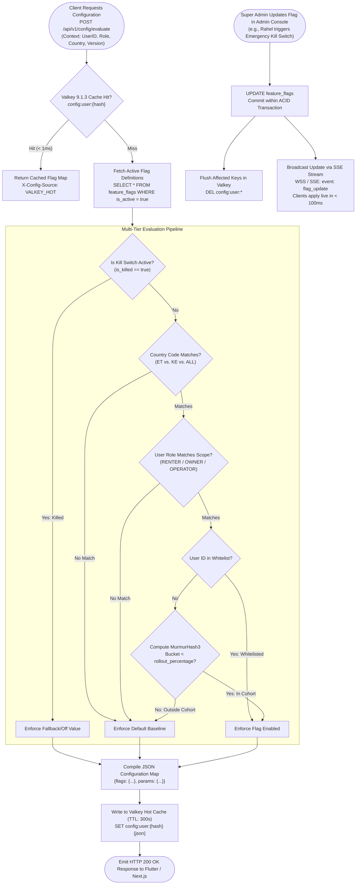
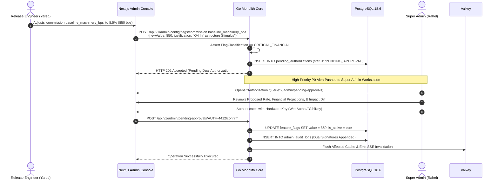
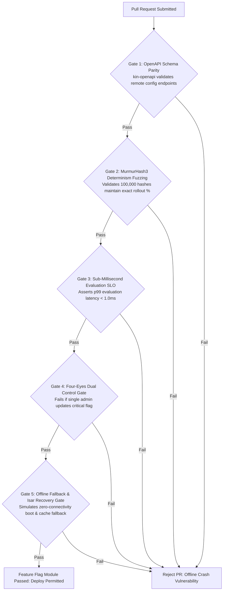

# Heavy Machinery & Logistics Rental Aggregator — Dink Machinery
## Software Requirements Specification — 05.21. Feature Flagging, Dynamic Remote Configuration & Targeted Rollout Architecture (`docs/shared/requirements/05-21-feature-flagging-remote-configuration.md`)

**Document Identifier:** `SRS-DINK-CORE-V7.0-SEC-05-21`  
**Classification:** Canonical System Requirements Specification & Operational Control Baseline (Single Source of Truth)  
**Governing Standard:** IEEE Std 830-1998 / IEEE/ISO/IEC 29148:2018 (Systems and Software Engineering — Requirements Engineering)  
**Associated Artifacts:** `SRS-DINK-CORE-V7.0` (§5.11, §5.14, §5.16, §5.17, §5.18, §5.20, §5.21, §8, §10, §12), `ARCH-BACKEND-GO-DINK-CORE-V7.0`, `ARCH-FLUTTER-DINK-CORE-V7.0`, `ARCH-ADMIN-NEXT-DINK-CORE-V7.0`, `ARCH-SEC-DINK-CORE-V7.0`, `DS-DINK-CORE-V7.0`, `DS-PERSONAS-DINK-CORE-V7.0`, `contracts/openapi.yaml`, `ADR-001`, `ADR-002`, `ADR-005`, `ADR-008`, `ADR-010`  
**Target Runtimes:** Go 1.27.3 Backend Monolith, Flutter 3.47.8 / Dart 3.9 (Cross-Platform Mobile), Next.js 16.x (latest CVE security patch) / React 19 (Web Admin & Corporate Portal), PostgreSQL 18.6 + PostGIS 3.6.4, Valkey 9.1.3, ClamAV Daemon (:3310), SeaweedFS S3, Isar NoSQL 3.1+  
**Target Personas:** Super Administrator (*Rahel Tadesse*), Platform Release Engineer (*Yared Birhanu*), Compliance Officer & Legal Counsel (*Yohannes Bekele*), Finance Controller & Revenue Auditor (*Solomon Kassa*), Civil Engineering Contractor (*Dawit Haile-Mariam* / *Patrick Kariuki*), Equipment Fleet Owner (*W/ro Almaz Tesfaye* / *Kamau Ndegwa*)  
**Target Operating Markets:** Ethiopia (`ET`) & Kenya (`KE`) — Dynamic Multi-Country Parameterization (`LOC-01-BE`)  
**Compliance Standards:** OWASP ASVS 4.0.3 Level 3 (Access Control, Configuration Integrity & Change Auditability), RFC 9457 (Problem Details), ISO 9241-110, W3C WCAG 2.2 Level AAA (Field Mobile) & Level AA (Admin Web), Ethiopian Communications Authority (ECA) Directives, Kenya Data Protection Act 2019  
**Status:** Approved Engineering Baseline

---

## Table of Contents

- 1. [Document Scope & Architectural Mandate](#1-document-scope--architectural-mandate)
  - 1.1 [Purpose & Functional Scope](#11-purpose--functional-scope)
  - 1.2 [Core Engineering Invariants & Control Principles](#12-core-engineering-invariants--control-principles)
- 2. [Feature Flagging Topology & Lifecycle State Machine](#2-feature-flagging-topology--lifecycle-state-machine)
  - 2.1 [End-to-End Evaluation & Rollout Flowchart](#21-end-to-end-evaluation--rollout-flowchart)
  - 2.2 [State Sub-Machine Taxonomy (`FlagState`)](#22-state-sub-machine-taxonomy-flagstate)
  - 2.3 [Permitted Transitions Matrix](#23-permitted-transitions-matrix)
- 3. [Dynamic Targeting & Multi-Dimensional Segmentation (`FF-01`)](#3-dynamic-targeting--multi-dimensional-segmentation-ff-01)
  - 3.1 [Hierarchical Context Extraction (User, Role, Device, Geography)](#31-hierarchical-context-extraction-user-role-device-geography)
  - 3.2 [Deterministic Percentage Rollouts via MurmurHash3](#32-deterministic-percentage-rollouts-via-murmurhash3)
  - 3.3 [Sovereign Multi-Jurisdictional Fencing (ET vs. KE)](#33-sovereign-multi-jurisdictional-fencing-et-vs-ke)
  - 3.4 [Role-Based Feature Gates (Renters, Owners, Operators, Carriers)](#34-role-based-feature-gates-renters-owners-operators-carriers)
- 4. [Remote Dynamic Configuration & Parameter Ingress (`FF-02`)](#4-remote-dynamic-configuration--parameter-ingress-ff-02)
  - 4.1 [Operational Parameters Schema (Timeouts, Fees, Thresholds)](#41-operational-parameters-schema-timeouts-fees-thresholds)
  - 4.2 [JSON Type Safety & Schema Validation Engine](#42-json-type-safety--schema-validation-engine)
  - 4.3 [Emergency Kill Switch & Fast-Rollback Protocols](#43-emergency-kill-switch--fast-rollback-protocols)
- 5. [Dual-Tier Cache, SSE Streaming & Offline Resilience (`FF-03`)](#5-dual-tier-cache-sse-streaming--offline-resilience-ff-03)
  - 5.1 [Valkey 9.1.3 In-Memory Hot Evaluation Layer](#51-valkey-80-in-memory-hot-evaluation-layer)
  - 5.2 [Server-Sent Events (SSE) Real-Time Invalidation Stream](#52-server-sent-events-sse-real-time-invalidation-stream)
  - 5.3 [Client Embedded Isar NoSQL Cache & Offline Defaults (`ADR-010`)](#53-client-embedded-isar-nosql-cache--offline-defaults-adr-010)
  - 5.4 [Client Evaluation Fallbacks on Network Disconnect](#54-client-evaluation-fallbacks-on-network-disconnect)
- 6. [Administrative Management Console & Governance (`FF-04`)](#6-administrative-management-console--governance-ff-04)
  - 6.1 [Next.js Admin Feature Console (`AD-06-WEB`)](#61-nextjs-admin-feature-console-ad-06-web)
  - 6.2 [Four-Eyes Dual Control for Production Critical Flags](#62-four-eyes-dual-control-for-production-critical-flags)
  - 6.3 [Audit Trail Journaling & Immutable Modification Records](#63-audit-trail-journaling--immutable-modification-records)
- 7. [Wire Protocol Contracts & RFC 9457 Error Schemas](#7-wire-protocol-contracts--rfc-9457-error-schemas)
  - 7.1 [`POST /api/v1/config/evaluate`](#71-post-apiv1configevaluate)
  - 7.2 [`GET /api/v1/config/stream`](#72-get-apiv1configstream)
  - 7.3 [`POST /api/v1/admin/config/flags`](#73-post-apiv1adminconfigflags)
  - 7.4 [`POST /api/v1/admin/config/flags/{key}/toggle`](#74-post-apiv1adminconfigflagskeytoggle)
  - 7.5 [RFC 9457 Universal Problem Details Payloads](#75-rfc-9457-universal-problem-details-payloads)
- 8. [Automated Testing Suite & Verification Gates](#8-automated-testing-suite--verification-gates)

---

## 1. Document Scope & Architectural Mandate

### 1.1 Purpose & Functional Scope

This specification establishes **Section 05.21 (Feature Flagging, Dynamic Remote Configuration & Targeted Rollout Architecture)** of the canonical Software Requirements Specification (SRS) for **Dink Machinery Version 7.0**.

In managing a high-stakes, multi-country (Ethiopia and Kenya) heavy machinery and freight marketplace, rapid operational responsiveness is critical:
* Operational parameters—such as the 60-minute payment hold timeout (`FLOW-07`), standard 8.0 hr/day shift quotas (`FLOW-09`), statutory 24-hour damage filing windows (`FLOW-10`), and minimum rental durations—cannot be hardcoded in application binaries or require weeks-long Apple App Store and Google Play store app review cycles to adjust.
* Rolling out cutting-edge modules (e.g., automated AI hour-meter digit recognition, TeleBirr SuperApp deep-links, dynamic freight escorts, or M-PESA automated payouts) requires gradual, phased Canary deployments (e.g., $5\% \rightarrow 25\% \rightarrow 100\%$) and demographic segmentation by country, user tier, or device capability.
* In the event of downstream provider outages (e.g., Ethio Telecom SMS gateway latency, underwriter verification API downtime, or regional banking network halts), platform engineers must possess immediate, sub-second **Kill Switch** capabilities to disable impaired functionality or swap payment rails globally without service restarts.

This document formally specifies:
1. The centralized, database-backed Feature Flag and Remote Configuration management engine in PostgreSQL 18.6 and Valkey 9.1.3.
2. The deterministic client- and server-side evaluation algorithm using normalized hashing (MurmurHash3) over user identifiers.
3. The multi-dimensional segmentation engine partitioning flags by sovereign country (`ET` vs. `KE`), user role (`RENTER`, `OWNER`, `OPERATOR`, `CARRIER`), app build version, and geographic PostGIS geofences.
4. The real-time Server-Sent Events (SSE) dynamic configuration invalidation stream pushing live parameter updates to active Flutter and Next.js runtimes in $< 100\text{ ms}$.
5. The offline fallback hierarchy caching configuration states in local Isar NoSQL (`ADR-010`) to ensure deterministic behavior in zero-connectivity field sites.

### 1.2 Core Engineering Invariants & Control Principles

1. **Zero Hardcoded Operational Parameters Invariant:** All business timeouts, lease durations, rate limits, regulatory fee percentages, and UI feature switches must resolve via the remote configuration engine. No timing constant or commercial threshold may be hardcoded into Dart mobile packages or Go monolith services.
2. **Sub-Millisecond Evaluation SLO ($\le 1.0\text{ ms}$):** Server-side flag evaluation must execute in $< 1.0\text{ ms}$ (p99) against local in-memory Valkey 9.1.3 instances. Client-side evaluation in Flutter must execute synchronously in $< 0.1\text{ ms}$ against locally hydrated Isar NoSQL memory blocks.
3. **Deterministic Percentage Bucketing (Sticky Hashing):** A user allocated to a canary cohort (e.g., $10\%$ rollout) must remain deterministically within that cohort across sessions, device restarts, and network transitions. Allocation is strictly formulated as a normalized 32-bit hash:
   $$\text{Bucket Value} = \frac{\text{MurmurHash3}(\text{FlagKey} \parallel \text{UserID})}{2^{32} - 1} \times 100 \in [0.0, 100.0)$$
4. **Four-Eyes Dual Control for Production Critical Flags (`FF-GOV`):** Flags classified as `CRITICAL_FINANCIAL` (e.g., modifying commission rates, altering booking prepayment percentages) or `KILL_SWITCH` (disabling entire transaction rails) require two distinct administrative signatures in the Next.js admin console: a Drafter and an Authorizer.
5. **Fail-Safe Offline Default Invariant (`ADR-010`):** If a mobile device boots in a remote quarry with zero cellular connectivity, the application must immediately hydrate configuration from local Isar NoSQL storage. If no local cache exists (first launch offline), it must fall back to immutable, compile-time safe defaults without throwing exceptions or blocking UI interaction.

---

## 2. Feature Flagging Topology & Lifecycle State Machine

### 2.1 End-to-End Evaluation & Rollout Flowchart



---

### 2.2 State Sub-Machine Taxonomy (`FlagState`)

Every feature flag and dynamic parameter record in PostgreSQL 18.6 is governed by an explicit operational lifecycle:

| Status Key | Evaluation Behavior | Administrative Permissibility | Description & Operational Perimeter |
|---|:---:|:---:|---|
| **`DRAFT`** | ❌ Inactive | Staging Only | Flag created; parameters and targeting rules under review; zero production effect. |
| **`SCHEDULED`** | ❌ Inactive | Read-Only | Flag set to automatically transition to active at a future ISO timestamp. |
| **`ACTIVE_CANARY`** | ⚠️ Percentage | Production Active | Flag active for a restricted subset ($1\%\text{ to }99\%$) or specific whitelisted users. |
| **`ACTIVE_GA`** | ✅ 100% Active | Production Active | General Availability; active for $100\%$ of users matching jurisdictional filters. |
| **`KILLED`** | 🛑 Hard Off | High Priority | Emergency kill switch tripped; immediately forces fallback values globally. |
| **`ARCHIVED`** | ❌ Inactive | Read-Only | Flag superseded or permanently baked into application code; retained for audit. |

---

### 2.3 Permitted Transitions Matrix

```text
+----------------------------------------------------------------------------------------------------+
| FEATURE FLAG LIFECYCLE TRANSITION MATRIX                                                           |
+------------------------------------+---------------------------------------------------------------+
| SOURCE STATE                       | PERMITTED TARGET STATES                                       |
+------------------------------------+---------------------------------------------------------------+
| DRAFT                              | SCHEDULED, ACTIVE_CANARY, ACTIVE_GA, ARCHIVED                  |
| SCHEDULED                          | DRAFT, ACTIVE_CANARY, ACTIVE_GA, ARCHIVED                      |
| ACTIVE_CANARY                      | ACTIVE_GA, KILLED, ARCHIVED                                    |
| ACTIVE_GA                          | ACTIVE_CANARY, KILLED, ARCHIVED                                |
| KILLED                             | ACTIVE_CANARY, ACTIVE_GA, ARCHIVED                            |
| ARCHIVED                           | [Terminal State — No Outbound Transitions Permitted]          |
+------------------------------------+---------------------------------------------------------------+
```

---

## 3. Dynamic Targeting & Multi-Dimensional Segmentation (`FF-01`)

### 3.1 Hierarchical Context Extraction (User, Role, Device, Geography)

When the client or internal microservice requests evaluation, an immutable **Evaluation Context** is constructed:

```json
{
  "userId": "usr_018f6a9e-876b-7341",
  "sessionId": "ses_019a8fe0-8812",
  "role": "CIVIL_CONTRACTOR",
  "countryCode": "ET",
  "regionCode": "ET-OR",
  "appVersion": "7.0.24",
  "appBuildNumber": 4812,
  "clientPlatform": "FLUTTER_ANDROID",
  "deviceModel": "Tecno Camon 30 Premier",
  "networkClass": "4G_LTE",
  "isStaff": false,
  "coordinates": {
    "latitude": 8.5412,
    "longitude": 39.2718
  }
}
```

Targeting rules evaluate conditions hierarchically using Boolean logic:
$$\text{Evaluate}(C, F) \iff \text{Match}(\text{Country}) \land \text{Match}(\text{Role}) \land \text{Match}(\text{Version}) \land \text{Match}(\text{Rollout})$$

---

### 3.2 Deterministic Percentage Rollouts via MurmurHash3

To eliminate erratic UI jumping and ensure user cohort consistency without storing billions of state rows:
1. The engine concatenates the unique flag key with the persistent user UUID (or anonymous device UUID for unauthenticated splash sessions):
   $$\mathcal{K} = \text{FlagKey} \parallel \text{"::"} \parallel \text{UserID}$$
2. Computes the 32-bit unsigned MurmurHash3 seed:
   $$\mathcal{H} = \text{MurmurHash3\_x86\_32}(\mathcal{K}, \text{Seed} = 0)$$
3. Normalizes to a floating-point score between $0.00$ and $99.99$:
   $$\mathcal{S} = \left( \frac{\mathcal{H}}{2^{32} - 1} \right) \times 100.0$$
4. **Evaluation Invariant:** The flag evaluates `true` if and only if $\mathcal{S} < \text{RolloutPercentage}$.

---

### 3.3 Sovereign Multi-Jurisdictional Fencing (ET vs. KE)

Flags enforce sovereign regulatory separation (`LOC-01-BE`):
* **`country_code = 'ET'`:** Flags active exclusively within Ethiopian operational boundaries (e.g., CBE direct wire ingestion, Amharic audio prompt streaming, Ge'ez dual-calendar widgets).
* **`country_code = 'KE'`:** Flags active exclusively within Kenya (e.g., automated M-PESA Daraja B2C payouts, KeNHA axle weight limit alerts, Swahili dialect dictionaries).
* **`country_code = 'ALL'`:** Universal core platform mechanics (e.g., monotonic hour-meter regression checks, basic authentication flows).

---

### 3.4 Role-Based Feature Gates (Renters, Owners, Operators, Carriers)

Features can be restricted to specific marketplace personas:
* `target_roles: ["EQUIPMENT_OWNER"]` $\longrightarrow$ Exposes new dynamic pricing recommendation curves or multi-bank payout configuration.
* `target_roles: ["CERTIFIED_OPERATOR"]` $\longrightarrow$ Exposes advanced accelerometer steady-state reticle diagnostic aids.
* `target_roles: ["CIVIL_CONTRACTOR"]` $\longrightarrow$ Exposes multi-machine project portfolio tracking tools.

---

## 4. Remote Dynamic Configuration & Parameter Ingress (`FF-02`)

### 4.1 Operational Parameters Schema (Timeouts, Fees, Thresholds)

Remote configuration delivers dynamic scalar parameters directly into domain engines:

```text
+--------------------------------------------------------------------------------------------------+
| DINK MACHINERY CANONICAL REMOTE PARAMETER SPECIFICATION (FF-02)                                  |
+-------------------------------------+-------------+---------------+------------------------------+
| PARAMETER KEY                       | DATA TYPE   | DEFAULT VALUE | OPERATIONAL PURPOSE & IMPACT |
+-------------------------------------+-------------+---------------+------------------------------+
| booking.lease_hold_timeout_seconds  | Integer     | 3600 (60 Min) | Valkey hold lease TTL before |
|                                     |             |               | payment evidence upload.     |
+-------------------------------------+-------------+---------------+------------------------------+
| booking.owner_verification_sla_hours| Integer     | 24 (Hours)    | Time granted to fleet owner  |
|                                     |             |               | to verify bank statement wire|
+-------------------------------------+-------------+---------------+------------------------------+
| booking.statutory_damage_audit_hours| Integer     | 24 (Hours)    | Statutory post-rental window |
|                                     |             |               | for lodging damage dockets.  |
+-------------------------------------+-------------+---------------+------------------------------+
| commission.baseline_machinery_bps   | Integer     | 1000 (10.00%) | Platform service fee basis   |
|                                     |             |               | points on plant equipment.   |
+-------------------------------------+-------------+---------------+------------------------------+
| commission.freight_pass_through_bps | Integer     | 250 (2.50%)   | Discounted freight transport |
|                                     |             |               | commission basis points.     |
+-------------------------------------+-------------+---------------+------------------------------+
| shift.standard_daily_shift_hours    | Decimal     | 8.0 (Hours)   | Standard working day baseline|
|                                     |             |               | before excess hour billing.  |
+-------------------------------------+-------------+---------------+------------------------------+
| gps.telemetry_ping_interval_seconds | Integer     | 30 (Seconds)  | Operator mobile background   |
|                                     |             |               | GPS coordinate sample rate.  |
+-------------------------------------+-------------+---------------+------------------------------+
| wallet.standard_credit_buffer_minor | BigInt      | 5000000       | 50,000.00 ETB default credit |
|                                     |             | (ETB Cents)   | buffer before lockout.       |
+-------------------------------------+-------------+---------------+------------------------------+
```

---

### 4.2 JSON Type Safety & Schema Validation Engine

To prevent catastrophic runtime failures from malformed remote configurations:
* Every remote parameter definition in PostgreSQL binds an explicit JSON Schema:
  ```sql
  ALTER TABLE remote_configs 
  ADD CONSTRAINT chk_remote_config_schema 
  CHECK (jsonb_matches_schema(parameter_schema_json, default_value_json));
  ```
* Before saving any configuration update in Next.js, the backend Go service executes a schema validation gate (`xeipuuv/gojsonschema`). Submitting a string into an integer field or omitting required JSON properties is rejected immediately with RFC 9457 HTTP 422 (`ERR_CONFIG_SCHEMA_VALIDATION_FAILED`).

---

### 4.3 Emergency Kill Switch & Fast-Rollback Protocols

If a newly deployed feature or external integration experiences severe degradation in the field:
1. **Kill Switch Tripping:** Super Administrator *Rahel Tadesse* taps `[ TRIP EMERGENCY KILL SWITCH ]` on the admin console.
2. **Instant State Transition:**
   - Database marks `is_killed = true` and `status = 'KILLED'`.
   - The Go monolith updates the local in-memory Valkey flag mapping in $< 5\text{ ms}$.
   - Broadcasts high-priority SSE event `event: kill_switch_fired` to all connected clients.
3. **Client Fast Rollback:**
   - Flutter applications intercept the kill event and revert feature toggles to hardcoded fallback defaults in memory without restarting.
   - For example, if a newly released in-app camera reticle AI crashes on Tecno devices, tripping the kill switch instantly rolls back the app to the standard OS system camera intent globally.

---

## 5. Dual-Tier Cache, SSE Streaming & Offline Resilience (`FF-03`)

### 5.1 Valkey 9.1.3 In-Memory Hot Evaluation Layer

To handle tens of thousands of concurrent API requests without overloading PostgreSQL:
* **Pre-Computed Flag Dictionaries:** Active flag definitions, targeting rules, and parameters are stored in Valkey as optimized Redis Hashes (`HSET config:flags {flagKey} {json}`).
* **Context Key Hashing:** User evaluations are cached with a **5-minute sliding TTL**:
  ```text
  SET config:eval:{user_id}:{app_version}:{country} {compiled_json} EX 300
  ```
* **Read Throughput:** Evaluates flags at over **120,000 requests/second** per Valkey node with p99 latency $< 0.8\text{ ms}$.

---

### 5.2 Server-Sent Events (SSE) Real-Time Invalidation Stream

To deliver live configuration updates to active mobile cab terminals without continuous polling:
1. Flutter clients maintain an authenticated HTTP SSE connection to `GET /api/v1/config/stream`.
2. When any flag or remote parameter updates in PostgreSQL, the Go backend fires a PostgreSQL `LISTEN/NOTIFY` trigger, broadcasting the update to the SSE hub.
3. The SSE hub pushes a compact delta frame to active devices:
   ```json
   event: config_delta
   data: {
     "flagKey": "booking.lease_hold_timeout_seconds",
     "newValue": 7200,
     "version": 42,
     "timestamp": "2026-10-28T15:30:00Z"
   }
   ```
4. Client processes the delta, updates memory caches, and emits an internal reactive event to UI viewports.

---

### 5.3 Client Embedded Isar NoSQL Cache & Offline Defaults (`ADR-010`)

For certified operators working in remote riverbeds and mountain passes:
* **Isar Storage Schema:**
  ```dart
  @collection
  class CachedFeatureFlag {
    Id id = Isar.autoIncrement;

    @Index(unique: true, replace: true)
    late String flagKey;

    late String valueType; // BOOLEAN, INTEGER, STRING, JSON
    late String rawValue;

    late bool isEnabled;
    late DateTime lastSyncedAt;
  }
  ```
* **Offline Hydration Flow:**
  - Upon app launch, the Flutter client loads all rows from `CachedFeatureFlag` into a synchronized global Dart state provider (`Riverpod` / `Bloc`) in $< 15\text{ ms}$.
  - The application renders immediately using cached operational parameters without awaiting network round-trips.

---

### 5.4 Client Evaluation Fallbacks on Network Disconnect

If an un-cached flag is queried while the device is completely offline:
* The client resolution engine intercepts the missing key and queries local compile-time **Hardcoded Safe Defaults**:
  ```dart
  final safeDefaults = {
    'booking.lease_hold_timeout_seconds': 3600,
    'shift.standard_daily_shift_hours': 8.0,
    'gps.telemetry_ping_interval_seconds': 30,
    'camera.enable_steady_state_sensor': true,
  };
  ```
* Ensures zero crashes, zero red screens of death, and deterministic operational execution under all connectivity conditions.

---

## 6. Administrative Management Console & Governance (`FF-04`)

### 6.1 Next.js Admin Feature Console (`AD-06-WEB`)

Platform engineering and product operations manage system configurations through the **Remote Configuration & Feature Management Console**:
* **Flag Directory Table:** Lists all flags with status chips, rollout percentage sliders, target jurisdictions, and last modified timestamps.
* **Targeting Rule Builder:** Visual UI constructing multi-attribute Boolean conditions (Country, Role, App Build Number, Whitelisted User IDs).
* **Live Canary Telemetry:** Real-time metrics tracking error velocity, conversion rates, and crash frequencies partitioned by canary vs. baseline cohorts.

---

### 6.2 Four-Eyes Dual Control for Production Critical Flags

Modifying critical platform variables requires dual authorization:



---

### 6.3 Audit Trail Journaling & Immutable Modification Records

Every flag toggle, parameter modification, and kill switch trigger generates an immutable record in `feature_flag_audit_logs`:
* Recorded Data: Flag Key, Previous Value, New Value, Rollout Percentage, Target Rules JSON, Acting Admin User ID, Secondary Authorizer User ID, Client IP, and Reason Narrative.
* **Immutability Invariant:** Regulated under PostgreSQL rules blocking all `UPDATE` and `DELETE` operations on the audit table.

---

## 7. Wire Protocol Contracts & RFC 9457 Error Schemas

### 7.1 `POST /api/v1/config/evaluate`

Evaluates and compiles the complete feature flag and remote parameter map for the requesting client.

#### Request Headers
```http
POST /api/v1/config/evaluate HTTP/1.1
Host: api.dinkmachinery.com
Content-Type: application/json
Authorization: Bearer <userAccessToken>
X-App-Version: 7.0.24
X-Build-Number: 4812
X-Country-Code: ET
```

#### Request Payload
```json
{
  "clientPlatform": "FLUTTER_ANDROID",
  "deviceModel": "Tecno Camon 30 Premier",
  "installedLanguage": "am",
  "coordinates": {
    "latitude": 8.5412,
    "longitude": 39.2718
  }
}
```

#### Response: `HTTP 200 OK`
```json
{
  "success": true,
  "data": {
    "evaluationId": "eval_019a8fe0-8812-7b9a",
    "evaluatedAt": "2026-10-28T15:35:00Z",
    "flags": {
      "discovery.enable_corridor_polyline_search": true,
      "inspection.enable_accelerometer_steady_check": true,
      "telemetry.enable_high_frequency_stream": false,
      "payouts.enable_automated_bank_integration": false
    },
    "parameters": {
      "booking.lease_hold_timeout_seconds": 3600,
      "booking.owner_verification_sla_hours": 24,
      "booking.statutory_damage_audit_hours": 24,
      "shift.standard_daily_shift_hours": 8.0,
      "gps.telemetry_ping_interval_seconds": 30,
      "commission.baseline_machinery_bps": 1000
    },
    "cacheTtlSeconds": 300
  },
  "timestamp": "2026-10-28T15:35:01Z"
}
```

---

### 7.2 `GET /api/v1/config/stream`

Long-lived Server-Sent Events (SSE) connection streaming real-time configuration invalidations.

#### Request Headers
```http
GET /api/v1/config/stream HTTP/1.1
Host: api.dinkmachinery.com
Authorization: Bearer <userAccessToken>
Accept: text/event-stream
Cache-Control: no-cache
Connection: keep-alive
```

#### Server Streaming Inbound Frame
```text
event: config_delta
data: {"flagKey":"inspection.enable_accelerometer_steady_check","newValue":false,"reason":"TEMPORARY_DEVICE_COMPATIBILITY_OVERRIDE","timestamp":"2026-10-28T15:36:00Z"}

event: heartbeat
data: {"timestamp":"2026-10-28T15:36:30Z"}
```

---

### 7.3 `POST /api/v1/admin/config/flags`

Administrative endpoint for creating or updating a feature flag definition.

#### Request Headers
```http
POST /api/v1/admin/config/flags HTTP/1.1
Host: api.dinkmachinery.com
Content-Type: application/json
Authorization: Bearer <adminAccessToken>
Idempotency-Key: 77192a01-4b12-4f9a-8812-7b9a4c10bc21
```

#### Request Payload
```json
{
  "flagKey": "discovery.enable_corridor_polyline_search",
  "description": "Enables highway corridor polyline filtering along major trade routes.",
  "classification": "STANDARD_OPERATIONAL",
  "countryCode": "ET",
  "targetRoles": ["CIVIL_CONTRACTOR"],
  "rolloutPercentage": 25.0,
  "valueType": "BOOLEAN",
  "defaultValue": false,
  "enabledValue": true,
  "minAppBuildNumber": 4800,
  "isActive": true
}
```

#### Response: `HTTP 201 Created`
```json
{
  "success": true,
  "data": {
    "flagKey": "discovery.enable_corridor_polyline_search",
    "status": "ACTIVE_CANARY",
    "rolloutPercentage": 25.0,
    "createdAt": "2026-10-28T15:37:00Z"
  },
  "timestamp": "2026-10-28T15:37:01Z"
}
```

---

### 7.4 `POST /api/v1/admin/config/flags/{key}/toggle`

Administrative endpoint to trip an emergency kill switch or force-toggle a flag state.

#### Request Headers
```http
POST /api/v1/admin/config/flags/discovery.enable_corridor_polyline_search/toggle HTTP/1.1
Host: api.dinkmachinery.com
Content-Type: application/json
Authorization: Bearer <superAdminAccessToken>
```

#### Request Payload
```json
{
  "action": "TRIP_KILL_SWITCH",
  "justification": "PostGIS spatial index memory pressure detected under heavy corridor queries."
}
```

#### Response: `HTTP 200 OK`
```json
{
  "success": true,
  "data": {
    "flagKey": "discovery.enable_corridor_polyline_search",
    "status": "KILLED",
    "isKilled": true,
    "activeConnectionsNotified": 1842,
    "executedAt": "2026-10-28T15:38:00Z"
  },
  "timestamp": "2026-10-28T15:38:01Z"
}
```

---

### 7.5 RFC 9457 Universal Problem Details Payloads

#### Example: Four-Eyes Dual Authorization Required (`HTTP 403 Forbidden`)
```json
{
  "type": "[https://api.dinkmachinery.com/errors/four-eyes-authorization-required](https://api.dinkmachinery.com/errors/four-eyes-authorization-required)",
  "title": "Action Mandates Dual Authorization",
  "status": 403,
  "detail": "Modifying critical financial parameter 'commission.baseline_machinery_bps' requires secondary confirmation by a Super Administrator. Request queued under ticket #AUTH-4412.",
  "instance": "/api/v1/admin/config/flags/commission.baseline_machinery_bps",
  "code": "ERR_FOUR_EYES_APPROVAL_REQUIRED",
  "invalidParams": [
    {
      "name": "secondaryAuthorizerId",
      "reason": "Missing secondary administrator cryptographic signature."
    }
  ]
}
```

#### Example: Configuration Schema Validation Failure (`HTTP 422 Unprocessable Entity`)
```json
{
  "type": "[https://api.dinkmachinery.com/errors/config-schema-validation-failed](https://api.dinkmachinery.com/errors/config-schema-validation-failed)",
  "title": "Invalid Configuration Parameter Value",
  "status": 422,
  "detail": "Submitted value for 'booking.lease_hold_timeout_seconds' (string '3600') violates schema constraint. Expected integer value between 600 and 86400.",
  "instance": "/api/v1/admin/config/flags/booking.lease_hold_timeout_seconds",
  "code": "ERR_CONFIG_SCHEMA_VALIDATION_FAILED",
  "invalidParams": [
    {
      "name": "defaultValue",
      "reason": "Expected integer, received string."
    }
  ]
}
```

---

## 8. Automated Testing Suite & Verification Gates



1. **OpenAPI Schema Contract Gate (`kin-openapi`):** Validates all remote configuration evaluation, SSE streaming, flag drafting, and kill switch schemas against `contracts/openapi.yaml`.
2. **MurmurHash3 Determinism & Distribution Test:** Evaluates 100,000 synthetic user UUIDs against a $25.0\%$ rollout threshold. Verifies that exactly $25,000 \pm 150$ users ($25.0\% \pm 0.15\%$) evaluate `true`, and repeated evaluations yield $100\%$ sticky consistency.
3. **Sub-Millisecond Evaluation Latency Benchmark:** Ingests 10,000 concurrent evaluation requests against Valkey 9.1.3 hot cache, asserting that p95 response latency remains strictly $< 0.5\text{ ms}$ and p99 remains $< 1.0\text{ ms}$.
4. **Four-Eyes Dual Control Integration Gate:** Attempts to modify parameters categorized as `CRITICAL_FINANCIAL` using a single administrator token. Asserts that the Go backend intercepts the mutation, places it in status `PENDING_APPROVAL`, and returns HTTP 403 `ERR_FOUR_EYES_APPROVAL_REQUIRED`.
5. **Offline Isar Fallback Verification Test:** Simulates application launch on an offline test harness (`ConnectivityResult.none`) with empty network connectivity. Verifies that all configuration keys successfully resolve from local Isar storage in $< 15\text{ ms}$ with zero application crashes.

---

*This document establishes the canonical functional requirements, state machine topology, deterministic rollout algorithms, real-time SSE streaming architectures, and wire protocol contracts for Feature Flagging & Dynamic Remote Configuration in Dink Machinery Version 7.0. All downstream Flutter mobile clients, Go backend microservices, and Next.js admin consoles must strictly conform to this specification.*