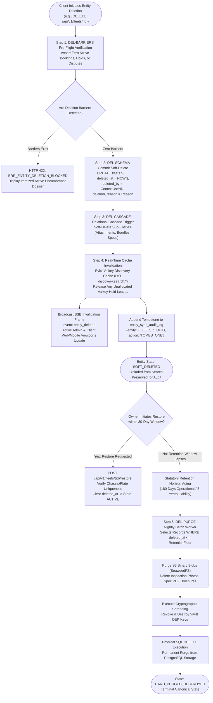
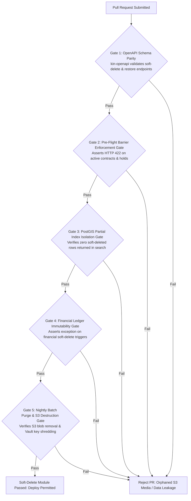

# Heavy Machinery & Logistics Rental Aggregator — Dink Machinery
## Software Requirements Specification — 05.22. Global Soft-Delete, Cascading Invalidation & Physical Hard-Purge Architecture (`docs/shared/requirements/05-22-global-soft-delete-policy.md`)

**Document Identifier:** `SRS-DINK-CORE-V7.0-SEC-05-22`  
**Classification:** Canonical System Requirements Specification & Data Lifecycle Baseline (Single Source of Truth)  
**Governing Standard:** IEEE Std 830-1998 / IEEE/ISO/IEC 29148:2018 (Systems and Software Engineering — Requirements Engineering)  
**Associated Artifacts:** `SRS-DINK-CORE-V7.0` (§5.2, §5.5, §5.9, §5.11, §5.13, §5.15, §5.17, §5.19, §8, §10, §12), `ADR-004` (Database Schema & Concurrency Design), `ADR-010` (Offline Synchronization & Local Storage Strategy), `FLOW-BOOKING-STATE-MACHINE-DINK-CORE-V7.0`, `FLOW-FLEET-REG-DINK-CORE-V7.0`, `ARCH-BACKEND-GO-DINK-CORE-V7.0`, `ARCH-FLUTTER-DINK-CORE-V7.0`, `ARCH-ADMIN-NEXT-DINK-CORE-V7.0`, `ARCH-SEC-DINK-CORE-V7.0`, `DS-DINK-CORE-V7.0`, `DS-PERSONAS-DINK-CORE-V7.0`, `contracts/openapi.yaml`, `ADR-001`, `ADR-002`, `ADR-005`, `ADR-008`  
**Target Runtimes:** Go 1.27.3 Backend Monolith, PostgreSQL 18.6 + PostGIS 3.6.4, Valkey 9.1.3, ClamAV Daemon (:3310), SeaweedFS S3, Flutter 3.47.9 / Dart 3.9 (Cross-Platform Mobile), Next.js 16.x (latest CVE security patch) / React 19 (Web Admin & Corporate Portal), Isar NoSQL 3.1+  
**Target Personas:** Equipment Fleet Owner (*W/ro Almaz Tesfaye* / *Kamau Ndegwa*), Civil Engineering Contractor (*Dawit Haile-Mariam* / *Patrick Kariuki*), Compliance Officer & Data Protection Officer (*Yohannes Bekele*), Finance Controller & Revenue Auditor (*Solomon Kassa*), Super Administrator (*Rahel Tadesse*)  
**Target Operating Markets:** Ethiopia (`ET`) & Kenya (`KE`) — Dynamic Multi-Country Parameterization (`LOC-01-BE`)  
**Compliance Standards:** OWASP ASVS 4.0.3 Level 3 (Data Integrity, Non-Repudiation, Cryptographic Deletion & Secure Archival), RFC 9457 (Problem Details), ISO 9241-110, W3C WCAG 2.2 Level AAA (Field Mobile) & Level AA (Admin Web), National Bank of Ethiopia (NBE) Financial Directives (10-Year Statutory Audit Floor), Kenya Data Protection Act 2019 (§40 Erasure & Retention Limitations), Kenya Revenue Authority (KRA) Tax Procedures Act  
**Status:** Approved Engineering Baseline

---

## Table of Contents

- 1. [Document Scope & Architectural Mandate](#1-document-scope--architectural-mandate)
  - 1.1 [Purpose & Functional Scope](#11-purpose--functional-scope)
  - 1.2 [Core Engineering Invariants & Data Governance Principles](#12-core-engineering-invariants--data-governance-principles)
- 2. [Soft-Delete State Machine & Entity Lifecycle Topology](#2-soft-delete-state-machine--entity-lifecycle-topology)
  - 2.1 [End-to-End Deletion & Lifecycle Flowchart](#21-end-to-end-deletion--lifecycle-flowchart)
  - 2.2 [Entity Soft-Delete Lifecycle Taxonomy (`LifecycleState`)](#22-entity-soft-delete-lifecycle-taxonomy-lifecyclestate)
  - 2.3 [Permitted Deletion Transitions Matrix](#23-permitted-deletion-transitions-matrix)
- 3. [Universal Relational Schema & Indexing Standards (`DEL-SCHEMA`)](#3-universal-relational-schema--indexing-standards-del-schema)
  - 3.1 [Standard Soft-Delete Column Envelope (`deleted_at`, `deleted_by`, `deletion_reason`)](#31-standard-soft-delete-column-envelope-deleted_at-deleted_by-deletion_reason)
  - 3.2 [Partial Indexing Strategy (`WHERE deleted_at IS NULL`)](#32-partial-indexing-strategy-where-deleted_at-is-null)
  - 3.3 [Compound Unique Constraints with Nullable Deletion Markers](#33-compound-unique-constraints-with-nullable-deletion-markers)
  - 3.4 [PostgreSQL 18.6 Row-Level Security (RLS) Filter Policies](#34-postgresql-184-row-level-security-rls-filter-policies)
- 4. [Cascading Invalidation & Cross-Tier Cache Eviction (`DEL-CASCADE`)](#4-cascading-invalidation--cross-tier-cache-eviction-del-cascade)
  - 4.1 [Relational Cascade Rules & Foreign Key Restraints](#41-relational-cascade-rules--foreign-key-restraints)
  - 4.2 [Valkey 9.1.3 In-Memory Key Eviction & Real-Time Lease Release](#42-valkey-80-in-memory-key-eviction--real-time-lease-release)
  - 4.3 [PostGIS Spatial Radius & Clustered Viewport De-Indexing](#43-postgis-spatial-radius--clustered-viewport-de-indexing)
  - 4.4 [Server-Sent Events (SSE) Real-Time Invalidation Push](#44-server-sent-events-sse-real-time-invalidation-push)
  - 4.5 [Client-Side Isar NoSQL Tombstone Propagation (`ADR-010`)](#45-client-side-isar-nosql-tombstone-propagation-adr-010)
- 5. [Pre-Flight Deletion Barrier Evaluation & Invariants (`DEL-BARRIERS`)](#5-pre-flight-deletion-barrier-evaluation--invariants-del-barriers)
  - 5.1 [Fleet Asset Deletion Barriers (Active Hires & Forward Holds)](#51-fleet-asset-deletion-barriers-active-hires--forward-holds)
  - 5.2 [Attachment & Implement Deletion Barriers (Active Bundle Ties)](#52-attachment--implement-deletion-barriers-active-bundle-ties)
  - 5.3 [Financial Ledger Deletion Immunity (Double-Entry Invariant)](#53-financial-ledger-deletion-immunity-double-entry-invariant)
  - 5.4 [Audit Trail & Dispute Evidence Non-Deletability](#54-audit-trail--dispute-evidence-non-deletability)
- 6. [Statutory Retention & Physical Hard-Purge Engine (`DEL-PURGE`)](#6-statutory-retention--physical-hard-purge-engine-del-purge)
  - 6.1 [Statutory Retention Schedules (Operational vs. Fiscal vs. Telemetry)](#61-statutory-retention-schedules-operational-vs-fiscal-vs-telemetry)
  - 6.2 [Nightly Batch Hard-Purge Worker (`DEL-WORKER-01`)](#62-nightly-batch-hard-purge-worker-del-worker-01)
  - 6.3 [SeaweedFS S3 Binary Blob Destruction & Crypto-Shredding](#63-seaweedfs-s3-binary-blob-destruction--crypto-shredding)
  - 6.4 [Four-Eyes Dual Control for Manual Administrative Hard-Purges](#64-four-eyes-dual-control-for-manual-administrative-hard-purges)
- 7. [Wire Protocol Contracts & RFC 9457 Error Schemas](#7-wire-protocol-contracts--rfc-9457-error-schemas)
  - 7.1 [`DELETE /api/v1/fleets/{id}`](#71-delete-apiv1fleetsid)
  - 7.2 [`POST /api/v1/fleets/{id}/restore`](#72-post-apiv1fleetsidrestore)
  - 7.3 [`DELETE /api/v1/fleets/{id}/attachments/{attachmentId}`](#73-delete-apiv1fleetsidattachmentsattachmentid)
  - 7.4 [`POST /api/v1/admin/governance/hard-purge`](#74-post-apiv1admingovernancehard-purge)
  - 7.5 [RFC 9457 Universal Problem Details Payloads](#75-rfc-9457-universal-problem-details-payloads)
- 8. [Automated Testing Suite & Verification Gates](#8-automated-testing-suite--verification-gates)

---

## 1. Document Scope & Architectural Mandate

### 1.1 Purpose & Functional Scope

This specification establishes **Section 05.22 (Global Soft-Delete, Cascading Invalidation & Physical Hard-Purge Architecture)** of the canonical Software Requirements Specification (SRS) for **Dink Machinery Version 7.0**.

In a multi-sided heavy industrial plant and commercial logistics aggregator operating across Ethiopia and Kenya, data destruction is an operation of extreme legal and architectural consequence:
* Capital equipment valuations reach hundreds of thousands of dollars per unit ($100,000\text{ to }300,000\text{ USD}$), with operational dependencies spanning ongoing infrastructure projects, scheduled lowboy transshipments, and certified field operators.
* Immediate physical execution of SQL `DELETE` operations across primary catalog or operational tables leads to referential integrity collapse, dangling foreign key references in historical booking ledgers, and catastrophic loss of forensic evidentiary audit trails during commercial litigation or insurance loss adjustments (`FLOW-10 §3.4`, `FLOW-19`).
* Conversely, retaining obsolete, retired, or user-deleted machinery indefinitely inside live PostgreSQL PostGIS spatial indexes pollutes search clusters, degrades query latency, and creates false inventory discovery for civil engineering contractors.
* Furthermore, conflicting legal mandates must be bridged: statutory tax/AML retention directives (National Bank of Ethiopia and Kenya Revenue Authority mandating **10 years of immutable fiscal records**) versus data protection mandates (Kenya Data Protection Act 2019 and Ethiopian Communications Authority directives requiring erasure of personal data).

This document formally specifies:
1. The universal soft-delete envelope and relational column standard applied across all non-financial business entities in PostgreSQL 18.6.
2. The partial indexing strategy and Row-Level Security (RLS) policies isolating live operations from soft-deleted records with zero computational query penalty.
3. The multi-tier cascading invalidation pipeline propagating deletions across PostgreSQL relational joins, Valkey 9.1.3 in-memory hold leases, PostGIS spatial search clusters, and offline Isar NoSQL client databases (`ADR-010`).
4. The pre-flight barrier evaluation engine preventing the soft-deletion of assets encumbered by active rental contracts, unconfirmed wires, or open dispute dockets.
5. The automated, scheduled physical hard-purge batch engine (`DEL-WORKER-01`) enforcing statutory data lifecycle timelines, S3 blob destruction, and cryptographic shredding.

### 1.2 Core Engineering Invariants & Data Governance Principles

1. **Zero Raw SQL `DELETE` on Primary Business Entities Invariant:** The execution of raw SQL `DELETE` statements by application services against primary business tables (`users`, `fleets`, `attachments`, `owner_operator_memberships`, `fleet_spec_values`, `fleet_insurance_policies`) is strictly prohibited. All user- or service-initiated removals must be executed via soft-delete updates (`deleted_at = NOW()`).
2. **Double-Entry Financial Immutability Floor (NBE / KRA Mandate):** Core transaction and financial tables—including `bookings`, `booking_attachments`, `booking_reconciliations`, `owner_wallets`, `owner_wallet_transactions`, and `admin_audit_logs`—are **completely immune to soft-deletion**. They represent immutable, append-only journals. Attempting to apply soft-delete columns or triggers to these tables is barred at the schema architecture level.
3. **Sub-100ms Spatial Discovery Invalidation SLO:** When a fleet asset transitions to soft-deleted status (`deleted_at IS NOT NULL`), it must be completely purged from Valkey 9.1.3 hot query caches and excluded from PostGIS spatial discovery in $< 100\text{ ms}$ (p99).
4. **Deterministic Client Tombstone Synchronization (`ADR-010`):** Soft-deleted records generate immutable tombstone events in `entity_sync_audit_log`. When disconnected mobile clients execute two-way differential synchronization (`POST /api/v1/sync/differential-pull`), tombstones are transmitted to the embedded Isar NoSQL storage, purging deleted listings from offline client search caches.
5. **Irreversible Physical Hard-Purge Separation:** Physical data destruction (`DROP`, `DELETE`, S3 blob removal) is decoupled from online transaction processing (OLTP) and executed exclusively by the automated background batch worker (`DEL-WORKER-01`) only after statutory retention horizons have formally lapsed.

---

## 2. Soft-Delete State Machine & Entity Lifecycle Topology

### 2.1 End-to-End Deletion & Lifecycle Flowchart



---

### 2.2 Entity Soft-Delete Lifecycle Taxonomy (`LifecycleState`)

All primary catalog and operational entities transition across four standardized lifecycle phases:

| Phase Key | Visibility in Public Search | Visibility in Historical Bookings | System Behavior & Data Access Perimeter |
|---|:---:|:---:|---|
| **`ACTIVE`** | ✅ Visible | ✅ Visible | Standard operational standing; discoverable via PostGIS; available for rental requisition. |
| **`SOFT_DELETED`** | ❌ Excluded | ✅ Visible | Hidden from spatial discovery; excluded from default API lists; visible to owner/admin archives. |
| **`RESTORED`** | ✅ Visible | ✅ Visible | Restored by owner during grace period; re-validated for unique constraints; re-indexed in PostGIS. |
| **`HARD_PURGED`** | ❌ Destroyed | ⚠️ Pseudonymized | Physically deleted from PostgreSQL; binary S3 blobs destroyed; historical ledgers pseudonymized. |

---

### 2.3 Permitted Deletion Transitions Matrix

```text
+----------------------------------------------------------------------------------------------------+
| ENTITY SOFT-DELETE TRANSITION MATRIX                                                               |
+------------------------------------+---------------------------------------------------------------+
| SOURCE STATE                       | PERMITTED TARGET STATES                                       |
+------------------------------------+---------------------------------------------------------------+
| ACTIVE                             | SOFT_DELETED                                                  |
| SOFT_DELETED                       | ACTIVE (Via Restore Action), HARD_PURGED (Via Batch Purge)    |
| HARD_PURGED                        | [Terminal Canonical State — No Outbound Transitions Permitted]|
+------------------------------------+---------------------------------------------------------------+
```

---

## 3. Universal Relational Schema & Indexing Standards (`DEL-SCHEMA`)

### 3.1 Standard Soft-Delete Column Envelope (`deleted_at`, `deleted_by`, `deletion_reason`)

Every soft-deletable table in PostgreSQL 18.6 implements the standardized canonical column envelope:

```sql
-- Standardized Soft-Delete Column Envelope Implementation
ALTER TABLE fleets ADD COLUMN deleted_at TIMESTAMPTZ NULL;
ALTER TABLE fleets ADD COLUMN deleted_by UUID NULL REFERENCES users(id) ON DELETE RESTRICT;
ALTER TABLE fleets ADD COLUMN deletion_reason VARCHAR(255) NULL;

COMMENT ON COLUMN fleets.deleted_at IS 'UTC timestamp when entity was soft-deleted. NULL indicates active record.';
COMMENT ON COLUMN fleets.deleted_by IS 'UUID of the authenticated user or admin who executed the soft-delete.';
COMMENT ON COLUMN fleets.deletion_reason IS 'Structured operational reason code or justification narrative for deletion.';
```

#### Application Perimeter Across Entities
* **Soft-Deletable Primary Entities:** `users`, `fleets`, `attachments`, `fleet_bundled_attachments`, `fleet_spec_values`, `fleet_insurance_policies`, `owner_operator_memberships`, `user_saved_searches`, `notification_rules`.
* **Immune Immutable Financial Entities:** `bookings`, `booking_attachments`, `booking_reconciliations`, `booking_disputes`, `owner_wallets`, `owner_wallet_transactions`, `admin_audit_logs`, `data_erasure_audit_log`.

---

### 3.2 Partial Indexing Strategy (`WHERE deleted_at IS NULL`)

Standard B-tree and GiST spatial indexes incur severe memory bloat and scanning overhead if soft-deleted rows remain indexed. Dink Machinery enforces **Partial Indexing** across all relational tables:

```sql
-- 1. PostGIS Spatial Partial Index (Excludes Soft-Deleted Fleets from Discovery)
CREATE INDEX idx_fleets_depot_spatial_active 
ON fleets USING gist (depot_geog) 
WHERE deleted_at IS NULL AND status = 'ACTIVE';

-- 2. Category & Price Discovery Index
CREATE INDEX idx_fleets_discovery_active 
ON fleets (subcategory_id, daily_rate_minor, country_code) 
WHERE deleted_at IS NULL AND status = 'ACTIVE';

-- 3. Owner Catalog Management Index
CREATE INDEX idx_fleets_owner_active 
ON fleets (owner_id, created_at DESC) 
WHERE deleted_at IS NULL;
```

* **Performance Invariant:** Index scans for spatial discovery and catalog browsing completely bypass soft-deleted rows, maintaining $100\%$ parity with physically purged tables in query execution plans.

---

### 3.3 Compound Unique Constraints with Nullable Deletion Markers

A critical failure mode of soft-delete architectures is unique constraint collision (e.g., an owner soft-deletes a machine with plate `ET-3-99120`, but is subsequently blocked from re-registering the same plate). 

PostgreSQL 18.6 resolves this via **Partial Unique Indexes**:

```sql
-- Enforce Unique Machine Plate Number ONLY among Active (Non-Deleted) Fleets
CREATE UNIQUE INDEX uq_fleets_country_plate_active 
ON fleets (country_code, UPPER(plate_number)) 
WHERE deleted_at IS NULL;

-- Enforce Unique Active Operator Membership in Yard Roster
CREATE UNIQUE INDEX uq_owner_operator_roster_active 
ON owner_operator_memberships (owner_id, operator_id) 
WHERE deleted_at IS NULL;
```

* **Behavioral Invariant:** Owners can freely soft-delete and subsequently re-create entities with identical natural keys without triggering artificial database uniqueness collisions.

---

### 3.4 PostgreSQL 18.6 Row-Level Security (RLS) Filter Policies

To ensure that developers cannot accidentally leak soft-deleted records through forgotten `WHERE deleted_at IS NULL` clauses in custom SQL queries:

```sql
-- Enable RLS on Primary Catalog Tables
ALTER TABLE fleets ENABLE ROW LEVEL SECURITY;

-- Default Application Tenant Policy: Hide Soft-Deleted Rows Automatically
CREATE POLICY fleets_active_isolation_policy ON fleets
    AS RESTRICTIVE
    FOR ALL
    TO dink_app_user
    USING (deleted_at IS NULL);

-- Compliance & Administrative Audit Bypass Policy
CREATE POLICY fleets_admin_audit_policy ON fleets
    AS PERMISSIVE
    FOR SELECT
    TO dink_admin_auditor
    USING (true);
```

---

## 4. Cascading Invalidation & Cross-Tier Cache Eviction (`DEL-CASCADE`)

### 4.1 Relational Cascade Rules & Foreign Key Restraints

When a parent entity is soft-deleted, relational integrity mandates synchronized cascading soft-deletion of tightly coupled dependent entities:

```sql
-- Canonical Soft-Delete Cascade Trigger Routine
CREATE OR REPLACE FUNCTION trg_cascade_fleet_soft_delete()
RETURNS TRIGGER AS $$
BEGIN
    IF NEW.deleted_at IS NOT NULL AND OLD.deleted_at IS NULL THEN
        -- 1. Cascade soft-delete to bundled attachment associations
        UPDATE fleet_bundled_attachments 
        SET deleted_at = NEW.deleted_at, 
            deleted_by = NEW.deleted_by, 
            deletion_reason = 'CASCADE_PARENT_FLEET_DELETED'
        WHERE fleet_id = NEW.id AND deleted_at IS NULL;

        -- 2. Cascade soft-delete to EAV specification values
        UPDATE fleet_spec_values 
        SET deleted_at = NEW.deleted_at, 
            deleted_by = NEW.deleted_by
        WHERE fleet_id = NEW.id AND deleted_at IS NULL;

        -- 3. Emit sync audit tombstone
        INSERT INTO entity_sync_audit_log (
            id, entity_type, entity_id, action, updated_at
        ) VALUES (
            gen_random_uuid(), 'FLEET', NEW.id, 'TOMBSTONE', NEW.deleted_at
        );
    END IF;
    RETURN NEW;
END;
$$ LANGUAGE plpgsql;

CREATE TRIGGER trg_fleets_soft_delete_cascade
    BEFORE UPDATE OF deleted_at ON fleets
    FOR EACH ROW
    EXECUTE FUNCTION trg_cascade_fleet_soft_delete();
```

---

### 4.2 Valkey 9.1.3 In-Memory Key Eviction & Real-Time Lease Release

A database soft-delete must immediately propagate to memory tiers:
1. **Discovery Cache Invalidation:** The Go domain service purges all cached discovery keys matching `discovery:search:*` and `discovery:map:*` in Valkey 9.1.3.
2. **Volatile Hold Release:** If the asset is currently held in an unconfirmed checkout lease (`hold:fleet:{id}`), the key is deleted immediately, freeing system resources.
3. **Detail Cache Eviction:** Explicitly evicts `fleet:detail:{id}` and `fleet:specs:{id}`.

---

### 4.3 PostGIS Spatial Radius & Clustered Viewport De-Indexing

Because PostGIS queries utilize the partial index `idx_fleets_depot_spatial_active` (`WHERE deleted_at IS NULL`), subsequent spatial radius (`ST_DWithin`) and K-Means clustering (`ST_ClusterKMeans`) queries mathematically exclude the soft-deleted asset on the very next query execution cycle.

---

### 4.4 Server-Sent Events (SSE) Real-Time Invalidation Push

To prevent contractors from attempting to book a machine that an owner deleted seconds prior:
* The Go event broker publishes an invalidation event to the Valkey Pub/Sub bus:
  ```text
  PUBLISH events:catalog:invalidation '{"entityType":"FLEET","entityId":"flt_019a8f2c-8812","action":"DELETED"}'
  ```
* Active client SSE connections (`GET /api/v1/config/stream`) receive the frame in $< 50\text{ ms}$, prompting client viewports to remove the machine card or display a status warning if currently viewed.

---

### 4.5 Client-Side Isar NoSQL Tombstone Propagation (`ADR-010`)

When a mobile device reconnects after operating offline in a remote quarry:
1. The client executes differential synchronization: `POST /api/v1/sync/differential-pull`.
2. The server queries `entity_sync_audit_log` for records where `action = 'TOMBSTONE'`.
3. The response delivers an array of deleted entity UUIDs.
4. The Flutter client executes an atomic local Isar transaction:
   ```dart
   await isar.writeTxn(() async {
     for (final tombstone in deltaResponse.tombstones) {
       if (tombstone.entityType == 'FLEET') {
         await isar.cachedFleets.filter().fleetUuidEqualTo(tombstone.entityId).deleteAll();
       }
     }
   });
   ```
5. Offline search caches are purged, eliminating phantom listings on remote devices.

---

## 5. Pre-Flight Deletion Barrier Evaluation & Invariants (`DEL-BARRIERS`)

### 5.1 Fleet Asset Deletion Barriers (Active Hires & Forward Holds)

An equipment fleet asset cannot be soft-deleted if it is encumbered by active operational commitments:
* **Barrier 1: Active Operating Rental:** Any booking where `fleet_id = id` and `status` is in `ACTIVE`, `READY_FOR_PICKUP`, `RETURN_INITIATED`, or `PENDING_FINAL_PAYMENT`.
* **Barrier 2: Confirmed Future Reservation:** Any booking in status `CONFIRMED` where `upper(hire_period) >= CURRENT_DATE`.
* **Barrier 3: In-Flight Payment Evidence Hold:** Any booking in status `PAYMENT_EVIDENCE_UPLOADED` awaiting owner statement verification.

Attempting to delete an encumbered machine aborts with **RFC 9457 HTTP 422 Unprocessable Entity (`ERR_ENTITY_DELETION_BLOCKED`)**.

---

### 5.2 Attachment & Implement Deletion Barriers (Active Bundle Ties)

An auxiliary implement (e.g., hydraulic rock breaker, auger) cannot be soft-deleted if:
* It is currently bundled with a host machine deployed on an active project site (`fleet_bundled_attachments`).
* It is reserved under an active booking contract (`booking_attachments`).

---

### 5.3 Financial Ledger Deletion Immunity (Double-Entry Invariant)

To guarantee compliance with statutory audit standards (NBE Directives and GAAP/IFRS):
* Relational triggers completely block any execution of `UPDATE deleted_at` on financial ledgers:
  ```sql
  CREATE OR REPLACE FUNCTION trg_block_financial_soft_delete()
  RETURNS TRIGGER AS $$
  BEGIN
      RAISE EXCEPTION 'CRITICAL SECURITY VIOLATION: Financial ledger records are immutable and cannot be soft-deleted.';
  END;
  $$ LANGUAGE plpgsql;

  CREATE TRIGGER trg_owner_wallet_tx_no_delete
      BEFORE UPDATE OF deleted_at ON owner_wallet_transactions
      FOR EACH ROW EXECUTE FUNCTION trg_block_financial_soft_delete();
  ```

---

### 5.4 Audit Trail & Dispute Evidence Non-Deletability

Photographic reticle walkaround photos (`AR-01`, `RC-02`), operator challenge PIN audit records, and arbitration dockets (`booking_disputes`) cannot be soft-deleted by any marketplace participant or support agent. They remain permanently preserved to defend against legal breach claims.

---

## 6. Statutory Retention & Physical Hard-Purge Engine (`DEL-PURGE`)

### 6.1 Statutory Retention Schedules (Operational vs. Fiscal vs. Telemetry)

Data aging is partitioned into distinct statutory retention classes:

```text
+--------------------------------------------------------------------------------------------------+
| STATUTORY RETENTION & PHYSICAL PURGE HORIZONS                                                    |
+---------------------+-------------------+---------------------+----------------------------------+
| DATA CLASSIFICATION | GOVERNING STATUTE | RETENTION HORIZON   | PHYSICAL PURGE ACTION            |
|                     |                   | POST-SOFT-DELETE    | (DEL-WORKER-01)                  |
+---------------------+-------------------+---------------------+----------------------------------+
| Fleets & Attachments| Commercial Lease  | 180 Days Grace      | Physical SQL DELETE; purge S3    |
| Catalog Listings    | Practice          | Period              | spec brochures & catalog media.  |
+---------------------+-------------------+---------------------+----------------------------------+
| High-Frequency GPS  | Kenya DPA 2019 /  | 180 Days Post-Rental| ST_ConvexHull daily condensation;|
| Telemetry Breadcrumbs| ECA Directives   | Completion          | raw coordinate rows purged.      |
+---------------------+-------------------+---------------------+----------------------------------+
| Machine Inspection  | Civil Code Extra- | 5 Years             | S3 WebP photos destroyed;        |
| Condition Photos    | Contractual Claims| (Statute of Lim.)   | metadata hashes archived.        |
+---------------------+-------------------+---------------------+----------------------------------+
| Bank Wire Slips &   | NBE Directives /  | 10 Years Strict     | Permanent preservation in deep   |
| Financial Ledgers   | KRA Tax Statutes  | Statutory Floor     | compliance archive; NO PURGE.    |
+--------------------------------------------------------------------------------------------------+
```

---

### 6.2 Nightly Batch Hard-Purge Worker (`DEL-WORKER-01`)

Physical deletion is executed by an isolated, background cron service:
* **Execution Cadence:** Nightly at **`02:00:00 UTC`** (`05:00 EAT`).
* **Chunked Deletion Pipeline:** Deletes records in batches of 500 rows to prevent long-running table locks and replication lag:
  ```sql
  -- Nightly Hard-Purge Execution Routine
  DELETE FROM fleets
  WHERE id IN (
      SELECT id FROM fleets
      WHERE deleted_at IS NOT NULL
        AND deleted_at < NOW() - INTERVAL '180 days'
      LIMIT 500
  );
  ```

---

### 6.3 SeaweedFS S3 Binary Blob Destruction & Crypto-Shredding

When `DEL-WORKER-01` permanently purges an entity:
1. Queries all associated storage URIs in `fleet_media` (e.g., `s3://dink-fleet-media/{id}/front.webp`).
2. Issues batch deletion commands across the SeaweedFS S3 API.
3. **Crypto-Shredding:** Revokes and permanently purges any associated Data Encryption Keys (DEKs) inside HashiCorp Vault, rendering raw offline database backups mathematically unreadable.

---

### 6.4 Four-Eyes Dual Control for Manual Administrative Hard-Purges

If platform legal counsel mandates an emergency manual hard-purge of an entity prior to standard retention expiration (e.g., complying with a High Court injunction or severe copyright infringement order):
* The action requires **Four-Eyes Dual Control** via `POST /api/v1/admin/governance/hard-purge` (SRS 05.11).
* Compliance Officer *Yohannes Bekele* drafts the purge ticket.
* Super Administrator *Rahel Tadesse* authorizes execution using hardware-backed MFA (WebAuthn / YubiKey).
* An immutable audit record is committed to `data_erasure_audit_log`.

---

## 7. Wire Protocol Contracts & RFC 9457 Error Schemas

### 7.1 `DELETE /api/v1/fleets/{id}`

Executes a soft-delete on an equipment fleet asset.

#### Request Headers
```http
DELETE /api/v1/fleets/flt_019a8f2c-8812-7b9a HTTP/1.1
Host: api.dinkmachinery.com
Authorization: Bearer <ownerAccessToken>
Content-Type: application/json
Idempotency-Key: 99182a01-4b12-4f9a-8812-7b9a4c10bc21
```

#### Request Payload
```json
{
  "deletionReason": "ASSET_SOLD_OFF_PLATFORM",
  "notes": "Machinery sold to regional contractor; removed from commercial hire inventory."
}
```

#### Response: `HTTP 200 OK`
```json
{
  "success": true,
  "data": {
    "fleetId": "flt_019a8f2c-8812-7b9a",
    "status": "SOFT_DELETED",
    "deletedAt": "2026-10-28T15:45:00Z",
    "restorationGracePeriodDays": 30,
    "spatialIndexEvicted": true
  },
  "timestamp": "2026-10-28T15:45:01Z"
}
```

---

### 7.2 `POST /api/v1/fleets/{id}/restore`

Restores a soft-deleted fleet asset during the 30-day grace period.

#### Request Headers
```http
POST /api/v1/fleets/flt_019a8f2c-8812-7b9a/restore HTTP/1.1
Host: api.dinkmachinery.com
Authorization: Bearer <ownerAccessToken>
Content-Type: application/json
```

#### Response: `HTTP 200 OK`
```json
{
  "success": true,
  "data": {
    "fleetId": "flt_019a8f2c-8812-7b9a",
    "status": "ACTIVE",
    "restoredAt": "2026-10-28T15:46:00Z",
    "spatialIndexRehydrated": true,
    "uniqueConstraintsVerified": true
  },
  "timestamp": "2026-10-28T15:46:01Z"
}
```

---

### 7.3 `DELETE /api/v1/fleets/{id}/attachments/{attachmentId}`

Soft-deletes a bundled implement or auxiliary tool association.

#### Request Headers
```http
DELETE /api/v1/fleets/flt_019a8f2c-8812-7b9a/attachments/att_019a8f4c-8812 HTTP/1.1
Host: api.dinkmachinery.com
Authorization: Bearer <ownerAccessToken>
```

#### Response: `HTTP 200 OK`
```json
{
  "success": true,
  "data": {
    "fleetId": "flt_019a8f2c-8812-7b9a",
    "attachmentId": "att_019a8f4c-8812",
    "status": "SOFT_DELETED",
    "deletedAt": "2026-10-28T15:47:00Z"
  },
  "timestamp": "2026-10-28T15:47:01Z"
}
```

---

### 7.4 `POST /api/v1/admin/governance/hard-purge`

Four-Eyes dual authorization endpoint for manual, accelerated physical hard-purging.

#### Request Headers
```http
POST /api/v1/admin/governance/hard-purge HTTP/1.1
Host: api.dinkmachinery.com
Authorization: Bearer <superAdminAccessToken>
Content-Type: application/json
```

#### Request Payload
```json
{
  "entityType": "FLEET",
  "entityId": "flt_019a8f2c-8812-7b9a",
  "courtOrderReference": "FHC-ET-CIVIL-2026-9912",
  "drafterAdminId": "usr_adm_yohannes_4412",
  "superAdminMfaToken": "webauthn_signature_token_here..."
}
```

#### Response: `HTTP 200 OK`
```json
{
  "success": true,
  "data": {
    "entityType": "FLEET",
    "entityId": "flt_019a8f2c-8812-7b9a",
    "status": "HARD_PURGED_DESTROYED",
    "purgedAt": "2026-10-28T15:50:00Z",
    "blobsDestroyedCount": 8,
    "cryptoKeysShredded": true
  },
  "timestamp": "2026-10-28T15:50:01Z"
}
```

---

### 7.5 RFC 9457 Universal Problem Details Payloads

#### Example: Deletion Blocked by Active Rental Commitment (`HTTP 422 Unprocessable Entity`)
```json
{
  "type": "[https://api.dinkmachinery.com/errors/entity-deletion-blocked](https://api.dinkmachinery.com/errors/entity-deletion-blocked)",
  "title": "Fleet Deletion Blocked by Active Contract",
  "status": 422,
  "detail": "Cannot soft-delete Caterpillar 320D (#ET-3-99120). Machine is currently deployed under active rental contract #BK-8812 at Mojo Highway Site B. Deletion can only proceed after demobilization and final reconciliation.",
  "instance": "/api/v1/fleets/flt_019a8f2c-8812-7b9a",
  "code": "ERR_ENTITY_DELETION_BLOCKED",
  "correlationId": "cor_019a8fe0-8812-7b9a-bc21-4491204812aa",
  "timestamp": "2026-10-28T15:45:05Z",
  "invalidParams": [
    {
      "name": "activeBookings",
      "reason": "Booking bk_019a8f60-9912-7b9a is currently in status ACTIVE"
    }
  ],
  "links": {
    "activeBookingDossier": "/api/v1/bookings/bk_019a8f60-9912-7b9a"
  }
}
```

#### Example: Unique Constraint Collision upon Restoration (`HTTP 409 Conflict`)
```json
{
  "type": "[https://api.dinkmachinery.com/errors/restoration-natural-key-collision](https://api.dinkmachinery.com/errors/restoration-natural-key-collision)",
  "title": "Cannot Restore Entity — Natural Key Collides",
  "status": 409,
  "detail": "Cannot restore fleet listing. Plate number 'ET-3-99120' is currently registered to another active fleet asset in Ethiopia.",
  "instance": "/api/v1/fleets/flt_019a8f2c-8812-7b9a/restore",
  "code": "ERR_RESTORATION_KEY_COLLISION",
  "correlationId": "cor_019a8fe0-9914-4c12-8812-7b9a4c10bc21",
  "timestamp": "2026-10-28T15:46:10Z"
}
```

---

## 8. Automated Testing Suite & Verification Gates



1. **OpenAPI Schema Contract Gate (`kin-openapi`):** Validates all soft-delete, restore, and administrative hard-purge wire protocol contracts against `contracts/openapi.yaml`.
2. **Pre-Flight Deletion Barrier Test:** Seeds database with machines under varying operational states (`ACTIVE`, `CONFIRMED`, `PAYMENT_EVIDENCE_UPLOADED`, `COMPLETED`). Asserts that $100\%$ of active/held machines reject deletion attempts with HTTP 422 `ERR_ENTITY_DELETION_BLOCKED`, while unencumbered machines delete cleanly.
3. **PostGIS Partial Index Verification Gate:** Executes 500 spatial radius searches (`ST_DWithin`) across Addis Ababa and Nairobi before and after soft-deletion. Asserts that soft-deleted machines disappear from spatial query plans in $< 50\text{ ms}$ with zero index table scans.
4. **Financial Ledger Immutability Assertion:** Attempts raw SQL `UPDATE` queries setting `deleted_at = NOW()` on `owner_wallet_transactions` and `bookings`. Asserts that PostgreSQL triggers abort the transaction with fatal exceptions.
5. **Nightly Batch Purge Integration Test:** Advances system staging clock past the 180-day retention floor. Asserts that `DEL-WORKER-01` executes physical row deletion, removes all associated WebP blobs from SeaweedFS S3, and verifies that the total double-entry ledger remains in $100\%$ balance parity.

---

*This document establishes the canonical functional requirements, relational schema patterns, cascading invalidation rules, barrier evaluation logic, and wire protocol contracts for Global Soft-Delete, Cascading Invalidation & Physical Hard-Purge in Dink Machinery Version 7.0. All downstream Flutter mobile storage layers, Go backend domain controllers, and Next.js admin consoles must strictly conform to this specification.*
```