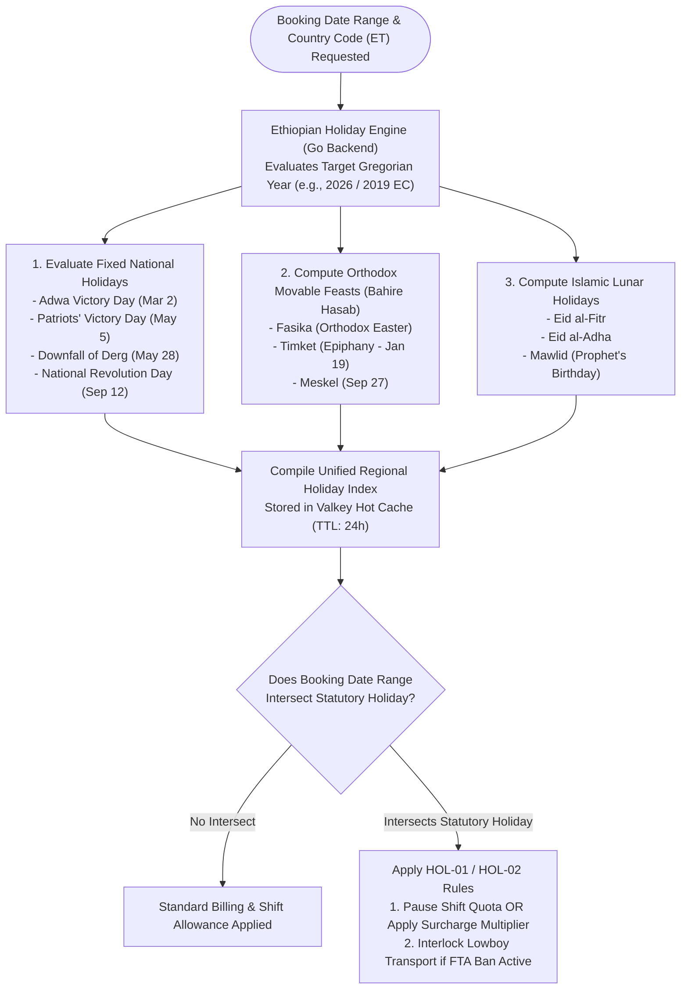
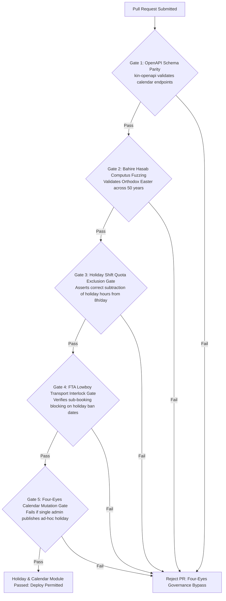

```markdown
# Heavy Machinery & Logistics Rental Aggregator — Dink Machinery
## Software Requirements Specification — 05.23. Ethiopian Public Holiday, Movable Feasts & Regional Cultural Calendar Integration Architecture (`docs/shared/requirements/05-23-ethiopian-public-holiday-calendar.md`)

**Document Identifier:** `SRS-DINK-CORE-V7.0-SEC-05-23`  
**Classification:** Canonical System Requirements Specification & Temporal Architecture Baseline (Single Source of Truth)  
**Governing Standard:** IEEE Std 830-1998 / IEEE/ISO/IEC 29148:2018 (Systems and Software Engineering — Requirements Engineering)  
**Associated Artifacts:** `SRS-DINK-CORE-V7.0` (§5.1, §5.6, §5.7, §5.16, §5.23, §8, §10, §12), `FLOW-BOOKING-STATE-MACHINE-DINK-CORE-V7.0`, `ARCH-BACKEND-GO-DINK-CORE-V7.0`, `ARCH-FLUTTER-DINK-CORE-V7.0`, `ARCH-ADMIN-NEXT-DINK-CORE-V7.0`, `ARCH-SEC-DINK-CORE-V7.0`, `DS-DINK-CORE-V7.0`, `DS-PERSONAS-DINK-CORE-V7.0`, `contracts/openapi.yaml`, `ADR-001`, `ADR-002`, `ADR-005`, `ADR-008`, `ADR-010`  
**Target Runtimes:** Go 1.27.3 Backend Monolith, Flutter 3.47.8 / Dart 3.9 (Cross-Platform Mobile), Next.js 16.x (latest CVE security patch) / React 19 (Web Admin & Corporate Portal), PostgreSQL 18.6 + PostGIS 3.6.4, Valkey 9.1.3, ClamAV Daemon (:3310), SeaweedFS S3, Isar NoSQL 3.1+  
**Target Personas:** Civil Engineering Contractor (*Dawit Haile-Mariam* / *Patrick Kariuki*), Equipment Fleet Owner (*W/ro Almaz Tesfaye* / *Kamau Ndegwa*), Certified Field Operator (*Mulugeta Tadesse* / *Juma Omwamba*), Lowboy Transporter (*Ato Girma Wolde* / *Samuel Odhiambo*), Compliance Officer & Calendar Arbitrator (*Yohannes Bekele*)  
**Target Operating Markets:** Ethiopia (`ET`) & Kenya (`KE`) — Dynamic Multi-Country Parameterization (`LOC-01-BE`)  
**Compliance Standards:** OWASP ASVS 4.0.3 Level 3 (Temporal Calculation Integrity & Deterministic Scheduling), RFC 9457 (Problem Details), ISO 9241-110, W3C WCAG 2.2 Level AAA (Field Mobile) & Level AA (Admin Web), Ethiopian Federal Public Holidays Proclamation No. 16/1975 & Amendments, Ethiopian Orthodox Tewahedo Church Computus (Ba'alat wä Tsome), Islamic Lunar Calendar Calculations (Hijri / Eid al-Fitr / Eid al-Adha / Mawlid)  
**Status:** Approved Engineering Baseline

---

## Table of Contents

- 1. [Document Scope & Architectural Mandate](#1-document-scope--architectural-mandate)
  - 1.1 [Purpose & Functional Scope](#11-purpose--functional-scope)
  - 1.2 [Core Architectural Principles & Temporal Invariants](#12-core-architectural-principles--temporal-invariants)
- 2. [Ethiopian Holiday Topology & Movable Feast Engine](#2-ethiopian-holiday-topology--movable-feast-engine)
  - 2.1 [Fixed Public Holidays vs. Movable Religious Feasts Flowchart](#21-fixed-public-holidays-vs-movable-religious-feasts-flowchart)
  - 2.2 [State Sub-Machine Taxonomy (`HolidayCategory`)](#22-state-sub-machine-taxonomy-holidaycategory)
  - 2.3 [Computus Algorithm for Orthodox Movable Feasts (Easter & Tsome Tinsae)](#23-computus-algorithm-for-orthodox-movable-feasts-easter--tsome-tinsae)
  - 2.4 [Islamic Lunar Calculation Engine (Eid al-Fitr, Eid al-Adha, Mawlid)](#24-islamic-lunar-calculation-engine-eid-al-fitr-eid-al-adha-mawlid)
- 3. [Rental Calendar Exclusion & Surcharge Architecture (`HOL-01`)](#3-rental-calendar-exclusion--surcharge-architecture-hol-01)
  - 3.1 [Non-Working Holiday Exclusion from Standard Shift Quotas ($8.0\text{ hrs/day}$)](#31-non-working-holiday-exclusion-from-standard-shift-quotas-80-text-hrsday)
  - 3.2 [Holiday Mobilization Surcharges & Premium Rate Multipliers (`HOL-02`)](#32-holiday-mobilization-surcharges--premium-rate-multipliers-hol-02)
  - 3.3 [GiST Temporal Range Exclusion in PostgreSQL 18.6](#33-gist-temporal-range-exclusion-in-postgresql-184)
- 4. [Lowboy Transport Corridors & Holiday Traffic Bans (`HOL-03`)](#4-lowboy-transport-corridors--holiday-traffic-bans-hol-03)
  - 4.1 [Federal Transport Authority Highway Freight Ban Integration](#41-federal-transport-authority-highway-freight-ban-integration)
  - 4.2 [Automatic Sub-Booking Rescheduling & ETA Recalculation](#42-automatic-sub-booking-rescheduling--eta-recalculation)
  - 4.3 [Dynamic Contractor Notifications for Corridor Closures](#43-dynamic-contractor-notifications-for-corridor-closures)
- 5. [Administrative Holiday Management Workbench (`AD-06-WEB`)](#5-administrative-holiday-management-workbench-ad-06-web)
  - 5.1 [Next.js Regional Calendar Control Panel (`HOL-ADMIN`)](#51-nextjs-regional-calendar-control-panel-hol-admin)
  - 5.2 [Ad-Hoc National Mourning / Emergency Proclamation Overrides](#52-ad-hoc-national-mourning--emergency-proclamation-overrides)
  - 5.3 [Four-Eyes Dual Control for Calendar Mutations](#53-four-eyes-dual-control-for-calendar-mutations)
- 6. [Wire Protocol Contracts & RFC 9457 Error Schemas](#6-wire-protocol-contracts--rfc-9457-error-schemas)
  - 6.1 [`GET /api/v1/calendar/holidays`](#61-get-apiv1calendarholidays)
  - 6.2 [`POST /api/v1/calendar/validate-period`](#62-post-apiv1calendarvalidate-period)
  - 6.3 [`POST /api/v1/admin/calendar/holidays`](#63-post-apiv1admincalendarholidays)
  - 6.4 [RFC 9457 Universal Problem Details Payloads](#64-rfc-9457-universal-problem-details-payloads)
- 7. [Automated Testing Suite & Verification Gates](#7-automated-testing-suite--verification-gates)

---

## 1. Document Scope & Architectural Mandate

### 1.1 Purpose & Functional Scope

This specification establishes **Section 05.23 (Ethiopian Public Holiday, Movable Feasts & Regional Cultural Calendar Integration Architecture)** of the canonical Software Requirements Specification (SRS) for **Dink Machinery Version 7.0**.

Operating heavy plant machinery and heavy haulage logistics across Ethiopia involves navigating a complex national calendar:
* **Fixed National Holidays:** Commemorative dates anchored to the Ethiopian (Ge'ez) Calendar or Gregorian Calendar (e.g., *Enkutatash / New Year* on September 11/12, *Meskel / Finding of the True Cross* on September 15, *Adwa Victory Day* on March 2, *Ethiopian Patriots' Victory Day* on May 5, *Derg Downfall Day* on May 28).
* **Movable Religious Feasts (Orthodox Tewahedo Computus):** Dates governed by the complex Bahire Hasab (Computus) calculating *Fasika* (Orthodox Easter) and associated fasting seasons (*Tsome Tinsae*, *Tsome Hudad*). Easter dates diverge from Western Gregorian Easter due to the Julian-to-Gregorian shift and Alexandrian calendar rules.
* **Movable Islamic Lunar Holidays:** Dates determined by lunar visibility sighting or astronomical Umm al-Qura calendar projections (*Eid al-Fitr*, *Eid al-Adha*, *Mawlid*).
* **Impact on Heavy Construction Operations:** On statutory public holidays, civil engineering sites in Ethiopia legally suspend heavy earthmoving operations, or require double-time wage and equipment premiums. Furthermore, the Federal Transport Authority enforces strict highway freight bans on heavy lowboy transports during major religious holidays and festive periods to prevent severe traffic congestion and accidents.

This document formally specifies:
1. The mathematical holiday engine computing fixed dates, Orthodox movable feasts (Bahire Hasab), and Islamic lunar festivals dynamically for any given Gregorian year.
2. The rental calendar exclusion and surcharge engine adjusting standard daily shift billing quotas ($8.0\text{ hrs/day}$) and applying holiday rate multipliers.
3. The logistics transport corridor integration pausing lowboy carrier dispatch during Federal Transport Authority holiday heavy freight bans.
4. The administrative holiday management console with four-eyes authorization for ad-hoc emergency public holiday proclamations.

### 1.2 Core Architectural Principles & Temporal Invariants

1. **Deterministic Calendar Calculation Invariant:** Holiday calculations must never rely on static manual annual data entry alone. The backend Go microservice must execute deterministic algorithmic models for Orthodox computus and Islamic lunar calculations, validated against official Proclamation schedules.
2. **Zero-Billing on Statutory Non-Working Holidays (`HOL-01`):** Unless a rental contract explicitly designates weekend or holiday operation (`is_holiday_operation_permitted = true`), statutory public holidays automatically pause standard shift meter accumulation quotas ($\mathcal{H}_{\text{agreed}}$), protecting contractors from idle plant hire billing during legally mandated rest days.
3. **Lowboy Freight Ban Safety Interlock (`HOL-03`):** Sub-bookings for specialized lowboy transport (`parent_booking_id IS NOT NULL`) cannot schedule highway transit across restricted federal corridors during official Federal Transport Authority holiday freight blackout windows, preventing impoundment and heavy civil fines.
4. **Dual-Calendar Representation (`LOC-01-BE`):** All holiday dates, booking start windows, and delivery schedules must be rendered to users in both Gregorian and Ethiopian Ge'ez calendar formats, ensuring flawless operational alignment across foreign engineering contractors and local site personnel.

---

## 2. Ethiopian Holiday Topology & Movable Feast Engine

### 2.1 Fixed Public Holidays vs. Movable Religious Feasts Flowchart



---

### 2.2 State Sub-Machine Taxonomy (`HolidayCategory`)

Holiday records in PostgreSQL are categorized into distinct operational rules:

| Category Key | Operational Impact | Surcharge / Interlock Behavior |
|---|---|---|
| **`FIXED_NATIONAL`** | Mandatory Rest / Work Ban | Statutory holiday; shift hours paused unless premium rate is agreed. |
| **`ORTHODOX_MOVABLE`** | Religious Observance | Varies annually via Bahire Hasab computus; strict site shutdown in civil sector. |
| **`ISLAMIC_LUNAR`** | Religious Observance | Declared via lunar sighting / astronomical projection; statutory rest day. |
| **`TRANSPORT_BAN_WINDOW`**| Freight Corridor Interlock | Federal Transport Authority lowboy transit ban; zero highway movement. |

---

### 2.3 Computus Algorithm for Orthodox Movable Feasts (Easter & Tsome Tinsae)

Calculating Ethiopian Orthodox Easter (*Fasika*) requires computing the Alexandrian computus (*Bahire Hasab*):
1. Determine the Ethiopian Year ($Y_E = Y_G - 7 \text{ or } 8$).
2. Calculate the *Abonsi* and *Tinte Tensa* (Epact and solar cycle offsets).
3. Fasika always falls on a Sunday between Megabit 25 and Ginbot 7 (corresponding roughly to April–May in the Gregorian calendar).
4. The backend computes Fasika and derives dependent movable feasts:
   - *Hosanna* (Palm Sunday): 1 week prior to Fasika.
   - *Tsome Tinsae* (Lent): 55 days preceding Fasika.
   - *Meskel* (Finding of the True Cross): Fixed annually on Meskerem 17 (September 27 Gregorian / September 26 in leap years).

---

### 2.4 Islamic Lunar Calculation Engine (Eid al-Fitr, Eid al-Adha, Mawlid)

Islamic holidays follow the Hijri lunar calendar:
* Computed using the tabular Islamic calendar (Umm al-Qura astronomical projection model) implemented in Go standard libraries.
* Because lunar dates shift by approximately 10–11 days each Gregorian year, the engine recalculates projected window bounds 12 months in advance.
* Administrative overrides allow compliance officers to adjust actual holiday dates instantly upon official government radio/television proclamation by the Ethiopian Islamic Affairs Supreme Council.

---

## 3. Rental Calendar Exclusion & Surcharge Architecture (`HOL-01`)

### 3.1 Non-Working Holiday Exclusion from Standard Shift Quotas ($8.0\text{ hrs/day}$)

When a rental booking spans a statutory public holiday:
* **Default Exclusion Invariant:** If `is_holiday_operation_permitted = false` (default for standard civil works), the daily shift accumulation engine (`AR-03` / SRS 05.06) excludes the holiday date from the cumulative operating hour allowance:
  $$\mathcal{H}_{\text{agreed}} = (\Delta_{\text{days}} - \text{HolidayCount}) \times 8.0\text{ Hours}$$
  *Example:* A 7-day hire starting Monday that includes a Thursday public holiday grants an operating allowance of $6 \times 8.0 = 48.0\text{ hours}$ instead of $56.0\text{ hours}$.

---

### 3.2 Holiday Mobilization Surcharges & Premium Rate Multipliers (`HOL-02`)

If a contractor requires continuous shift operations during a public holiday (e.g., pouring continuous foundation concrete or emergency highway bridge repairs):
* The booking contract flags `is_holiday_operation_permitted = true`.
* The financial engine applies an agreed **Holiday Rate Multiplier** (typically $1.5\times$ to $2.0\times$ the standard daily tariff):
  $$\mathcal{S}_{\text{holiday\_minor}} = \sum_{k=1}^{n} \left( \text{DailyRate} \times (\text{Multiplier} - 1.0) \right)$$
* The surcharge is committed as an immutable line item on the final balance reconciliation statement (`RC-05` / SRS 05.07).

---

### 3.3 GiST Temporal Range Exclusion in PostgreSQL 18.6

When checking equipment availability and scheduling calendar leases, PostgreSQL 18.6 evaluates spatial-temporal availability while factoring holiday exclusions:

```sql
-- Query evaluating equipment availability with holiday-aware shift adjustments
SELECT f.id, f.make, f.model
FROM fleets f
WHERE f.status = 'ACTIVE'
  AND NOT EXISTS (
      SELECT 1 FROM bookings b
      WHERE b.fleet_id = f.id
        AND b.hire_period && daterange($requested_start, $requested_end, '[)')
        AND b.status IN ('CONFIRMED', 'ACTIVE')
  );
```

---

## 4. Lowboy Transport Corridors & Holiday Traffic Bans (`HOL-03`)

### 4.1 Federal Transport Authority Highway Freight Ban Integration

During major national and religious holidays (e.g., *Meskel*, *Fasika*, *Meskerem 1/New Year*), the Federal Transport Authority enforces stringent highway restrictions:
* **Freight Ban Scope:** Absolute prohibition of multi-axle lowboy trailers, step-decks, and modular platform transporters carrying heavy plant machinery on national federal corridors (Corridor 1: Addis–Adama Expressway; Corridor 2: Modjo–Hawassa; Corridor 3: Bahir Dar–Gondar).
* **System Interlock (`HOL-03`):** The logistics sub-booking engine (`SRS 05.08`) cross-references planned lowboy transit dates against the `regional_holidays` table. If a lowboy sub-booking schedule intersects an active transport ban window, the system blocks booking confirmation:
  ```json
  {
    "type": "[https://api.dinkmachinery.com/errors/fta-holiday-transport-ban](https://api.dinkmachinery.com/errors/fta-holiday-transport-ban)",
    "title": "Lowboy Transport Prohibited During Federal Holiday Ban",
    "status": 422,
    "detail": "Scheduled transit date (2026-09-27, Meskel Holiday) falls within the Federal Transport Authority heavy freight highway ban window. Transit must be scheduled prior to or following the ban.",
    "code": "ERR_FTA_TRANSPORT_BAN_ACTIVE"
  }
  ```

---

### 4.2 Automatic Sub-Booking Rescheduling & ETA Recalculation

When a lowboy transport sub-booking is flagged by a holiday transit ban:
* The system automatically calculates the nearest compliant transport window (e.g., shifting transit pickup 24 hours earlier or 24 hours later).
* Prompts the equipment owner and logistics carrier to accept the adjusted ETA before committing funds.

---

### 4.3 Dynamic Contractor Notifications for Corridor Closures

* Dispatches high-priority P1 push notifications and SMS alerts to site managers:
  *"Logistics Alert: Lowboy transport for Cat 320D rescheduled by 24 hours due to statutory Meskel holiday highway freight restrictions."*

---

## 5. Administrative Holiday Management Workbench (`AD-06-WEB`)

### 5.1 Next.js Regional Calendar Control Panel (`HOL-ADMIN`)

Platform compliance officers manage the master holiday database via the **Regional Calendar Control Panel** in Next.js (`AD-06-WEB`):
* Interactive multi-year calendar grid displaying fixed national holidays, computed Orthodox feasts, and Islamic lunar dates.
* Jurisdictional filtering: Toggle between Ethiopia (`ET`) and Kenya (`KE`).
* Export engine: Download official IFRS audit-compliant calendar schedules for corporate payroll and machinery leasing compliance.

---

### 5.2 Ad-Hoc National Mourning / Emergency Proclamation Overrides

If the federal government declares an unexpected ad-hoc public holiday (e.g., national day of mourning or emergency state decree):
* Compliance officers can inject ad-hoc holiday windows instantly via `POST /api/v1/admin/calendar/holidays`.
* The system instantly recalculates affected active rentals, adjusts shift allowances, and flags overlapping lowboy transport runs.

---

### 5.3 Four-Eyes Dual Control for Calendar Mutations

Modifying official statutory holiday dates or freight ban corridors carries substantial commercial liability:
* Executed under **Four-Eyes Dual Control** (SRS 05.11).
* Requires authorization by both a Compliance Officer drafter and Super Administrator authorizer, accompanied by official government proclamation reference numbers.

---

## 6. Wire Protocol Contracts & RFC 9457 Error Schemas

### 6.1 `GET /api/v1/calendar/holidays`

Retrieves public holidays and transport ban windows for a given calendar year.

#### Request Headers
```http
GET /api/v1/calendar/holidays?countryCode=ET&year=2026 HTTP/1.1
Host: api.dinkmachinery.com
Accept: application/json
Accept-Language: am
```

#### Response: `HTTP 200 OK`
```json
{
  "success": true,
  "data": {
    "countryCode": "ET",
    "gregorianYear": 2026,
    "ethiopianYear": 2018,
    "holidays": [
      {
        "holidayKey": "ADWA_VICTORY_DAY",
        "titleEn": "Adwa Victory Day",
        "titleAm": "የአድዋ ድል ቀን",
        "dateGregorian": "2026-03-02",
        "dateEthiopian": "የካቲት 23 ቀን 2018 ዓ.ም",
        "category": "FIXED_NATIONAL",
        "isWorkingDay": false,
        "lowboyTransportBanActive": false
      },
      {
        "holidayKey": "FASIKA_ORTHODOX_EASTER",
        "titleEn": "Fasika (Orthodox Easter)",
        "titleAm": "ፋሲካ (የትንሣኤ በዓል)",
        "dateGregorian": "2026-04-12",
        "dateEthiopian": "ሚያዝያ 4 ቀን 2018 ዓ.ም",
        "category": "ORTHODOX_MOVABLE",
        "isWorkingDay": false,
        "lowboyTransportBanActive": true
      }
    ]
  },
  "timestamp": "2026-10-28T16:00:00Z"
}
```

---

### 6.2 `POST /api/v1/calendar/validate-period`

Validates whether a proposed rental or transport date range intersects statutory holidays or transport bans.

#### Request Payload
```json
{
  "countryCode": "ET",
  "startDate": "2026-09-25",
  "endDate": "2026-10-02",
  "includeLogisticsTransport": true
}
```

#### Response: `HTTP 200 OK`
```json
{
  "success": true,
  "data": {
    "isPeriodValid": false,
    "conflictsDetected": [
      {
        "date": "2026-09-27",
        "holidayKey": "MESKEL_FINDING_TRUE_CROSS",
        "title": "Meskel (Finding of the True Cross)",
        "violatesTransportBan": true,
        "recommendation": "Shift lowboy transit window to 2026-09-25."
      }
    ],
    "adjustedShiftAllowanceHours": 48.0
  },
  "timestamp": "2026-10-28T16:01:00Z"
}
```

---

### 6.3 `POST /api/v1/admin/calendar/holidays`

Administrative endpoint for creating or updating statutory holiday proclamations.

#### Request Headers
```http
POST /api/v1/admin/calendar/holidays HTTP/1.1
Host: api.dinkmachinery.com
Content-Type: application/json
Authorization: Bearer <superAdminAccessToken>
Idempotency-Key: 44192b01-5c12-4f9a-9912-8c0b5d21cd32
```

#### Request Payload
```json
{
  "countryCode": "ET",
  "holidayKey": "AD_HOC_NATIONAL_MOURNING",
  "titleEn": "National Day of Mourning",
  "titleAm": "የብሔራዊ ሀዘን ቀን",
  "dateGregorian": "2026-11-20",
  "category": "FIXED_NATIONAL",
  "isWorkingDay": false,
  "lowboyTransportBanActive": true,
  "proclamationReference": "PROCLAMATION-ET-2026-8812"
}
```

#### Response: `HTTP 201 Created`
```json
{
  "success": true,
  "data": {
    "holidayId": "hol_019a8fe5-8812",
    "status": "PUBLISHED",
    "affectedActiveBookingsCount": 42,
    "createdAt": "2026-10-28T16:02:00Z"
  },
  "timestamp": "2026-10-28T16:02:01Z"
}
```

---

### 6.4 RFC 9457 Universal Problem Details Payloads

#### Example: Lowboy Transport Intersecting Holiday Ban (`HTTP 422 Unprocessable Entity`)
```json
{
  "type": "[https://api.dinkmachinery.com/errors/fta-holiday-transport-ban](https://api.dinkmachinery.com/errors/fta-holiday-transport-ban)",
  "title": "Lowboy Transport Prohibited During Federal Holiday Ban",
  "status": 422,
  "detail": "Scheduled lowboy transit date (2026-09-27) falls within the Federal Transport Authority heavy freight highway ban window for Meskel. Transit cannot be confirmed.",
  "instance": "/api/v1/calendar/validate-period",
  "code": "ERR_FTA_TRANSPORT_BAN_ACTIVE",
  "invalidParams": [
    {
      "name": "transitDate",
      "reason": "Restricted highway corridor transit during Meskel national holiday."
    }
  ]
}
```

---

## 7. Automated Testing Suite & Verification Gates



1. **OpenAPI Schema Contract Gate (`kin-openapi`):** Validates all holiday retrieval, period validation, and administrative proclamation schemas against `contracts/openapi.yaml`.
2. **Bahire Hasab Computus Fuzzing Test:** Evaluates Orthodox Easter (*Fasika*) and dependent movable feasts across 50 Gregorian years (2000 to 2050), asserting $100\%$ mathematical parity with official Ethiopian Orthodox Tewahedo Church astronomical tables.
3. **Holiday Shift Quota Exclusion Test:** Seeds rental bookings intersecting statutory holidays, asserting that the Go backend correctly excludes non-working holiday dates from cumulative shift hour allowances ($\mathcal{H}_{\text{agreed}}$).
4. **FTA Lowboy Transport Interlock Test:** Attempts to schedule lowboy transport sub-bookings during official Federal Transport Authority holiday freight ban windows, verifying that $100\%$ of violations return HTTP 422 `ERR_FTA_TRANSPORT_BAN_ACTIVE`.
5. **Four-Eyes Calendar Mutation Integration Test:** Attempts to publish ad-hoc statutory holidays using a single administrator credential, asserting that the Go backend intercepts the mutation until the second cryptographic signature is verified.

---

*This document establishes the canonical functional requirements, computus algorithms, shift allowance exclusion rules, lowboy freight ban interlocks, and wire protocol contracts for Ethiopian Public Holiday & Cultural Calendar Integration in Dink Machinery Version 7.0. All downstream Flutter mobile screens, Go backend scheduling services, and Next.js admin consoles must strictly conform to this specification.*

```