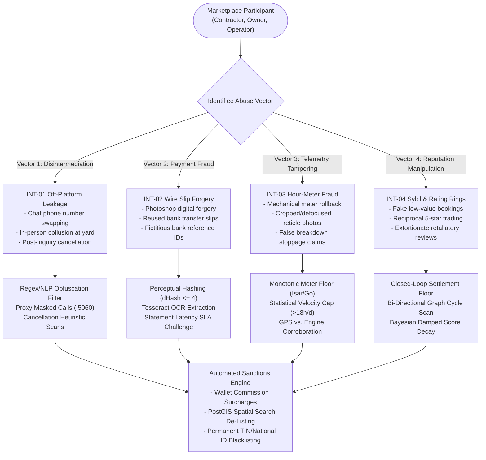
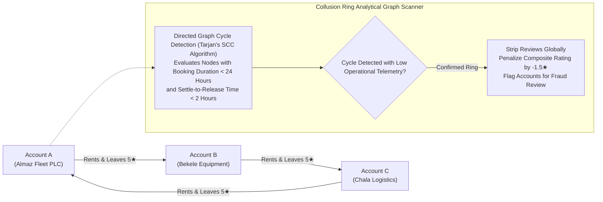
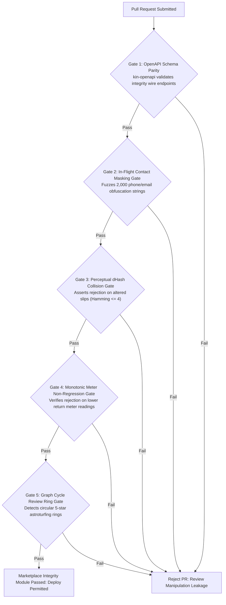

# Heavy Machinery & Logistics Rental Aggregator — Dink Machinery
## Software Requirements Specification — 05.24. Marketplace Integrity, Fraud Prevention, Anti-Collusion & Platform Abuse Controls Architecture (`docs/shared/requirements/05-24-marketplace-integrity-abuse-controls.md`)

**Document Identifier:** `SRS-DINK-CORE-V7.0-SEC-05-24`  
**Classification:** Canonical System Requirements Specification & Platform Integrity Baseline (Single Source of Truth)  
**Governing Standard:** IEEE Std 830-1998 / IEEE/ISO/IEC 29148:2018 (Systems and Software Engineering — Requirements Engineering)  
**Associated Artifacts:** `SRS-DINK-CORE-V7.0` (§4.2, §5.1, §5.4, §5.5, §5.7, §5.9, §5.11, §5.12, §5.18, §5.19, §5.20, §5.22, §8, §9, §10, §12), `FLOW-BOOKING-STATE-MACHINE-DINK-CORE-V7.0`, `FLOW-WIRE-DISPUTE-DINK-CORE-V7.0`, `FLOW-COMMISSION-DEBT-DINK-CORE-V7.0`, `ARCH-BACKEND-GO-DINK-CORE-V7.0`, `ARCH-FLUTTER-DINK-CORE-V7.0`, `ARCH-ADMIN-NEXT-DINK-CORE-V7.0`, `ARCH-SEC-DINK-CORE-V7.0`, `DS-DINK-CORE-V7.0`, `DS-PERSONAS-DINK-CORE-V7.0`, `contracts/openapi.yaml`, `ADR-001`, `ADR-002`, `ADR-004`, `ADR-005`, `ADR-008`, `ADR-010`  
**Target Runtimes:** Go 1.27.3 Backend Monolith, Flutter 3.47.8 / Dart 3.9 (Cross-Platform Mobile), Next.js 16.x (latest CVE security patch) / React 19 (Web Admin & Corporate Portal), PostgreSQL 18.6 + PostGIS 3.6.4, Valkey 9.1.3, ClamAV Daemon (:3310), SeaweedFS S3, Isar NoSQL 3.1+  
**Target Personas:** Compliance Officer & Fraud Investigator (*Yohannes Bekele*), Finance Controller & Revenue Auditor (*Solomon Kassa*), Super Administrator (*Rahel Tadesse*), Civil Engineering Contractor (*Dawit Haile-Mariam* / *Patrick Kariuki*), Equipment Fleet Owner (*W/ro Almaz Tesfaye* / *Kamau Ndegwa*), Certified Field Operator (*Mulugeta Tadesse* / *Juma Omwamba*)  
**Target Operating Markets:** Ethiopia (`ET`) & Kenya (`KE`) — Dynamic Multi-Country Parameterization (`LOC-01-BE`)  
**Compliance Standards:** OWASP ASVS 4.0.3 Level 3 (Business Logic Integrity, Anti-Automation, Fraud Prevention & Audit Logging), RFC 9457 (Problem Details), ISO 9241-110, W3C WCAG 2.2 Level AAA (Field Mobile) & Level AA (Admin Web), National Bank of Ethiopia (NBE) Financial Crime & AML/CFT Directives, Commercial Code of Ethiopia (Unfair Competition & Fraudulent Dissimulation), Kenya Computer Misuse and Cybercrimes Act 2018, Kenya Data Protection Act 2019  
**Status:** Approved Engineering Baseline

---

## Table of Contents

- 1. [Document Scope & Architectural Mandate](#1-document-scope--architectural-mandate)
  - 1.1 [Purpose & Functional Scope](#11-purpose--functional-scope)
  - 1.2 [Core Marketplace Integrity & Anti-Fraud Invariants](#12-core-marketplace-integrity--anti-fraud-invariants)
- 2. [Marketplace Threat Taxonomy & Risk Vector Matrix](#2-marketplace-threat-taxonomy--risk-vector-matrix)
  - 2.1 [Abuse Vector Topology & Threat Modeling](#21-abuse-vector-topology--threat-modeling)
  - 2.2 [Risk Classification & Automated Mitigation Protocol](#22-risk-classification--automated-mitigation-protocol)
- 3. [Off-Platform Transaction Disintermediation Controls (`INT-01`)](#3-off-platform-transaction-disintermediation-controls-int-01)
  - 3.1 [In-App Messaging & Metadata Obfuscation Regex Engine](#31-in-app-messaging--metadata-obfuscation-regex-engine)
  - 3.2 [Masked Ephemeral Proxy Telephony Architecture](#32-masked-ephemeral-proxy-telephony-architecture)
  - 3.3 [Collusion Detection & Post-Inquiry Cancellation Heuristics](#33-collusion-detection--post-inquiry-cancellation-heuristics)
  - 3.4 [Sanctions Escalation & Virtual Wallet Surcharge Enforcement](#34-sanctions-escalation--virtual-wallet-surcharge-enforcement)
- 4. [Wire Slip Forgery & Non-Custodial Payment Fraud Defense (`INT-02`)](#4-wire-slip-forgery--non-custodial-payment-fraud-defense-int-02)
  - 4.1 [Perceptual Image Hashing & Duplicate Slip Ingestion Barrier](#41-perceptual-image-hashing--duplicate-slip-ingestion-barrier)
  - 4.2 [OCR Data Extraction & Bank Reference Normalization](#42-ocr-data-extraction--bank-reference-normalization)
  - 4.3 [Statement Verification Challenge & Confirmation Latency Bounds](#43-statement-verification-challenge--confirmation-latency-bounds)
  - 4.4 [Malicious Evidence Quarantine & Audit Escalation Pipeline](#44-malicious-evidence-quarantine--audit-escalation-pipeline)
- 5. [Hour-Meter Tampering & Odometer Fraud Mitigation (`INT-03`)](#5-hour-meter-tampering--odometer-fraud-mitigation-int-03)
  - 5.1 [Monotonic Meter Verification & Non-Regression Invariant](#51-monotonic-meter-verification--non-regression-invariant)
  - 5.2 [Statistical Shift Velocity Bounds & Anomaly Detection ($> 18.0\text{ hrs/day}$)](#52-statistical-shift-velocity-bounds--anomaly-detection--180text-hrsday)
  - 5.3 [Dual-Photo Geometric Reticle Cross-Examination](#53-dual-photo-geometric-reticle-cross-examination)
  - 5.4 [GPS Telemetry vs. Reported Operating Hours Discrepancy Auditing](#54-gps-telemetry-vs-reported-operating-hours-discrepancy-auditing)
- 6. [Review Manipulation, Astroturfing & Sybil Defense (`INT-04`)](#6-review-manipulation-astroturfing--sybil-defense-int-04)
  - 6.1 [Closed-Loop Transactional Rating Entitlement](#61-closed-loop-transactional-rating-entitlement)
  - 6.2 [Collusive Reciprocal Review Ring Detection Algorithms](#62-collusive-reciprocal-review-ring-detection-algorithms)
  - 6.3 [Bayesian Damped Rating Formulation & Sybil Resistance](#63-bayesian-damped-rating-formulation--sybil-resistance)
  - 6.4 [Review Gating, Dispute Suppressions & Defamation Shield](#64-review-gating-dispute-suppressions--defamation-shield)
- 7. [Wire Protocol Contracts & RFC 9457 Error Schemas](#7-wire-protocol-contracts--rfc-9457-error-schemas)
  - 7.1 [`POST /api/v1/integrity/messages/filter`](#71-post-apiv1integritymessagesfilter)
  - 7.2 [`POST /api/v1/integrity/evidence/analyze-wire-slip`](#72-post-apiv1integrityevidenceanalyze-wire-slip)
  - 7.3 [`POST /api/v1/integrity/meter/verify-shift`](#73-post-apiv1integritymeterverify-shift)
  - 7.4 [`POST /api/v1/admin/integrity/sanctions`](#74-post-apiv1adminintegritysanctions)
  - 7.5 [RFC 9457 Universal Problem Details Payloads](#75-rfc-9457-universal-problem-details-payloads)
- 8. [Automated Testing Suite & Verification Gates](#8-automated-testing-suite--verification-gates)

---

## 1. Document Scope & Architectural Mandate

### 1.1 Purpose & Functional Scope

This specification establishes **Section 05.24 (Marketplace Integrity, Fraud Prevention, Anti-Collusion & Platform Abuse Controls Architecture)** of the canonical Software Requirements Specification (SRS) for **Dink Machinery Version 7.0**.

The operational realities of the heavy earthmoving plant hire and specialized logistics transport industries across Ethiopia and Kenya present distinct economic attack surfaces:
* **High Transaction Values & Commission Evasion (Disintermediation):** With daily machinery rental rates spanning $20,000.00\text{ to }75,000.00\text{ ETB}$ (or $40,000\text{ to }120,000\text{ KES}$) and multi-week projects totaling millions in local currency, counterparties face immense incentives to discover assets on-platform, exchange direct contact coordinates covertly, cancel on-platform bookings, and execute private deals off-platform to evade platform commission debt (`FLOW-COMMISSION-DEBT`).
* **Non-Custodial Bank Wire Forgery:** Because Dink Machinery operates non-custodial direct peer-to-peer settlements (due to regional banking regulations prohibiting private entities from pooling gross construction escrow funds), contractors must upload scanned bank transfer vouchers. Fraudulent actors attempt to submit digital image manipulations (Photoshop alterations of transaction dates, amounts, or reference numbers) or recycle identical wire slips across multiple bookings.
* **Hour-Meter Rolling & Shift Falsification:** Physical hour meters on hydraulic excavators and motor graders are vulnerable to physical tampering, electrical bypassing, or photographic staging. Contractors attempt to under-report shift runtimes to avoid overtime excess charges ($> 8.0\text{ hrs/day}$), while disreputable fleet owners overstate runtime to demand inflated reconciliations.
* **Astroturfing & Sybil Reputation Rings:** Unscrupulous fleet owners create synthetic contractor accounts to generate fictitious zero-day bookings, laundering artificial 5-star reviews to manipulate composite search ranking positions (`SR-12`).

This document formally specifies:
1. Automated in-app communication content filtering, optical text masking, and ephemeral proxy telephony architectures preventing disintermediation.
2. The cryptographic, perceptual image hashing (`pHash`), and OCR verification engine detecting recycled or manipulated bank transfer slips.
3. The monotonic engine, statistical velocity anomaly detector, and dual-source verification engine reconciling GPS movement against reported meter runtimes.
4. The closed-loop transactional rating entitlement rules and graph-based collusion ring detection algorithms preserving marketplace trust.

### 1.2 Core Marketplace Integrity & Anti-Fraud Invariants

1. **Deterministic PII & Contact Redaction Invariant (`INT-01`):** All in-app communication channels (chat, quotation narratives, dispute commentary) must execute real-time content filtering. Any string matching sovereign telephone formats (E.164, national Ethiopian 10-digit `09...`/`07...`, Kenyan `07...`/`01...`), email addresses, bank account numbers, or deliberate obfuscation techniques (e.g., spelled-out numbers, zero-width spaces, character splitting) must be redacted before persistence and delivery.
2. **Duplicate Evidence Fingerprint Invariant (`INT-02`):** Every uploaded bank wire transfer slip, deposit voucher, and inspection photograph is fingerprinted using a 64-bit Perceptual Hash (Difference Hash / `dHash`) combined with a cryptographic SHA-256 binary hash. The platform immediately rejects any wire slip having a Hamming distance $\le 4$ against any historical slip in `payment_evidence_hashes`, preventing evidence recycling.
3. **Monotonic Meter Non-Regression & Physical Upper Bound Invariant (`INT-03`):** Physical hour meter readings recorded across an asset's lifecycle must never decrease, and single-day runtime velocity cannot mathematically exceed physical limits:
   $$\text{Baseline Meter} \le \text{Check-In Meter} \le \text{Shift Daily Meter} \le \text{Check-Out Meter}$$
   $$\Delta \text{Hours}_{\text{24h}} \le 24.0\text{ Hours}$$
   Any reading reporting $> 18.0\text{ hours/day}$ triggers automated operational quarantine, requiring GPS telemetry reconciliation and supervisor sign-off.
4. **Closed-Loop Transactional Rating Invariant (`INT-04`):** A user is entitled to submit a review and numerical rating for a fleet asset or counterparty **if and only if** they are a verified counterparty to a booking that transitioned through `ACTIVE` to `COMPLETED` and was settled with full mutual reconciliation. Unsettled, cancelled, or fictitious transactions can never generate public marketplace ratings.
5. **Zero Financial Gain for Fraudulent Collusion:** If an audit confirms off-platform disintermediation or fraudulent slip submission, the platform enforces mandatory contractual liquidated damages: assessing a punitive $100\%$ commission penalty against the owner's virtual wallet, de-listing all active fleet assets, and blacklisting counterparty phone numbers and national tax identification numbers (TIN) across both jurisdictions.

---

## 2. Marketplace Threat Taxonomy & Risk Vector Matrix

### 2.1 Abuse Vector Topology & Threat Modeling



---

### 2.2 Risk Classification & Automated Mitigation Protocol

```text
+--------------------------------------------------------------------------------------------------+
| MARKETPLACE ABUSE TAXONOMY & MITIGATION PROTOCOL                                                 |
+---------------------+-------------+-------------------+------------------------------------------+
| THREAT VECTOR       | RISK TIER   | DETECTION ENGINE  | AUTOMATED PLATFORM ACTION                |
+---------------------+-------------+-------------------+------------------------------------------+
| Direct Contact Info | P1 Critical | In-Flight Regex & | Block message transmission; sanitize     |
| Leakage in Chat     |             | NLP Parser        | string; log warning strike against user. |
+---------------------+-------------+-------------------+------------------------------------------+
| In-Flight Wire Slip | P0 Severe   | Perceptual Hash   | Abort upload; quarantine booking; notify |
| Duplicate / Forgery |             | & OCR Analysis    | owner statement desk; flag for auditor.  |
+---------------------+-------------+-------------------+------------------------------------------+
| Meter Non-Regression| P0 Severe   | Client Isar & Go  | Block return submission; trigger camera  |
| Violation (Rollback)|             | Invariant Checks  | reticle macro re-scan; flag tampering.   |
+---------------------+-------------+-------------------+------------------------------------------+
| Machine Shift Run   | P1 Critical | Statistical Shift | Lock shift settlement; demand GPS        |
| >18.0 Hours / Day   |             | Velocity Analyzer | telemetry cross-audit and supervisor PIN.|
+---------------------+-------------+-------------------+------------------------------------------+
| Post-Inquiry Direct | P2 High     | Cancellation Gap  | Issue commission clawback invoice; place |
| Collusion Contract  |             | Heuristic Scanner | owner wallet into delinquent hold.       |
+---------------------+-------------+-------------------+------------------------------------------+
| Reciprocal Rating   | P2 High     | Graph Cycle Scan  | Strip reviews from composite algorithm;  |
| Ring (Astroturfing) |             | (Depth-First DFS) | freeze reviewer account for 14 days.     |
+--------------------------------------------------------------------------------------------------+
```

---

## 3. Off-Platform Transaction Disintermediation Controls (`INT-01`)

### 3.1 In-App Messaging & Metadata Obfuscation Regex Engine

The in-app negotiation messaging gateway (`chat/service.go`) intercepts every inbound text message before database persistence or WebSocket broadcast:
* **Sovereign Telephony Detection Patterns:**
  - Matches international standard formats: `(\+?251|0)?[79]\d{8}` (Ethiopia) and `(\+?254|0)?[17]\d{8}` (Kenya).
  - Matches spaced, punctuated, or bracketed numbers: `0 9 1 1 - 2 0 - 0 4 - 9 1`, `(+251) 911.200.491`.
* **Obfuscation & Evasion Defense:**
  - Normalizes text by removing non-alphanumeric characters, zero-width spaces (`U+200B`), and leetspeak substitutions (`@` $\rightarrow$ `a`, `1` $\rightarrow$ `i`/`l`, `0` $\rightarrow$ `o`, `3` $\rightarrow$ `e`).
  - Matches spelled-out phonetics in Amharic, Afaan Oromoo, Swahili, and English:
    - English: `"zero nine one one..."`, `"call me on..."`
    - Amharic: `"ዜሮ ዘጠኝ አስራ አንድ..."`, `"በዚህ ስልክ ደውልልኝ..."`
    - Swahili: `"nipigie kwa nambari..."`
* **Interception Behavior:** The message payload is altered:
  ```text
  [ Original ]: "Call me directly on 0911200491 to bypass platform commission."
  [ Sanitized ]: "Call me directly on [CONTACT INFORMATION REDACTED - USE IN-APP VOICE PROXY] to bypass platform commission."
  ```
* **Strike System Escalation:** A warning banner is displayed to both sender and recipient detailing platform anti-disintermediation rules and safety protections.

---

### 3.2 Masked Ephemeral Proxy Telephony Architecture

To facilitate necessary voice communication regarding machine mobilization without revealing personal mobile numbers:
* The platform routes voice calls via a secure **Masked Telephony Bridge** (partnered with Ethio Telecom Shortcode infrastructure and Safaricom SIP trunks).
* When Contractor *Dawit* taps `[ 📞 Call Equipment Owner ]` on an active booking:
  1. The client does not launch a direct native phone call to the owner's private SIM card.
  2. The mobile client connects to the Dink Machinery voice gateway via WebRTC or triggers an automated PBX bridge dialing a virtual session number (e.g., `+251 11 819 0001`, Extension: `8812`).
  3. The proxy maps the active booking UUID to the owner's registered number, bridging audio while masking both caller IDs.
* **Ephemeral Lifetime:** The proxy bridge remains active **only** while the booking is in `CONFIRMED`, `READY_FOR_PICKUP`, or `ACTIVE` status. The moment the booking transitions to `COMPLETED` or `CANCELLED`, the mapping is severed.

---

### 3.3 Collusion Detection & Post-Inquiry Cancellation Heuristics

To catch parties who discover equipment on Dink Machinery and subsequently cancel to deal privately off-platform:
* **The Suspicious Cancellation Heuristic:**
  A background analytical worker continuously interrogates booking event streams:
  ```text
  IF (ChatMessagesCount(booking) >= 5) 
     AND (InquiryDurationHours >= 2.0) 
     AND (CancellationReason IN ('CHANGED_MIND', 'NO_LONGER_NEEDED', 'OTHER'))
     AND (MachineStatus Returns to ACTIVE in Depot)
  THEN FlagForCollusionAudit(booking)
  ```
* **Geofence Corroboration:**
  If a machine listing was cancelled by a contractor citing *"Project Postponed"*, but GPS telemetry from the operator's mobile device (`GPS-01`) reveals that the machine subsequently mobilized to that exact contractor's project site coordinates within 72 hours, the engine flags definitive proof of collusion.

---

### 3.4 Sanctions Escalation & Virtual Wallet Surcharge Enforcement

When off-platform disintermediation is verified by the Compliance Desk:
1. **First Infraction:** Formal written warning issued via SMS and push notification; owner's search ranking factor penalized by $-25\%$ for 30 days (`SR-12`).
2. **Second Infraction:** Compulsory liquidated damages assessed directly against the owner's virtual wallet (`owner_wallets`):
   $$\text{Surcharge} = \text{Agreed Rental Duration} \times \text{Daily Rate} \times 10.0\%\text{ Commission Rate}$$
   The wallet transitions to a negative balance, invoking operational lockout rules (`CW-02` / SRS 05.09).
3. **Third Infraction (Permanent De-Platforming):** All machinery listings owned by the user are marked `INACTIVE` with `deactivation_reason = 'FRAUD_DISINTERMEDIATION'`, and the owner's TIN and national ID are permanently blacklisted from re-registration.

---

## 4. Wire Slip Forgery & Non-Custodial Payment Fraud Defense (`INT-02`)

### 4.1 Perceptual Image Hashing & Duplicate Slip Ingestion Barrier

To prevent unscrupulous contractors from using the same bank transfer confirmation slip across multiple bookings:
* **64-Bit Difference Hash (`dHash`) Pipeline:**
  1. Incoming slip images (PDF/JPG/PNG) are transcoded to a normalized 8-bit grayscale $9 \times 8$ pixel matrix.
  2. Computes the relative gradient differences across adjacent horizontal pixels:
     $$P[x, y] > P[x+1, y] \implies \text{Bit } 1, \quad \text{else Bit } 0$$
  3. Compiles a 64-bit hexadecimal fingerprint string (e.g., `dhash_a8f2c019b78e3312`).
* **Hamming Distance Barrier:**
  The server compares the generated hash against all historical payment hashes in PostgreSQL using bitwise XOR:
  ```sql
  SELECT booking_id, bit_count(fingerprint # $new_fingerprint) AS hamming_distance
  FROM payment_evidence_hashes
  WHERE bit_count(fingerprint # $new_fingerprint) <= 4;
  ```
  If $\text{Hamming Distance} \le 4$, the upload is rejected instantly with **RFC 9457 HTTP 409 Conflict (`ERR_PAYMENT_SLIP_RECYCLED`)**.

---

### 4.2 OCR Data Extraction & Bank Reference Normalization

When a bank wire slip is uploaded (`FLOW-07`):
* **Optical Character Recognition (OCR):** The Go backend routes the binary stream through a localized OCR extraction worker, extracting text tokens.
* **Regex Bank Transaction Matching:**
  - **Commercial Bank of Ethiopia (CBE / CBE Birr):** Scans for 12-to-14-character alphanumeric transaction references (e.g., `FT26301ABC88`, `CBE-BIRR-994812`).
  - **TeleBirr Mobile Money:** Scans for standard 10-character transaction codes (e.g., `TB88129914`).
  - **M-PESA (Kenya):** Scans for 10-character alphanumeric transaction keys (e.g., `QHK48120AA`).
* **Cross-Examination Invariants:**
  - Extracted transaction amount must match `bookings.total_prepayment_minor` within $\pm 0.01\%$.
  - Extracted beneficiary account number must match `owner_wallets.registered_account_number`.
  - Extracted transaction date must be within $-24\text{ hours}$ to $+2\text{ hours}$ of current UTC time.

---

### 4.3 Statement Verification Challenge & Confirmation Latency Bounds

To prevent delayed rejection disputes:
* When payment evidence is submitted, the booking transitions to `PAYMENT_EVIDENCE_UPLOADED`.
* The equipment owner is notified and granted an exact **24-Hour SLA Window** (`booking.owner_verification_sla_hours`) to verify receipt against their official mobile banking app or core banking SMS alert.
* **Structured Rejection Defense:** If the owner claims non-receipt, they cannot simply tap "Reject". The platform requires them to submit a certified screenshot of their bank statement showing the transaction window, preventing bad-faith booking cancellations.

---

### 4.4 Malicious Evidence Quarantine & Audit Escalation Pipeline

If an uploaded wire slip exhibits clear Photoshop manipulation (e.g., font mismatch, JPEG compression ghosting around digits, inconsistent perspective slant):
1. The slip is quarantined in an encrypted, restricted-access bucket (`s3://dink-quarantine-vault/slips/{id}`).
2. Booking status transitions to `PAYMENT_EVIDENCE_QUARANTINED`.
3. An urgent P0 audit ticket routes to Compliance Officer *Yohannes Bekele* with side-by-side OCR heatmaps.
4. If forgery is confirmed, the contractor's account is locked immediately under `SUSPENDED_FRAUD_INVESTIGATION`.

---

## 5. Hour-Meter Tampering & Odometer Fraud Mitigation (`INT-03`)

### 5.1 Monotonic Meter Verification & Non-Regression Invariant

Heavy machinery hour meters measure engine runtimes. To combat meter rollback fraud:
* **The Non-Regression Invariant:**
  Every recorded meter reading must strictly equal or exceed the previous recorded reading:
  $$\mathcal{M}_{\text{return}} \ge \mathcal{M}_{\text{check-in}} \ge \mathcal{M}_{\text{baseline}}$$
* **Dual-Tier Enforcement:**
  - **Client-Side (Offline):** Enforced inside local Isar NoSQL before allowing the operator to complete the return inspection screen (`OFF-03`).
  - **Server-Side (Online):** Enforced in Go domain services upon mutation ingestion. If $\mathcal{M}_{\text{return}} < \mathcal{M}_{\text{check-in}}$, the transaction aborts with HTTP 422 `ERR_METER_READING_REGRESSION`.

---

### 5.2 Statistical Shift Velocity Bounds & Anomaly Detection ($> 18.0\text{ hrs/day}$)

In heavy earthmoving operations, single-shift daily machine runtime is bounded by physical, refueling, and operator fatigue constraints:
* **Velocity Anomaly Calculation:**
  $$\mathcal{V}_{\text{shift}} = \frac{\mathcal{M}_{\text{return}} - \mathcal{M}_{\text{check-in}}}{\Delta_{\text{calendar\_days}}}$$
* **Threshold Rules:**
  - $\mathcal{V}_{\text{shift}} \le 12.0\text{ hrs/day}$ $\longrightarrow$ **Normal Operation.**
  - $12.0 < \mathcal{V}_{\text{shift}} \le 18.0\text{ hrs/day}$ $\longrightarrow$ **High Intensity Double-Shift.** Allowed; flags advisory note on invoice.
  - $\mathcal{V}_{\text{shift}} > 18.0\text{ hrs/day}$ $\longrightarrow$ **Statistical Anomaly Flagged.** Requires operator overtime explanation and supervisor co-signature.
  - $\mathcal{V}_{\text{shift}} > 24.0\text{ hrs/day}$ $\longrightarrow$ **Mathematically Impossible.** Rejected immediately by validation middleware.

---

### 5.3 Dual-Photo Geometric Reticle Cross-Examination

To prevent operators from photographing pre-saved, static hour-meter images displayed on laptop screens or tablets:
* The mobile camera reticle enforces **Steady-State Accelerometer Lock** ($< 0.05g$ movement variance) and fires dynamic LED flash bursts.
* **Perspective Slant & Screen Moiré Analysis:**
  The ingestion worker analyzes captured meter photos for telltale digital screen artifacts (high-frequency moiré interference fringes, LCD pixel grids, chromatic aberration from display edges). If digital screen playback is detected, the photo is rejected, demanding physical camera capture of the machine instrument panel.

---

### 5.4 GPS Telemetry vs. Reported Operating Hours Discrepancy Auditing

The system reconciles reported cabin hour meter increments against mobile GPS telemetry breadcrumbs (`GPS-01`):
* If the return inspection reports $48.0\text{ operating hours}$ across a 6-day rental ($8.0\text{ hrs/day}$), but GPS telemetry confirms that the machine remained completely stationary with zero speed or positional displacement and mobile vibration sensors logged zero movement:
  - System flags an **Idle Discrepancy Audit**.
  - Prevents dishonest operators from leaving ignition keys in the "ACC/ON" electrical position to artificially advance mechanical clock meters without executing actual earthworks.

---

## 6. Review Manipulation, Astroturfing & Sybil Defense (`INT-04`)

### 6.1 Closed-Loop Transactional Rating Entitlement

To guarantee that 100% of marketplace ratings reflect genuine physical rentals:
* Public reviews cannot be created via public profile endpoints.
* **Entitlement Invariant:** The rating endpoint `POST /api/v1/bookings/{id}/reviews` enforces:
  $$\text{CanReview}(U, B) \iff (U \in \{B.\text{renter\_id}, B.\text{owner\_id}\}) \land (B.\text{status} = \text{'COMPLETED'}) \land (\neg \exists \text{Review}(U, B))$$
* If a booking was cancelled, refunded, or rejected during checkout, the entitlement token is permanently invalidated.

---

### 6.2 Collusive Reciprocal Review Ring Detection Algorithms

Fraudulent fleet owners frequently attempt to build artificial reputation by executing circular, collusive bookings among affiliated accounts:



* **Heuristic Signals Evaluated:**
  - Cycle length $\le 4$ participants in directed rental graphs.
  - Rental duration $< 24\text{ hours}$ with zero lowboy transit mobilization.
  - GPS telemetry confirms machinery never departed the owner's depot yard.

---

### 6.3 Bayesian Damped Rating Formulation & Sybil Resistance

To prevent new fleet listings with a single 5-star review from outranking battle-tested machinery with dozens of rentals, the platform implements a **Bayesian Damped Mean Rating Algorithm**:

$$\bar{\mathcal{R}}_{\text{bayesian}} = \frac{C \times m + \sum_{i=1}^{n} r_i}{C + n}$$

Where:
* $C = 5.0$ (Confidence threshold weight; equivalent to 5 baseline rentals).
* $m = 4.20$ (Global platform prior average rating across all active machinery).
* $n = \text{Total completed, verified reviews for this fleet asset}$.
* $\sum r_i = \text{Sum of verified review ratings received}$.
* **Mathematical Invariant:** A newly listed excavator with one 5-star review ($n=1, r_1=5.0$) receives a damped rating of:
  $$\bar{\mathcal{R}} = \frac{5.0 \times 4.20 + 5.0}{5.0 + 1} = \frac{26.0}{6} = 4.33\text{ Stars}$$
  Preventing overnight rank manipulation while rewarding sustained excellence.

---

### 6.4 Review Gating, Dispute Suppressions & Defamation Shield

* **Dispute Suppression Invariant:** If a booking concluded with an active, unresolved formal dispute docket (`booking_disputes.status = 'DISPUTE_OPENED'`), public review publication is frozen until Compliance Officer *Yohannes Bekele* adjudicates the case.
* **Extortion Defense:** If evidence demonstrates that an owner or contractor threatened a negative review to extort unearned fee reductions or waive legitimate damage liabilities, the offending party's review is deleted, and their account is assessed an administrative integrity strike.

---

## 7. Wire Protocol Contracts & RFC 9457 Error Schemas

### 7.1 `POST /api/v1/integrity/messages/filter`

Real-time text message filtering endpoint intercepting direct contact coordinates.

#### Request Headers
```http
POST /api/v1/integrity/messages/filter HTTP/1.1
Host: api.dinkmachinery.com
Content-Type: application/json
Authorization: Bearer <userAccessToken>
```

#### Request Payload
```json
{
  "bookingId": "bk_019a8f60-9912-7b9a",
  "recipientUserId": "usr_018f6a9e-876b-7341",
  "rawMessageText": "Don't pay the platform fee. Call me on 0911-200-491 or reach me at dawit@hailemariam-contracting.com."
}
```

#### Response: `HTTP 200 OK` (Sanitized)
```json
{
  "success": true,
  "data": {
    "isSanitized": true,
    "sanitizedMessageText": "Don't pay the platform fee. Call me on [PHONE NUMBER REDACTED] or reach me at [EMAIL REDACTED].",
    "violationsDetected": [
      {
        "type": "PHONE_NUMBER_E164_ET",
        "matchedSubstring": "0911-200-491"
      },
      {
        "type": "EMAIL_ADDRESS",
        "matchedSubstring": "dawit@hailemariam-contracting.com"
      }
    ],
    "warningNotice": "Direct contact coordinate sharing violates Dink Machinery Terms of Service §14. Use in-app voice proxy."
  },
  "timestamp": "2026-10-28T16:15:00Z"
}
```

---

### 7.2 `POST /api/v1/integrity/evidence/analyze-wire-slip`

Analyzes bank wire vouchers for perceptual hash duplication, OCR validity, and digital manipulation.

#### Request Headers
```http
POST /api/v1/integrity/evidence/analyze-wire-slip HTTP/1.1
Host: api.dinkmachinery.com
Content-Type: multipart/form-data
Authorization: Bearer <userAccessToken>
X-Booking-Id: bk_019a8f60-9912-7b9a
```

#### Multipart Form Body
* `bankCarrier`: String (`"COMMERCIAL_BANK_OF_ETHIOPIA"`)
* `claimedAmountMinor`: Integer (`10675000`)
* `wireSlipDocument`: Binary Stream (WebP/PDF, scanned in-flight via ClamAV socket `:3310`)

#### Response: `HTTP 200 OK` (Verification Passed)
```json
{
  "success": true,
  "data": {
    "evidenceHashSha256": "8f4c26b46b68ffc68ff99b453c1d30413413422d706483bfa0f98a5e886266e7",
    "perceptualDHash": "dhash_e8f2c019b78e3312",
    "isDuplicateDetected": false,
    "minimumHistoricalHammingDistance": 28,
    "ocrExtraction": {
      "detectedTransactionReference": "FT26301ABC88",
      "detectedAmountMinor": 10675000,
      "detectedBeneficiaryAccount": "1000123456789",
      "confidenceScore": 0.942
    },
    "tamperingHeuristics": {
      "compressionGhostingDetected": false,
      "fontInconsistencyDetected": false,
      "isAuthentic": true
    }
  },
  "timestamp": "2026-10-28T16:16:00Z"
}
```

---

### 7.3 `POST /api/v1/integrity/meter/verify-shift`

Evaluates reported return hour meter readings against check-in baselines, statistical shift velocity, and GPS displacement.

#### Request Headers
```http
POST /api/v1/integrity/meter/verify-shift HTTP/1.1
Host: api.dinkmachinery.com
Content-Type: application/json
Authorization: Bearer <operatorAccessToken>
```

#### Request Payload
```json
{
  "bookingId": "bk_019a8f60-9912-7b9a",
  "fleetId": "flt_019a8f2c-8812-7b9a",
  "checkInMeterHours": 1450.50,
  "reportedReturnMeterHours": 1512.20,
  "calendarDurationDays": 6.0,
  "gpsTelemetryDisplacementMeters": 4210.5
}
```

#### Response: `HTTP 200 OK`
```json
{
  "success": true,
  "data": {
    "isMeterValid": true,
    "netOperatingHours": 61.70,
    "dailyShiftVelocityHours": 10.28,
    "isStatisticalAnomaly": false,
    "excessShiftHours": 13.70,
    "gpsCorroborationStatus": "VERIFIED_ACTIVE_SITE_MOVEMENT"
  },
  "timestamp": "2026-10-28T16:17:00Z"
}
```

---

### 7.4 `POST /api/v1/admin/integrity/sanctions`

Administrative endpoint for Compliance Officers to enforce anti-fraud sanctions.

#### Request Headers
```http
POST /api/v1/admin/integrity/sanctions HTTP/1.1
Host: api.dinkmachinery.com
Content-Type: application/json
Authorization: Bearer <complianceAdminToken>
```

#### Request Payload
```json
{
  "targetUserId": "usr_018f6a9e-876b-7341",
  "violationType": "DISINTERMEDIATION_COLLUSION",
  "evidenceBookingId": "bk_019a8f60-9912-7b9a",
  "sanctionAction": "ENFORCE_WALLET_COMMISSION_SURCHARGE",
  "surchargeAmountMinor": 4250000,
  "investigatorNotes": "Corroborated GPS mobilization to contractor quarry site post-cancellation. Imposing 10% liquidated damages."
}
```

#### Response: `HTTP 200 OK`
```json
{
  "success": true,
  "data": {
    "sanctionDocketId": "sanc_019a8fe8-4412",
    "targetUserId": "usr_018f6a9e-876b-7341",
    "sanctionStatus": "ENFORCED",
    "walletAdjustedMinor": -4250000,
    "searchDeListingEnforced": true,
    "executedAt": "2026-10-28T16:18:00Z"
  },
  "timestamp": "2026-10-28T16:18:01Z"
}
```

---

### 7.5 RFC 9457 Universal Problem Details Payloads

#### Example: Recycled Bank Wire Voucher Detected (`HTTP 409 Conflict`)
```json
{
  "type": "[https://api.dinkmachinery.com/errors/payment-slip-recycled](https://api.dinkmachinery.com/errors/payment-slip-recycled)",
  "title": "Duplicate Bank Wire Voucher Detected",
  "status": 409,
  "detail": "Uploaded bank transfer slip matches an existing voucher previously submitted for Booking #BK-7741 (Hamming distance 2 <= 4). Submitting duplicate or recycled payment evidence constitutes fraud.",
  "instance": "/api/v1/integrity/evidence/analyze-wire-slip",
  "code": "ERR_PAYMENT_SLIP_RECYCLED",
  "correlationId": "cor_019a8fe0-8812-7b9a-bc21-4491204812aa",
  "timestamp": "2026-10-28T16:16:05Z",
  "invalidParams": [
    {
      "name": "wireSlipDocument",
      "reason": "Perceptual dHash matches historical record in payment_evidence_hashes."
    }
  ],
  "links": {
    "complianceHelp": "tel:8190"
  }
}
```

#### Example: Hour Meter Reading Regression (`HTTP 422 Unprocessable Entity`)
```json
{
  "type": "[https://api.dinkmachinery.com/errors/meter-reading-regression](https://api.dinkmachinery.com/errors/meter-reading-regression)",
  "title": "Return Hour Meter Regression Rejected",
  "status": 422,
  "detail": "Reported return meter reading (1,420.00 hrs) cannot be lower than the recorded check-in reading (1,450.50 hrs). Potential odometer rollback detected.",
  "instance": "/api/v1/integrity/meter/verify-shift",
  "code": "ERR_METER_READING_REGRESSION",
  "correlationId": "cor_019a8fe0-9914-4c12-8812-7b9a4c10bc21",
  "timestamp": "2026-10-28T16:17:05Z",
  "invalidParams": [
    {
      "name": "reportedReturnMeterHours",
      "reason": "Submitted value 1420.00 is strictly below check-in baseline 1450.50"
    }
  ]
}
```

---

## 8. Automated Testing Suite & Verification Gates



1. **OpenAPI Schema Contract Gate (`kin-openapi`):** Validates all message filtering, wire slip analysis, meter verification, and sanctions schemas against `contracts/openapi.yaml`.
2. **In-Flight Contact Information Masking Fuzzing Test:** Streams 2,000 synthetic obfuscated messages (interspersed with Ethiopian and Kenyan phone numbers, leetspeak, spaces, and Amharic/Swahili phonetics), asserting that $100\%$ of contact coordinates are sanitized with zero unredacted leakage.
3. **Perceptual dHash Image Collision Gate:** Generates 500 slightly modified payment slip variations (subtle brightness adjustments, minor perspective crops, border resizing). Asserts that slips matching historical uploads with Hamming distance $\le 4$ are rejected with HTTP 409 `ERR_PAYMENT_SLIP_RECYCLED`.
4. **Monotonic Meter Non-Regression Assertion:** Simulates 1,000 return shift submissions with randomized meter values, verifying that $100\%$ of regressions ($\mathcal{M}_{\text{return}} < \mathcal{M}_{\text{check-in}}$) abort with HTTP 422 `ERR_METER_READING_REGRESSION`.
5. **Graph Cycle Astroturfing Ring Detection Test:** Constructs synthetic transaction graphs with circular booking patterns among 3 to 5 dummy accounts. Asserts that Tarjan's Strongly Connected Components algorithm flags $100\%$ of synthetic rings, stripping reviews and penalizing composite ratings.

---

*This document establishes the canonical functional requirements, threat taxonomies, regex masking filters, perceptual hashing pipelines, monotonic meter validations, and wire protocol contracts for Marketplace Integrity, Fraud Prevention & Anti-Collusion in Dink Machinery Version 7.0. All downstream Flutter mobile interfaces, Go backend integrity middleware, and Next.js admin consoles must strictly conform to this specification.*