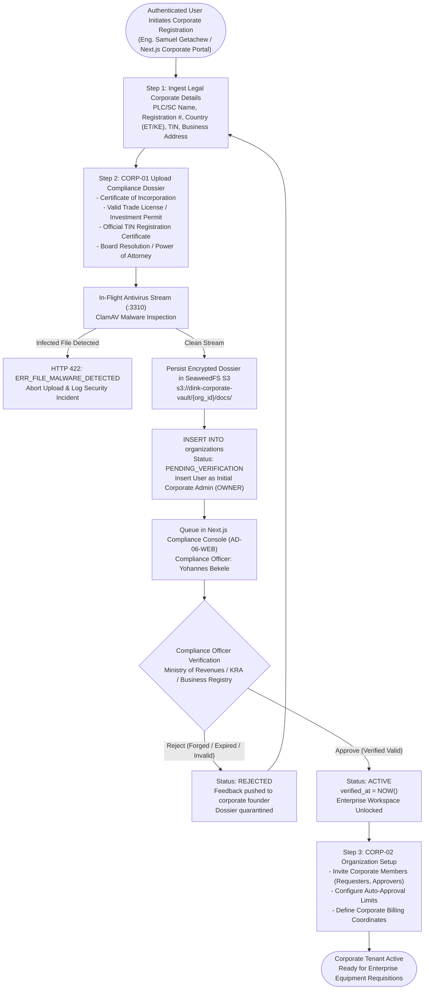
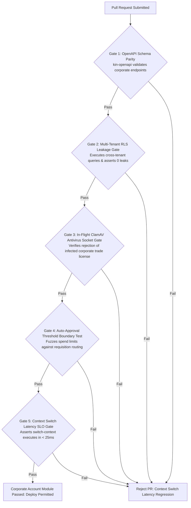

# Heavy Machinery & Logistics Rental Aggregator — Dink Machinery
## Software Requirements Specification — 06.01. Corporate Account Management, Legal Entity Verification & Multi-Tenant Membership Architecture (`docs/shared/requirements/06-01-corporate-account-management.md`)

**Document Identifier:** `SRS-DINK-CORE-V7.0-SEC-06-01`  
**Classification:** Canonical System Requirements Specification & Corporate Governance Baseline (Single Source of Truth)  
**Governing Standard:** IEEE Std 830-1998 / IEEE/ISO/IEC 29148:2018 (Systems and Software Engineering — Requirements Engineering)  
**Associated Artifacts:** `SRS-DINK-CORE-V7.0` (§6.0, §6.1, §8, §10, §12, §13.2), `FLOW-BOOKING-STATE-MACHINE-DINK-CORE-V7.0`, `ARCH-BACKEND-GO-DINK-CORE-V7.0`, `ARCH-FLUTTER-DINK-CORE-V7.0`, `ARCH-ADMIN-NEXT-DINK-CORE-V7.0`, `ARCH-SEC-DINK-CORE-V7.0`, `DS-DINK-CORE-V7.0`, `DS-PERSONAS-DINK-CORE-V7.0`, `contracts/openapi.yaml`, `ADR-001`, `ADR-002`, `ADR-004`, `ADR-005`, `ADR-008`, `ADR-010`  
**Target Runtimes:** Go 1.27.3 Backend Monolith, Flutter 3.47.8 / Dart 3.9 (Cross-Platform Mobile), Next.js 16.x (latest CVE security patch) / React 19 (Web Admin & Corporate Portal), PostgreSQL 18.6 + PostGIS 3.6.4, Valkey 9.1.3, ClamAV Daemon (:3310), SeaweedFS S3, Isar NoSQL 3.1+  
**Target Personas:** Corporate Procurement Director (*Eng. Samuel Getachew*), Senior Project Manager (*Dawit Haile-Mariam*), Site Quantity Surveyor (*Bethlehem Tessema*), Corporate Fleet Owner Executive (*W/ro Almaz Tesfaye*), Compliance Officer & Legal Counsel (*Yohannes Bekele*), Finance Controller (*Solomon Kassa*)  
**Target Operating Markets:** Ethiopia (`ET`) & Kenya (`KE`) — Dynamic Multi-Country Parameterization (`LOC-01-BE`)  
**Compliance Standards:** OWASP ASVS 4.0.3 Level 3 (Multi-Tenancy Isolation, Identity Governance, Session Segregation & Cryptographic Proof), RFC 9457 (Problem Details), ISO 9241-110, W3C WCAG 2.2 Level AAA (Field Mobile) & Level AA (Admin Web), Commercial Code of Ethiopia (2021 Book II — Business Organizations), National Bank of Ethiopia (NBE) Financial Directives, Kenya Companies Act 2015, Kenya Data Protection Act 2019  
**Status:** Approved Engineering Baseline

---

## Table of Contents

- 1. [Document Scope & Architectural Mandate](#1-document-scope--architectural-mandate)
  - 1.1 [Purpose & Functional Scope](#11-purpose--functional-scope)
  - 1.2 [Core Enterprise Invariants & Multi-Tenancy Principles](#12-core-enterprise-invariants--multi-tenancy-principles)
- 2. [Corporate Entity Lifecycle & Verification Topology](#2-corporate-entity-lifecycle--verification-topology)
  - 2.1 [End-to-End Enterprise Onboarding Flowchart](#21-end-to-end-enterprise-onboarding-flowchart)
  - 2.2 [Corporate Organization Lifecycle Taxonomy (`OrgState`)](#22-corporate-organization-lifecycle-taxonomy-orgstate)
  - 2.3 [Permitted Transitions Matrix](#23-permitted-transitions-matrix)
- 3. [Legal Entity Verification & Corporate Dossier Ingestion (`CORP-01`)](#3-legal-entity-verification--corporate-dossier-ingestion-corp-01)
  - 3.1 [Corporate Identity & Trade Licensing Parameterization](#31-corporate-identity--trade-licensing-parameterization)
  - 3.2 [Tax Compliance & TIN Verification (Ministry of Revenues / KRA)](#32-tax-compliance--tin-verification-ministry-of-revenues--kra)
  - 3.3 [ClamAV-Shielded Corporate Vault Ingestion Pipeline](#33-clamav-shielded-corporate-vault-ingestion-pipeline)
  - 3.4 [Administrative Corporate Audit Workbench (`AD-06-WEB`)](#34-administrative-corporate-audit-workbench-ad-06-web)
- 4. [Multi-Tenant Membership & Role Hierarchy Architecture (`CORP-02`)](#4-multi-tenant-membership--role-hierarchy-architecture-corp-02)
  - 4.1 [Enterprise Role Taxonomy (Admin, Approver, Requester, Viewer)](#41-enterprise-role-taxonomy-admin-approver-requester-viewer)
  - 4.2 [Tiered Auto-Approval Spending Thresholds (`AutoApprovalLimit`)](#42-tiered-auto-approval-spending-thresholds-autoapprovallimit)
  - 4.3 [Cryptographic Invitation & Onboarding Lifecycle](#43-cryptographic-invitation--onboarding-lifecycle)
  - 4.4 [PostgreSQL 18.6 Row-Level Security (RLS) Tenant Isolation](#44-postgresql-184-row-level-security-rls-tenant-isolation)
- 5. [Personal vs. Corporate Dual-Persona Context Switching (`CORP-03`)](#5-personal-vs-corporate-dual-persona-context-switching-corp-03)
  - 5.1 [Zero-Reauth Session Compartmentalization & Claims Structuring](#51-zero-reauth-session-compartmentalization--claims-structuring)
  - 5.2 [Valkey In-Memory Active Tenant Context Binding](#52-valkey-in-memory-active-tenant-context-binding)
  - 5.3 [Client-Side Persona HUD Switcher (Flutter & Next.js)](#53-client-side-persona-hud-switcher-flutter--nextjs)
- 6. [Relational Database Schema & Data Modeling (`CORP-DB`)](#6-relational-database-schema--data-modeling-corp-db)
  - 6.1 [Entity Relationship Diagram (Organizations, Memberships, Limits)](#61-entity-relationship-diagram-organizations-memberships-limits)
  - 6.2 [Data Definition Language (DDL) Table Specifications](#62-data-definition-language-ddl-table-specifications)
- 7. [Wire Protocol Contracts & RFC 9457 Error Schemas](#7-wire-protocol-contracts--rfc-9457-error-schemas)
  - 7.1 [`POST /api/v1/corporate/organizations`](#71-post-apiv1corporateorganizations)
  - 7.2 [`GET /api/v1/corporate/organizations/{id}`](#72-get-apiv1corporateorganizationsid)
  - 7.3 [`POST /api/v1/corporate/memberships/invite`](#73-post-apiv1corporatemembershipsinvite)
  - 7.4 [`POST /api/v1/auth/switch-context`](#74-post-apiv1authswitch-context)
  - 7.5 [RFC 9457 Universal Problem Details Payloads](#75-rfc-9457-universal-problem-details-payloads)
- 8. [Automated Testing Suite & Verification Gates](#8-automated-testing-suite--verification-gates)

---

## 1. Document Scope & Architectural Mandate

### 1.1 Purpose & Functional Scope

This specification establishes **Section 06.01 (Corporate Account Management, Legal Entity Verification & Multi-Tenant Membership Architecture)** of the canonical Software Requirements Specification (SRS) for **Dink Machinery Version 7.0**.

In the East African infrastructure, civil earthmoving, and mining sectors, the vast majority of heavy plant machinery requisitions originate not from individual retail consumers, but from formal commercial enterprises:
* Tier-1, Tier-2, and Grade-1 General Contractors (e.g., *MIDROC Construction*, *Sur Construction*, *Sogea-Satom*, *H-Young Construction*).
* Large-scale agricultural conglomerates, quarry aggregate operators, and industrial logistics carriers.
* Corporate plant hire and machinery depot leasing enterprises managing multi-million-dollar rolling equipment fleets.

Individual retail consumer accounts lack the legal authority, governance structures, and internal delegation controls necessary for enterprise procurement:
* Commercial law requires contracts, insurance riders, and bank transfers to bind the registered corporate legal entity (*Share Company - S.C.*, *Private Limited Company - PLC*, or *Limited - Ltd.*), not the personal identity of an individual site engineer.
* Enterprise governance mandates clear division of duties: site quantity surveyors must be empowered to draft equipment requisitions without granting them authority to execute financial transfers or bind company credit lines.
* Corporate executives and fleet managers must oversee equipment portfolios, verify cross-project equipment utilization, and configure auto-approval spending limits.

This document formally specifies:
1. The corporate legal entity registration, KYC dossier ingestion, trade license verification, and tax authority (TIN) validation pipeline (`CORP-01`).
2. The multi-tenant organizational structure establishing granular enterprise role hierarchies (*Corporate Admin*, *Approver*, *Requester*, *Viewer*) and auto-approval spend limits (`CORP-02`).
3. The seamless, zero-reauth context-switching engine enabling users to toggle between personal retail accounts and corporate enterprise workspaces across mobile and web viewports (`CORP-03`).
4. The Row-Level Security (RLS) tenant isolation architecture in PostgreSQL 18.6 and session security layers in Valkey 9.1.3.

### 1.2 Core Enterprise Invariants & Multi-Tenancy Principles

1. **Strict Multi-Tenant Relational Isolation Invariant (OWASP ASVS §4.1):** Every database query, cache key, and storage path executing in a corporate context must enforce hard organizational perimeter scoping (`WHERE organization_id = $context_org_id`). Corporate data leaks across competitor enterprises constitute a catastrophic Tier-0 security failure.
2. **Legal Entity Binding & Non-Repudiation Invariant:** A corporate requisition or booking committed under an enterprise context legally binds the registered corporate entity. The executing user acts as a verified commercial agent of the organization, backed by cryptographic signature logs, corporate power-of-attorney attestations, and corporate TIN registration (`SRS 05.20`).
3. **Single Identity, Multi-Tenant Membership Invariant:** A physical human being possesses exactly **one** canonical user record (`users.id`) tied to their sovereign phone number and master cryptographic credentials. The platform strictly prohibits creating multiple distinct login accounts for work versus personal use. A single user may simultaneously belong to multiple corporate organizations while retaining an individual retail persona.
4. **Context-Explicit Token Scope Invariant:** An authenticated API request executes **either** in a personal user context **or** within an explicit corporate organization context (`X-Organization-ID: {uuid}`). Access tokens and Valkey session caches encode the active organizational context, dynamically bounding role-based permissions (RBAC) to that specific corporate tenant.
5. **Zero-Trust Corporate Dossier ClamAV Screening:** Every corporate trade license, certificate of incorporation, TIN certificate, and power-of-attorney mandate (PDF, PNG, JPG) must be scanned in-flight via TCP socket `:3310` to ClamAV prior to encrypted archival in SeaweedFS S3 storage (`s3://dink-corporate-vault/{org_id}/`).

---

## 2. Corporate Entity Lifecycle & Verification Topology

### 2.1 End-to-End Enterprise Onboarding Flowchart



---

### 2.2 Corporate Organization Lifecycle Taxonomy (`OrgState`)

Every corporate enterprise entity in PostgreSQL 18.6 is governed by an immutable state enumeration:

| Status Key | Can Members Transact? | Public Fleet Listing Visibility | Operational System Behavior |
|---|:---:|:---:|---|
| **`PENDING_VERIFICATION`** | ❌ No | ❌ No | Organization created; corporate legal dossier under review by Compliance Desk. |
| **`ACTIVE`** | ✅ Yes | ✅ Yes | Corporate legal entity verified; full enterprise requisitioning and listing unlocked. |
| **`SUSPENDED_COMPLIANCE`** | ❌ No | ❌ Hidden | Corporate compliance failure, expired trade license, or tax registration dispute. |
| **`SUSPENDED_CREDIT_HOLD`** | ❌ No | ⚠️ View Only | Corporate credit limit breached or Net-30/60 invoice delinquency exceeding grace period. |
| **`DISSOLVED`** | ❌ No | ❌ Scrubbed | Terminal state; organization dissolved or permanently de-registered. Historical ledgers preserved. |

---

### 2.3 Permitted Transitions Matrix

```text
+----------------------------------------------------------------------------------------------------+
| CORPORATE ORGANIZATION STATE TRANSITION MATRIX                                                     |
+------------------------------------+---------------------------------------------------------------+
| SOURCE STATE                       | PERMITTED TARGET STATES                                       |
+------------------------------------+---------------------------------------------------------------+
| PENDING_VERIFICATION               | ACTIVE, SUSPENDED_COMPLIANCE (Rejected)                       |
| ACTIVE                             | SUSPENDED_COMPLIANCE, SUSPENDED_CREDIT_HOLD, DISSOLVED        |
| SUSPENDED_COMPLIANCE               | ACTIVE (Upon Remediation & Re-Verification), DISSOLVED        |
| SUSPENDED_CREDIT_HOLD              | ACTIVE (Upon Debt Settlement & Balance Top-Up), DISSOLVED     |
| DISSOLVED                          | [Terminal Canonical State — No Outbound Transitions Permitted]|
+------------------------------------+---------------------------------------------------------------+
```

---

## 3. Legal Entity Verification & Corporate Dossier Ingestion (`CORP-01`)

### 3.1 Corporate Identity & Trade Licensing Parameterization

During corporate registration via the Next.js Corporate Portal (`AD-06-WEB`) or Flutter mobile app, the initiating executive inputs structured enterprise metadata:

```text
+--------------------------------------------------------------------------------------------------+
| STRUCTURED CORPORATE IDENTITY SPECIFICATION (CORP-01)                                            |
+------------------------+-------------------+-----------------------------------------------------+
| FIELD PARAMETER        | DATA TYPE         | VALIDATION BOUNDS & TECHNICAL BEHAVIOR              |
+------------------------+-------------------+-----------------------------------------------------+
| Legal Entity Name      | String (Max 128)  | Official registered corporate name matching trade   |
|                        |                   | license (e.g., "Sur Construction Share Company").   |
+------------------------+-------------------+-----------------------------------------------------+
| Commercial Legal Form  | Enum              | Ethiopia: SHARE_COMPANY (S.C.), PRIVATE_LIMITED_    |
|                        |                   | COMPANY (PLC), PUBLIC_ENTERPRISE.                   |
|                        |                   | Kenya: PUBLIC_LIMITED (PLC), PRIVATE_LIMITED (LTD), |
|                        |                   | SOLE_PROPRIETORSHIP, GENERAL_PARTNERSHIP.           |
+------------------------+-------------------+-----------------------------------------------------+
| Commercial Reg Number  | String (Max 64)   | Official commercial registration number issued by   |
|                        |                   | Ministry of Trade (ET) or Business Reg Service (KE).|
+------------------------+-------------------+-----------------------------------------------------+
| Tax Identification #   | String (10 Digits)| Ethiopian 10-digit TIN or Kenyan 11-digit KRA PIN   |
| (TIN / KRA PIN)        |                   | (Format: A000000000X). Checksum verified.           |
+------------------------+-------------------+-----------------------------------------------------+
| Country Jurisdiction   | Enum (ISO 3166-1) | Strictly ET (Ethiopia) or KE (Kenya).               |
+------------------------+-------------------+-----------------------------------------------------+
| Principal Business HQ  | PostGIS Point &   | Physical corporate head office street address and   |
| Address                | Structured JSON   | GPS coordinates for legal service of process.       |
+------------------------+-------------------+-----------------------------------------------------+
| Corporate Phone & Web  | E.164 & URL       | Official corporate domain email and telephony.      |
+--------------------------------------------------------------------------------------------------+
```

---

### 3.2 Tax Compliance & TIN Verification (Ministry of Revenues / KRA)

To combat tax evasion, shell corporate fraud, and un-registered broking:
* **Ethiopian Jurisdiction (`country_code = 'ET'`):**
  - Enforces mathematical Luhn-style mod-11 checksum validation against the Ethiopian Ministry of Revenues 10-digit Tax Identification Number (TIN).
  - Uniqueness is absolute:
    ```sql
    CREATE UNIQUE INDEX uq_organizations_country_tin 
    ON organizations (country_code, tin_number) 
    WHERE status != 'DISSOLVED';
    ```
* **Kenyan Jurisdiction (`country_code = 'KE'`):**
  - Enforces Kenya Revenue Authority (KRA) PIN formatting: 1 leading letter (`A` or `P`), 9 numeric digits, and 1 trailing check letter (`e.g., P051234567Z`).
* **Cross-Examination Invariant:** If a TIN or Commercial Registration Number has already been registered to an existing active organization, registration is rejected with **RFC 9457 HTTP 409 Conflict (`ERR_CORPORATE_TIN_COLLISION`)**.

---

### 3.3 ClamAV-Shielded Corporate Vault Ingestion Pipeline

Uploading corporate documentation passes through an in-flight security boundary:

```text
Client Multipart Stream -> Traefik Ingress Gateway -> Go Monolith Stream Reader
                                                            |
                                               TCP Socket :3310 (zINSTREAM)
                                                            v
                                                  ClamAV Malware Daemon
                                                            |
                                        +-------------------+-------------------+
                                        | Clean (OK)                            | Infected (Malware)
                                        v                                       v
                             Strip Metadata / Re-Encode              Abort Transaction (HTTP 422)
                             Persist to SeaweedFS S3 Vault           Log Security Incident
                             s3://dink-corporate-vault/{org_id}/     Return ERR_FILE_MALWARE_DETECTED
```

* **Mandatory Corporate Documents:**
  1. `TRADE_LICENSE`: Current renewed commercial trade license for the active fiscal year.
  2. `CERTIFICATE_OF_INCORPORATION`: Founding charter or registrar certification.
  3. `TIN_CERTIFICATE`: Official tax authority registration certificate.
  4. `MEMORANDUM_OF_ASSOCIATION`: Scope of business authorizing plant hire/contracting.
  5. `POWER_OF_ATTORNEY`: Board resolution delegating administrative signing authority.
* **Storage Encryption Standard:** All corporate files are stored encrypted at rest in SeaweedFS S3 using AES-256-GCM. Pre-signed access URLs expire in strictly **$300\text{ seconds}$** ($5\text{ minutes}$).

---

### 3.4 Administrative Corporate Audit Workbench (`AD-06-WEB`)

Every corporate registration enters the **Corporate Verification Queue** in Next.js:
* **Compliance Workbench Viewport:** Compliance Officer *Yohannes Bekele* inspects the submitted corporate dossier in the split-screen document auditor.
* **Carrier Verification Checklist:**
  - Corporate name on trade license precisely matches registered legal name.
  - License business category includes construction, general contracting, mining, or machinery leasing.
  - Expiration date is strictly in the future (valid for $\ge 60\text{ days}$).
  - TIN certificate cross-examined against national tax portal records.
* **Adjudication Decisions:**
  - **Approve:** Organization transitions to `ACTIVE`. A verified corporate badge is unlocked. The founding user's membership is confirmed as `CORP_ADMIN`.
  - **Reject:** Opens structured rejection modal requiring specific failure categories (`EXPIRED_TRADE_LICENSE`, `UNAUTHORIZED_BUSINESS_PURPOSE`, `FORGED_TIN_DOCUMENT`, `ILLEGIBLE_SCAN`). The applicant receives an immediate SMS and email notification with remediation instructions.

---

## 4. Multi-Tenant Membership & Role Hierarchy Architecture (`CORP-02`)

### 4.1 Enterprise Role Taxonomy (Admin, Approver, Requester, Viewer)

Corporate accounts support multi-user operations through four hierarchical roles within the tenant boundary:

```text
+--------------------------------------------------------------------------------------------------+
| CORPORATE ROLE PERMISSION MATRIX (CORP-02)                                                       |
+-----------------------+------------+---------------+---------------------------------------------+
| ROLE IDENTIFIER       | ROLE LEVEL | INHERITS FROM | PERMITTED SYSTEM ACTIONS & PERIMETERS       |
+-----------------------+------------+---------------+---------------------------------------------+
| CORP_ADMIN            | Level 4    | CORP_APPROVER | Manage corporate settings, invite/remove    |
| (Managing Director /  | (Root)     |               | members, configure auto-approval thresholds,|
| Procurement Head)     |            |               | set billing terms, manage all bookings/fleets|
+-----------------------+------------+---------------+---------------------------------------------+
| CORP_APPROVER         | Level 3    | CORP_REQUESTER| Authorize equipment requisitions exceeding  |
| (Project Director /   |            |               | requester auto-approval limits; approve     |
| Commercial Manager)   |            |               | payment releases and damage settlements.    |
+-----------------------+------------+---------------+---------------------------------------------+
| CORP_REQUESTER        | Level 2    | CORP_VIEWER   | Search equipment, draft booking requests,   |
| (Senior Site Engineer |            |               | auto-approve within assigned spending limit,|
| / Quantity Surveyor)  |            |               | execute site handovers (dual challenge PIN).|
+-----------------------+------------+---------------+---------------------------------------------+
| CORP_VIEWER           | Level 1    | None (Base)   | Read-only visibility into corporate fleet   |
| (Project Accountant / |            |               | deployments, active rentals, and historical |
| External Auditor)     |            |               | reconciliation invoices.                    |
+--------------------------------------------------------------------------------------------------+
```

---

### 4.2 Tiered Auto-Approval Spending Thresholds (`AutoApprovalLimit`)

To streamline procurement without compromising financial governance:
* Each `CORP_REQUESTER` can be assigned an individual **Auto-Approval Limit** in minor currency units (e.g., $100,000.00\text{ ETB} = 10,000,000\text{ minor units}$).
* **Execution Formulation:**
  When a requester initiates an equipment booking request with total estimated value $\mathcal{V}_{\text{booking}}$:
  $$\mathcal{V}_{\text{booking}} \le \text{AutoApprovalLimit} \implies \text{Booking transitions directly to PENDING\_PAYMENT (Self-Approved)}$$
  $$\mathcal{V}_{\text{booking}} > \text{AutoApprovalLimit} \implies \text{Booking transitions to PENDING\_CORPORATE\_APPROVAL}$$
* If $\mathcal{V}_{\text{booking}} > \text{AutoApprovalLimit}$, an approval task is dispatched to all authorized `CORP_APPROVER` and `CORP_ADMIN` members, pausing operational checkout until approved.

---

### 4.3 Cryptographic Invitation & Onboarding Lifecycle

To onboard employees into a corporate organization:
1. `CORP_ADMIN` submits member invitation:
   ```json
   {
     "email": "bethlehem@surconstruction.com",
     "phoneNumber": "+251911442910",
     "role": "CORP_REQUESTER",
     "autoApprovalLimitMinor": 5000000
   }
   ```
2. The Go backend creates an invitation docket in `organization_invitations` with a cryptographically secure 256-bit entropy token:
   $$\text{Token} = \text{HexEncode}(\text{CryptoRandomBytes}(32))$$
3. An invitation dispatch (SMS and Email) delivers a deep-link:
   `https://app.dinkmachinery.com/invite/accept?token=8f4c26b46b68ff...`
4. **Acceptance Flow:**
   - If user exists: Tapping the link attaches the membership immediately.
   - If user is new: The link routes through fast-path mobile onboarding (`REG-R01` / SRS 05.14) before finalizing membership attachment.
5. Invitations expire in exactly **$7\text{ Days}$** ($168\text{ hours}$) if unaccepted.

---

### 4.4 PostgreSQL 18.6 Row-Level Security (RLS) Tenant Isolation

Every corporate operational query enforces Row-Level Security:

```sql
-- Enable Row-Level Security across Corporate Operational Tables
ALTER TABLE corporate_bookings ENABLE ROW LEVEL SECURITY;
ALTER TABLE corporate_fleets ENABLE ROW LEVEL SECURITY;

-- Dynamic Tenant Context Policy
CREATE POLICY corporate_tenant_isolation_policy ON corporate_bookings
    AS RESTRICTIVE
    FOR ALL
    TO dink_app_user
    USING (
        organization_id = NULLIF(current_setting('app.current_organization_id', true), '')::UUID
    );

-- Enforce Context Parameter Injection in Go Transaction Middleware
-- (Executed before evaluating any domain SQL query)
-- SET LOCAL app.current_organization_id = '019a8fe0-8812-7b9a-bc21-4491204812aa';
```

* **Tenant Leakage Immunity:** Even if an application service omits an explicit `WHERE organization_id = ...` clause, the PostgreSQL query engine physically filters out all rows belonging to other enterprises.

---

## 5. Personal vs. Corporate Dual-Persona Context Switching (`CORP-03`)

### 5.1 Zero-Reauth Session Compartmentalization & Claims Structuring

Users should never log out to switch between personal and corporate duties:
* **The Master Session Invariant:** A user authenticates once with their master phone OTP / password.
* **Context Claims Structuring:** The JWT payload contains the base user claims, while an active organizational context token dictates operational authority:
  ```json
  {
    "sub": "usr_018f6a9e-876b-7341",
    "name": "Eng. Samuel Getachew",
    "activeContext": {
      "type": "CORPORATE",
      "organizationId": "org_019a8f2c-8812-7b9a",
      "organizationName": "Sur Construction S.C.",
      "role": "CORP_ADMIN",
      "permissions": ["FLEET_RENT", "FLEET_MANAGE", "APPROVE_SPEND", "ORG_SETTINGS"]
    },
    "exp": 1730120400
  }
  ```

---

### 5.2 Valkey In-Memory Active Tenant Context Binding

When a user calls `POST /api/v1/auth/switch-context`:
1. Go backend validates that `users.id` holds an active, non-suspended membership in the requested `organization_id`.
2. Updates the active context pointer in Valkey 9.1.3:
   ```text
   SET user:active_context:usr_018f6a9e-876b-7341 '{"orgId":"org_019a8f2c-8812","role":"CORP_ADMIN"}' EX 86400
   ```
3. Emits a refreshed short-lived JWT ($15\text{ minutes}$) encoding the new tenant scope.
4. Latency bound: Context switching completes in $< 25\text{ ms}$ with zero database table locks.

---

### 5.3 Client-Side Persona HUD Switcher (Flutter & Next.js)

The client viewport dynamically adapts to the active context:

```text
+--------------------------------------------------------------------------------------------------+
| DUAL-PERSONA CONTEXT SWITCHER HUD LAYOUT (CORP-03)                                               |
+--------------------------------------------------------------------------------------------------+
| +----------------------------------------------------------------------------------------------+ |
| | [ 🏢 ACTIVE WORKSPACE: Sur Construction S.C. (Corporate Admin) ▼ ]                           | |
| +----------------------------------------------------------------------------------------------+ |
| | CONTEXT SWITCHER DRAWER (Tapping header opens dropdown):                                      | |
| |                                                                                              | |
| |   [✓] 🏢 Sur Construction S.C.              [Role: Corporate Admin • Verified Enterprise]    | |
| |       TIN: 0012489120 • 12 Active Sites • Budget Balance: 4,500,000 ETB                      | |
| |                                                                                              | |
| |   [ ] 🚜 Great Rift Plant Hire Ltd          [Role: Fleet Manager • Verified Owner]           | |
| |       KRA: P051234567Z • 18 Machines Listed • Payout Wallet: KES 850,000                     | |
| |                                                                                              | |
| |   [ ] 👤 Personal Retail Account            [Samuel Getachew • Private Renter]               | |
| |       Individual Hire • Direct Bank Transfers • Standard Rates                               | |
| |                                                                                              | |
| |   [ + Register New Corporate Legal Entity ]                                                  | |
| +----------------------------------------------------------------------------------------------+ |
```

* **Visual Differentiation:** The corporate workspace adopts a distinct Navy/Gold corporate color scheme (`#1E3A8A` and `#D97706`) contrasting with the standard individual retail theme, preventing accidental corporate billing on personal weekend equipment hires.

---

## 6. Relational Database Schema & Data Modeling (`CORP-DB`)

### 6.1 Entity Relationship Diagram (Organizations, Memberships, Limits)

```mermaid
erDiagram
    Organization ||--o{ OrganizationDocument : "submits"
    Organization ||--o{ OrganizationMembership : "employs"
    Organization ||--o{ OrganizationInvitation : "issues"
    Organization ||--o{ OrganizationAutoApprovalRule : "configures"
    User ||--o{ OrganizationMembership : "participates in"
    User ||--o{ OrganizationInvitation : "invited as"

    Organization {
        uuid id PK
        string legal_name
        string legal_form -- 'SHARE_COMPANY', 'PLC', 'LIMITED'
        string commercial_reg_number
        string tin_number
        string country_code -- 'ET', 'KE'
        string status -- 'PENDING_VERIFICATION', 'ACTIVE', 'SUSPENDED_COMPLIANCE', 'DISSOLVED'
        jsonb hq_address_json
        timestamptz verified_at
        uuid verified_by_admin_id FK
        timestamptz created_at
        timestamptz updated_at
    }

    OrganizationDocument {
        uuid id PK
        uuid organization_id FK
        string document_type -- 'TRADE_LICENSE', 'INCORPORATION_CERT', 'TIN_CERT', 'POWER_OF_ATTORNEY'
        string s3_storage_uri
        string file_sha256
        int file_size_bytes
        date expiration_date
        boolean is_verified
        timestamptz uploaded_at
    }

    OrganizationMembership {
        uuid id PK
        uuid organization_id FK
        uuid user_id FK
        string role -- 'CORP_ADMIN', 'CORP_APPROVER', 'CORP_REQUESTER', 'CORP_VIEWER'
        bigint auto_approval_limit_minor
        boolean is_active
        timestamptz joined_at
        timestamptz updated_at
    }

    OrganizationInvitation {
        uuid id PK
        uuid organization_id FK
        string invitee_email
        string invitee_phone
        string assigned_role
        string token_hash UK
        string status -- 'PENDING', 'ACCEPTED', 'EXPIRED', 'REVOKED'
        timestamptz expires_at
        timestamptz created_at
    }

    OrganizationAutoApprovalRule {
        uuid id PK
        uuid organization_id FK
        uuid subcategory_id FK NULL
        bigint max_amount_minor
        int max_hire_duration_days
        boolean require_two_approvers
        timestamptz created_at
    }
```

---

### 6.2 Data Definition Language (DDL) Table Specifications

```sql
-- 1. Core Corporate Organizations Table
CREATE TABLE organizations (
    id UUID PRIMARY KEY DEFAULT gen_random_uuid(),
    legal_name VARCHAR(128) NOT NULL,
    legal_form VARCHAR(32) NOT NULL,
    commercial_reg_number VARCHAR(64) NOT NULL,
    tin_number VARCHAR(32) NOT NULL,
    country_code VARCHAR(2) NOT NULL CHECK (country_code IN ('ET', 'KE')),
    status VARCHAR(32) NOT NULL DEFAULT 'PENDING_VERIFICATION',
    hq_address_json JSONB NOT NULL,
    verified_at TIMESTAMPTZ NULL,
    verified_by_admin_id UUID NULL REFERENCES users(id) ON DELETE RESTRICT,
    created_at TIMESTAMPTZ NOT NULL DEFAULT NOW(),
    updated_at TIMESTAMPTZ NOT NULL DEFAULT NOW(),
    CONSTRAINT chk_org_status CHECK (status IN ('PENDING_VERIFICATION', 'ACTIVE', 'SUSPENDED_COMPLIANCE', 'SUSPENDED_CREDIT_HOLD', 'DISSOLVED'))
);

CREATE UNIQUE INDEX uq_organizations_tin_active 
ON organizations (country_code, UPPER(tin_number)) 
WHERE status != 'DISSOLVED';

CREATE UNIQUE INDEX uq_organizations_reg_num_active 
ON organizations (country_code, UPPER(commercial_reg_number)) 
WHERE status != 'DISSOLVED';

-- 2. Organization Memberships Table
CREATE TABLE organization_memberships (
    id UUID PRIMARY KEY DEFAULT gen_random_uuid(),
    organization_id UUID NOT NULL REFERENCES organizations(id) ON DELETE CASCADE,
    user_id UUID NOT NULL REFERENCES users(id) ON DELETE RESTRICT,
    role VARCHAR(32) NOT NULL,
    auto_approval_limit_minor BIGINT NOT NULL DEFAULT 0,
    is_active BOOLEAN NOT NULL DEFAULT true,
    joined_at TIMESTAMPTZ NOT NULL DEFAULT NOW(),
    updated_at TIMESTAMPTZ NOT NULL DEFAULT NOW(),
    CONSTRAINT chk_member_role CHECK (role IN ('CORP_ADMIN', 'CORP_APPROVER', 'CORP_REQUESTER', 'CORP_VIEWER')),
    CONSTRAINT uq_org_user_membership UNIQUE (organization_id, user_id)
);

CREATE INDEX idx_org_memberships_user ON organization_memberships (user_id) WHERE is_active = true;

-- 3. Corporate Compliance Documents Table
CREATE TABLE organization_documents (
    id UUID PRIMARY KEY DEFAULT gen_random_uuid(),
    organization_id UUID NOT NULL REFERENCES organizations(id) ON DELETE CASCADE,
    document_type VARCHAR(32) NOT NULL,
    s3_storage_uri VARCHAR(512) NOT NULL,
    file_sha256 VARCHAR(64) NOT NULL,
    file_size_bytes INT NOT NULL,
    expiration_date DATE NULL,
    is_verified BOOLEAN NOT NULL DEFAULT false,
    uploaded_at TIMESTAMPTZ NOT NULL DEFAULT NOW(),
    CONSTRAINT chk_doc_type CHECK (document_type IN ('TRADE_LICENSE', 'INCORPORATION_CERT', 'TIN_CERT', 'POWER_OF_ATTORNEY', 'MEMORANDUM'))
);

CREATE INDEX idx_org_documents_org ON organization_documents (organization_id);
```

---

## 7. Wire Protocol Contracts & RFC 9457 Error Schemas

### 7.1 `POST /api/v1/corporate/organizations`

Registers a new corporate legal entity and submits corporate KYC credentials.

#### Request Headers
```http
POST /api/v1/corporate/organizations HTTP/1.1
Host: api.dinkmachinery.com
Content-Type: multipart/form-data
Authorization: Bearer <userAccessToken>
Idempotency-Key: 11982a01-4b12-4f9a-8812-7b9a4c10bc21
```

#### Multipart Form Body
* `legalName`: String (`"Sur Construction Share Company"`)
* `legalForm`: String (`"SHARE_COMPANY"`)
* `commercialRegNumber`: String (`"MTR/AA/14/672/99"`)
* `tinNumber`: String (`"0012489120"`)
* `countryCode`: String (`"ET"`)
* `hqAddress`: JSON String (`{"region":"Addis Ababa","subCity":"Kirkos","woreda":"02","houseNo":"412"}`)
* `tradeLicenseDocument`: Binary File (PDF, scanned in-flight via ClamAV socket `:3310`)
* `tinCertificateDocument`: Binary File (PDF, scanned in-flight via ClamAV socket `:3310`)

#### Response: `HTTP 201 Created`
```json
{
  "success": true,
  "data": {
    "organizationId": "org_019a8fe0-8812-7b9a-bc21-4491204812aa",
    "legalName": "Sur Construction Share Company",
    "status": "PENDING_VERIFICATION",
    "countryCode": "ET",
    "founderRole": "CORP_ADMIN",
    "documentsUploadedCount": 2,
    "targetVerificationHours": 24,
    "createdAt": "2026-10-28T16:30:00Z"
  },
  "timestamp": "2026-10-28T16:30:01Z"
}
```

---

### 7.2 `GET /api/v1/corporate/organizations/{id}`

Retrieves enterprise profile, active compliance standing, member roster, and billing limits.

#### Request Headers
```http
GET /api/v1/corporate/organizations/org_019a8fe0-8812-7b9a-bc21-4491204812aa HTTP/1.1
Host: api.dinkmachinery.com
Authorization: Bearer <corporateAccessToken>
X-Organization-ID: org_019a8fe0-8812-7b9a-bc21-4491204812aa
```

#### Response: `HTTP 200 OK`
```json
{
  "success": true,
  "data": {
    "organizationId": "org_019a8fe0-8812-7b9a-bc21-4491204812aa",
    "legalName": "Sur Construction Share Company",
    "legalForm": "SHARE_COMPANY",
    "tinNumber": "0012489120",
    "status": "ACTIVE",
    "isVerified": true,
    "verifiedAt": "2026-08-14T10:00:00Z",
    "activeMembersCount": 18,
    "billingProfile": {
      "paymentTerms": "NET_30",
      "creditLimitMinor": 5000000000,
      "availableCreditMinor": 3850000000,
      "currency": "ETB"
    },
    "complianceStatus": {
      "tradeLicenseValidUntil": "2027-07-07",
      "daysUntilLicenseExpiry": 252,
      "hasPendingDisputes": false
    }
  },
  "timestamp": "2026-10-28T16:31:00Z"
}
```

---

### 7.3 `POST /api/v1/corporate/memberships/invite`

Invites a staff member into the organization with an assigned role and auto-approval limit.

#### Request Headers
```http
POST /api/v1/corporate/memberships/invite HTTP/1.1
Host: api.dinkmachinery.com
Content-Type: application/json
Authorization: Bearer <corporateAdminAccessToken>
X-Organization-ID: org_019a8fe0-8812-7b9a-bc21-4491204812aa
```

#### Request Payload
```json
{
  "inviteeEmail": "bethlehem@surconstruction.com",
  "inviteePhone": "+251911442910",
  "assignedRole": "CORP_REQUESTER",
  "autoApprovalLimitMinor": 5000000,
  "department": "Civil Infrastructure / Mojo Highway Lot 3"
}
```

#### Response: `HTTP 201 Created`
```json
{
  "success": true,
  "data": {
    "invitationId": "inv_019a8fe5-1123",
    "organizationId": "org_019a8fe0-8812-7b9a-bc21-4491204812aa",
    "inviteeEmail": "bethlehem@surconstruction.com",
    "assignedRole": "CORP_REQUESTER",
    "status": "PENDING",
    "expiresAt": "2026-11-04T16:32:00Z"
  },
  "timestamp": "2026-10-28T16:32:01Z"
}
```

---

### 7.4 `POST /api/v1/auth/switch-context`

Toggles the user's active session context between personal and corporate organizations.

#### Request Headers
```http
POST /api/v1/auth/switch-context HTTP/1.1
Host: api.dinkmachinery.com
Content-Type: application/json
Authorization: Bearer <masterUserAccessToken>
```

#### Request Payload
```json
{
  "contextType": "CORPORATE",
  "organizationId": "org_019a8fe0-8812-7b9a-bc21-4491204812aa"
}
```

#### Response: `HTTP 200 OK`
```json
{
  "success": true,
  "data": {
    "activeContext": {
      "contextType": "CORPORATE",
      "organizationId": "org_019a8fe0-8812-7b9a-bc21-4491204812aa",
      "organizationName": "Sur Construction Share Company",
      "role": "CORP_ADMIN",
      "permissions": ["FLEET_RENT", "FLEET_MANAGE", "APPROVE_SPEND", "ORG_SETTINGS"]
    },
    "accessToken": "eyJhbGciOiJFUzI1NiIs...",
    "expiresInSeconds": 900
  },
  "timestamp": "2026-10-28T16:33:00Z"
}
```

---

### 7.5 RFC 9457 Universal Problem Details Payloads

#### Example: Corporate TIN Collision (`HTTP 409 Conflict`)
```json
{
  "type": "[https://api.dinkmachinery.com/errors/corporate-tin-collision](https://api.dinkmachinery.com/errors/corporate-tin-collision)",
  "title": "Corporate Tax Identification Number Already Registered",
  "status": 409,
  "detail": "The submitted Ethiopian TIN '0012489120' is already registered to active entity 'Sur Construction S.C.'. An organization cannot be registered multiple times.",
  "instance": "/api/v1/corporate/organizations",
  "code": "ERR_CORPORATE_TIN_COLLISION",
  "correlationId": "cor_019a8fe0-8812-7b9a-bc21-4491204812aa",
  "timestamp": "2026-10-28T16:30:05Z",
  "invalidParams": [
    {
      "name": "tinNumber",
      "reason": "Active organization exists with TIN 0012489120"
    }
  ]
}
```

#### Example: Spend Exceeds Auto-Approval Limit (`HTTP 403 Forbidden`)
```json
{
  "type": "[https://api.dinkmachinery.com/errors/spend-limit-exceeded](https://api.dinkmachinery.com/errors/spend-limit-exceeded)",
  "title": "Booking Exceeds Requester Auto-Approval Threshold",
  "status": 403,
  "detail": "Total booking cost of 125,000.00 ETB exceeds your individual auto-approval threshold of 50,000.00 ETB. Requisition submitted to Corporate Approvers for authorization.",
  "instance": "/api/v1/bookings/checkout",
  "code": "ERR_AUTO_APPROVAL_THRESHOLD_EXCEEDED",
  "correlationId": "cor_019a8fe0-9914-4c12-8812-7b9a4c10bc21",
  "timestamp": "2026-10-28T16:35:00Z",
  "links": {
    "approvalDocketId": "appr_019a8fe8-4412"
  }
}
```

---

## 8. Automated Testing Suite & Verification Gates



1. **OpenAPI Schema Contract Gate (`kin-openapi`):** Validates all organization registration, document retrieval, member invitation, context switching, and approval routing schemas against `contracts/openapi.yaml`.
2. **Multi-Tenant RLS Isolation Leakage Test:** Seeds a database with two competing corporate organizations (`Org A` and `Org B`). Executes 1,000 parallel queries under `Org A` context claims, asserting that zero rows belonging to `Org B` are returned under any query structure.
3. **In-Flight ClamAV Corporate Ingestion Gate:** Streams an `EICAR` test signature file into the corporate trade license upload multipart endpoint across TCP socket `:3310`. Asserts that the Go backend terminates the upload, returns HTTP 422 `ERR_FILE_MALWARE_DETECTED`, and commits zero files to SeaweedFS S3.
4. **Auto-Approval Threshold Boundary Benchmark:** Simulates 500 booking requisitions with values spanning $1.00\text{ ETB}$ below and above member limits. Asserts that $100\%$ of below-limit requisitions self-approve to `PENDING_PAYMENT`, while $100\%$ of above-limit requisitions halt under `PENDING_CORPORATE_APPROVAL`.
5. **Context Switch Latency SLO Gate:** Executes 2,000 rapid context toggles across Valkey 9.1.3, verifying that active context updating and new token signing complete with p99 latency $< 25\text{ ms}$.

---

*This document establishes the canonical functional requirements, multi-tenant relational schemas, legal entity verification workflows, role permission hierarchies, and wire protocol contracts for Corporate Account Management in Dink Machinery Version 7.0. All downstream Flutter mobile apps, Next.js corporate portals, Go backend multi-tenancy middleware, and PostgreSQL RLS policies must strictly conform to this specification.*