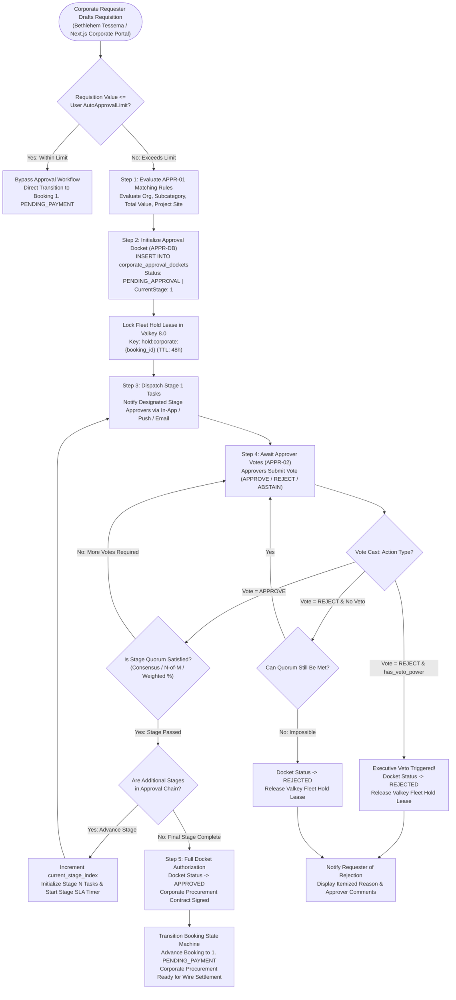
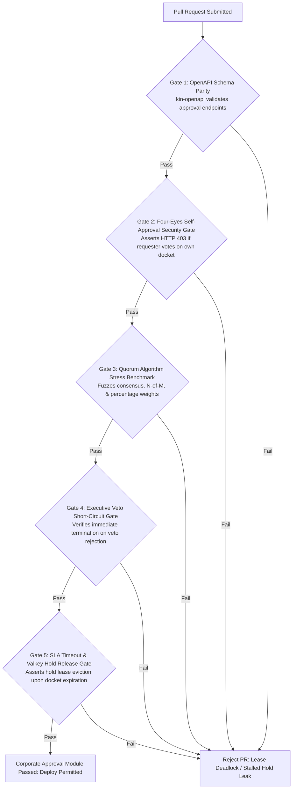

# Heavy Machinery & Logistics Rental Aggregator — Dink Machinery
## Software Requirements Specification — 06.02. Corporate Approval Workflows, Multi-Stage Chains, Quorum Rules & Delegation Architecture (`docs/shared/requirements/06-02-corporate-approval-workflows.md`)

**Document Identifier:** `SRS-DINK-CORE-V7.0-SEC-06-02`  
**Classification:** Canonical System Requirements Specification & Enterprise Governance Baseline (Single Source of Truth)  
**Governing Standard:** IEEE Std 830-1998 / IEEE/ISO/IEC 29148:2018 (Systems and Software Engineering — Requirements Engineering)  
**Associated Artifacts:** `SRS-DINK-CORE-V7.0` (§6.0, §6.1, §6.2, §8, §10, §12, §13.2), `FLOW-BOOKING-STATE-MACHINE-DINK-CORE-V7.0`, `ARCH-BACKEND-GO-DINK-CORE-V7.0`, `ARCH-FLUTTER-DINK-CORE-V7.0`, `ARCH-ADMIN-NEXT-DINK-CORE-V7.0`, `ARCH-SEC-DINK-CORE-V7.0`, `DS-DINK-CORE-V7.0`, `DS-PERSONAS-DINK-CORE-V7.0`, `contracts/openapi.yaml`, `ADR-001`, `ADR-002`, `ADR-004`, `ADR-005`, `ADR-008`, `ADR-010`  
**Target Runtimes:** Go 1.24 Backend Monolith, Flutter 3.44 / Dart 3.9 (Cross-Platform Mobile), Next.js 16 / React 19 (Web Admin & Corporate Portal), PostgreSQL 18.4 + PostGIS 3.4, Valkey 8.0, ClamAV Daemon (:3310), SeaweedFS S3, Isar NoSQL 3.1+  
**Target Personas:** Corporate Procurement Director (*Eng. Samuel Getachew*), Senior Project Manager (*Dawit Haile-Mariam*), Site Quantity Surveyor (*Bethlehem Tessema*), Corporate Fleet Owner Executive (*W/ro Almaz Tesfaye*), Finance Controller & Compliance Auditor (*Solomon Kassa*), Super Administrator (*Rahel Tadesse*)  
**Target Operating Markets:** Ethiopia (`ET`) & Kenya (`KE`) — Dynamic Multi-Country Parameterization (`LOC-01-BE`)  
**Compliance Standards:** OWASP ASVS 4.0.3 Level 3 (Separation of Duties, Multi-Party Approval Integrity & Non-Repudiation), RFC 9457 (Problem Details), ISO 9241-110, W3C WCAG 2.2 Level AAA (Field Mobile) & Level AA (Admin Web), Commercial Code of Ethiopia (Corporate Agency & Signing Authorities), Kenya Companies Act 2015, International Financial Reporting Standards (IFRS 16 Leases & Internal Controls)  
**Status:** Approved Engineering Baseline

---

## Table of Contents

- 1. [Document Scope & Architectural Mandate](#1-document-scope--architectural-mandate)
  - 1.1 [Purpose & Functional Scope](#11-purpose--functional-scope)
  - 1.2 [Core Enterprise Governance & Approval Invariants](#12-core-enterprise-governance--approval-invariants)
- 2. [Approval Workflow Finite State Machine & Topology](#2-approval-workflow-finite-state-machine--topology)
  - 2.1 [Multi-Stage Requisition & Decision Pipeline Flowchart](#21-multi-stage-requisition--decision-pipeline-flowchart)
  - 2.2 [State Sub-Machine Taxonomy (`ApprovalDocketState`)](#22-state-sub-machine-taxonomy-approvaldocketstate)
  - 2.3 [Permitted Transitions Matrix](#23-permitted-transitions-matrix)
- 3. [Approval Groups, Fleets & Category Scoping (`APPR-01`)](#3-approval-groups-fleets--category-scoping-appr-01)
  - 3.1 [Hierarchical Approval Group Topology](#31-hierarchical-approval-group-topology)
  - 3.2 [Machinery Category & Asset-Specific Routing Bounds](#32-machinery-category--asset-specific-routing-bounds)
  - 3.3 [Project & Site-Specific Geographical Fencing](#33-project--site-specific-geographical-fencing)
- 4. [Quorum Mechanics, Voting Weights & Veto Architecture (`APPR-02`)](#4-quorum-mechanics-voting-weights--veto-architecture-appr-02)
  - 4.1 [Quorum Evaluation Rules (Consensus, $N\text{-of-}M$, Percentage)](#41-quorum-evaluation-rules-consensus-n-of-m-percentage)
  - 4.2 [Weighted Voting & Executive Veto Power (`has_veto_power`)](#42-weighted-voting--executive-veto-power-has_veto_power)
  - 4.3 [Mathematical Decision Resolution Formulation](#43-mathematical-decision-resolution-formulation)
  - 4.4 [Self-Approval Disqualification (Four-Eyes Enforcement)](#44-self-approval-disqualification-four-eyes-enforcement)
- 5. [Multi-Stage Approval Chains & Escalation Matrices (`APPR-03`)](#5-multi-stage-approval-chains--escalation-matrices-appr-03)
  - 5.1 [Sequential Multi-Stage Pipeline Execution](#51-sequential-multi-stage-pipeline-execution)
  - 5.2 [Value-Tiered Dynamic Stage Dispatch](#52-value-tiered-dynamic-stage-dispatch)
  - 5.3 [SLA Timeout Monitors, Escalation & Automated Fallbacks](#53-sla-timeout-monitors-escalation--automated-fallbacks)
  - 5.4 [Delegation & Out-of-Office Proxy Routing](#54-delegation--out-of-office-proxy-routing)
- 6. [Relational Database Schema & Data Modeling (`APPR-DB`)](#6-relational-database-schema--data-modeling-appr-db)
  - 6.1 [Entity Relationship Diagram](#61-entity-relationship-diagram)
  - 6.2 [Data Definition Language (DDL) Specifications](#62-data-definition-language-ddl-specifications)
- 7. [Wire Protocol Contracts & RFC 9457 Error Schemas](#7-wire-protocol-contracts--rfc-9457-error-schemas)
  - 7.1 [`POST /api/v1/corporate/approvals/dockets`](#71-post-apiv1corporateapprovalsdockets)
  - 7.2 [`GET /api/v1/corporate/approvals/dockets/{id}`](#72-get-apiv1corporateapprovalsdocketsid)
  - 7.3 [`POST /api/v1/corporate/approvals/dockets/{id}/vote`](#73-post-apiv1corporateapprovalsdocketsidvote)
  - 7.4 [`POST /api/v1/corporate/approvals/rules`](#74-post-apiv1corporateapprovalsrules)
  - 7.5 [RFC 9457 Universal Problem Details Payloads](#75-rfc-9457-universal-problem-details-payloads)
- 8. [Automated Testing Suite & Verification Gates](#8-automated-testing-suite--verification-gates)

---

## 1. Document Scope & Architectural Mandate

### 1.1 Purpose & Functional Scope

This specification establishes **Section 06.02 (Corporate Approval Workflows, Multi-Stage Chains, Quorum Rules & Delegation Architecture)** of the canonical Software Requirements Specification (SRS) for **Dink Machinery Version 7.0**.

In large infrastructure projects, commercial road construction, and mining ventures across East Africa (e.g., *Modjo–Hawassa Expressway*, *LAPSSET corridor*, *Addis Ababa Corridor Project*), machinery requisitions involve commitments ranging from hundreds of thousands to tens of millions of Ethiopian Birr or Kenyan Shillings. Enterprise governance forbids arbitrary machinery leasing by lone actors:
* A site engineer or quantity surveyor discovering equipment on-site cannot autonomously bind corporate financial lines or execute bank transfers without commercial review.
* Requisitions require multi-party scrutiny across engineering technical fit (machine tonnage, digging depth, hydraulic rating), operational logistics, and commercial budgets.
* Enterprise organizations establish custom signing mandates: some requisitions require unanimous consensus of all project managers; others require majority quorum ($N\text{-of-}M$), percentage consensus, or explicit veto authority held by the Finance Director.
* High-value commitments mandate sequential multi-stage authorization: Level 1 (Site Project Manager) $\longrightarrow$ Level 2 (Commercial Quantity Surveyor) $\longrightarrow$ Level 3 (Managing Director & Procurement Board).

This document formally specifies:
1. The dynamic approval workflow engine evaluating equipment requisitions against multi-variable organizational rules.
2. The quorum evaluation algorithms supporting consensus, $N\text{-of-}M$ voting, percentage thresholds, weighted votes, and executive veto overrides.
3. Multi-stage approval chains with automated SLA escalations, fallback routing, and out-of-office delegation matrices.
4. The integration connecting approved corporate dockets into the primary Booking State Machine (`FLOW-BOOKING-STATE-MACHINE-DINK-CORE-V7.0`), advancing dockets from internal corporate hold to `PENDING_PAYMENT`.

### 1.2 Core Enterprise Governance & Approval Invariants

1. **Four-Eyes Separation of Duties Invariant (OWASP ASVS §4.3):** The creator of a requisition docket cannot participate as an approver within any stage of that docket's approval chain, regardless of their organizational role or voting weight. Self-approval is blocked at the domain engine level:
   $$\text{ApproverUserID} \neq \text{RequesterUserID}$$
2. **Immutable Audit Trail of Voting Mandate:** Once cast, an approval vote (Approve, Reject, Abstain) is cryptographically signed and immutable. It can never be edited, deleted, or transferred retroactively. The audit record permanently commits the acting user ID, vote choice, timestamp, client IP, and justification narrative.
3. **Deterministic Quorum Resolution SLO ($\le 15.0\text{ ms}$):** When an approver submits a vote, the quorum evaluation algorithm must synchronously resolve the stage state (remain `PENDING`, advance to `STAGE_APPROVED`, or terminate as `REJECTED`) within $< 15.0\text{ ms}$ (p99) under an ACID database transaction lock.
4. **Veto Precedence Invariant:** If any designated approver possessing `has_veto_power = true` casts a `REJECT` vote within their assigned stage, the approval docket terminates **immediately** as `REJECTED`, short-circuiting all remaining stages, voting weights, and open approvals.
5. **Safe Booking Lease Hold Extension:** While a requisition docket traverses an active internal approval chain, the referenced machinery asset must be held under a corporate reservation hold lease in Valkey 8.0, preventing public rediscovery while guarding against infinite deadlocks via strict stage SLA timers.

---

## 2. Approval Workflow Finite State Machine & Topology

### 2.1 Multi-Stage Requisition & Decision Pipeline Flowchart



---

### 2.2 State Sub-Machine Taxonomy (`ApprovalDocketState`)

Every corporate approval docket record is governed by an explicit state enumeration:

| Status Key | Can Fleet Be Rented? | Operational Definition & System Behavior |
|---|:---:|---|
| **`DRAFT`** | ❌ No | Requisition drafted by requester; not yet formally submitted for workflow routing. |
| **`PENDING_APPROVAL`** | ⚠️ Held | Requisition submitted; traversing active multi-stage approval chain; fleet lease locked. |
| **`STAGE_PASSED`** | ⚠️ Held | Intermediate milestone; current stage quorum satisfied; advancing to subsequent stage. |
| **`APPROVED`** | ✅ Unlocked | All chain stages satisfied; corporate procurement approved; advances booking to `PENDING_PAYMENT`. |
| **`REJECTED`** | ❌ No | Rejection cast by veto authority or failed quorum; fleet lease released; docket archived. |
| **`CANCELLED`** | ❌ No | Requester voluntarily cancelled requisition prior to final approval; hold released. |
| **`EXPIRED_TIMEOUT`** | ❌ No | Stage SLA timer expired without quorum resolution; docket automatically aborted. |

---

### 2.3 Permitted Transitions Matrix

```text
+----------------------------------------------------------------------------------------------------+
| CORPORATE APPROVAL DOCKET TRANSITION MATRIX                                                        |
+------------------------------------+---------------------------------------------------------------+
| SOURCE STATE                       | PERMITTED TARGET STATES                                       |
+------------------------------------+---------------------------------------------------------------+
| DRAFT                              | PENDING_APPROVAL, CANCELLED                                   |
| PENDING_APPROVAL                   | STAGE_PASSED, APPROVED, REJECTED, CANCELLED, EXPIRED_TIMEOUT  |
| STAGE_PASSED                       | PENDING_APPROVAL (Next Stage), APPROVED (If Final), CANCELLED |
| APPROVED                           | [Terminal Operational State — Handed to Booking Engine]       |
| REJECTED                           | [Terminal State — Requisition Aborted]                        |
| CANCELLED                          | [Terminal State — User Aborted]                               |
| EXPIRED_TIMEOUT                    | [Terminal State — SLA Abandonment]                            |
+------------------------------------+---------------------------------------------------------------+
```

---

## 3. Approval Groups, Fleets & Category Scoping (`APPR-01`)

### 3.1 Hierarchical Approval Group Topology

Corporate enterprises structure decision-making bodies into modular **Approval Groups**:
* An Approval Group (`corporate_approval_groups`) is a named collection of corporate members sharing evaluation responsibilities (e.g., *"Heavy Earthmoving Technical Committee"*, *"Regional Finance Approvers"*, *"Executive Board"*).
* A single user may belong to multiple approval groups with varying voting weights and permissions.
* Groups are mapped into dynamic routing rules rather than hardcoded to individual users, ensuring operational continuity during personnel turnover.

---

### 3.2 Machinery Category & Asset-Specific Routing Bounds

Approval requirements vary depending on the specialized nature of the machinery:
* **Category Scoping:** A rule may target specific subcategories:
  - Standard Excavators & Loaders $\longrightarrow$ Site-Level Engineering Group.
  - Specialized 100-Ton Cranes or Rigging Gear $\longrightarrow$ Central Technical Safety Committee.
* **Specific Fleet Pinning:** High-value corporate-owned fleet assets or specialized leased long-term packages can be bound to designated managerial groups.
* **Capital Commitment Scaling:** Rules enforce value thresholds:
  $$\text{Requisition Value} = \text{Daily Rate} \times \text{Duration} + \text{Estimated Freight} + \text{Security Deposit}$$

---

### 3.3 Project & Site-Specific Geographical Fencing

Infrastructure contractors frequently manage simultaneous projects across wide geographies (e.g., *Site A: Hawassa Industrial Park*, *Site B: Koysha Hydroelectric Project*):
* Approval rules can bind to explicit **Project Sites** (`project_site_id`) or PostGIS geographic polygons.
* Requisitions originating for machinery delivered to Site A route automatically to Site A's Resident Project Manager, preventing cross-project budget interference.

---

## 4. Quorum Mechanics, Voting Weights & Veto Architecture (`APPR-02`)

### 4.1 Quorum Evaluation Rules (Consensus, $N\text{-of-}M$, Percentage)

When a stage activates, the engine enforces one of three mathematical quorum strategies:

```text
+--------------------------------------------------------------------------------------------------+
| QUORUM STRATEGY EVALUATION SPECIFICATION (APPR-02)                                               |
+---------------------+-----------------------------------+----------------------------------------+
| STRATEGY KEY        | MATHEMATICAL SUCCESS CONDITION    | OPERATIONAL USE CASE                   |
+---------------------+-----------------------------------+----------------------------------------+
| UNANIMOUS_CONSENSUS | ApprovalsCount == TotalApprovers   | High-risk machinery leases; joint      |
|                     | AND RejectionsCount == 0          | venture partner board authorizations.  |
+---------------------+-----------------------------------+----------------------------------------+
| THRESHOLD_N_OF_M    | ApprovalsCount >= RequiredN       | Operational agility; requires any 2 of |
|                     |                                   | 5 designated site managers to approve. |
+---------------------+-----------------------------------+----------------------------------------+
| WEIGHTED_PERCENTAGE | (ApprovedWeight / TotalWeight)    | Capital allocation; votes scaled by    |
|                     | >= RequiredPercentage (e.g., 66%) | corporate equity or managerial seniority.|
+--------------------------------------------------------------------------------------------------+
```

---

### 4.2 Weighted Voting & Executive Veto Power (`has_veto_power`)

Within an approval group, individual members can be allocated custom governance powers:
* **Voting Weight (`voting_weight`):** An integer multiplier (Default: `1`). In weighted percentage quorum, an executive's vote can carry a weight of `3`, while junior approvers carry `1`.
* **Veto Power (`has_veto_power = true`):** Designated key executives (e.g., Chief Financial Officer or Legal Counsel) can be granted absolute veto power.
  - If a veto holder casts `REJECT`, the docket transitions immediately to `REJECTED`, regardless of cumulative approval scores.

---

### 4.3 Mathematical Decision Resolution Formulation

For each active stage $k$ with approvers $\{a_1, a_2, \dots, a_m\}$:

$$\mathcal{W}_{\text{approved}} = \sum_{i \in \text{Approved}} w_i, \quad \mathcal{W}_{\text{rejected}} = \sum_{j \in \text{Rejected}} w_j, \quad \mathcal{W}_{\text{total}} = \sum_{k=1}^{m} w_k$$

$$\text{StageStatus} = \begin{cases} \text{REJECTED} & \text{if } \exists i \in \text{Rejected} : \text{veto}_i = \text{true} \\ \text{REJECTED} & \text{if } (\mathcal{W}_{\text{total}} - \mathcal{W}_{\text{rejected}}) < \mathcal{W}_{\text{threshold}} \\ \text{STAGE\_PASSED} & \text{if } \mathcal{W}_{\text{approved}} \ge \mathcal{W}_{\text{threshold}} \\ \text{PENDING} & \text{otherwise} \end{cases}$$

---

### 4.4 Self-Approval Disqualification (Four-Eyes Enforcement)

If a user possessing corporate approver status submits a requisition as a requester:
* The Go evaluation engine automatically purges the requester from the eligible voting pool for that specific docket instance:
  $$\text{EligibleApprovers} = \text{GroupMembers} \setminus \{\text{RequesterUserID}\}$$
* Total voting weight $\mathcal{W}_{\text{total}}$ dynamically recalculates to exclude the requester's weight, preventing artificial quorum deadlocks.

---

## 5. Multi-Stage Approval Chains & Escalation Matrices (`APPR-03`)

### 5.1 Sequential Multi-Stage Pipeline Execution

Complex procurements route through sequential stages where each tier evaluates distinct dimensions:

```text
+--------------------------------------------------------------------------------------------------+
| MULTI-STAGE PROCUREMENT PIPELINE MATRIX                                                          |
+-------+--------------------------+-----------------------+---------------------------------------+
| STAGE | STAGE NAME               | ASSIGNED GROUP        | EVALUATION FOCUS                      |
+-------+--------------------------+-----------------------+---------------------------------------+
| 1     | Site Engineering Review  | Resident Project Engs | Technical fit, site access, duration. |
+-------+--------------------------+-----------------------+---------------------------------------+
| 2     | Commercial Quantity Surv | Cost Controllers      | Rate benchmark, fuel, mobilization.   |
+-------+--------------------------+-----------------------+---------------------------------------+
| 3     | Executive Directorate    | Executive Board / MD  | Capital commitment, payment terms.    |
+-------+--------------------------+-----------------------+---------------------------------------+
```

---

### 5.2 Value-Tiered Dynamic Stage Dispatch

The depth of the approval chain scales dynamically with requisition valuation:

```text
+--------------------------------------------------------------------------------------------------+
| VALUE-TIERED CHAIN ESCALATION THRESHOLDS (ETHIOPIAN BIRR EXAMPLE)                                |
+-----------------------+-------------------+------------------------------------------------------+
| TOTAL REQUISITION VAL | ACTIVE STAGES     | MANDATED APPROVAL CHAIN TOPOLOGY                     |
+-----------------------+-------------------+------------------------------------------------------+
| <= 100,000 ETB        | Stage 1 Only      | Single Approver (Resident Site Engineer).            |
+-----------------------+-------------------+------------------------------------------------------+
| 100,001 - 500,000 ETB | Stages 1 & 2      | Site Engineer (Consensus) -> Project Manager.        |
+-----------------------+-------------------+------------------------------------------------------+
| > 500,000 ETB         | Stages 1, 2, & 3  | Site Eng -> Commercial Manager -> Managing Director. |
+--------------------------------------------------------------------------------------------------+
```

---

### 5.3 SLA Timeout Monitors, Escalation & Automated Fallbacks

To prevent requisitions from stalling on dormant approver desks:
* Every stage defines an **SLA Timeout Horizon** (e.g., $24\text{ Hours}$).
* **Escalation Hierarchy:**
  - **T-4 Hours Warning:** Dispatches urgent SMS/Push alert to all pending approvers.
  - **Timeout Reached ($T = 0$):**
    - **Fallback Mode 1 (Escalate Upward):** Automatically escalates docket to the next managerial tier.
    - **Fallback Mode 2 (Auto-Abort):** Transitions docket to `EXPIRED_TIMEOUT`, releasing the Valkey hold lease and notifying the requester.

---

### 5.4 Delegation & Out-of-Office Proxy Routing

When an executive takes annual leave or travels to remote field sites without cellular coverage:
* Approver configures a **Delegation Proxy** (`POST /api/v1/corporate/approvals/delegations`):
  - Delegate User ID, Start Timestamp, Expiry Timestamp.
* During the delegation window, all voting rights, notifications, and signing authority route to the designated proxy.
* Audit logs maintain full traceability, attributing decisions as:
  `Approved by Ato Girma Wolde (Acting as Proxy for Eng. Samuel Getachew)`.

---

## 6. Relational Database Schema & Data Modeling (`APPR-DB`)

### 6.1 Entity Relationship Diagram

```mermaid
erDiagram
    Organization ||--o{ CorporateApprovalGroup : "maintains"
    Organization ||--o{ CorporateApprovalRule : "configures"
    Organization ||--o{ CorporateApprovalDocket : "processes"
    CorporateApprovalGroup ||--o{ CorporateApprovalGroupMember : "contains"
    CorporateApprovalDocket ||--o{ CorporateApprovalStageInstance : "executes"
    CorporateApprovalStageInstance ||--o{ CorporateApprovalVote : "records"
    User ||--o{ CorporateApprovalVote : "casts"
    User ||--o{ CorporateApprovalGroupMember : "assigned"

    CorporateApprovalGroup {
        uuid id PK
        uuid organization_id FK
        string group_name
        string description
        boolean is_active
        timestamptz created_at
    }

    CorporateApprovalGroupMember {
        uuid id PK
        uuid group_id FK
        uuid user_id FK
        int voting_weight
        boolean has_veto_power
        timestamptz joined_at
    }

    CorporateApprovalRule {
        uuid id PK
        uuid organization_id FK
        string rule_name
        uuid subcategory_id FK NULL
        uuid project_site_id FK NULL
        bigint min_amount_minor
        bigint max_amount_minor
        jsonb stage_definitions_json
        int priority_order
        boolean is_active
        timestamptz created_at
    }

    CorporateApprovalDocket {
        uuid id PK
        uuid organization_id FK
        uuid booking_id FK UK
        uuid requester_user_id FK
        bigint total_amount_minor
        string currency
        string status -- 'PENDING_APPROVAL', 'APPROVED', 'REJECTED', 'EXPIRED_TIMEOUT'
        int current_stage_index
        int total_stages
        timestamptz expires_at
        timestamptz created_at
        timestamptz resolved_at
    }

    CorporateApprovalStageInstance {
        uuid id PK
        uuid docket_id FK
        int stage_index
        string stage_name
        uuid approval_group_id FK
        string quorum_strategy -- 'UNANIMOUS_CONSENSUS', 'THRESHOLD_N_OF_M', 'WEIGHTED_PERCENTAGE'
        int required_threshold_value
        string status -- 'PENDING', 'STAGE_PASSED', 'REJECTED', 'EXPIRED'
        timestamptz started_at
        timestamptz resolved_at
    }

    CorporateApprovalVote {
        uuid id PK
        uuid stage_instance_id FK
        uuid user_id FK
        uuid proxy_for_user_id FK NULL
        string decision -- 'APPROVE', 'REJECT', 'ABSTAIN'
        int applied_weight
        boolean used_veto
        text comments
        string signature_hash
        timestamptz voted_at
    }
```

---

### 6.2 Data Definition Language (DDL) Specifications

```sql
-- 1. Corporate Approval Groups Table
CREATE TABLE corporate_approval_groups (
    id UUID PRIMARY KEY DEFAULT gen_random_uuid(),
    organization_id UUID NOT NULL REFERENCES organizations(id) ON DELETE CASCADE,
    group_name VARCHAR(128) NOT NULL,
    description TEXT NULL,
    is_active BOOLEAN NOT NULL DEFAULT true,
    created_at TIMESTAMPTZ NOT NULL DEFAULT NOW()
);

CREATE INDEX idx_appr_groups_org ON corporate_approval_groups (organization_id) WHERE is_active = true;

-- 2. Corporate Approval Group Members Table
CREATE TABLE corporate_approval_group_members (
    id UUID PRIMARY KEY DEFAULT gen_random_uuid(),
    group_id UUID NOT NULL REFERENCES corporate_approval_groups(id) ON DELETE CASCADE,
    user_id UUID NOT NULL REFERENCES users(id) ON DELETE RESTRICT,
    voting_weight INT NOT NULL DEFAULT 1 CHECK (voting_weight >= 1),
    has_veto_power BOOLEAN NOT NULL DEFAULT false,
    joined_at TIMESTAMPTZ NOT NULL DEFAULT NOW(),
    CONSTRAINT uq_group_member UNIQUE (group_id, user_id)
);

CREATE INDEX idx_appr_group_members_user ON corporate_approval_group_members (user_id);

-- 3. Corporate Approval Rules Table
CREATE TABLE corporate_approval_rules (
    id UUID PRIMARY KEY DEFAULT gen_random_uuid(),
    organization_id UUID NOT NULL REFERENCES organizations(id) ON DELETE CASCADE,
    rule_name VARCHAR(128) NOT NULL,
    subcategory_id VARCHAR(64) NULL,
    project_site_id UUID NULL,
    min_amount_minor BIGINT NOT NULL DEFAULT 0,
    max_amount_minor BIGINT NULL,
    stage_definitions_json JSONB NOT NULL,
    priority_order INT NOT NULL DEFAULT 100,
    is_active BOOLEAN NOT NULL DEFAULT true,
    created_at TIMESTAMPTZ NOT NULL DEFAULT NOW()
);

CREATE INDEX idx_appr_rules_org ON corporate_approval_rules (organization_id, priority_order ASC) WHERE is_active = true;

-- 4. Corporate Approval Dockets Table
CREATE TABLE corporate_approval_dockets (
    id UUID PRIMARY KEY DEFAULT gen_random_uuid(),
    organization_id UUID NOT NULL REFERENCES organizations(id) ON DELETE CASCADE,
    booking_id UUID NOT NULL UNIQUE REFERENCES bookings(id) ON DELETE RESTRICT,
    requester_user_id UUID NOT NULL REFERENCES users(id) ON DELETE RESTRICT,
    total_amount_minor BIGINT NOT NULL,
    currency VARCHAR(3) NOT NULL CHECK (currency IN ('ETB', 'KES')),
    status VARCHAR(32) NOT NULL DEFAULT 'PENDING_APPROVAL',
    current_stage_index INT NOT NULL DEFAULT 1,
    total_stages INT NOT NULL,
    expires_at TIMESTAMPTZ NOT NULL,
    created_at TIMESTAMPTZ NOT NULL DEFAULT NOW(),
    resolved_at TIMESTAMPTZ NULL,
    CONSTRAINT chk_docket_status CHECK (status IN ('DRAFT', 'PENDING_APPROVAL', 'STAGE_PASSED', 'APPROVED', 'REJECTED', 'CANCELLED', 'EXPIRED_TIMEOUT'))
);

CREATE INDEX idx_appr_dockets_org ON corporate_approval_dockets (organization_id, status);

-- 5. Corporate Approval Stage Instances Table
CREATE TABLE corporate_approval_stage_instances (
    id UUID PRIMARY KEY DEFAULT gen_random_uuid(),
    docket_id UUID NOT NULL REFERENCES corporate_approval_dockets(id) ON DELETE CASCADE,
    stage_index INT NOT NULL,
    stage_name VARCHAR(128) NOT NULL,
    approval_group_id UUID NOT NULL REFERENCES corporate_approval_groups(id) ON DELETE RESTRICT,
    quorum_strategy VARCHAR(32) NOT NULL,
    required_threshold_value INT NOT NULL,
    status VARCHAR(32) NOT NULL DEFAULT 'PENDING',
    started_at TIMESTAMPTZ NOT NULL DEFAULT NOW(),
    resolved_at TIMESTAMPTZ NULL,
    CONSTRAINT chk_stage_status CHECK (status IN ('PENDING', 'STAGE_PASSED', 'REJECTED', 'EXPIRED')),
    CONSTRAINT chk_stage_quorum CHECK (quorum_strategy IN ('UNANIMOUS_CONSENSUS', 'THRESHOLD_N_OF_M', 'WEIGHTED_PERCENTAGE')),
    CONSTRAINT uq_docket_stage UNIQUE (docket_id, stage_index)
);

-- 6. Corporate Approval Votes Table (Immutable Audit Ledger)
CREATE TABLE corporate_approval_votes (
    id UUID PRIMARY KEY DEFAULT gen_random_uuid(),
    stage_instance_id UUID NOT NULL REFERENCES corporate_approval_stage_instances(id) ON DELETE CASCADE,
    user_id UUID NOT NULL REFERENCES users(id) ON DELETE RESTRICT,
    proxy_for_user_id UUID NULL REFERENCES users(id) ON DELETE RESTRICT,
    decision VARCHAR(16) NOT NULL CHECK (decision IN ('APPROVE', 'REJECT', 'ABSTAIN')),
    applied_weight INT NOT NULL,
    used_veto BOOLEAN NOT NULL DEFAULT false,
    comments TEXT NULL,
    signature_hash VARCHAR(64) NOT NULL,
    voted_at TIMESTAMPTZ NOT NULL DEFAULT NOW(),
    CONSTRAINT uq_stage_voter UNIQUE (stage_instance_id, user_id)
);

CREATE RULE prevent_vote_update AS ON UPDATE TO corporate_approval_votes DO INSTEAD NOTHING;
CREATE RULE prevent_vote_delete AS ON DELETE TO corporate_approval_votes DO INSTEAD NOTHING;
```

---

## 7. Wire Protocol Contracts & RFC 9457 Error Schemas

### 7.1 `POST /api/v1/corporate/approvals/dockets`

Creates and initializes a corporate approval docket for an equipment booking.

#### Request Headers
```http
POST /api/v1/corporate/approvals/dockets HTTP/1.1
Host: api.dinkmachinery.com
Content-Type: application/json
Authorization: Bearer <corporateUserAccessToken>
X-Organization-ID: org_019a8fe0-8812-7b9a-bc21-4491204812aa
Idempotency-Key: 88182a01-4b12-4f9a-8812-7b9a4c10bc21
```

#### Request Payload
```json
{
  "bookingId": "bk_019a8f60-9912-7b9a",
  "projectSiteId": "sit_019a8fc0-4412",
  "justification": "Foundation excavation for Mojo Highway Lot 3 Overpass Shoring."
}
```

#### Response: `HTTP 201 Created`
```json
{
  "success": true,
  "data": {
    "docketId": "doc_appr_019a8fe0-1123",
    "organizationId": "org_019a8fe0-8812-7b9a-bc21-4491204812aa",
    "bookingId": "bk_019a8f60-9912-7b9a",
    "status": "PENDING_APPROVAL",
    "totalAmountMinor": 22500000,
    "currency": "ETB",
    "currentStage": {
      "stageIndex": 1,
      "stageName": "Site Engineering Technical Review",
      "groupName": "Mojo Highway Project Engineers",
      "quorumStrategy": "THRESHOLD_N_OF_M",
      "requiredThresholdValue": 2,
      "timeoutAt": "2026-10-29T16:30:00Z"
    },
    "totalStages": 2,
    "createdAt": "2026-10-28T16:30:00Z"
  },
  "timestamp": "2026-10-28T16:30:01Z"
}
```

---

### 7.2 `GET /api/v1/corporate/approvals/dockets/{id}`

Retrieves complete approval status, active stage metrics, cast votes, and audit logs.

#### Request Headers
```http
GET /api/v1/corporate/approvals/dockets/doc_appr_019a8fe0-1123 HTTP/1.1
Host: api.dinkmachinery.com
Authorization: Bearer <corporateUserAccessToken>
X-Organization-ID: org_019a8fe0-8812-7b9a-bc21-4491204812aa
```

#### Response: `HTTP 200 OK`
```json
{
  "success": true,
  "data": {
    "docketId": "doc_appr_019a8fe0-1123",
    "status": "PENDING_APPROVAL",
    "bookingDetails": {
      "bookingId": "bk_019a8f60-9912-7b9a",
      "fleetName": "Caterpillar 320D Excavator",
      "hireDurationDays": 10,
      "totalAmountMinor": 22500000,
      "currency": "ETB"
    },
    "requester": {
      "userId": "usr_018f6a9e-876b-7341",
      "fullName": "Bethlehem Tessema",
      "role": "Site Quantity Surveyor"
    },
    "stages": [
      {
        "stageIndex": 1,
        "stageName": "Site Engineering Technical Review",
        "status": "STAGE_PASSED",
        "quorumStrategy": "THRESHOLD_N_OF_M",
        "requiredThreshold": 2,
        "currentApprovals": 2,
        "votes": [
          {
            "voterName": "Eng. Samuel Getachew",
            "decision": "APPROVE",
            "appliedWeight": 1,
            "votedAt": "2026-10-28T16:35:00Z"
          },
          {
            "voterName": "Dawit Haile-Mariam",
            "decision": "APPROVE",
            "appliedWeight": 1,
            "votedAt": "2026-10-28T16:40:00Z"
          }
        ]
      },
      {
        "stageIndex": 2,
        "stageName": "Commercial Directorate Sign-Off",
        "status": "PENDING",
        "quorumStrategy": "UNANIMOUS_CONSENSUS",
        "requiredThreshold": 1,
        "currentApprovals": 0,
        "votes": []
      }
    ]
  },
  "timestamp": "2026-10-28T16:45:00Z"
}
```

---

### 7.3 `POST /api/v1/corporate/approvals/dockets/{id}/vote`

Casts an immutable decision vote (Approve, Reject, Abstain) on the active stage.

#### Request Headers
```http
POST /api/v1/corporate/approvals/dockets/doc_appr_019a8fe0-1123/vote HTTP/1.1
Host: api.dinkmachinery.com
Content-Type: application/json
Authorization: Bearer <approverAccessToken>
X-Organization-ID: org_019a8fe0-8812-7b9a-bc21-4491204812aa
Idempotency-Key: 99182a01-5c12-4f9a-8812-7b9a4c10bc21
```

#### Request Payload
```json
{
  "decision": "APPROVE",
  "comments": "Technical capacity verified. Mojo site access road confirmed cleared for lowboy delivery."
}
```

#### Response: `HTTP 200 OK`
```json
{
  "success": true,
  "data": {
    "voteId": "vot_019a8fe5-9912",
    "stageIndex": 2,
    "decision": "APPROVE",
    "stageStatus": "STAGE_PASSED",
    "docketStatus": "APPROVED",
    "bookingStatus": "PENDING_PAYMENT",
    "finalAuthorizationAchieved": true,
    "votedAt": "2026-10-28T16:50:00Z"
  },
  "timestamp": "2026-10-28T16:50:01Z"
}
```

---

### 7.4 `POST /api/v1/corporate/approvals/rules`

Administrative endpoint for corporate executives to configure enterprise approval rules.

#### Request Headers
```http
POST /api/v1/corporate/approvals/rules HTTP/1.1
Host: api.dinkmachinery.com
Content-Type: application/json
Authorization: Bearer <corporateAdminAccessToken>
X-Organization-ID: org_019a8fe0-8812-7b9a-bc21-4491204812aa
```

#### Request Payload
```json
{
  "ruleName": "Heavy Excavator Tier-2 Multi-Stage Rule",
  "subcategoryId": "cat_sub_excavator_std",
  "minAmountMinor": 5000000,
  "maxAmountMinor": 50000000,
  "stageDefinitions": [
    {
      "stageIndex": 1,
      "stageName": "Site Project Engineering",
      "approvalGroupId": "grp_019a8fc0-1123",
      "quorumStrategy": "THRESHOLD_N_OF_M",
      "requiredThresholdValue": 2,
      "timeoutHours": 24
    },
    {
      "stageIndex": 2,
      "stageName": "Commercial Director Approval",
      "approvalGroupId": "grp_019a8fc0-4412",
      "quorumStrategy": "UNANIMOUS_CONSENSUS",
      "requiredThresholdValue": 1,
      "timeoutHours": 48
    }
  ],
  "priorityOrder": 10
}
```

#### Response: `HTTP 201 Created`
```json
{
  "success": true,
  "data": {
    "ruleId": "rul_019a8fe8-3341",
    "ruleName": "Heavy Excavator Tier-2 Multi-Stage Rule",
    "totalStagesConfigured": 2,
    "isActive": true,
    "createdAt": "2026-10-28T16:55:00Z"
  },
  "timestamp": "2026-10-28T16:55:01Z"
}
```

---

### 7.5 RFC 9457 Universal Problem Details Payloads

#### Example: Four-Eyes Self-Approval Violation (`HTTP 403 Forbidden`)
```json
{
  "type": "[https://api.dinkmachinery.com/errors/four-eyes-self-approval-forbidden](https://api.dinkmachinery.com/errors/four-eyes-self-approval-forbidden)",
  "title": "Self-Approval Strictly Forbidden",
  "status": 403,
  "detail": "You cannot cast an approval vote on Requisition #DOC-1123 because you are the original requester. Corporate governance requires independent four-eyes authorization.",
  "instance": "/api/v1/corporate/approvals/dockets/doc_appr_019a8fe0-1123/vote",
  "code": "ERR_SELF_APPROVAL_DISQUALIFIED",
  "correlationId": "cor_019a8fe0-8812-7b9a-bc21-4491204812aa",
  "timestamp": "2026-10-28T16:50:05Z",
  "invalidParams": [
    {
      "name": "userId",
      "reason": "Matches docket.requester_user_id (usr_018f6a9e-876b-7341)"
    }
  ]
}
```

#### Example: Executive Veto Termination (`HTTP 409 Conflict`)
```json
{
  "type": "[https://api.dinkmachinery.com/errors/approval-docket-vetoed](https://api.dinkmachinery.com/errors/approval-docket-vetoed)",
  "title": "Approval Docket Terminated by Executive Veto",
  "status": 409,
  "detail": "Requisition #DOC-1123 was rejected with absolute executive veto by Chief Commercial Officer Dawit Haile-Mariam. Remaining stages aborted.",
  "instance": "/api/v1/corporate/approvals/dockets/doc_appr_019a8fe0-1123/vote",
  "code": "ERR_APPROVAL_DOCKET_VETOED",
  "correlationId": "cor_019a8fe0-9914-4c12-8812-7b9a4c10bc21",
  "timestamp": "2026-10-28T16:51:00Z",
  "invalidParams": [
    {
      "name": "decision",
      "reason": "Veto authority exercised. Docket moved to terminal state REJECTED."
    }
  ]
}
```

---

## 8. Automated Testing Suite & Verification Gates



1. **OpenAPI Schema Contract Gate (`kin-openapi`):** Validates all docket creation, status interrogation, voting, rule definition, and delegation schemas against `contracts/openapi.yaml`.
2. **Four-Eyes Separation of Duties Gate:** Simulates 500 requisition workflows where the creator attempts to cast a vote within the assigned approval group. Asserts that $100\%$ of attempts abort with HTTP 403 `ERR_SELF_APPROVAL_DISQUALIFIED`.
3. **Quorum Mathematics Stress Benchmark:** Evaluates 2,000 synthetic voting scenarios across Unanimous, $N\text{-of-}M$, and Weighted Percentage quorums with random vote orderings, asserting zero calculation drift and sub-15ms execution latency.
4. **Executive Veto Precedence Test:** Simulates an approval chain where 4 approvers cast `APPROVE` and 1 veto-holding approver casts `REJECT`. Verifies that the docket terminates immediately as `REJECTED`, short-circuiting downstream stages and unlocking the fleet hold.
5. **SLA Timeout & Lease Invalidation Benchmark:** Advances system clock past the stage timeout threshold, verifying that background workers transition stalled dockets to `EXPIRED_TIMEOUT` and evict Valkey reservation leases in $< 100\text{ ms}$.

---

*This document establishes the canonical functional requirements, multi-stage pipeline state machines, quorum mathematics, relational database schemas, and wire protocol contracts for Corporate Approval Workflows in Dink Machinery Version 7.0. All downstream Flutter mobile interfaces, Next.js corporate portals, Go backend approval engines, and PostgreSQL RLS rules must strictly conform to this specification.*