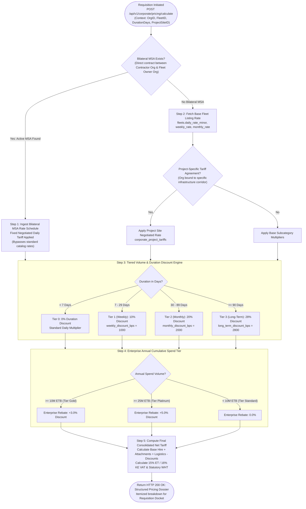
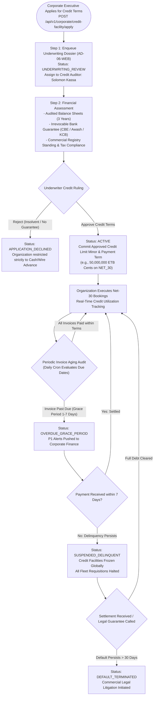
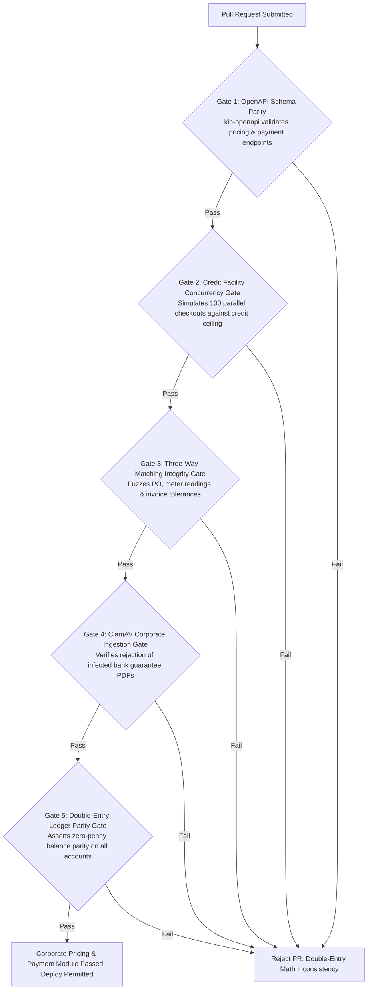

# Heavy Machinery & Logistics Rental Aggregator — Dink Machinery
## Software Requirements Specification — 06.03. Corporate Pricing, Credit Terms, Purchase Order (PO) Management & Net-30/60 Invoicing Architecture (`docs/shared/requirements/06-03-corporate-pricing-payment.md`)

**Document Identifier:** `SRS-DINK-CORE-V7.0-SEC-06-03`  
**Classification:** Canonical System Requirements Specification & Corporate Financial Engineering Baseline (Single Source of Truth)  
**Governing Standard:** IEEE Std 830-1998 / IEEE/ISO/IEC 29148:2018 (Systems and Software Engineering — Requirements Engineering)  
**Associated Artifacts:** `SRS-DINK-CORE-V7.0` (§5.2, §5.5, §5.7, §5.9, §6.0, §6.1, §6.2, §6.3, §8, §10, §12, §13.2), `FLOW-BOOKING-STATE-MACHINE-DINK-CORE-V7.0`, `FLOW-COMMISSION-DEBT-DINK-CORE-V7.0`, `FLOW-WIRE-DISPUTE-DINK-CORE-V7.0`, `ARCH-BACKEND-GO-DINK-CORE-V7.0`, `ARCH-FLUTTER-DINK-CORE-V7.0`, `ARCH-ADMIN-NEXT-DINK-CORE-V7.0`, `ARCH-SEC-DINK-CORE-V7.0`, `DS-DINK-CORE-V7.0`, `DS-PERSONAS-DINK-CORE-V7.0`, `contracts/openapi.yaml`, `ADR-001`, `ADR-002`, `ADR-004`, `ADR-005`, `ADR-008`, `ADR-010`  
**Target Runtimes:** Go 1.27.3 Backend Monolith, PostgreSQL 18.6 + PostGIS 3.6.4, Valkey 9.1.3, ClamAV Daemon (:3310), SeaweedFS S3, Flutter 3.47.8 / Dart 3.9 (Cross-Platform Mobile), Next.js 16.x (latest CVE security patch) / React 19 (Web Admin & Corporate Portal), Isar NoSQL 3.1+  
**Target Personas:** Corporate Procurement Director (*Eng. Samuel Getachew*), Finance Controller & Credit Underwriter (*Solomon Kassa*), Senior Project Manager (*Dawit Haile-Mariam*), Site Quantity Surveyor (*Bethlehem Tessema*), Corporate Fleet Owner Executive (*W/ro Almaz Tesfaye*), Compliance Officer & Legal Counsel (*Yohannes Bekele*), Super Administrator (*Rahel Tadesse*)  
**Target Operating Markets:** Ethiopia (`ET`) & Kenya (`KE`) — Dynamic Multi-Country Parameterization (`LOC-01-BE`)  
**Compliance Standards:** OWASP ASVS 4.0.3 Level 3 (Business Logic Integrity, Financial Ledger Non-Repudiation & Cryptographic Multi-Tenancy), RFC 9457 (Problem Details), ISO 9241-110, W3C WCAG 2.2 Level AAA (Field Mobile) & Level AA (Admin Web), Commercial Code of Ethiopia (Commercial Credit, Sales on Account & Invoice Recognition), National Bank of Ethiopia (NBE) Directives (Non-Custodial Settlements & Currency Controls), Kenya Companies Act 2015, Kenya Revenue Authority (KRA) Tax Procedures Act, International Financial Reporting Standards (IFRS 15 Revenue from Contracts & IFRS 16 Leases)  
**Status:** Approved Engineering Baseline

---

## Table of Contents

- 1. [Document Scope & Architectural Mandate](#1-document-scope--architectural-mandate)
  - 1.1 [Purpose & Functional Scope](#11-purpose--functional-scope)
  - 1.2 [Core Enterprise Financial Invariants](#12-core-enterprise-financial-invariants)
- 2. [Corporate Commercial Pricing & Rate Schedule Topology (`CORP-PRICE`)](#2-corporate-commercial-pricing--rate-schedule-topology-corp-price)
  - 2.1 [Dynamic Pricing Resolution Pipeline Flowchart](#21-dynamic-pricing-resolution-pipeline-flowchart)
  - 2.2 [Rate Resolution Precedence Matrix](#22-rate-resolution-precedence-matrix)
  - 2.3 [Tiered Volume Discounts & Long-Term Deployment Tariffs](#23-tiered-volume-discounts--long-term-deployment-tariffs)
  - 2.4 [Bilateral Enterprise Master Service Agreement (MSA) Rate Overrides](#24-bilateral-enterprise-master-service-agreement-msa-rate-overrides)
- 3. [Corporate Credit Underwriting & Net-30/60 Payment Terms (`CORP-CREDIT`)](#3-corporate-credit-underwriting--net-3060-payment-terms-corp-credit)
  - 3.1 [Underwriting Lifecycle State Machine (`CreditFacilityState`)](#31-underwriting-lifecycle-state-machine-creditfacilitystate)
  - 3.2 [Credit Facility Mechanics (Limit, Utilized, Pending, Available)](#32-credit-facility-mechanics-limit-utilized-pending-available)
  - 3.3 [Underwriting Dossier Ingestion & Bank Guarantee Verification](#33-underwriting-dossier-ingestion--bank-guarantee-verification)
  - 3.4 [Delinquency State Transitions, Grace Periods & Account Lockouts](#34-delinquency-state-transitions-grace-periods--account-lockouts)
- 4. [Purchase Order (PO) Management & Lifecycle Architecture (`CORP-PO`)](#4-purchase-order-po-management--lifecycle-architecture-corp-po)
  - 4.1 [Purchase Order Lifecycle State Machine (`POState`)](#41-purchase-order-lifecycle-state-machine-postate)
  - 4.2 [PO Balance Exhaustion & Partial Utilization Engine](#42-po-balance-exhaustion--partial-utilization-engine)
  - 4.3 [Mandatory Field Ingestion & ClamAV PDF Dossier Archival](#43-mandatory-field-ingestion--clamav-pdf-dossier-archival)
  - 4.4 [Three-Way Matching Invariant (PO vs. Shift Log vs. Tax Invoice)](#44-three-way-matching-invariant-po-vs-shift-log-vs-tax-invoice)
- 5. [Consolidated Net Invoicing, VAT Withholding & Multi-Currency Settlement (`CORP-INV`)](#5-consolidated-net-invoicing-vat-withholding--multi-currency-settlement-corp-inv)
  - 5.1 [Periodic Statement Consolidation (Calendar Month / Fortnightly)](#51-periodic-statement-consolidation-calendar-month--fortnightly)
  - 5.2 [Sovereign Tax Disclosures (15% Ethiopian VAT / 16% Kenyan VAT)](#52-sovereign-tax-disclosures-15-ethiopian-vat--16-kenyan-vat)
  - 5.3 [Withholding Tax (WHT) Deductions & Official Clearance Vouchers](#53-withholding-tax-wht-deductions--official-clearance-vouchers)
  - 5.4 [Non-Custodial Corporate Direct Bank Transfer Protocol](#54-non-custodial-corporate-direct-bank-transfer-protocol)
- 6. [Relational Database Schema & Data Modeling (`CORP-FIN-DB`)](#6-relational-database-schema--data-modeling-corp-fin-db)
  - 6.1 [Entity Relationship Diagram](#61-entity-relationship-diagram)
  - 6.2 [Data Definition Language (DDL) Table Specifications](#62-data-definition-language-ddl-table-specifications)
- 7. [Wire Protocol Contracts & RFC 9457 Error Schemas](#7-wire-protocol-contracts--rfc-9457-error-schemas)
  - 7.1 [`POST /api/v1/corporate/pricing/calculate`](#71-post-apiv1corporatepricingcalculate)
  - 7.2 [`POST /api/v1/corporate/credit-facility/apply`](#72-post-apiv1corporatecredit-facilityapply)
  - 7.3 [`POST /api/v1/corporate/purchase-orders`](#73-post-apiv1corporatepurchase-orders)
  - 7.4 [`POST /api/v1/corporate/invoices/{id}/settle`](#74-post-apiv1corporateinvoicesidsettle)
  - 7.5 [RFC 9457 Universal Problem Details Payloads](#75-rfc-9457-universal-problem-details-payloads)
- 8. [Automated Testing Suite & Verification Gates](#8-automated-testing-suite--verification-gates)

---

## 1. Document Scope & Architectural Mandate

### 1.1 Purpose & Functional Scope

This specification establishes **Section 06.03 (Corporate Pricing, Credit Terms, Purchase Order Management & Net-30/60 Invoicing Architecture)** of the canonical Software Requirements Specification (SRS) for **Dink Machinery Version 7.0**.

In large-scale East African civil infrastructure, mining, and commercial construction projects, corporate machinery procurement operates under fundamentally different financial mechanisms than retail cash-in-advance transactions:
* **The Scale of Capital Commitments:** Enterprise contractors (*e.g., Sur Construction, H-Young, Sogea-Satom*) rent multiple plant equipment assets simultaneously (crawler excavators, motor graders, lowboy haulage sets) across multi-month deployment schedules, resulting in single contract commitments exceeding $1,000,000.00\text{ to }10,000,000.00\text{ ETB}$ (or $2,000,000\text{ to }20,000,000\text{ KES}$).
* **Commercial Credit Norms (Net-30 / Net-60):** Tier-1 enterprises do not execute retail peer-to-peer mobile transfers or bank slips prior to equipment mobilization. Corporate procurement requires formal commercial credit terms—paying upon periodic consolidated invoice reconciliation on 30-day or 60-day cycles backed by corporate credit underwriting, collateral guarantees, or corporate credit insurance.
* **Corporate Purchase Order (PO) Binding:** Corporate finance policies forbid disbursement without binding against pre-authorized corporate Purchase Orders issued by ERP systems (SAP, Oracle Financials, Microsoft Dynamics). Every hour meter charge and transport run must cross-reference an active PO authorization docket.
* **Complex Multi-Jurisdictional Fiscal Deductions:** Corporate settlements require statutory tax withholding (*e.g., Ethiopian 2% or 30% Withholding Tax / 15% VAT, Kenyan 5% WHT / 16% VAT*), necessitating formal tax withholding certificates (*Ministry of Revenues / KRA*) to reconcile double-entry ledgers.

This document formally specifies:
1. The dynamic corporate pricing engine resolving tiered volume discounts, project-specific tariffs, and bilateral enterprise Master Service Agreement (MSA) rates.
2. The corporate credit facility architecture managing underwriting bounds, dynamic credit utilization counters, and automated delinquency locks.
3. The Purchase Order (PO) ingestion, tracking, and balance exhaustion engine enforcing three-way matching against daily shift hour meters.
4. The consolidated billing, VAT withholding reconciliation, and non-custodial multi-bank corporate wire settlement pipeline.

### 1.2 Core Enterprise Financial Invariants

1. **Non-Custodial Fund Flow Invariant (NBE / Central Bank Oversight):** Dink Machinery never holds, pools, or escrows corporate rental capital. All corporate invoice settlements flow directly from the contractor's commercial bank (*e.g., Commercial Bank of Ethiopia, Awash, KCB, Equity*) to the fleet owner's verified enterprise bank account. Dink Machinery calculates reconciliation deltas, tracks commission debt, and enforces digital compliance ledgers without touching gross capital.
2. **Three-Tier Credit Facility Barrier Invariant (`CORP-CREDIT`):** An enterprise cannot initiate an on-account booking unless:
   $$\text{FacilityState} = \text{'ACTIVE'} \quad \land \quad (\mathcal{C}_{\text{utilized}} + \mathcal{C}_{\text{pending}} + \mathcal{V}_{\text{new\_booking}}) \le \mathcal{C}_{\text{approved\_limit}}$$
   Attempting to checkout on Net-30/60 terms when the total commitment breaches the approved credit facility limit aborts synchronously with **RFC 9457 HTTP 403 Forbidden (`ERR_CORPORATE_CREDIT_LIMIT_EXCEEDED`)**.
3. **Three-Way Matching Invariant (IFRS 15 / Audit Floor):** A corporate invoice statement is legally payable and auditable **if and only if** there is exact mathematical congruence across three distinct data artifacts:
   $$\text{Authorized Purchase Order (PO)} \equiv \text{Verified Machine Meter Shift Logs} \equiv \text{Corporate Final Tax Invoice}$$
   Any variance in operating hours exceeding $\pm 0.1\text{ hours}$ or currency values exceeding $\pm 1\text{ minor unit}$ blocks automated invoice clearance.
4. **Integer Minor Unit Currency Representation:** All monetary balances, tariffs, discounts, credit ceilings, and tax withholdings are calculated and stored strictly as 64-bit integers representing currency minor units ($100\text{ Cents} = 1\text{ ETB}$ or $1\text{ KES}$). Floating-point arithmetic is strictly barred from all financial services.
5. **Double-Entry Financial Immutability Floor:** All adjustments to corporate credit limits, PO balances, invoice line items, and commission debts are committed to append-only immutable journal ledgers in PostgreSQL 18.6 (`corporate_credit_ledger`, `corporate_invoice_line_items`). Relational triggers enforce `ON UPDATE DO INSTEAD NOTHING` and `ON DELETE DO INSTEAD NOTHING`.

---

## 2. Corporate Commercial Pricing & Rate Schedule Topology (`CORP-PRICE`)

### 2.1 Dynamic Pricing Resolution Pipeline Flowchart



---

### 2.2 Rate Resolution Precedence Matrix

When a corporate requisition calculates pricing, the Go domain engine resolves rates using a strict precedence waterfall:

```text
+--------------------------------------------------------------------------------------------------+
| CORPORATE PRICING RESOLUTION PRECEDENCE WATERFALL                                                |
+------+---------------------------+-----------------------------------+---------------------------+
| RANK | PRICING STRATEGY          | RESOLUTION CRITERIA & SOURCE      | OVERRIDE BEHAVIOR         |
+------+---------------------------+-----------------------------------+---------------------------+
| 1    | Bilateral MSA Contract    | Active bilateral agreement        | Supercedes all public and |
|      | Negotiated Rate (Highest) | between Contractor Org and Owner  | project rates. Absolute.  |
+------+---------------------------+-----------------------------------+---------------------------+
| 2    | Project Corridor Tariff   | Organization bound to specific    | Overrides public catalog  |
|      | Agreement                 | Project Site (e.g., LAPSSET Lot 2)| listing rates.            |
+------+---------------------------+-----------------------------------+---------------------------+
| 3    | Long-Term Duration Tier   | Duration >= 30 Days (Monthly) or  | System applies published  |
|      | Discount                  | >= 90 Days (Quarterly Deployment) | duration discount curves. |
+------+---------------------------+-----------------------------------+---------------------------+
| 4    | Enterprise Volume Rebate  | Cumulative 12-month platform      | Applied as basis points   |
|      | Tier (Gold / Platinum)    | spend >= threshold                | deduction on final net.   |
+------+---------------------------+-----------------------------------+---------------------------+
| 5    | Base Public Listing Tariff| Default daily hire rate published | Baseline floor.           |
|      | (Lowest Precedence)       | on `fleets.daily_rate_minor`      |                           |
+--------------------------------------------------------------------------------------------------+
```

---

### 2.3 Tiered Volume Discounts & Long-Term Deployment Tariffs

Heavy earthmoving civil contracts span months or years. Dink Machinery formalizes long-term deployment discounting:
* **Duration Discount Formula:**
  $$\mathcal{T}_{\text{base}} = \text{DailyRate} \times \Delta_{\text{days}}$$
  $$\mathcal{D}_{\text{duration}} = \mathcal{T}_{\text{base}} \times \left( \frac{\text{DiscountBasisPoints}}{10,000} \right)$$
* **Published Duration Thresholds:**
  - $\Delta_{\text{days}} \ge 7\text{ Days (Weekly)} \longrightarrow \mathbf{1,000\text{ bps}}\ (10.0\%)$
  - $\Delta_{\text{days}} \ge 30\text{ Days (Monthly)} \longrightarrow \mathbf{2,000\text{ bps}}\ (20.0\%)$
  - $\Delta_{\text{days}} \ge 90\text{ Days (Quarterly)} \longrightarrow \mathbf{2,800\text{ bps}}\ (28.0\%)$
  - $\Delta_{\text{days}} \ge 180\text{ Days (Multi-Season)} \longrightarrow \mathbf{3,500\text{ bps}}\ (35.0\%)$
* **Overtime Protection Invariant:** Duration discounts apply strictly to the baseline shift hire ($8.0\text{ hrs/day}$). Excess hour meter overruns are billed at the standard hourly overtime tariff without duration discount erosion.

---

### 2.4 Bilateral Enterprise Master Service Agreement (MSA) Rate Overrides

Large construction contractors often maintain pre-negotiated bilateral agreements with major fleet leasing depots (*e.g., Sur Construction leasing 20 excavators from Tesfaye Heavy Plant PLC*):
* A bilateral MSA record is registered in `corporate_msa_contracts`:
  - Contractor Organization UUID, Fleet Owner Organization UUID, Valid Date Range, Jurisdiction.
  - Rate Schedule Table: maps specific machine subcategories (`cat_sub_excavator_std`) to fixed, agreed daily and hourly rates in minor units.
* When a requester under that corporate tenant initiates checkout for any machine owned by that specific fleet owner, the system intercepts the public rate and automatically injects the negotiated MSA tariff.

---

## 3. Corporate Credit Underwriting & Net-30/60 Payment Terms (`CORP-CREDIT`)

### 3.1 Underwriting Lifecycle State Machine (`CreditFacilityState`)

A corporate organization cannot transact on credit terms until formally underwritten:



---

### 3.2 Credit Facility Mechanics (Limit, Utilized, Pending, Available)

Every active corporate credit facility is governed by strict mathematical allocation:

$$\mathcal{C}_{\text{available}} = \mathcal{C}_{\text{approved\_limit}} - \left( \mathcal{C}_{\text{utilized}} + \mathcal{C}_{\text{pending\_approvals}} \right)$$

```text
+--------------------------------------------------------------------------------------------------+
| CREDIT FACILITY ACCOUNTING BOUNDS SPECIFICATION                                                  |
+---------------------+-------------+--------------------------------------------------------------+
| PARAMETER KEY       | DATA TYPE   | OPERATIONAL ACCOUNTING DEFINITION                            |
+---------------------+-------------+--------------------------------------------------------------+
| approved_limit_     | BigInt      | Maximum total credit ceiling authorized by underwriter       |
| minor               |             | (e.g., 50,000,000 minor units = 500,000.00 ETB).             |
+---------------------+-------------+--------------------------------------------------------------+
| utilized_balance_   | BigInt      | Sum of all un-paid confirmed bookings, active hires, and     |
| minor               |             | outstanding un-settled consolidated tax invoices.            |
+---------------------+-------------+--------------------------------------------------------------+
| pending_approvals_  | BigInt      | Total commitment value of all requisitions currently in      |
| minor               |             | flight within corporate approval chains (`PENDING_APPROVAL`).|
+---------------------+-------------+--------------------------------------------------------------+
| available_balance_  | BigInt      | Real-time liquid credit allowance remaining for new          |
| minor               |             | equipment requisitions.                                      |
+---------------------+-------------+--------------------------------------------------------------+
| payment_terms       | Enum        | Strictly NET_15, NET_30, or NET_60 calendar days from invoice|
|                     |             | issuance.                                                    |
+--------------------------------------------------------------------------------------------------+
```

---

### 3.3 Underwriting Dossier Ingestion & Bank Guarantee Verification

To qualify for credit terms exceeding $1,000,000.00\text{ ETB}$, an enterprise must submit verified security:
* **Irrevocable Bank Guarantee (Letter of Credit / SBLC):**
  - Issued by an authorized Tier-1 financial institution (*Commercial Bank of Ethiopia, Awash International Bank, Dashen Bank, KCB Kenya*).
  - Encrypted and archived in SeaweedFS S3 (`s3://dink-corporate-vault/{org_id}/guarantees/`).
  - The Go backend tracks guarantee expiration dates. 30 days prior to expiry, the system prompts for renewal; if un-renewed upon expiration, the credit facility automatically suspends.
* **Audited Financial Statements:** 3 prior fiscal years stamped by a certified public accounting firm.

---

### 3.4 Delinquency State Transitions, Grace Periods & Account Lockouts

When an invoice reaches its statutory due date without verified settlement:
1. **Day 0 (Due Date):** System emits invoice due notice via email and high-priority push to Corporate Admin and Finance Controller.
2. **Day 1 to 7 (Grace Period):** Status transitions to `OVERDUE_GRACE_PERIOD`. Requesters can still draft requisitions, but a persistent amber warning banner displays on all corporate mobile and web dashboards.
3. **Day 8 (Delinquency Lockout):** Status transitions to `SUSPENDED_DELINQUENT`.
   - All corporate purchasing authority is locked.
   - Any booking requisition in `PENDING_APPROVAL` is aborted.
   - Valkey hold leases are released immediately.
   - Corporate identity is de-indexed from credit terms across the marketplace.

---

## 4. Purchase Order (PO) Management & Lifecycle Architecture (`CORP-PO`)

### 4.1 Purchase Order Lifecycle State Machine (`POState`)

Enterprise accounting controls mandate that all equipment rentals bind to a valid corporate Purchase Order:

```text
+----------------------------------------------------------------------------------------------------+
| PURCHASE ORDER (PO) LIFECYCLE TRANSITION MATRIX                                                    |
+------------------------------------+---------------------------------------------------------------+
| SOURCE STATE                       | PERMITTED TARGET STATES                                       |
+------------------------------------+---------------------------------------------------------------+
| DRAFT                              | ACTIVE, CANCELLED                                             |
| ACTIVE                             | PARTIALLY_UTILIZED, EXHAUSTED, EXPIRED, CANCELLED              |
| PARTIALLY_UTILIZED                 | EXHAUSTED, EXPIRED, CANCELLED                                 |
| EXHAUSTED                          | ARCHIVED (When all linked bookings settle)                    |
| EXPIRED                            | ARCHIVED (Balance released back to corporate budget)          |
| CANCELLED                          | ARCHIVED (Un-utilized commitments released)                   |
| ARCHIVED                           | [Terminal State — Permanent Accounting Ledger Record]         |
+------------------------------------+---------------------------------------------------------------+
```

---

### 4.2 PO Balance Exhaustion & Partial Utilization Engine

A single corporate Purchase Order can serve as a multi-asset umbrella commitment:
* **Blanket Purchase Order Support:** An enterprise issues a Blanket PO (*e.g., PO #SUR-2026-HW-412*) authorized for $2,500,000.00\text{ ETB}$ earmarked for earthmoving on a specific highway segment.
* **Drawdown Mechanics:**
  1. As individual excavator and dozer bookings are confirmed, the system deducts the estimated hire commitment from `po_remaining_amount_minor`:
     $$\mathcal{PO}_{\text{remaining}} = \mathcal{PO}_{\text{total}} - \sum \mathcal{V}_{\text{linked\_bookings}}$$
  2. If a proposed requisition exceeds $\mathcal{PO}_{\text{remaining}}$, the booking checkout blocks, requiring either:
     - Selecting an alternative active PO with sufficient balance.
     - Issuing a formal PO amendment increasing the ceiling.
     - Splitting the requisition commitment across two distinct POs.

---

### 4.3 Mandatory Field Ingestion & ClamAV PDF Dossier Archival

When a corporate user registers a new Purchase Order:
* **Mandatory Parameters:**
  - PO Reference Number (e.g., `PO-2026-09941-ET`).
  - Total Authorized Amount in Minor Units.
  - Linked Project Site / Cost Center Code.
  - Authorized Category Scope (`ALL` or specific subcategories like `cat_sub_excavator_std`).
  - Expiry Date (Statutory validity window).
* **Binary Ingestion Pipeline:**
  The official stamped PDF generated by the enterprise ERP is uploaded via multipart stream, scanned in-flight via ClamAV TCP socket `:3310`, and archived in SeaweedFS S3 (`s3://dink-corporate-vault/{org_id}/pos/`).

---

### 4.4 Three-Way Matching Invariant (PO vs. Shift Log vs. Tax Invoice)

Before an invoice line item can be finalized for settlement:
* The Go accounting worker executes automated **Three-Way Matching**:
  1. **Document 1 (PO):** Asserts that the rate and authorized line-item cap match the initial Purchase Order authorization.
  2. **Document 2 (Shift Logs):** Asserts that billed machine hours match the cryptographically signed and verified return hour meter logs (`AR-03`, `RC-02` / SRS 05.06).
  3. **Document 3 (Tax Invoice):** Asserts that the generated invoice line items, tax calculations, and net totals reflect the exact arithmetic sum of verified shifts.
* If any discrepancy exists, the invoice is tagged `DISCREPANCY_REVIEW`, routing to the internal corporate audit workbench.

---

## 5. Consolidated Net Invoicing, VAT Withholding & Multi-Currency Settlement (`CORP-INV`)

### 5.1 Periodic Statement Consolidation (Calendar Month / Fortnightly)

Instead of requiring dozens of isolated wire transfers for individual machine shifts:
* On the statement closing date (e.g., 25th of each calendar month), the billing engine compiles all completed, reconciled rentals into a single **Consolidated Corporate Invoice Statement**.
* The consolidated invoice aggregates:
  - Machinery Base Hire Run Times across all active project sites.
  - Mobilization and Demobilization Lowboy Haulage Sub-Bookings.
  - Excess Hour Overtime Charges verified via shift telemetry.
  - Approved Fuel Deductions and Field Maintenance Credits.

---

### 5.2 Sovereign Tax Disclosures (15% Ethiopian VAT / 16% Kenyan VAT)

Invoicing engines enforce sovereign fiscal compliance:
* **Ethiopian Fiscal Regulations (`country_code = 'ET'`):**
  - Standard Value Added Tax (VAT): Exactly **$15.0\%$** calculated on gross rental value:
    $$\text{VAT}_{\text{ET}} = \left\lfloor \text{SubtotalMinor} \times \frac{15}{100} \right\rfloor$$
  - Invoices render the supplier's verified Ministry of Revenues TIN and VAT Registration Certificate Number.
* **Kenyan Fiscal Regulations (`country_code = 'KE'`):**
  - Standard Value Added Tax (VAT): Exactly **$16.0\%$**:
    $$\text{VAT}_{\text{KE}} = \left\lfloor \text{SubtotalMinor} \times \frac{16}{100} \right\rfloor$$
  - Invoices render the KRA Electronic Tax Invoice Management System (eTIMS) QR code metadata for automated tax deduction verification.

---

### 5.3 Withholding Tax (WHT) Deductions & Official Clearance Vouchers

Under East African commercial law, corporate entities are legally designated tax withholding agents:
* **Withholding Tax Mechanics:**
  - **Ethiopia:** Corporate contractors must withhold **$2.0\%$** (goods/leasing) from payments made to resident suppliers.
  - **Kenya:** Corporate contractors withhold **$5.0\%$** on contractual plant hire leasing.
* **Net Settlement Formulation:**
  $$\text{InvoiceTotal} = \text{Subtotal} + \text{VAT}$$
  $$\text{PayableToOwner} = \text{InvoiceTotal} - \text{WithholdingTax}$$
* **WHT Voucher Upload Barrier:** When settling the invoice, the contractor's finance department uploads the official government **Withholding Tax Credit Voucher** (*Ministry of Revenues Form / KRA WHT Receipt*). The platform credits the withholding deduction on the owner's tax balance ledger, ensuring the fleet owner can claim credit during corporate tax filing.

---

### 5.4 Non-Custodial Corporate Direct Bank Transfer Protocol

Corporate settlements execute via direct enterprise bank channels:

```text
+--------------------------------------------------------------------------------------------------+
| NON-CUSTODIAL CORPORATE SETTLEMENT EXECUTION FLOW                                                |
+------+--------------------------+----------------------------------------------------------------+
| STEP | ACTOR                    | OPERATIONAL & TECHNICAL BEHAVIOR                               |
+------+--------------------------+----------------------------------------------------------------+
| 1    | Contractor Finance Dept  | Inspects Consolidated Invoice #INV-2026-0812 in Next.js portal |
|      | (Bethlehem / Solomon)    | Downloads approved bank payment instruction sheet with exact   |
|      |                          | owner bank coordinates (CBE, Awash, KCB, Equity).              |
+------+--------------------------+----------------------------------------------------------------+
| 2    | Contractor Core Banking  | Executes direct RTGS / ACH corporate wire from company account |
|      |                          | directly to Fleet Owner's registered enterprise account.       |
+------+--------------------------+----------------------------------------------------------------+
| 3    | Contractor Finance Dept  | Uploads stamped bank debit advice / RTGS confirmation slip     |
|      |                          | + Withholding Tax Certificate via POST /api/v1/corporate/settle|
+------+--------------------------+----------------------------------------------------------------+
| 4    | Fleet Owner Executive    | Receives P0 settlement notification. Reconciles wire in core   |
|      | (Almaz Tesfaye)          | banking portal. Confirms receipt on Next.js corporate console. |
+------+--------------------------+----------------------------------------------------------------+
| 5    | Dink Machinery Engine    | Invoice marks SETTLED. Re-credits contractor's available credit|
|      |                          | facility balance. Calculates and assesses platform commission  |
|      |                          | debt on fleet owner's virtual wallet (FLOW-COMMISSION-DEBT).   |
+--------------------------------------------------------------------------------------------------+
```

---

## 6. Relational Database Schema & Data Modeling (`CORP-FIN-DB`)

### 6.1 Entity Relationship Diagram

```mermaid
erDiagram
    Organization ||--o{ CorporateCreditFacility : "holds"
    Organization ||--o{ CorporatePurchaseOrder : "issues"
    Organization ||--o{ CorporateInvoiceStatement : "billed to"
    CorporateCreditFacility ||--o{ CorporateCreditLedgerEntry : "logs"
    CorporatePurchaseOrder ||--o{ CorporatePurchaseOrderAllocation : "allocates"
    CorporateInvoiceStatement ||--o{ CorporateInvoiceLineItem : "contains"
    Booking ||--o{ CorporatePurchaseOrderAllocation : "binds"
    Booking ||--o{ CorporateInvoiceLineItem : "materializes"

    CorporateCreditFacility {
        uuid id PK
        uuid organization_id FK UK
        string facility_state -- 'PENDING_REVIEW', 'ACTIVE', 'OVERDUE_GRACE_PERIOD', 'SUSPENDED_DELINQUENT'
        string payment_terms -- 'NET_15', 'NET_30', 'NET_60'
        bigint approved_limit_minor
        bigint utilized_balance_minor
        bigint pending_balance_minor
        string bank_guarantee_ref
        date guarantee_expiry_date
        uuid underwritten_by_admin_id FK
        timestamptz approved_at
        timestamptz updated_at
    }

    CorporateCreditLedgerEntry {
        uuid id PK
        uuid facility_id FK
        string entry_type -- 'ALLOCATION_HOLD', 'RELEASE_HOLD', 'DRAWDOWN_SETTLE', 'LIMIT_ADJUSTMENT'
        bigint amount_minor
        bigint resulting_utilized_minor
        uuid related_booking_id FK NULL
        uuid related_invoice_id FK NULL
        string notes
        timestamptz created_at
    }

    CorporatePurchaseOrder {
        uuid id PK
        uuid organization_id FK
        string po_number UK
        string currency -- 'ETB', 'KES'
        bigint total_amount_minor
        bigint remaining_amount_minor
        date expiration_date
        string status -- 'ACTIVE', 'PARTIALLY_UTILIZED', 'EXHAUSTED', 'EXPIRED', 'CANCELLED'
        string s3_document_uri
        uuid created_by_user_id FK
        timestamptz created_at
        timestamptz updated_at
    }

    CorporatePurchaseOrderAllocation {
        uuid id PK
        uuid purchase_order_id FK
        uuid booking_id FK
        bigint allocated_amount_minor
        string status -- 'HELD', 'COMMITTED', 'RELEASED'
        timestamptz allocated_at
    }

    CorporateInvoiceStatement {
        uuid id PK
        uuid debtor_organization_id FK
        uuid creditor_organization_id FK
        string invoice_number UK
        string currency
        date billing_period_start
        date billing_period_end
        date payment_due_date
        bigint subtotal_minor
        bigint vat_amount_minor
        bigint withholding_tax_minor
        bigint net_payable_minor
        string status -- 'DRAFT', 'ISSUED', 'DISCREPANCY_REVIEW', 'PAYMENT_PENDING_REVIEW', 'SETTLED', 'DELINQUENT'
        string s3_invoice_pdf_uri
        string s3_wht_voucher_uri NULL
        timestamptz settled_at
        timestamptz created_at
    }

    CorporateInvoiceLineItem {
        uuid id PK
        uuid invoice_id FK
        uuid booking_id FK
        string line_item_type -- 'BASE_HIRE', 'OVERTIME_HOURS', 'LOWBOY_TRANSPORT', 'FUEL_CREDIT'
        decimal quantity
        bigint unit_rate_minor
        bigint total_line_minor
        string description
    }
```

---

### 6.2 Data Definition Language (DDL) Table Specifications

```sql
-- 1. Corporate Credit Facilities Table
CREATE TABLE corporate_credit_facilities (
    id UUID PRIMARY KEY DEFAULT gen_random_uuid(),
    organization_id UUID NOT NULL UNIQUE REFERENCES organizations(id) ON DELETE CASCADE,
    facility_state VARCHAR(32) NOT NULL DEFAULT 'PENDING_REVIEW',
    payment_terms VARCHAR(16) NOT NULL DEFAULT 'NET_30',
    approved_limit_minor BIGINT NOT NULL DEFAULT 0,
    utilized_balance_minor BIGINT NOT NULL DEFAULT 0,
    pending_balance_minor BIGINT NOT NULL DEFAULT 0,
    bank_guarantee_ref VARCHAR(128) NULL,
    guarantee_expiry_date DATE NULL,
    underwritten_by_admin_id UUID NULL REFERENCES users(id) ON DELETE RESTRICT,
    approved_at TIMESTAMPTZ NULL,
    updated_at TIMESTAMPTZ NOT NULL DEFAULT NOW(),
    CONSTRAINT chk_facility_state CHECK (facility_state IN ('PENDING_REVIEW', 'ACTIVE', 'OVERDUE_GRACE_PERIOD', 'SUSPENDED_DELINQUENT', 'DEFAULT_TERMINATED')),
    CONSTRAINT chk_payment_terms CHECK (payment_terms IN ('NET_15', 'NET_30', 'NET_60')),
    CONSTRAINT chk_utilized_bounds CHECK (utilized_balance_minor >= 0),
    CONSTRAINT chk_pending_bounds CHECK (pending_balance_minor >= 0)
);

CREATE INDEX idx_credit_facilities_state ON corporate_credit_facilities (facility_state);

-- 2. Corporate Credit Ledger Table (Immutable Double-Entry Journal)
CREATE TABLE corporate_credit_ledger (
    id UUID PRIMARY KEY DEFAULT gen_random_uuid(),
    facility_id UUID NOT NULL REFERENCES corporate_credit_facilities(id) ON DELETE RESTRICT,
    entry_type VARCHAR(32) NOT NULL,
    amount_minor BIGINT NOT NULL,
    resulting_utilized_minor BIGINT NOT NULL,
    related_booking_id UUID NULL REFERENCES bookings(id) ON DELETE RESTRICT,
    related_invoice_id UUID NULL,
    notes TEXT NULL,
    created_at TIMESTAMPTZ NOT NULL DEFAULT NOW(),
    CONSTRAINT chk_ledger_entry_type CHECK (entry_type IN ('ALLOCATION_HOLD', 'RELEASE_HOLD', 'DRAWDOWN_SETTLE', 'LIMIT_ADJUSTMENT'))
);

CREATE RULE prevent_credit_ledger_update AS ON UPDATE TO corporate_credit_ledger DO INSTEAD NOTHING;
CREATE RULE prevent_credit_ledger_delete AS ON DELETE TO corporate_credit_ledger DO INSTEAD NOTHING;

-- 3. Corporate Purchase Orders Table
CREATE TABLE corporate_purchase_orders (
    id UUID PRIMARY KEY DEFAULT gen_random_uuid(),
    organization_id UUID NOT NULL REFERENCES organizations(id) ON DELETE CASCADE,
    po_number VARCHAR(64) NOT NULL,
    currency VARCHAR(3) NOT NULL CHECK (currency IN ('ETB', 'KES')),
    total_amount_minor BIGINT NOT NULL CHECK (total_amount_minor > 0),
    remaining_amount_minor BIGINT NOT NULL,
    expiration_date DATE NOT NULL,
    status VARCHAR(32) NOT NULL DEFAULT 'ACTIVE',
    s3_document_uri VARCHAR(512) NOT NULL,
    created_by_user_id UUID NOT NULL REFERENCES users(id) ON DELETE RESTRICT,
    created_at TIMESTAMPTZ NOT NULL DEFAULT NOW(),
    updated_at TIMESTAMPTZ NOT NULL DEFAULT NOW(),
    CONSTRAINT chk_po_status CHECK (status IN ('ACTIVE', 'PARTIALLY_UTILIZED', 'EXHAUSTED', 'EXPIRED', 'CANCELLED', 'ARCHIVED')),
    CONSTRAINT chk_po_remaining CHECK (remaining_amount_minor >= 0 AND remaining_amount_minor <= total_amount_minor),
    CONSTRAINT uq_org_po_number UNIQUE (organization_id, UPPER(po_number))
);

CREATE INDEX idx_purchase_orders_org ON corporate_purchase_orders (organization_id, status);

-- 4. Corporate Purchase Order Allocations Table
CREATE TABLE corporate_po_allocations (
    id UUID PRIMARY KEY DEFAULT gen_random_uuid(),
    purchase_order_id UUID NOT NULL REFERENCES corporate_purchase_orders(id) ON DELETE RESTRICT,
    booking_id UUID NOT NULL REFERENCES bookings(id) ON DELETE RESTRICT,
    allocated_amount_minor BIGINT NOT NULL CHECK (allocated_amount_minor > 0),
    status VARCHAR(16) NOT NULL DEFAULT 'HELD',
    allocated_at TIMESTAMPTZ NOT NULL DEFAULT NOW(),
    CONSTRAINT chk_po_alloc_status CHECK (status IN ('HELD', 'COMMITTED', 'RELEASED')),
    CONSTRAINT uq_po_booking UNIQUE (purchase_order_id, booking_id)
);

-- 5. Consolidated Corporate Invoice Statements Table
CREATE TABLE corporate_invoice_statements (
    id UUID PRIMARY KEY DEFAULT gen_random_uuid(),
    debtor_organization_id UUID NOT NULL REFERENCES organizations(id) ON DELETE RESTRICT,
    creditor_organization_id UUID NOT NULL REFERENCES organizations(id) ON DELETE RESTRICT,
    invoice_number VARCHAR(64) NOT NULL UNIQUE,
    currency VARCHAR(3) NOT NULL CHECK (currency IN ('ETB', 'KES')),
    billing_period_start DATE NOT NULL,
    billing_period_end DATE NOT NULL,
    payment_due_date DATE NOT NULL,
    subtotal_minor BIGINT NOT NULL CHECK (subtotal_minor >= 0),
    vat_amount_minor BIGINT NOT NULL CHECK (vat_amount_minor >= 0),
    withholding_tax_minor BIGINT NOT NULL DEFAULT 0 CHECK (withholding_tax_minor >= 0),
    net_payable_minor BIGINT NOT NULL CHECK (net_payable_minor >= 0),
    status VARCHAR(32) NOT NULL DEFAULT 'ISSUED',
    s3_invoice_pdf_uri VARCHAR(512) NOT NULL,
    s3_wht_voucher_uri VARCHAR(512) NULL,
    settled_at TIMESTAMPTZ NULL,
    created_at TIMESTAMPTZ NOT NULL DEFAULT NOW(),
    CONSTRAINT chk_invoice_status CHECK (status IN ('DRAFT', 'ISSUED', 'DISCREPANCY_REVIEW', 'PAYMENT_PENDING_REVIEW', 'SETTLED', 'DELINQUENT'))
);

CREATE INDEX idx_invoices_debtor ON corporate_invoice_statements (debtor_organization_id, status);
CREATE INDEX idx_invoices_due_date ON corporate_invoice_statements (payment_due_date) WHERE status = 'ISSUED';
```

---

## 7. Wire Protocol Contracts & RFC 9457 Error Schemas

### 7.1 `POST /api/v1/corporate/pricing/calculate`

Calculates customized enterprise pricing, evaluating volume discount curves, project site tariffs, and bilateral MSA overrides.

#### Request Headers
```http
POST /api/v1/corporate/pricing/calculate HTTP/1.1
Host: api.dinkmachinery.com
Content-Type: application/json
Authorization: Bearer <corporateUserAccessToken>
X-Organization-ID: org_019a8fe0-8812-7b9a-bc21-4491204812aa
```

#### Request Payload
```json
{
  "fleetId": "flt_019a8f2c-8812-7b9a",
  "projectSiteId": "sit_019a8fc0-4412",
  "startDate": "2026-11-01",
  "endDate": "2026-11-30",
  "includeOperator": true,
  "bundledAttachmentIds": [
    "att_019a8f4c-8812"
  ]
}
```

#### Response: `HTTP 200 OK`
```json
{
  "success": true,
  "data": {
    "calculationId": "calc_019a8ff0-1123",
    "currency": "ETB",
    "durationDays": 30,
    "appliedPricingStrategy": "BILATERAL_MSA_OVERRIDE",
    "contractReference": "MSA-SUR-TESFAYE-2026-B",
    "baseDailyRateMinor": 2250000,
    "negotiatedDailyRateMinor": 1800000,
    "rateBreakdown": {
      "machineryBaseHireMinor": 54000000,
      "bundledAttachmentsMinor": 4500000,
      "operatorServicesMinor": 9000000,
      "grossSubtotalMinor": 67500000,
      "durationDiscountMinor": 13500000,
      "netSubtotalMinor": 54000000,
      "vatRatePercent": 15.0,
      "vatAmountMinor": 8100000,
      "statutoryWithholdingTaxPercent": 2.0,
      "withholdingTaxMinor": 1080000,
      "totalCommitmentMinor": 62100000,
      "netPayableUponInvoiceMinor": 61020000
    },
    "creditEligibility": {
      "canChargeToCreditFacility": true,
      "paymentTerms": "NET_30",
      "availableCreditMinor": 3850000000
    }
  },
  "timestamp": "2026-10-29T10:30:00Z"
}
```

---

### 7.2 `POST /api/v1/corporate/credit-facility/apply`

Submits an enterprise credit facility underwriting application backed by bank guarantees.

#### Request Headers
```http
POST /api/v1/corporate/credit-facility/apply HTTP/1.1
Host: api.dinkmachinery.com
Content-Type: multipart/form-data
Authorization: Bearer <corporateAdminAccessToken>
X-Organization-ID: org_019a8fe0-8812-7b9a-bc21-4491204812aa
Idempotency-Key: 77182a01-5c12-4f9a-8812-7b9a4c10bc21
```

#### Multipart Form Body
* `requestedLimitMinor`: BigInt (`5000000000`)
* `requestedPaymentTerms`: String (`"NET_30"`)
* `bankGuaranteeReference`: String (`"CBE-LG-2026-99412"`)
* `bankGuaranteeExpiryDate`: String (`"2027-10-29"`)
* `guaranteeDocument`: Binary Stream (PDF, scanned in-flight via ClamAV socket `:3310`)
* `auditedFinancialsDocument`: Binary Stream (PDF, scanned in-flight via ClamAV socket `:3310`)

#### Response: `HTTP 201 Created`
```json
{
  "success": true,
  "data": {
    "facilityId": "fac_019a8fe0-4412",
    "organizationId": "org_019a8fe0-8812-7b9a-bc21-4491204812aa",
    "status": "PENDING_REVIEW",
    "requestedLimitMinor": 5000000000,
    "paymentTerms": "NET_30",
    "underwritingDocketId": "und_019a8fe5-8812",
    "targetDecisionHours": 48,
    "createdAt": "2026-10-29T10:35:00Z"
  },
  "timestamp": "2026-10-29T10:35:01Z"
}
```

---

### 7.3 `POST /api/v1/corporate/purchase-orders`

Registers a corporate Purchase Order issued by the enterprise ERP.

#### Request Headers
```http
POST /api/v1/corporate/purchase-orders HTTP/1.1
Host: api.dinkmachinery.com
Content-Type: multipart/form-data
Authorization: Bearer <corporateAdminAccessToken>
X-Organization-ID: org_019a8fe0-8812-7b9a-bc21-4491204812aa
```

#### Multipart Form Body
* `poNumber`: String (`"PO-SUR-2026-HW-412"`)
* `totalAmountMinor`: BigInt (`2500000000`)
* `currency`: String (`"ETB"`)
* `expirationDate`: String (`"2027-04-30"`)
* `poDocumentPdf`: Binary Stream (PDF, scanned in-flight via ClamAV socket `:3310`)

#### Response: `HTTP 201 Created`
```json
{
  "success": true,
  "data": {
    "purchaseOrderId": "po_019a8fe8-3341",
    "poNumber": "PO-SUR-2026-HW-412",
    "totalAmountMinor": 2500000000,
    "remainingAmountMinor": 2500000000,
    "currency": "ETB",
    "status": "ACTIVE",
    "expiresAt": "2027-04-30",
    "createdAt": "2026-10-29T10:40:00Z"
  },
  "timestamp": "2026-10-29T10:40:01Z"
}
```

---

### 7.4 `POST /api/v1/corporate/invoices/{id}/settle`

Submits non-custodial direct bank transfer evidence and statutory tax withholding certificates.

#### Request Headers
```http
POST /api/v1/corporate/invoices/inv_019a8fe9-7712/settle HTTP/1.1
Host: api.dinkmachinery.com
Content-Type: multipart/form-data
Authorization: Bearer <corporateAdminAccessToken>
X-Organization-ID: org_019a8fe0-8812-7b9a-bc21-4491204812aa
Idempotency-Key: 99182a01-5c12-4f9a-8812-7b9a4c10bc21
```

#### Multipart Form Body
* `bankCarrier`: String (`"COMMERCIAL_BANK_OF_ETHIOPIA"`)
* `transactionReference`: String (`"CBE-RTGS-99482103"`)
* `settledAmountMinor`: BigInt (`61020000`)
* `withholdingTaxAmountMinor`: BigInt (`1080000`)
* `paymentDebitAdvicePdf`: Binary Stream (PDF / WebP, ClamAV scanned)
* `whtVoucherDocumentPdf`: Binary Stream (PDF / WebP, ClamAV scanned)

#### Response: `HTTP 200 OK`
```json
{
  "success": true,
  "data": {
    "invoiceId": "inv_019a8fe9-7712",
    "status": "PAYMENT_PENDING_REVIEW",
    "settledAmountMinor": 61020000,
    "withholdingTaxAmountMinor": 1080000,
    "ownerNotified": true,
    "reviewSlaHours": 24,
    "submittedAt": "2026-10-29T10:45:00Z"
  },
  "timestamp": "2026-10-29T10:45:01Z"
}
```

---

### 7.5 RFC 9457 Universal Problem Details Payloads

#### Example: Credit Facility Limit Exceeded (`HTTP 403 Forbidden`)
```json
{
  "type": "[https://api.dinkmachinery.com/errors/corporate-credit-limit-exceeded](https://api.dinkmachinery.com/errors/corporate-credit-limit-exceeded)",
  "title": "Corporate Credit Facility Limit Exceeded",
  "status": 403,
  "detail": "Proposed requisition commitment of 62,100.00 ETB exceeds available facility credit (available: 38,500.00 ETB, limit: 500,000.00 ETB). Please settle outstanding invoices or submit payment via cash wire.",
  "instance": "/api/v1/corporate/bookings/checkout",
  "code": "ERR_CORPORATE_CREDIT_LIMIT_EXCEEDED",
  "correlationId": "cor_019a8fe0-8812-7b9a-bc21-4491204812aa",
  "timestamp": "2026-10-29T10:30:05Z",
  "invalidParams": [
    {
      "name": "totalCommitmentMinor",
      "reason": "Available facility credit is 3850000 minor units, but 6210000 minor units are required."
    }
  ],
  "links": {
    "outstandingInvoices": "/api/v1/corporate/invoices?status=ISSUED",
    "creditAdjustmentRequest": "/api/v1/corporate/credit-facility/apply"
  }
}
```

#### Example: Purchase Order Balance Exhausted (`HTTP 409 Conflict`)
```json
{
  "type": "[https://api.dinkmachinery.com/errors/po-balance-exhausted](https://api.dinkmachinery.com/errors/po-balance-exhausted)",
  "title": "Purchase Order Authorized Balance Exhausted",
  "status": 409,
  "detail": "Purchase Order 'PO-SUR-2026-HW-412' has an unallocated balance of 120,000.00 ETB, which is insufficient for requisition commitment of 180,000.00 ETB.",
  "instance": "/api/v1/corporate/bookings/checkout",
  "code": "ERR_PO_BALANCE_INSUFFICIENT",
  "correlationId": "cor_019a8fe0-9914-4c12-8812-7b9a4c10bc21",
  "timestamp": "2026-10-29T10:40:05Z",
  "invalidParams": [
    {
      "name": "purchaseOrderId",
      "reason": "Remaining PO balance: 12000000 minor units. Required: 18000000 minor units."
    }
  ]
}
```

---

## 8. Automated Testing Suite & Verification Gates



1. **OpenAPI Schema Contract Gate (`kin-openapi`):** Validates all pricing calculation, credit application, purchase order management, and invoice settlement endpoints against `contracts/openapi.yaml`.
2. **Credit Facility Concurrency & Race-Condition Gate:** Dispatches 100 simultaneous concurrent checkout requests across multiple goroutines against an enterprise tenant having an available credit buffer of exactly $500,000.00\text{ ETB}$. Asserts that PostgreSQL row-level locks and Valkey atomic counters prevent overdraft, granting exactly the permissible capacity and rejecting the rest with HTTP 403 `ERR_CORPORATE_CREDIT_LIMIT_EXCEEDED`.
3. **Three-Way Matching Mathematical Fuzzing Test:** Evaluates 1,000 synthetic invoices against varying PO allocations and machine hour meter telemetry logs. Verifies that $100\%$ of matching sets clear automatically, while any hour deviation $> 0.1\text{ hrs}$ halts under `DISCREPANCY_REVIEW`.
4. **ClamAV Antivirus Ingestion Gate:** Attempts to upload an `EICAR` test signature inside a bank guarantee PDF stream across TCP socket `:3310`. Asserts that the Go backend terminates the upload, returns HTTP 422 `ERR_FILE_MALWARE_DETECTED`, and commits zero bytes to SeaweedFS S3.
5. **Double-Entry Financial Parity Gate:** Simulates 500 complete invoice billing and settlement cycles. Executes raw SQL assertions on `corporate_credit_ledger` and `corporate_invoice_line_items`, asserting that:
   $$\sum \text{Authorized Drawdowns} \equiv \sum \text{Settled Invoices} \quad (\Delta = 0\text{ Minor Units})$$

---

*This document establishes the canonical functional requirements, pricing precedence engines, credit facility state machines, purchase order lifecycles, tax withholding algorithms, and wire protocol contracts for Corporate Pricing, Credit Terms, Purchase Order Management & Net-30/60 Invoicing in Dink Machinery Version 7.0. All downstream Flutter mobile apps, Next.js corporate portals, Go backend financial microservices, and PostgreSQL accounting ledgers must strictly conform to this specification.*