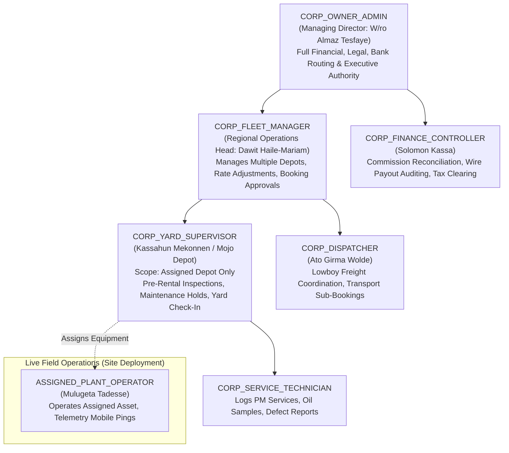
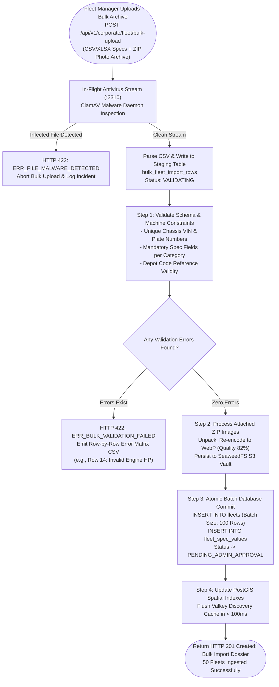
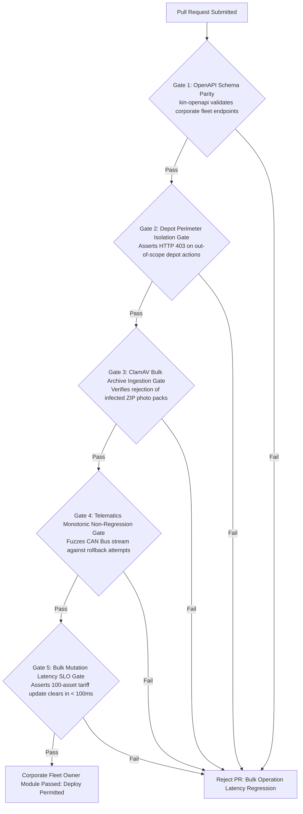

# Heavy Machinery & Logistics Rental Aggregator — Dink Machinery
## Software Requirements Specification — 06.04. Corporate Fleet Management (Owner-Side), Multi-Depot Operations, Fleet Manager Delegation & Telematics Utilization Architecture (`docs/shared/requirements/06-04-corporate-fleet-management-owner-side.md`)

**Document Identifier:** `SRS-DINK-CORE-V7.0-SEC-06-04`  
**Classification:** Canonical System Requirements Specification & Corporate Asset Operations Baseline (Single Source of Truth)  
**Governing Standard:** IEEE Std 830-1998 / IEEE/ISO/IEC 29148:2018 (Systems and Software Engineering — Requirements Engineering)  
**Associated Artifacts:** `SRS-DINK-CORE-V7.0` (§5.2, §5.3, §5.6, §5.9, §5.12, §5.13, §6.0, §6.1, §6.4, §8, §10, §12, §13.2), `FLOW-FLEET-REG-DINK-CORE-V7.0`, `FLOW-BOOKING-STATE-MACHINE-DINK-CORE-V7.0`, `FLOW-COMMISSION-DEBT-DINK-CORE-V7.0`, `ARCH-BACKEND-GO-DINK-CORE-V7.0`, `ARCH-FLUTTER-DINK-CORE-V7.0`, `ARCH-ADMIN-NEXT-DINK-CORE-V7.0`, `ARCH-SEC-DINK-CORE-V7.0`, `DS-DINK-CORE-V7.0`, `DS-PERSONAS-DINK-CORE-V7.0`, `contracts/openapi.yaml`, `ADR-001`, `ADR-002`, `ADR-004`, `ADR-005`, `ADR-008`, `ADR-010`  
**Target Runtimes:** Go 1.27.3 Backend Monolith, PostgreSQL 18.6 + PostGIS 3.6.4, Valkey 9.1.3, ClamAV Daemon (:3310), SeaweedFS S3, Flutter 3.47.9 / Dart 3.9 (Cross-Platform Mobile), Next.js 16.x (latest CVE security patch) / React 19 (Web Admin & Corporate Portal), Isar NoSQL 3.1+  
**Target Personas:** Corporate Fleet Owner Executive (*W/ro Almaz Tesfaye* / *Kamau Ndegwa*), Regional Fleet Operations Manager (*Dawit Haile-Mariam*), Depot Maintenance Yard Supervisor (*Kassahun Mekonnen*), Certified Yard Operator (*Mulugeta Tadesse*), Corporate Dispatcher (*Ato Girma Wolde*), Finance Controller & Asset Auditor (*Solomon Kassa*), Super Administrator (*Rahel Tadesse*)  
**Target Operating Markets:** Ethiopia (`ET`) & Kenya (`KE`) — Dynamic Multi-Country Parameterization (`LOC-01-BE`)  
**Compliance Standards:** OWASP ASVS 4.0.3 Level 3 (Multi-Tenancy Isolation, Granular Role Delegation & Telematics Data Confidentiality), RFC 9457 (Problem Details), ISO 9241-110, W3C WCAG 2.2 Level AAA (Field Mobile) & Level AA (Admin Web), Commercial Code of Ethiopia (2021 Commercial Chattel Registries & Agency Delegations), Federal Transport Authority (FTA) Heavy Commercial Vehicle Standards, Kenya National Transport and Safety Authority (NTSA) Commercial Fleet Directives, International Financial Reporting Standards (IFRS 16 Leases & Asset Impairment)  
**Status:** Approved Engineering Baseline

---

## Table of Contents

- 1. [Document Scope & Architectural Mandate](#1-document-scope--architectural-mandate)
  - 1.1 [Purpose & Functional Scope](#11-purpose--functional-scope)
  - 1.2 [Core Enterprise Fleet Operating Invariants](#12-core-enterprise-fleet-operating-invariants)
- 2. [Corporate Fleet Organization & Granular Role Hierarchy (`CFM-01`)](#2-corporate-fleet-organization--granular-role-hierarchy-cfm-01)
  - 2.1 [Enterprise Owner Staff Hierarchy Flowchart](#21-enterprise-owner-staff-hierarchy-flowchart)
  - 2.2 [Granular Operational Role Taxonomy](#22-granular-operational-role-taxonomy)
  - 2.3 [Cryptographic Delegation Tokens & Yard-Level Permissions Scoping](#23-cryptographic-delegation-tokens--yard-level-permissions-scoping)
- 3. [Multi-Depot Operations & Yard Spatial Zoning (`CFM-02`)](#3-multi-depot-operations--yard-spatial-zoning-cfm-02)
  - 3.1 [Depot Relational Schema & PostGIS Geofencing (SRID 4326)](#31-depot-relational-schema--postgis-geofencing-srid-4326)
  - 3.2 [Asset Assignment, Yard Staging & Transfer Workflows](#32-asset-assignment-yard-staging--transfer-workflows)
  - 3.3 [Depot-Bound Availability Calendars & Local Maintenance Holds](#33-depot-bound-availability-calendars--local-maintenance-holds)
  - 3.4 [Sub-Account Dispatching & Geofenced Handover Authorization](#34-sub-account-dispatching--geofenced-handover-authorization)
- 4. [Bulk Catalog Operations & Asset Lifecycle Management (`CFM-03`)](#4-bulk-catalog-operations--asset-lifecycle-management-cfm-03)
  - 4.1 [ClamAV-Inspected Bulk Ingestion Pipeline (CSV / Excel / ZIP Archival)](#41-clamav-inspected-bulk-ingestion-pipeline-csv--excel--zip-archival)
  - 4.2 [Batch Dynamic Tariff Configuration & Seasonal Rate Multipliers](#42-batch-dynamic-tariff-configuration--seasonal-rate-multipliers)
  - 4.3 [Bulk Maintenance Deactivation & Emergency Safety Recalls](#43-bulk-maintenance-deactivation--emergency-safety-recalls)
  - 4.4 [PostGIS Spatial Index Bulk Refresh & Valkey Eviction Pipelines](#44-postgis-spatial-index-bulk-refresh--valkey-eviction-pipelines)
- 5. [Enterprise Telematics, IoT Hardware & Yard Health Engine (`CFM-04`)](#5-enterprise-telematics-iot-hardware--yard-health-engine-cfm-04)
  - 5.1 [IoT Hardware Protocol Telemetry Ingestion (CAN Bus / J1939 / OBD-II)](#51-iot-hardware-protocol-telemetry-ingestion-can-bus--j1939--obd-ii)
  - 5.2 [Telemetry vs. Manual Operator Meter Discrepancy Reconciliation](#52-telemetry-vs-manual-operator-meter-discrepancy-reconciliation)
  - 5.3 [Predictive Preventive Maintenance (PM) Scheduling & Service Alerts](#53-predictive-preventive-maintenance-pm-scheduling--service-alerts)
  - 5.4 [Live Asset Heatmaps & Real-Time Operational Fleet Telemetry](#54-live-asset-heatmaps--real-time-operational-fleet-telemetry)
- 6. [Corporate Financial Aggregation, Revenue & Payout Sub-Ledgers (`CFM-05`)](#6-corporate-financial-aggregation-revenue--payout-sub-ledgers-cfm-05)
  - 6.1 [Asset-Level Profitability & ROI Matrix (Revenue vs. Maintenance vs. Overtime)](#61-asset-level-profitability--roi-matrix-revenue-vs-maintenance-vs-overtime)
  - 6.2 [Multi-Bank Payout Routing & Sub-Account Allocation](#62-multi-bank-payout-routing--sub-account-allocation)
  - 6.3 [Corporate Commission Debt Consolidation & Offsetting Ledgers](#63-corporate-commission-debt-consolidation--offsetting-ledgers)
- 7. [Relational Database Schema & Data Modeling (`CFM-DB`)](#7-relational-database-schema--data-modeling-cfm-db)
  - 7.1 [Entity Relationship Diagram](#71-entity-relationship-diagram)
  - 7.2 [Data Definition Language (DDL) Specifications](#72-data-definition-language-ddl-specifications)
- 8. [Wire Protocol Contracts & RFC 9457 Error Schemas](#8-wire-protocol-contracts--rfc-9457-error-schemas)
  - 8.1 [`POST /api/v1/corporate/fleet/depots`](#81-post-apiv1corporatefleetdepots)
  - 8.2 [`POST /api/v1/corporate/fleet/bulk-upload`](#82-post-apiv1corporatefleetbulk-upload)
  - 8.3 [`POST /api/v1/corporate/fleet/telematics/ingest`](#83-post-apiv1corporatefleettelematicsingest)
  - 8.4 [`GET /api/v1/corporate/fleet/analytics/utilization`](#84-get-apiv1corporatefleetanalyticsutilization)
  - 8.5 [RFC 9457 Universal Problem Details Payloads](#85-rfc-9457-universal-problem-details-payloads)
- 9. [Automated Testing Suite & Verification Gates](#9-automated-testing-suite--verification-gates)

---

## 1. Document Scope & Architectural Mandate

### 1.1 Purpose & Functional Scope

This specification establishes **Section 06.04 (Corporate Fleet Management — Owner-Side, Multi-Depot Operations, Fleet Manager Delegation & Telematics Utilization Architecture)** of the canonical Software Requirements Specification (SRS) for **Dink Machinery Version 7.0**.

In frontier East African construction, heavy earthworks, and mining hubs (e.g., Addis Ababa, Mojo Dry Port, Adama, Dire Dawa, Nairobi, Mombasa, Kisumu), commercial equipment owners are not isolated single-machine owner-operators. Commercial fleet owners (*e.g., Tesfaye Heavy Plant PLC, Trans-Africa Logistics Ltd.*) operate as structured corporate enterprises:
* They deploy capitalized equipment assets valued between $5,000,000.00\text{ and }50,000,000.00\text{ USD}$, spanning crawler excavators, motor graders, tandem vibratory rollers, crawler dozers, lowbed articulated multi-axles, and modular hydraulic trailers.
* Equipment is geographically staged across multiple regional logistics depots, staging yards, quarry repair bases, and remote infrastructure maintenance workshops.
* Management operations require strict administrative compartmentalization: an enterprise executive (*W/ro Almaz Tesfaye*) delegates daily fleet operations to regional Fleet Managers (*Dawit Haile-Mariam*), equipment maintenance to Yard Supervisors (*Kassahun Mekonnen*), and site mobilization to Dispatchers (*Ato Girma Wolde*), without granting full corporate executive privileges or exposing sensitive corporate bank payout configurations.
* High asset density necessitates bulk catalog management: registering 50 machines at once via verified CSV/Excel specifications, applying seasonal and project-specific tariff shifts in batches, managing preventative maintenance (PM) service intervals, and ingesting live IoT CAN Bus telematics.

This document formally specifies:
1. The enterprise fleet management hierarchy and granular role-based access control (RBAC) delegation engine (`CFM-01`).
2. Multi-depot operations, spatial yard zoning, and depot-bound inventory staging (`CFM-02`).
3. The ClamAV-shielded bulk asset ingestion and batch tariff management engine (`CFM-03`).
4. The industrial telematics (CAN Bus / J1939 / OBD-II) ingestion engine and mechanical hour meter reconciliation pipeline (`CFM-04`).
5. Asset-level financial ROI analytics, multi-bank payout distribution, and corporate commission debt consolidation (`CFM-05`).

### 1.2 Core Enterprise Fleet Operating Invariants

1. **Strict Depot-Level Spatial Scoping Invariant (PostGIS SRID 4326):** Every corporate fleet asset must be physically and logically assigned to an approved operational depot yard (`depot_id`). The asset's public discovery location, lowboy mobilization origin, and base geofence inherit directly from the depot's centroid polygon. An asset cannot exist in an unassigned, floating spatial state.
2. **Four-Eyes Separation of Sensitive Commercial Privileges (`CFM-RBAC`):** A delegated Fleet Operations Manager or Dispatcher is strictly barred from modifying corporate bank accounts, redirecting direct wire payout routes, or settling platform commission debts. Only verified users holding the `CORP_OWNER_ADMIN` role possess authority over financial banking coordinates and commercial payout profiles.
3. **Monotonic Telematics Non-Regression Floor (CAN Bus vs. Manual Sync):** The telematics ingestion engine enforces strict hour-meter monotonicity. Ingested engine run-hours from IoT hardware gateways (`J1939 Engine Hours`) cannot decrease. If manual handover inspection photos deviate from hardware CAN Bus readings by more than $\pm 2.0\text{ hours}$, the system raises an automated audit flag (`DISCREPANCY_METER_AUDIT`), freezing billing settlement until reconciled by an auditor.
4. **Sub-100ms Bulk Mutation Invalidation SLO:** Executing a bulk status change (e.g., placing 25 machines on emergency maintenance hold or adjusting seasonal tariffs across 40 assets) must invalidate all affected Valkey 9.1.3 hot query keys (`fleet:detail:*`, `discovery:search:*`) and update PostGIS partial spatial indexes in $< 100\text{ ms}$ (p99).
5. **Zero Data Leakage Across Competitor Fleets (RLS Tenant Invariant):** All fleet management queries, depot analytics, operator assignment pools, and utilization reports enforce PostgreSQL 18.6 Row-Level Security (RLS) bound to `organization_id`. Competitor leasing enterprises operating within the same physical geography cannot infer or inspect equipment availability, telematics breadcrumbs, or utilization rates.

---

## 2. Corporate Fleet Organization & Granular Role Hierarchy (`CFM-01`)

### 2.1 Enterprise Owner Staff Hierarchy Flowchart



---

### 2.2 Granular Operational Role Taxonomy

Corporate fleet owners deploy specialized personnel across five granular functional roles within their organizational boundary:

```text
+--------------------------------------------------------------------------------------------------+
| CORPORATE FLEET OWNER ROLE SPECIFICATION MATRIX (CFM-01)                                         |
+----------------------+------------+---------------+----------------------------------------------+
| ROLE IDENTIFIER      | ROLE LEVEL | SCOPE BOUNDS  | PERMITTED SYSTEM ACTIONS & PERIMETERS        |
+----------------------+------------+---------------+----------------------------------------------+
| CORP_OWNER_ADMIN     | Level 5    | Enterprise    | Master bank accounts, TIN configuration,     |
| (Managing Director)  | (Root)     | Global        | executive delegations, commission clearing,  |
|                      |            |               | legal disputes, full catalog authority.     |
+----------------------+------------+---------------+----------------------------------------------+
| CORP_FLEET_MANAGER   | Level 4    | Multi-Depot / | Approve/decline rental bookings, adjust rate |
| (Operations Head)    |            | Regional      | schedules, assign yard supervisors, trigger  |
|                      |            |               | bulk listing status updates, manage MSA terms|
+----------------------+------------+---------------+----------------------------------------------+
| CORP_YARD_SUPERVISOR | Level 3    | Single Depot  | Execute pre-rental handover inspections,     |
| (Depot Yard Head)    |            | Specific      | verify mechanical return meters, log PM holds|
|                      |            |               | assign linked operators to specific machines.|
+----------------------+------------+---------------+----------------------------------------------+
| CORP_DISPATCHER      | Level 2    | Enterprise    | Coordinate lowboy haulage sub-bookings,      |
| (Logistics Officer)  |            | Transport     | inspect tie-down lashing, monitor transit ETA|
+----------------------+------------+---------------+----------------------------------------------+
| CORP_SERVICE_TECH    | Level 1    | Yard / Shop   | Read-only specs, log engine oil samples,     |
| (Maintenance Clerk)  | (Base)     | Floor         | record telematics fault code clearances.     |
+--------------------------------------------------------------------------------------------------+
```

---

### 2.3 Cryptographic Delegation Tokens & Yard-Level Permissions Scoping

To restrict yard supervisors from tampering with machinery located at distant depots:
* **The Permission Tuple:** Every delegated action executes against a triple:
  $$\langle \text{UserID}, \text{PermissionCode}, \text{ScopeDepotID} \rangle$$
* **Session JWT Claims Scoping:**
  When a user operates under a corporate fleet owner context, the issued JWT embeds their explicit depot perimeter:
  ```json
  {
    "sub": "usr_018f6a9e-876b-7341",
    "activeContext": {
      "type": "CORPORATE_OWNER",
      "organizationId": "org_019a8fe0-8812-7b9a",
      "role": "CORP_YARD_SUPERVISOR",
      "assignedDepotIds": ["dep_019a8fe0-mojo-yard-01"],
      "permissions": ["FLEET_INSPECT", "METER_RECORD", "MAINTENANCE_TOGGLE"]
    }
  }
  ```
* **Enforcement:** If Yard Supervisor *Kassahun* (assigned to Mojo Yard) attempts to execute a handover sign-off on an excavator staged at the Hawassa Depot, the Go backend rejects the mutation with **RFC 9457 HTTP 403 Forbidden (`ERR_DEPOT_PERIMETER_VIOLATION`)**.

---

## 3. Multi-Depot Operations & Yard Spatial Zoning (`CFM-02`)

### 3.1 Depot Relational Schema & PostGIS Geofencing (SRID 4326)

Corporate fleet enterprises operate multiple staging facilities. Each depot is modeled as a first-class spatial entity:

```sql
CREATE TABLE corporate_depots (
    id UUID PRIMARY KEY DEFAULT gen_random_uuid(),
    organization_id UUID NOT NULL REFERENCES organizations(id) ON DELETE CASCADE,
    depot_name VARCHAR(128) NOT NULL,
    depot_code VARCHAR(32) NOT NULL,
    country_code VARCHAR(2) NOT NULL CHECK (country_code IN ('ET', 'KE')),
    depot_location GEOGRAPHY(Point, 4326) NOT NULL,
    depot_boundary GEOGRAPHY(Polygon, 4326) NOT NULL,
    address_json JSONB NOT NULL,
    capacity_machines INT NOT NULL DEFAULT 50,
    supervisor_user_id UUID NULL REFERENCES users(id) ON DELETE RESTRICT,
    contact_phone VARCHAR(32) NOT NULL,
    is_active BOOLEAN NOT NULL DEFAULT true,
    created_at TIMESTAMPTZ NOT NULL DEFAULT NOW(),
    updated_at TIMESTAMPTZ NOT NULL DEFAULT NOW(),
    CONSTRAINT uq_org_depot_code UNIQUE (organization_id, UPPER(depot_code))
);

CREATE INDEX idx_corporate_depots_spatial ON corporate_depots USING gist (depot_location);
CREATE INDEX idx_corporate_depots_boundary ON corporate_depots USING gist (depot_boundary);
```

* **Spatial Geofencing Invariant:** When an asset is marked as `STAGED_IN_DEPOT`, live GPS telematics pings from the machine must evaluate within the `depot_boundary` polygon:
  $$\text{ST\_Contains}(\text{depot\_boundary}::\text{geometry}, \text{current\_gps}::\text{geometry}) = \text{true}$$
  Departing the polygon without an `ACTIVE` rental or approved inter-depot transit order triggers an automated security alert (`UNAUTHORIZED_ASSET_DISPLACEMENT`).

---

### 3.2 Asset Assignment, Yard Staging & Transfer Workflows

Moving equipment between regional depots (*e.g., reallocating 5 dozers from Mojo to Dire Dawa for a new railway cut*) executes via an **Inter-Depot Transfer Docket**:
1. `CORP_FLEET_MANAGER` issues transfer request: Source Depot, Destination Depot, Fleet UUIDs, Designated Lowboy Carrier.
2. Assets transition from `ACTIVE` to `TRANSIT_RELOCATION`.
3. Spatial discovery is temporarily suppressed in public search to prevent booking collisions during mobilization.
4. Upon arrival at the target depot, the destination Yard Supervisor conducts a gate inspection, scans the machine chassis QR code, and confirms check-in.
5. Assets update their `depot_id`, re-anchor their PostGIS search coordinates, and re-enter `ACTIVE` marketplace inventory.

---

### 3.3 Depot-Bound Availability Calendars & Local Maintenance Holds

Each machine inherits calendar exclusions from its parent depot:
* **Depot Operational Windows:** If a specific depot yard closes for national regional celebrations or seasonal heavy rains, all un-rented assets staged at that depot automatically reflect blocked status in discovery (`FLOW-05.23`).
* **Dedicated Maintenance Bays:** If an asset enters the depot workshop for track rebuilding or hydraulic pump overhauls, the yard supervisor toggles `MAINTENANCE_HOLD`, taking the machine offline across all search channels.

---

### 3.4 Sub-Account Dispatching & Geofenced Handover Authorization

When a physical equipment handover takes place at the depot gate (`AR-01` / `FLOW-09`):
* The system asserts that the authorizing `CORP_YARD_SUPERVISOR` is physically present within the depot geofence:
  $$\text{ST\_DWithin}(\text{supervisor\_device\_geog}, \text{depot\_location}, 500\text{ meters}) = \text{true}$$
* The supervisor reviews condition photos, verifies mechanical hour meters via the camera reticle, and inputs their 6-digit corporate PIN to release custody to the contractor's driver.

---

## 4. Bulk Catalog Operations & Asset Lifecycle Management (`CFM-03`)

### 4.1 ClamAV-Inspected Bulk Ingestion Pipeline (CSV / Excel / ZIP Archival)

Large leasing enterprises cannot manually register 60 machines through single-screen mobile wizards. Dink Machinery provides an enterprise bulk ingestion engine:



---

### 4.2 Batch Dynamic Tariff Configuration & Seasonal Rate Multipliers

Corporate managers adjust tariffs across dozens of machines simultaneously based on market demand:
* **The Batch Adjustment Specification:**
  ```json
  {
    "filterCriteria": {
      "depotId": "dep_019a8fe0-mojo-yard-01",
      "subcategoryId": "cat_sub_excavator_std"
    },
    "adjustmentType": "PERCENTAGE_SURGE",
    "adjustmentValueBps": 1200,
    "effectiveStartDate": "2026-11-01",
    "effectiveEndDate": "2027-01-31",
    "reason": "Dry Season Earthworks Peak Demand Surge"
  }
  ```
* **Transactional Parity:** The Go backend executes an atomic batch update on `fleets.daily_rate_minor`, logging previous tariffs to `fleet_rate_history` for accounting audits.

---

### 4.3 Bulk Maintenance Deactivation & Emergency Safety Recalls

If a manufacturer issues an urgent mechanical safety bulletin (*e.g., Caterpillar recall on 320D hydraulic pilot valve seals*):
* `CORP_FLEET_MANAGER` can execute a **Bulk Safety Quarantine**:
  - Filters all company-owned machines matching Make: `Caterpillar` and Model: `320D`.
  - Atomically flips status from `ACTIVE` to `MAINTENANCE_HOLD`.
  - Machine cards disappear from public search within $< 100\text{ ms}$.
  - Any active rental dockets for future dates receive automated engineering notification alerts.

---

### 4.4 PostGIS Spatial Index Bulk Refresh & Valkey Eviction Pipelines

Bulk mutations generate substantial database churn. To prevent database degradation:
* Ingestion triggers execute chunked updates in batches of **100 rows**.
* The cache invalidation service flushes high-level spatial keys via non-blocking asynchronous threads:
  ```text
  DEL discovery:search:ET:* discovery:map:ET:*
  ```
* PostGIS GiST indexes evaluate updates incrementally, maintaining sub-50ms search latency on public search queries.

---

## 5. Enterprise Telematics, IoT Hardware & Yard Health Engine (`CFM-04`)

### 5.1 IoT Hardware Protocol Telemetry Ingestion (CAN Bus / J1939 / OBD-II)

Enterprise machinery is equipped with industrial telematics gateways (*e.g., Cat Product Link, Komatsu KOMTRAX, Teltonika FMC640*). Dink Machinery ingests streaming data via standard protocols:

```text
+--------------------------------------------------------------------------------------------------+
| INDUSTRIAL TELEMATICS TELEMETRY INGESTION SPECIFICATION (CFM-04)                                 |
+---------------------+-------------+-------------------+------------------------------------------+
| TELEMETRY PARAMETER | SOURCE      | INGESTION FREQ    | OPERATIONAL SIGNIFICANCE                 |
+---------------------+-------------+-------------------+------------------------------------------+
| Engine Total Hours  | J1939 /     | Hourly / Daily    | Canonical baseline for rental billing,   |
| (Hour Meter)        | CAN Bus     | Check-In Pulse    | shift overtime, and PM schedules.        |
+---------------------+-------------+-------------------+------------------------------------------+
| Fuel Level (%) &    | CAN Bus /   | 15-Minute Sample  | Tracks fuel burn rate (L/hr); reconciles |
| Total Fuel Consumed | Float Sensor| Rate              | renter fuel return deductions (AR-01/RC-02)|
+---------------------+-------------+-------------------+------------------------------------------+
| Diagnostic Trouble  | J1939 DM1 / | Real-Time Upon    | Detects critical hydraulic pressure drops|
| Codes (DTC / SPN)   | Fault Codes | Occurrence        | engine overheat, or transmission faults. |
+---------------------+-------------+-------------------+------------------------------------------+
| GPS Fix Coordinates | GNSS Multi- | 30-Second Ping    | Geofencing, spatial asset tracking, and  |
| (Lat, Lng, Alt, Spd)| Constell.   | (When Ignition ON)| site displacement verification (GPS-01). |
+--------------------------------------------------------------------------------------------------+
```

---

### 5.2 Telemetry vs. Manual Operator Meter Discrepancy Reconciliation

A frequent source of rental friction is the discrepancy between what an operator enters manually on their phone and what the machine's engine computer actually registered:
* **Automated Reconciliation Routine:**
  Upon return inspection (`RC-02` / SRS 05.07), the backend fetches the exact engine computer hour meter reading transmitted by IoT telematics at the moment of return:
  $$\Delta_{\text{meter}} = \left\vert{} \mathcal{M}_{\text{manual\_operator}} - \mathcal{M}_{\text{can\_bus\_telematics}} \right\vert{}$$
* **Reconciliation Bounds:**
  - $\Delta_{\text{meter}} \le 1.0\text{ Hours} \longrightarrow$ **Auto-Reconciled.** System adopts the higher of the two readings to prevent revenue loss.
  - $\Delta_{\text{meter}} > 1.0\text{ Hours} \longrightarrow$ **Telemetry Discrepancy Flag.** System flags invoice line item for review by `CORP_FLEET_MANAGER`, attaching raw CAN Bus timestamp logs.

---

### 5.3 Predictive Preventive Maintenance (PM) Scheduling & Service Alerts

To maintain asset value and prevent catastrophic job-site breakdowns:
* The system tracks machine service intervals based on cumulative engine hours:
  - **PM 250:** Engine oil, oil filters, and fuel water separators (Every $250\text{ Hours}$).
  - **PM 500:** Hydraulic pilot filters, air cleaners, final drive oil (Every $500\text{ Hours}$).
  - **PM 1000 / 2000:** Full hydraulic fluid change, valve adjustment, undercarriage track pin inspection.
* **Proactive Scheduling:**
  When a machine comes within **$25\text{ engine hours}$** of a PM threshold:
  - System notifies the Yard Supervisor and Fleet Operations Head.
  - System blocks long-term forward rental bookings that would cause the machine to exceed the PM limit by $> 50\text{ hours}$ without an agreed on-site maintenance window.

---

### 5.4 Live Asset Heatmaps & Real-Time Operational Fleet Telemetry

The Next.js Corporate Portal (`AD-06-WEB`) provides fleet managers with a real-time operational bird's-eye view:
* **Live Fleet Map Viewport:** Interactive Mapbox/PostGIS canvas plotting every owned asset across Ethiopia and Kenya with status-coded pins:
  - 🟢 **Active Working** (Ignition ON, moving, within rental geofence).
  - 🟡 **Staged in Depot** (Available for rent, inside depot polygon).
  - 🔴 **Mechanical Stoppage / PM Hold** (Fault code active or maintenance open).
  - 🔵 **Lowboy Transit** (Moving on federal highway corridor at transport speeds $> 40\text{ km/h}$).

---

## 6. Corporate Financial Aggregation, Revenue & Payout Sub-Ledgers (`CFM-05`)

### 6.1 Asset-Level Profitability & ROI Matrix (Revenue vs. Maintenance vs. Overtime)

Corporate fleet executives evaluate asset performance based on capital return:
* For every asset in the catalog, the engine aggregates financial metrics across a rolling 12-month period:
  $$\text{Net Yield} = \sum \text{Rental Revenue} + \sum \text{Overtime Billings} - \left( \sum \text{Platform Commission} + \sum \text{Logged Maintenance Costs} \right)$$
* **Utilization Rate Metric:**
  $$\mathcal{U}_{\text{asset}} = \left( \frac{\text{Total Days on Active Hire}}{365 - \text{Depot Maintenance Days}} \right) \times 100\%$$
* High-performing assets are badged as `HIGH_DEMAND_PORTFOLIO`, providing owners with data-driven guidance on future machine acquisitions.

---

### 6.2 Multi-Bank Payout Routing & Sub-Account Allocation

Large fleet enterprises operate multiple specialized bank accounts across financial institutions:
* **Sub-Account Routing Rules:**
  - Revenue from Excavators & Earthmoving $\longrightarrow$ Commercial Bank of Ethiopia (CBE Corporate Account A).
  - Revenue from Lowboy Transport Operations $\longrightarrow$ Awash Bank (Logistics Operating Account B).
  - Kenyan Regional Cross-Border Operations $\longrightarrow$ KCB Bank Kenya (KES Operating Account C).
* **Payment Instruction Directives:**
  When a contractor checks out, the payment instruction sheet generated by the platform dynamically routes to the exact bank account mapped to that machine's operational division, simplifying corporate treasury reconciliation.

---

### 6.3 Corporate Commission Debt Consolidation & Offsetting Ledgers

Under the non-custodial direct settlement model, the fleet owner collects gross hire fees directly from the contractor and accumulates a commission debt owed to Dink Machinery (`FLOW-COMMISSION-DEBT` / SRS 05.09):
* **Consolidated Enterprise Debt Statements:**
  Instead of settling commission on a per-booking basis, corporate owners receive a **Monthly Consolidated Commission Statement** compiling all completed rentals across all regional depots.
* **Credit Buffer Ceiling:** Corporate enterprises are granted an extended commission credit buffer (e.g., $250,000.00\text{ to }500,000.00\text{ ETB}$) before operational delinquency locks are triggered.
* **Consolidated Wire Settlement:** Owner executes a single bulk bank wire to Dink Machinery's corporate bank account, uploading the deposit slip to clear commission debt across the entire fleet in one atomic reconciliation transaction.

---

## 7. Relational Database Schema & Data Modeling (`CFM-DB`)

### 7.1 Entity Relationship Diagram

```mermaid
erDiagram
    Organization ||--o{ CorporateDepot : "operates"
    Organization ||--o{ CorporateDepotStaff : "assigns"
    CorporateDepot ||--o{ CorporateDepotStaff : "stations"
    CorporateDepot ||--o{ Fleet : "stages"
    Fleet ||--o{ FleetTelematicsLog : "transmits"
    Fleet ||--o{ FleetMaintenanceRecord : "undergoes"
    Fleet ||--o{ InterDepotTransfer : "transfers"
    CorporateDepot ||--o{ InterDepotTransfer : "originates / receives"

    CorporateDepot {
        uuid id PK
        uuid organization_id FK
        string depot_name
        string depot_code UK
        string country_code
        geography depot_location
        geography depot_boundary
        int capacity_machines
        uuid supervisor_user_id FK
        boolean is_active
        timestamptz created_at
    }

    CorporateDepotStaff {
        uuid id PK
        uuid organization_id FK
        uuid depot_id FK
        uuid user_id FK
        string operational_role -- 'CORP_FLEET_MANAGER', 'CORP_YARD_SUPERVISOR', 'CORP_DISPATCHER', 'CORP_SERVICE_TECH'
        boolean can_authorize_handover
        boolean can_adjust_rates
        timestamptz assigned_at
    }

    Fleet {
        uuid id PK
        uuid organization_id FK
        uuid current_depot_id FK
        string make
        string model
        string plate_number
        string status -- 'ACTIVE', 'RENTED', 'MAINTENANCE_HOLD', 'TRANSIT_RELOCATION'
        bigint current_hour_meter_minor
        timestamptz last_telematics_at
    }

    FleetTelematicsLog {
        uuid id PK
        uuid fleet_id FK
        geography location
        decimal engine_hours
        decimal fuel_level_percent
        string active_fault_codes_json
        timestamptz timestamp
    }

    FleetMaintenanceRecord {
        uuid id PK
        uuid fleet_id FK
        uuid depot_id FK
        string service_type -- 'PM_250', 'PM_500', 'PM_1000', 'EMERGENCY_REPAIR'
        decimal hour_meter_at_service
        bigint total_cost_minor
        string parts_replaced_json
        uuid signed_off_by_tech_id FK
        timestamptz completed_at
    }

    InterDepotTransfer {
        uuid id PK
        uuid organization_id FK
        uuid fleet_id FK
        uuid source_depot_id FK
        uuid destination_depot_id FK
        uuid carrier_booking_id FK NULL
        string status -- 'INITIATED', 'IN_TRANSIT', 'COMPLETED', 'ABORTED'
        timestamptz dispatched_at
        timestamptz received_at
    }
```

---

### 7.2 Data Definition Language (DDL) Specifications

```sql
-- 1. Corporate Depot Staff Assignment Table
CREATE TABLE corporate_depot_staff (
    id UUID PRIMARY KEY DEFAULT gen_random_uuid(),
    organization_id UUID NOT NULL REFERENCES organizations(id) ON DELETE CASCADE,
    depot_id UUID NOT NULL REFERENCES corporate_depots(id) ON DELETE CASCADE,
    user_id UUID NOT NULL REFERENCES users(id) ON DELETE RESTRICT,
    operational_role VARCHAR(32) NOT NULL,
    can_authorize_handover BOOLEAN NOT NULL DEFAULT false,
    can_adjust_rates BOOLEAN NOT NULL DEFAULT false,
    assigned_at TIMESTAMPTZ NOT NULL DEFAULT NOW(),
    CONSTRAINT chk_staff_role CHECK (operational_role IN ('CORP_FLEET_MANAGER', 'CORP_YARD_SUPERVISOR', 'CORP_DISPATCHER', 'CORP_SERVICE_TECH')),
    CONSTRAINT uq_depot_staff UNIQUE (depot_id, user_id)
);

CREATE INDEX idx_depot_staff_user ON corporate_depot_staff (user_id);

-- 2. Fleet Telematics Streaming Log Table
CREATE TABLE fleet_telematics_logs (
    id UUID PRIMARY KEY DEFAULT gen_random_uuid(),
    fleet_id UUID NOT NULL REFERENCES fleets(id) ON DELETE CASCADE,
    location GEOGRAPHY(Point, 4326) NOT NULL,
    engine_hours NUMERIC(10, 2) NOT NULL,
    fuel_level_percent NUMERIC(5, 2) NULL,
    battery_voltage NUMERIC(4, 2) NULL,
    active_fault_codes_json JSONB NULL,
    timestamp TIMESTAMPTZ NOT NULL,
    created_at TIMESTAMPTZ NOT NULL DEFAULT NOW()
);

CREATE INDEX idx_telematics_fleet_time ON fleet_telematics_logs (fleet_id, timestamp DESC);

-- 3. Fleet Maintenance Records Table
CREATE TABLE fleet_maintenance_records (
    id UUID PRIMARY KEY DEFAULT gen_random_uuid(),
    fleet_id UUID NOT NULL REFERENCES fleets(id) ON DELETE CASCADE,
    depot_id UUID NOT NULL REFERENCES corporate_depots(id) ON DELETE RESTRICT,
    service_type VARCHAR(32) NOT NULL,
    hour_meter_at_service NUMERIC(10, 2) NOT NULL,
    total_cost_minor BIGINT NOT NULL DEFAULT 0,
    parts_replaced_json JSONB NOT NULL DEFAULT '[]'::JSONB,
    technician_user_id UUID NOT NULL REFERENCES users(id) ON DELETE RESTRICT,
    notes TEXT NULL,
    completed_at TIMESTAMPTZ NOT NULL,
    created_at TIMESTAMPTZ NOT NULL DEFAULT NOW(),
    CONSTRAINT chk_service_type CHECK (service_type IN ('PM_250', 'PM_500', 'PM_1000', 'PM_2000', 'EMERGENCY_REPAIR', 'INSPECTION'))
);

CREATE INDEX idx_maintenance_fleet ON fleet_maintenance_records (fleet_id, completed_at DESC);

-- 4. Inter-Depot Asset Transfer Dockets Table
CREATE TABLE inter_depot_transfers (
    id UUID PRIMARY KEY DEFAULT gen_random_uuid(),
    organization_id UUID NOT NULL REFERENCES organizations(id) ON DELETE CASCADE,
    fleet_id UUID NOT NULL REFERENCES fleets(id) ON DELETE RESTRICT,
    source_depot_id UUID NOT NULL REFERENCES corporate_depots(id) ON DELETE RESTRICT,
    destination_depot_id UUID NOT NULL REFERENCES corporate_depots(id) ON DELETE RESTRICT,
    carrier_booking_id UUID NULL REFERENCES bookings(id) ON DELETE RESTRICT,
    status VARCHAR(32) NOT NULL DEFAULT 'INITIATED',
    transfer_notes TEXT NULL,
    dispatched_at TIMESTAMPTZ NULL,
    received_at TIMESTAMPTZ NULL,
    created_at TIMESTAMPTZ NOT NULL DEFAULT NOW(),
    CONSTRAINT chk_transfer_status CHECK (status IN ('INITIATED', 'IN_TRANSIT', 'COMPLETED', 'ABORTED')),
    CONSTRAINT chk_different_depots CHECK (source_depot_id != destination_depot_id)
);

CREATE INDEX idx_transfers_org ON inter_depot_transfers (organization_id, status);
```

---

## 8. Wire Protocol Contracts & RFC 9457 Error Schemas

### 8.1 `POST /api/v1/corporate/fleet/depots`

Registers a new operational equipment depot yard with spatial geofencing boundaries.

#### Request Headers
```http
POST /api/v1/corporate/fleet/depots HTTP/1.1
Host: api.dinkmachinery.com
Content-Type: application/json
Authorization: Bearer <corporateOwnerAdminToken>
X-Organization-ID: org_019a8fe0-8812-7b9a-bc21-4491204812aa
Idempotency-Key: 11982a01-4b12-4f9a-8812-7b9a4c10bc21
```

#### Request Payload
```json
{
  "depotName": "Mojo Dry Port Heavy Staging Yard",
  "depotCode": "MOJO-YD-01",
  "countryCode": "ET",
  "latitude": 8.5882,
  "longitude": 39.1245,
  "boundaryGeoJson": {
    "type": "Polygon",
    "coordinates": [
      [
        [39.1230, 8.5870],
        [39.1260, 8.5870],
        [39.1260, 8.5895],
        [39.1230, 8.5895],
        [39.1230, 8.5870]
      ]
    ]
  },
  "address": {
    "region": "Oromia",
    "zone": "East Shewa",
    "woreda": "Lome",
    "city": "Mojo",
    "street": "Ethio-Djibouti Highway Junction Gate 3"
  },
  "capacityMachines": 75,
  "contactPhone": "+251911200491"
}
```

#### Response: `HTTP 201 Created`
```json
{
  "success": true,
  "data": {
    "depotId": "dep_019a8fe0-mojo-yard-01",
    "depotName": "Mojo Dry Port Heavy Staging Yard",
    "depotCode": "MOJO-YD-01",
    "countryCode": "ET",
    "capacityMachines": 75,
    "isActive": true,
    "spatialGeofenceCommitted": true,
    "createdAt": "2026-10-29T11:00:00Z"
  },
  "timestamp": "2026-10-29T11:00:01Z"
}
```

---

### 8.2 `POST /api/v1/corporate/fleet/bulk-upload`

Ingests bulk fleet assets via CSV metadata specifications and attached ZIP media archive.

#### Request Headers
```http
POST /api/v1/corporate/fleet/bulk-upload HTTP/1.1
Host: api.dinkmachinery.com
Content-Type: multipart/form-data
Authorization: Bearer <corporateFleetManagerToken>
X-Organization-ID: org_019a8fe0-8812-7b9a-bc21-4491204812aa
Idempotency-Key: 22342a01-5c12-4f9a-8812-7b9a4c10bc21
```

#### Multipart Form Body
* `targetDepotId`: String (`"dep_019a8fe0-mojo-yard-01"`)
* `specificationCsv`: Binary File (`fleet_manifest_50_units.csv`)
* `mediaZipArchive`: Binary File (`fleet_photos_archive.zip`, scanned in-flight via ClamAV socket `:3310`)

#### Response: `HTTP 201 Created`
```json
{
  "success": true,
  "data": {
    "batchImportId": "imp_019a8fe5-8812",
    "targetDepotCode": "MOJO-YD-01",
    "totalRecordsProcessed": 50,
    "successfulImportsCount": 50,
    "failedValidationCount": 0,
    "photosTranscodedCount": 200,
    "status": "PENDING_ADMIN_APPROVAL",
    "committedAt": "2026-10-29T11:05:00Z"
  },
  "timestamp": "2026-10-29T11:05:01Z"
}
```

---

### 8.3 `POST /api/v1/corporate/fleet/telematics/ingest`

High-throughput industrial IoT gateway endpoint ingesting CAN Bus / J1939 machine telemetry.

#### Request Headers
```http
POST /api/v1/corporate/fleet/telematics/ingest HTTP/1.1
Host: api.dinkmachinery.com
Content-Type: application/json
X-Gateway-Auth-Token: <telematicsGatewaySecretKey>
```

#### Request Payload
```json
{
  "gatewayId": "fmc640_teltonika_88120",
  "fleetId": "flt_019a8f2c-8812-7b9a",
  "timestamp": "2026-10-29T11:10:00Z",
  "coordinates": {
    "latitude": 8.5885,
    "longitude": 39.1250,
    "altitudeMeters": 1782.4,
    "speedKmh": 0.0
  },
  "canBusMetrics": {
    "engineTotalHours": 1458.75,
    "fuelLevelPercent": 84.50,
    "batteryVoltage": 27.8,
    "engineCoolantTempC": 88.0,
    "hydraulicPressureBar": 345.0
  },
  "diagnosticFaultCodes": []
}
```

#### Response: `HTTP 200 OK`
```json
{
  "success": true,
  "data": {
    "fleetId": "flt_019a8f2c-8812-7b9a",
    "telematicsRecorded": true,
    "monotonicMeterVerified": true,
    "geofenceStatus": "INSIDE_ASSIGNED_DEPOT",
    "maintenanceStatus": "HEALTHY"
  },
  "timestamp": "2026-10-29T11:10:01Z"
}
```

---

### 8.4 `GET /api/v1/corporate/fleet/analytics/utilization`

Returns rolling 12-month asset-level financial performance, machine utilization, and maintenance cost metrics.

#### Request Headers
```http
GET /api/v1/corporate/fleet/analytics/utilization?depotId=dep_019a8fe0-mojo-yard-01&year=2026 HTTP/1.1
Host: api.dinkmachinery.com
Authorization: Bearer <corporateOwnerAdminToken>
X-Organization-ID: org_019a8fe0-8812-7b9a-bc21-4491204812aa
```

#### Response: `HTTP 200 OK`
```json
{
  "success": true,
  "data": {
    "organizationId": "org_019a8fe0-8812-7b9a-bc21-4491204812aa",
    "depotCode": "MOJO-YD-01",
    "reportingPeriod": "2026-01-01 to 2026-10-29",
    "summary": {
      "totalMachinesManaged": 42,
      "averageFleetUtilizationPercent": 78.4,
      "totalGrossRevenueMinor": 18450000000,
      "totalCommissionPaidMinor": 1845000000,
      "totalMaintenanceExpensesMinor": 1240000000,
      "netOperatingProfitMinor": 15365000000,
      "currency": "ETB"
    },
    "topPerformingAssets": [
      {
        "fleetId": "flt_019a8f2c-8812-7b9a",
        "makeModel": "Caterpillar 320D",
        "utilizationPercent": 91.2,
        "hireDaysCount": 248,
        "netRevenueMinor": 5580000000
      }
    ]
  },
  "timestamp": "2026-10-29T11:15:00Z"
}
```

---

### 8.5 RFC 9457 Universal Problem Details Payloads

#### Example: Depot Spatial Perimeter Violation (`HTTP 403 Forbidden`)
```json
{
  "type": "[https://api.dinkmachinery.com/errors/depot-perimeter-violation](https://api.dinkmachinery.com/errors/depot-perimeter-violation)",
  "title": "Depot Administrative Perimeter Violation",
  "status": 403,
  "detail": "Your operational role (CORP_YARD_SUPERVISOR) is strictly bound to Mojo Dry Port Yard. You lack authority to execute handover inspections for assets staged at Hawassa Logistics Depot.",
  "instance": "/api/v1/corporate/fleet/flt_019a8f2c-hawassa-01/handover-sign",
  "code": "ERR_DEPOT_PERIMETER_VIOLATION",
  "correlationId": "cor_019a8fe0-8812-7b9a-bc21-4491204812aa",
  "timestamp": "2026-10-29T11:10:05Z",
  "invalidParams": [
    {
      "name": "depotId",
      "reason": "Asset belongs to depot dep_019a8fe0-hawassa-yd, outside user assigned scope [dep_019a8fe0-mojo-yard-01]"
    }
  ]
}
```

#### Example: Bulk Upload Validation Failure (`HTTP 422 Unprocessable Entity`)
```json
{
  "type": "[https://api.dinkmachinery.com/errors/bulk-fleet-validation-failed](https://api.dinkmachinery.com/errors/bulk-fleet-validation-failed)",
  "title": "Bulk Manifest Schema Validation Failed",
  "status": 422,
  "detail": "Bulk fleet import manifest contains 2 invalid rows. Import transaction rolled back.",
  "instance": "/api/v1/corporate/fleet/bulk-upload",
  "code": "ERR_BULK_VALIDATION_FAILED",
  "correlationId": "cor_019a8fe0-9914-4c12-8812-7b9a4c10bc21",
  "timestamp": "2026-10-29T11:05:05Z",
  "invalidParams": [
    {
      "name": "Row 14",
      "reason": "Plate number 'ET-3-99120' collides with existing active fleet asset in Ethiopia."
    },
    {
      "name": "Row 38",
      "reason": "Mandatory spec 'operating_weight_kg' is missing for Crawler Excavator subcategory."
    }
  ],
  "links": {
    "errorMatrixDownload": "/api/v1/corporate/fleet/bulk-imports/imp_8812/errors.csv"
  }
}
```

---

## 9. Automated Testing Suite & Verification Gates



1. **OpenAPI Schema Contract Gate (`kin-openapi`):** Validates all depot registration, bulk import, telematics ingestion, maintenance logging, and utilization analytics endpoints against `contracts/openapi.yaml`.
2. **Depot Boundary Authorization Gate:** Simulates cross-depot mutation attempts by a constrained Yard Supervisor. Asserts that $100\%$ of out-of-scope inspection or maintenance calls are intercepted with HTTP 403 `ERR_DEPOT_PERIMETER_VIOLATION`.
3. **ClamAV Bulk Archive Antivirus Ingestion Gate:** Injects an `EICAR` test signature inside a bulk ZIP media archive stream across TCP socket `:3310`. Asserts that the Go backend terminates the upload, returns HTTP 422 `ERR_FILE_MALWARE_DETECTED`, and commits zero rows to PostgreSQL or files to SeaweedFS S3.
4. **Telematics Monotonic Non-Regression Gate:** Streams 5,000 synthetic CAN Bus J1939 telemetry packets with randomized jitter, asserting that engine hour meters can never step backward and that meter discrepancies $> 1.0\text{ hours}$ reliably flag `DISCREPANCY_METER_AUDIT`.
5. **Bulk Mutation Latency SLO Gate:** Executes a batch rate adjustment across 100 fleet records simultaneously. Asserts that database transaction commit, PostGIS spatial index update, and Valkey hot cache eviction complete with p99 latency strictly $< 100\text{ ms}$.

---

*This document establishes the canonical functional requirements, multi-depot operational models, role-based delegation rules, bulk ingestion pipelines, industrial IoT telematics architectures, and wire protocol contracts for Corporate Fleet Management (Owner-Side) in Dink Machinery Version 7.0. All downstream Flutter mobile apps, Next.js corporate consoles, Go backend domain controllers, and PostgreSQL RLS policies must strictly conform to this specification.*