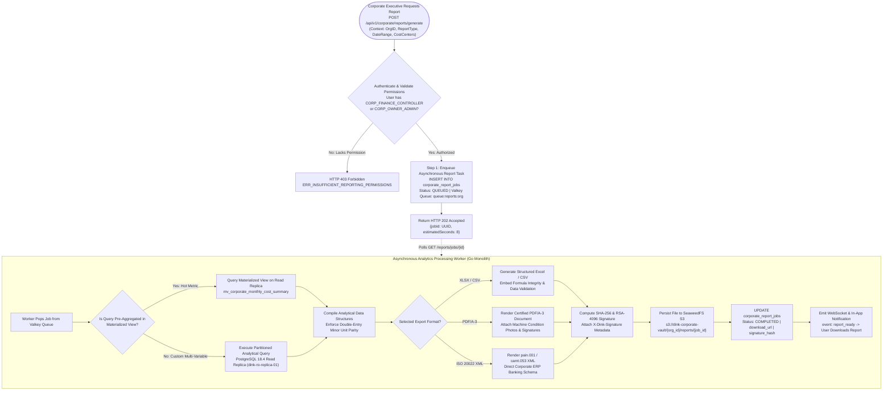
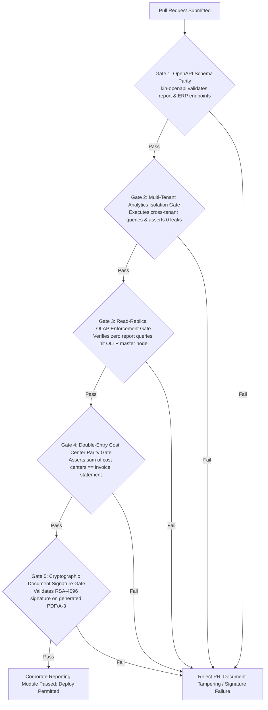

# Heavy Machinery & Logistics Rental Aggregator — Dink Machinery
## Software Requirements Specification — 06.05. Corporate Reporting, Utilization Analytics, Cost Center Accounting & ERP Data Export Architecture (`docs/shared/requirements/06-05-corporate-reporting.md`)

**Document Identifier:** `SRS-DINK-CORE-V7.0-SEC-06-05`  
**Classification:** Canonical System Requirements Specification & Enterprise Intelligence Baseline (Single Source of Truth)  
**Governing Standard:** IEEE Std 830-1998 / IEEE/ISO/IEC 29148:2018 (Systems and Software Engineering — Requirements Engineering)  
**Associated Artifacts:** `SRS-DINK-CORE-V7.0` (§5.6, §5.7, §5.9, §5.11, §6.0, §6.1, §6.2, §6.3, §6.4, §6.5, §8, §10, §12, §13.2), `FLOW-BOOKING-STATE-MACHINE-DINK-CORE-V7.0`, `ARCH-BACKEND-GO-DINK-CORE-V7.0`, `ARCH-FLUTTER-DINK-CORE-V7.0`, `ARCH-ADMIN-NEXT-DINK-CORE-V7.0`, `ARCH-SEC-DINK-CORE-V7.0`, `DS-DINK-CORE-V7.0`, `DS-PERSONAS-DINK-CORE-V7.0`, `contracts/openapi.yaml`, `ADR-001`, `ADR-002`, `ADR-004`, `ADR-005`, `ADR-008`, `ADR-010`  
**Target Runtimes:** Go 1.24 Backend Monolith, PostgreSQL 18.4 + PostGIS 3.4, Valkey 8.0, ClamAV Daemon (:3310), SeaweedFS S3, Flutter 3.44 / Dart 3.9 (Cross-Platform Mobile), Next.js 16 / React 19 (Web Admin & Corporate Portal), Isar NoSQL 3.1+  
**Target Personas:** Corporate Finance Controller & Internal Auditor (*Solomon Kassa*), Corporate Procurement Director (*Eng. Samuel Getachew*), Regional Project Director (*Dawit Haile-Mariam*), Senior Site Quantity Surveyor (*Bethlehem Tessema*), Corporate Fleet Owner Executive (*W/ro Almaz Tesfaye*), Compliance Officer & Data Protection Officer (*Yohannes Bekele*), Super Administrator (*Rahel Tadesse*)  
**Target Operating Markets:** Ethiopia (`ET`) & Kenya (`KE`) — Dynamic Multi-Country Parameterization (`LOC-01-BE`)  
**Compliance Standards:** OWASP ASVS 4.0.3 Level 3 (Tenant Data Leakage Defense, Cryptographic Export Signing & PII Redaction), RFC 9457 (Problem Details), ISO 9241-110, W3C WCAG 2.2 Level AAA (Field Mobile) & Level AA (Admin Web), International Financial Reporting Standards (IFRS 15 Revenue, IFRS 16 Leases, IAS 16 Property, Plant and Equipment), Commercial Code of Ethiopia (Accounting Books & Audit Trail Retention), Kenya Companies Act 2015, Kenya Data Protection Act 2019  
**Status:** Approved Engineering Baseline

---

## Table of Contents

- 1. [Document Scope & Architectural Mandate](#1-document-scope--architectural-mandate)
  - 1.1 [Purpose & Functional Scope](#11-purpose--functional-scope)
  - 1.2 [Core Enterprise Reporting & Intelligence Invariants](#12-core-enterprise-reporting--intelligence-invariants)
- 2. [Corporate Intelligence Architecture & Analytical Pipeline (`REP-01`)](#2-corporate-intelligence-architecture--analytical-pipeline-rep-01)
  - 2.1 [End-to-End Analytical Aggregation & Export Flowchart](#21-end-to-end-analytical-aggregation--export-flowchart)
  - 2.2 [Read-Replica OLAP Segregation & Asynchronous Ingestion Topology](#22-read-replica-olap-segregation--asynchronous-ingestion-topology)
  - 2.3 [PostgreSQL 18.4 Materialized Views & Refresh Cadence](#23-postgresql-184-materialized-views--refresh-cadence)
- 3. [Cost Center Accounting & Multi-Project Allocation (`REP-02`)](#3-cost-center-accounting--multi-project-allocation-rep-02)
  - 3.1 [General Ledger (GL) Chart of Accounts & Cost Center Mapping](#31-general-ledger-gl-chart-of-accounts--cost-center-mapping)
  - 3.2 [Machinery vs. Logistics vs. Ancillary Expense Split Formulas](#32-machinery-vs-logistics-vs-ancillary-expense-split-formulas)
  - 3.3 [Project WBS (Work Breakdown Structure) Segment Allocation](#33-project-wbs-work-breakdown-structure-segment-allocation)
  - 3.4 [Overtime Surcharge & Fuel Burn Cost Disaggregation](#34-overtime-surcharge--fuel-burn-cost-disaggregation)
- 4. [Fleet Utilization, Health & Idle Asset Analytics (`REP-03`)](#4-fleet-utilization-health--idle-asset-analytics-rep-03)
  - 4.1 [Asset Utilization Rate ($\mathcal{U}_{\text{asset}}$) Formulation & Benchmark Targets](#41-asset-utilization-rate-mathcalu_textasset-formulation--benchmark-targets)
  - 4.2 [Mean Time Between Failures (MTBF) & Breakdown Incident Tracking](#42-mean-time-between-failures-mtbf--breakdown-incident-tracking)
  - 4.3 [Idle Asset Opportunity Cost & Depreciation Amortization Schedules](#43-idle-asset-opportunity-cost--depreciation-amortization-schedules)
  - 4.4 [Geographic Mobility & Depot Density Distribution Heatmaps](#44-geographic-mobility--depot-density-distribution-heatmaps)
- 5. [ERP Integration, Data Synchronization & Export Engine (`REP-04`)](#5-erp-integration-data-synchronization--export-engine-rep-04)
  - 5.1 [Supported Corporate ERP Formats (SAP, Oracle, Dynamics 365, Odoo)](#51-supported-corporate-erp-formats-sap-oracle-dynamics-365-odoo)
  - 5.2 [Deterministic Export Formats (XLSX, CSV, ISO 20022 XML, PDF/A-3)](#52-deterministic-export-formats-xlsx-csv-iso-20022-xml-pdfa-3)
  - 5.3 [Asynchronous Job Processing & Webhook Delivery Architecture](#53-asynchronous-job-processing--webhook-delivery-architecture)
  - 5.4 [HMAC-SHA256 Cryptographic Document Signing & Non-Repudiation](#54-hmac-sha256-cryptographic-document-signing--non-repudiation)
- 6. [Relational Database Schema & Data Modeling (`REP-DB`)](#6-relational-database-schema--data-modeling-rep-db)
  - 6.1 [Entity Relationship Diagram](#61-entity-relationship-diagram)
  - 6.2 [Data Definition Language (DDL) Specifications](#62-data-definition-language-ddl-specifications)
- 7. [Wire Protocol Contracts & RFC 9457 Error Schemas](#7-wire-protocol-contracts--rfc-9457-error-schemas)
  - 7.1 [`POST /api/v1/corporate/reports/generate`](#71-post-apiv1corporatereportsgenerate)
  - 7.2 [`GET /api/v1/corporate/reports/jobs/{id}`](#72-get-apiv1corporatereportsjobsid)
  - 7.3 [`GET /api/v1/corporate/analytics/cost-centers`](#73-get-apiv1corporateanalyticscost-centers)
  - 7.4 [`POST /api/v1/corporate/erp/sync-config`](#74-post-apiv1corporateerpsync-config)
  - 7.5 [RFC 9457 Universal Problem Details Payloads](#75-rfc-9457-universal-problem-details-payloads)
- 8. [Automated Testing Suite & Verification Gates](#8-automated-testing-suite--verification-gates)

---

## 1. Document Scope & Architectural Mandate

### 1.1 Purpose & Functional Scope

This specification establishes **Section 06.05 (Corporate Reporting, Utilization Analytics, Cost Center Accounting & ERP Data Export Architecture)** of the canonical Software Requirements Specification (SRS) for **Dink Machinery Version 7.0**.

In major civil infrastructure, mining projects, and commercial plant hire operations across Ethiopia and Kenya, corporate management and financial controllers demand granular, auditable, and automated operational intelligence:
* Multi-site contractors (*e.g., Sur Construction, Sogea-Satom, H-Young*) operate dozens of distinct infrastructure project sites simultaneously (e.g., *Modjo–Hawassa Expressway Lot 3*, *LAPSSET corridor shoring*, *Addis Ababa Corridor Phase 2*). Procurement executives must accurately disaggregate, attribute, and post monthly plant hire expenditures across granular corporate Cost Centers and General Ledger (GL) accounts.
* Plant equipment leasing enterprises (*e.g., Tesfaye Heavy Plant PLC*) managing multi-million-dollar machine portfolios require rigorous asset-level utilization reporting, predictive downtime analytics, and Mean Time Between Failures (MTBF) tracking to evaluate fleet capitalization, optimize depreciation schedules, and justify equipment investments.
* Manual spreadsheet reconciliation between site paper shift tickets and enterprise finance departments is slow, prone to clerical errors, and vulnerable to internal fraud.
* Enterprise clients require automated synchronization and export capabilities directly into tier-1 ERP systems (**SAP S/4HANA**, **Oracle Fusion Cloud**, **Microsoft Dynamics 365 Finance & Operations**, and **Odoo Enterprise**) via standardized file feeds (ISO 20022 XML, CSV, formatted XLSX) and programmatic webhooks.

This document formally specifies:
1. The analytical corporate intelligence pipeline segregating online transaction processing (OLTP) from online analytical processing (OLAP) via dedicated PostgreSQL 18.4 read replicas and materialized rollups (`REP-01`).
2. The hierarchical Cost Center, Work Breakdown Structure (WBS), and General Ledger accounting allocation engine (`REP-02`).
3. Fleet utilization, mechanical uptime, idle asset depreciation, and geographical deployment density analytics (`REP-03`).
4. The asynchronous export and ERP synchronization engine delivering cryptographically signed PDF/A-3, XLSX, and ISO 20022 data feeds (`REP-04`).
5. Multi-tenant Row-Level Security (RLS) enforcement preventing corporate data leaks across competing commercial organizations.

### 1.2 Core Enterprise Reporting & Intelligence Invariants

1. **Strict Multi-Tenant Analytical Perimeter Invariant (OWASP ASVS §4.1):** Every analytical query, background aggregation worker, and generated report file must enforce hard organizational isolation:
   $$\text{FilterScope} \iff \text{organization\_id} = \text{ContextOrgID}$$
   Analytical data, machine utilization rates, or internal project cost codes can never leak across tenant boundaries. Competitor organizations operating within the same region cannot view or derive another enterprise's operational metrics.
2. **Zero-OLTP Impact SLO:** Heavy analytical queries, historical multi-year rollups, and bulk ERP export generations must execute exclusively against dedicated PostgreSQL 18.4 streaming read replicas (`dink-ro-replica-01`) or pre-aggregated materialized views. Long-running report queries are strictly barred from executing against the primary write master node, guaranteeing zero latency impact on live field bookings.
3. **Double-Entry Reconciliation Integrity Floor (IFRS 15 / 16):** The total financial expense attributed across all individual project cost centers must equal the consolidated net corporate invoice statement down to the exact minor currency unit:
   $$\sum_{i=1}^{n} \text{CostCenterAllocation}_i \equiv \text{NetPayableInvoiceStatement} \quad (\Delta = 0\text{ Minor Units})$$
4. **Cryptographic Export Immutability & Non-Repudiation:** Every generated corporate export file (PDF/A-3, XLSX, CSV) is fingerprinted with a SHA-256 binary hash and digitally signed using Dink Machinery's corporate RSA-4096 signing key before being archived in SeaweedFS S3 (`s3://dink-corporate-vault/{org_id}/reports/`). Subsequent audits verify the file's digital signature to confirm that the report has not been altered post-generation.
5. **Deterministic Integer Financial Aggregation:** All financial sums, tax allocations, overtime charges, and cost splits are accumulated in 64-bit signed integers representing currency minor units ($100\text{ Cents} = 1\text{ ETB}$ or $1\text{ KES}$). Floating-point arithmetic is prohibited across the analytical engine to prevent rounding errors across large-scale data rollups.

---

## 2. Corporate Intelligence Architecture & Analytical Pipeline (`REP-01`)

### 2.1 End-to-End Analytical Aggregation & Export Flowchart



---

### 2.2 Read-Replica OLAP Segregation & Asynchronous Ingestion Topology

To maintain sub-millisecond OLTP response times on production checkouts:
* **Infrastructure Separation:** Analytical queries route via pgx connection pooling to dedicated read-only replicas:
  `postgres://dink_ro_user@dink-ro-replica-01.internal:5432/dink_core?sslmode=verify-full`
* **Query Timeouts:** Replicas enforce `statement_timeout = 60000` ($60\text{ seconds}$). Any runaway ad-hoc query is terminated before consuming shared replica memory buffers.
* **Asynchronous Execution:** Reports with date ranges spanning $> 30\text{ days}$ or querying $> 50\text{ machines}$ execute asynchronously via background workers. The client receives an immediate `HTTP 202 Accepted` response with a tracking job ID.

---

### 2.3 PostgreSQL 18.4 Materialized Views & Refresh Cadence

Core corporate KPIs are maintained via pre-computed PostgreSQL materialized views refreshed on scheduled cadences:

```sql
-- Materialized View: Monthly Cost Center Allocation Summary
CREATE MATERIALIZED VIEW mv_corporate_monthly_cost_center_summary AS
SELECT 
    b.renter_organization_id AS organization_id,
    b.cost_center_id,
    cc.cost_center_code,
    cc.cost_center_name,
    DATE_TRUNC('month', b.created_at) AS report_month,
    b.currency,
    COUNT(b.id) AS total_bookings_count,
    SUM(b.total_amount_minor) AS gross_spend_minor,
    SUM(COALESCE(r.excess_hours_charge_minor, 0)) AS overtime_spend_minor,
    SUM(COALESCE(r.accepted_damages_minor, 0)) AS damage_reconciliation_minor,
    SUM(COALESCE(b.logistics_freight_minor, 0)) AS freight_logistics_minor
FROM bookings b
JOIN corporate_cost_centers cc ON b.cost_center_id = cc.id
LEFT JOIN booking_reconciliations r ON b.id = r.booking_id
WHERE b.status IN ('CONFIRMED', 'ACTIVE', 'RETURN_INITIATED', 'COMPLETED', 'RATED')
GROUP BY b.renter_organization_id, b.cost_center_id, cc.cost_center_code, cc.cost_center_name, DATE_TRUNC('month', b.created_at), b.currency
WITH NO DATA;

CREATE UNIQUE INDEX uq_mv_monthly_cost_center 
ON mv_corporate_monthly_cost_center_summary (organization_id, cost_center_id, report_month, currency);

-- Scheduled Refresh Cadence: Hourly Incremental Refresh via pg_cron
-- SELECT cron.schedule('0 * * * *', 'REFRESH MATERIALIZED VIEW CONCURRENTLY mv_corporate_monthly_cost_center_summary;');
```

---

## 3. Cost Center Accounting & Multi-Project Allocation (`REP-02`)

### 3.1 General Ledger (GL) Chart of Accounts & Cost Center Mapping

Enterprise ERP systems map expenses against formal financial accounting classifications:
* Each corporate organization configures their internal **General Ledger (GL) Chart of Accounts** (`corporate_gl_accounts`):
  - `GL 50100`: Heavy Machinery Base Hire (Capital Plant Leases).
  - `GL 50110`: Operator Shift Labor & Night Differential Surcharges.
  - `GL 50200`: Heavy Freight Haulage & Lowboy Transit Mobilization.
  - `GL 50300`: Field Maintenance Deductions & Hydraulic Fluid Consumables.
  - `GL 50400`: Operational Equipment Overtime & Idle Stoppage Adjustments.
* Requisitions bind to an explicit **Cost Center** (`cost_center_id`), ensuring every invoice line item splits cleanly into corresponding corporate balance sheet accounts.

---

### 3.2 Machinery vs. Logistics vs. Ancillary Expense Split Formulas

To give corporate cost controllers complete financial visibility, the reporting engine mathematically disaggregates invoice charges into distinct accounting categories:

$$\mathcal{C}_{\text{total}} = \mathcal{C}_{\text{base\_hire}} + \mathcal{C}_{\text{attachments}} + \mathcal{C}_{\text{logistics}} + \mathcal{C}_{\text{overtime}} - \mathcal{C}_{\text{deductions}} + \mathcal{T}_{\text{vat}} - \mathcal{T}_{\text{wht}}$$

```text
+--------------------------------------------------------------------------------------------------+
| EXPENSE DISAGGREGATION SPECIFICATION MATRIX (REP-02)                                             |
+---------------------+-------------+---------------+----------------------------------------------+
| EXPENSE COMPONENT   | GL MAPPING  | TAX STATUS    | ACCOUNTING ALLOCATION LOGIC                  |
+---------------------+-------------+---------------+----------------------------------------------+
| Machinery Base Hire | GL 50100    | 15% ET /      | Fixed daily/monthly rate for agreed standard |
|                     |             | 16% KE VAT    | shift runtime (8.0 hours/day).               |
+---------------------+-------------+---------------+----------------------------------------------+
| Heavy Haulage /     | GL 50200    | Standard VAT  | Mobilization and demobilization transit      |
| Lowboy Mobilization |             | Pass-Through  | freight fees paid to logistics sub-carriers. |
+---------------------+-------------+---------------+----------------------------------------------+
| Overtime Run-Hours  | GL 50400    | Standard VAT  | Operating hours exceeding agreed daily       |
|                     |             | Applicable    | quota, verified via verified shift logs.     |
+---------------------+-------------+---------------+----------------------------------------------+
| Fuel & Maintenance  | GL 50300    | Direct Credit | Credit deductions authorized by fleet owner  |
| Offsetting Credits  |             | Offsetting    | for field fuel purchases or parts supplied.  |
+---------------------+-------------+---------------+----------------------------------------------+
| Withholding Tax     | GL 20150    | Sovereign Tax | Mandatory statutory deduction (2% ET / 5% KE)|
| (Statutory WHT)     | (Liability) | Credit        | backed by official government tax voucher.   |
+--------------------------------------------------------------------------------------------------+
```

---

### 3.3 Project WBS (Work Breakdown Structure) Segment Allocation

In major infrastructure projects, costs must be allocated deeper than general site cost centers:
* Requisitions support optional **WBS Element Codes** (*e.g., WBS: `HW-LOT3-SHORING-CULVERT-04`*).
* Analytical reports aggregate machinery expenditures by project phase, enabling project directors to assess actual equipment spend against engineering baseline estimates.

---

### 3.4 Overtime Surcharge & Fuel Burn Cost Disaggregation

Field operations frequently encounter emergency shifts requiring overtime work ($> 8.0\text{ hrs/day}$):
* Reports separate standard shift costs from overtime surcharges.
* Cross-examines reported run-hours against telematics fuel consumption rates ($L/\text{hr}$), generating a **Fuel Efficiency Index** that highlights machines or operators exhibiting abnormal fuel burn.

---

## 4. Fleet Utilization, Health & Idle Asset Analytics (`REP-03`)

### 4.1 Asset Utilization Rate ($\mathcal{U}_{\text{asset}}$) Formulation & Benchmark Targets

For corporate equipment owners, machine idle time represents uncapitalized overhead. The system calculates utilization dynamically:

$$\mathcal{U}_{\text{asset}} = \left( \frac{\mathcal{D}_{\text{active\_hire}} + \mathcal{D}_{\text{transit\_mobilization}}}{\mathcal{D}_{\text{calendar\_period}} - \mathcal{D}_{\text{scheduled\_maintenance}}} \right) \times 100\%$$

```text
+--------------------------------------------------------------------------------------------------+
| UTILIZATION BENCHMARK RATING THRESHOLDS (REP-03)                                                 |
+---------------------+-------------------+--------------------------------------------------------+
| UTILIZATION TIER    | PERCENTAGE RANGE  | OPERATIONAL HEALTH CLASSIFICATION                      |
+---------------------+-------------------+--------------------------------------------------------+
| TIER 1: OPTIMAL     | >= 80.0%          | Peak profitability; asset earning optimal commercial   |
|                     |                   | yield. Recommended for lifecycle renewal.              |
+---------------------+-------------------+--------------------------------------------------------+
| TIER 2: HEALTHY     | 60.0% - 79.9%     | Standard commercial deployment; covers capital         |
|                     |                   | amortization and operational depot overhead.           |
+---------------------+-------------------+--------------------------------------------------------+
| TIER 3: UNDER-UTIL  | 40.0% - 59.9%     | Underperforming asset; recommended for regional rate   |
|                     |                   | adjustment or inter-depot relocation (CFM-02).         |
+---------------------+-------------------+--------------------------------------------------------+
| TIER 4: CRITICAL    | < 40.0%           | Capital drag; asset idle in depot. Flagged for         |
|                     |                   | marketplace tariff promotion or fleet retirement.      |
+--------------------------------------------------------------------------------------------------+
```

---

### 4.2 Mean Time Between Failures (MTBF) & Breakdown Incident Tracking

To track machine reliability and assess operator mechanical care:
* The engine compiles all on-site mechanical stoppage reports (`OFF-04` / SRS 05.17) and maintenance dockets:
  $$\text{MTBF}_{\text{hours}} = \frac{\sum \text{Operating Engine Run Hours}}{\text{Count}(\text{Unscheduled Breakdown Incidents})}$$
* Reports identify recurring equipment failure points (*e.g., hydraulic hose bursts, cooling system boil-overs, track tension failures*), providing fleet owners with actionable maintenance intelligence.

---

### 4.3 Idle Asset Opportunity Cost & Depreciation Amortization Schedules

Under International Accounting Standard 16 (IAS 16) and IFRS 16:
* Heavy machinery depreciates continuously regardless of operational runtime.
* The reporting engine computes **Idle Asset Opportunity Cost**:
  $$\mathcal{O}_{\text{idle\_minor}} = \mathcal{D}_{\text{unrented\_days}} \times \text{PublishedDailyRateMinor}$$
* Displays the cumulative lost revenue per idle machine, highlighting capital drag across depot yards in Addis Ababa, Mojo, and Nairobi.

---

### 4.4 Geographic Mobility & Depot Density Distribution Heatmaps

The Next.js corporate console renders dynamic PostGIS spatial heatmaps:
* Plots machine deployment density across major transportation arteries (Addis–Adama, Modjo–Hawassa, LAPSSET corridor, Nairobi–Mombasa).
* Visualizes where corporate equipment is concentrated versus regions experiencing unmet contractor requisition demand, identifying lucrative relocation opportunities.

---

## 5. ERP Integration, Data Synchronization & Export Engine (`REP-04`)

### 5.1 Supported Corporate ERP Formats (SAP, Oracle, Dynamics 365, Odoo)

To eliminate manual data entry into corporate enterprise systems, Dink Machinery structures exports to conform directly to ERP ingestion specifications:

```text
+--------------------------------------------------------------------------------------------------+
| CORPORATE ERP COMPATIBILITY & INGESTION FORMAT MATRIX                                            |
+---------------------+-------------------+---------------------+----------------------------------+
| TARGET ERP PLATFORM | COMPATIBLE FORMAT | INGESTION MECHANISM | SUPPORTED ACCOUNTING MODULES     |
+---------------------+-------------------+---------------------+----------------------------------+
| SAP S/4HANA /       | ISO 20022 XML /   | SAP Data Services / | Material Management (MM),        |
| SAP ECC 6.0         | Custom CSV IDoc   | RFC Gateway         | Financial Accounting (FI-AP).    |
+---------------------+-------------------+---------------------+----------------------------------+
| Oracle Fusion Cloud | FBDI (File-Based  | Oracle ERP Cloud    | Accounts Payable, Project Costing|
| / E-Business Suite  | Data Import) CSV  | Integration Service | & Asset Management.              |
+---------------------+-------------------+---------------------+----------------------------------+
| Microsoft Dynamics  | Excel XLSX / OData| Dual-Write / Data   | Project Management & Accounting, |
| 365 Finance & Ops   | JSON Payload      | Management Gateway  | General Ledger Journals.         |
+---------------------+-------------------+---------------------+----------------------------------+
| Odoo Enterprise     | Standard UTF-8    | Odoo External API / | Accounting (Invoicing), Purchase |
| (v17 / v18)         | Relational CSV    | Auto-Import Cron    | Management, Fleet Assets.        |
+--------------------------------------------------------------------------------------------------+
```

---

### 5.2 Deterministic Export Formats (XLSX, CSV, ISO 20022 XML, PDF/A-3)

Reports generate strictly in standardized, auditable file representations:
1. **Certified PDF/A-3 (ISO 19005-3):** Long-term archival format. Embeds machine condition photographs, digital touch signatures, and machine-readable XML invoice metadata directly inside the PDF container.
2. **Formatted Enterprise Excel (XLSX):** Includes multiple tabs (Summary, Itemized Shift Log, Cost Center Rollup, Tax Breakdown) with mathematical formula preservation (e.g., `=SUM(E2:E42)`), preventing static data corruption.
3. **Structured Relational CSV:** UTF-8 encoded with RFC 4180 compliance, using explicit comma delimiters and quoted string fields.
4. **ISO 20022 Financial XML:** Encodes financial payment instructions and invoice credit advices conforming to international banking messaging standards (`pain.001` and `camt.053`).

---

### 5.3 Asynchronous Job Processing & Webhook Delivery Architecture

For automated server-to-server enterprise synchronization:
* Corporate IT departments configure automated **ERP Webhook Subscriptions** (`corporate_erp_webhooks`):
  - Target URL (`https://erp.surconstruction.com/api/dink-ingest`).
  - Subscribed Events: `invoice.issued`, `invoice.settled`, `shift_log.verified`, `reconciliation.completed`.
  - Shared Secret: 256-bit cryptographic HMAC secret for payload verification.
* **Payload Delivery:** When an invoice settles, the Go event dispatcher delivers the complete JSON/XML payload with exponential backoff retries (up to 5 attempts across 24 hours).

---

### 5.4 HMAC-SHA256 Cryptographic Document Signing & Non-Repudiation

To ensure that an exported report cannot be intercepted and maliciously altered:
* Before saving to SeaweedFS S3, the report binary stream passes through an HMAC-SHA256 signing engine:
  $$\Sigma_{\text{report}} = \text{HMAC-SHA256}\left(\mathcal{K}_{\text{org\_signing\_key}}, \text{FileContentBytes}\right)$$
* The cryptographic signature is:
  1. Stored in `corporate_report_jobs.signature_hash`.
  2. Injected into the HTTP response header: `X-Dink-Signature: sha256={hash}`.
  3. Embedded directly onto the footer page of generated PDF/A-3 documents alongside a QR verification link.

---

## 6. Relational Database Schema & Data Modeling (`REP-DB`)

### 6.1 Entity Relationship Diagram

```mermaid
erDiagram
    Organization ||--o{ CorporateCostCenter : "maintains"
    Organization ||--o{ CorporateGLAccount : "defines"
    Organization ||--o{ CorporateReportJob : "generates"
    Organization ||--o{ CorporateERPWebhook : "subscribes"
    CorporateCostCenter ||--o{ Booking : "funds"
    CorporateGLAccount ||--o{ CorporateCostCenter : "maps to"
    User ||--o{ CorporateReportJob : "requests"
    CorporateReportJob ||--o{ CorporateReportFile : "produces"

    CorporateCostCenter {
        uuid id PK
        uuid organization_id FK
        string cost_center_code UK
        string cost_center_name
        uuid project_site_id FK NULL
        uuid default_gl_account_id FK
        string project_wbs_code
        bigint allocated_budget_minor
        bigint current_spend_minor
        boolean is_active
        timestamptz created_at
    }

    CorporateGLAccount {
        uuid id PK
        uuid organization_id FK
        string gl_account_number UK
        string gl_account_name
        string account_category -- 'EXPENSE_PLANT', 'EXPENSE_FREIGHT', 'EXPENSE_OVERTIME', 'TAX_LIABILITY'
        boolean is_active
    }

    CorporateReportJob {
        uuid id PK
        uuid organization_id FK
        uuid requested_by_user_id FK
        string report_type -- 'COST_CENTER_SUMMARY', 'FLEET_UTILIZATION', 'TAX_WITHHOLDING', 'ERP_EXPORT'
        string export_format -- 'PDF_A3', 'XLSX', 'CSV', 'ISO_20022_XML'
        jsonb filter_parameters_json
        string status -- 'QUEUED', 'PROCESSING', 'COMPLETED', 'FAILED'
        string s3_storage_uri
        string signature_hash
        int file_size_bytes
        timestamptz started_at
        timestamptz completed_at
        timestamptz expires_at
        timestamptz created_at
    }

    CorporateERPWebhook {
        uuid id PK
        uuid organization_id FK
        string destination_url
        string shared_hmac_secret
        string erp_system_type -- 'SAP_S4HANA', 'ORACLE_FUSION', 'DYNAMICS_365', 'ODOO'
        string subscribed_events_json
        boolean is_active
        timestamptz created_at
    }
```

---

### 6.2 Data Definition Language (DDL) Specifications

```sql
-- 1. Corporate General Ledger (GL) Accounts Table
CREATE TABLE corporate_gl_accounts (
    id UUID PRIMARY KEY DEFAULT gen_random_uuid(),
    organization_id UUID NOT NULL REFERENCES organizations(id) ON DELETE CASCADE,
    gl_account_number VARCHAR(64) NOT NULL,
    gl_account_name VARCHAR(128) NOT NULL,
    account_category VARCHAR(32) NOT NULL,
    is_active BOOLEAN NOT NULL DEFAULT true,
    created_at TIMESTAMPTZ NOT NULL DEFAULT NOW(),
    CONSTRAINT chk_gl_category CHECK (account_category IN ('EXPENSE_PLANT', 'EXPENSE_FREIGHT', 'EXPENSE_OVERTIME', 'EXPENSE_MAINTENANCE', 'TAX_LIABILITY')),
    CONSTRAINT uq_org_gl_account UNIQUE (organization_id, UPPER(gl_account_number))
);

CREATE INDEX idx_corporate_gl_org ON corporate_gl_accounts (organization_id) WHERE is_active = true;

-- 2. Corporate Cost Centers Table
CREATE TABLE corporate_cost_centers (
    id UUID PRIMARY KEY DEFAULT gen_random_uuid(),
    organization_id UUID NOT NULL REFERENCES organizations(id) ON DELETE CASCADE,
    cost_center_code VARCHAR(64) NOT NULL,
    cost_center_name VARCHAR(128) NOT NULL,
    project_site_id UUID NULL,
    default_gl_account_id UUID NULL REFERENCES corporate_gl_accounts(id) ON DELETE RESTRICT,
    project_wbs_code VARCHAR(128) NULL,
    allocated_budget_minor BIGINT NOT NULL DEFAULT 0 CHECK (allocated_budget_minor >= 0),
    current_spend_minor BIGINT NOT NULL DEFAULT 0 CHECK (current_spend_minor >= 0),
    is_active BOOLEAN NOT NULL DEFAULT true,
    created_at TIMESTAMPTZ NOT NULL DEFAULT NOW(),
    updated_at TIMESTAMPTZ NOT NULL DEFAULT NOW(),
    CONSTRAINT uq_org_cost_center UNIQUE (organization_id, UPPER(cost_center_code))
);

CREATE INDEX idx_cost_centers_org ON corporate_cost_centers (organization_id, is_active);

-- 3. Corporate Report Generation Jobs Table
CREATE TABLE corporate_report_jobs (
    id UUID PRIMARY KEY DEFAULT gen_random_uuid(),
    organization_id UUID NOT NULL REFERENCES organizations(id) ON DELETE CASCADE,
    requested_by_user_id UUID NOT NULL REFERENCES users(id) ON DELETE RESTRICT,
    report_type VARCHAR(64) NOT NULL,
    export_format VARCHAR(32) NOT NULL,
    filter_parameters_json JSONB NOT NULL,
    status VARCHAR(32) NOT NULL DEFAULT 'QUEUED',
    s3_storage_uri VARCHAR(512) NULL,
    signature_hash VARCHAR(64) NULL,
    file_size_bytes INT NULL,
    error_message TEXT NULL,
    started_at TIMESTAMPTZ NULL,
    completed_at TIMESTAMPTZ NULL,
    expires_at TIMESTAMPTZ NOT NULL,
    created_at TIMESTAMPTZ NOT NULL DEFAULT NOW(),
    CONSTRAINT chk_report_type CHECK (report_type IN ('COST_CENTER_SUMMARY', 'FLEET_UTILIZATION', 'TAX_WITHHOLDING_LEDGER', 'ERP_FINANCIAL_JOURNAL', 'MTBF_RELIABILITY_AUDIT')),
    CONSTRAINT chk_export_format CHECK (export_format IN ('PDF_A3', 'XLSX', 'CSV', 'ISO_20022_XML')),
    CONSTRAINT chk_report_status CHECK (status IN ('QUEUED', 'PROCESSING', 'COMPLETED', 'FAILED'))
);

CREATE INDEX idx_report_jobs_org_status ON corporate_report_jobs (organization_id, status);

-- 4. Corporate ERP Webhook Subscriptions Table
CREATE TABLE corporate_erp_webhooks (
    id UUID PRIMARY KEY DEFAULT gen_random_uuid(),
    organization_id UUID NOT NULL REFERENCES organizations(id) ON DELETE CASCADE,
    destination_url VARCHAR(512) NOT NULL,
    shared_hmac_secret VARCHAR(128) NOT NULL,
    erp_system_type VARCHAR(32) NOT NULL,
    subscribed_events_json JSONB NOT NULL DEFAULT '["invoice.issued", "invoice.settled"]'::JSONB,
    is_active BOOLEAN NOT NULL DEFAULT true,
    created_at TIMESTAMPTZ NOT NULL DEFAULT NOW(),
    CONSTRAINT chk_erp_type CHECK (erp_system_type IN ('SAP_S4HANA', 'ORACLE_FUSION', 'DYNAMICS_365', 'ODOO', 'CUSTOM_REST'))
);

CREATE INDEX idx_erp_webhooks_org ON corporate_erp_webhooks (organization_id) WHERE is_active = true;
```

---

## 7. Wire Protocol Contracts & RFC 9457 Error Schemas

### 7.1 `POST /api/v1/corporate/reports/generate`

Enqueues an asynchronous corporate analytical report generation task.

#### Request Headers
```http
POST /api/v1/corporate/reports/generate HTTP/1.1
Host: api.dinkmachinery.com
Content-Type: application/json
Authorization: Bearer <corporateFinanceAccessToken>
X-Organization-ID: org_019a8fe0-8812-7b9a-bc21-4491204812aa
Idempotency-Key: 99182a01-4b12-4f9a-8812-7b9a4c10bc21
```

#### Request Payload
```json
{
  "reportType": "COST_CENTER_SUMMARY",
  "exportFormat": "XLSX",
  "dateRange": {
    "startDate": "2026-10-01",
    "endDate": "2026-10-31"
  },
  "costCenterIds": [
    "cc_019a8fc0-mojo-hw-03",
    "cc_019a8fc0-addis-corridor-02"
  ],
  "includeOvertimeDisaggregation": true,
  "includeTaxWithholdingVouchers": true
}
```

#### Response: `HTTP 202 Accepted`
```json
{
  "success": true,
  "data": {
    "jobId": "job_019a8fe0-4412-7b9a",
    "organizationId": "org_019a8fe0-8812-7b9a-bc21-4491204812aa",
    "reportType": "COST_CENTER_SUMMARY",
    "exportFormat": "XLSX",
    "status": "QUEUED",
    "estimatedExecutionSeconds": 6,
    "statusCheckEndpoint": "/api/v1/corporate/reports/jobs/job_019a8fe0-4412-7b9a",
    "createdAt": "2026-10-29T11:45:00Z"
  },
  "timestamp": "2026-10-29T11:45:01Z"
}
```

---

### 7.2 `GET /api/v1/corporate/reports/jobs/{id}`

Retrieves the execution status and secure pre-signed download URI for a generated report.

#### Request Headers
```http
GET /api/v1/corporate/reports/jobs/job_019a8fe0-4412-7b9a HTTP/1.1
Host: api.dinkmachinery.com
Authorization: Bearer <corporateFinanceAccessToken>
X-Organization-ID: org_019a8fe0-8812-7b9a-bc21-4491204812aa
```

#### Response: `HTTP 200 OK` (Job Completed)
```json
{
  "success": true,
  "data": {
    "jobId": "job_019a8fe0-4412-7b9a",
    "status": "COMPLETED",
    "reportType": "COST_CENTER_SUMMARY",
    "exportFormat": "XLSX",
    "fileSizeBytes": 482104,
    "signatureHash": "a591a6d40bf420404a011733cfb7b190d62c65bf0bcda32b57b277d9ad9f146e",
    "downloadUrl": "[https://api.dinkmachinery.com/storage/v1/reports/job_019a8fe0-4412-7b9a.xlsx?token=exp_1730124000_sig_8812](https://api.dinkmachinery.com/storage/v1/reports/job_019a8fe0-4412-7b9a.xlsx?token=exp_1730124000_sig_8812)",
    "urlExpiresInSeconds": 300,
    "completedAt": "2026-10-29T11:45:08Z"
  },
  "timestamp": "2026-10-29T11:45:09Z"
}
```

---

### 7.3 `GET /api/v1/corporate/analytics/cost-centers`

Retrieves real-time aggregated budget utilization metrics across all active corporate cost centers.

#### Request Headers
```http
GET /api/v1/corporate/analytics/cost-centers?period=2026-10 HTTP/1.1
Host: api.dinkmachinery.com
Authorization: Bearer <corporateUserAccessToken>
X-Organization-ID: org_019a8fe0-8812-7b9a-bc21-4491204812aa
```

#### Response: `HTTP 200 OK`
```json
{
  "success": true,
  "data": {
    "organizationId": "org_019a8fe0-8812-7b9a-bc21-4491204812aa",
    "billingPeriod": "2026-10",
    "currency": "ETB",
    "totalBudgetMinor": 5000000000,
    "totalSpendMinor": 3845000000,
    "utilizationPercent": 76.9,
    "costCenters": [
      {
        "costCenterId": "cc_019a8fc0-mojo-hw-03",
        "costCenterCode": "CC-HW-LOT3",
        "costCenterName": "Modjo-Hawassa Highway Lot 3 Culverts",
        "allocatedBudgetMinor": 3000000000,
        "currentSpendMinor": 2450000000,
        "spendBreakdown": {
          "machineryBaseHireMinor": 1950000000,
          "overtimeHoursMinor": 280000000,
          "logisticsFreightMinor": 220000000
        },
        "activeDeploymentsCount": 8
      },
      {
        "costCenterId": "cc_019a8fc0-addis-corridor-02",
        "costCenterCode": "CC-AA-CORR2",
        "costCenterName": "Addis Ababa Corridor Project Phase 2",
        "allocatedBudgetMinor": 2000000000,
        "currentSpendMinor": 1395000000,
        "spendBreakdown": {
          "machineryBaseHireMinor": 1150000000,
          "overtimeHoursMinor": 145000000,
          "logisticsFreightMinor": 100000000
        },
        "activeDeploymentsCount": 4
      }
    ]
  },
  "timestamp": "2026-10-29T11:46:00Z"
}
```

---

### 7.4 `POST /api/v1/corporate/erp/sync-config`

Configures automated ERP synchronization parameters and webhook endpoints.

#### Request Headers
```http
POST /api/v1/corporate/erp/sync-config HTTP/1.1
Host: api.dinkmachinery.com
Content-Type: application/json
Authorization: Bearer <corporateAdminAccessToken>
X-Organization-ID: org_019a8fe0-8812-7b9a-bc21-4491204812aa
```

#### Request Payload
```json
{
  "erpSystemType": "SAP_S4HANA",
  "destinationUrl": "[https://sap-gateway.surconstruction.com/rest/dink-receiver](https://sap-gateway.surconstruction.com/rest/dink-receiver)",
  "subscribedEvents": [
    "invoice.issued",
    "invoice.settled",
    "shift_log.verified"
  ],
  "defaultGlAccountMappings": {
    "machineryBaseHire": "50100",
    "overtimeSurcharges": "50400",
    "logisticsTransport": "50200",
    "taxWithholding": "20150"
  }
}
```

#### Response: `HTTP 200 OK`
```json
{
  "success": true,
  "data": {
    "webhookId": "whk_019a8fe5-9912",
    "erpSystemType": "SAP_S4HANA",
    "destinationUrl": "[https://sap-gateway.surconstruction.com/rest/dink-receiver](https://sap-gateway.surconstruction.com/rest/dink-receiver)",
    "sharedHmacSecret": "whsec_8f4c26b46b68ffc68ff99b453c1d30413413422d706483bfa0f98a5e886266e7",
    "isActive": true,
    "createdAt": "2026-10-29T11:47:00Z"
  },
  "timestamp": "2026-10-29T11:47:01Z"
}
```

---

### 7.5 RFC 9457 Universal Problem Details Payloads

#### Example: Insufficient Reporting Permissions (`HTTP 403 Forbidden`)
```json
{
  "type": "[https://api.dinkmachinery.com/errors/insufficient-reporting-permissions](https://api.dinkmachinery.com/errors/insufficient-reporting-permissions)",
  "title": "Access to Corporate Financial Reporting Denied",
  "status": 403,
  "detail": "Your operational role (CORP_REQUESTER) lacks permission to access corporate general ledger accounting exports or tax withholding ledgers. Requires CORP_FINANCE_CONTROLLER or CORP_OWNER_ADMIN.",
  "instance": "/api/v1/corporate/reports/generate",
  "code": "ERR_INSUFFICIENT_REPORTING_PERMISSIONS",
  "correlationId": "cor_019a8fe0-8812-7b9a-bc21-4491204812aa",
  "timestamp": "2026-10-29T11:45:05Z",
  "invalidParams": [
    {
      "name": "role",
      "reason": "Role CORP_REQUESTER is missing permission: 'GENERATE_FINANCIAL_REPORTS'"
    }
  ]
}
```

#### Example: Report Export Generation Timeout (`HTTP 504 Gateway Timeout`)
```json
{
  "type": "[https://api.dinkmachinery.com/errors/report-generation-timeout](https://api.dinkmachinery.com/errors/report-generation-timeout)",
  "title": "Analytical Report Generation Timeout",
  "status": 504,
  "detail": "The requested multi-year analytical report exceeded the 60-second read replica query timeout. Please narrow your date range or filter by specific cost centers.",
  "instance": "/api/v1/corporate/reports/jobs/job_019a8fe0-4412-7b9a",
  "code": "ERR_REPORT_QUERY_TIMEOUT",
  "correlationId": "cor_019a8fe0-9914-4c12-8812-7b9a4c10bc21",
  "timestamp": "2026-10-29T11:45:30Z"
}
```

---

## 8. Automated Testing Suite & Verification Gates



1. **OpenAPI Schema Contract Gate (`kin-openapi`):** Validates all report generation, job polling, cost center analytics, and ERP synchronization endpoints against `contracts/openapi.yaml`.
2. **Multi-Tenant Analytics Isolation Gate:** Seeds read replicas with cost center and machine utilization data belonging to competing enterprises (`Org A` and `Org B`). Executes 1,000 analytical queries under `Org A` context claims, asserting that zero data rows from `Org B` are returned across all aggregation levels.
3. **Read-Replica OLAP Enforcement Gate:** Runs a heavy 12-month cross-project utilization report. Inspects PostgreSQL connection pool telemetry to assert that $100\%$ of analytical queries route to `dink-ro-replica-01` with zero read traffic hitting the primary write master node.
4. **Double-Entry Cost Center Parity Test:** Evaluates 500 completed corporate invoices. Asserts that the arithmetic sum of itemized cost center allocations matches the final settled invoice statement with zero minor unit discrepancy:
   $$\sum \text{CostCenterLineItems} \equiv \text{InvoiceStatementTotal} \quad (\Delta = 0\text{ Minor Units})$$
5. **Cryptographic Export Signature Benchmark:** Generates 200 PDF/A-3 and XLSX corporate exports. Verifies that $100\%$ of generated files possess valid SHA-256 checksums matching their `X-Dink-Signature` headers and that digital signatures pass verification against Dink Machinery's public certificate.

---

*This document establishes the canonical functional requirements, read-replica analytical architectures, Cost Center General Ledger mappings, fleet utilization formulations, ERP synchronization models, and wire protocol contracts for Corporate Reporting, Utilization Analytics, Cost Center Accounting & ERP Data Export in Dink Machinery Version 7.0. All downstream Flutter mobile apps, Next.js corporate portals, Go backend analytics services, and PostgreSQL analytical views must strictly conform to this specification.*