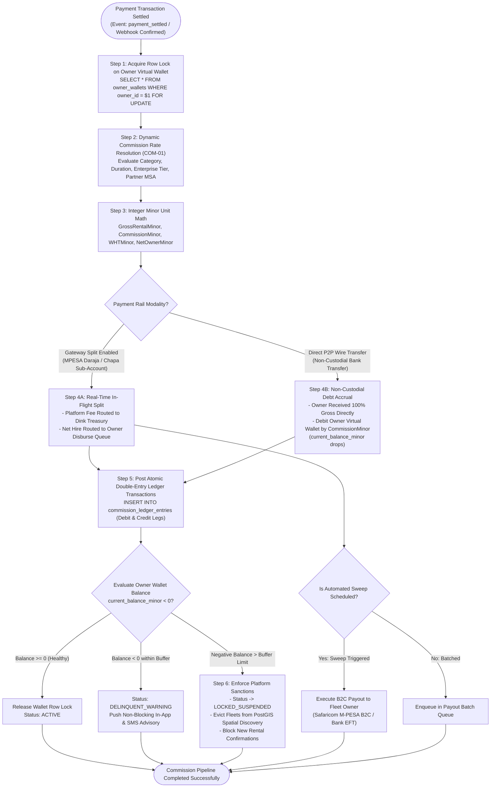
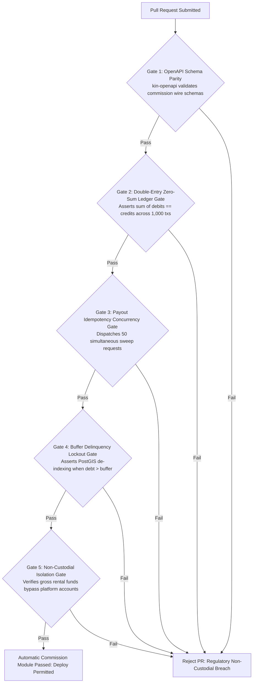

# Heavy Machinery & Logistics Rental Aggregator — Dink Machinery
## Software Requirements Specification — 07.02. Automatic Commission Deduction, Escrow Splits, Wallet Sweep & Payout Routing Architecture (`docs/shared/requirements/07-02-automatic-commission-deduction.md`)

**Document Identifier:** `SRS-DINK-CORE-V7.0-SEC-07-02`  
**Classification:** Canonical System Requirements Specification & Financial Settlement Baseline (Single Source of Truth)  
**Governing Standard:** IEEE Std 830-1998 / IEEE/ISO/IEC 29148:2018 (Systems and Software Engineering — Requirements Engineering)  
**Associated Artifacts:** `SRS-DINK-CORE-V7.0` (§5.2, §5.5, §5.7, §5.9, §6.3, §7.0, §7.1, §7.2, §8, §10, §12, §13.2), `FLOW-BOOKING-STATE-MACHINE-DINK-CORE-V7.0`, `FLOW-COMMISSION-DEBT-DINK-CORE-V7.0`, `FLOW-WIRE-DISPUTE-DINK-CORE-V7.0`, `ARCH-BACKEND-GO-DINK-CORE-V7.0`, `ARCH-FLUTTER-DINK-CORE-V7.0`, `ARCH-ADMIN-NEXT-DINK-CORE-V7.0`, `ARCH-SEC-DINK-CORE-V7.0`, `DS-DINK-CORE-V7.0`, `DS-PERSONAS-DINK-CORE-V7.0`, `contracts/openapi.yaml`, `ADR-001`, `ADR-002`, `ADR-004`, `ADR-005`, `ADR-008`, `ADR-010`  
**Target Runtimes:** Go 1.27.3 Backend Monolith, PostgreSQL 18.6 + PostGIS 3.6.4, Valkey 9.1.3, ClamAV Daemon (:3310), SeaweedFS S3, Flutter 3.47.9 / Dart 3.9 (Cross-Platform Mobile), Next.js 16.x (latest CVE security patch) / React 19 (Web Admin & Corporate Portal), Isar NoSQL 3.1+  
**Target Personas:** Equipment Fleet Owner (*W/ro Almaz Tesfaye* / *Kamau Ndegwa*), Civil Engineering Contractor (*Dawit Haile-Mariam* / *Patrick Kariuki*), Finance Controller & Revenue Auditor (*Solomon Kassa*), Compliance Officer & Legal Counsel (*Yohannes Bekele*), Super Administrator (*Rahel Tadesse*)  
**Target Operating Markets:** Ethiopia (`ET`) & Kenya (`KE`) — Dynamic Multi-Country Parameterization (`LOC-01-BE`)  
**Compliance Standards:** OWASP ASVS 4.0.3 Level 3 (Cryptographic Non-Repudiation, Transaction Isolation, Financial Audit Trail Immutability), RFC 9457 (Problem Details), ISO 9241-110, W3C WCAG 2.2 Level AAA (Field Mobile) & Level AA (Admin Web), National Bank of Ethiopia (NBE) Payment Instrument Issuer Directives (ONPS/01/2020 & ONPS/09/2023), Central Bank of Kenya (CBK) National Payment System Act (Cap 491B), Safaricom M-PESA B2C/B2B Integration Standards, Commercial Bank of Ethiopia (CBE) Direct Settlement Guidelines, International Financial Reporting Standards (IFRS 15 Revenue from Contracts with Customers)  
**Status:** Approved Engineering Baseline

---

## Table of Contents

- 1. [Document Scope & Architectural Mandate](#1-document-scope--architectural-mandate)
  - 1.1 [Purpose & Functional Scope](#11-purpose--functional-scope)
  - 1.2 [Core Financial Invariants & Non-Custodial Bounds](#12-core-financial-invariants--non-custodial-bounds)
- 2. [Automated Commission Deduction & Split Topology (`COM-01`)](#2-automated-commission-deduction--split-topology-com-01)
  - 2.1 [End-to-End Commission Ingestion & Split Pipeline Flowchart](#21-end-to-end-commission-ingestion--split-pipeline-flowchart)
  - 2.2 [Dynamic Commission Rate Resolution Waterfall](#22-dynamic-commission-rate-resolution-waterfall)
  - 2.3 [Multi-Rail Real-Time Split vs. Off-Platform P2P Debt Model](#23-multi-rail-real-time-split-vs-off-platform-p2p-debt-model)
  - 2.4 [Dispute Withholding & Reconciliation Adjustment Rules](#24-dispute-withholding--reconciliation-adjustment-rules)
- 3. [Virtual Wallet Sweeps & Direct Payout Automation (`COM-02`)](#3-virtual-wallet-sweeps--direct-payout-automation-com-02)
  - 3.1 [Automated Sweep Schedule & Threshold Triggers](#31-automated-sweep-schedule--threshold-triggers)
  - 3.2 [Kenyan Rail: Safaricom M-PESA B2C / B2B Automated Disbursement](#32-kenyan-rail-safaricom-m-pesa-b2c--b2b-automated-disbursement)
  - 3.3 [Ethiopian Rail: Direct Core Banking Settlement (CBE, Awash, TeleBirr)](#33-ethiopian-rail-direct-core-banking-settlement-cbe-awash-telebirr)
  - 3.4 [Negative Wallet Buffer Limits, Delinquency Warnings & Auto-Lockouts](#34-negative-wallet-buffer-limits-delinquency-warnings--auto-lockouts)
- 4. [Escrow Split Mechanics & Double-Entry Accounting (`COM-03`)](#4-escrow-split-mechanics--double-entry-accounting-com-03)
  - 4.1 [Double-Entry General Ledger Account Topology](#41-double-entry-general-ledger-account-topology)
  - 4.2 [Atomic Ingestion Pipeline (Zero-Sum Integer Balances)](#42-atomic-ingestion-pipeline-zero-sum-integer-balances)
  - 4.3 [Tax Withholding (WHT) & VAT Remittance Carve-Outs](#43-tax-withholding-wht--vat-remittance-carve-outs)
- 5. [Relational Database Schema & Data Modeling (`COM-DB`)](#5-relational-database-schema--data-modeling-com-db)
  - 5.1 [Entity Relationship Diagram](#51-entity-relationship-diagram)
  - 5.2 [Data Definition Language (DDL) Specifications](#52-data-definition-language-ddl-specifications)
- 6. [Wire Protocol Contracts & RFC 9457 Error Schemas](#6-wire-protocol-contracts--rfc-9457-error-schemas)
  - 6.1 [`POST /api/v1/finance/commission/calculate`](#61-post-apiv1financecommissioncalculate)
  - 6.2 [`POST /api/v1/finance/wallets/{walletId}/sweep`](#62-post-apiv1financewalletswalletidsweep)
  - 6.3 [`POST /api/v1/finance/payouts/b2c-disburse`](#63-post-apiv1financepayoutsb2c-disburse)
  - 6.4 [`GET /api/v1/finance/wallets/{walletId}/statement`](#64-get-apiv1financewalletswalletidstatement)
  - 6.5 [RFC 9457 Universal Problem Details Payloads](#65-rfc-9457-universal-problem-details-payloads)
- 7. [Automated Testing Suite & Verification Gates](#7-automated-testing-suite--verification-gates)

---

## 1. Document Scope & Architectural Mandate

### 1.1 Purpose & Functional Scope

This specification establishes **Section 07.02 (Automatic Commission Deduction, Escrow Splits, Wallet Sweep & Payout Routing Architecture)** of the canonical Software Requirements Specification (SRS) for **Dink Machinery Version 7.0**.

In scaling heavy machinery plant hire and commercial logistics operations across Ethiopia and Kenya, revenue realization and commission collection cannot depend on manual payment matching or unsecured post-settlement invoicing:
* Under the Phase 1 MVP framework (`SRS 05.09`), equipment owners accumulate commission liabilities in a virtual wallet, requiring manual periodic bank wire transfers back to Dink Machinery (`FLOW-COMMISSION-DEBT`). This operational model creates credit risk, collection friction, administrative overhead, and potential commercial disputes.
* In Phase 3 (`ADV-02`), where programmatic payment rails (*TeleBirr SuperApp H5, CBEBirr Plus, Chapa, Safaricom M-PESA Daraja 2.0, Pesapal*) are operational, the platform introduces **Automated Commission Deductions and Real-Time Split Settlements**.
* Where regulatory licenses and technical gateways permit direct split settlement (*e.g., Safaricom M-PESA split disbursements, payment aggregator sub-account routing*), inbound rental payments must atomically divide at ingestion: routing net supplier funds to the equipment owner's verified account while instantaneously sweeping the platform service fee into Dink Machinery’s treasury account.
* Where sovereign regulatory constraints (*e.g., NBE non-custodial directives for direct peer-to-peer bank wires*) mandate gross direct payment from contractor to fleet owner, the system enforces automated wallet debt accrual, dynamic credit buffer monitoring, automated sweep debit orders, and programmatic marketplace restrictions upon buffer breach.

This document formally specifies:
1. The real-time commission calculation engine evaluating variable basis points across machinery categories, rental durations, and corporate enterprise tiers (`COM-01`).
2. The automated gateway split and payout sweep engine executing instant M-PESA B2C/B2B disbursements and Ethiopian core banking sweep orders (`COM-02`).
3. The double-entry general ledger architecture enforcing zero-sum balancing, VAT remittances, and withholding tax (WHT) deductions (`COM-03`).
4. The delinquency escalation engine managing wallet credit buffers, progressive operational restrictions, and asset de-indexing.

### 1.2 Core Financial Invariants & Non-Custodial Bounds

1. **Deterministic Basis-Point Resolution Invariant:** Platform service fees are calculated strictly using integer basis points ($10,000\text{ bps} = 100.00\%$). Floating-point arithmetic is barred across all financial calculations:
   $$\mathcal{C}_{\text{commission\_minor}} = \left\lfloor \frac{\mathcal{V}_{\text{base\_hire\_minor}} \times \text{RateBps}}{10,000} \right\rfloor$$
2. **Double-Entry General Ledger Floor (IFRS 15):** Every commission deduction, gateway split, wallet sweep, and debt accrual must execute as an atomic, multi-legged double-entry transaction where the sum of debits strictly equals the sum of credits:
   $$\sum \text{Debits} \equiv \sum \text{Credits} \quad (\Delta = 0\text{ Minor Units})$$
   Tables `commission_ledger_entries`, `owner_wallet_transactions`, and `payout_disbursement_records` are strictly append-only. Relational rules enforce `ON UPDATE DO INSTEAD NOTHING` and `ON DELETE DO INSTEAD NOTHING`.
3. **Sovereign Non-Custodial Separation Floor (NBE Directive ONPS/01/2020):** In jurisdictions or payment rails where Dink Machinery does not possess a custodial trust-banking license, the platform must never hold, pool, or escrow gross machinery rental capital. Gross funds route directly to the equipment owner, and commission is tracked as an enforceable contractual debt (`COMMISSION_DEBT_ACCRUED`) against the owner's virtual wallet.
4. **Sub-100ms Ingestion & Balance Locking SLO:** Commission calculations and wallet balance mutations must resolve synchronously within $< 100\text{ ms}$ (p99) under row-level database locks (`SELECT FOR UPDATE`), preventing double-spend and race conditions during high-concurrency checkouts.
5. **Universal Payout Idempotency Protection:** All automated outward payout sweeps (M-PESA B2C, interbank EFT, RTGS) must bind a deterministic cryptographic `Idempotency-Key` formed from the unique transaction and wallet ledger references. Re-submitting an identical key returns the original payout status without re-executing funds disbursement.

---

## 2. Automated Commission Deduction & Split Topology (`COM-01`)

### 2.1 End-to-End Commission Ingestion & Split Pipeline Flowchart



---

### 2.2 Dynamic Commission Rate Resolution Waterfall

The commission engine determines the applicable platform service fee dynamically using an unambiguous precedence waterfall:

```text
+----------------------------------------------------------------------------------------------------+
| DINK MACHINERY COMMISSION RESOLUTION WATERFALL                                                     |
+------+---------------------------+-----------------------------------+-----------------------------+
| RANK | RULE CLASSIFICATION       | EVALUATION CRITERIA               | STANDARD COMMISSION TARIFF  |
+------+---------------------------+-----------------------------------+-----------------------------+
| 1    | Enterprise MSA Negotiated | Bilateral contract active between | Custom Contract Bps         |
|      | Tariff (Highest Priority) | Dink Machinery and Corporate Owner| (e.g., 650 bps = 6.50%)     |
+------+---------------------------+-----------------------------------+-----------------------------+
| 2    | Long-Term Rental Volume   | Hire Duration >= 90 Days          | 750 bps (7.50%)             |
|      | Incentive Tier            | Hire Duration >= 30 Days          | 850 bps (8.50%)             |
+------+---------------------------+-----------------------------------+-----------------------------+
| 3    | Logistics Transport       | Fleet Category: LOGISTICS         | 250 bps (2.50%)             |
|      | Pass-Through Tariff       | (Lowboy, Flatbed, Step-Deck)      | (Discounted freight rate)   |
+------+---------------------------+-----------------------------------+-----------------------------+
| 4    | High-Value Mining & Crane | Asset Category: MINING_EXCAVATOR, | 800 bps (8.00%)             |
|      | Heavy Plant Tariff        | ALL_TERRAIN_CRANE (> 100 Tons)    |                             |
+------+---------------------------+-----------------------------------+-----------------------------+
| 5    | Standard Catalog Base     | Standard Earthmoving Plant        | 1,000 bps (10.00%)          |
|      | (Baseline Floor)          | (Excavators, Dozers, Graders)     | (Canonical platform floor)  |
+------+---------------------------+-----------------------------------+-----------------------------+
```

* **Calculation Floor Rule:** Regardless of duration discounts or promotional incentives, the platform commission can never resolve below **$200\text{ bps}$ ($2.00\%$)**, ensuring operational cost recovery across cloud infrastructure, cellular telemetry, and customer verification overhead.

---

### 2.3 Multi-Rail Real-Time Split vs. Off-Platform P2P Debt Model

Due to sovereign financial regulations, Dink Machinery implements a dual-mode operational settlement model:

#### Mode A: Programmatic Gateway Split (Real-Time In-Flight Deduction)
* **Applicable Rails:** Safaricom M-PESA Daraja 2.0 (Kenya), Chapa Sub-Accounts (Ethiopia).
* **Execution:** When the contractor authorizes checkout, the gateway split directive splits the payment at the gateway level:
  $$\text{Contractor Pays: } 100,000.00\text{ KES}$$
  $$\text{Gateway Routes To Dink Treasury: } 10,000.00\text{ KES (10.00\% Commission)}$$
  $$\text{Gateway Routes To Owner Escrow / Wallet: } 90,000.00\text{ KES (Net Supplier Yield)}$$
* The owner virtual wallet is credited with net funds, ready for automated payout sweeping.

#### Mode B: Non-Custodial Direct P2P Bank Wire (Commission Debt Accrual)
* **Applicable Rails:** Direct Core Interbank Wire (CBE, Awash, Dashen, KCB RTGS).
* **Execution:** Contractor deposits $100\%$ gross rental funds directly into the fleet owner's verified commercial bank account.
* Upon owner statement verification (`FLOW-07` / `SRS 05.09`), the Go monolith assesses commission:
  - System debits `owner_wallets.current_balance_minor` by the commission amount ($10.0\%$).
  - Current balance transitions into a negative state (debt owed to platform).
  - Owner settles accumulated debt via in-app payment rails or direct administrative deposit.

---

### 2.4 Dispute Withholding & Reconciliation Adjustment Rules

If a rental terminates with an open damage dispute or excess hour contestation (`FLOW-10` / `SRS 05.07`):
* **Commission Hold Invariant:** Commission on the contested portion is frozen in status `COMMISSION_HELD_DISPUTE`.
* **Adjudication Release:**
  - If Compliance Officer *Yohannes Bekele* rules in favor of the contractor (refunding excess hours), the held commission debt is voided via balancing credit reversal.
  - If ruled in favor of the owner, the held commission debt commits to `ACCRUED`, decrementing the owner's virtual wallet.

---

## 3. Virtual Wallet Sweeps & Direct Payout Automation (`COM-02`)

### 3.1 Automated Sweep Schedule & Threshold Triggers

For funds collected via programmatic gateway rails, the virtual wallet payout sweep engine executes automated transfers to the fleet owner's verified bank or mobile wallet:

```text
+--------------------------------------------------------------------------------------------------+
| VIRTUAL WALLET PAYOUT SWEEP TRIGGER MATRIX (COM-02)                                              |
+---------------------+-------------------+---------------------+----------------------------------+
| SWEEP TRIGGER TYPE  | THRESHOLD / TIME  | JURISDICTION TARGET | OPERATIONAL DISBURSEMENT ACTION  |
+---------------------+-------------------+---------------------+----------------------------------+
| Instant Threshold   | Wallet Net Balance| Kenya (M-PESA)      | Immediate Safaricom B2C payout   |
| Real-Time Sweep     | >= 5,000 KES      |                     | dispatch (< 3.0 seconds).        |
+---------------------+-------------------+---------------------+----------------------------------+
| Daily Scheduled     | Every Working Day | Ethiopia & Kenya    | Batch ACH / EFT disbursement to  |
| Treasury Sweep      | at 16:30:00 EAT   | (Commercial Banks)  | corporate bank accounts.         |
+---------------------+-------------------+---------------------+----------------------------------+
| Minimum Threshold   | Balance < Floor   | Universal           | Funds accumulate in wallet until |
| Accumulation Hold   | (< 500 ETB / KES) |                     | floor is reached; avoids fees.   |
+---------------------+-------------------+---------------------+----------------------------------+
```

---

### 3.2 Kenyan Rail: Safaricom M-PESA B2C / B2B Automated Disbursement

For fleet owners in Kenya, disbursements execute programmatically:
1. The Go monolith calls Safaricom Daraja 2.0 B2C endpoint (`POST /mpesa/b2c/v1/paymentrequest`).
2. Parameters: `CommandID = 'BusinessPayment'`, `InitiatorName`, encrypted credentials, recipient phone, amount in KES minor units.
3. System logs `payout_disbursement_records` in status `DISPATCHED`.
4. Safaricom returns callback to `POST /api/v1/payments/webhooks/mpesa-b2c`.
5. Upon confirmation (`ResultCode == 0`), payout transitions to `CONFIRMED`, and owner wallet updates.

---

### 3.3 Ethiopian Rail: Direct Core Banking Settlement (CBE, Awash, TeleBirr)

For fleet owners in Ethiopia:
* **TeleBirr B2C Bulk Payout:** Programmatically transfers funds from Dink Machinery’s corporate TeleBirr merchant till directly to the owner’s TeleBirr mobile account via Ethio Telecom partner API.
* **CBE Direct Interbank Credit:** Generates automated clearing house instruction files conforming to the Commercial Bank of Ethiopia (CBE) corporate direct debit/credit format for high-value payouts.

---

### 3.4 Negative Wallet Buffer Limits, Delinquency Warnings & Auto-Lockouts

Under Mode B (Non-Custodial Direct Wire), fleet owners accumulate negative wallet balances:

```text
+--------------------------------------------------------------------------------------------------+
| OWNER COMMISSION DEBT PROGRESSIVE ESCALATION MATRIX                                              |
+-------+-------------------------+---------------------+------------------------------------------+
| STAGE | DEBT THRESHOLD / AGING  | STATUS CLASSIFIC.   | PLATFORM SANCTIONS & SYSTEM BEHAVIOR     |
+-------+-------------------------+---------------------+------------------------------------------+
| 1     | Debt <= 50,000.00 ETB   | ACTIVE              | Standard operations; yellow badge on     |
|       | (Within Credit Buffer)  |                     | owner dashboard: "Current Balance Owed". |
+-------+-------------------------+---------------------+------------------------------------------+
| 2     | Debt > 50,000.00 ETB    | DELINQUENT_WARNING  | P1 In-App & SMS alerts; grace period     |
|       | OR Age > 14 Days        |                     | countdown timer (7 Days to settle).      |
+-------+-------------------------+---------------------+------------------------------------------+
| 3     | Unpaid post Grace Period| LOCKED_SUSPENDED    | 1. Fleets evicted from PostGIS search.   |
|       | OR Debt > 100,000.00 ETB|                     | 2. New booking confirmations blocked.    |
|       |                         |                     | 3. Outbox sync halted on mobile devices. |
+-------+-------------------------+---------------------+------------------------------------------+
| 4     | Delinquency > 45 Days   | LEGAL_RECOVERY      | Account referred to commercial recovery; |
|       |                         |                     | corporate tax ID (TIN) blacklisted.      |
+--------------------------------------------------------------------------------------------------+
```

---

## 4. Escrow Split Mechanics & Double-Entry Accounting (`COM-03`)

### 4.1 Double-Entry General Ledger Account Topology

Every financial transaction is recorded across standardized chart-of-accounts codes:

```text
+--------------------------------------------------------------------------------------------------+
| DINK MACHINERY GENERAL LEDGER (GL) CHART OF ACCOUNTS (COM-03)                                    |
+-------------+---------------------------+-------------------+------------------------------------+
| ACCOUNT NO  | ACCOUNT NAME              | CLASSIFICATION    | OPERATIONAL ROLE                   |
+-------------+---------------------------+-------------------+------------------------------------+
| GL 10100    | Platform Settlement Bank  | Asset (Cash)      | Gateway merchant clearing balances.|
+-------------+---------------------------+-------------------+------------------------------------+
| GL 20100    | Owner Escrow Payable      | Liability         | Undisbursed net hire funds owed to |
|             |                           |                   | fleet owners.                      |
+-------------+---------------------------+-------------------+------------------------------------+
| GL 20200    | Commission Debt Owed      | Asset (Receivable)| Uncollected commission debts owed  |
|             | by Owners                 |                   | by fleet owners to Dink Machinery. |
+-------------+---------------------------+-------------------+------------------------------------+
| GL 40100    | Platform Commission       | Revenue           | Earned platform fee revenue        |
|             | Revenue                   |                   | (10% machinery, 2.5% freight).     |
+-------------+---------------------------+-------------------+------------------------------------+
| GL 20300    | Statutory VAT Output Tax  | Liability         | 15% ET / 16% KE VAT collected on   |
|             | Payable                   |                   | platform commission fees.          |
+-------------+---------------------------+-------------------+------------------------------------+
```

---

### 4.2 Atomic Ingestion Pipeline (Zero-Sum Integer Balances)

When a $100,000.00\text{ KES}$ payment settles via M-PESA with a $10.0\%$ commission rate ($10,000.00\text{ KES}$ platform fee):

$$\text{Dr: GL 10100 (Platform Bank Clearing)} \quad 10,000,000\text{ Cents}$$
$$\text{Cr: GL 20100 (Owner Payable Escrow)} \quad 9,000,000\text{ Cents}$$
$$\text{Cr: GL 40100 (Platform Commission Revenue)} \quad 862,069\text{ Cents}$$
$$\text{Cr: GL 20300 (VAT Output Tax Liability - 16\%)} \quad 137,931\text{ Cents}$$

$$\Delta = 10,000,000 - (9,000,000 + 862,069 + 137,931) = 0\text{ Minor Units}$$

* **Integrity Guard:** If the sum of debit legs does not exactly match the sum of credit legs down to the individual minor unit, the PostgreSQL transaction aborts, raising a fatal database exception.

---

### 4.3 Tax Withholding (WHT) & VAT Remittance Carve-Outs

In sovereign corporate leasing, tax withholding applies:
* **Ethiopia:** $2.0\%$ statutory Withholding Tax (WHT) on plant equipment leasing.
* **Kenya:** $5.0\%$ statutory WHT on commercial equipment leasing.
* The system computes tax carve-outs and commits them to `commission_tax_carveouts`, generating automated tax summary records for enterprise tax filing.

---

## 5. Relational Database Schema & Data Modeling (`COM-DB`)

### 5.1 Entity Relationship Diagram

```mermaid
erDiagram
    Booking ||--o{ CommissionRecord : "generates"
    Organization ||--o{ OwnerWallet : "owns"
    OwnerWallet ||--o{ CommissionLedgerEntry : "tracks"
    CommissionRecord ||--o{ CommissionLedgerEntry : "materializes"
    OwnerWallet ||--o{ PayoutDisbursementRecord : "disburses"
    CommissionRecord ||--o{ CommissionTaxCarveout : "apportions"

    CommissionRecord {
        uuid id PK
        uuid booking_id FK UK
        uuid owner_organization_id FK
        bigint gross_amount_minor
        int commission_rate_bps
        bigint commission_amount_minor
        bigint net_owner_amount_minor
        string currency -- 'ETB', 'KES'
        string settlement_mode -- 'GATEWAY_SPLIT', 'NON_CUSTODIAL_DEBT'
        string status -- 'PENDING_CONFIRMATION', 'ACCRUED', 'SETTLED', 'HELD_DISPUTE', 'VOIDED'
        timestamptz accrued_at
        timestamptz settled_at
    }

    OwnerWallet {
        uuid id PK
        uuid organization_id FK UK
        bigint current_balance_minor
        bigint credit_buffer_limit_minor
        string currency
        string status -- 'ACTIVE', 'DELINQUENT_WARNING', 'LOCKED_SUSPENDED'
        timestamptz last_sweep_at
        timestamptz updated_at
    }

    CommissionLedgerEntry {
        uuid id PK
        uuid wallet_id FK
        uuid commission_record_id FK NULL
        string entry_type -- 'DEBT_ASSESSMENT', 'COMMISSION_PAYMENT', 'SWEEP_DEDUCTION', 'DISPUTE_REVERSAL'
        string gl_debit_account
        string gl_credit_account
        bigint amount_minor
        bigint resulting_balance_minor
        string transaction_reference
        timestamptz created_at
    }

    PayoutDisbursementRecord {
        uuid id PK
        uuid wallet_id FK
        string payout_rail -- 'MPESA_B2C', 'TELEBIRR_B2C', 'CBE_EFT', 'PESAPAL'
        string destination_account
        bigint disbursed_amount_minor
        bigint gateway_fee_minor
        string status -- 'QUEUED', 'DISPATCHED', 'CONFIRMED', 'FAILED'
        string idempotency_key UK
        string gateway_receipt_ref
        timestamptz dispatched_at
        timestamptz confirmed_at
    }

    CommissionTaxCarveout {
        uuid id PK
        uuid commission_record_id FK
        string tax_type -- 'VAT_OUTPUT', 'WITHHOLDING_TAX'
        decimal tax_rate_percent
        bigint tax_amount_minor
        string certificate_reference
    }
```

---

### 5.2 Data Definition Language (DDL) Specifications

```sql
-- 1. Master Commission Records Table
CREATE TABLE commission_records (
    id UUID PRIMARY KEY DEFAULT gen_random_uuid(),
    booking_id UUID NOT NULL UNIQUE REFERENCES bookings(id) ON DELETE RESTRICT,
    owner_organization_id UUID NOT NULL REFERENCES organizations(id) ON DELETE RESTRICT,
    gross_amount_minor BIGINT NOT NULL CHECK (gross_amount_minor > 0),
    commission_rate_bps INT NOT NULL CHECK (commission_rate_bps >= 200 AND commission_rate_bps <= 2500),
    commission_amount_minor BIGINT NOT NULL CHECK (commission_amount_minor > 0),
    net_owner_amount_minor BIGINT NOT NULL CHECK (net_owner_amount_minor >= 0),
    currency VARCHAR(3) NOT NULL CHECK (currency IN ('ETB', 'KES')),
    settlement_mode VARCHAR(32) NOT NULL,
    status VARCHAR(32) NOT NULL DEFAULT 'PENDING_CONFIRMATION',
    accrued_at TIMESTAMPTZ NOT NULL DEFAULT NOW(),
    settled_at TIMESTAMPTZ NULL,
    CONSTRAINT chk_comm_mode CHECK (settlement_mode IN ('GATEWAY_SPLIT', 'NON_CUSTODIAL_DEBT')),
    CONSTRAINT chk_comm_status CHECK (status IN ('PENDING_CONFIRMATION', 'ACCRUED', 'SETTLED', 'HELD_DISPUTE', 'VOIDED')),
    CONSTRAINT chk_split_sum CHECK (commission_amount_minor + net_owner_amount_minor = gross_amount_minor)
);

CREATE INDEX idx_commission_records_owner ON commission_records (owner_organization_id, status);

-- 2. Owner Virtual Wallets Table
CREATE TABLE owner_wallets (
    id UUID PRIMARY KEY DEFAULT gen_random_uuid(),
    organization_id UUID NOT NULL UNIQUE REFERENCES organizations(id) ON DELETE CASCADE,
    current_balance_minor BIGINT NOT NULL DEFAULT 0,
    credit_buffer_limit_minor BIGINT NOT NULL DEFAULT 5000000, -- 50,000.00 ETB / KES buffer
    currency VARCHAR(3) NOT NULL CHECK (currency IN ('ETB', 'KES')),
    status VARCHAR(32) NOT NULL DEFAULT 'ACTIVE',
    last_sweep_at TIMESTAMPTZ NULL,
    updated_at TIMESTAMPTZ NOT NULL DEFAULT NOW(),
    CONSTRAINT chk_wallet_status CHECK (status IN ('ACTIVE', 'DELINQUENT_WARNING', 'LOCKED_SUSPENDED'))
);

CREATE INDEX idx_owner_wallets_org ON owner_wallets (organization_id);

-- 3. Commission Ledger Entries (Double-Entry Journal)
CREATE TABLE commission_ledger_entries (
    id UUID PRIMARY KEY DEFAULT gen_random_uuid(),
    wallet_id UUID NOT NULL REFERENCES owner_wallets(id) ON DELETE RESTRICT,
    commission_record_id UUID NULL REFERENCES commission_records(id) ON DELETE RESTRICT,
    entry_type VARCHAR(32) NOT NULL,
    gl_debit_account VARCHAR(32) NOT NULL,
    gl_credit_account VARCHAR(32) NOT NULL,
    amount_minor BIGINT NOT NULL CHECK (amount_minor > 0),
    resulting_balance_minor BIGINT NOT NULL,
    transaction_reference VARCHAR(128) NOT NULL,
    created_at TIMESTAMPTZ NOT NULL DEFAULT NOW(),
    CONSTRAINT chk_ledger_entry_type CHECK (entry_type IN ('DEBT_ASSESSMENT', 'COMMISSION_PAYMENT', 'SWEEP_DEDUCTION', 'DISPUTE_REVERSAL', 'BUFFER_ADJUSTMENT'))
);

CREATE INDEX idx_comm_ledger_wallet ON commission_ledger_entries (wallet_id, created_at DESC);

CREATE RULE prevent_comm_ledger_update AS ON UPDATE TO commission_ledger_entries DO INSTEAD NOTHING;
CREATE RULE prevent_comm_ledger_delete AS ON DELETE TO commission_ledger_entries DO INSTEAD NOTHING;

-- 4. Payout Disbursement Records Table
CREATE TABLE payout_disbursement_records (
    id UUID PRIMARY KEY DEFAULT gen_random_uuid(),
    wallet_id UUID NOT NULL REFERENCES owner_wallets(id) ON DELETE RESTRICT,
    payout_rail VARCHAR(32) NOT NULL,
    destination_account VARCHAR(128) NOT NULL,
    disbursed_amount_minor BIGINT NOT NULL CHECK (disbursed_amount_minor > 0),
    gateway_fee_minor BIGINT NOT NULL DEFAULT 0,
    status VARCHAR(32) NOT NULL DEFAULT 'QUEUED',
    idempotency_key VARCHAR(128) NOT NULL UNIQUE,
    gateway_receipt_ref VARCHAR(128) NULL,
    dispatched_at TIMESTAMPTZ NULL,
    confirmed_at TIMESTAMPTZ NULL,
    created_at TIMESTAMPTZ NOT NULL DEFAULT NOW(),
    CONSTRAINT chk_payout_rail CHECK (payout_rail IN ('MPESA_B2C', 'TELEBIRR_B2C', 'CBE_EFT', 'PESAPAL', 'BANK_RTGS')),
    CONSTRAINT chk_payout_status CHECK (status IN ('QUEUED', 'DISPATCHED', 'CONFIRMED', 'FAILED'))
);

CREATE INDEX idx_payout_disburse_status ON payout_disbursement_records (status);
```

---

## 6. Wire Protocol Contracts & RFC 9457 Error Schemas

### 6.1 `POST /api/v1/finance/commission/calculate`

Calculates applicable platform commission, tax withholdings, and net owner yield for a proposed booking.

#### Request Headers
```http
POST /api/v1/finance/commission/calculate HTTP/1.1
Host: api.dinkmachinery.com
Content-Type: application/json
Authorization: Bearer <userAccessToken>
```

#### Request Payload
```json
{
  "fleetId": "flt_019a8f2c-8812-7b9a",
  "grossAmountMinor": 10000000,
  "currency": "ETB",
  "hireDurationDays": 30,
  "paymentRail": "CBEBIRR_PLUS"
}
```

#### Response: `HTTP 200 OK`
```json
{
  "success": true,
  "data": {
    "grossAmountMinor": 10000000,
    "currency": "ETB",
    "appliedCommissionRateBps": 850,
    "commissionAmountMinor": 850000,
    "netOwnerAmountMinor": 9150000,
    "settlementMode": "GATEWAY_SPLIT",
    "taxBreakdown": {
      "vatRatePercent": 15.0,
      "vatOnCommissionMinor": 110869,
      "statutoryWhtRatePercent": 2.0,
      "withholdingTaxMinor": 200000
    },
    "rateResolutionBasis": "DURATION_DISCOUNT_30_DAYS"
  },
  "timestamp": "2026-10-29T14:15:00Z"
}
```

---

### 6.2 `POST /api/v1/finance/wallets/{walletId}/sweep`

Triggers an on-demand payout sweep of liquid wallet balances to the fleet owner's verified bank or mobile account.

#### Request Headers
```http
POST /api/v1/finance/wallets/wal_019a8fe0-8812-7b9a/sweep HTTP/1.1
Host: api.dinkmachinery.com
Content-Type: application/json
Authorization: Bearer <ownerAdminAccessToken>
X-Organization-ID: org_019a8fe0-8812-7b9a-bc21-4491204812aa
Idempotency-Key: 99182a01-4b12-4f9a-8812-7b9a4c10bc21
```

#### Request Payload
```json
{
  "sweepAmountMinor": 8500000,
  "destinationRail": "MPESA_B2C",
  "destinationAccount": "+254712345678"
}
```

#### Response: `HTTP 202 Accepted`
```json
{
  "success": true,
  "data": {
    "disbursementId": "dsb_019a8fe5-1123-7b9a",
    "walletId": "wal_019a8fe0-8812-7b9a",
    "disbursedAmountMinor": 8500000,
    "currency": "KES",
    "payoutRail": "MPESA_B2C",
    "status": "QUEUED",
    "estimatedSettlementSeconds": 3,
    "createdAt": "2026-10-29T14:16:00Z"
  },
  "timestamp": "2026-10-29T14:16:01Z"
}
```

---

### 6.3 `POST /api/v1/finance/payouts/b2c-disburse`

Internal administrative/system endpoint executing automated Safaricom M-PESA B2C disbursements.

#### Request Headers
```http
POST /api/v1/finance/payouts/b2c-disburse HTTP/1.1
Host: api.dinkmachinery.com
Content-Type: application/json
Authorization: Bearer <internalServiceToken>
Idempotency-Key: 77182a01-5c12-4f9a-8812-8c0b5d21cd32
```

#### Request Payload
```json
{
  "disbursementId": "dsb_019a8fe5-1123-7b9a",
  "destinationPhone": "+254712345678",
  "amountMinor": 8500000,
  "remarks": "Dink Machinery Rental Settlement #BK-9912"
}
```

#### Response: `HTTP 200 OK`
```json
{
  "success": true,
  "data": {
    "disbursementId": "dsb_019a8fe5-1123-7b9a",
    "status": "DISPATCHED",
    "gatewayReference": "WS-MPESA-B2C-994120",
    "dispatchedAt": "2026-10-29T14:16:05Z"
  },
  "timestamp": "2026-10-29T14:16:06Z"
}
```

---

### 6.4 `GET /api/v1/finance/wallets/{walletId}/statement`

Retrieves an itemized virtual wallet statement, tracking commission debts, deductions, sweeps, and running balances.

#### Request Headers
```http
GET /api/v1/finance/wallets/wal_019a8fe0-8812-7b9a/statement?startDate=2026-10-01&endDate=2026-10-29 HTTP/1.1
Host: api.dinkmachinery.com
Authorization: Bearer <ownerAccessToken>
```

#### Response: `HTTP 200 OK`
```json
{
  "success": true,
  "data": {
    "walletId": "wal_019a8fe0-8812-7b9a",
    "currency": "ETB",
    "currentBalanceMinor": -1250000,
    "creditBufferLimitMinor": 5000000,
    "status": "ACTIVE",
    "summary": {
      "totalCommissionAccruedMinor": 3450000,
      "totalCommissionSettledMinor": 2200000,
      "netOutstandingDebtMinor": 1250000
    },
    "entries": [
      {
        "entryId": "led_019a8fe8-3341",
        "entryType": "DEBT_ASSESSMENT",
        "amountMinor": 850000,
        "resultingBalanceMinor": -1250000,
        "bookingReference": "BK-2026-8812",
        "createdAt": "2026-10-28T16:00:00Z"
      }
    ]
  },
  "timestamp": "2026-10-29T14:17:00Z"
}
```

---

### 6.5 RFC 9457 Universal Problem Details Payloads

#### Example: Wallet Commission Buffer Exceeded (`HTTP 403 Forbidden`)
```json
{
  "type": "[https://api.dinkmachinery.com/errors/wallet-buffer-exceeded](https://api.dinkmachinery.com/errors/wallet-buffer-exceeded)",
  "title": "Commission Debt Buffer Limit Exceeded",
  "status": 403,
  "detail": "Outstanding commission debt of 58,400.00 ETB exceeds your authorized credit buffer limit of 50,000.00 ETB. Fleet assets temporarily unlisted from marketplace discovery until debt is settled.",
  "instance": "/api/v1/bookings/bk_019a8f60-9912/confirm",
  "code": "ERR_COMMISSION_BUFFER_EXCEEDED",
  "correlationId": "cor_019a8fe0-8812-7b9a-bc21-4491204812aa",
  "timestamp": "2026-10-29T14:18:00Z",
  "invalidParams": [
    {
      "name": "currentBalanceMinor",
      "reason": "Current balance -5840000 is lower than buffer floor -5000000."
    }
  ],
  "links": {
    "settlementEndpoint": "/api/v1/payments/intent?purpose=COMMISSION_SETTLEMENT"
  }
}
```

#### Example: Minimum Payout Threshold Unmet (`HTTP 422 Unprocessable Entity`)
```json
{
  "type": "[https://api.dinkmachinery.com/errors/payout-threshold-unmet](https://api.dinkmachinery.com/errors/payout-threshold-unmet)",
  "title": "Minimum Payout Sweep Threshold Unmet",
  "status": 422,
  "detail": "Requested payout sweep of 350.00 KES is below the minimum processing threshold of 500.00 KES. Balances accumulate until threshold is reached.",
  "instance": "/api/v1/finance/wallets/wal_019a8fe0-8812/sweep",
  "code": "ERR_PAYOUT_THRESHOLD_UNMET",
  "correlationId": "cor_019a8fe0-9914-4c12-8812-7b9a4c10bc21",
  "timestamp": "2026-10-29T14:18:30Z"
}
```

---

## 7. Automated Testing Suite & Verification Gates



1. **OpenAPI Schema Contract Gate (`kin-openapi`):** Validates all commission calculation, wallet sweep, B2C disbursement, and statement retrieval endpoints against `contracts/openapi.yaml`.
2. **Double-Entry Zero-Sum Ledger Integrity Test:** Simulates 1,000 concurrent commission split and sweep executions. Asserts that every leg in `commission_ledger_entries` satisfies exact mathematical balance parity down to zero minor units:
   $$\sum \text{Debits} - \sum \text{Credits} = 0\text{ Minor Units}$$
3. **Payout Sweep Idempotency Concurrency Benchmark:** Dispatches 50 simultaneous parallel sweep requests sharing an identical `Idempotency-Key` across concurrent goroutines. Verifies that exactly one disbursement docket is created and dispatched, while 49 return the cached response with zero duplicate bank or M-PESA transfers.
4. **Buffer Delinquency Auto-Lockout Test:** Deducts a commission liability exceeding the $50,000.00\text{ ETB}$ buffer threshold on an owner wallet. Verifies that the owner’s status atomically updates to `LOCKED_SUSPENDED`, all owned machinery listings are excluded from PostGIS spatial search in $< 100\text{ ms}$, and new rental booking confirmations are blocked.
5. **Non-Custodial Isolation Gate:** Inspects bank wire execution pathways for Ethiopian interbank transactions, verifying that $100\%$ of gross rental advances flow directly from the contractor's bank coordinates to the fleet owner's verified commercial bank account, with zero routing through platform-held bank accounts.

---

*This document establishes the canonical functional requirements, dynamic rate waterfalls, double-entry general ledger topologies, automated payout sweep algorithms, and wire protocol contracts for Automatic Commission Deduction & Payout Routing in Dink Machinery Version 7.0. All downstream Flutter mobile apps, Next.js corporate portals, Go backend financial services, and PostgreSQL ledger databases must strictly conform to this specification.*