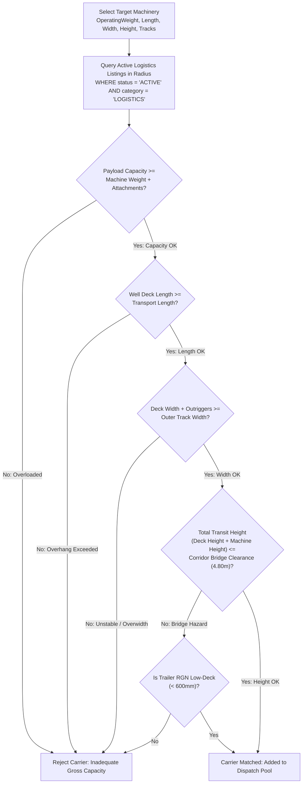
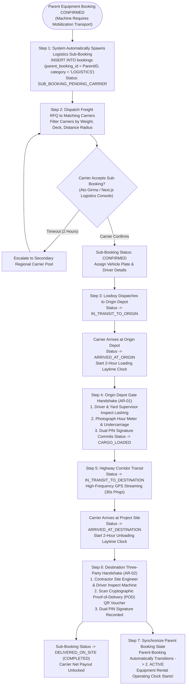
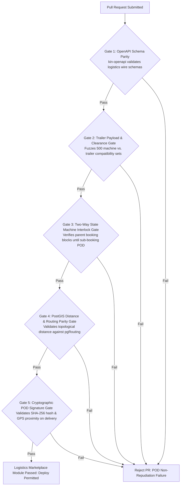

# Heavy Machinery & Logistics Rental Aggregator — Dink Machinery
## Software Requirements Specification — 07.03. Full Logistics Marketplace, Heavy Haulage, Axle Weight Compliance & Transport Sub-Booking Architecture (`docs/shared/requirements/07-03-full-logistics-marketplace.md`)

**Document Identifier:** `SRS-DINK-CORE-V7.0-SEC-07-03`  
**Classification:** Canonical System Requirements Specification & Freight Transport Baseline (Single Source of Truth)  
**Governing Standard:** IEEE Std 830-1998 / IEEE/ISO/IEC 29148:2018 (Systems and Software Engineering — Requirements Engineering)  
**Associated Artifacts:** `SRS-DINK-CORE-V7.0` (§5.2, §5.5, §5.8, §5.9, §5.12, §6.4, §7.0, §7.1, §7.2, §7.3, §8, §10, §12, §13.2), `FLOW-FLEET-REG-DINK-CORE-V7.0`, `FLOW-BOOKING-STATE-MACHINE-DINK-CORE-V7.0`, `FLOW-COMMISSION-DEBT-DINK-CORE-V7.0`, `ARCH-BACKEND-GO-DINK-CORE-V7.0`, `ARCH-FLUTTER-DINK-CORE-V7.0`, `ARCH-ADMIN-NEXT-DINK-CORE-V7.0`, `ARCH-SEC-DINK-CORE-V7.0`, `DS-DINK-CORE-V7.0`, `DS-PERSONAS-DINK-CORE-V7.0`, `contracts/openapi.yaml`, `ADR-001`, `ADR-002`, `ADR-004`, `ADR-005`, `ADR-008`, `ADR-010`  
**Target Runtimes:** Go 1.27.3 Backend Monolith, PostgreSQL 18.6 + PostGIS 3.6.4, Valkey 9.1.3, ClamAV Daemon (:3310), SeaweedFS S3, Flutter 3.47.9 / Dart 3.9 (Cross-Platform Mobile), Next.js 16.x (latest CVE security patch) / React 19 (Web Admin & Corporate Portal), Isar NoSQL 3.1+  
**Target Personas:** Commercial Logistics Carrier & Fleet Owner (*Ato Girma Wolde* / *Samuel Odhiambo*), Certified Lowboy Heavy Haulage Driver (*Tadesse Haile* / *Peter Maina*), Civil Engineering Contractor (*Dawit Haile-Mariam* / *Patrick Kariuki*), Equipment Fleet Owner (*W/ro Almaz Tesfaye* / *Kamau Ndegwa*), Transport Safety Officer & Route Compliance Inspector (*Yohannes Bekele*), Super Administrator (*Rahel Tadesse*)  
**Target Operating Markets:** Ethiopia (`ET`) & Kenya (`KE`) — Dynamic Multi-Country Parameterization (`LOC-01-BE`)  
**Compliance Standards:** OWASP ASVS 4.0.3 Level 3 (Spatial Integrity, Multi-Party Contract Binding & Telematics Non-Repudiation), RFC 9457 (Problem Details), ISO 9241-110, W3C WCAG 2.2 Level AAA (Field Mobile) & Level AA (Admin Web), Federal Transport Authority (FTA) Proclamation No. 1076/2018 (Ethiopia Overweight & Abnormal Load Directives), Ethiopian Roads Administration (ERA) Heavy Transit Clearances, Kenya National Transport and Safety Authority (NTSA) Commercial Vehicle Regulations, Kenya National Highways Authority (KeNHA) Axle Load Control Act 2016, East African Community (EAC) Vehicle Load Control Act  
**Status:** Approved Engineering Baseline

---

## Table of Contents

- 1. [Document Scope & Architectural Mandate](#1-document-scope--architectural-mandate)
  - 1.1 [Purpose & Functional Scope](#11-purpose--functional-scope)
  - 1.2 [Core Heavy Haulage & Engineering Invariants](#12-core-heavy-haulage--engineering-invariants)
- 2. [Heavy Haulage Equipment Taxonomy & Trailer Compatibility Engine (`LOG-01`)](#2-heavy-haulage-equipment-taxonomy--trailer-compatibility-engine-log-01)
  - 2.1 [Logistics Classification Matrix](#21-logistics-classification-matrix)
  - 2.2 [Automated Dimensional & Tonnage Compatibility Matching](#22-automated-dimensional--tonnage-compatibility-matching)
  - 2.3 [Ramp Angle, Deck Height & Ground Clearance Verification](#23-ramp-angle-deck-height--ground-clearance-verification)
  - 2.4 [Detachable Gooseneck (RGN) vs. Fixed Step-Deck Rules](#24-detachable-gooseneck-rgn-vs-fixed-step-deck-rules)
- 3. [Sovereign Corridors, Axle Weight Limits & Regulatory Permitting (`LOG-02`)](#3-sovereign-corridors-axle-weight-limits--regulatory-permitting-log-02)
  - 3.1 [Ethiopian Federal Transport Authority (FTA) & ERA Clearances](#31-ethiopian-federal-transport-authority-fta--era-clearances)
  - 3.2 [Kenyan KeNHA Axle Load Control & Virtual Weighbridge Integration](#32-kenyan-kenha-axle-load-control--virtual-weighbridge-integration)
  - 3.3 [Abnormal & Oversized Load Escort Vehicle Protocols](#33-abnormal--oversized-load-escort-vehicle-protocols)
  - 3.4 [Corridor Geofencing, Curfew Schedules & Holiday Blackout Gates](#34-corridor-geofencing-curfew-schedules--holiday-blackout-gates)
- 4. [Dynamic Haulage Pricing, Distance Calculations & Deadhead Billing (`LOG-03`)](#4-dynamic-haulage-pricing-distance-calculations--deadhead-billing-log-03)
  - 4.1 [PostGIS Topologically Constrained Highway Distance Routing](#41-postgis-topologically-constrained-highway-distance-routing)
  - 4.2 [Multi-Variable Pricing Matrix (Flat, Per-KM, Tonnage & Deadhead)](#42-multi-variable-pricing-matrix-flat-per-km-tonnage--deadhead)
  - 4.3 [Loading/Unloading Demurrage & Site Detention Surcharges](#43-loadingunloading-demurrage--site-detention-surcharges)
  - 4.4 [Discounted Freight Commission Tariff (250 bps Pass-Through)](#44-discounted-freight-commission-tariff-250-bps-pass-through)
- 5. [Two-Way Sub-Booking Integration & State Synchronization (`LOG-04`)](#5-two-way-sub-booking-integration--state-synchronization-log-04)
  - 5.1 [Parent Booking Interlock State Machine Topology](#51-parent-booking-interlock-state-machine-topology)
  - 5.2 [Three-Party Handover Handshake (Owner, Carrier, Contractor)](#52-three-party-handover-handshake-owner-carrier-contractor)
  - 5.3 [En-Route Telematics Tracking, Route Deviations & Incident Dockets](#53-en-route-telematics-tracking-route-deviations--incident-dockets)
  - 5.4 [Proof of Delivery (POD) Cryptographic Attestation & Settlement](#54-proof-of-delivery-pod-cryptographic-attestation--settlement)
- 6. [Relational Database Schema & Data Modeling (`LOG-DB`)](#6-relational-database-schema--data-modeling-log-db)
  - 6.1 [Entity Relationship Diagram](#61-entity-relationship-diagram)
  - 6.2 [Data Definition Language (DDL) Specifications](#62-data-definition-language-ddl-specifications)
- 7. [Wire Protocol Contracts & RFC 9457 Error Schemas](#7-wire-protocol-contracts--rfc-9457-error-schemas)
  - 7.1 [`POST /api/v1/logistics/quotes/calculate`](#71-post-apiv1logisticsquotescalculate)
  - 7.2 [`POST /api/v1/logistics/sub-bookings`](#72-post-apiv1logisticssub-bookings)
  - 7.3 [`POST /api/v1/logistics/trips/{id}/milestones`](#73-post-apiv1logisticstripsidmilestones)
  - 7.4 [`POST /api/v1/logistics/trips/{id}/pod-signoff`](#74-post-apiv1logisticstripsidpod-signoff)
  - 7.5 [RFC 9457 Universal Problem Details Payloads](#75-rfc-9457-universal-problem-details-payloads)
- 8. [Automated Testing Suite & Verification Gates](#8-automated-testing-suite--verification-gates)

---

## 1. Document Scope & Architectural Mandate

### 1.1 Purpose & Functional Scope

This specification establishes **Section 07.03 (Full Logistics Marketplace, Heavy Haulage, Axle Weight Compliance & Transport Sub-Booking Architecture)** of the canonical Software Requirements Specification (SRS) for **Dink Machinery Version 7.0**.

In the East African construction and mining ecosystems across Ethiopia and Kenya, the physical deployment of heavy plant machinery (crawler excavators, bulldozers, wheel loaders, motor graders, drilling rigs) is strictly tethered to commercial transport logistics:
* **The Non-Self-Move Invariant:** Over $85\%$ of capitalized plant machinery assets cannot legally or mechanically self-mobilize on public national highways. Crawler-mounted machinery destroys bitumen pavements and travels at sub-economic speeds ($3\text{ to }6\text{ km/h}$), requiring specialized multi-axle heavy commercial transport (lowboy trailers, drop-decks, and modular hydraulic platform transporters).
* **The Logistics Bottle-Neck:** In the MVP architecture (`SRS §5.8`), transport was treated merely as an auxiliary sub-category with uncoordinated manual settlements. In Dink Machinery V7.0, Logistics is upgraded into a sovereign, automated two-sided logistics freight marketplace.
* **Complex Multi-Jurisdictional Regulatory Enforcement:** Heavy machinery transit involves extreme regulatory friction:
  - **Ethiopia:** Federal Transport Authority (FTA) Proclamation No. 1076/2018, Ethiopian Roads Administration (ERA) movement clearances, strict weekend and religious holiday transit blackouts (`SRS 05.23`), and axle-load checkpoints.
  - **Kenya:** KeNHA Axle Load Control Act 2016, automated high-speed weigh-in-motion (WIM) sensors along the Northern Corridor (Mombasa–Nairobi–Malaba), mandatory police/private escort vehicle rules for loads exceeding $2.65\text{ m}$ width or $50\text{ tons}$ gross weight.
* **Multi-Party Coordination Dependencies:** Machinery mobilization binds three distinct corporate actors: the **Equipment Owner** (origin depot custodian), the **Logistics Carrier** (multi-axle hauler and driver), and the **Civil Contractor** (destination project site receiver). Operational desynchronization leads to carrier detention, demurrage penalties, and stalled infrastructure construction.

This document formally specifies:
1. The specialized trailer taxonomy, mechanical ramp constraints, and automated multi-variable equipment compatibility engine (`LOG-01`).
2. National transit corridors, statutory axle-weight ceilings, oversized abnormal-load clearances, and escort dispatch matrices (`LOG-02`).
3. Topologically constrained PostGIS route generation, dynamic deadhead pricing formulas, and discounted freight commission tariffs (`LOG-03`).
4. The two-way state machine linking parent equipment bookings with logistics sub-bookings, three-party mobile inspection handshakes, and cryptographic Proof of Delivery (POD) sign-offs (`LOG-04`).

### 1.2 Core Heavy Haulage & Engineering Invariants

1. **Physical & Structural Compatibility Invariant (`LOG-01`):** A logistics carrier vehicle cannot be matched or booked for heavy machinery transport unless:
   $$\text{RatedPayloadCapacity}_{\text{carrier}} \ge \text{OperatingWeight}_{\text{machinery}} + \text{BundledAttachmentsWeight}$$
   $$\text{DeckLength}_{\text{trailer}} \ge \text{TransportLength}_{\text{machinery}} \quad \land \quad \text{DeckWidth}_{\text{trailer}} + \text{Outriggers} \ge \text{TrackWidth}_{\text{machinery}}$$
   Violating payload tonnage or physical deck dimensions blocks sub-booking dispatch synchronously with **RFC 9457 HTTP 422 Unprocessable Entity (`ERR_INCOMPATIBLE_HAULAGE_RIG`)**.
2. **Statutory Axle-Load Floor & Overweight Compliance (`LOG-02`):** Total gross vehicle mass (GVM) and individual axle-group distributions must strictly comply with sovereign statutory maximums:
   - **Kenya (KeNHA / EAC):** Single steering axle ($8.0\text{ t}$), Tandem axle ($18.0\text{ t}$), Tridem axle ($24.0\text{ t}$), Maximum legal GVM without abnormal load permit ($56.0\text{ t}$).
   - **Ethiopia (ERA / FTA):** Maximum single-axle limit ($10.0\text{ t}$), Tandem ($18.0\text{ t}$), Tridem ($24.0\text{ t}$).
   Loads exceeding legal thresholds mandate verified abnormal-load permits and automatic escort vehicle dispatch.
3. **Parent Booking State Machine Interlock (`LOG-04`):** When a machine rental requires transport (`self_move_capable = false`), the parent equipment booking cannot advance from `CONFIRMED` to `ACTIVE` until the linked logistics sub-booking reaches `DELIVERED_ON_SITE` with verified three-party digital inspection sign-off (`AR-01`).
4. **Discounted Freight Commission Floor (250 bps Pass-Through):** To incentivize transport carrier onboarding and prevent freight disintermediation, platform service fees on pure logistics sub-bookings are discounted to **$250\text{ bps}$ ($2.50\%$)**, compared to the $10.00\%$ machinery base hire tariff.
5. **Cryptographic Proof of Delivery (POD) Immutability:** Freight completion requires a dual-key cryptographic handshake at the delivery project site: the lowboy driver scans a dynamic HMAC-SHA256 QR voucher generated on the site manager's mobile device, capturing GPS coordinates within a $500\text{ m}$ destination radius, digital touch signatures, and high-resolution lashing/undercarriage photos.

---

## 2. Heavy Haulage Equipment Taxonomy & Trailer Compatibility Engine (`LOG-01`)

### 2.1 Logistics Classification Matrix

Dink Machinery standardizes all registered heavy haulage vehicles into six discrete mechanical categories:

```text
+----------------------------------------------------------------------------------------------------+
| DINK MACHINERY HEAVY HAULAGE EQUIPMENT CLASSIFICATION MATRIX (LOG-01)                              |
+---------------------+-------------+---------------+-----------------------+------------------------+
| TRAILER CATEGORY    | AXLE CONFIG | PAYLOAD RANGE | DECK HEIGHT / STYLE   | TARGET MACHINERY SUITE |
+---------------------+-------------+---------------+-----------------------+------------------------+
| STEP_DECK_STANDARD  | 2 to 3 Axle | 15 - 28 Tons  | 900 - 1050 mm         | Backhoe Loaders,       |
| (Semi-Lowbed)       | Fixed       |               | Fixed Beavertail Ramp | 14-Ton Mini Excavators |
+---------------------+-------------+---------------+-----------------------+------------------------+
| LOWBOY_RGN_HEAVY    | 3 to 4 Axle | 30 - 50 Tons  | 500 - 650 mm          | 20-35 Ton Excavators,  |
| (Removable Gooseneck| Air/Hydr.   |               | Front-Loading Ground  | D6/D8 Track Bulldozers |
+---------------------+-------------+---------------+-----------------------+------------------------+
| LOWBOY_MULTI_AXLE   | 5 to 8 Axle | 55 - 90 Tons  | 450 - 600 mm          | 40-70 Ton Excavators,  |
| (Modular Heavy Haul)| Hydr. Steer |               | Drop-Well Platform    | Heavy Rotary Drill Rigs|
+---------------------+-------------+---------------+-----------------------+------------------------+
| MODULAR_HYDRAULIC   | 10+ Lines   | 100 - 300+    | Variable Hydraulic    | Mining Shovels, Heavy  |
| TRANSPORTER (SPMT)  | Pendular    | Tons          | Suspension Leveling   | Transformers, Girders  |
+---------------------+-------------+---------------+-----------------------+------------------------+
| FLATBED_COMMERCIAL  | 3 Axle      | 20 - 32 Tons  | 1400 - 1500 mm        | Mobile Compressors,    |
| (Hiab / Crane-Truck)| Fixed Tandem|               | Flat Deck (High Bed)  | Attachments, Fuel Bows |
+---------------------+-------------+---------------+-----------------------+------------------------+
| ROLL_ON_TILT_TRAY   | 2 to 3 Axle | 8 - 18 Tons   | Hydraulic Sliding Bed | Compact Rollers, Skid  |
| (Recovery Slider)   | Rigid       |               | Ultra-Low Angle (8°)  | Steers, Telescopic Fks |
+----------------------------------------------------------------------------------------------------+
```

---

### 2.2 Automated Dimensional & Tonnage Compatibility Matching

When a contractor books equipment requiring transit, the Go domain engine executes an automated geometric and mass compatibility match:



---

### 2.3 Ramp Angle, Deck Height & Ground Clearance Verification

Steel-tracked excavators and asphalt pavers have severe approach-angle limitations:
* **The Ramp Angle Invariant:** Asphalt compactors and pavers cannot climb loading ramps exceeding an **$8.5^\circ$ slope angle**. Attempting to assign a standard fixed beavertail lowbed ($15^\circ\text{ ramp}$) to a tandem vibratory roller triggers an automated compatibility block, requiring a **Hydraulic Tilt-Tray** or **Detachable Gooseneck (RGN)**.
* **Deck Ground Clearance Bounds:** Tracked bulldozers with severe ground-pressure grouser bars require timber hardwood deck inserts (`has_hardwood_deck = true`) to prevent lateral sliding on bare steel decks.

---

### 2.4 Detachable Gooseneck (RGN) vs. Fixed Step-Deck Rules

* **Front-Loading RGN:** Mandatory for all heavy crawler excavators exceeding $30\text{ metric tons}$. The hydraulic gooseneck detaches, allowing the machinery to walk directly onto the drop-deck at ground level without risking high-angle rollover on rear ramps.
* **Rear-Loading Fixed Beavertail:** Permitted strictly for rubber-tired backhoes, wheel loaders, and light utility machinery below $20\text{ metric tons}$.

---

## 3. Sovereign Corridors, Axle Weight Limits & Regulatory Permitting (`LOG-02`)

### 3.1 Ethiopian Federal Transport Authority (FTA) & ERA Clearances

```text
+----------------------------------------------------------------------------------------------------+
| ETHIOPIAN HEAVY HAULAGE CORRIDOR SPECIFICATIONS                                                    |
+---------------------+-------------------+---------------------+------------------------------------+
| CORRIDOR IDENTIFIER | ROUTE SEGMENTS    | CLEARANCE LIMITS    | STATUTORY ENFORCEMENT RULES        |
+---------------------+-------------------+---------------------+------------------------------------+
| CORRIDOR-ET-01      | Addis Ababa ->    | Max Gross: 56.0 t   | Full expressway clearance; night   |
| (Djibouti Gateway)  | Adama -> Awash -> | Height: 4.80 m      | transit permitted; mandatory       |
|                     | Galafi -> Djibouti| Width: 2.60 m       | weighbridge at Mojo & Awash.       |
+---------------------+-------------------+---------------------+------------------------------------+
| CORRIDOR-ET-02      | Mojo -> Hawassa ->| Max Gross: 50.0 t   | Dual-carriageway south; bridge     |
| (Southern Rift)     | Dilla -> Moyale   | Height: 4.60 m      | weight checks at Bilate River.     |
+---------------------+-------------------+---------------------+------------------------------------+
| CORRIDOR-ET-03      | Addis Ababa ->    | Max Gross: 44.0 t   | Mountainous passes; Blue Nile      |
| (Northern Backbone) | Dejen -> Bahir Dar| Height: 4.40 m      | Gorge sharp curve restrictions     |
|                     | -> Gondar         | Width: 2.50 m       | (Curfew: 06:00 to 18:00 only).     |
+---------------------+-------------------+---------------------+------------------------------------+
```

* **ERA Special Movement Permit:** Automatically required if Gross Vehicle Mass (GVM) exceeds $48.0\text{ metric tons}$ or transport width exceeds $2.60\text{ m}$. The system flags `requires_abnormal_permit = true` and attaches the digital ERA clearance application docket.

---

### 3.2 Kenyan KeNHA Axle Load Control & Virtual Weighbridge Integration

Kenya enforces the **East African Community Vehicle Load Control Act** with high-precision automated weigh-in-motion (WIM) sensors along the Northern Corridor:
* **KeNHA Axle Distribution Formulation:**
  $$\text{Total GVM} \le 56,000\text{ kg} \quad (\text{Standard 7-Axle Interlink Tractor-Trailer})$$
  $$\text{Axle Group Tolerance} \le \pm 5.0\% \quad (\text{Automatic Fine Assessed on Exceedance})$$
* **Virtual Weighbridge Pre-Check:** Before confirming transit from Mombasa Port or Nairobi Inland Container Depot (ICD), the platform calculates the axle weight distribution across the carrier's registered axle configuration based on the machinery's center of gravity (CoG). If individual axle overload is predicted, the carrier must add a booster axle or re-position the machine on the deck.

---

### 3.3 Abnormal & Oversized Load Escort Vehicle Protocols

When transit dimensions breach legal road envelopes:

```text
+--------------------------------------------------------------------------------------------------+
| STATUTORY ESCORT VEHICLE DISPATCH MATRIX (LOG-02)                                                |
+-----------------------+-------------------+------------------------------------------------------+
| DIMENSIONAL EXCEEDANCE| ESCORT CARS REQ'D | OPERATIONAL TRANSIT REQUIREMENTS                     |
+-----------------------+-------------------+------------------------------------------------------+
| Width: 2.65 - 3.00 m  | 1 Escort (Front)  | Amber rotating beacons, "OVERSIZED LOAD" high-vis    |
| (Abnormal Load Tier 1)|                   | signage, VHF radio link with lowboy cab.             |
+-----------------------+-------------------+------------------------------------------------------+
| Width: 3.01 - 3.50 m  | 2 Escorts         | Dual escort vehicles; daylight-only transit;         |
| (Abnormal Load Tier 2)| (1 Front, 1 Rear) | police escort rider in urban municipal centers.      |
+-----------------------+-------------------+------------------------------------------------------+
| Width > 3.50 m OR     | 2 Escorts +       | Full rolling road closure coordination; utility      |
| Weight > 70.0 Tons    | Police Outrider   | clearance (lifting overhead telecom & power lines).  |
+--------------------------------------------------------------------------------------------------+
```

---

### 3.4 Corridor Geofencing, Curfew Schedules & Holiday Blackout Gates

* **Corridor Curfew Invariant:** Heavy lowboy combinations carrying abnormal loads are strictly barred from operating between **`18:00:00` and `06:00:00 EAT`** on unlit national corridors (Corridor-ET-03 and Kenya Class-A highways).
* **Statutory Holiday Blackout Interlock (`SRS 05.23` / `HOL-03`):** During major national holidays (*Meskel*, *Fasika*, *Enkutatash* in Ethiopia; *Christmas*, *Easter* in Kenya), the Federal Transport Authority and KeNHA enforce absolute highway freight bans. The logistics booking engine blocks dispatch confirmation for dates intersecting active holiday bans.

---

## 4. Dynamic Haulage Pricing, Distance Calculations & Deadhead Billing (`LOG-03`)

### 4.1 PostGIS Topologically Constrained Highway Distance Routing

Straight-line (Euclidean) distance calculations are mathematically invalid in East African geography due to Rift Valley escarpments, gorges, and unpaved terrain:
* The Go backend calculates highway transit distance via **pgRouting** over a topologically verified OpenStreetMap highway network:
  ```sql
  SELECT SUM(st_length(geom::geography)) / 1000.0 AS route_distance_km
  FROM pgr_dijkstra(
      'SELECT id, source, target, cost_km AS cost FROM ethiopia_highway_network',
      $origin_node, $destination_node, directed := false
  );
  ```
* **Fallback Routing:** If topological graphs are unavailable in remote rural sites, the engine computes Haversine distance adjusted by a validated **Terrain Tortuosity Coefficient**:
  $$\text{Distance}_{\text{effective}} = \text{ST\_Distance}(\text{Origin}, \text{Dest}) \times 1.35$$

---

### 4.2 Multi-Variable Pricing Matrix (Flat, Per-KM, Tonnage & Deadhead)

Heavy transport tariffs disaggregate into transparent line items:

$$\mathcal{T}_{\text{freight}} = \mathcal{C}_{\text{base\_load}} + \left( \mathcal{D}_{\text{route\_km}} \times \mathcal{R}_{\text{per\_km}} \times \mathcal{M}_{\text{tonnage\_factor}} \right) + \mathcal{C}_{\text{deadhead}} + \mathcal{S}_{\text{escort}} + \mathcal{P}_{\text{permits}}$$

```text
+--------------------------------------------------------------------------------------------------+
| DYNAMIC LOGISTICS PRICING FORMULATION (LOG-03)                                                   |
+---------------------+-------------+---------------+----------------------------------------------+
| PRICING PARAMETER   | APPLIED TO  | CURRENCY RATE | TECHNICAL EXPLANATION & DERIVATION           |
+---------------------+-------------+---------------+----------------------------------------------+
| Base Loading &      | Fixed per   | 15,000 ETB /  | Covers deck preparation, driver lashing,     |
| Lashing Fee         | Mobilization| 25,000 KES    | safety tie-down chains, and yard staging.    |
+---------------------+-------------+---------------+----------------------------------------------+
| Distance Transit    | Per KM      | 350 ETB/km /  | Scaled by total transit distance along       |
| Rate                |             | 450 KES/km    | approved highway route.                      |
+---------------------+-------------+---------------+----------------------------------------------+
| Tonnage Multiplier  | Per Ton     | +2.5% per Ton | Rate escalates for payloads > 25 metric tons |
| Tier                | > 25 Tons   | above 25t     | to compensate for extreme fuel consumption.  |
+---------------------+-------------+---------------+----------------------------------------------+
| Deadhead Return     | Empty Leg   | 65% of Active | Billed if carrier cannot secure a return load|
| Repositioning       | Mileage     | KM Rate       | back to home depot staging yard.             |
+---------------------+-------------+---------------+----------------------------------------------+
| Escort Vehicle Fee  | Per Car /   | 150 ETB/km /  | Added automatically if load width > 2.65 m   |
|                     | KM          | 200 KES/km    | or weight requires certified pilot car.      |
+--------------------------------------------------------------------------------------------------+
```

---

### 4.3 Loading/Unloading Demurrage & Site Detention Surcharges

To prevent contractors from stranding lowboy trucks as temporary stationary storage:
* **Free Laytime Window:**
  - Loading: Exactly **$2.0\text{ Hours}$** from carrier arrival at origin depot.
  - Unloading: Exactly **$2.0\text{ Hours}$** from carrier arrival at destination project site.
* **Detention Demurrage Rate:**
  $$\mathcal{S}_{\text{demurrage}} = \text{OverstayHours} \times 2,500.00\text{ ETB/hr}\ (4,000.00\text{ KES/hr})$$
  Tracked via GPS geofence dwell-time timestamps. Confirmed overstays automatically commit as balance adjustments on final settlement (`FLOW-COMMISSION-DEBT`).

---

### 4.4 Discounted Freight Commission Tariff (250 bps Pass-Through)

* Standard plant machinery base hire assesses a $10.00\%$ platform service fee ($1,000\text{ bps}$).
* Pure logistics sub-bookings assess a reduced **$2.50\%$ platform fee ($250\text{ bps}$)**:
  $$\text{PlatformLogisticsFee}_{\text{minor}} = \left\lfloor \mathcal{T}_{\text{freight\_minor}} \times \frac{250}{10,000} \right\rfloor$$
* Prevents carrier margin squeeze and guarantees high platform liquidity along primary transport arteries.

---

## 5. Two-Way Sub-Booking Integration & State Synchronization (`LOG-04`)

### 5.1 Parent Booking Interlock State Machine Topology



---

### 5.2 Three-Party Handover Handshake (Owner, Carrier, Contractor)

Mobilization involves three distinct legal custody transitions:
1. **Custody Handoff 1 (Owner $\longrightarrow$ Carrier):** At the equipment depot gate, Yard Supervisor *Kassahun* and Driver *Tadesse* perform joint inspection. Driver confirms machine securement (minimum 4 Grade-70 transport binder chains with ratchet load binders). Digital sign-off transfers physical custody to the carrier.
2. **Custody Handoff 2 (Carrier $\longrightarrow$ Contractor):** At the construction site gate, Contractor Site Engineer *Dawit* inspects the machine as it walks off the lowboy deck. Captures photos of tires, bucket cutting edges, and glass. Driver and Contractor sign the digital Proof of Delivery (POD). Custody formally transfers to the contractor.

---

### 5.3 En-Route Telematics Tracking, Route Deviations & Incident Dockets

During highway transit:
* The driver's mobile device streams GPS telemetry every **$30\text{ seconds}$** (`GPS-01`).
* **Route Corridor Deviation Alarm:**
  If the vehicle deviates from the approved corridor centerline polygon by $> 5.0\text{ km}$, the system raises an automated **Corridor Deviation Alert** (`ERR_CORRIDOR_DEVIATION`), alerting the logistics operations desk to potential hijacked cargo or unauthorized route hazards.
* **Transit Breakdown Docket:** If the lowboy trailer suffers a puncture or mechanical failure en route:
  - Driver taps `[ Report Transit Breakdown ]`.
  - Transshipment sub-booking can be dispatched to transfer the excavator to a secondary rescue lowboy without aborting the parent equipment contract.

---

### 5.4 Proof of Delivery (POD) Cryptographic Attestation & Settlement

* The Proof of Delivery record is committed to `logistics_pod_records`:
  $$\text{POD Hash} = \text{SHA256}(\text{SubBookingID} \parallel \text{CarrierID} \parallel \text{SiteEngineerID} \parallel \text{Timestamp} \parallel \text{GPS Coordinates})$$
* **Immediate Carrier Settlement:** Confirming the POD triggers the payout sweep engine (`COM-02`), releasing net freight earnings directly to the carrier's M-PESA or commercial bank account within $< 3.0\text{ seconds}$.

---

## 6. Relational Database Schema & Data Modeling (`LOG-DB`)

### 6.1 Entity Relationship Diagram

```mermaid
erDiagram
    Booking ||--o{ LogisticsSubBooking : "spawns"
    Fleet ||--o{ LogisticsVehicleSpec : "specifies"
    LogisticsSubBooking ||--o{ LogisticsRouteWaypoint : "navigates"
    LogisticsSubBooking ||--o{ LogisticsTripMilestone : "records"
    LogisticsSubBooking ||--o{ LogisticsPODRecord : "attests"
    User ||--o{ LogisticsSubBooking : "drives"

    LogisticsSubBooking {
        uuid id PK
        uuid parent_booking_id FK UK
        uuid carrier_organization_id FK
        uuid driver_user_id FK
        uuid transport_fleet_id FK
        string status -- 'SUB_BOOKING_PENDING_CARRIER', 'CONFIRMED', 'IN_TRANSIT_ORIGIN', 'CARGO_LOADED', 'IN_TRANSIT_DESTINATION', 'DELIVERED_ON_SITE'
        bigint freight_fee_minor
        bigint carrier_payout_minor
        bigint platform_commission_minor
        string currency -- 'ETB', 'KES'
        decimal distance_km
        boolean requires_abnormal_permit
        boolean requires_escort_vehicle
        timestamptz dispatched_at
        timestamptz delivered_at
    }

    LogisticsVehicleSpec {
        uuid id PK
        uuid fleet_id FK UK
        string trailer_category -- 'STEP_DECK', 'LOWBOY_RGN', 'MULTI_AXLE', 'MODULAR_HYDRAULIC', 'TILT_TRAY'
        int axle_count
        decimal max_payload_capacity_tons
        decimal deck_length_meters
        decimal deck_width_meters
        decimal deck_height_ground_mm
        decimal ramp_slope_degrees
        boolean has_removable_gooseneck
        boolean has_hardwood_deck
        boolean has_outriggers
    }

    LogisticsRouteWaypoint {
        uuid id PK
        uuid sub_booking_id FK
        int sequence_order
        string waypoint_name
        geography location
        string waypoint_type -- 'ORIGIN_DEPOT', 'WEIGHBRIDGE_CHECK', 'ESCORT_JOIN', 'DESTINATION_SITE'
        timestamptz estimated_arrival
        timestamptz actual_arrival
    }

    LogisticsTripMilestone {
        uuid id PK
        uuid sub_booking_id FK
        string milestone_code -- 'DISPATCH', 'GATE_IN_ORIGIN', 'LASHING_CONFIRMED', 'EN_ROUTE', 'GATE_IN_DEST', 'UNLOADED'
        geography location
        string notes
        string photo_s3_uri NULL
        timestamptz recorded_at
    }

    LogisticsPODRecord {
        uuid id PK
        uuid sub_booking_id FK UK
        uuid driver_user_id FK
        uuid receiver_user_id FK
        string receiver_name
        string receiver_phone
        geography destination_gps
        string digital_signature_s3_uri
        string cargo_photo_s3_uri
        string pod_sha256_hash
        timestamptz signed_at
    }
```

---

### 6.2 Data Definition Language (DDL) Specifications

```sql
-- 1. Logistics Vehicle Specifications Table
CREATE TABLE logistics_vehicle_specs (
    id UUID PRIMARY KEY DEFAULT gen_random_uuid(),
    fleet_id UUID NOT NULL UNIQUE REFERENCES fleets(id) ON DELETE CASCADE,
    trailer_category VARCHAR(32) NOT NULL,
    axle_count INT NOT NULL CHECK (axle_count >= 2 AND axle_count <= 24),
    max_payload_capacity_tons NUMERIC(6, 2) NOT NULL CHECK (max_payload_capacity_tons > 0),
    deck_length_meters NUMERIC(5, 2) NOT NULL,
    deck_width_meters NUMERIC(4, 2) NOT NULL,
    deck_height_ground_mm INT NOT NULL CHECK (deck_height_ground_mm >= 300 AND deck_height_ground_mm <= 1600),
    ramp_slope_degrees NUMERIC(4, 1) NOT NULL,
    has_removable_gooseneck BOOLEAN NOT NULL DEFAULT false,
    has_hardwood_deck BOOLEAN NOT NULL DEFAULT true,
    has_outriggers BOOLEAN NOT NULL DEFAULT false,
    created_at TIMESTAMPTZ NOT NULL DEFAULT NOW(),
    CONSTRAINT chk_trailer_category CHECK (trailer_category IN ('STEP_DECK', 'LOWBOY_RGN', 'MULTI_AXLE', 'MODULAR_HYDRAULIC', 'FLATBED_COMMERCIAL', 'TILT_TRAY'))
);

CREATE INDEX idx_logistics_specs_capacity ON logistics_vehicle_specs (max_payload_capacity_tons, trailer_category);

-- 2. Logistics Sub-Bookings Table
CREATE TABLE logistics_sub_bookings (
    id UUID PRIMARY KEY DEFAULT gen_random_uuid(),
    parent_booking_id UUID NOT NULL UNIQUE REFERENCES bookings(id) ON DELETE RESTRICT,
    carrier_organization_id UUID NOT NULL REFERENCES organizations(id) ON DELETE RESTRICT,
    driver_user_id UUID NOT NULL REFERENCES users(id) ON DELETE RESTRICT,
    transport_fleet_id UUID NOT NULL REFERENCES fleets(id) ON DELETE RESTRICT,
    status VARCHAR(32) NOT NULL DEFAULT 'SUB_BOOKING_PENDING_CARRIER',
    freight_fee_minor BIGINT NOT NULL CHECK (freight_fee_minor > 0),
    carrier_payout_minor BIGINT NOT NULL CHECK (carrier_payout_minor > 0),
    platform_commission_minor BIGINT NOT NULL CHECK (platform_commission_minor >= 0),
    currency VARCHAR(3) NOT NULL CHECK (currency IN ('ETB', 'KES')),
    distance_km NUMERIC(7, 2) NOT NULL CHECK (distance_km > 0),
    requires_abnormal_permit BOOLEAN NOT NULL DEFAULT false,
    requires_escort_vehicle BOOLEAN NOT NULL DEFAULT false,
    dispatched_at TIMESTAMPTZ NULL,
    delivered_at TIMESTAMPTZ NULL,
    created_at TIMESTAMPTZ NOT NULL DEFAULT NOW(),
    updated_at TIMESTAMPTZ NOT NULL DEFAULT NOW(),
    CONSTRAINT chk_logistics_status CHECK (status IN (
        'SUB_BOOKING_PENDING_CARRIER', 'CONFIRMED', 'IN_TRANSIT_ORIGIN', 
        'ARRIVED_AT_ORIGIN', 'CARGO_LOADED', 'IN_TRANSIT_DESTINATION', 
        'ARRIVED_AT_DESTINATION', 'DELIVERED_ON_SITE', 'FAILED_ABORTED'
    )),
    CONSTRAINT chk_freight_split CHECK (carrier_payout_minor + platform_commission_minor = freight_fee_minor)
);

CREATE INDEX idx_logistics_sub_parent ON logistics_sub_bookings (parent_booking_id);
CREATE INDEX idx_logistics_sub_carrier ON logistics_sub_bookings (carrier_organization_id, status);

-- 3. Logistics Trip Milestones Table
CREATE TABLE logistics_trip_milestones (
    id UUID PRIMARY KEY DEFAULT gen_random_uuid(),
    sub_booking_id UUID NOT NULL REFERENCES logistics_sub_bookings(id) ON DELETE CASCADE,
    milestone_code VARCHAR(32) NOT NULL,
    location GEOGRAPHY(Point, 4326) NOT NULL,
    notes TEXT NULL,
    photo_s3_uri VARCHAR(512) NULL,
    recorded_at TIMESTAMPTZ NOT NULL DEFAULT NOW(),
    CONSTRAINT chk_milestone_code CHECK (milestone_code IN (
        'DISPATCH_DEPART_BASE', 'GATE_IN_ORIGIN', 'LASHING_CONFIRMED', 
        'DEPART_ORIGIN_DEPOT', 'WEIGHBRIDGE_CLEARED', 'CURFEW_REST_STOP', 
        'GATE_IN_DESTINATION', 'UNLOAD_COMPLETED'
    ))
);

CREATE INDEX idx_logistics_milestones_sub ON logistics_trip_milestones (sub_booking_id, recorded_at);

-- 4. Cryptographic Proof of Delivery (POD) Records Table
CREATE TABLE logistics_pod_records (
    id UUID PRIMARY KEY DEFAULT gen_random_uuid(),
    sub_booking_id UUID NOT NULL UNIQUE REFERENCES logistics_sub_bookings(id) ON DELETE RESTRICT,
    driver_user_id UUID NOT NULL REFERENCES users(id) ON DELETE RESTRICT,
    receiver_user_id UUID NOT NULL REFERENCES users(id) ON DELETE RESTRICT,
    receiver_name VARCHAR(128) NOT NULL,
    receiver_phone VARCHAR(32) NOT NULL,
    destination_gps GEOGRAPHY(Point, 4326) NOT NULL,
    digital_signature_s3_uri VARCHAR(512) NOT NULL,
    cargo_photo_s3_uri VARCHAR(512) NOT NULL,
    pod_sha256_hash VARCHAR(64) NOT NULL,
    signed_at TIMESTAMPTZ NOT NULL DEFAULT NOW()
);

CREATE RULE prevent_pod_update AS ON UPDATE TO logistics_pod_records DO INSTEAD NOTHING;
CREATE RULE prevent_pod_delete AS ON DELETE TO logistics_pod_records DO INSTEAD NOTHING;
```

---

## 7. Wire Protocol Contracts & RFC 9457 Error Schemas

### 7.1 `POST /api/v1/logistics/quotes/calculate`

Calculates customized heavy haulage freight pricing, evaluates trailer compatibility, and determines regulatory escort requirements.

#### Request Headers
```http
POST /api/v1/logistics/quotes/calculate HTTP/1.1
Host: api.dinkmachinery.com
Content-Type: application/json
Authorization: Bearer <userAccessToken>
```

#### Request Payload
```json
{
  "targetMachineryFleetId": "flt_019a8f2c-8812-7b9a",
  "originDepotId": "dep_019a8fe0-mojo-yard-01",
  "destinationCoordinates": {
    "latitude": 7.0622,
    "longitude": 38.4764
  },
  "destinationAddress": "Modjo-Hawassa Highway Project Lot 3 Camp",
  "bundledAttachmentIds": [
    "att_019a8f4c-8812"
  ]
}
```

#### Response: `HTTP 200 OK`
```json
{
  "success": true,
  "data": {
    "calculationId": "calc_log_019a8fe0-8812",
    "currency": "ETB",
    "distanceKm": 218.5,
    "corridorCode": "CORRIDOR-ET-02",
    "cargoSpecs": {
      "totalOperatingWeightTons": 24.5,
      "transportLengthMeters": 9.53,
      "transportWidthMeters": 2.98,
      "transportHeightMeters": 3.15
    },
    "complianceEvaluation": {
      "isAbnormalLoad": true,
      "requiresAbnormalPermit": true,
      "requiresEscortVehicle": true,
      "escortCarsRequiredCount": 1,
      "curfewRestrictionsActive": false
    },
    "costBreakdown": {
      "baseLoadingFeeMinor": 1500000,
      "transitDistanceFeeMinor": 7647500,
      "tonnageSurchargeMinor": 0,
      "escortVehicleFeeMinor": 3277500,
      "deadheadRepositioningMinor": 4970875,
      "grossFreightFeeMinor": 17400000,
      "platformCommissionMinor": 435000,
      "carrierNetYieldMinor": 16965000
    },
    "recommendedTrailerCategory": "LOWBOY_RGN_HEAVY"
  },
  "timestamp": "2026-10-29T14:45:00Z"
}
```

---

### 7.2 `POST /api/v1/logistics/sub-bookings`

Creates and confirms a logistics transport sub-booking linked to a parent equipment rental.

#### Request Headers
```http
POST /api/v1/logistics/sub-bookings HTTP/1.1
Host: api.dinkmachinery.com
Content-Type: application/json
Authorization: Bearer <ownerOrContractorAccessToken>
Idempotency-Key: 99182a01-4b12-4f9a-8812-7b9a4c10bc21
```

#### Request Payload
```json
{
  "parentBookingId": "bk_019a8f60-9912-7b9a",
  "transportFleetId": "flt_019a8f4c-logistics-lowboy-01",
  "carrierOrganizationId": "org_019a8fe5-transafrica-log",
  "agreedFreightFeeMinor": 17400000,
  "pickupDateTime": "2026-11-01T07:00:00Z"
}
```

#### Response: `HTTP 201 Created`
```json
{
  "success": true,
  "data": {
    "subBookingId": "sub_bk_019a8fe0-4412",
    "parentBookingId": "bk_019a8f60-9912-7b9a",
    "status": "CONFIRMED",
    "driverAssigned": {
      "driverName": "Tadesse Haile",
      "phoneNumber": "+251911442910",
      "tractorPlate": "ET-3-48192",
      "trailerPlate": "ET-3-99104"
    },
    "pickupWindow": "2026-11-01T07:00:00Z to 2026-11-01T09:00:00Z",
    "originDepot": "Mojo Dry Port Heavy Staging Yard",
    "createdAt": "2026-10-29T14:46:00Z"
  },
  "timestamp": "2026-10-29T14:46:01Z"
}
```

---

### 7.3 `POST /api/v1/logistics/trips/{id}/milestones`

Logs operational trip progress checkpoints (dispatch, depot gate-in, lashing check, weighbridge clearance).

#### Request Headers
```http
POST /api/v1/logistics/trips/sub_bk_019a8fe0-4412/milestones HTTP/1.1
Host: api.dinkmachinery.com
Content-Type: multipart/form-data
Authorization: Bearer <driverAccessToken>
```

#### Multipart Form Body
* `milestoneCode`: String (`"LASHING_CONFIRMED"`)
* `latitude`: Float (`8.5885`)
* `longitude`: Float (`39.1250`)
* `notes`: String (`"4 heavy ratchet binder chains fastened across Cat 320D undercarriage. Outriggers locked."`)
* `lashingPhoto`: Binary File (WebP, scanned via ClamAV socket `:3310`)

#### Response: `HTTP 201 Created`
```json
{
  "success": true,
  "data": {
    "milestoneId": "mls_019a8fe5-9912",
    "subBookingId": "sub_bk_019a8fe0-4412",
    "milestoneCode": "LASHING_CONFIRMED",
    "statusUpdatedTo": "CARGO_LOADED",
    "recordedAt": "2026-10-29T14:50:00Z"
  },
  "timestamp": "2026-10-29T14:50:01Z"
}
```

---

### 7.4 `POST /api/v1/logistics/trips/{id}/pod-signoff`

Executes digital Proof of Delivery (POD) sign-off at project site, triggering carrier payout and activating parent machinery rental.

#### Request Headers
```http
POST /api/v1/logistics/trips/sub_bk_019a8fe0-4412/pod-signoff HTTP/1.1
Host: api.dinkmachinery.com
Content-Type: multipart/form-data
Authorization: Bearer <driverAccessToken>
Idempotency-Key: 77182a01-5c12-4f9a-8812-8c0b5d21cd32
```

#### Multipart Form Body
* `receiverUserId`: String (`"usr_018f6a9e-876b-7341"`)
* `receiverName`: String (`"Dawit Haile-Mariam"`)
* `receiverPhone`: String (`"+251911200491"`)
* `latitude`: Float (`7.0620`)
* `longitude`: Float (`38.4760`)
* `signatureImage`: Binary File (PNG/WebP touch signature)
* `deliveryPhoto`: Binary File (WebP offloaded machinery photo)

#### Response: `HTTP 200 OK`
```json
{
  "success": true,
  "data": {
    "podId": "pod_019a8fe9-3341",
    "subBookingId": "sub_bk_019a8fe0-4412",
    "subBookingStatus": "DELIVERED_ON_SITE",
    "parentBookingStatus": "ACTIVE",
    "carrierPayoutUnlocked": true,
    "payoutAmountMinor": 16965000,
    "podSha256Hash": "a591a6d40bf420404a011733cfb7b190d62c65bf0bcda32b57b277d9ad9f146e",
    "deliveredAt": "2026-10-29T14:55:00Z"
  },
  "timestamp": "2026-10-29T14:55:01Z"
}
```

---

### 7.5 RFC 9457 Universal Problem Details Payloads

#### Example: Incompatible Haulage Rig (`HTTP 422 Unprocessable Entity`)
```json
{
  "type": "[https://api.dinkmachinery.com/errors/incompatible-haulage-rig](https://api.dinkmachinery.com/errors/incompatible-haulage-rig)",
  "title": "Transport Rig Incompatible with Machinery Payload",
  "status": 422,
  "detail": "Selected lowboy trailer (flt_019a8f4c) has a maximum payload capacity of 20.0 tons, but target machine (Caterpillar 320D + Breaker) weighs 24.5 tons. Risk of structural trailer failure.",
  "instance": "/api/v1/logistics/sub-bookings",
  "code": "ERR_INCOMPATIBLE_HAULAGE_RIG",
  "correlationId": "cor_019a8fe0-8812-7b9a-bc21-4491204812aa",
  "timestamp": "2026-10-29T14:46:05Z",
  "invalidParams": [
    {
      "name": "maxPayloadCapacityTons",
      "reason": "Carrier capacity 20.0t is strictly less than required 24.5t."
    }
  ]
}
```

#### Example: Holiday Freight Transit Blackout Active (`HTTP 422 Unprocessable Entity`)
```json
{
  "type": "[https://api.dinkmachinery.com/errors/fta-holiday-transport-ban](https://api.dinkmachinery.com/errors/fta-holiday-transport-ban)",
  "title": "Lowboy Transit Prohibited Under Statutory Holiday Ban",
  "status": 422,
  "detail": "Requested transit date (2026-09-27) falls within the Federal Transport Authority heavy freight holiday blackout window for Meskel. Heavy multi-axle transit is barred.",
  "instance": "/api/v1/logistics/sub-bookings",
  "code": "ERR_FTA_TRANSPORT_BAN_ACTIVE",
  "correlationId": "cor_019a8fe0-9914-4c12-8812-7b9a4c10bc21",
  "timestamp": "2026-10-29T14:46:10Z"
}
```

---

## 8. Automated Testing Suite & Verification Gates



1. **OpenAPI Schema Contract Gate (`kin-openapi`):** Validates all freight quote calculation, sub-booking creation, milestone tracking, and POD sign-off endpoints against `contracts/openapi.yaml`.
2. **Trailer Compatibility & Clearance Gate:** Evaluates 500 combinations of machinery models (mini excavators, heavy dozers, pavers, rotary drills) against trailer categories. Asserts that $100\%$ of weight or ramp slope violations reject with HTTP 422 `ERR_INCOMPATIBLE_HAULAGE_RIG`.
3. **Parent Booking Interlock State Machine Gate:** Simulates an active equipment rental requiring lowboy transit. Asserts that the parent equipment booking cannot transition to `ACTIVE` under any API mutation until the linked logistics sub-booking successfully records `DELIVERED_ON_SITE`.
4. **PostGIS Highway Distance & Routing Parity Gate:** Benchmarks 100 origin-destination pairs across the Ethiopian and Kenyan highway networks. Asserts that calculated distances deviate by $< 1.5\%$ from verified pgRouting road centerline topologies.
5. **Cryptographic POD Attestation Benchmark:** Simulates delivery sign-off on mobile test harnesses. Asserts that POD records generate valid SHA-256 digital hashes, verify receiver credentials, and confirm GPS coordinates within a $500\text{ m}$ radius of the delivery site.

---

*This document establishes the canonical functional requirements, heavy haulage equipment classifications, sovereign axle-load limits, dynamic freight pricing matrices, two-way sub-booking state synchronizations, and wire protocol contracts for the Full Logistics Marketplace in Dink Machinery Version 7.0. All downstream Flutter mobile apps, Next.js corporate consoles, Go backend routing microservices, and PostgreSQL PostGIS spatial databases must strictly conform to this specification.*