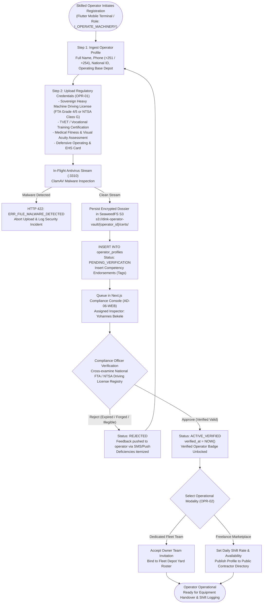
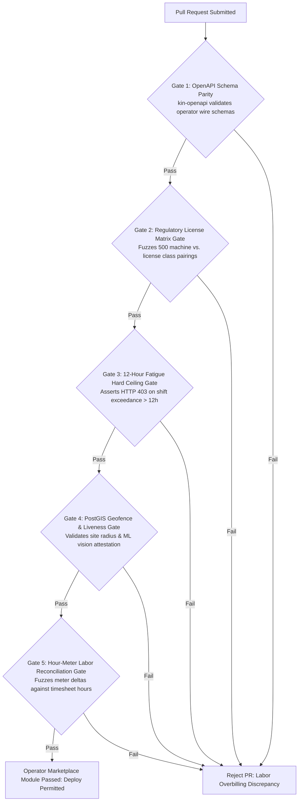

# Heavy Machinery & Logistics Rental Aggregator — Dink Machinery
## Software Requirements Specification — 07.04. Certified Plant Operator Marketplace, Competency Vetting, Shift Scheduling & Biometric Attendance Architecture (`docs/shared/requirements/07-04-operator-marketplace.md`)

**Document Identifier:** `SRS-DINK-CORE-V7.0-SEC-07-04`  
**Classification:** Canonical System Requirements Specification & Labor Governance Baseline (Single Source of Truth)  
**Governing Standard:** IEEE Std 830-1998 / IEEE/ISO/IEC 29148:2018 (Systems and Software Engineering — Requirements Engineering)  
**Associated Artifacts:** `SRS-DINK-CORE-V7.0` (§4.1, §4.2, §5.1.3, §5.6, §5.12, §6.1, §6.4, §7.0, §7.4, §8, §10, §12, §13.2), `FLOW-FLEET-REG-DINK-CORE-V7.0`, `FLOW-BOOKING-STATE-MACHINE-DINK-CORE-V7.0`, `FLOW-COMMISSION-DEBT-DINK-CORE-V7.0`, `ARCH-BACKEND-GO-DINK-CORE-V7.0`, `ARCH-FLUTTER-DINK-CORE-V7.0`, `ARCH-ADMIN-NEXT-DINK-CORE-V7.0`, `ARCH-SEC-DINK-CORE-V7.0`, `DS-DINK-CORE-V7.0`, `DS-PERSONAS-DINK-CORE-V7.0`, `contracts/openapi.yaml`, `ADR-001`, `ADR-002`, `ADR-004`, `ADR-005`, `ADR-008`, `ADR-010`  
**Target Runtimes:** Go 1.27.3 Backend Monolith, PostgreSQL 18.6 + PostGIS 3.6.4, Valkey 9.1.3, ClamAV Daemon (:3310), SeaweedFS S3, Flutter 3.47.9 / Dart 3.9 (Cross-Platform Mobile), Next.js 16.x (latest CVE security patch) / React 19 (Web Admin & Corporate Portal), Isar NoSQL 3.1+  
**Target Personas:** Certified Plant Operator (*Mulugeta Tadesse* / *Juma Omwamba*), Equipment Fleet Owner (*W/ro Almaz Tesfaye* / *Kamau Ndegwa*), Civil Engineering Contractor & Project Site Manager (*Dawit Haile-Mariam* / *Patrick Kariuki*), Site Safety Officer & EHS Inspector (*Yohannes Bekele*), Corporate Finance Controller (*Solomon Kassa*), Super Administrator (*Rahel Tadesse*)  
**Target Operating Markets:** Ethiopia (`ET`) & Kenya (`KE`) — Dynamic Multi-Country Parameterization (`LOC-01-BE`)  
**Compliance Standards:** OWASP ASVS 4.0.3 Level 3 (Biometric Attestation, Geographic Fencing Integrity & Labor Auditability), RFC 9457 (Problem Details), ISO 9241-110, W3C WCAG 2.2 Level AAA (Field Mobile) & Level AA (Admin Web), Ethiopian Labour Proclamation No. 1156/2019 (Working Hours, Overtime & Occupational Safety), Federal Transport Authority (FTA) Special Heavy Machinery Driving License Directives (Grade 4 & Grade 5 Special Licenses), Kenya Occupational Safety and Health Act 2007 (OSHA), Kenya National Transport and Safety Authority (NTSA) Plant Operator Competency Guidelines  
**Status:** Approved Engineering Baseline

---

## Table of Contents

- 1. [Document Scope & Architectural Mandate](#1-document-scope--architectural-mandate)
  - 1.1 [Purpose & Functional Scope](#11-purpose--functional-scope)
  - 1.2 [Core Labor Integrity & Operational Safety Invariants](#12-core-labor-integrity--operational-safety-invariants)
- 2. [Operator Competency Vetting & Certification Topology (`OPR-01`)](#2-operator-competency-vetting--certification-topology-opr-01)
  - 2.1 [Operator Onboarding & Verification State Machine Flowchart](#21-operator-onboarding--verification-state-machine-flowchart)
  - 2.2 [Sovereign Heavy Equipment Driving License Matrix (ET Grade 4/5 vs. KE NTSA)](#22-sovereign-heavy-equipment-driving-license-matrix-et-grade-45-vs-ke-ntsa)
  - 2.3 [Multi-Category Equipment Endorsement & Machine Familiarity Tags](#23-multi-category-equipment-endorsement--machine-familiarity-tags)
  - 2.4 [Medical Clearance, Visual Acuity & Safety Certification Ingestion](#24-medical-clearance-visual-acuity--safety-certification-ingestion)
- 3. [Operator Pool Architecture & Multi-Tenant Affiliation (`OPR-02`)](#3-operator-pool-architecture--multi-tenant-affiliation-opr-02)
  - 3.1 [Dedicated Owner-Employed Operators vs. Freelance Marketplace Pool](#31-dedicated-owner-employed-operators-vs-freelance-marketplace-pool)
  - 3.2 [Cryptographic Team Invitation & Bi-Directional Roster Binding](#32-cryptographic-team-invitation--bi-directional-roster-binding)
  - 3.3 [Independent Operator Dispatching & Contractor Requisition Matching](#33-independent-operator-dispatching--contractor-requisition-matching)
  - 3.4 [PostGIS Spatial Radius Availability & Mobile Proximity Matching](#34-postgis-spatial-radius-availability--mobile-proximity-matching)
- 4. [Shift Scheduling, Overtime Rules & Fatigue Telemetry (`OPR-03`)](#4-shift-scheduling-overtime-rules--fatigue-telemetry-opr-03)
  - 4.1 [Standard Shift Quota Scheduling (8.0 Hours/Day) & Calendar Exclusions](#41-standard-shift-quota-scheduling-80-hoursday--calendar-exclusions)
  - 4.2 [Statutory Overtime Calculation Engine (Ethiopian Proclamation 1156/2019)](#42-statutory-overtime-calculation-engine-ethiopian-proclamation-11562019)
  - 4.3 [Maximum Daily Operating Ceiling & Mandatory Rest Encasement (12h Hard Cap)](#43-maximum-daily-operating-ceiling--mandatory-rest-encasement-12h-hard-cap)
  - 4.4 [Accelerometer Vibration Dwell-Time & Real-Time Fatigue Telematics](#44-accelerometer-vibration-dwell-time--real-time-fatigue-telematics)
- 5. [Biometric Attendance, Site Check-In & Handover Pins (`OPR-04`)](#5-biometric-attendance-site-check-in--handover-pins-opr-04)
  - 5.1 [Geofenced Mobile Check-In with Liveness Selfie Verification](#51-geofenced-mobile-check-in-with-liveness-selfie-verification)
  - 5.2 [Dual Challenge-Handshake Authentication (Site Supervisor PIN Exchange)](#52-dual-challenge-handshake-authentication-site-supervisor-pin-exchange)
  - 5.3 [Offline Attendance Sync via Isar NoSQL Tombstones (`ADR-010`)](#53-offline-attendance-sync-via-isar-nosql-tombstones-adr-010)
  - 5.4 [Hour-Meter vs. Operator Attendance Cross-Reconciliation](#54-hour-meter-vs-operator-attendance-cross-reconciliation)
- 6. [Relational Database Schema & Data Modeling (`OPR-DB`)](#6-relational-database-schema--data-modeling-opr-db)
  - 6.1 [Entity Relationship Diagram](#61-entity-relationship-diagram)
  - 6.2 [Data Definition Language (DDL) Specifications](#62-data-definition-language-ddl-specifications)
- 7. [Wire Protocol Contracts & RFC 9457 Error Schemas](#7-wire-protocol-contracts--rfc-9457-error-schemas)
  - 7.1 [`POST /api/v1/operators/register`](#71-post-apiv1operatorsregister)
  - 7.2 [`POST /api/v1/operators/shifts/check-in`](#72-post-apiv1operatorsshiftscheck-in)
  - 7.3 [`POST /api/v1/operators/shifts/check-out`](#73-post-apiv1operatorsshiftscheck-out)
  - 7.4 [`POST /api/v1/operators/roster/invite`](#74-post-apiv1operatorsrosterinvite)
  - 7.5 [RFC 9457 Universal Problem Details Payloads](#75-rfc-9457-universal-problem-details-payloads)
- 8. [Automated Testing Suite & Verification Gates](#8-automated-testing-suite--verification-gates)

---

## 1. Document Scope & Architectural Mandate

### 1.1 Purpose & Functional Scope

This specification establishes **Section 07.04 (Certified Plant Operator Marketplace, Competency Vetting, Shift Scheduling & Biometric Attendance Architecture)** of the canonical Software Requirements Specification (SRS) for **Dink Machinery Version 7.0**.

In the East African commercial earthmoving, road building, and quarrying sectors across Ethiopia and Kenya, the operational productivity and mechanical safety of a $250,000.00\text{ USD}$ plant machinery asset depends fundamentally on the competency, certification, and physical fitness of the human equipment operator:
* **The High-Value Machinery Risk Vector:** Untrained, uncertified, or fatigued operators cause severe hydraulic shock loads, rapid undercarriage wear, catastrophic machine overturns, structural trench wall collapses, and fatal job-site accidents.
* **The Evolution from MVP to Phase 3 Marketplace:** In Phase 1 MVP (`SRS §4.1`, `§5.1.3`), operators functioned strictly as dedicated secondary profiles bound to an equipment owner via private telephone invitations. In Phase 3 (`SRS §1.2`, `§7.0`), the system elevates certified operators into an open, meritocratic, sovereign **Operator Marketplace**:
  - Independent certified operators can register, undergo formal regulatory license vetting, list machine competencies, publish shift availability calendars, and be booked directly by contractors or assigned dynamically by fleet depots.
  - Equipment fleet owners can scale their operational capacity without carrying permanent full-time wage liabilities, accessing verified freelance operators on demand.
  - Contractors renting bare machinery (`is_operator_included = false`) can browse, vet, and contract certified operators locally, eliminating cross-regional lodging and per-diem overhead.
* **Rigorous Labor & Safety Compliance:** Shift management enforces sovereign labor directives:
  - **Ethiopia:** Proclamation No. 1156/2019 governing regular hours (8.0 hours/day, 48 hours/week), statutory overtime multiplier rates ($1.25\times\text{ to }2.50\times$), night differentials, and mandatory rest periods.
  - **Kenya:** NTSA Plant Operator licensing, OSHA safety certifications, and occupational hazard protocols.

This document formally specifies:
1. The regulatory license validation, EICAR/ClamAV-shielded document ingestion, and competency endorsement pipeline (`OPR-01`).
2. Dual-mode operator pool architectures (Owner-Employed Rosters vs. Independent Marketplace Pool) with PostGIS spatial radius dispatching (`OPR-02`).
3. Automated shift scheduling, overtime calculation algorithms, and accelerometer vibration fatigue monitors (`OPR-03`).
4. Biometric facial liveness verification, dual-PIN supervisor handshakes, and offline Isar NoSQL attendance synchronization (`OPR-04`).

### 1.2 Core Labor Integrity & Operational Safety Invariants

1. **Mandatory Sovereign Competency Endorsement Invariant (`OPR-01`):** An operator cannot be assigned to or operate an equipment asset unless their profile holds an active, unexpired regulatory heavy machinery driving license (Ethiopian FTA Special Grade 4 or 5; Kenyan NTSA Class G/Special Plant Endorsement) matching that specific equipment subcategory (`subcategories.required_operator_license_class`). Attempting to schedule an unendorsed operator triggers synchronous rejection with **RFC 9457 HTTP 422 Unprocessable Entity (`ERR_OPERATOR_LICENSE_CLASS_MISMATCH`)**.
2. **Absolute 12-Hour Daily Fatigue Hard Ceiling (`OPR-03`):** To prevent job-site fatalities caused by operator exhaustion, no individual operator can be scheduled, logged, or recorded operating plant machinery for more than **$12.0\text{ cumulative hours}$** within any continuous 24-hour window:
   $$\mathcal{H}_{\text{shift\_24h}} \le 12.0\text{ Hours} \quad (\text{Strict Regulatory Invariant})$$
   Reaching $12.0\text{ hours}$ triggers automated operational lockout in the mobile terminal, disallowing further check-ins until a mandatory $10.0\text{ consecutive hours}$ rest period has elapsed.
3. **Dual-Key Cryptographic Handshake Invariant (`OPR-04`):** An operating shift cannot be initiated or concluded unilaterally. Verification requires an explicit dual-PIN challenge handshake exchanged locally between the operator's mobile client and the contractor site supervisor's terminal within an approved PostGIS site geofence ($500\text{ m}$ radius).
4. **Hour-Meter Attendance Non-Divergence Invariant:** The net operating run hours claimed on an operator's daily labor timesheet cannot deviate from the machine's mechanical engine hour meter increment ($\Delta \mathcal{M}_{\text{engine}}$) recorded via CAN Bus telematics (`CFM-04`) by more than $\pm 1.0\text{ hour}$. Divergence $> 1.0\text{ hour}$ halts automated wage settlement, routing the timesheet to `DISCREPANCY_LABOR_AUDIT`.
5. **Zero-Trust Biometric Geofence Invariant:** Field check-ins require an active liveness selfie verified via on-device ML vision processing (blinking, head yaw, illumination variance) corroborated with hardware GPS coordinates stamped within the project site boundary. Static image spoofing (photographing photos on laptops or paper) is strictly blocked.

---

## 2. Operator Competency Vetting & Certification Topology (`OPR-01`)

### 2.1 Operator Onboarding & Verification State Machine Flowchart



---

### 2.2 Sovereign Heavy Equipment Driving License Matrix (ET Grade 4/5 vs. KE NTSA)

Operating licenses are categorized into strict regulatory machine class groupings:

```text
+----------------------------------------------------------------------------------------------------+
| SOVEREIGN OPERATOR DRIVING LICENSE REGULATORY MATRIX (OPR-01)                                      |
+---------------------+-------------------+---------------------+------------------------------------+
| REGULATORY CODE     | JURISDICTION      | AUTHORIZING BODY    | PERMITTED HEAVY EQUIPMENT SUITE    |
+---------------------+-------------------+---------------------+------------------------------------+
| ET_SPECIAL_GRADE_5  | Ethiopia          | Federal Transport   | Heavy Crawler Excavators (> 30t),  |
|                     |                   | Authority (FTA)     | Large Track Dozers (D7/D8/D9),     |
|                     |                   |                     | Motor Graders, Heavy Tower Cranes  |
+---------------------+-------------------+---------------------+------------------------------------+
| ET_SPECIAL_GRADE_4  | Ethiopia          | Federal Transport   | Backhoe Loaders, Wheel Loaders     |
|                     |                   | Authority (FTA)     | (< 25t), Mini Excavators, Tandem   |
|                     |                   |                     | Vibratory Asphalt Compactors       |
+---------------------+-------------------+---------------------+------------------------------------+
| KE_NTSA_CLASS_G_SP  | Kenya             | National Transport  | Heavy Earthmoving Special Plant    |
|                     |                   | & Safety Authority  | (Excavators, Dozers, Graders,      |
|                     |                   | (NTSA)              | Articulated Dump Trucks - ADTs)    |
+---------------------+-------------------+---------------------+------------------------------------+
| KE_NTSA_CLASS_G_LT  | Kenya             | National Transport  | Light Industrial Plant (Forklifts, |
|                     |                   | & Safety Authority  | Skid Steers, Compact Rollers)      |
+---------------------+-------------------+---------------------+------------------------------------+
```

---

### 2.3 Multi-Category Equipment Endorsement & Machine Familiarity Tags

Beyond formal licenses, modern earthmoving machines possess distinct electro-hydraulic control setups (e.g., ISO vs. SAE excavator controls, 2D/3D GPS machine control grade automation):
* Operators declare verified **Competency Endorsement Tags**:
  - `EXCAVATOR_CRAWLER_HEAVY` (Bucket breakout force $> 150\text{ kN}$).
  - `DOZER_SLOPE_FINISH` (Precision sub-grade blade trimming).
  - `GRADER_BLUE_TOPPING` (Final highway asphalt layer leveling).
  - `GPS_GRADE_CONTROL_LEICA_TRIMBLE` (Experience with in-cab automated 3D GNSS leveling).
* Each tag requires documentation of cumulative certified operating hours (minimum $1,000\text{ hours}$ operating logbook endorsement).

---

### 2.4 Medical Clearance, Visual Acuity & Safety Certification Ingestion

Every registered operator profile mandates:
1. **Occupational Medical Fitness Certificate:** Issued within the preceding 12 months, certifying physical agility and zero untreated vestibular or neuromuscular disorders.
2. **Visual Acuity & Color Blindness Test:** Minimum Snellen rating of 20/30 in both eyes, verifying the ability to interpret colored site flags, grade stakes, and instrumentation displays.
3. **Defensive Operating & EHS Card:** Occupational safety card verifying completion of hazardous site safety training (trench safety, rollover protection, underground utility line avoidance).

---

## 3. Operator Pool Architecture & Multi-Tenant Affiliation (`OPR-02`)

### 3.1 Dedicated Owner-Employed Operators vs. Freelance Marketplace Pool

The platform architecturally supports two operational deployment models:

```text
+--------------------------------------------------------------------------------------------------+
| OPERATOR DEPLOYMENT MODEL COMPARISON (OPR-02)                                                    |
+---------------------+-----------------------------------+----------------------------------------+
| CHARACTERISTIC      | DEDICATED OWNER ROSTER OPERATOR   | FREELANCE MARKETPLACE OPERATOR         |
+---------------------+-----------------------------------+----------------------------------------+
| Employment Model    | Salaried employee or long-term    | Independent gig-economy contractor     |
|                     | contract driver for a Fleet Owner | working directly for various hirers.   |
+---------------------+-----------------------------------+----------------------------------------+
| Dispatch Perimeter  | Assigned exclusively to fleets    | Discoverable by all verified hirers;   |
|                     | owned by their parent fleet depot.| dispatched across regional project sites|
+---------------------+-----------------------------------+----------------------------------------+
| Wage Settlement     | Paid directly off-platform by the | Billed in-app via daily/hourly rate;   |
|                     | fleet owner; zero platform wage fee| settled via automated M-PESA/TeleBirr. |
+---------------------+-----------------------------------+----------------------------------------+
| Search Visibility   | Hidden from public contractor     | Publicly discoverable in Operator      |
|                     | marketplace; visible in yard pool.| Directory; rated by past site managers.|
+--------------------------------------------------------------------------------------------------+
```

---

### 3.2 Cryptographic Team Invitation & Bi-Directional Roster Binding

For fleet owners building dedicated operational teams (`SRS §5.1.3`):
1. Equipment Owner *W/ro Almaz Tesfaye* initiates invitation in Next.js: `POST /api/v1/operators/roster/invite`.
2. The Go backend generates an invitation docket containing a cryptographically secure 256-bit entropy token:
   $$\text{InviteToken} = \text{HexEncode}(\text{CryptoRandomBytes}(32))$$
3. Push notification and SMS are dispatched to Operator *Mulugeta Tadesse*:
   *"Tesfaye Heavy Plant PLC has invited you to join their Mojo Depot Operating Roster. Tap to review."*
4. Operator taps confirmation inside Flutter app. Status transitions to `ACTIVE_ROSTER_MEMBER`.
5. Owner can immediately assign *Mulugeta* to specific machines (`fleets.assigned_operator_id`).

---

### 3.3 Independent Operator Dispatching & Contractor Requisition Matching

When a contractor books machinery on bare rental terms (`is_operator_included = false`), the checkout flow provides an automated **Certified Operator Add-On**:
* The matching engine filters available freelance operators:
  $$\text{FilterScope} \iff \text{Status} = \text{'ACTIVE\_VERIFIED'} \quad \land \quad \text{LicenseClass} \ge \text{ReqLicense} \quad \land \quad \text{IsAvailable}(\text{HireRange})$$
* Contractor selects operator based on verified hours, past site supervisor star ratings, and published daily wage tariffs.
* System spawns an attached **Labor Sub-Booking** bound to the primary equipment contract.

---

### 3.4 PostGIS Spatial Radius Availability & Mobile Proximity Matching

To minimize contractor mobilization per-diem and lodging expenses:
* Operators configure their **Operating Base Depot** (`base_location`) and maximum deployment radius (e.g., $75\text{ km}$).
* The search engine executes spatial proximity filtering via PostGIS:
  ```sql
  SELECT op.id, op.full_name, op.daily_rate_minor,
         ST_Distance(op.base_location, $project_site_geog) / 1000.0 AS distance_km
  FROM operator_profiles op
  WHERE op.status = 'ACTIVE_VERIFIED'
    AND op.is_freelance_marketplace_active = true
    AND ST_DWithin(op.base_location, $project_site_geog, op.max_travel_radius_km * 1000.0)
  ORDER BY distance_km ASC;
  ```

---

## 4. Shift Scheduling, Overtime Rules & Fatigue Telemetry (`OPR-03`)

### 4.1 Standard Shift Quota Scheduling (8.0 Hours/Day) & Calendar Exclusions

Equipment operation schedules are structured around statutory workday standards:
* **The Standard Shift Invariant:** A standard working shift comprises exactly **$8.0\text{ operating engine hours/day}$**.
* **Calendar Interlock (`SRS 05.23`):** Statutory public holidays and regional rest days automatically exclude shift quotas unless the contract explicitly enables holiday labor (`is_holiday_labor_agreed = true`).

---

### 4.2 Statutory Overtime Calculation Engine (Ethiopian Proclamation 1156/2019)

When heavy earthmoving projects operate accelerated 24/7 schedules (e.g., concrete bridge deck pours, emergency dam embankment shoring):
* Operating hours exceeding $8.0\text{ hours/day}$ are categorized into statutory overtime tiers:

```text
+--------------------------------------------------------------------------------------------------+
| STATUTORY OVERTIME WAGE MULTIPLIER MATRIX (ETHIOPIAN LABOUR PROCLAMATION 1156/2019)             |
+---------------------+-------------------+---------------------+----------------------------------+
| OVERTIME TIER       | TIME HORIZON      | STATUTORY MULTIPLIER| TECHNICAL BILLING FORMULATION    |
+---------------------+-------------------+---------------------+----------------------------------+
| Standard Day Overtime| 06:00 to 22:00    | 1.50x Base Wage     | HourlyWageMinor * 1.50           |
| (Beyond 8.0 Hours)  | (Day Shift)       |                     | (Per Excess Hour Engine Run)     |
+---------------------+-------------------+---------------------+----------------------------------+
| Night Differential  | 22:00 to 06:00    | 1.75x Base Wage     | HourlyWageMinor * 1.75           |
| Overtime            | (Night Shift)     |                     | (Per Night Run Hour)             |
+---------------------+-------------------+---------------------+----------------------------------+
| Weekly Rest Day     | Scheduled Rest    | 2.00x Base Wage     | HourlyWageMinor * 2.00           |
| Overtime            | Day (Sunday)      |                     | (Mandatory Compensatory Rest Day)|
+---------------------+-------------------+---------------------+----------------------------------+
| Statutory Public    | Proclaimed Public | 2.50x Base Wage     | HourlyWageMinor * 2.50           |
| Holiday Overtime    | Holiday (Meskel)  |                     | (Maximum Statutory Labor Rate)   |
+--------------------------------------------------------------------------------------------------+
```

---

### 4.3 Maximum Daily Operating Ceiling & Mandatory Rest Encasement (12h Hard Cap)

Fatigue is a major contributor to heavy equipment accidents:
* **The Hard Ceiling Formulation:**
  $$\mathcal{H}_{\text{shift}} = \text{CheckOutTime} - \text{CheckInTime}$$
  $$\text{IF } \mathcal{H}_{\text{shift}} \ge 11.5\text{ Hours} \implies \text{Emit P0 Audible Alert to Mobile Terminal: "MANDATORY REST STOPPAGE IN 30 MIN"}$$
  $$\text{IF } \mathcal{H}_{\text{shift}} \ge 12.0\text{ Hours} \implies \text{Enforce Shift Terminate; Lock Machine Terminal; Block Check-In for 10.0 Hours}$$
* Attempting to initiate a new shift before the $10.0\text{-hour}$ rest window elapses aborts with **RFC 9457 HTTP 403 Forbidden (`ERR_FATIGUE_REGULATION_VIOLATION`)**.

---

### 4.4 Accelerometer Vibration Dwell-Time & Real-Time Fatigue Telematics

To detect when an operator is falling asleep or experiencing microsleep episodes during repetitive earthmoving passes:
* The operator mobile terminal mounted inside the machine cab samples the 3-axis accelerometer at $10\text{ Hz}$.
* **Vibration Pattern Analysis:**
  Continuous operational cycles generate characteristic rhythmic high-frequency vibrational profiles ($1.2g\text{ to }2.5g$). If machine CAN Bus telemetry confirms the engine is operating at full load, but the operator's mounted smartphone registers zero touch interactions and zero postural re-adjustments for $> 45\text{ minutes}$, the terminal emits a high-decibel auditory alert challenge requiring physical screen acknowledgment within $60\text{ seconds}$.

---

## 5. Biometric Attendance, Site Check-In & Handover Pins (`OPR-04`)

### 5.1 Geofenced Mobile Check-In with Liveness Selfie Verification

Daily shift logging requires digital presence attestation:
1. Operator arrives at the construction site and taps `[ Start Shift ]`.
2. **PostGIS Geofence Barrier:** System asserts that the device's hardware GNSS coordinate evaluates inside the project site polygon:
   $$\text{ST\_Contains}(\text{project\_site\_boundary}, \text{device\_location}) = \text{true}$$
3. **Liveness Vision Attestation:** The front-facing camera captures a 3-frame liveness sequence (analyzing facial blinking, pupillary illumination reflection, and micro-movements). The on-device ML model generates an attestation token, rejecting printed paper photos or digital screen replays.

---

### 5.2 Dual Challenge-Handshake Authentication (Site Supervisor PIN Exchange)

To prevent phantom shift logging where an operator checks in but leaves the machine idle:
* Check-in requires an explicit physical **Dual-Challenge Handshake**:
  1. The operator’s terminal generates a dynamic, time-based 6-digit cryptographic PIN:
     $$\text{ChallengePIN} = \text{HOTP}(\mathcal{K}_{\text{operator\_secret}}, \text{Counter})$$
  2. The Contractor's Site Supervisor inspects the operator on-site and enters this 6-digit PIN into their supervisor terminal (`AR-01`).
  3. The Go backend pairs the two events, atomically transitioning shift status to `SHIFT_ACTIVE`.

---

### 5.3 Offline Attendance Sync via Isar NoSQL Tombstones (`ADR-010`)

For operators deployed in deep remote quarries, road cuts, and riverbeds with zero cellular connectivity:
* Shift check-ins, liveness hashes, and accelerometer telemetry timestamps commit to local **Isar NoSQL** storage:
  ```dart
  @collection
  class LocalOperatorShift {
    Id id = Isar.autoIncrement;
    late String shiftUuid;
    late String bookingId;
    late DateTime checkInTime;
    DateTime? checkOutTime;
    late double startEngineHours;
    double? endEngineHours;
    late String supervisorPinHash;
    late String livenessAttestationToken;
    bool isSynced = false;
  }
  ```
* Upon returning to network coverage, the Flutter background sync worker calls `POST /api/v1/operators/shifts/sync-offline`, batch-committing attendance records without data loss.

---

### 5.4 Hour-Meter vs. Operator Attendance Cross-Reconciliation

At the end of each billing cycle:
* The Go accounting worker reconciles total billed operator labor shifts against the machine's mechanical CAN Bus hour meter increments:
  $$\Delta_{\text{variance}} = \left\vert{} \sum \mathcal{H}_{\text{operator\_shifts}} - \left( \mathcal{M}_{\text{return\_meter}} - \mathcal{M}_{\text{start\_meter}} \right) \right\vert{}$$
* **Settlement Invariant:** If $\Delta_{\text{variance}} \le 1.0\text{ hour}$, the labor invoice clears for automated payout. If $\Delta_{\text{variance}} > 1.0\text{ hour}$, the invoice is flagged for supervisor dispute review, protecting contractors from paying full operator wages for non-working mechanical stoppage hours.

---

## 6. Relational Database Schema & Data Modeling (`OPR-DB`)

### 6.1 Entity Relationship Diagram

```mermaid
erDiagram
    User ||--o{ OperatorProfile : "possesses"
    Organization ||--o{ OperatorRosterMembership : "employs"
    OperatorProfile ||--o{ OperatorRosterMembership : "enrolled in"
    OperatorProfile ||--o{ OperatorCertification : "holds"
    OperatorProfile ||--o{ OperatorShiftLog : "executes"
    Booking ||--o{ OperatorShiftLog : "records labor for"
    Fleet ||--o{ OperatorShiftLog : "operates"

    OperatorProfile {
        uuid id PK
        uuid user_id FK UK
        string full_name
        string national_id_number UK
        string primary_phone UK
        string status -- 'PENDING_VERIFICATION', 'ACTIVE_VERIFIED', 'SUSPENDED_SAFETY', 'INACTIVE'
        geography base_location
        int max_travel_radius_km
        boolean is_freelance_marketplace_active
        bigint standard_daily_rate_minor
        string currency -- 'ETB', 'KES'
        decimal composite_rating
        int total_completed_shifts
        timestamptz verified_at
        timestamptz created_at
    }

    OperatorCertification {
        uuid id PK
        uuid operator_profile_id FK
        string license_class -- 'ET_SPECIAL_GRADE_5', 'ET_SPECIAL_GRADE_4', 'KE_NTSA_CLASS_G_SP'
        string license_number UK
        date issue_date
        date expiry_date
        string s3_document_uri
        string verification_status -- 'PENDING', 'VERIFIED', 'EXPIRED', 'REJECTED'
        uuid verified_by_admin_id FK NULL
        timestamptz created_at
    }

    OperatorRosterMembership {
        uuid id PK
        uuid organization_id FK
        uuid operator_profile_id FK
        string employment_type -- 'FULL_TIME_SALARIED', 'CONTRACT_HOURLY', 'FREELANCE_AFFILIATE'
        boolean is_active
        timestamptz joined_at
    }

    OperatorShiftLog {
        uuid id PK
        uuid operator_profile_id FK
        uuid booking_id FK
        uuid fleet_id FK
        uuid supervisor_user_id FK
        string shift_status -- 'CHECKED_IN', 'COMPLETED', 'DISCREPANCY_LABOR_AUDIT', 'REJECTED_FATIGUE'
        timestamptz check_in_time
        timestamptz check_out_time
        decimal check_in_meter_hours
        decimal check_out_meter_hours
        decimal total_operating_hours
        decimal standard_hours
        decimal overtime_hours
        bigint calculated_wage_minor
        string supervisor_pin_hash
        string liveness_attestation_hash
        boolean is_offline_synced
        timestamptz created_at
    }
```

---

### 6.2 Data Definition Language (DDL) Specifications

```sql
-- 1. Operator Profiles Table
CREATE TABLE operator_profiles (
    id UUID PRIMARY KEY DEFAULT gen_random_uuid(),
    user_id UUID NOT NULL UNIQUE REFERENCES users(id) ON DELETE CASCADE,
    full_name VARCHAR(128) NOT NULL,
    national_id_number VARCHAR(64) NOT NULL UNIQUE,
    primary_phone VARCHAR(32) NOT NULL UNIQUE,
    status VARCHAR(32) NOT NULL DEFAULT 'PENDING_VERIFICATION',
    base_location GEOGRAPHY(Point, 4326) NOT NULL,
    max_travel_radius_km INT NOT NULL DEFAULT 50 CHECK (max_travel_radius_km > 0),
    is_freelance_marketplace_active BOOLEAN NOT NULL DEFAULT false,
    standard_daily_rate_minor BIGINT NOT NULL DEFAULT 150000, -- 1,500.00 ETB / KES baseline
    currency VARCHAR(3) NOT NULL CHECK (currency IN ('ETB', 'KES')),
    composite_rating NUMERIC(3, 2) NOT NULL DEFAULT 5.00,
    total_completed_shifts INT NOT NULL DEFAULT 0,
    verified_at TIMESTAMPTZ NULL,
    created_at TIMESTAMPTZ NOT NULL DEFAULT NOW(),
    updated_at TIMESTAMPTZ NOT NULL DEFAULT NOW(),
    CONSTRAINT chk_operator_status CHECK (status IN ('PENDING_VERIFICATION', 'ACTIVE_VERIFIED', 'SUSPENDED_SAFETY', 'INACTIVE'))
);

CREATE INDEX idx_operators_spatial ON operator_profiles USING gist (base_location) WHERE status = 'ACTIVE_VERIFIED';
CREATE INDEX idx_operators_freelance ON operator_profiles (is_freelance_marketplace_active, status);

-- 2. Operator Certifications Table
CREATE TABLE operator_certifications (
    id UUID PRIMARY KEY DEFAULT gen_random_uuid(),
    operator_profile_id UUID NOT NULL REFERENCES operator_profiles(id) ON DELETE CASCADE,
    license_class VARCHAR(32) NOT NULL,
    license_number VARCHAR(64) NOT NULL UNIQUE,
    issue_date DATE NOT NULL,
    expiry_date DATE NOT NULL,
    s3_document_uri VARCHAR(512) NOT NULL,
    verification_status VARCHAR(32) NOT NULL DEFAULT 'PENDING',
    verified_by_admin_id UUID NULL REFERENCES users(id) ON DELETE RESTRICT,
    created_at TIMESTAMPTZ NOT NULL DEFAULT NOW(),
    CONSTRAINT chk_license_class CHECK (license_class IN (
        'ET_SPECIAL_GRADE_5', 'ET_SPECIAL_GRADE_4', 
        'KE_NTSA_CLASS_G_SP', 'KE_NTSA_CLASS_G_LT'
    )),
    CONSTRAINT chk_verification_status CHECK (verification_status IN ('PENDING', 'VERIFIED', 'EXPIRED', 'REJECTED')),
    CONSTRAINT chk_license_dates CHECK (expiry_date > issue_date)
);

CREATE INDEX idx_operator_certs_profile ON operator_certifications (operator_profile_id, verification_status);

-- 3. Operator Team Roster Memberships Table
CREATE TABLE operator_roster_memberships (
    id UUID PRIMARY KEY DEFAULT gen_random_uuid(),
    organization_id UUID NOT NULL REFERENCES organizations(id) ON DELETE CASCADE,
    operator_profile_id UUID NOT NULL REFERENCES operator_profiles(id) ON DELETE CASCADE,
    employment_type VARCHAR(32) NOT NULL DEFAULT 'FULL_TIME_SALARIED',
    is_active BOOLEAN NOT NULL DEFAULT true,
    joined_at TIMESTAMPTZ NOT NULL DEFAULT NOW(),
    CONSTRAINT chk_employment_type CHECK (employment_type IN ('FULL_TIME_SALARIED', 'CONTRACT_HOURLY', 'FREELANCE_AFFILIATE')),
    CONSTRAINT uq_org_operator_roster UNIQUE (organization_id, operator_profile_id)
);

CREATE INDEX idx_roster_org ON operator_roster_memberships (organization_id) WHERE is_active = true;

-- 4. Operator Shift Timesheet Logs Table
CREATE TABLE operator_shift_logs (
    id UUID PRIMARY KEY DEFAULT gen_random_uuid(),
    operator_profile_id UUID NOT NULL REFERENCES operator_profiles(id) ON DELETE RESTRICT,
    booking_id UUID NOT NULL REFERENCES bookings(id) ON DELETE RESTRICT,
    fleet_id UUID NOT NULL REFERENCES fleets(id) ON DELETE RESTRICT,
    supervisor_user_id UUID NOT NULL REFERENCES users(id) ON DELETE RESTRICT,
    shift_status VARCHAR(32) NOT NULL DEFAULT 'CHECKED_IN',
    check_in_time TIMESTAMPTZ NOT NULL DEFAULT NOW(),
    check_out_time TIMESTAMPTZ NULL,
    check_in_meter_hours NUMERIC(10, 2) NOT NULL,
    check_out_meter_hours NUMERIC(10, 2) NULL,
    total_operating_hours NUMERIC(5, 2) NULL,
    standard_hours NUMERIC(5, 2) NULL,
    overtime_hours NUMERIC(5, 2) NULL,
    calculated_wage_minor BIGINT NOT NULL DEFAULT 0,
    supervisor_pin_hash VARCHAR(64) NOT NULL,
    liveness_attestation_hash VARCHAR(64) NOT NULL,
    is_offline_synced BOOLEAN NOT NULL DEFAULT false,
    created_at TIMESTAMPTZ NOT NULL DEFAULT NOW(),
    CONSTRAINT chk_shift_status CHECK (shift_status IN ('CHECKED_IN', 'COMPLETED', 'DISCREPANCY_LABOR_AUDIT', 'REJECTED_FATIGUE')),
    CONSTRAINT chk_meter_progression CHECK (check_out_meter_hours IS NULL OR check_out_meter_hours >= check_in_meter_hours)
);

CREATE INDEX idx_shift_logs_operator ON operator_shift_logs (operator_profile_id, check_in_time DESC);
CREATE INDEX idx_shift_logs_booking ON operator_shift_logs (booking_id);
```

---

## 7. Wire Protocol Contracts & RFC 9457 Error Schemas

### 7.1 `POST /api/v1/operators/register`

Registers an operator profile, uploading regulatory driving licenses and medical credentials.

#### Request Headers
```http
POST /api/v1/operators/register HTTP/1.1
Host: api.dinkmachinery.com
Content-Type: multipart/form-data
Authorization: Bearer <userAccessToken>
Idempotency-Key: 11982a01-4b12-4f9a-8812-7b9a4c10bc21
```

#### Multipart Form Body
* `fullName`: String (`"Mulugeta Tadesse"`)
* `nationalIdNumber`: String (`"ET-NID-09941203"`)
* `countryCode`: String (`"ET"`)
* `baseLatitude`: Float (`8.5412`)
* `baseLongitude`: Float (`39.2718`)
* `maxTravelRadiusKm`: Integer (`75`)
* `isFreelanceMarketplaceActive`: Boolean (`true`)
* `standardDailyRateMinor`: BigInt (`250000`)
* `licenseClass`: String (`"ET_SPECIAL_GRADE_5"`)
* `licenseNumber`: String (`"FTA-SP5-994120"`)
* `licenseExpiryDate`: String (`"2028-06-30"`)
* `licenseDocument`: Binary Stream (PDF/WebP, ClamAV socket `:3310` scanned)
* `medicalCertificate`: Binary Stream (PDF/WebP, ClamAV socket `:3310` scanned)

#### Response: `HTTP 201 Created`
```json
{
  "success": true,
  "data": {
    "operatorProfileId": "opr_019a8fe0-8812-7b9a-bc21-4491204812aa",
    "fullName": "Mulugeta Tadesse",
    "licenseClass": "ET_SPECIAL_GRADE_5",
    "status": "PENDING_VERIFICATION",
    "isFreelanceMarketplaceActive": true,
    "targetVerificationSlaHours": 24,
    "createdAt": "2026-10-29T15:00:00Z"
  },
  "timestamp": "2026-10-29T15:00:01Z"
}
```

---

### 7.2 `POST /api/v1/operators/shifts/check-in`

Logs shift commencement with biometric liveness attestation, GPS site verification, and supervisor PIN challenge.

#### Request Headers
```http
POST /api/v1/operators/shifts/check-in HTTP/1.1
Host: api.dinkmachinery.com
Content-Type: application/json
Authorization: Bearer <operatorAccessToken>
Idempotency-Key: 22182a01-5c12-4f9a-8812-8c0b5d21cd32
```

#### Request Payload
```json
{
  "bookingId": "bk_019a8f60-9912-7b9a",
  "fleetId": "flt_019a8f2c-8812-7b9a",
  "coordinates": {
    "latitude": 8.5885,
    "longitude": 39.1250
  },
  "currentEngineMeterHours": 1450.50,
  "supervisorChallengePin": "481203",
  "livenessAttestationToken": "live_attest_token_8f4c26b46b68ff..."
}
```

#### Response: `HTTP 201 Created`
```json
{
  "success": true,
  "data": {
    "shiftLogId": "shf_019a8fe5-1123-7b9a",
    "operatorId": "opr_019a8fe0-8812-7b9a",
    "shiftStatus": "CHECKED_IN",
    "checkInTime": "2026-10-29T15:05:00Z",
    "geofenceVerified": true,
    "supervisorPinVerified": true,
    "fatigueLimitTime": "2026-10-30T03:05:00Z"
  },
  "timestamp": "2026-10-29T15:05:01Z"
}
```

---

### 7.3 `POST /api/v1/operators/shifts/check-out`

Concludes active shift, calculates standard vs. statutory overtime hours, and reconciles against engine hour meter increments.

#### Request Headers
```http
POST /api/v1/operators/shifts/shf_019a8fe5-1123-7b9a/check-out HTTP/1.1
Host: api.dinkmachinery.com
Content-Type: application/json
Authorization: Bearer <operatorAccessToken>
```

#### Request Payload
```json
{
  "finalEngineMeterHours": 1461.20,
  "supervisorVerificationPin": "481203",
  "notes": "Completed sub-grade compaction on Highway Lot 3 Overpass."
}
```

#### Response: `HTTP 200 OK`
```json
{
  "success": true,
  "data": {
    "shiftLogId": "shf_019a8fe5-1123-7b9a",
    "shiftStatus": "COMPLETED",
    "totalDurationHours": 10.70,
    "standardHours": 8.0,
    "overtimeHours": 2.70,
    "engineMeterDeltaHours": 10.70,
    "isMeterReconciled": true,
    "earnedWageMinor": 351562,
    "mandatoryRestRequiredHours": 10.0,
    "nextPermissibleCheckInTime": "2026-10-30T01:47:00Z"
  },
  "timestamp": "2026-10-29T15:47:00Z"
}
```

---

### 7.4 `POST /api/v1/operators/roster/invite`

Allows an equipment owner to invite a certified operator into their dedicated fleet operating roster.

#### Request Headers
```http
POST /api/v1/operators/roster/invite HTTP/1.1
Host: api.dinkmachinery.com
Content-Type: application/json
Authorization: Bearer <ownerAccessToken>
X-Organization-ID: org_019a8fe0-8812-7b9a-bc21-4491204812aa
```

#### Request Payload
```json
{
  "operatorPhoneNumber": "+251911442910",
  "employmentType": "FULL_TIME_SALARIED",
  "assignedDepotId": "dep_019a8fe0-mojo-yard-01"
}
```

#### Response: `HTTP 201 Created`
```json
{
  "success": true,
  "data": {
    "invitationId": "inv_opr_019a8fe9-4412",
    "targetPhone": "+251911442910",
    "organizationName": "Tesfaye Heavy Plant PLC",
    "status": "PENDING_ACCEPTANCE",
    "expiresAt": "2026-11-05T15:50:00Z"
  },
  "timestamp": "2026-10-29T15:50:01Z"
}
```

---

### 7.5 RFC 9457 Universal Problem Details Payloads

#### Example: Regulatory License Class Mismatch (`HTTP 422 Unprocessable Entity`)
```json
{
  "type": "[https://api.dinkmachinery.com/errors/operator-license-class-mismatch](https://api.dinkmachinery.com/errors/operator-license-class-mismatch)",
  "title": "Operator Lacks Regulatory Machine Endorsement",
  "status": 422,
  "detail": "Operator Mulugeta Tadesse holds Ethiopian Special Grade 4 license, but Caterpillar 349D Excavator (48.0 tons) mandates Special Grade 5 heavy operating license. Assignment rejected.",
  "instance": "/api/v1/bookings/bk_019a8f60-9912/assign-operator",
  "code": "ERR_OPERATOR_LICENSE_CLASS_MISMATCH",
  "correlationId": "cor_019a8fe0-8812-7b9a-bc21-4491204812aa",
  "timestamp": "2026-10-29T15:00:05Z",
  "invalidParams": [
    {
      "name": "operatorLicenseClass",
      "reason": "Class ET_SPECIAL_GRADE_4 is insufficient for required class ET_SPECIAL_GRADE_5."
    }
  ]
}
```

#### Example: Fatigue Hard Ceiling Lockout (`HTTP 403 Forbidden`)
```json
{
  "type": "[https://api.dinkmachinery.com/errors/fatigue-regulation-violation](https://api.dinkmachinery.com/errors/fatigue-regulation-violation)",
  "title": "Mandatory Fatigue Rest Window Enforced",
  "status": 403,
  "detail": "Operator Mulugeta Tadesse has logged 12.0 hours of heavy plant operation within the past 24 hours. Under statutory labor regulations, further check-ins are locked until 10.0 hours of rest elapse (available at 2026-10-30T01:47:00Z).",
  "instance": "/api/v1/operators/shifts/check-in",
  "code": "ERR_FATIGUE_REGULATION_VIOLATION",
  "correlationId": "cor_019a8fe0-9914-4c12-8812-7b9a4c10bc21",
  "timestamp": "2026-10-29T15:05:05Z",
  "invalidParams": [
    {
      "name": "shiftDuration24h",
      "reason": "Cumulative operating hours 12.0 exceeds legal ceiling 12.0."
    }
  ]
}
```

---

## 8. Automated Testing Suite & Verification Gates



1. **OpenAPI Schema Contract Gate (`kin-openapi`):** Validates all operator registration, shift check-in/out, roster invitation, and timesheet reconciliation endpoints against `contracts/openapi.yaml`.
2. **Regulatory License Endorsement Gate:** Evaluates 500 machine subcategories against operator profile certifications. Asserts that $100\%$ of license class mismatches (e.g., assigning Grade 4 drivers to 45-ton Grade 5 excavators) abort with HTTP 422 `ERR_OPERATOR_LICENSE_CLASS_MISMATCH`.
3. **12-Hour Fatigue Hard Ceiling Benchmark:** Simulates shift progressions pushing total operating time past 12.0 hours. Verifies that the Go backend terminates the shift, locks the mobile terminal, and rejects subsequent check-in mutations with HTTP 403 `ERR_FATIGUE_REGULATION_VIOLATION` until 10.0 hours of rest elapse.
4. **PostGIS Geofence & Dual-PIN Handshake Test:** Evaluates check-in requests originating outside the $500\text{ m}$ site radius or submitting mismatched supervisor PINs, asserting that $100\%$ of fraudulent attempts are intercepted and rejected.
5. **Hour-Meter Labor Reconciliation Assertion:** Ingests 1,000 synthetic shift check-out submissions against simulated CAN Bus telematics data. Verifies that labor logs matching within $\pm 1.0\text{ hour}$ clear automatically, while variances $> 1.0\text{ hour}$ reliably route to `DISCREPANCY_LABOR_AUDIT`.

---

*This document establishes the canonical functional requirements, regulatory license classes, multi-tenant roster affiliations, statutory overtime algorithms, biometric check-in workflows, and wire protocol contracts for the Certified Plant Operator Marketplace in Dink Machinery Version 7.0. All downstream Flutter mobile apps, Next.js corporate consoles, Go backend scheduling microservices, and PostgreSQL spatial databases must strictly conform to this specification.*