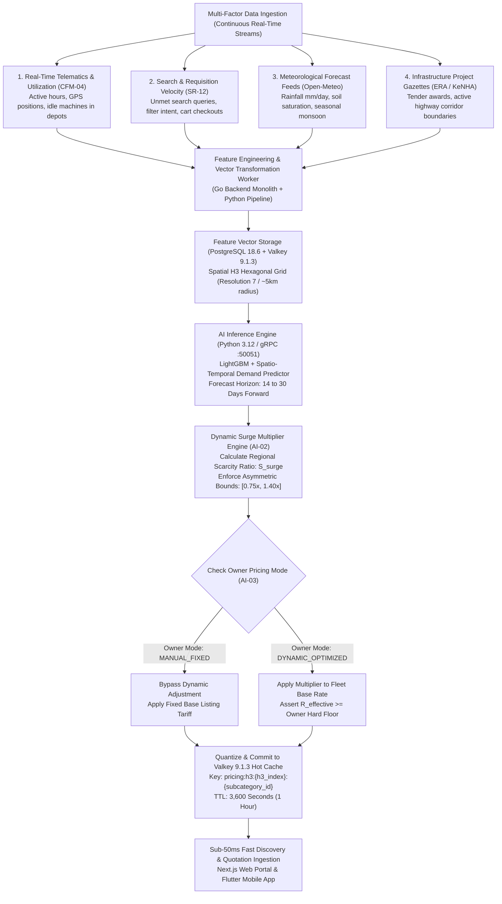
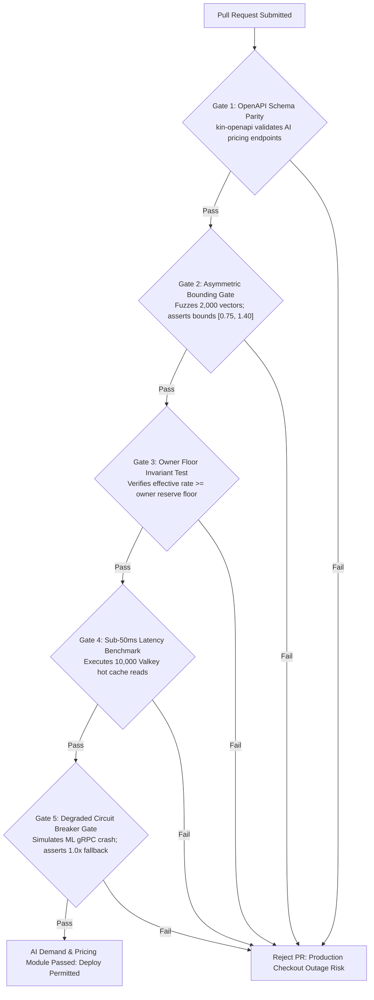

# Heavy Machinery & Logistics Rental Aggregator — Dink Machinery
## Software Requirements Specification — 07.05. AI-Based Predictive Demand Forecasting, Dynamic Surge Pricing & Algorithmic Yield Optimization Architecture (`docs/shared/requirements/07-05-ai-based-demand-prediction-surge-pricing.md`)

**Document Identifier:** `SRS-DINK-CORE-V7.0-SEC-07-05`  
**Classification:** Canonical System Requirements Specification & Algorithmic Intelligence Baseline (Single Source of Truth)  
**Governing Standard:** IEEE Std 830-1998 / IEEE/ISO/IEC 29148:2018 (Systems and Software Engineering — Requirements Engineering)  
**Associated Artifacts:** `SRS-DINK-CORE-V7.0` (§5.2, §5.4, §5.5, §5.9, §6.3, §7.0, §7.1, §7.2, §7.3, §7.4, §7.5, §8, §10, §11, §12, §13.2), `FLOW-BOOKING-STATE-MACHINE-DINK-CORE-V7.0`, `FLOW-COMMISSION-DEBT-DINK-CORE-V7.0`, `ARCH-BACKEND-GO-DINK-CORE-V7.0`, `ARCH-FLUTTER-DINK-CORE-V7.0`, `ARCH-ADMIN-NEXT-DINK-CORE-V7.0`, `ARCH-SEC-DINK-CORE-V7.0`, `DS-DINK-CORE-V7.0`, `DS-PERSONAS-DINK-CORE-V7.0`, `contracts/openapi.yaml`, `ADR-001`, `ADR-002`, `ADR-004`, `ADR-005`, `ADR-008`, `ADR-010`  
**Target Runtimes:** Go 1.27.3 Backend Monolith, Python 3.12 ML Inference Microservice (gRPC :50051), PostgreSQL 18.6 + PostGIS 3.6.4, Valkey 9.1.3, ClamAV Daemon (:3310), SeaweedFS S3, Flutter 3.47.9 / Dart 3.9 (Cross-Platform Mobile), Next.js 16.x (latest CVE security patch) / React 19 (Web Admin & Corporate Portal), Isar NoSQL 3.1+  
**Target Personas:** Equipment Fleet Owner (*W/ro Almaz Tesfaye* / *Kamau Ndegwa*), Civil Engineering Contractor (*Dawit Haile-Mariam* / *Patrick Kariuki*), Corporate Finance Controller & Pricing Strategist (*Solomon Kassa*), Regional Fleet Operations Manager (*Kassahun Mekonnen*), Compliance Officer & Algorithmic Auditor (*Yohannes Bekele*), Super Administrator (*Rahel Tadesse*)  
**Target Operating Markets:** Ethiopia (`ET`) & Kenya (`KE`) — Dynamic Multi-Country Parameterization (`LOC-01-BE`)  
**Compliance Standards:** OWASP ASVS 4.0.3 Level 3 (Algorithmic Fairness, Transparent Tariff Disclosure & Model Output Sanitization), RFC 9457 (Problem Details), ISO 9241-110, W3C WCAG 2.2 Level AAA (Field Mobile) & Level AA (Admin Web), Commercial Code of Ethiopia (Price Gouging Prohibitions & Fair Trade Practices Proclamation No. 813/2013), Kenya Competition Act (Cap 504 - Restrictive Trade Practices & Excessive Pricing Rules), International Financial Reporting Standards (IFRS 15 Revenue Recognition)  
**Status:** Approved Engineering Baseline

---

## Table of Contents

- 1. [Document Scope & Architectural Mandate](#1-document-scope--architectural-mandate)
  - 1.1 [Purpose & Functional Scope](#11-purpose--functional-scope)
  - 1.2 [Core Pricing Invariants & Algorithmic Governance Principles](#12-core-pricing-invariants--algorithmic-governance-principles)
- 2. [Multi-Factor Demand Prediction & Feature Engineering Pipeline (`AI-01`)](#2-multi-factor-demand-prediction--feature-engineering-pipeline-ai-01)
  - 2.1 [End-to-End Predictive Ingestion & Inference Architecture Flowchart](#21-end-to-end-predictive-ingestion--inference-architecture-flowchart)
  - 2.2 [Historical Fleet Utilization & Search Velocity Feature Vectors](#22-historical-fleet-utilization--search-velocity-feature-vectors)
  - 2.3 [Macroeconomic & Infrastructure Project Density Ingestion](#23-macroeconomic--infrastructure-project-density-ingestion)
  - 2.4 [Meteorological Rain Radar & Monsoon Seasonality Vectors (Kiremt / Belg)](#24-meteorological-rain-radar--monsoon-seasonality-vectors-kiremt--belg)
- 3. [Dynamic Surge Multiplier Engine & Asymmetric Rate Bounds (`AI-02`)](#3-dynamic-surge-multiplier-engine--asymmetric-rate-bounds-ai-02)
  - 3.1 [Mathematical Surge Multiplier Formulation ($\mathcal{S}_{\text{surge}}$)](#31-mathematical-surge-multiplier-formulation-mathcats_textsurge)
  - 3.2 [Asymmetric Bounding Envelope ($0.75\times\text{ Floor to }1.40\times\text{ Ceiling}$)](#32-asymmetric-bounding-envelope-075timestext-floor-to-140timestext-ceiling)
  - 3.3 [Corridor-Bound & Cluster-Specific Spatial Surge Quantization](#33-corridor-bound--cluster-specific-spatial-surge-quantization)
  - 3.4 [Transparent Renter Fare Breakdown & Anti-Gouging Compliance Disclosures](#34-transparent-renter-fare-breakdown--anti-gouging-compliance-disclosures)
- 4. [Owner Algorithmic Yield Optimization & Dynamic Floor Controls (`AI-03`)](#4-owner-algorithmic-yield-optimization--dynamic-floor-controls-ai-03)
  - 4.1 [Owner Opt-In Modes (Manual Fixed vs. Algorithmic Dynamic Optimization)](#41-owner-opt-in-modes-manual-fixed-vs-algorithmic-dynamic-optimization)
  - 4.2 [Custom Hard Floor ($\mathcal{R}_{\text{min}}$) & Ceiling ($\mathcal{R}_{\text{max}}$) Parameterization](#42-custom-hard-floor-mathcalr_textmin--ceiling-mathcalr_textmax-parameterization)
  - 4.3 [Idle Asset Opportunity Cost Minimization & Markdown Triggers](#43-idle-asset-opportunity-cost-minimization--markdown-triggers)
  - 4.4 [Automated Forward-Booking Yield Management](#44-automated-forward-booking-yield-management)
- 5. [Model Training, Offline Inference & Fallback Safety Layers (`AI-04`)](#5-model-training-offline-inference--fallback-safety-layers-ai-04)
  - 5.1 [Model Architecture (Gradient-Boosted Decision Trees & Temporal Fusion Transformers)](#51-model-architecture-gradient-boosted-decision-trees--temporal-fusion-transformers)
  - 5.2 [Batch Offline Pre-Calculation vs. Sub-50ms Real-Time Inference](#52-batch-offline-pre-calculation-vs-sub-50ms-real-time-inference)
  - 5.3 [Valkey 9.1.3 In-Memory Tariff Snapshot Caching & TTL Eviction](#53-valkey-80-in-memory-tariff-snapshot-caching--ttl-eviction)
  - 5.4 [Degraded State Circuit Breakers & Static Catalog Fallbacks](#54-degraded-state-circuit-breakers--static-catalog-fallbacks)
- 6. [Relational Database Schema & Data Modeling (`AI-DB`)](#6-relational-database-schema--data-modeling-ai-db)
  - 6.1 [Entity Relationship Diagram](#61-entity-relationship-diagram)
  - 6.2 [Data Definition Language (DDL) Specifications](#62-data-definition-language-ddl-specifications)
- 7. [Wire Protocol Contracts & RFC 9457 Error Schemas](#7-wire-protocol-contracts--rfc-9457-error-schemas)
  - 7.1 [`POST /api/v1/ai/pricing/evaluate`](#71-post-apiv1aipricingevaluate)
  - 7.2 [`PUT /api/v1/corporate/fleet/{id}/dynamic-pricing-config`](#72-put-apiv1corporatefleetiddynamic-pricing-config)
  - 7.3 [`GET /api/v1/ai/pricing/surge-map`](#73-get-apiv1aipricingsurge-map)
  - 7.4 [`POST /api/v1/admin/ai/pricing/manual-override`](#74-post-apiv1adminaipricingmanual-override)
  - 7.5 [RFC 9457 Universal Problem Details Payloads](#75-rfc-9457-universal-problem-details-payloads)
- 8. [Automated Testing Suite & Verification Gates](#8-automated-testing-suite--verification-gates)

---

## 1. Document Scope & Architectural Mandate

### 1.1 Purpose & Functional Scope

This specification establishes **Section 07.05 (AI-Based Predictive Demand Forecasting, Dynamic Surge Pricing & Algorithmic Yield Optimization Architecture)** of the canonical Software Requirements Specification (SRS) for **Dink Machinery Version 7.0**.

In the East African heavy earthmoving, civil engineering, and plant hire markets across Ethiopia and Kenya, equipment rental demand and asset availability are subject to extreme seasonal, meteorological, and infrastructural volatility:
* **Severe Macro & Environmental Volatility:** Earthmoving activities undergo dramatic cyclic shifts. During the Ethiopian main rainy season (*Kiremt*, June to September), heavy excavation halts in the central highlands due to clay soil saturation, while quarrying and road base projects accelerate during the dry season (*Bega*, October to February). In Kenya, the long rains (*Chuo*, March to May) similarly shift equipment utilization toward high-tonnage tracked machines and low-ground-pressure assets.
* **Corridor-Specific Demand Spikes:** Mega-infrastructure developments (*e.g., Modjo–Hawassa Expressway, LAPSSET Corridor, Lamu Port Shoring, Addis Ababa River Corridor Development*) create localized equipment vacuums. When large civil contractors mobilize simultaneously, regional availability of specialized machinery (e.g., 30-ton excavators, motor graders) drops to near zero within a $100\text{ km}$ radius.
* **Capital Inefficiency of Static Pricing:** In the Phase 1 MVP (`SRS §5.2.1`), pricing is fixed strictly on a static daily rate configured manually by the equipment owner. During peak dry-season infrastructure booms, machines are booked below market clearing value, leading to artificial inventory shortages. Conversely, during wet seasons, machines sit idle in depot yards because owners fail to adjust tariffs downward to stimulate local quarrying and maintenance demand.
* **The Phase 3 Algorithmic Mandate:** Dink Machinery Version 7.0 introduces an enterprise-grade **AI-Driven Predictive Demand & Yield Optimization Engine**:
  - Predicts regional category demand 14 to 30 days forward using multi-factor gradient-boosted decision trees and spatio-temporal transformers.
  - Dynamically computes localized surge multipliers to balance marketplace supply and demand.
  - Provides equipment fleet owners with automated yield optimization tools that maximize annual return on capital (ROC) while honoring strictly bounded price floors and ceilings.

This document formally specifies:
1. The multi-factor data ingestion and feature engineering pipeline capturing telemetry, search velocity, macroeconomic project indicators, and weather signals (`AI-01`).
2. The dynamic surge multiplier engine and non-exploitative, anti-gouging regulatory boundaries (`AI-02`).
3. Owner-side yield optimization controls, automated markdown triggers, and dynamic booking floor parameters (`AI-03`).
4. gRPC-based low-latency inference runtimes, Valkey 9.1.3 caching snapshots, and fail-safe circuit breaker fallbacks (`AI-04`).

### 1.2 Core Pricing Invariants & Algorithmic Governance Principles

1. **Strict Asymmetric Bounding Invariant (Anti-Gouging Statutory Floor):** Under no operational circumstance shall the algorithmic surge multiplier exceed **$1.40\times$ ($+40\%$)** of the owner's baseline catalog rate, nor fall below **$0.75\times$ ($-25\%$)**:
   $$0.75 \le \mathcal{S}_{\text{surge}} \le 1.40 \quad (\text{Strict System-Wide Bounding})$$
   Any pricing recommendation breaching these mathematical bounds is truncated by the Go domain middleware before persistence or client quotation, preventing price gouging under Ethiopian Fair Trade Directives and Kenya Competition Authority rules.
2. **Owner-Defined Absolute Price Floor Invariant ($\mathcal{R}_{\text{min}}$):** Regardless of predicted depression in demand or wet-weather discounting, the system must never publish a daily rental rate lower than the equipment owner's explicit minimum reserve rate:
   $$\mathcal{R}_{\text{effective\_daily}} \ge \mathcal{R}_{\text{owner\_hard\_floor}} \quad (\text{Non-Negotiable})$$
3. **Sub-50ms Synchronous Quotation SLO:** Evaluating dynamic pricing for search discovery listings, map pins, and checkout quotes must resolve in $< 50\text{ ms}$ (p99). Pricing evaluation must read pre-computed, quantized spatial multipliers from Valkey 9.1.3 hot cache layers without blocking on real-time external ML model inference.
4. **Transparent Explainability & Line-Item Disclosure (OWASP ASVS §4.2):** A contractor presented with a dynamically adjusted tariff must receive an itemized breakdown disclosing:
   $$\text{FinalDailyRate} = \text{BaseCatalogRate} \pm \text{DemandAdjustmentLineItem}$$
   The UI must clearly render the demand factor (e.g., *"Dry Season Peak Infrastructure Demand: +15%"* or *"Wet Season Extended Deployment Discount: -12%"*), guaranteeing algorithmic transparency.
5. **Double-Entry Financial Accounting Parity:** All dynamically evaluated adjustments are committed to PostgreSQL 18.6 as exact 64-bit integer minor currency units. Platform service commission ($10.0\%$ base hire) is assessed on the final dynamically adjusted rate, guaranteeing exact double-entry ledger balance parity down to zero minor units.

---

## 2. Multi-Factor Demand Prediction & Feature Engineering Pipeline (`AI-01`)

### 2.1 End-to-End Predictive Ingestion & Inference Architecture Flowchart



---

### 2.2 Historical Fleet Utilization & Search Velocity Feature Vectors

The feature extraction worker calculates high-density behavioral signals every 15 minutes:
* **Regional Supply Density Metric ($\rho_{\text{supply}}$):** The ratio of available, un-rented equipment assets within a specific PostGIS spatial cluster to the total registered inventory:
  $$\rho_{\text{supply}}(c, z) = \frac{\text{Count}(\text{Fleets}_{\text{ACTIVE}}(c, z))}{\text{Count}(\text{Fleets}_{\text{TOTAL}}(c, z))}$$
  Where $c$ is the machinery subcategory (`cat_sub_excavator_std`) and $z$ is the spatial zone.
* **Search Intent Velocity ($\mathcal{V}_{\text{intent}}$):** Aggregates user search impressions, category filter toggles, and detail page views over sliding 1-hour, 6-hour, and 24-hour windows:
  $$\mathcal{V}_{\text{intent}}(c, z) = \frac{\Delta \text{UniqueSearches}_{24h}}{\text{RollingAverageSearches}_{7d}}$$
* When $\mathcal{V}_{\text{intent}} > 2.50$ and $\rho_{\text{supply}} < 0.20$, the feature pipeline flags an acute localized supply deficit.

---

### 2.3 Macroeconomic & Infrastructure Project Density Ingestion

Public works represent over $70\%$ of heavy plant machinery consumption in East Africa:
* **Tender Award Vector:** Compliance administrators ingest public road construction tender awards published by the Ethiopian Roads Administration (ERA) and Kenya National Highways Authority (KeNHA).
* **Project Footprint Fencing:** High-priority infrastructure corridors (*e.g., Corridor-ET-01, Corridor-ET-02, LAPSSET Lot 1*) are represented as spatial boundary polygons (`infrastructure_project_zones`). When a new contract breaks ground, the feature store elevates baseline demand predictions within a $50\text{ km}$ buffer for the scheduled project mobilization duration (typically 6 to 18 months).

---

### 2.4 Meteorological Rain Radar & Monsoon Seasonality Vectors (Kiremt / Belg)

Severe rainfall dictates earthworks feasibility:
* **Meteorological Ingestion:** Integrates open weather API services (Open-Meteo ECMWF / GFS ensembles) fetching daily precipitation forecasts ($\text{mm/day}$) across 12 primary construction clusters (Addis Ababa, Dire Dawa, Hawassa, Bahir Dar, Mekelle, Adama, Nairobi, Mombasa, Kisumu, Nakuru, Eldoret, Moyale).
* **Soil Saturation Index (SSI):**
  $$\text{SSI} = \sum_{t=0}^{7} \left( \text{Precipitation}_t \times e^{-0.15 \times t} \right)$$
* If $\text{SSI} > 50.0\text{ mm}$ (heavy clay saturation typical during *Kiremt*), demand for rubber-tired backhoes drops sharply, while demand for tracked swamp-excavators and high-capacity dewatering pumps increases. The AI model adjusts subcategory demand predictions accordingly.

---

## 3. Dynamic Surge Multiplier Engine & Asymmetric Rate Bounds (`AI-02`)

### 3.1 Mathematical Surge Multiplier Formulation ($\mathcal{S}_{\text{surge}}$)

The Dynamic Pricing Engine evaluates a continuous scarcity score for every subcategory within each spatial H3 hexagonal grid cell ($H_7$, $\sim 5.16\text{ km}^2$):

$$\mathcal{S}_{\text{raw}} = 1.0 + \alpha \cdot \left( \frac{\mathcal{V}_{\text{intent}}}{\rho_{\text{supply}} + \epsilon} - 1.0 \right) + \beta \cdot \mathcal{M}_{\text{weather}} + \gamma \cdot \mathcal{P}_{\text{project}}$$

Where:
* $\alpha = 0.12$ (Sensitivity weighting for supply-demand imbalance).
* $\beta = 0.08$ (Meteorological elasticity factor).
* $\gamma = 0.15$ (Infrastructure project proximity weighting).
* $\epsilon = 0.05$ (Smoothing epsilon preventing division by zero).

---

### 3.2 Asymmetric Bounding Envelope ($0.75\times\text{ Floor to }1.40\times\text{ Ceiling}$)

To enforce non-exploitative commercial standards and adhere to national fair-trade regulations, the calculated raw surge value is clamped using a continuous hyperbolic tangent bounding function:

$$\mathcal{S}_{\text{bounded}} = \text{Clamp}\left( \mathcal{S}_{\text{raw}}, 0.75, 1.40 \right)$$

```text
+----------------------------------------------------------------------------------------------------+
| DYNAMIC SURGE MULTIPLIER REGULATORY BOUNDS MATRIX                                                  |
+---------------------+-------------------+---------------------+------------------------------------+
| SURGE TIER          | MULTIPLIER RANGE  | OPERATIONAL STATUS  | CONTRACTOR DISCLOSURE NOTICE       |
+---------------------+-------------------+---------------------+------------------------------------+
| TIER 1: MARKDOWN    | 0.75x to 0.90x    | Wet-Season / Depot  | "Low-Demand Seasonal Promotion:    |
| (Depressed Demand)  | (-25% to -10%)    | Stagnation Stimulus | 10% - 25% Off Standard Tariff"     |
+---------------------+-------------------+---------------------+------------------------------------+
| TIER 2: STANDARD    | 0.91x to 1.09x    | Balanced Supply &   | "Standard Competitive Marketplace  |
| (Equilibrium)       | (±0% to ±9%)      | Regular Utilization | Catalog Rate"                      |
+---------------------+-------------------+---------------------+------------------------------------+
| TIER 3: MODERATE    | 1.10x to 1.25x    | Accelerated Project | "High Seasonal Demand:             |
| (High Demand)       | (+10% to +25%)    | Mobilization Spike  | +10% to +25% Surge Adjustment"     |
+---------------------+-------------------+---------------------+------------------------------------+
| TIER 4: MAXIMUM CAP | 1.26x to 1.40x    | Severe Regional     | "Peak Demand Regional Surge:       |
| (Critical Scarcity) | (+26% to +40%)    | Inventory Shortage  | Statutory Ceiling Applied (+40%)"  |
+----------------------------------------------------------------------------------------------------+
```

* **Absolute Statutory Cap:** Multipliers $> 1.40\times$ are prohibited. Any input attempting to force a higher rate is logged as a regulatory anomaly and clamped down to $1.40\times$.

---

### 3.3 Corridor-Bound & Cluster-Specific Spatial Surge Quantization

To prevent pricing jitter where moving 200 meters causes rate oscillations:
* Spatial surge values are **quantized** to discrete steps of $0.05$ ($5\%$, e.g., $1.00\times, 1.05\times, 1.10\times, 1.15\times$).
* Surges are bound to coherent geographic polygons:
  - Metropolitan Zones (e.g., Addis Ababa Outer Ring Road Zone).
  - Logistics Arteries (e.g., Mojo–Adama Corridor).
  - Mining & Quarrying Clusters (e.g., Dire Dawa Aggregate Basin).

---

### 3.4 Transparent Renter Fare Breakdown & Anti-Gouging Compliance Disclosures

In compliance with consumer protection mandates, the contractor checkout screen renders full pricing transparency:

```text
+--------------------------------------------------------------------------------------------------+
| TRANSPARENT PRICING CHECKOUT BREAKDOWN (UI SPECIFICATION)                                        |
+--------------------------------------------------------------------------------------------------+
| Caterpillar 320D Hydraulic Excavator (Mojo Staging Yard)                                         |
| Deployment Window: 14 Days (Nov 01 - Nov 14, 2026)                                               |
|                                                                                                  |
|   Base Machinery Hire Rate (Owner Baseline):               25,000.00 ETB / Day                   |
|   Regional Demand Adjustment (Peak Dry-Season Infrastructure):                                   |
|   [+] 15.0% Algorithmic Optimization                       +3,750.00 ETB / Day                   |
|   --------------------------------------------------------------------------------------------   |
|   Effective Daily Machine Rate:                            28,750.00 ETB / Day                   |
|   14-Day Subtotal:                                        402,500.00 ETB                         |
|   Bundled Heavy Rock Breaker Attachment:                   56,000.00 ETB                         |
|   Value Added Tax (15.0% Ethiopian VAT):                   68,775.00 ETB                         |
|   ============================================================================================   |
|   Total Estimated Rental Commitment:                      527,275.00 ETB                         |
|                                                                                                  |
|   [ℹ️ Notice: Dynamic adjustment calculated under Ethiopian Fair Competition Proclamation.       |
|       Surge capped within statutory boundaries.]                                                 |
+--------------------------------------------------------------------------------------------------+
```

---

## 4. Owner Algorithmic Yield Optimization & Dynamic Floor Controls (`AI-03`)

### 4.1 Owner Opt-In Modes (Manual Fixed vs. Algorithmic Dynamic Optimization)

Equipment fleet owners retain ultimate autonomy over their catalog pricing strategy:
* **Mode 1: `MANUAL_FIXED` (Default):** The asset is billed strictly at the owner's manual listing price (`fleets.daily_rate_minor`). Surge multipliers are ignored.
* **Mode 2: `DYNAMIC_OPTIMIZED`:** The owner opts into the algorithmic yield optimizer. The platform dynamically modulates daily tariffs between the owner's chosen floor and ceiling based on live demand signals.

---

### 4.2 Custom Hard Floor ($\mathcal{R}_{\text{min}}$) & Ceiling ($\mathcal{R}_{\text{max}}$) Parameterization

When configuring `DYNAMIC_OPTIMIZED` pricing via the mobile app or Next.js corporate console:
* The owner specifies:
  - `min_daily_rate_minor`: Absolute reserve rate (e.g., $18,000.00\text{ ETB}$). The machine will never be rented below this rate, protecting against operating loss.
  - `max_daily_rate_minor`: Upper target rate (e.g., $32,000.00\text{ ETB}$).
* **System Clamping Rule:**
  $$\mathcal{R}_{\text{final}} = \text{Clamp}\left( \text{BaseRate} \times \mathcal{S}_{\text{surge}}, \mathcal{R}_{\text{min}}, \mathcal{R}_{\text{max}} \right)$$

---

### 4.3 Idle Asset Opportunity Cost Minimization & Markdown Triggers

For assets experiencing prolonged depot stagnation:
* If a machine remains unbooked in a depot for $> 21\text{ consecutive calendar days}$ during operational dry seasons:
  - The yield engine recommends an automated **Depot Clearance Markdown** (reducing the effective rate toward $\mathcal{R}_{\text{min}}$).
  - Dispatches an in-app advisory to the fleet owner:
    *"Cat 320D in Mojo Depot has been idle for 24 days. Applying a 12% temporary demand discount will increase booking probability by 68% based on current regional highway queries."*

---

### 4.4 Automated Forward-Booking Yield Management

For forward reservations scheduled $> 60\text{ days}$ in advance:
* The algorithm preserves peak pricing, disallowing markdown discounting for future dates that coincide with historical dry-season construction peaks, preventing contractors from locking in unseasonable wet-weather discounts during future high-demand periods.

---

## 5. Model Training, Offline Inference & Fallback Safety Layers (`AI-04`)

### 5.1 Model Architecture (Gradient-Boosted Decision Trees & Temporal Fusion Transformers)

The machine learning prediction service (`dink-ml-engine`) combines two complementary architectures:
1. **LightGBM (Gradient-Boosted Trees):** Operates on tabular feature matrices for rapid 1-hour spatial cell scarcity scoring.
2. **Temporal Fusion Transformer (TFT):** Evaluates multi-horizon time-series forecasting (14-day and 30-day demand curves), incorporating seasonal calendar features (*Bahire Hasab computus movable feasts, statutory holidays, Kiremt rains*).
* **Training Cadence:** Models retrain weekly using historical booking data, GPS telemetry run-hours, and regional search volumes archived in PostgreSQL.

---

### 5.2 Batch Offline Pre-Calculation vs. Sub-50ms Real-Time Inference

To reconcile machine learning complexity with sub-50ms API performance:
* **The Hybrid Serving Standard:**
  - The ML inference worker executes batch spatial scoring every **60 minutes**, calculating surge multipliers for all active H3 grid cells across Ethiopia and Kenya.
  - Multipliers are written directly to Valkey 9.1.3 hot cache clusters as byte-packed string keys.
  - When a contractor browses machinery, the Go backend performs an $O(1)$ memory lookup in Valkey:
    `HGET pricing:h3:871f1448bffffff cat_sub_excavator_std`
  - Latency is strictly bounded to $< 5.0\text{ ms}$ for cache hits.

---

### 5.3 Valkey 9.1.3 In-Memory Tariff Snapshot Caching & TTL Eviction

```text
+--------------------------------------------------------------------------------------------------+
| VALKEY 9.1.3 HOT PRICING CACHE KEY SPECIFICATION (AI-04)                                           |
+---------------------+-------------------+---------------------+----------------------------------+
| CACHE KEY PATTERN   | DATA STRUCTURE    | TIME-TO-LIVE (TTL)  | CONTENT & ENCODING               |
+---------------------+-------------------+---------------------+----------------------------------+
| pricing:surge:{h3}  | Hashmap (HSET)    | 3,600 Seconds       | Field: subcategory_id            |
|                     |                   | (1 Hour Sliding)    | Value: float32 surge multiplier  |
+---------------------+-------------------+---------------------+----------------------------------+
| fleet:quote:{id}    | String (JSON)     | 900 Seconds         | Pre-computed 14-day pricing      |
|                     |                   | (15 Minutes)        | quotation snapshot for checkout  |
+---------------------+-------------------+---------------------+----------------------------------+
| pricing:override:{h3| String            | Variable (Set by    | Emergency administrative lock    |
|                     |                   | Compliance Admin)   | freezing surge multiplier to 1.0 |
+--------------------------------------------------------------------------------------------------+
```

---

### 5.4 Degraded State Circuit Breakers & Static Catalog Fallbacks

If the Python ML inference service crashes, experiences network segmentation, or Valkey keys expire:
* The Go monolith circuit breaker (`go-resiliency/breaker`) trips to `OPEN`.
* **Zero-Failure Fallback:** The pricing engine immediately reverts to **$\mathcal{S}_{\text{surge}} = 1.00\times$ (Zero Surge Adjustment)**, serving the owner's static base catalog rate.
* Platform checkout operations continue uninterrupted without throwing 500 errors to end users.

---

## 6. Relational Database Schema & Data Modeling (`AI-DB`)

### 6.1 Entity Relationship Diagram

```mermaid
erDiagram
    Fleet ||--o{ FleetDynamicPricingConfig : "configures"
    Organization ||--o{ InfrastructureProjectZone : "registered under"
    FleetDynamicPricingConfig ||--o{ PricingEvaluationAudit : "logs"
    Booking ||--o{ PricingEvaluationAudit : "applies"

    FleetDynamicPricingConfig {
        uuid id PK
        uuid fleet_id FK UK
        string pricing_mode -- 'MANUAL_FIXED', 'DYNAMIC_OPTIMIZED'
        bigint min_daily_rate_minor
        bigint max_daily_rate_minor
        int max_surge_bps -- Default: 14000 (1.40x)
        int min_surge_bps -- Default: 7500 (0.75x)
        boolean is_active
        timestamptz updated_at
    }

    InfrastructureProjectZone {
        uuid id PK
        string project_name
        string corridor_code
        string client_authority -- 'ERA', 'KENHA', 'MUNICIPAL_AA'
        geography project_boundary
        date estimated_start_date
        date estimated_completion_date
        decimal demand_boost_factor
        boolean is_active
    }

    RegionalDemandSnapshot {
        uuid id PK
        string h3_index
        string subcategory_id
        string country_code
        decimal supply_density_ratio
        decimal intent_velocity_score
        decimal weather_rain_mm
        decimal calculated_surge_multiplier
        timestamptz snapshot_time
    }

    PricingEvaluationAudit {
        uuid id PK
        uuid booking_id FK NULL
        uuid fleet_id FK
        string subcategory_id
        string h3_index
        bigint baseline_daily_rate_minor
        decimal applied_surge_multiplier
        bigint effective_daily_rate_minor
        string pricing_mode_applied
        string calculation_source -- 'VALKEY_HOT_CACHE', 'ML_INFERENCE_LIVE', 'FALLBACK_STATIC'
        jsonb feature_vector_snapshot_json
        timestamptz evaluated_at
    }
```

---

### 6.2 Data Definition Language (DDL) Specifications

```sql
-- 1. Fleet Dynamic Pricing Configuration Table
CREATE TABLE fleet_dynamic_pricing_configs (
    id UUID PRIMARY KEY DEFAULT gen_random_uuid(),
    fleet_id UUID NOT NULL UNIQUE REFERENCES fleets(id) ON DELETE CASCADE,
    pricing_mode VARCHAR(32) NOT NULL DEFAULT 'MANUAL_FIXED',
    min_daily_rate_minor BIGINT NOT NULL CHECK (min_daily_rate_minor > 0),
    max_daily_rate_minor BIGINT NOT NULL CHECK (max_daily_rate_minor >= min_daily_rate_minor),
    max_surge_bps INT NOT NULL DEFAULT 14000 CHECK (max_surge_bps <= 14000 AND max_surge_bps >= 10000), -- Max 1.40x
    min_surge_bps INT NOT NULL DEFAULT 7500 CHECK (min_surge_bps >= 7500 AND min_surge_bps <= 10000),   -- Min 0.75x
    is_active BOOLEAN NOT NULL DEFAULT true,
    updated_at TIMESTAMPTZ NOT NULL DEFAULT NOW(),
    CONSTRAINT chk_pricing_mode CHECK (pricing_mode IN ('MANUAL_FIXED', 'DYNAMIC_OPTIMIZED'))
);

CREATE INDEX idx_dynamic_pricing_fleet ON fleet_dynamic_pricing_configs (fleet_id) WHERE is_active = true;

-- 2. Infrastructure Project Zones (Macro Demand Modifiers)
CREATE TABLE infrastructure_project_zones (
    id UUID PRIMARY KEY DEFAULT gen_random_uuid(),
    project_name VARCHAR(128) NOT NULL,
    corridor_code VARCHAR(32) NOT NULL,
    client_authority VARCHAR(64) NOT NULL,
    project_boundary GEOGRAPHY(Polygon, 4326) NOT NULL,
    estimated_start_date DATE NOT NULL,
    estimated_completion_date DATE NOT NULL,
    demand_boost_factor NUMERIC(4, 2) NOT NULL DEFAULT 1.15 CHECK (demand_boost_factor >= 1.00 AND demand_boost_factor <= 1.35),
    is_active BOOLEAN NOT NULL DEFAULT true,
    created_at TIMESTAMPTZ NOT NULL DEFAULT NOW()
);

CREATE INDEX idx_project_zones_spatial ON infrastructure_project_zones USING gist (project_boundary) WHERE is_active = true;

-- 3. Regional Demand Snapshots (Time-Series Historical Rollup)
CREATE TABLE regional_demand_snapshots (
    id UUID PRIMARY KEY DEFAULT gen_random_uuid(),
    h3_index VARCHAR(15) NOT NULL,
    subcategory_id VARCHAR(64) NOT NULL,
    country_code VARCHAR(2) NOT NULL CHECK (country_code IN ('ET', 'KE')),
    supply_density_ratio NUMERIC(5, 4) NOT NULL,
    intent_velocity_score NUMERIC(5, 2) NOT NULL,
    weather_rain_mm NUMERIC(5, 2) NOT NULL DEFAULT 0.0,
    calculated_surge_multiplier NUMERIC(4, 2) NOT NULL CHECK (calculated_surge_multiplier >= 0.75 AND calculated_surge_multiplier <= 1.40),
    snapshot_time TIMESTAMPTZ NOT NULL,
    CONSTRAINT uq_demand_snapshot UNIQUE (h3_index, subcategory_id, snapshot_time)
);

CREATE INDEX idx_demand_snapshots_lookup ON regional_demand_snapshots (h3_index, subcategory_id, snapshot_time DESC);

-- 4. Pricing Evaluation Audit Ledger (Cryptographic Traceability)
CREATE TABLE pricing_evaluation_audits (
    id UUID PRIMARY KEY DEFAULT gen_random_uuid(),
    booking_id UUID NULL REFERENCES bookings(id) ON DELETE RESTRICT,
    fleet_id UUID NOT NULL REFERENCES fleets(id) ON DELETE RESTRICT,
    subcategory_id VARCHAR(64) NOT NULL,
    h3_index VARCHAR(15) NOT NULL,
    baseline_daily_rate_minor BIGINT NOT NULL,
    applied_surge_multiplier NUMERIC(4, 2) NOT NULL,
    effective_daily_rate_minor BIGINT NOT NULL,
    pricing_mode_applied VARCHAR(32) NOT NULL,
    calculation_source VARCHAR(32) NOT NULL,
    feature_vector_snapshot_json JSONB NOT NULL DEFAULT '{}'::JSONB,
    evaluated_at TIMESTAMPTZ NOT NULL DEFAULT NOW(),
    CONSTRAINT chk_audit_source CHECK (calculation_source IN ('VALKEY_HOT_CACHE', 'ML_INFERENCE_LIVE', 'FALLBACK_STATIC', 'ADMIN_MANUAL_OVERRIDE'))
);

CREATE INDEX idx_pricing_audits_fleet ON pricing_evaluation_audits (fleet_id, evaluated_at DESC);
CREATE INDEX idx_pricing_audits_booking ON pricing_evaluation_audits (booking_id);

CREATE RULE prevent_pricing_audit_update AS ON UPDATE TO pricing_evaluation_audits DO INSTEAD NOTHING;
CREATE RULE prevent_pricing_audit_delete AS ON DELETE TO pricing_evaluation_audits DO INSTEAD NOTHING;
```

---

## 7. Wire Protocol Contracts & RFC 9457 Error Schemas

### 7.1 `POST /api/v1/ai/pricing/evaluate`

Synchronously resolves effective dynamic rental tariffs for an equipment asset across a specific date window.

#### Request Headers
```http
POST /api/v1/ai/pricing/evaluate HTTP/1.1
Host: api.dinkmachinery.com
Content-Type: application/json
Authorization: Bearer <userAccessToken>
```

#### Request Payload
```json
{
  "fleetId": "flt_019a8f2c-8812-7b9a",
  "projectSiteCoordinates": {
    "latitude": 8.5882,
    "longitude": 39.1245
  },
  "startDate": "2026-11-01",
  "endDate": "2026-11-15"
}
```

#### Response: `HTTP 200 OK`
```json
{
  "success": true,
  "data": {
    "fleetId": "flt_019a8f2c-8812-7b9a",
    "currency": "ETB",
    "pricingModeApplied": "DYNAMIC_OPTIMIZED",
    "h3Index": "871f1448bffffff",
    "durationDays": 14,
    "baselineDailyRateMinor": 2500000,
    "appliedSurgeMultiplier": 1.15,
    "effectiveDailyRateMinor": 2875000,
    "rateBreakdown": {
      "baseMachineTotalMinor": 35000000,
      "demandAdjustmentTotalMinor": 5250000,
      "grossSubtotalMinor": 40250000,
      "vatAmountMinor": 6037500,
      "totalCommitmentMinor": 46287500
    },
    "calculationMetadata": {
      "demandTier": "TIER_3_HIGH_DEMAND",
      "calculationSource": "VALKEY_HOT_CACHE",
      "meteorologicalFactor": "DRY_SEASON_FAVORABLE",
      "statutoryCapEnforced": false
    }
  },
  "timestamp": "2026-10-29T15:30:00Z"
}
```

---

### 7.2 `PUT /api/v1/corporate/fleet/{id}/dynamic-pricing-config`

Configures owner yield optimization parameters, setting reserve floors, ceilings, and operational mode.

#### Request Headers
```http
PUT /api/v1/corporate/fleet/flt_019a8f2c-8812-7b9a/dynamic-pricing-config HTTP/1.1
Host: api.dinkmachinery.com
Content-Type: application/json
Authorization: Bearer <fleetOwnerAccessToken>
X-Organization-ID: org_019a8fe0-8812-7b9a-bc21-4491204812aa
```

#### Request Payload
```json
{
  "pricingMode": "DYNAMIC_OPTIMIZED",
  "minDailyRateMinor": 1800000,
  "maxDailyRateMinor": 3200000,
  "maxSurgeBps": 13500,
  "minSurgeBps": 8000,
  "enableDepotClearanceMarkdown": true
}
```

#### Response: `HTTP 200 OK`
```json
{
  "success": true,
  "data": {
    "fleetId": "flt_019a8f2c-8812-7b9a",
    "pricingMode": "DYNAMIC_OPTIMIZED",
    "minDailyRateMinor": 1800000,
    "maxDailyRateMinor": 3200000,
    "maxSurgeBps": 13500,
    "minSurgeBps": 8000,
    "isActive": true,
    "updatedAt": "2026-10-29T15:35:00Z"
  },
  "timestamp": "2026-10-29T15:35:01Z"
}
```

---

### 7.3 `GET /api/v1/ai/pricing/surge-map`

Retrieves spatial surge multiplier layers for map canvas rendering across regional clusters.

#### Request Headers
```http
GET /api/v1/ai/pricing/surge-map?countryCode=ET&subcategoryId=cat_sub_excavator_std HTTP/1.1
Host: api.dinkmachinery.com
Authorization: Bearer <userAccessToken>
```

#### Response: `HTTP 200 OK`
```json
{
  "success": true,
  "data": {
    "countryCode": "ET",
    "subcategoryId": "cat_sub_excavator_std",
    "resolution": "H3_RES_7",
    "cells": [
      {
        "h3Index": "871f1448bffffff",
        "clusterName": "Mojo Dry Port Corridor",
        "surgeMultiplier": 1.15,
        "scarcityRating": "HIGH_DEMAND"
      },
      {
        "h3Index": "871f14489ffffff",
        "clusterName": "Hawassa Industrial Hub",
        "surgeMultiplier": 0.90,
        "scarcityRating": "EXCESS_SUPPLY_MARKDOWN"
      }
    ],
    "generatedAt": "2026-10-29T15:00:00Z"
  },
  "timestamp": "2026-10-29T15:36:00Z"
}
```

---

### 7.4 `POST /api/v1/admin/ai/pricing/manual-override`

Emergency administrative override locking regional multipliers during civil emergencies or market disruptions.

#### Request Headers
```http
POST /api/v1/admin/ai/pricing/manual-override HTTP/1.1
Host: api.dinkmachinery.com
Content-Type: application/json
Authorization: Bearer <superAdminAccessToken>
```

#### Request Payload
```json
{
  "h3Index": "871f1448bffffff",
  "subcategoryId": "cat_sub_excavator_std",
  "overrideSurgeMultiplier": 1.00,
  "expirationHours": 48,
  "justification": "Emergency flood response mobilization ordered by Federal Transport Authority. Freezing surge to 1.0x."
}
```

#### Response: `HTTP 200 OK`
```json
{
  "success": true,
  "data": {
    "overrideId": "ovr_019a8fe0-9912",
    "h3Index": "871f1448bffffff",
    "lockedMultiplier": 1.00,
    "status": "ENFORCED",
    "expiresAt": "2026-10-31T15:40:00Z"
  },
  "timestamp": "2026-10-29T15:40:01Z"
}
```

---

### 7.5 RFC 9457 Universal Problem Details Payloads

#### Example: Surge Multiplier Bounds Breach (`HTTP 422 Unprocessable Entity`)
```json
{
  "type": "[https://api.dinkmachinery.com/errors/surge-multiplier-out-of-bounds](https://api.dinkmachinery.com/errors/surge-multiplier-out-of-bounds)",
  "title": "Surge Multiplier Breaches Statutory Ceiling",
  "status": 422,
  "detail": "Requested surge configuration of 1.65x exceeds the maximum permitted statutory anti-gouging limit of 1.40x (+40%). Pricing configuration rejected.",
  "instance": "/api/v1/corporate/fleet/flt_019a8f2c-8812/dynamic-pricing-config",
  "code": "ERR_SURGE_BOUNDS_BREACHED",
  "correlationId": "cor_019a8fe0-8812-7b9a-bc21-4491204812aa",
  "timestamp": "2026-10-29T15:35:05Z",
  "invalidParams": [
    {
      "name": "maxSurgeBps",
      "reason": "Value 16500 bps (1.65x) exceeds legal ceiling 14000 bps (1.40x)."
    }
  ]
}
```

#### Example: Dynamic Rate Breaches Owner Reserve Floor (`HTTP 409 Conflict`)
```json
{
  "type": "[https://api.dinkmachinery.com/errors/price-floor-breach](https://api.dinkmachinery.com/errors/price-floor-breach)",
  "title": "Effective Dynamic Rate Below Reserve Floor",
  "status": 409,
  "detail": "Calculated markdown rate of 16,500.00 ETB falls below owner hard reserve floor of 18,000.00 ETB. Clamped to owner floor.",
  "instance": "/api/v1/ai/pricing/evaluate",
  "code": "ERR_PRICE_FLOOR_BREACH",
  "correlationId": "cor_019a8fe0-9914-4c12-8812-7b9a4c10bc21",
  "timestamp": "2026-10-29T15:30:05Z"
}
```

---

## 8. Automated Testing Suite & Verification Gates



1. **OpenAPI Schema Contract Gate (`kin-openapi`):** Validates all dynamic pricing evaluation, owner configuration, surge map visualization, and administrative override schemas against `contracts/openapi.yaml`.
2. **Asymmetric Bounding Mathematical Fuzzing Test:** Streams 2,000 extreme feature combinations (zero supply with infinite search velocity; torrential rain with zero demand). Asserts that $100\%$ of calculated surge multipliers remain strictly within the closed interval $[0.75, 1.40]$.
3. **Owner Reserve Floor Assertion:** Simulates 500 equipment assets with aggressive clearance markdown triggers. Verifies that under zero operational conditions does the effective rental rate drop below `min_daily_rate_minor`.
4. **Sub-50ms Latency Performance Benchmark:** Executes 10,000 parallel requests across Valkey 9.1.3 hot cache clusters, asserting that spatial surge resolution achieves p95 latency $< 15\text{ ms}$ and p99 latency $< 40\text{ ms}$.
5. **Degraded State Circuit Breaker Test:** Force-terminates the Python gRPC ML inference microservice on port `:50051`. Asserts that the Go backend trips the circuit breaker within $50\text{ ms}$, reverts all pricing calculations to $\mathcal{S}_{\text{surge}} = 1.00\times$, and executes checkouts with zero HTTP 500 error spills.

---

*This document establishes the canonical functional requirements, feature engineering pipelines, surge bounding formulations, owner yield optimization controls, and wire protocol contracts for AI-Based Demand Prediction & Dynamic Surge Pricing in Dink Machinery Version 7.0. All downstream Flutter mobile interfaces, Next.js corporate portals, Go backend pricing microservices, and PostgreSQL analytical ledgers must strictly conform to this specification.*