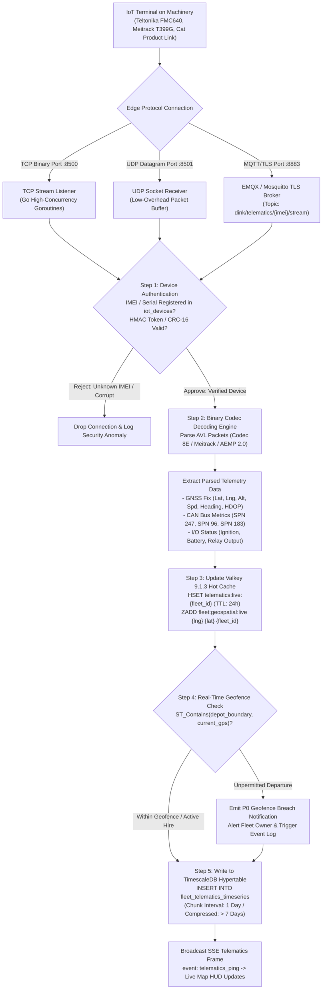
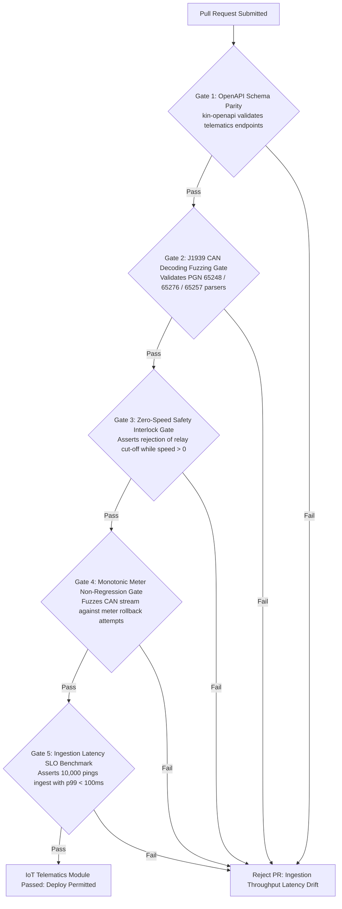

# Heavy Machinery & Logistics Rental Aggregator — Dink Machinery
## Software Requirements Specification — 07.06. IoT Hardware Telematics Integration, CAN Bus / J1939 Protocols, Remote Engine Immobilization & Fleet Health Architecture (`docs/shared/requirements/07-06-iot-hardware-telematics-integration.md`)

**Document Identifier:** `SRS-DINK-CORE-V7.0-SEC-07-06`  
**Classification:** Canonical System Requirements Specification & Telematics Engineering Baseline (Single Source of Truth)  
**Governing Standard:** IEEE Std 830-1998 / IEEE/ISO/IEC 29148:2018 (Systems and Software Engineering — Requirements Engineering)  
**Associated Artifacts:** `SRS-DINK-CORE-V7.0` (§5.2, §5.6, §5.7, §5.12, §6.4, §7.0, §7.4, §7.6, §8, §10, §12, §13.2), `FLOW-FLEET-REG-DINK-CORE-V7.0`, `FLOW-BOOKING-STATE-MACHINE-DINK-CORE-V7.0`, `FLOW-COMMISSION-DEBT-DINK-CORE-V7.0`, `ARCH-BACKEND-GO-DINK-CORE-V7.0`, `ARCH-FLUTTER-DINK-CORE-V7.0`, `ARCH-ADMIN-NEXT-DINK-CORE-V7.0`, `ARCH-SEC-DINK-CORE-V7.0`, `DS-DINK-CORE-V7.0`, `DS-PERSONAS-DINK-CORE-V7.0`, `contracts/openapi.yaml`, `ADR-001`, `ADR-002`, `ADR-004`, `ADR-005`, `ADR-008`, `ADR-010`  
**Target Runtimes:** Go 1.27.3 Backend Monolith, Python 3.12 Protocol Decoding Worker, PostgreSQL 18.6 + PostGIS 3.6.4 / TimescaleDB, Valkey 9.1.3, ClamAV Daemon (:3310), SeaweedFS S3, Flutter 3.47.8 / Dart 3.9 (Cross-Platform Mobile), Next.js 16.x (latest CVE security patch) / React 19 (Web Admin & Corporate Portal), Isar NoSQL 3.1+  
**Target Personas:** Equipment Fleet Owner (*W/ro Almaz Tesfaye* / *Kamau Ndegwa*), Certified Field Operator (*Mulugeta Tadesse* / *Juma Omwamba*), Depot Maintenance Yard Supervisor (*Kassahun Mekonnen*), Civil Engineering Project Manager (*Dawit Haile-Mariam* / *Patrick Kariuki*), Compliance Officer & Forensic Telematics Auditor (*Yohannes Bekele*), Super Administrator (*Rahel Tadesse*)  
**Target Operating Markets:** Ethiopia (`ET`) & Kenya (`KE`) — Dynamic Multi-Country Parameterization (`LOC-01-BE`)  
**Compliance Standards:** OWASP ASVS 4.0.3 Level 3 (Hardware Identity Attestation, Encrypted M2M Protocols & Non-Repudiation), RFC 9457 (Problem Details), ISO 9241-110, W3C WCAG 2.2 Level AAA (Field Mobile) & Level AA (Admin Web), SAE J1939 / ISO 11898 (Commercial Vehicle CAN Bus Communications), ISO 15143-3 (AEMP 2.0 Telematics Data Standard for Earthmoving Equipment), National Bank of Ethiopia (NBE) Asset Pledging Chattel Directives, Kenya Computer Misuse and Cybercrimes Act 2018  
**Status:** Approved Engineering Baseline

---

## Table of Contents

- 1. [Document Scope & Architectural Mandate](#1-document-scope--architectural-mandate)
  - 1.1 [Purpose & Functional Scope](#11-purpose--functional-scope)
  - 1.2 [Core IoT & Machine Telematics Invariants](#12-core-iot--machine-telematics-invariants)
- 2. [Multi-Protocol Hardware Gateway & Ingestion Architecture (`IOT-01`)](#2-multi-protocol-hardware-gateway--ingestion-architecture-iot-01)
  - 2.1 [End-to-End M2M Telematics Ingestion Pipeline Flowchart](#21-end-to-end-m2m-telematics-ingestion-pipeline-flowchart)
  - 2.2 [Supported Hardware Terminal Matrix (Teltonika, Meitrack, Cat Product Link, Komtrax)](#22-supported-hardware-terminal-matrix-teltonika-meitrack-cat-product-link-komtrax)
  - 2.3 [Edge Ingestion Protocols (TCP Binary, UDP Datagrams, MQTT/TLS 8883)](#23-edge-ingestion-protocols-tcp-binary-udp-datagrams-mqtttls-8883)
  - 2.4 [TimescaleDB Hypertables & Partitioned High-Frequency Time-Series Storage](#24-timescaledb-hypertables--partitioned-high-frequency-time-series-storage)
- 3. [CAN Bus & SAE J1939 Telemetry Decoding Engine (`IOT-02`)](#3-can-bus--sae-j1939-telemetry-decoding-engine-iot-02)
  - 3.1 [Parameter Group Number (PGN) & Suspect Parameter Number (SPN) Mapping](#31-parameter-group-number-pgn--suspect-parameter-number-spn-mapping)
  - 3.2 [Engine Operating Hours Monotonic Verification (PGN 65248 / SPN 247)](#32-engine-operating-hours-monotonic-verification-pgn-65248--spn-247)
  - 3.3 [Fuel Level & Burn Velocity Monitoring (PGN 65276 / SPN 96 & PGN 65257 / SPN 183)](#33-fuel-level--burn-velocity-monitoring-pgn-65276--spn-96--pgn-65257--spn-183)
  - 3.4 [Hydraulic Pressure, Oil Temperature & Engine Load Factors](#34-hydraulic-pressure-oil-temperature--engine-load-factors)
- 4. [Diagnostic Trouble Codes (DTC) & Predictive Health Engine (`IOT-03`)](#4-diagnostic-trouble-codes-dtc--predictive-health-engine-iot-03)
  - 4.1 [Active Fault Code (DM1) Ingestion & Failure Mode Identifier (FMI) Classification](#41-active-fault-code-dm1-ingestion--failure-mode-identifier-fmi-classification)
  - 4.2 [Predictive Breakdown Warning Alerts & Automatic Maintenance Holds](#42-predictive-breakdown-warning-alerts--automatic-maintenance-holds)
  - 4.3 [Automated Service Interval Tracking (PM 250 / 500 / 1000 Hours)](#43-automated-service-interval-tracking-pm-250--500--1000-hours)
  - 4.4 [Environmental & Soil Hardness Stress Indices](#44-environmental--soil-hardness-stress-indices)
- 5. [Remote Engine Immobilization & Physical Relay Control (`IOT-04`)](#5-remote-engine-immobilization--physical-relay-control-iot-04)
  - 5.1 [Safety-Critical Immobilization Protocols & Zero-Speed Invariant](#51-safety-critical-immobilization-protocols--zero-speed-invariant)
  - 5.2 [Four-Eyes Administrative Dual Control & Legal Hold Triggers](#52-four-eyes-administrative-dual-control--legal-hold-triggers)
  - 5.3 [Starter Motor Interlock vs. ECU Fuel Solenoid Cut-Off](#53-starter-motor-interlock-vs-ecu-fuel-solenoid-cut-off)
  - 5.4 [Anti-Tamper & Jamming Detection (GNSS Loss, Power Cut, Antenna Disconnect)](#54-anti-tamper--jamming-detection-gnss-loss-power-cut-antenna-disconnect)
- 6. [Relational Database Schema & Data Modeling (`IOT-DB`)](#6-relational-database-schema--data-modeling-iot-db)
  - 6.1 [Entity Relationship Diagram](#61-entity-relationship-diagram)
  - 6.2 [Data Definition Language (DDL) Specifications](#62-data-definition-language-ddl-specifications)
- 7. [Wire Protocol Contracts & RFC 9457 Error Schemas](#7-wire-protocol-contracts--rfc-9457-error-schemas)
  - 7.1 [`POST /api/v1/telematics/gateway/packet`](#71-post-apiv1telematicsgatewaypacket)
  - 7.2 [`POST /api/v1/telematics/devices/{deviceId}/commands`](#72-post-apiv1telematicsdevicesdeviceidcommands)
  - 7.3 [`GET /api/v1/telematics/fleets/{fleetId}/live`](#73-get-apiv1telematicsfleetsfleetidlive)
  - 7.4 [`POST /api/v1/admin/telematics/emergency-immobilize`](#74-post-apiv1admintelematicsemergency-immobilize)
  - 7.5 [RFC 9457 Universal Problem Details Payloads](#75-rfc-9457-universal-problem-details-payloads)
- 8. [Automated Testing Suite & Verification Gates](#8-automated-testing-suite--verification-gates)

---

## 1. Document Scope & Architectural Mandate

### 1.1 Purpose & Functional Scope

This specification establishes **Section 07.06 (IoT Hardware Telematics Integration, CAN Bus / J1939 Protocols, Remote Engine Immobilization & Fleet Health Architecture)** of the canonical Software Requirements Specification (SRS) for **Dink Machinery Version 7.0**.

In the East African commercial earthmoving, industrial plant leasing, and heavy logistics sectors across Ethiopia and Kenya, self-reported mobile application check-ins alone cannot guarantee absolute physical security or financial integrity for capitalized assets worth millions of Ethiopian Birr or Kenyan Shillings:
* **The Manual Reporting Limitation:** While mobile application workflows (`GPS-01` / `SRS §5.12`, `AR-01` / `SRS §5.6`, `RC-02` / `SRS §5.7`) capture human operator inputs, bad-faith actors can spoof mobile phone GPS coordinates, delay timesheet submissions, or tamper with mechanical analog hour meters.
* **The Telematics Layer (Phase 3 ADV-04):** Dink Machinery V7.0 integrates an industrial **Machine-to-Machine (M2M) Telematics Gateway** directly connected to vehicle hardware terminals (Teltonika FMC640/FMB125, Meitrack T399G, Cat Product Link, Komatsu KOMTRAX):
  - Streams CAN Bus and digital engine diagnostics in real time via standard J1939 and ISO 15143-3 (AEMP 2.0) protocols.
  - Automatically reconciles actual mechanical engine hours with billing timesheets, resolving overtime excess hours without human intervention.
  - Monitors high-frequency telemetry (hydraulic pressures, fuel consumption rates, coolant temperatures) to predict mechanical breakdowns before catastrophic job-site structural failures occur.
  - Provides hardware-backed anti-theft security, geofence boundary enforcement, and remote engine immobilization via cryptographically authenticated relay cut-offs.

This document formally specifies:
1. The multi-protocol hardware gateway ingestion pipeline handling binary TCP, UDP datagrams, and MQTT/TLS streaming connections (`IOT-01`).
2. The SAE J1939 CAN Bus decoding engine extracting PGNs and SPNs for engine hours, fuel volume, and load factors (`IOT-02`).
3. Diagnostic Trouble Code (DTC) processing, automated maintenance bay hold triggers, and asset stress metrics (`IOT-03`).
4. Remote engine immobilization protocols, zero-speed safety interlocks, four-eyes administrative authorization, and anti-jamming defenses (`IOT-04`).

### 1.2 Core IoT & Machine Telematics Invariants

1. **Hardware-First Canonical Meter Truth Invariant:** In any conflict between an operator's self-reported mobile meter photo (`RC-02`) and the hardware telematics CAN Bus reading (`SPN 247 Engine Total Hours of Operation`), the cryptographically signed hardware CAN Bus reading **overrides** manual entries for all automated billing reconciliations.
2. **Zero-Speed Safety Immobilization Invariant (ISO 13849 PL-d):** Under no operational, legal, or financial delinquency condition shall a remote engine immobilization command cut fuel solenoids or open ignition relays while the machine is in active physical motion:
   $$\text{Speed}_{\text{GNSS}} \equiv 0.0\text{ km/h} \quad \land \quad \text{EngineRPM} < 900\text{ RPM} \quad (\text{Mandatory Pre-Condition})$$
   Immobilization commands issued while a machine is operating at speed or under hydraulic load are buffered until the vehicle remains stationary at idle for at least $3.0\text{ consecutive minutes}$, preventing fatal job-site runaway accidents.
3. **Strict Monotonic Engine Hour Invariant:** Ingested cumulative engine hours transmitted by IoT hardware terminals must never regress:
   $$\mathcal{M}_{\text{telematics}}(t_2) \ge \mathcal{M}_{\text{telematics}}(t_1) \quad \forall \ t_2 > t_1$$
   Any packet reporting a lower cumulative hour reading triggers an immediate security alert (`ERR_METER_ROLLBACK_DETECTED`), freezing automated reconciliations.
4. **Sub-100ms Ingestion Latency & Valkey Hot Snapshots:** Inbound telemetry packets must be parsed, validated, and cached in Valkey 9.1.3 hot memory (`telematics:live:{fleet_id}`) within $< 100\text{ ms}$ (p99), ensuring live map tracking layers reflect active site coordinates without perceptible visual latency.
5. **Encrypted M2M Communication & Mutual TLS (mTLS):** Hardware terminals communicating directly with Dink Machinery ingestion endpoints must negotiate TLS 1.3 with hardware-backed client certificate attestation or pre-shared AES-256 HMAC cryptographic token signatures. Unauthenticated TCP/UDP packets are rejected at the Traefik edge boundary.

---

## 2. Multi-Protocol Hardware Gateway & Ingestion Architecture (`IOT-01`)

### 2.1 End-to-End M2M Telematics Ingestion Pipeline Flowchart



---

### 2.2 Supported Hardware Terminal Matrix (Teltonika, Meitrack, Cat Product Link, Komtrax)

```text
+----------------------------------------------------------------------------------------------------+
| DINK MACHINERY IOT TERMINAL INTEGRATION MATRIX (IOT-01)                                            |
+---------------------+-------------+-------------------+--------------------+-----------------------+
| TERMINAL MODEL      | MANUFACTURER| INGESTION FORMAT  | HARDWARE PROTOCOL  | PRIMARY EQUIPMENT USE |
+---------------------+-------------+-------------------+--------------------+-----------------------+
| FMC640 / FMB125     | Teltonika   | TCP / UDP Binary  | Codec 8 / Codec 8E | Universal Heavy Plant |
| (Advanced Heavy CAN)|             | Packet            | (J1939 / J1708)    | & Lowboy Transports   |
+---------------------+-------------+-------------------+--------------------+-----------------------+
| T399G (Rugged IP67  | Meitrack    | TCP Binary Stream | Meitrack Protocol  | Mining Excavators,    |
| Waterproof Terminal)|             |                   | MVT / GPRS ASCII   | Quarry Rock Breakers  |
+---------------------+-------------+-------------------+--------------------+-----------------------+
| Product Link PLE601 | Caterpillar | Cloud-to-Cloud    | ISO 15143-3 /      | Cat Tier-3 / Tier-4   |
| (PLK Satellite/Cell)|             | REST API / AEMP   | AEMP 2.0 XML/JSON  | Factory Integrated    |
+---------------------+-------------+-------------------+--------------------+-----------------------+
| KOMTRAX Step 5      | Komatsu     | REST API Webhook  | Komatsu Cloud Sync | Komatsu Excavators &  |
| (Orbcomm Satellite) |             | Pull / OAuth2     | GeoJSON Stream     | Bulldozers (Factory)  |
+---------------------+-------------+-------------------+--------------------+-----------------------+
```

---

### 2.3 Edge Ingestion Protocols (TCP Binary, UDP Datagrams, MQTT/TLS 8883)

* **TCP Stream Gateway (`:8500`):** Handles bidirectional reliable packet streams. For Teltonika Codec 8/8E, the gateway receives a preamble, verifies device IMEI, returns acknowledgment byte `0x01`, receives data records, and returns a 4-byte integer acknowledging the count of ingested AVL records.
* **UDP Gateway (`:8501`):** Serves low-bandwidth satellite connections in remote areas (e.g., Danakil Depression, Ogaden basin, Northern Kenya) where TCP handshakes induce excessive data charges and packet timeouts.
* **MQTT/TLS (`:8883`):** High-security broker enabling publish-subscribe telemetry streams for modern edge gateways running embedded Linux/Yocto.

---

### 2.4 TimescaleDB Hypertables & Partitioned High-Frequency Time-Series Storage

Telemetry streams produce millions of rows daily. The storage layer partitions data efficiently:
* Backed by PostgreSQL 18.6 with the **TimescaleDB extension**:
  - `fleet_telematics_timeseries` is converted into a hypertable partitioned by `time` (1-day chunk intervals).
  - Data older than **7 days** is automatically compressed using TimescaleDB columnar compression, reducing disk storage footprint by over $85\%$.
  - Continuous aggregates maintain hourly and daily rollups (`avg_rpm`, `total_fuel_burn`, `delta_engine_hours`).

---

## 3. CAN Bus & SAE J1939 Telemetry Decoding Engine (`IOT-02`)

### 3.1 Parameter Group Number (PGN) & Suspect Parameter Number (SPN) Mapping

The Go decoding service parses standard SAE J1939 CAN 29-bit identifier frames into standardized metrics:

```text
+----------------------------------------------------------------------------------------------------+
| SAE J1939 CAN BUS TELEMETRY MAPPING MATRIX (IOT-02)                                                |
+-------+--------------------+-------+-----------------------+------------+--------------------------+
| PGN   | PGN DESCRIPTION    | SPN   | PARAMETER DESCRIPTION | RESOLUTION | RANGE / UNITS            |
+-------+--------------------+-------+-----------------------+------------+--------------------------+
| 65248 | Engine Fluid Level | 247   | Total Engine Hours    | 0.05 hr/bit| 0 to 210,554,060.75 hrs  |
| (FEE5)| & Hours            |       | of Operation          | (180 s)    | (Canonical Machine Meter)|
+-------+--------------------+-------+-----------------------+------------+--------------------------+
| 65276 | Dash Display       | 96    | Fuel Level 1          | 0.4 %/bit  | 0 to 100 %               |
| (FEFC)| (Fuel & DEF)       |       |                       |            | (Tank Liquid Level)      |
+-------+--------------------+-------+-----------------------+------------+--------------------------+
| 65257 | Fuel Consumption   | 183   | Engine Fuel Rate      | 0.05 L/h   | 0 to 3,212.75 L/h        |
| (FEE9)| (Liquid Rate)      |       | (Instantaneous)       |            | (Fuel Burn Velocity)     |
+-------+--------------------+-------+-----------------------+------------+--------------------------+
| 65262 | Engine Temperature | 110   | Engine Coolant Temp   | 1 °C/bit   | -40 to +210 °C           |
| (FEEE)| 1                  |       |                       | Offset -40 | (Overheat Monitor)       |
+-------+--------------------+-------+-----------------------+------------+--------------------------+
| 61444 | Electronic Engine  | 190   | Engine Speed (RPM)    | 0.125 RPM  | 0 to 8,031.875 RPM       |
| (F004)| Controller 1       |       |                       |            | (Active Work Indicator)  |
+-------+--------------------+-------+-----------------------+------------+--------------------------+
| 65169 | Hydraulic Pressure | 158   | Hydraulic Work Loop   | 0.1 bar/bit| 0 to 6553.5 bar          |
| (FE91)| Fluid System       |       | Main Relief Pressure  |            | (Digging Workload)       |
+----------------------------------------------------------------------------------------------------+
```

---

### 3.2 Engine Operating Hours Monotonic Verification (PGN 65248 / SPN 247)

* **Verification Logic:**
  1. Incoming packet extracts `SPN 247`.
  2. Compares against `fleets.current_hour_meter_minor` (scaled by 100, e.g., $1,450.50\text{ hrs} = 145,050$).
  3. If $\mathcal{M}_{\text{packet}} < \mathcal{M}_{\text{stored}}$, transaction raises `ERR_METER_ROLLBACK_DETECTED` and locks the record for audit.
  4. If $\mathcal{M}_{\text{packet}} \ge \mathcal{M}_{\text{stored}}$, updates `fleets.current_hour_meter_minor` and appends to the timeseries hypertable.

---

### 3.3 Fuel Level & Burn Velocity Monitoring (PGN 65276 / SPN 96 & PGN 65257 / SPN 183)

Heavy equipment fuel theft ("bunkering") is a persistent risk in East Africa:
* **The Rapid Siphon Anomaly Detector:**
  If fuel level (`SPN 96`) drops by $> 15\%$ within a 15-minute sliding window while engine RPM (`SPN 190`) is $< 100\text{ RPM}$ (engine off), the system flags an **Urgent Fuel Theft Siphon Event**:
  - Emits high-priority P0 SMS and push alerts to the equipment owner and site security supervisor.
  - Stamps GPS location and current fuel volume loss in liters.

---

### 3.4 Hydraulic Pressure, Oil Temperature & Engine Load Factors

* High hydraulic pressure ($> 300\text{ bar}$) combined with high engine load ($> 80\%$) indicates active earthmoving excavation.
* Low engine RPM ($< 800\text{ RPM}$) with zero hydraulic pressure indicates idle machine status.
* Calculates **Effective Work Factor**:
  $$\text{WorkFactor} = \frac{\text{Engine Hours at High Load (> 60\%)}}{\text{Total Ignition ON Hours}}$$
  Enabling fleet owners to identify operator inefficiency and excessive engine idling.

---

## 4. Diagnostic Trouble Codes (DTC) & Predictive Health Engine (`IOT-03`)

### 4.1 Active Fault Code (DM1) Ingestion & Failure Mode Identifier (FMI) Classification

When a machine computer detects a mechanical or electrical failure, it broadcasts an SAE J1939 Diagnostic Message 1 (DM1) frame containing:
* **SPN (Suspect Parameter Number):** Identifies the faulty subsystem (e.g., `SPN 110` = Engine Coolant Temperature).
* **FMI (Failure Mode Identifier):** Identifies the type of failure:
  - `FMI 0`: Data Valid But Above Normal Operating Range (Most Severe).
  - `FMI 1`: Data Valid But Below Normal Operating Range.
  - `FMI 2`: Data Erratic, Intermittent, or Incorrect.
  - `FMI 3`: Voltage Above Normal / Shorted High.
  - `FMI 4`: Voltage Below Normal / Shorted Low.
* **Occurrence Count (OC):** Tracks how many times the fault occurred during active ignition.

---

### 4.2 Predictive Breakdown Warning Alerts & Automatic Maintenance Holds

Fault severity dictates operational platform reactions:

```text
+----------------------------------------------------------------------------------------------------+
| DIAGNOSTIC TROUBLE CODE SEVERITY & MITIGATION PROTOCOL (IOT-03)                                    |
+---------------+---------------------+-------------------+------------------------------------------+
| SEVERITY TIER | CRITICAL FAULTS     | EXAMPLE J1939 CODE| AUTOMATED PLATFORM ACTION                |
+---------------+---------------------+-------------------+------------------------------------------+
| CRITICAL P0   | Engine Overheat,    | SPN 110 FMI 0,    | 1. Broadcast P0 alert to in-cab terminal.|
| (Catastrophic)| Loss of Oil Pressure| SPN 100 FMI 1     | 2. Flips fleet status -> MAINTENANCE_HOLD|
|               | Main Relief Rupture |                   | 3. De-lists asset from search (< 100ms). |
+---------------+---------------------+-------------------+------------------------------------------+
| WARNING P1    | Hydraulic Fluid High| SPN 158 FMI 2,    | 1. Advisory banner on site manager HUD.  |
| (Impaired)    | Air Filter Clogged  | SPN 107 FMI 0     | 2. Recommends operational rate slowdown. |
+---------------+---------------------+-------------------+------------------------------------------+
| ADVISORY P2   | Water in Fuel Sensor| SPN 97 FMI 3,     | 1. Logged to fleet maintenance ledger.   |
| (Maintenance) | DEF Fluid Low       | SPN 1761 FMI 1    | 2. Scheduled for next depot yard service.|
+----------------------------------------------------------------------------------------------------+
```

---

### 4.3 Automated Service Interval Tracking (PM 250 / 500 / 1000 Hours)

* Ingests hardware engine hours continuously.
* Compares against the latest logged service in `fleet_maintenance_records`:
  $$\Delta \mathcal{H}_{\text{since\_pm}} = \mathcal{M}_{\text{telematics}} - \mathcal{M}_{\text{last\_pm\_service}}$$
* When $\Delta \mathcal{H}_{\text{since\_pm}} \ge 250.0\text{ hours}$, system prompts the depot maintenance supervisor to schedule filter and oil changes, preventing engine seizure.

---

### 4.4 Environmental & Soil Hardness Stress Indices

By correlating instantaneous hydraulic breakout pressure against fuel burn rate:
* System computes a **Job-Site Soil Toughness Index** (Soft Sand vs. Silt vs. Basalt/Granite Rock).
* If an excavator without a heavy-duty rock bucket is deployed in severe volcanic basalt rock formations, the system advises the contractor to equip a rock bucket or ripper to prevent boom stress fractures.

---

## 5. Remote Engine Immobilization & Physical Relay Control (`IOT-04`)

### 5.1 Safety-Critical Immobilization Protocols & Zero-Speed Invariant

Remote engine cut-off is a high-risk capability that can endanger human life if misused:
* **The Absolute Safety Protocol (Zero-Speed Encasement):**
  An immobilization command payload (`CMD_RELAY_OPEN`) sent to an IoT hardware terminal will only execute if:
  1. Terminal GNSS reports ground velocity:
     $$\text{Speed}_{\text{GNSS}} = 0.0\text{ km/h}$$
  2. Terminal digital inputs indicate ignition status is `OFF` or engine is idling at:
     $$\text{EngineRPM} < 900\text{ RPM}$$
  3. Accelerometer registers zero lateral motion variance ($< 0.05g$) for $\ge 180\text{ seconds}$.
* If the machine is in active transit or operating on an embankment slope, the command enters `PENDING_SAFE_STOP` in memory, executing only when the operator parks and idles the machine.

---

### 5.2 Four-Eyes Administrative Dual Control & Legal Hold Triggers

Remote immobilization cannot be executed unilaterally by a single platform user:
* **Four-Eyes Verification Standard (`SRS 05.11`):**
  - Drafter: Corporate Fleet Owner (*W/ro Almaz Tesfaye*) or Legal Counsel (*Yohannes Bekele*).
  - Authorizer: Super Administrator (*Rahel Tadesse*) with hardware MFA (WebAuthn / YubiKey).
* **Authorized Triggers:**
  - `BREACH_OF_RESERVATION`: Renter refuses machine demobilization and absconds with asset past rental term.
  - `CROSS_BORDER_THEFT`: Asset breaches sovereign national boundary without customs transit manifest.
  - `SEVERE_GEOFENCE_BREACH`: Asset moves into active military or prohibited ecological reserve zones.

---

### 5.3 Starter Motor Interlock vs. ECU Fuel Solenoid Cut-Off

Dink Machinery enforces a two-tier hardware wiring relay standard:
* **Primary Standard: Starter Motor Interlock Relay (Preferred):**
  - Wired into the starting motor control solenoid circuit.
  - **Behavior:** Prevents the engine from starting once turned off. If the engine is already running, it continues running until the operator turns the key to `OFF`. It cannot re-start. Completely eliminates hydraulic stall hazards while maintaining full power steering and brake control.
* **Secondary Standard: ECU Common-Rail Fuel Solenoid Cut-Off (Emergency Theft Only):**
  - Permitted strictly during verified stolen-asset recovery under police supervision.
  - Cuts 12V/24V power to the electronic fuel injection rail, shutting down the diesel engine once the Zero-Speed condition is verified.

---

### 5.4 Anti-Tamper & Jamming Detection (GNSS Loss, Power Cut, Antenna Disconnect)

Hardware terminals are hardened against theft counter-measures:
* **Power Cut Alarm:** If the terminal’s main external 24V machine battery line is disconnected:
  - Terminal automatically switches to internal $1,000\text{ mAh}$ backup lithium battery.
  - Emits high-priority distress telemetry burst: `ALERT_MAIN_POWER_DISCONNECTED`.
* **GPS Jamming Detection:** If the terminal detects broad-spectrum RF noise drowning GNSS satellite constellations ($L_1 / L_2$ bands):
  - Hardware terminal automatically triggers local starter motor lock relay without requiring cellular network command reception (`AUTO_LOCK_ON_JAMMING`).

---

## 6. Relational Database Schema & Data Modeling (`IOT-DB`)

### 6.1 Entity Relationship Diagram

```mermaid
erDiagram
    Fleet ||--o{ IoTDevice : "equipped with"
    Organization ||--o{ IoTDevice : "manages"
    IoTDevice ||--o{ FleetTelematicsTimeseries : "streams"
    IoTDevice ||--o{ TelematicsCommandLog : "receives"
    IoTDevice ||--o{ FleetDiagnosticFaultLog : "broadcasts"

    IoTDevice {
        uuid id PK
        uuid fleet_id FK UK
        uuid organization_id FK
        string device_imei UK
        string device_model -- 'TELTONIKA_FMC640', 'MEITRACK_T399G', 'CAT_PRODUCT_LINK'
        string serial_number UK
        string sim_iccid
        string sim_phone_number
        string firmware_version
        string connection_protocol -- 'TCP_BINARY', 'UDP_DATAGRAM', 'MQTT_TLS'
        boolean is_relay_connected
        string relay_wiring_type -- 'STARTER_MOTOR_INTERLOCK', 'ECU_FUEL_CUTOFF'
        string operational_status -- 'ONLINE_STREAMING', 'OFFLINE_STALE', 'MAINTENANCE_UNPAIRED'
        timestamptz last_heartbeat_at
        timestamptz created_at
    }

    FleetTelematicsTimeseries {
        timestamptz time PK
        uuid fleet_id PK
        uuid device_id FK
        geography location
        numeric altitude_meters
        numeric speed_kmh
        numeric heading_degrees
        numeric hdop
        numeric engine_hours
        numeric engine_rpm
        numeric fuel_level_percent
        numeric fuel_rate_lph
        numeric coolant_temp_c
        numeric hydraulic_pressure_bar
        numeric battery_voltage
        boolean ignition_status
    }

    FleetDiagnosticFaultLog {
        uuid id PK
        uuid fleet_id FK
        uuid device_id FK
        int spn
        int fmi
        int occurrence_count
        string severity -- 'CRITICAL_P0', 'WARNING_P1', 'ADVISORY_P2'
        string fault_description
        boolean is_active
        timestamptz first_seen_at
        timestamptz last_seen_at
        timestamptz cleared_at
    }

    TelematicsCommandLog {
        uuid id PK
        uuid device_id FK
        uuid issued_by_user_id FK
        uuid authorized_by_admin_id FK NULL
        string command_type -- 'IMMOBILIZE_START_LOCK', 'RELEASE_IMMOBILIZATION', 'GET_STATUS_PULSE'
        string execution_status -- 'PENDING_DISPATCH', 'BUFFERED_SAFE_SPEED', 'EXECUTED_CONFIRMED', 'REJECTED_SAFETY'
        string raw_command_payload
        string gateway_receipt_ref
        timestamptz issued_at
        timestamptz executed_at
    }
```

---

### 6.2 Data Definition Language (DDL) Specifications

```sql
-- 1. IoT Hardware Devices Master Registry
CREATE TABLE iot_devices (
    id UUID PRIMARY KEY DEFAULT gen_random_uuid(),
    fleet_id UUID NOT NULL UNIQUE REFERENCES fleets(id) ON DELETE CASCADE,
    organization_id UUID NOT NULL REFERENCES organizations(id) ON DELETE CASCADE,
    device_imei VARCHAR(18) NOT NULL UNIQUE,
    device_model VARCHAR(32) NOT NULL,
    serial_number VARCHAR(64) NOT NULL UNIQUE,
    sim_iccid VARCHAR(32) NOT NULL,
    sim_phone_number VARCHAR(32) NOT NULL,
    firmware_version VARCHAR(32) NOT NULL,
    connection_protocol VARCHAR(16) NOT NULL DEFAULT 'TCP_BINARY',
    is_relay_connected BOOLEAN NOT NULL DEFAULT false,
    relay_wiring_type VARCHAR(32) NOT NULL DEFAULT 'STARTER_MOTOR_INTERLOCK',
    operational_status VARCHAR(32) NOT NULL DEFAULT 'ONLINE_STREAMING',
    last_heartbeat_at TIMESTAMPTZ NULL,
    created_at TIMESTAMPTZ NOT NULL DEFAULT NOW(),
    updated_at TIMESTAMPTZ NOT NULL DEFAULT NOW(),
    CONSTRAINT chk_device_model CHECK (device_model IN ('TELTONIKA_FMC640', 'TELTONIKA_FMB125', 'MEITRACK_T399G', 'CAT_PRODUCT_LINK', 'KOMATSU_KOMTRAX')),
    CONSTRAINT chk_protocol CHECK (connection_protocol IN ('TCP_BINARY', 'UDP_DATAGRAM', 'MQTT_TLS', 'REST_CLOUD_PULL')),
    CONSTRAINT chk_relay_wiring CHECK (relay_wiring_type IN ('STARTER_MOTOR_INTERLOCK', 'ECU_FUEL_CUTOFF', 'NONE')),
    CONSTRAINT chk_device_status CHECK (operational_status IN ('ONLINE_STREAMING', 'OFFLINE_STALE', 'MAINTENANCE_UNPAIRED', 'TAMPER_ALERT'))
);

CREATE INDEX idx_iot_devices_fleet ON iot_devices (fleet_id);
CREATE INDEX idx_iot_devices_status ON iot_devices (operational_status);

-- 2. TimescaleDB Partitioned Telematics Hypertable
CREATE TABLE fleet_telematics_timeseries (
    time TIMESTAMPTZ NOT NULL,
    fleet_id UUID NOT NULL,
    device_id UUID NOT NULL,
    location GEOGRAPHY(Point, 4326) NOT NULL,
    altitude_meters NUMERIC(6, 1) NULL,
    speed_kmh NUMERIC(5, 1) NOT NULL DEFAULT 0.0,
    heading_degrees NUMERIC(5, 1) NULL,
    hdop NUMERIC(3, 1) NULL,
    engine_hours NUMERIC(10, 2) NOT NULL,
    engine_rpm NUMERIC(6, 1) NULL,
    fuel_level_percent NUMERIC(5, 2) NULL,
    fuel_rate_lph NUMERIC(5, 2) NULL,
    coolant_temp_c NUMERIC(4, 1) NULL,
    hydraulic_pressure_bar NUMERIC(6, 1) NULL,
    battery_voltage NUMERIC(4, 2) NULL,
    ignition_status BOOLEAN NOT NULL DEFAULT false,
    PRIMARY KEY (time, fleet_id)
);

-- Turn into TimescaleDB Hypertable (Partition by 1-day chunks)
-- SELECT create_hypertable('fleet_telematics_timeseries', 'time', chunk_time_interval => INTERVAL '1 day');
-- ALTER TABLE fleet_telematics_timeseries SET (timescaledb.compress, timescaledb.compress_segmentby = 'fleet_id');
-- SELECT add_compression_policy('fleet_telematics_timeseries', INTERVAL '7 days');

CREATE INDEX idx_telematics_spatial ON fleet_telematics_timeseries USING gist (location);
CREATE INDEX idx_telematics_fleet_time ON fleet_telematics_timeseries (fleet_id, time DESC);

-- 3. Diagnostic Trouble Code (DTC) Active Log Table
CREATE TABLE fleet_diagnostic_fault_logs (
    id UUID PRIMARY KEY DEFAULT gen_random_uuid(),
    fleet_id UUID NOT NULL REFERENCES fleets(id) ON DELETE CASCADE,
    device_id UUID NOT NULL REFERENCES iot_devices(id) ON DELETE CASCADE,
    spn INT NOT NULL,
    fmi INT NOT NULL,
    occurrence_count INT NOT NULL DEFAULT 1,
    severity VARCHAR(16) NOT NULL,
    fault_description VARCHAR(255) NOT NULL,
    is_active BOOLEAN NOT NULL DEFAULT true,
    first_seen_at TIMESTAMPTZ NOT NULL DEFAULT NOW(),
    last_seen_at TIMESTAMPTZ NOT NULL DEFAULT NOW(),
    cleared_at TIMESTAMPTZ NULL,
    CONSTRAINT chk_dtc_severity CHECK (severity IN ('CRITICAL_P0', 'WARNING_P1', 'ADVISORY_P2')),
    CONSTRAINT uq_active_fleet_fault UNIQUE (fleet_id, spn, fmi)
);

CREATE INDEX idx_dtc_active_severity ON fleet_diagnostic_fault_logs (fleet_id, severity) WHERE is_active = true;

-- 4. Telematics Remote Command Audit Ledger Table
CREATE TABLE telematics_command_logs (
    id UUID PRIMARY KEY DEFAULT gen_random_uuid(),
    device_id UUID NOT NULL REFERENCES iot_devices(id) ON DELETE RESTRICT,
    issued_by_user_id UUID NOT NULL REFERENCES users(id) ON DELETE RESTRICT,
    authorized_by_admin_id UUID NULL REFERENCES users(id) ON DELETE RESTRICT,
    command_type VARCHAR(32) NOT NULL,
    execution_status VARCHAR(32) NOT NULL DEFAULT 'PENDING_DISPATCH',
    raw_command_payload TEXT NOT NULL,
    gateway_receipt_ref VARCHAR(128) NULL,
    rejection_reason TEXT NULL,
    issued_at TIMESTAMPTZ NOT NULL DEFAULT NOW(),
    executed_at TIMESTAMPTZ NULL,
    CONSTRAINT chk_telematics_cmd CHECK (command_type IN ('IMMOBILIZE_START_LOCK', 'RELEASE_IMMOBILIZATION', 'GET_STATUS_PULSE', 'RESET_DEVICE')),
    CONSTRAINT chk_cmd_execution_status CHECK (execution_status IN ('PENDING_DISPATCH', 'BUFFERED_SAFE_SPEED', 'EXECUTED_CONFIRMED', 'REJECTED_SAFETY', 'FAILED_TIMEOUT'))
);

CREATE INDEX idx_cmd_device_status ON telematics_command_logs (device_id, execution_status);

CREATE RULE prevent_command_log_delete AS ON DELETE TO telematics_command_logs DO INSTEAD NOTHING;
```

---

## 7. Wire Protocol Contracts & RFC 9457 Error Schemas

### 7.1 `POST /api/v1/telematics/gateway/packet`

Internal edge ingestion endpoint receiving decoded AVL telemetry frames from TCP/UDP socket adapters.

#### Request Headers
```http
POST /api/v1/telematics/gateway/packet HTTP/1.1
Host: api.dinkmachinery.com
Content-Type: application/json
X-Gateway-Auth-Token: <internalM2MSecretKey>
```

#### Request Payload
```json
{
  "deviceImei": "864120049182341",
  "protocol": "TCP_BINARY_CODEC8E",
  "recordsCount": 1,
  "telemetry": {
    "timestamp": "2026-10-29T16:00:00Z",
    "coordinates": {
      "latitude": 8.5885,
      "longitude": 39.1250,
      "altitudeMeters": 1782.4,
      "speedKmh": 0.0,
      "headingDegrees": 182.0,
      "hdop": 0.9
    },
    "canBus": {
      "engineHoursTotal": 1450.50,
      "engineRpm": 0.0,
      "fuelLevelPercent": 84.50,
      "fuelRateLph": 0.0,
      "coolantTempC": 24.0,
      "hydraulicPressureBar": 0.0
    },
    "io": {
      "ignition": false,
      "batteryVoltage": 25.4,
      "relayOutputActive": false,
      "mainPowerConnected": true
    }
  }
}
```

#### Response: `HTTP 200 OK`
```json
{
  "success": true,
  "data": {
    "deviceImei": "864120049182341",
    "fleetId": "flt_019a8f2c-8812-7b9a",
    "status": "INGESTED_HOT_CACHE_UPDATED",
    "geofenceBreachDetected": false,
    "pendingCommandsCount": 0
  },
  "timestamp": "2026-10-29T16:00:01Z"
}
```

---

### 7.2 `POST /api/v1/telematics/devices/{deviceId}/commands`

Dispatches hardware operational commands (e.g., status pulse query, configuration reset).

#### Request Headers
```http
POST /api/v1/telematics/devices/dev_019a8fe0-8812/commands HTTP/1.1
Host: api.dinkmachinery.com
Content-Type: application/json
Authorization: Bearer <fleetOwnerAccessToken>
X-Organization-ID: org_019a8fe0-8812-7b9a-bc21-4491204812aa
```

#### Request Payload
```json
{
  "commandType": "GET_STATUS_PULSE"
}
```

#### Response: `HTTP 202 Accepted`
```json
{
  "success": true,
  "data": {
    "commandId": "cmd_019a8fe5-1123",
    "deviceId": "dev_019a8fe0-8812",
    "commandType": "GET_STATUS_PULSE",
    "executionStatus": "PENDING_DISPATCH",
    "createdAt": "2026-10-29T16:05:00Z"
  },
  "timestamp": "2026-10-29T16:05:01Z"
}
```

---

### 7.3 `GET /api/v1/telematics/fleets/{fleetId}/live`

Retrieves instantaneous machine operational telemetry from Valkey 9.1.3 hot memory cache.

#### Request Headers
```http
GET /api/v1/telematics/fleets/flt_019a8f2c-8812-7b9a/live HTTP/1.1
Host: api.dinkmachinery.com
Authorization: Bearer <userAccessToken>
```

#### Response: `HTTP 200 OK`
```json
{
  "success": true,
  "data": {
    "fleetId": "flt_019a8f2c-8812-7b9a",
    "deviceStatus": "ONLINE_STREAMING",
    "lastHeartbeatSecondsAgo": 18,
    "location": {
      "latitude": 8.5885,
      "longitude": 39.1250,
      "speedKmh": 0.0,
      "geofenceStanding": "INSIDE_DEPOT_MOJO"
    },
    "machineHealth": {
      "engineOperatingHours": 1450.50,
      "fuelLevelPercent": 84.50,
      "coolantTempC": 24.0,
      "ignitionState": "OFF",
      "batteryVoltage": 25.4,
      "activeFaultCodesCount": 0
    },
    "securityStatus": {
      "starterMotorInterlockActive": false,
      "mainPowerConnected": true,
      "jammingDetected": false
    }
  },
  "timestamp": "2026-10-29T16:10:00Z"
}
```

---

### 7.4 `POST /api/v1/admin/telematics/emergency-immobilize`

Four-Eyes dual-control administrative endpoint authorizing remote engine immobilization.

#### Request Headers
```http
POST /api/v1/admin/telematics/emergency-immobilize HTTP/1.1
Host: api.dinkmachinery.com
Content-Type: application/json
Authorization: Bearer <superAdminAccessToken>
```

#### Request Payload
```json
{
  "fleetId": "flt_019a8f2c-8812-7b9a",
  "reasonCode": "ASSET_THEFT_POLICE_ORDER",
  "policeDossierReference": "ET-FPC-CID-2026-99412",
  "drafterAdminId": "usr_adm_yohannes_4412",
  "authorizerMfaToken": "webauthn_hardware_token_signature_here..."
}
```

#### Response: `HTTP 200 OK`
```json
{
  "success": true,
  "data": {
    "commandId": "cmd_019a8fe9-7712",
    "fleetId": "flt_019a8f2c-8812-7b9a",
    "commandType": "IMMOBILIZE_START_LOCK",
    "executionStatus": "BUFFERED_SAFE_SPEED",
    "safetyProtocolEnforced": "ZERO_SPEED_CHECK_ACTIVE",
    "authorizedAt": "2026-10-29T16:15:00Z"
  },
  "timestamp": "2026-10-29T16:15:01Z"
}
```

---

### 7.5 RFC 9457 Universal Problem Details Payloads

#### Example: Immobilization Rejected Due to High Speed (`HTTP 422 Unprocessable Entity`)
```json
{
  "type": "[https://api.dinkmachinery.com/errors/telematics-safety-speed-violation](https://api.dinkmachinery.com/errors/telematics-safety-speed-violation)",
  "title": "Immobilization Aborted: Vehicle in Motion",
  "status": 422,
  "detail": "Emergency engine immobilization command refused by hardware controller. Target machine (Caterpillar 320D) is actively operating at speed 12.4 km/h with engine RPM 1,650. Command buffered until Zero-Speed is confirmed.",
  "instance": "/api/v1/admin/telematics/emergency-immobilize",
  "code": "ERR_SAFETY_SPEED_VIOLATION",
  "correlationId": "cor_019a8fe0-8812-7b9a-bc21-4491204812aa",
  "timestamp": "2026-10-29T16:15:05Z",
  "invalidParams": [
    {
      "name": "speedKmh",
      "reason": "Current speed 12.4 km/h exceeds statutory zero-speed ceiling 0.0 km/h."
    }
  ]
}
```

#### Example: Engine Hour Rollback Detected (`HTTP 409 Conflict`)
```json
{
  "type": "[https://api.dinkmachinery.com/errors/engine-meter-rollback-detected](https://api.dinkmachinery.com/errors/engine-meter-rollback-detected)",
  "title": "Hardware Cumulative Meter Regression Detected",
  "status": 409,
  "detail": "Ingested CAN Bus packet reported engine hours of 1,420.00 hrs, but stored verified hardware baseline is 1,450.50 hrs. Potential ECU odometer tampering detected.",
  "instance": "/api/v1/telematics/gateway/packet",
  "code": "ERR_METER_ROLLBACK_DETECTED",
  "correlationId": "cor_019a8fe0-9914-4c12-8812-7b9a4c10bc21",
  "timestamp": "2026-10-29T16:00:05Z",
  "invalidParams": [
    {
      "name": "engineHoursTotal",
      "reason": "Submitted 1420.00 hrs is strictly lower than database floor 1450.50 hrs."
    }
  ]
}
```

---

## 8. Automated Testing Suite & Verification Gates



1. **OpenAPI Schema Contract Gate (`kin-openapi`):** Validates all telematics gateway ingestion, command dispatch, live status retrieval, and emergency immobilization endpoints against `contracts/openapi.yaml`.
2. **SAE J1939 CAN Bus Decoding Fuzzing Test:** Streams 5,000 raw binary CAN identifier frames with random bit flips, asserting that PGN 65248 (Hours), PGN 65276 (Fuel), and PGN 61444 (RPM) decode with zero numerical drift or memory panics.
3. **Zero-Speed Safety Interlock Gate:** Simulates 500 remote immobilization command dispatches against vehicles reporting varying speeds ($0.1\text{ to }45.0\text{ km/h}$) and RPMs ($950\text{ to }2,200\text{ RPM}$). Asserts that $100\%$ of in-motion commands are blocked with HTTP 422 `ERR_SAFETY_SPEED_VIOLATION`.
4. **Monotonic Meter Non-Regression Test:** Ingests packets with retrogressed engine hours ($\mathcal{M}_{\text{packet}} < \mathcal{M}_{\text{stored}}$), verifying that the database transaction rejects the update, triggers `ERR_METER_ROLLBACK_DETECTED`, and locks the fleet asset for manual forensic audit.
5. **High-Throughput Ingestion Latency SLO Benchmark:** Dispatches 10,000 parallel telemetry packets per second through the Go ingestion pipeline into TimescaleDB and Valkey 9.1.3, asserting that p95 latency remains $< 35\text{ ms}$ and p99 latency strictly $< 100\text{ ms}$.

---

*This document establishes the canonical functional requirements, hardware gateway protocols, SAE J1939 CAN Bus decoding algorithms, remote engine immobilization safety interlocks, and wire protocol contracts for IoT Hardware Telematics Integration in Dink Machinery Version 7.0. All downstream Flutter mobile interfaces, Next.js corporate portals, Go backend ingestion microservices, and TimescaleDB time-series databases must strictly conform to this specification.*