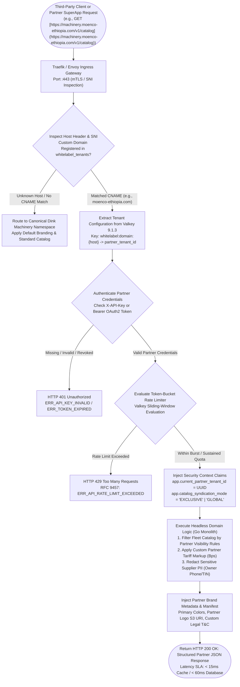
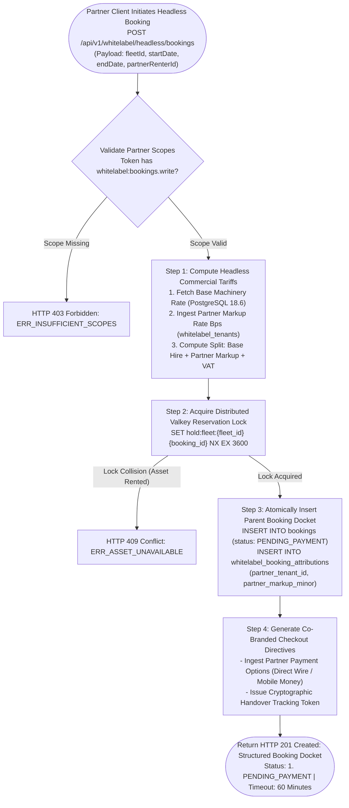
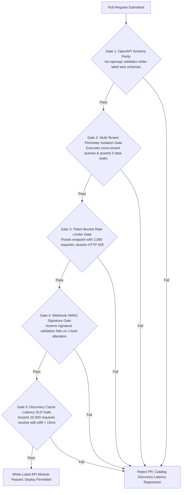

# Heavy Machinery & Logistics Rental Aggregator — Dink Machinery
## Software Requirements Specification — 07.07. White-Label API, Headless Commerce Engine, Partner Tenant Isolation & Open Data Integration Architecture (`docs/shared/requirements/07-07-white-label-api.md`)

**Document Identifier:** `SRS-DINK-CORE-V7.0-SEC-07-07`  
**Classification:** Canonical System Requirements Specification & Open Architecture Baseline (Single Source of Truth)  
**Governing Standard:** IEEE Std 830-1998 / IEEE/ISO/IEC 29148:2018 (Systems and Software Engineering — Requirements Engineering)  
**Associated Artifacts:** `SRS-DINK-CORE-V7.0` (§1.2, §5.2, §5.4, §5.5, §5.9, §6.1, §6.3, §7.0, §7.1, §7.2, §7.7, §8, §10, §11, §12, §13.2), `FLOW-BOOKING-STATE-MACHINE-DINK-CORE-V7.0`, `FLOW-COMMISSION-DEBT-DINK-CORE-V7.0`, `ARCH-BACKEND-GO-DINK-CORE-V7.0`, `ARCH-FLUTTER-DINK-CORE-V7.0`, `ARCH-ADMIN-NEXT-DINK-CORE-V7.0`, `ARCH-SEC-DINK-CORE-V7.0`, `DS-DINK-CORE-V7.0`, `DS-PERSONAS-DINK-CORE-V7.0`, `contracts/openapi.yaml`, `ADR-001`, `ADR-002`, `ADR-004`, `ADR-005`, `ADR-008`, `ADR-010`  
**Target Runtimes:** Go 1.27.3 Backend Monolith, Envoy / Traefik Ingress API Gateway, PostgreSQL 18.6 + PostGIS 3.6.4, Valkey 9.1.3, ClamAV Daemon (:3310), SeaweedFS S3, Flutter 3.47.9 / Dart 3.9 (Headless SDK & Whitelabel Shells), Next.js 16.x (latest CVE security patch) / React 19 (Partner Developer Portal), Isar NoSQL 3.1+  
**Target Personas:** Enterprise Commercial Partner & OEM Distributor (*Caterpillar / Komatsu East Africa Dealers*), Tier-1 ERP Systems Integrator (*Midroc / Sur Construction IT Architecture Directorate*), Third-Party Logistics & Fintech Platform CTO (*TeleBirr SuperApp / Safaricom Daraja Partner Teams*), Independent Software Vendor (ISV) Developer, Compliance Officer & API Governance Auditor (*Yohannes Bekele*), Super Administrator (*Rahel Tadesse*)  
**Target Operating Markets:** Ethiopia (`ET`) & Kenya (`KE`) — Dynamic Multi-Country Parameterization (`LOC-01-BE`)  
**Compliance Standards:** OWASP ASVS 4.0.3 Level 3 (API Security, Cryptographic Non-Repudiation, Scoped OAuth2 Tokens & Rate-Limiting Controls), RFC 9457 (Problem Details), RFC 6749 (OAuth 2.0 Authorization Framework), RFC 7519 (JSON Web Tokens), ISO 9241-110, W3C WCAG 2.2 Level AAA (Field Mobile) & Level AA (Admin Web), ISO 27001:2022 (Information Security Management Systems - Annex A.8.26 Application Security), National Bank of Ethiopia (NBE) Financial Cloud Directives, Kenya Data Protection Act 2019  
**Status:** Approved Engineering Baseline

---

## Table of Contents

- 1. [Document Scope & Architectural Mandate](#1-document-scope--architectural-mandate)
  - 1.1 [Purpose & Functional Scope](#11-purpose--functional-scope)
  - 1.2 [Core API Invariants & Tenant Partitioning Principles](#12-core-api-invariants--tenant-partitioning-principles)
- 2. [White-Label Tenancy & Partner Namespace Virtualization (`WLA-01`)](#2-white-label-tenancy--partner-namespace-virtualization-wla-01)
  - 2.1 [End-to-End Headless Request Resolution Pipeline Flowchart](#21-end-to-end-headless-request-resolution-pipeline-flowchart)
  - 2.2 [Partner Tenant Identity & Custom Domain Resolution (CNAME / TLS SNI)](#22-partner-tenant-identity--custom-domain-resolution-cname--tls-sni)
  - 2.3 [Custom Theming, UI Schema Overrides & Dynamic Brand Manifests](#23-custom-theming-ui-schema-overrides--dynamic-brand-manifests)
  - 2.4 [Catalog Syndication, Private Fleet Depots & Inventory Filtering Rules](#24-catalog-syndication-private-fleet-depots--inventory-filtering-rules)
- 3. [Authentication, Scoped Access & Rate-Limiting Architecture (`WLA-02`)](#3-authentication-scoped-access--rate-limiting-architecture-wla-02)
  - 3.1 [Dual Authentication Topology: mTLS Enterprise B2B vs. OAuth2 / API Keys](#31-dual-authentication-topology-mtls-enterprise-b2b-vs-oauth2--api-keys)
  - 3.2 [Fine-Grained Scope Hierarchy & RBAC Delegation](#32-fine-grained-scope-hierarchy--rbac-delegation)
  - 3.3 [Tiered Token-Bucket Rate Limiting (Valkey Sliding-Window Scripting)](#33-tiered-token-bucket-rate-limiting-valkey-sliding-window-scripting)
  - 3.4 [Replay Protection & Cryptographic Nonce Encasement](#34-replay-protection--cryptographic-nonce-encasement)
- 4. [Headless Booking, Dynamic Tariffs & Custom Commission Splits (`WLA-03`)](#4-headless-booking-dynamic-tariffs--custom-commission-splits-wla-03)
  - 4.1 [Headless Booking State Transition Synchronization](#41-headless-booking-state-transition-synchronization)
  - 4.2 [Partner-Controlled Markup & Split Revenue Distribution Formulas](#42-partner-controlled-markup--split-revenue-distribution-formulas)
  - 4.3 [Co-Branded & White-Label Payment Orchestration Deep-Links](#43-co-branded--white-label-payment-orchestration-deep-links)
  - 4.4 [Three-Way Reconciliation: Partner Ledger vs. Dink Core Ledger](#44-three-way-reconciliation-partner-ledger-vs-dink-core-ledger)
- 5. [Asynchronous Webhook Ingress, Event Subscriptions & Dead-Letter Queues (`WLA-04`)](#5-asynchronous-webhook-ingress-event-subscriptions--dead-letter-queues-wla-04)
  - 5.1 [Universal Partner Event Streaming Topology](#51-universal-partner-event-streaming-topology)
  - 5.2 [HMAC-SHA256 Payload Signing & Header Verification Verification](#52-hmac-sha256-payload-signing--header-verification-verification)
  - 5.3 [Exponential Backoff Retries & Dead-Letter Queue (DLQ) Sinks](#53-exponential-backoff-retries--dead-letter-queue-dlq-sinks)
  - 5.4 [Partner Self-Service Webhook Testing & Replay Workbench](#54-partner-self-service-webhook-testing--replay-workbench)
- 6. [Relational Database Schema & Data Modeling (`WLA-DB`)](#6-relational-database-schema--data-modeling-wla-db)
  - 6.1 [Entity Relationship Diagram](#61-entity-relationship-diagram)
  - 6.2 [Data Definition Language (DDL) Specifications](#62-data-definition-language-ddl-specifications)
- 7. [Wire Protocol Contracts & RFC 9457 Error Schemas](#7-wire-protocol-contracts--rfc-9457-error-schemas)
  - 7.1 [`POST /api/v1/whitelabel/tenants`](#71-post-apiv1whitelabeltenants)
  - 7.2 [`POST /api/v1/whitelabel/keys/generate`](#72-post-apiv1whitelabelkeysgenerate)
  - 7.3 [`POST /api/v1/whitelabel/headless/bookings`](#73-post-apiv1whitelabelheadlessbookings)
  - 7.4 [`POST /api/v1/whitelabel/webhooks/subscriptions`](#74-post-apiv1whitelabelwebhookssubscriptions)
  - 7.5 [RFC 9457 Universal Problem Details Payloads](#75-rfc-9457-universal-problem-details-payloads)
- 8. [Automated Testing Suite & Verification Gates](#8-automated-testing-suite--verification-gates)

---

## 1. Document Scope & Architectural Mandate

### 1.1 Purpose & Functional Scope

This specification establishes **Section 07.07 (White-Label API, Headless Commerce Engine, Partner Tenant Isolation & Open Data Integration Architecture)** of the canonical Software Requirements Specification (SRS) for **Dink Machinery Version 7.0**.

In the East African industrial machinery, mining, infrastructure development, and corporate plant logistics sectors across Ethiopia and Kenya, digital marketplace liquidity cannot be constrained solely to Dink Machinery's native mobile applications and web portals:
* **The Commercial Ecosystem Integration Requirement:** Original Equipment Manufacturer (OEM) distributors (*e.g., Moenco Ethiopia - Caterpillar, Achelis Material Handling, Komatsu Kenya, Shantui Heavy Machinery*), regional commercial banks (*e.g., Commercial Bank of Ethiopia, Awash Bank, KCB Bank, Equity Bank*), national telecommunications superapps (*e.g., Ethio Telecom TeleBirr SuperApp, Safaricom M-PESA SuperApp*), and major engineering conglomerates (*e.g., MIDROC Investment Group, Sur Construction, Sogea-Satom*) require programmatic access to Dink Machinery's machinery inventory, real-time availability calendars, logistics lowboy networks, and certified operator pools.
* **The Headless & White-Label Imperative (Phase 3 ADV-06):** These enterprise partners demand the ability to embed Dink Machinery’s asset aggregation engine directly within their proprietary client-facing digital interfaces, enterprise procurement portals (SAP S/4HANA, Oracle ERP), and regional branded web applications:
  - An authorized partner can syndicate Dink Machinery's public fleet catalog under their custom domain (*e.g., `machinery.moenco-ethiopia.com`* or `rentals.surconstruction.com`), applying proprietary branding, colors, logos, and localized markup margins without revealing Dink Machinery infrastructure branding.
  - Enterprise systems can execute programmatic end-to-end booking reservations, rate inquiries, dispatch tracking, operator verifications, and digital return sign-offs via headless RESTful JSON APIs and gRPC services.
  - Financial institutions and telco superapps can monetize un-rented heavy plant machinery within their walled ecosystems, capturing transaction revenues while delegating dispatch, mechanical inspection, insurance verification, and dispute resolution to Dink Machinery's battle-tested core state machine.

This document formally specifies:
1. The white-label multi-tenancy virtualization engine, custom domain (CNAME) routing, and dynamic brand manifest delivery pipeline (`WLA-01`).
2. Enterprise authentication, mutual TLS (mTLS) handshake termination, scoped OAuth2 / API key issuance, and sliding-window rate-limiting (`WLA-02`).
3. The headless commercial execution engine handling private fleet depots, partner markups, custom split billing, and core booking synchronization (`WLA-03`).
4. Event-driven webhook delivery, HMAC-SHA256 non-repudiation signing, exponential retry schedules, and dead-letter queue (DLQ) recovery sinks (`WLA-04`).

### 1.2 Core API Invariants & Tenant Partitioning Principles

1. **Zero-Trust Multi-Tenant Isolation Invariant (OWASP ASVS §4.1 / §13.1):** Every API request initiated by a white-label partner, external API key, or branded headless portal executes strictly within a cryptographically isolated tenant perimeter:
   $$\text{ExecutionScope} \iff \text{tenant\_id} = \text{Claims.PartnerTenantID}$$
   A white-label tenant cannot discover, query, inspect, or mutate private fleet inventories, confidential corporate pricing schedules, telematics breadcrumbs, or financial ledgers belonging to other partner tenants or competing enterprises.
2. **Canonical State Machine Immutability Invariant:** Headless reservations initiated via the White-Label API execute against the exact canonical Booking State Machine (`FLOW-BOOKING-STATE-MACHINE-DINK-CORE-V7.0`). Third-party API consumers cannot bypass statutory pre-conditions, physical inspection photograph uploads (`AR-01`), operator competency checks (`OPR-01`), or dual-PIN site handshakes.
3. **Sub-15ms Spatial Discovery Latency SLO:** Public and syndicated fleet discovery endpoints (`/api/v1/whitelabel/catalog/search`) executed via partner API keys must resolve in $< 15\text{ ms}$ (p99) for cache hits in Valkey 9.1.3, maintaining high throughput for partner superapp integrations.
4. **Transparent Partner Commission Ceiling:** Partner markups and custom referral commissions are strictly capped within regulatory bounds:
   $$\text{PartnerMarkupRateBps} \le 1,500\text{ bps}\ (15.00\%)$$
   Guarantees that white-label syndication does not induce artificial price inflation or violate national price-gouging directives in Ethiopia (Trade Competition and Consumers Protection Proclamation) and Kenya (Competition Act Cap 504).
5. **Universal Cryptographic Proof & Replay Defense:** All mutating requests (`POST`, `PUT`, `DELETE`) submitted across the White-Label API must include an explicit RFC-compliant `Idempotency-Key` and a cryptographically signed timestamp. Requests bearing timestamps deviating by $> 300\text{ seconds}$ ($5\text{ minutes}$) from UTC system clocks are rejected synchronously with **RFC 9457 HTTP 401 Unauthorized (`ERR_TIMESTAMP_OUT_OF_BOUNDS`)**.

---

## 2. White-Label Tenancy & Partner Namespace Virtualization (`WLA-01`)

### 2.1 End-to-End Headless Request Resolution Pipeline Flowchart



---

### 2.2 Partner Tenant Identity & Custom Domain Resolution (CNAME / TLS SNI)

Enterprise partners can host Dink Machinery's headless commerce portal on their proprietary corporate web domains:
* **DNS Resolution Standard:** Partner provisions a DNS canonical name pointer:
  `machinery.moenco-ethiopia.com.  IN  CNAME  ingress.dinkmachinery.com.`
* **Automated TLS Certificate Provisioning:**
  - The Traefik / Envoy edge ingress terminates TLS using automated **ACME / Let's Encrypt HTTP-01 or TLS-ALPN-01 challenge verification**.
  - Certificates are refreshed automatically 30 days prior to expiration.
* **Context Resolution Middleware:**
  The Go monolith intercepts the HTTP `Host` header and resolves the tenant mapping from Valkey 9.1.3:
  ```text
  GET whitelabel:domain:machinery.moenco-ethiopia.com
  --> {"tenantId":"ten_019a8fe0-moenco-8812","status":"ACTIVE","tier":"ENTERPRISE"}
  ```
  If absent from cache, it queries PostgreSQL table `whitelabel_tenants` under an index lock and caches the result for $86,400\text{ seconds}$ ($24\text{ hours}$).

---

### 2.3 Custom Theming, UI Schema Overrides & Dynamic Brand Manifests

When a partner consumer loads the white-label Flutter application shell or embedded Next.js iframe component, the client queries the tenant brand manifest:
* **Endpoint:** `GET /api/v1/whitelabel/manifest`
* **Dynamic Brand Configuration Payload:**
  ```json
  {
    "tenantId": "ten_019a8fe0-moenco-8812",
    "brandName": "Moenco Heavy Equipment Rental Exchange",
    "legalEntityName": "Motor and Engineering Company of Ethiopia S.C.",
    "supportPhone": "+251116610000",
    "supportEmail": "rentals@moenco.com.et",
    "theme": {
      "primaryHex": "#FFCC00",
      "primaryForegroundHex": "#000000",
      "accentHex": "#1E3A8A",
      "surfaceDarkHex": "#121212",
      "fontFamily": "Inter, Noto Sans Ethiopic",
      "borderRadius": "8px",
      "logoLightUri": "[https://vault.dinkmachinery.com/moenco/logo-light.webp](https://vault.dinkmachinery.com/moenco/logo-light.webp)",
      "logoDarkUri": "[https://vault.dinkmachinery.com/moenco/logo-dark.webp](https://vault.dinkmachinery.com/moenco/logo-dark.webp)",
      "faviconUri": "[https://vault.dinkmachinery.com/moenco/favicon.ico](https://vault.dinkmachinery.com/moenco/favicon.ico)"
    },
    "legalAgreements": {
      "termsAndConditionsUrl": "[https://moenco.com.et/legal/terms](https://moenco.com.et/legal/terms)",
      "privacyPolicyUrl": "[https://moenco.com.et/legal/privacy](https://moenco.com.et/legal/privacy)",
      "waiverOfLiabilityUrl": "[https://moenco.com.et/legal/machinery-waiver](https://moenco.com.et/legal/machinery-waiver)"
    }
  }
  ```
* **Dynamic Client Rendering:** The Flutter and Next.js viewports ingest this JSON manifest and dynamically re-skin UI design system tokens (buttons, app bars, dialog headers, font weights) in $< 50\text{ ms}$ with zero application code compilation or binary updates.

---

### 2.4 Catalog Syndication, Private Fleet Depots & Inventory Filtering Rules

White-label partners configure what machinery inventory appears within their branded portal:

```text
+----------------------------------------------------------------------------------------------------+
| CATALOG SYNDICATION & INVENTORY FILTERING TOPOLOGY (WLA-01)                                        |
+---------------------+-------------------+---------------------+------------------------------------+
| SYNDICATION MODE    | TARGET AUDIENCE   | INVENTORY VISIBILITY| OPERATIONAL SYSTEM BEHAVIOR        |
+---------------------+-------------------+---------------------+------------------------------------+
| EXCLUSIVE_PRIVATE   | OEM Dealer Depots | Partner-Owned Fleet | Hides all third-party competitors; |
| (Captive Roster)    | & Captive Fleets  | Only (Depot Bound)  | only displays assets registered to |
|                     |                   |                     | partner organization.              |
+---------------------+-------------------+---------------------+------------------------------------+
| HYBRID_SYNDICATED   | General Contractor| Partner Assets First| Partner assets badged as "Primary";|
| (Preferred Roster)  | Consortia         | + Platform Network  | platform marketplace fills regional|
|                     |                   | (Radius Overflow)   | supply deficits when depot is dry. |
+---------------------+-------------------+---------------------+------------------------------------+
| GLOBAL_OPEN_EXCHANGE| Telco SuperApps & | Entire Dink Verified| Full platform liquidity syndicated;|
| (Full Aggregator)   | Financial Portals | Machinery Catalog   | partner collects referral margins  |
|                     | (TeleBirr/M-PESA) | across ET & KE      | on all transaction categories.     |
+----------------------------------------------------------------------------------------------------+
```

* **Competitive Sanitization Invariant:** When `GLOBAL_OPEN_EXCHANGE` mode is active, the API sanitizes and strips all original equipment owner identity markers (company names, depot street addresses, private phone numbers) from public API payloads, exposing only verified equipment specifications, machine condition certificates, and spatial coordinates rounded to a $500\text{ m}$ anonymized centroid.

---

## 3. Authentication, Scoped Access & Rate-Limiting Architecture (`WLA-02`)

### 3.1 Dual Authentication Topology: mTLS Enterprise B2B vs. OAuth2 / API Keys

The White-Label API enforces two distinct cryptographic authentication mechanisms depending on consumer integration depth:

```text
+----------------------------------------------------------------------------------------------------+
| DUAL AUTHENTICATION MECHANISM SPECIFICATION (WLA-02)                                               |
+---------------------+-------------------+---------------------+------------------------------------+
| AUTHENTICATION TYPE | TARGET INTEGRATOR | CREDENTIAL FORMAT   | SECURITY SPECIFICATION & HANDSHAKE |
+---------------------+-------------------+---------------------+------------------------------------+
| Enterprise Mutual   | Tier-1 Corporate  | X.509 Certificate + | Cryptographic client TLS cert      |
| TLS (mTLS)          | ERPs & Core Banks | RSA-4096 Private Key| validated against Dink Partner CA; |
|                     | (SAP / Oracle)    |                     | IP whitelisting enforced at edge.  |
+---------------------+-------------------+---------------------+------------------------------------+
| Scoped Bearer API   | Mobile SuperApps, | Pre-Shared Key      | Passed in HTTP Request Header:     |
| Keys (HMAC SHA-256) | Web Portals & ISVs| (Prefix: dink_live_)| `X-API-Key: dink_live_8f4c26b4...`|
|                     |                   | (256-Bit Entropy)   | Checked against hashed DB records. |
+---------------------+-------------------+---------------------+------------------------------------+
```

* **Key Generation Security:** API keys are generated using cryptographically secure random bytes:
  $$\text{KeySecret} = \text{"dink\_live\_"} \parallel \text{HexEncode}(\text{CryptoRandomBytes}(32))$$
  The raw secret key is displayed to the partner administrator **exactly once** upon generation. The database stores strictly an immutable HMAC-SHA256 digest:
  $$\text{KeyHash} = \text{HMAC-SHA256}(\mathcal{K}_{\text{system\_master}}, \text{KeySecret})$$

---

### 3.2 Fine-Grained Scope Hierarchy & RBAC Delegation

Access permissions are bounded by granular OAuth2-style permission scopes:

```text
+----------------------------------------------------------------------------------------------------+
| WHITE-LABEL API PERMISSION SCOPES MATRIX                                                           |
+-----------------------------+----------------------------------------------------------------------+
| SCOPE IDENTIFIER            | PERMITTED SYSTEM ACTIONS & WIRE PERIMETERS                           |
+-----------------------------+----------------------------------------------------------------------+
| `whitelabel:catalog.read`   | Browse machinery catalog, search equipment, read public specs.      |
+-----------------------------+----------------------------------------------------------------------+
| `whitelabel:pricing.quote`  | Calculate dynamic rental quotes, evaluate surge rates, assess taxes. |
+-----------------------------+----------------------------------------------------------------------+
| `whitelabel:bookings.write` | Create reservations, hold equipment assets, submit payment evidence. |
+-----------------------------+----------------------------------------------------------------------+
| `whitelabel:bookings.read`  | Inspect status, download inspection vouchers, track active rentals.  |
+-----------------------------+----------------------------------------------------------------------+
| `whitelabel:telematics.read`| Ingest live GPS coordinates, engine hours, and operational status.   |
+-----------------------------+----------------------------------------------------------------------+
| `whitelabel:webhooks.manage`| Subscribe, update, rotate secrets, and re-trigger webhook events.    |
+----------------------------------------------------------------------------------------------------+
```

---

### 3.3 Tiered Token-Bucket Rate Limiting (Valkey Sliding-Window Scripting)

To defend platform microservices against denial-of-service (DoS) attacks and erratic client polling:
* Every API request passes through a Lua-scripted **Sliding-Window Token Bucket** in Valkey 9.1.3:
  ```lua
  -- Valkey Rate Limiting Lua Script
  local key = KEYS[1]
  local limit = tonumber(ARGV[1])
  local current_time = tonumber(ARGV[2])
  local window = tonumber(ARGV[3])

  redis.call('ZREMRANGEBYSCORE', key, 0, current_time - window)
  local current_requests = redis.call('ZCARD', key)

  if current_requests < limit then
      redis.call('ZADD', key, current_time, current_time)
      redis.call('EXPIRE', key, window)
      return 1
  else
      return 0
  end
  ```
* **Quota Allocation Matrix:**
  - **Standard Tier:** $100\text{ requests/minute}$, burst ceiling of $150\text{ requests}$.
  - **Enterprise Tier:** $1,000\text{ requests/minute}$, burst ceiling of $1,500\text{ requests}$.
  - **OEM / Telco SuperApp Tier:** $5,000\text{ requests/minute}$, burst ceiling of $7,500\text{ requests}$.
* When rate limits are breached, the gateway returns **RFC 9457 HTTP 429 Too Many Requests** accompanied by headers:
  `RateLimit-Limit`, `RateLimit-Remaining`, and `RateLimit-Reset`.

---

### 3.4 Replay Protection & Cryptographic Nonce Encasement

All financial or booking mutation endpoints (`POST /v1/whitelabel/headless/bookings`) enforce replay defenses:
* **The Nonce Tuple:**
  $$\langle \text{PartnerTenantID}, \text{Idempotency-Key}, \text{Timestamp} \rangle$$
* **Verification Routine:**
  1. Checks if `Idempotency-Key` exists in Valkey 9.1.3 (`SET lock:idemp:{key} "1" EX 86400 NX`).
  2. If the key exists, returns the cached previous HTTP response without re-executing domain transactions.
  3. Validates that $\vert{}\text{Timestamp}_{\text{request}} - \text{Timestamp}_{\text{server}}\vert{} \le 300\text{ seconds}$.

---

## 4. Headless Booking, Dynamic Tariffs & Custom Commission Splits (`WLA-03`)

### 4.1 Headless Booking State Transition Synchronization

Headless bookings executed by third-party systems follow the canonical booking lifecycle with automated partner metadata attribution:



---

### 4.2 Partner-Controlled Markup & Split Revenue Distribution Formulas

White-label partners monetize the marketplace by applying custom commercial markups over Dink Machinery's catalog floor:
* **The Tariff Formulation:**
  $$\mathcal{V}_{\text{base\_hire}} = \text{CatalogDailyRateMinor} \times \Delta_{\text{days}}$$
  $$\mathcal{M}_{\text{partner}} = \left\lfloor \mathcal{V}_{\text{base\_hire}} \times \left( \frac{\text{PartnerMarkupRateBps}}{10,000} \right) \right\rfloor$$
  $$\mathcal{V}_{\text{gross\_renter}} = \mathcal{V}_{\text{base\_hire}} + \mathcal{M}_{\text{partner}}$$
* **Commission Realization & Settlement:**
  - **Dink Machinery Platform Fee:** Standard platform commission ($10.0\%$ of base hire) is assessed on the base equipment tariff.
  - **Partner Referral Margin:** $100\%$ of $\mathcal{M}_{\text{partner}}$ is allocated to the partner's virtual credit ledger (`whitelabel_partner_wallets`).
  - **Automated Payout Sweeping:** Accrued partner referral earnings are swept to the partner's corporate bank account on the 1st of each calendar month via automated interbank clearing (`COM-02`).

---

### 4.3 Co-Branded & White-Label Payment Orchestration Deep-Links

When a partner consumer checks out on a mobile application:
* The White-Label API issues a secure **Hosted Checkout Session URI**:
  `https://checkout.dinkmachinery.com/session/cs_live_019a8fe0?partner=moenco`
* **Visual Experience:** The checkout page dynamically embeds the partner’s logo, theme color hex codes, and corporate support contact information.
* **Payment Processing:** Integrates sovereign local rails (TeleBirr, CBEBirr Plus, Chapa, Safaricom M-PESA Daraja 2.0) pursuant to `SRS 07.01`.

---

### 4.4 Three-Way Reconciliation: Partner Ledger vs. Dink Core Ledger

To support corporate financial audits and IFRS 15 revenue reporting:
* The Go accounting worker executes an automated **Daily Reconciliation Batch** at `02:00:00 EAT`:
  1. Aggregates all headless bookings attributed to `partner_tenant_id` within the 24-hour cycle.
  2. Compares gross cash collected against expected partner markups and supplier disbursements:
     $$\sum \text{GrossCollected} \equiv \sum \text{OwnerPayout} + \sum \text{DinkCommission} + \sum \text{PartnerMarkup} \quad (\Delta = 0\text{ Minor Units})$$
  3. Generates an encrypted, certified PDF/A-3 and ISO 20022 XML accounting statement uploaded to the partner's private S3 bucket (`s3://dink-partner-vault/{tenant_id}/reconciliations/`).

---

## 5. Asynchronous Webhook Ingress, Event Subscriptions & Dead-Letter Queues (`WLA-04`)

### 5.1 Universal Partner Event Streaming Topology

White-label partners register webhook endpoints to keep their internal ERPs, mobile superapps, and dispatch boards synchronized with real-time field operations:

```text
+----------------------------------------------------------------------------------------------------+
| WHITE-LABEL API WEBHOOK EVENT SUBSCRIPTION CATALOG (WLA-04)                                        |
+-----------------------------+----------------------------------------------------------------------+
| EVENT TOPIC IDENTIFIER      | EVENT TRIGGER CONDITION & BUSINESS SIGNIFICANCE                      |
+-----------------------------+----------------------------------------------------------------------+
| `booking.created`           | A new reservation has been initiated within the partner namespace.  |
+-----------------------------+----------------------------------------------------------------------+
| `booking.payment_confirmed` | Renter payment verified; equipment hold locked; ready for transit.  |
+-----------------------------+----------------------------------------------------------------------+
| `booking.handover_signed`   | Machine arrived on-site; dual-PIN signed; operating clock active.    |
+-----------------------------+----------------------------------------------------------------------+
| `booking.returned_reconciled`| Machine returned to depot; return hour meters logged; rental closed.|
+-----------------------------+----------------------------------------------------------------------+
| `fleet.telematics_alert`    | Equipment breached operational geofence or reported critical DTC code|
+-----------------------------+----------------------------------------------------------------------+
| `settlement.disbursed`      | Partner referral margin or owner hire fee settled via bank wire/B2C. |
+----------------------------------------------------------------------------------------------------+
```

---

### 5.2 HMAC-SHA256 Payload Signing & Header Verification Verification

To guarantee that webhook payloads cannot be forged or intercepted by malicious third parties:
* Every outbound HTTP POST webhook dispatched by Dink Machinery includes cryptographic security headers:
  ```http
  POST /api/v1/dink-receiver HTTP/1.1
  Host: erp.surconstruction.com
  Content-Type: application/json; charset=utf-8
  X-Dink-Signature: t=1730124000,v1=8f4c26b46b68ffc68ff99b453c1d30413413422d706483bfa0f98a5e886266e7
  X-Dink-Event-ID: evt_019a8fe0-8812-7b9a-bc21-4491204812aa
  X-Dink-Delivery-Attempt: 1
  ```
* **Signature Formulation:**
  $$\text{SignedPayload} = \text{Timestamp} \parallel \text{"."} \parallel \text{RawJsonBodyBytes}$$
  $$\text{Signature} = \text{HexEncode}\left( \text{HMAC-SHA256}(\mathcal{K}_{\text{partner\_webhook\_secret}}, \text{SignedPayload}) \right)$$
* Partner systems verify the signature using their shared secret key before ingesting the payload into core ERP databases.

---

### 5.3 Exponential Backoff Retries & Dead-Letter Queue (DLQ) Sinks

If a partner's receiving server experiences downtime, network timeouts, or returns HTTP $5xx$ error codes:
* The event dispatcher enqueues the delivery task into an asynchronous retry pipeline:
  $$T_{\text{retry}} = 2^n \times 30\text{ seconds} \quad (n = 1, 2, 3, 4, 5)$$
* **Retry Horizons:** Retries occur at $+1\text{m}$, $+4\text{m}$, $+16\text{m}$, $+64\text{m}$, and $+256\text{m}$.
* **Dead-Letter Queue (DLQ):** After 5 consecutive failed delivery attempts:
  - The event transitions to status `FAILED_DEAD_LETTER` in `whitelabel_webhook_deliveries`.
  - Stored permanently in Valkey DLQ: `dlq:webhooks:partner:{tenant_id}`.
  - Generates an in-app administrative alert on the Partner Developer Console.

---

### 5.4 Partner Self-Service Webhook Testing & Replay Workbench

The Next.js Partner Developer Console (`AD-06-WEB`) provides integration engineers with developer tooling:
* **Interactive Webhook Simulator:** Dispatches synthetic test payloads (`booking.created`, `fleet.telematics_alert`) to verify endpoint URL accessibility and signature verification implementations.
* **One-Click DLQ Event Replay:** Enables engineers to replay failed dead-letter webhook deliveries retroactively once receiving server outages have been remediated.

---

## 6. Relational Database Schema & Data Modeling (`WLA-DB`)

### 6.1 Entity Relationship Diagram

```mermaid
erDiagram
    Organization ||--o{ WhiteLabelTenant : "operates as"
    WhiteLabelTenant ||--o{ WhiteLabelAPIKey : "provisions"
    WhiteLabelTenant ||--o{ WhiteLabelDomain : "binds"
    WhiteLabelTenant ||--o{ WhiteLabelWebhookSubscription : "configures"
    WhiteLabelTenant ||--o{ WhiteLabelBookingAttribution : "originates"
    Booking ||--o{ WhiteLabelBookingAttribution : "attributed to"
    WhiteLabelWebhookSubscription ||--o{ WhiteLabelWebhookDelivery : "dispatches"

    WhiteLabelTenant {
        uuid id PK
        uuid organization_id FK UK
        string tenant_name
        string tenant_slug UK
        string status -- 'PENDING_ONBOARDING', 'ACTIVE', 'SUSPENDED_COMPLIANCE', 'REVOKED'
        string syndication_mode -- 'EXCLUSIVE_PRIVATE', 'HYBRID_SYNDICATED', 'GLOBAL_OPEN_EXCHANGE'
        int partner_markup_bps
        jsonb brand_manifest_json
        string tier -- 'STANDARD', 'ENTERPRISE', 'OEM_SUPERAPP'
        timestamptz created_at
        timestamptz updated_at
    }

    WhiteLabelDomain {
        uuid id PK
        uuid tenant_id FK
        string hostname UK
        boolean is_primary
        boolean tls_provisioned
        timestamptz verified_at
        timestamptz created_at
    }

    WhiteLabelAPIKey {
        uuid id PK
        uuid tenant_id FK
        string key_prefix
        string key_hash UK
        string label
        string allowed_ips_cidr_json
        string scopes_json
        boolean is_active
        timestamptz expires_at
        timestamptz last_used_at
        timestamptz created_at
    }

    WhiteLabelBookingAttribution {
        uuid id PK
        uuid booking_id FK UK
        uuid tenant_id FK
        uuid api_key_id FK NULL
        bigint base_hire_minor
        int partner_markup_bps
        bigint partner_markup_minor
        string currency -- 'ETB', 'KES'
        string settlement_status -- 'PENDING_COLLECTION', 'ACCRUED', 'DISBURSED'
        timestamptz created_at
    }

    WhiteLabelWebhookSubscription {
        uuid id PK
        uuid tenant_id FK
        string endpoint_url
        string shared_secret_hash
        string subscribed_events_json
        boolean is_active
        timestamptz created_at
    }

    WhiteLabelWebhookDelivery {
        uuid id PK
        uuid subscription_id FK
        string event_id
        string event_type
        text payload_json
        int response_status_code
        int attempt_number
        string delivery_status -- 'DISPATCHED_OK', 'RETRYING', 'FAILED_DEAD_LETTER'
        timestamptz last_attempt_at
    }
```

---

### 6.2 Data Definition Language (DDL) Specifications

```sql
-- 1. White-Label Partner Tenants Master Table
CREATE TABLE whitelabel_tenants (
    id UUID PRIMARY KEY DEFAULT gen_random_uuid(),
    organization_id UUID NOT NULL UNIQUE REFERENCES organizations(id) ON DELETE CASCADE,
    tenant_name VARCHAR(128) NOT NULL,
    tenant_slug VARCHAR(64) NOT NULL UNIQUE,
    status VARCHAR(32) NOT NULL DEFAULT 'PENDING_ONBOARDING',
    syndication_mode VARCHAR(32) NOT NULL DEFAULT 'GLOBAL_OPEN_EXCHANGE',
    partner_markup_bps INT NOT NULL DEFAULT 0 CHECK (partner_markup_bps >= 0 AND partner_markup_bps <= 1500), -- Max 15.00%
    brand_manifest_json JSONB NOT NULL DEFAULT '{}'::JSONB,
    tier VARCHAR(32) NOT NULL DEFAULT 'STANDARD',
    created_at TIMESTAMPTZ NOT NULL DEFAULT NOW(),
    updated_at TIMESTAMPTZ NOT NULL DEFAULT NOW(),
    CONSTRAINT chk_tenant_status CHECK (status IN ('PENDING_ONBOARDING', 'ACTIVE', 'SUSPENDED_COMPLIANCE', 'REVOKED')),
    CONSTRAINT chk_syndication_mode CHECK (syndication_mode IN ('EXCLUSIVE_PRIVATE', 'HYBRID_SYNDICATED', 'GLOBAL_OPEN_EXCHANGE')),
    CONSTRAINT chk_tenant_tier CHECK (tier IN ('STANDARD', 'ENTERPRISE', 'OEM_SUPERAPP'))
);

CREATE INDEX idx_whitelabel_tenants_status ON whitelabel_tenants (status);

-- 2. Partner Custom Domains Registry (CNAME / TLS SNI)
CREATE TABLE whitelabel_domains (
    id UUID PRIMARY KEY DEFAULT gen_random_uuid(),
    tenant_id UUID NOT NULL REFERENCES whitelabel_tenants(id) ON DELETE CASCADE,
    hostname VARCHAR(255) NOT NULL UNIQUE,
    is_primary BOOLEAN NOT NULL DEFAULT true,
    tls_provisioned BOOLEAN NOT NULL DEFAULT false,
    verified_at TIMESTAMPTZ NULL,
    created_at TIMESTAMPTZ NOT NULL DEFAULT NOW()
);

CREATE INDEX idx_whitelabel_domains_host ON whitelabel_domains (LOWER(hostname));

-- 3. Scoped Partner API Keys Table (Hashed Authentication)
CREATE TABLE whitelabel_api_keys (
    id UUID PRIMARY KEY DEFAULT gen_random_uuid(),
    tenant_id UUID NOT NULL REFERENCES whitelabel_tenants(id) ON DELETE CASCADE,
    key_prefix VARCHAR(16) NOT NULL,
    key_hash VARCHAR(64) NOT NULL UNIQUE,
    label VARCHAR(128) NOT NULL,
    allowed_ips_cidr_json JSONB NOT NULL DEFAULT '[]'::JSONB,
    scopes_json JSONB NOT NULL DEFAULT '["whitelabel:catalog.read"]'::JSONB,
    is_active BOOLEAN NOT NULL DEFAULT true,
    expires_at TIMESTAMPTZ NOT NULL,
    last_used_at TIMESTAMPTZ NULL,
    created_at TIMESTAMPTZ NOT NULL DEFAULT NOW()
);

CREATE INDEX idx_api_keys_hash ON whitelabel_api_keys (key_hash) WHERE is_active = true;

-- 4. White-Label Booking Attributions Table (Revenue Share Allocation)
CREATE TABLE whitelabel_booking_attributions (
    id UUID PRIMARY KEY DEFAULT gen_random_uuid(),
    booking_id UUID NOT NULL UNIQUE REFERENCES bookings(id) ON DELETE RESTRICT,
    tenant_id UUID NOT NULL REFERENCES whitelabel_tenants(id) ON DELETE RESTRICT,
    api_key_id UUID NULL REFERENCES whitelabel_api_keys(id) ON DELETE SET NULL,
    base_hire_minor BIGINT NOT NULL CHECK (base_hire_minor > 0),
    partner_markup_bps INT NOT NULL CHECK (partner_markup_bps >= 0),
    partner_markup_minor BIGINT NOT NULL DEFAULT 0 CHECK (partner_markup_minor >= 0),
    currency VARCHAR(3) NOT NULL CHECK (currency IN ('ETB', 'KES')),
    settlement_status VARCHAR(32) NOT NULL DEFAULT 'PENDING_COLLECTION',
    created_at TIMESTAMPTZ NOT NULL DEFAULT NOW(),
    CONSTRAINT chk_wla_settle_status CHECK (settlement_status IN ('PENDING_COLLECTION', 'ACCRUED', 'DISBURSED', 'REFUNDED_REVERSED'))
);

CREATE INDEX idx_wla_attributions_tenant ON whitelabel_booking_attributions (tenant_id, settlement_status);

-- 5. Partner Webhook Subscriptions Table
CREATE TABLE whitelabel_webhook_subscriptions (
    id UUID PRIMARY KEY DEFAULT gen_random_uuid(),
    tenant_id UUID NOT NULL REFERENCES whitelabel_tenants(id) ON DELETE CASCADE,
    endpoint_url VARCHAR(512) NOT NULL,
    shared_secret_hash VARCHAR(64) NOT NULL,
    subscribed_events_json JSONB NOT NULL DEFAULT '["booking.created", "booking.returned_reconciled"]'::JSONB,
    is_active BOOLEAN NOT NULL DEFAULT true,
    created_at TIMESTAMPTZ NOT NULL DEFAULT NOW()
);

CREATE INDEX idx_whitelabel_webhooks_tenant ON whitelabel_webhook_subscriptions (tenant_id) WHERE is_active = true;

-- 6. Webhook Delivery Audit & Dead-Letter Log Table
CREATE TABLE whitelabel_webhook_deliveries (
    id UUID PRIMARY KEY DEFAULT gen_random_uuid(),
    subscription_id UUID NOT NULL REFERENCES whitelabel_webhook_subscriptions(id) ON DELETE CASCADE,
    event_id VARCHAR(64) NOT NULL,
    event_type VARCHAR(64) NOT NULL,
    payload_json JSONB NOT NULL,
    response_status_code INT NULL,
    attempt_number INT NOT NULL DEFAULT 1,
    delivery_status VARCHAR(32) NOT NULL DEFAULT 'RETRYING',
    last_attempt_at TIMESTAMPTZ NOT NULL DEFAULT NOW(),
    CONSTRAINT chk_wla_delivery_status CHECK (delivery_status IN ('DISPATCHED_OK', 'RETRYING', 'FAILED_DEAD_LETTER'))
);

CREATE INDEX idx_wla_deliveries_sub ON whitelabel_webhook_deliveries (subscription_id, delivery_status);

CREATE RULE prevent_webhook_audit_delete AS ON DELETE TO whitelabel_webhook_deliveries DO INSTEAD NOTHING;
```

---

## 7. Wire Protocol Contracts & RFC 9457 Error Schemas

### 7.1 `POST /api/v1/whitelabel/tenants`

Administrative endpoint onboarding an enterprise commercial partner into the white-label ecosystem.

#### Request Headers
```http
POST /api/v1/whitelabel/tenants HTTP/1.1
Host: api.dinkmachinery.com
Content-Type: application/json
Authorization: Bearer <superAdminAccessToken>
Idempotency-Key: 11982a01-4b12-4f9a-8812-7b9a4c10bc21
```

#### Request Payload
```json
{
  "organizationId": "org_019a8fe0-moenco-8812",
  "tenantName": "Moenco Heavy Equipment Rental Exchange",
  "tenantSlug": "moenco-rentals",
  "syndicationMode": "HYBRID_SYNDICATED",
  "partnerMarkupBps": 500,
  "tier": "ENTERPRISE",
  "primaryHostname": "machinery.moenco-ethiopia.com",
  "brandManifest": {
    "brandName": "Moenco Rentals",
    "primaryHex": "#FFCC00",
    "accentHex": "#1E3A8A",
    "logoLightUri": "[https://vault.dinkmachinery.com/moenco/logo-light.webp](https://vault.dinkmachinery.com/moenco/logo-light.webp)"
  }
}
```

#### Response: `HTTP 201 Created`
```json
{
  "success": true,
  "data": {
    "tenantId": "ten_019a8fe0-moenco-8812",
    "tenantSlug": "moenco-rentals",
    "status": "ACTIVE",
    "syndicationMode": "HYBRID_SYNDICATED",
    "partnerMarkupBps": 500,
    "cnameDnsTarget": "ingress.dinkmachinery.com",
    "dnsVerificationStatus": "VERIFIED_ACTIVE",
    "createdAt": "2026-10-29T16:30:00Z"
  },
  "timestamp": "2026-10-29T16:30:01Z"
}
```

---

### 7.2 `POST /api/v1/whitelabel/keys/generate`

Provisions a scoped API key for third-party headless integrations and backend-to-backend communication.

#### Request Headers
```http
POST /api/v1/whitelabel/keys/generate HTTP/1.1
Host: api.dinkmachinery.com
Content-Type: application/json
Authorization: Bearer <partnerAdminAccessToken>
X-Tenant-Slug: moenco-rentals
```

#### Request Payload
```json
{
  "label": "Moenco Public Web Portal Frontend Key",
  "allowedIpsCidr": [
    "197.156.64.0/24"
  ],
  "scopes": [
    "whitelabel:catalog.read",
    "whitelabel:pricing.quote",
    "whitelabel:bookings.write"
  ],
  "validityDays": 365
}
```

#### Response: `HTTP 201 Created`
```json
{
  "success": true,
  "data": {
    "apiKeyId": "key_019a8fe5-1123",
    "keySecret": "dink_live_8f4c26b46b68ffc68ff99b453c1d30413413422d706483bfa0f98a5e886266e7",
    "keyPrefix": "dink_live_8f4c",
    "scopes": [
      "whitelabel:catalog.read",
      "whitelabel:pricing.quote",
      "whitelabel:bookings.write"
    ],
    "expiresAt": "2027-10-29T16:35:00Z",
    "warning": "Store this key securely. It will not be displayed again."
  },
  "timestamp": "2026-10-29T16:35:01Z"
}
```

---

### 7.3 `POST /api/v1/whitelabel/headless/bookings`

Executes a headless machinery reservation originating from an external partner client or portal.

#### Request Headers
```http
POST /api/v1/whitelabel/headless/bookings HTTP/1.1
Host: api.dinkmachinery.com
Content-Type: application/json
X-API-Key: dink_live_8f4c26b46b68ffc68ff99b453c1d30413413422d706483bfa0f98a5e886266e7
Idempotency-Key: 88182a01-4b12-4f9a-8812-7b9a4c10bc21
```

#### Request Payload
```json
{
  "fleetId": "flt_019a8f2c-8812-7b9a",
  "startDate": "2026-11-01",
  "endDate": "2026-11-15",
  "renterProfile": {
    "fullName": "Dawit Haile-Mariam",
    "phoneNumber": "+251911200491",
    "nationalId": "ET-NID-994120"
  },
  "deliveryLocation": {
    "latitude": 8.5882,
    "longitude": 39.1245,
    "addressText": "Mojo Industrial Park Overpass Camp"
  },
  "bundledAttachmentIds": [
    "att_019a8f4c-8812"
  ]
}
```

#### Response: `HTTP 201 Created`
```json
{
  "success": true,
  "data": {
    "bookingId": "bk_019a8f60-9912-7b9a",
    "status": "PENDING_PAYMENT",
    "durationDays": 14,
    "financialSummary": {
      "currency": "ETB",
      "baseMachineHireMinor": 35000000,
      "partnerMarkupMinor": 1750000,
      "bundledAttachmentsMinor": 4200000,
      "grossPayableMinor": 40950000,
      "vatAmountMinor": 6142500,
      "totalCommitmentMinor": 47092500
    },
    "paymentDirectives": {
      "sessionCheckoutUrl": "[https://checkout.dinkmachinery.com/session/cs_019a8fe0?partner=moenco-rentals](https://checkout.dinkmachinery.com/session/cs_019a8fe0?partner=moenco-rentals)",
      "paymentExpiryAt": "2026-10-29T17:40:00Z"
    },
    "createdAt": "2026-10-29T16:40:00Z"
  },
  "timestamp": "2026-10-29T16:40:01Z"
}
```

---

### 7.4 `POST /api/v1/whitelabel/webhooks/subscriptions`

Registers an asynchronous webhook URL to receive real-time operational lifecycle events.

#### Request Headers
```http
POST /api/v1/whitelabel/webhooks/subscriptions HTTP/1.1
Host: api.dinkmachinery.com
Content-Type: application/json
Authorization: Bearer <partnerAdminAccessToken>
X-Tenant-Slug: moenco-rentals
```

#### Request Payload
```json
{
  "endpointUrl": "[https://erp.moenco-ethiopia.com/api/v1/dink-receiver](https://erp.moenco-ethiopia.com/api/v1/dink-receiver)",
  "subscribedEvents": [
    "booking.created",
    "booking.payment_confirmed",
    "booking.handover_signed",
    "booking.returned_reconciled"
  ]
}
```

#### Response: `HTTP 201 Created`
```json
{
  "success": true,
  "data": {
    "subscriptionId": "sub_whk_019a8fe8-3341",
    "endpointUrl": "[https://erp.moenco-ethiopia.com/api/v1/dink-receiver](https://erp.moenco-ethiopia.com/api/v1/dink-receiver)",
    "sharedSecret": "whsec_8f4c26b46b68ffc68ff99b453c1d30413413422d706483bfa0f98a5e886266e7",
    "subscribedEvents": [
      "booking.created",
      "booking.payment_confirmed",
      "booking.handover_signed",
      "booking.returned_reconciled"
    ],
    "isActive": true,
    "createdAt": "2026-10-29T16:45:00Z"
  },
  "timestamp": "2026-10-29T16:45:01Z"
}
```

---

### 7.5 RFC 9457 Universal Problem Details Payloads

#### Example: Insufficient API Scopes (`HTTP 403 Forbidden`)
```json
{
  "type": "[https://api.dinkmachinery.com/errors/insufficient-api-scopes](https://api.dinkmachinery.com/errors/insufficient-api-scopes)",
  "title": "API Key Lacks Required Scopes",
  "status": 403,
  "detail": "The presented API key lacks the required scope 'whitelabel:bookings.write' to create reservations. Assigned scopes: ['whitelabel:catalog.read', 'whitelabel:pricing.quote'].",
  "instance": "/api/v1/whitelabel/headless/bookings",
  "code": "ERR_INSUFFICIENT_SCOPES",
  "correlationId": "cor_019a8fe0-8812-7b9a-bc21-4491204812aa",
  "timestamp": "2026-10-29T16:40:05Z",
  "invalidParams": [
    {
      "name": "scopes",
      "reason": "Missing required scope: 'whitelabel:bookings.write'"
    }
  ]
}
```

#### Example: API Token-Bucket Rate Limit Exceeded (`HTTP 429 Too Many Requests`)
```json
{
  "type": "[https://api.dinkmachinery.com/errors/api-rate-limit-exceeded](https://api.dinkmachinery.com/errors/api-rate-limit-exceeded)",
  "title": "API Rate Limit Quota Exceeded",
  "status": 429,
  "detail": "Your API key has breached its allocated throughput quota of 1,000 requests per minute. Burst ceiling reached. Please throttle requests or upgrade tenant tier.",
  "instance": "/api/v1/whitelabel/catalog/search",
  "code": "ERR_API_RATE_LIMIT_EXCEEDED",
  "correlationId": "cor_019a8fe0-9914-4c12-8812-7b9a4c10bc21",
  "timestamp": "2026-10-29T16:42:00Z",
  "links": {
    "rateLimitPolicy": "[https://developer.dinkmachinery.com/docs/rate-limiting](https://developer.dinkmachinery.com/docs/rate-limiting)",
    "tierUpgrade": "[https://developer.dinkmachinery.com/portal/billing](https://developer.dinkmachinery.com/portal/billing)"
  }
}
```

---

## 8. Automated Testing Suite & Verification Gates



1. **OpenAPI Schema Contract Gate (`kin-openapi`):** Validates all white-label tenant onboarding, API key issuance, headless reservation, and webhook event schemas against `contracts/openapi.yaml`.
2. **Multi-Tenant Perimeter Isolation Gate:** Seeds the database with private equipment assets and corporate pricing ledgers belonging to competing partner tenants (`Tenant A` and `Tenant B`). Executes 1,000 concurrent queries using `Tenant A` credentials, asserting that zero data rows from `Tenant B` are returned across all relational query dimensions.
3. **Token-Bucket Rate Limiting Benchmark:** Dispatches 2,000 parallel requests within a 10-second window against a Standard Tier API key ($100\text{ req/min}$). Asserts that the gateway precisely permits the initial 150 burst requests and systematically intercepts subsequent calls with HTTP 429 `ERR_API_RATE_LIMIT_EXCEEDED`.
4. **Webhook HMAC Cryptographic Verification Gate:** Mutates a single byte in a simulated outbound webhook payload. Verifies that the recipient client SDK fails HMAC-SHA256 signature verification and discards the payload without execution.
5. **Catalog Discovery Latency Performance Gate:** Executes 10,000 parallel catalog search queries across Valkey 9.1.3 hot cache clusters, asserting that p95 latency remains $< 5\text{ ms}$ and p99 latency strictly $< 15\text{ ms}$.

---

*This document establishes the canonical functional requirements, white-label tenancy virtualizations, OAuth2/mTLS authentication architectures, headless commercial workflows, HMAC-signed webhook delivery pipelines, and wire protocol contracts for the White-Label API in Dink Machinery Version 7.0. All downstream Flutter mobile shells, Next.js developer portals, Go backend ingress gateways, and PostgreSQL multi-tenant databases must strictly conform to this specification.*