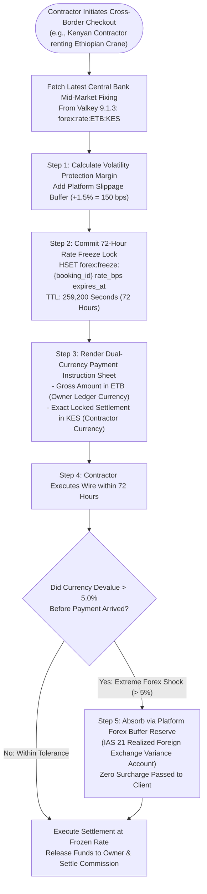
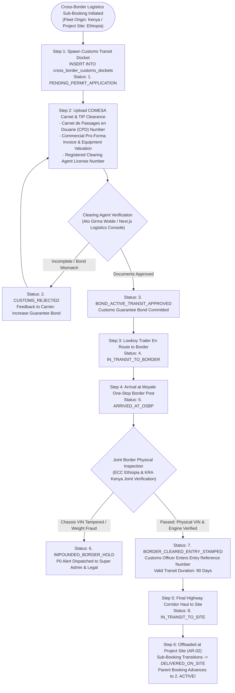
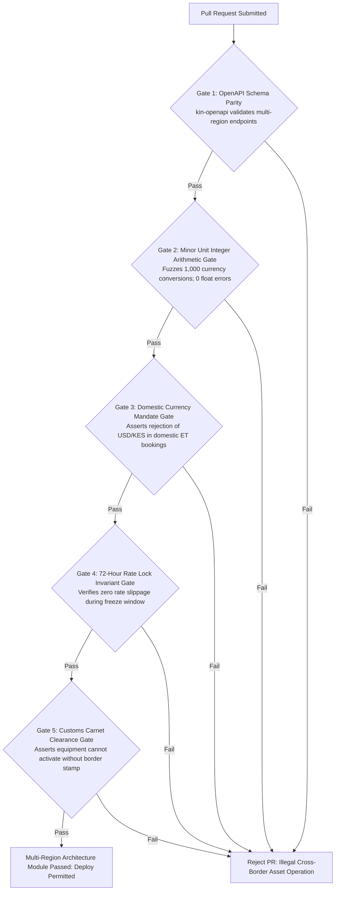

# Heavy Machinery & Logistics Rental Aggregator — Dink Machinery
## Software Requirements Specification — 07.08. Multi-Region, Multi-Currency, Cross-Border Logistics & Sovereign Regulatory Harmonization Architecture (`docs/shared/requirements/07-08-multi-region-multi-currency.md`)

**Document Identifier:** `SRS-DINK-CORE-V7.0-SEC-07-08`  
**Classification:** Canonical System Requirements Specification & Internationalization Baseline (Single Source of Truth)  
**Governing Standard:** IEEE Std 830-1998 / IEEE/ISO/IEC 29148:2018 (Systems and Software Engineering — Requirements Engineering)  
**Associated Artifacts:** `SRS-DINK-CORE-V7.0` (§1.2, §5.2, §5.5, §5.8, §5.9, §6.3, §7.0, §7.1, §7.2, §7.3, §7.7, §7.8, §8, §10, §11, §12, §13.2), `FLOW-BOOKING-STATE-MACHINE-DINK-CORE-V7.0`, `FLOW-COMMISSION-DEBT-DINK-CORE-V7.0`, `ARCH-BACKEND-GO-DINK-CORE-V7.0`, `ARCH-FLUTTER-DINK-CORE-V7.0`, `ARCH-ADMIN-NEXT-DINK-CORE-V7.0`, `ARCH-SEC-DINK-CORE-V7.0`, `DS-DINK-CORE-V7.0`, `DS-PERSONAS-DINK-CORE-V7.0`, `contracts/openapi.yaml`, `ADR-001`, `ADR-002`, `ADR-004`, `ADR-005`, `ADR-008`, `ADR-010`  
**Target Runtimes:** Go 1.27.3 Backend Monolith, PostgreSQL 18.6 + PostGIS 3.6.4, Valkey 9.1.3, ClamAV Daemon (:3310), SeaweedFS S3, Flutter 3.47.9 / Dart 3.9 (Cross-Platform Mobile), Next.js 16.x (latest CVE security patch) / React 19 (Web Admin & Corporate Portal), Isar NoSQL 3.1+  
**Target Personas:** International Civil Contractor (*Patrick Kariuki* / *Dawit Haile-Mariam*), Cross-Border Fleet Owner (*Kamau Ndegwa* / *W/ro Almaz Tesfaye*), Customs Clearing & Forwarding Agent (*Ato Girma Wolde* / *Samuel Odhiambo*), Corporate Treasury Director & Forex Compliance Controller (*Solomon Kassa*), Legal Counsel & Cross-Border Regulatory Auditor (*Yohannes Bekele*), Super Administrator (*Rahel Tadesse*)  
**Target Operating Markets:** Ethiopia (`ET`), Kenya (`KE`), and Cross-Border Corridors (Moyale OSBP, Galafi/Djibouti Border, Namanga OSBP, Malaba OSBP) — Dynamic Multi-Country Parameterization (`LOC-01-BE`)  
**Compliance Standards:** OWASP ASVS 4.0.3 Level 3 (Multi-Tenancy Ledger Isolation, Forex Rounding Non-Repudiation & Customs Escrow Attestation), RFC 9457 (Problem Details), ISO 4217 (Currency Codes), ISO 3166-1 alpha-2 (Country Codes), ISO 8601 (Universal Time Representation), National Bank of Ethiopia (NBE) Foreign Exchange Directives (FXD/01/2024 & Comprehensive Foreign Exchange Regime Reform Directives), Central Bank of Kenya (CBK) Prudential Guidelines on Foreign Exchange Business, East African Community (EAC) Customs Management Act 2004, Common Market for Eastern and Southern Africa (COMESA) Carnet de Passages en Douane (CPD) / Yellow Card System, International Financial Reporting Standards (IAS 21 The Effects of Changes in Foreign Exchange Rates & IFRS 15)  
**Status:** Approved Engineering Baseline

---

## Table of Contents

- 1. [Document Scope & Architectural Mandate](#1-document-scope--architectural-mandate)
  - 1.1 [Purpose & Functional Scope](#11-purpose--functional-scope)
  - 1.2 [Core Multi-Region & Multi-Currency Invariants](#12-core-multi-region--multi-currency-invariants)
- 2. [Sovereign Jurisdiction & Multi-Country Parameterization Engine (`MR-01`)](#2-sovereign-jurisdiction--multi-country-parameterization-engine-mr-01)
  - 2.1 [Dynamic Country Configuration Matrix (`LOC-01-BE`)](#21-dynamic-country-configuration-matrix-loc-01-be)
  - 2.2 [Regional Boundary Virtualization & Geofenced Routing Policies](#22-regional-boundary-virtualization--geofenced-routing-policies)
  - 2.3 [Multi-Calendar Synchronization: Gregorian vs. Ethiopian (Ge'ez Computus)](#23-multi-calendar-synchronization-gregorian-vs-ethiopian-geez-computus)
  - 2.4 [Sovereign Time-Zone Normalization (UTC+3 EAT & Local Day-Shift Clocks)](#24-sovereign-time-zone-normalization-utc3-eat--local-day-shift-clocks)
- 3. [Multi-Currency Financial Engineering & Real-Time Forex Architecture (`MR-02`)](#3-multi-currency-financial-engineering--real-time-forex-architecture-mr-02)
  - 3.1 [Tri-Currency Ledger System (ETB, KES, USD) & Minor Unit Rules](#31-tri-currency-ledger-system-etb-kes-usd--minor-unit-rules)
  - 3.2 [NBE & CBK Compliant Forex Rate Feeds & Mid-Market Fixing](#32-nbe--cbk-compliant-forex-rate-feeds--mid-market-fixing)
  - 3.3 [Rate Lock Guarantees, Volatility Slippage Bands & Conversion Freezes](#33-rate-lock-guarantees-volatility-slippage-bands--conversion-freezes)
  - 3.4 [Forex Gain/Loss Accounting under IAS 21](#34-forex-gainloss-accounting-under-ias-21)
- 4. [Cross-Border Equipment Mobilization & Customs Compliance (`MR-03`)](#4-cross-border-equipment-mobilization--customs-compliance-mr-03)
  - 4.1 [One-Stop Border Post (OSBP) Transit State Machine Topology](#41-one-stop-border-post-osbp-transit-state-machine-topology)
  - 4.2 [COMESA Carnet de Passages (CPD) & Temporary Import Permits (TIP)](#42-comesa-carnet-de-passages-cpd--temporary-import-permits-tip)
  - 4.3 [Cross-Border Lowboy Haulage Carrier Transshipment vs. Direct Haul](#43-cross-border-lowboy-haulage-carrier-transshipment-vs-direct-haul)
  - 4.4 [Customs Bond Escrow & Cross-Border Guarantee Tracking](#44-customs-bond-escrow--cross-border-guarantee-tracking)
- 5. [Dual Sovereign Taxation & Cross-Border Withholding Engine (`MR-04`)](#5-dual-sovereign-taxation--cross-border-withholding-engine-mr-04)
  - 5.1 [Sovereign VAT Harmonization (Ethiopian 15% vs. Kenyan 16%)](#51-sovereign-vat-harmonization-ethiopian-15-vs-kenyan-16)
  - 5.2 [Cross-Border Double Taxation Treaties (DTT) & Non-Resident WHT](#52-cross-border-double-taxation-treaties-dtt--non-resident-wht)
  - 5.3 [Automated Tax Clearance Certificate (TCC) & Ministry Voucher Vault](#53-automated-tax-clearance-certificate-tcc--ministry-voucher-vault)
- 6. [Relational Database Schema & Data Modeling (`MR-DB`)](#6-relational-database-schema--data-modeling-mr-db)
  - 6.1 [Entity Relationship Diagram](#61-entity-relationship-diagram)
  - 6.2 [Data Definition Language (DDL) Specifications](#62-data-definition-language-ddl-specifications)
- 7. [Wire Protocol Contracts & RFC 9457 Error Schemas](#7-wire-protocol-contracts--rfc-9457-error-schemas)
  - 7.1 [`GET /api/v1/regions/configs/{countryCode}`](#71-get-apiv1regionsconfigscountrycode)
  - 7.2 [`POST /api/v1/forex/convert`](#72-post-apiv1forexconvert)
  - 7.3 [`POST /api/v1/logistics/cross-border/permits`](#73-post-apiv1logisticscross-borderpermits)
  - 7.4 [`POST /api/v1/cross-border/bookings/checkout`](#74-post-apiv1cross-borderbookingscheckout)
  - 7.5 [RFC 9457 Universal Problem Details Payloads](#75-rfc-9457-universal-problem-details-payloads)
- 8. [Automated Testing Suite & Verification Gates](#8-automated-testing-suite--verification-gates)

---

## 1. Document Scope & Architectural Mandate

### 1.1 Purpose & Functional Scope

This specification establishes **Section 07.08 (Multi-Region, Multi-Currency, Cross-Border Logistics & Sovereign Regulatory Harmonization Architecture)** of the canonical Software Requirements Specification (SRS) for **Dink Machinery Version 7.0**.

In scaling civil engineering, infrastructure corridor construction, and mining operations across the East African economic zone (Ethiopia and Kenya), heavy plant rental transactions routinely transcend individual domestic boundaries:
* **The Regional Macro-Economic Corridor Reality:** Mega-infrastructure projects (e.g., the *Lamu Port-South Sudan-Ethiopia Transport Corridor [LAPSSET]*, the *Moyale One-Stop Border Post [OSBP] Corridor*, the *Isiolo–Moyale–Hawassa Highway*, and multinational power interconnection lines) span both Ethiopian and Kenyan territories. Heavy contractors operate cross-border joint ventures (*e.g., Sur Construction, H-Young, Sogea-Satom, SBI International*) shifting specialized machinery portfolios (e.g., 50-ton excavators, directional drilling rigs, CAT D8 bulldozers) across sovereign lines based on seasonal demand and corridor milestone delivery.
* **Severe Financial & Currency Divergence:** Ethiopia and Kenya operate fundamentally divergent monetary, fiscal, and banking environments:
  - **Ethiopia (`ET`):** National Bank of Ethiopia (NBE) Comprehensive Foreign Exchange Regime Directives, Ethiopian Birr (`ETB`), central bank foreign exchange allocation controls, statutory 15% VAT, and mandatory domestic settlement rules prohibiting unapproved resident foreign currency clearing.
  - **Kenya (`KE`):** Central Bank of Kenya (CBK) Prudential Guidelines, Kenyan Shilling (`KES`), fully convertible currency markets, multi-currency invoicing (KES & USD), and statutory 16% VAT with KRA eTIMS fiscalization.
* **The Cross-Border Friction Vector:** Moving a 40-ton excavator across the Moyale One-Stop Border Post (OSBP) requires resolving complex legal, customs, and transport dependencies:
  - Temporary Importation Permits (TIP) and COMESA *Carnet de Passages en Douane (CPD)* to prevent punitive customs duty assessment.
  - Cross-border carrier licensing (Ethiopian Federal Transport Authority transit permits vs. Kenyan KeNHA cross-border commercial carrier road transit clearances).
  - Cross-currency price locks protecting equipment owners and contractors from severe foreign exchange volatility during the multi-week lifecycle of a heavy equipment rental.

This document formally specifies:
1. The dynamic sovereign jurisdiction parameterization engine decoupling country-specific business logic into database-driven operational policies (`MR-01`).
2. The multi-currency financial ledger supporting integer minor unit conversions across ETB, KES, and USD, real-time central bank exchange feeds, and IAS 21 foreign exchange gain/loss accounting (`MR-02`).
3. The cross-border equipment transit workflow managing OSBP border clearing, COMESA carnets, customs bond escrows, and lowboy transshipment handshakes (`MR-03`).
4. Dual-country tax harmonization, bilateral double taxation treaty (DTT) handling, and non-resident withholding tax (WHT) deductions (`MR-04`).

### 1.2 Core Multi-Region & Multi-Currency Invariants

1. **Deterministic Minor Unit Integer Arithmetic Invariant:** In compliance with canonical Dink Core financial rules, all monetary balances across all supported currencies are calculated and persisted strictly as 64-bit signed integers representing currency minor units:
   - Ethiopian Birr: $1\text{ ETB} = 100\text{ Cents}$ (`ETB minor unit`).
   - Kenyan Shilling: $1\text{ KES} = 100\text{ Cents}$ (`KES minor unit`).
   - United States Dollar: $1\text{ USD} = 100\text{ Cents}$ (`USD minor unit`).
   Floating-point arithmetic is barred from all financial services, pricing engines, and ledger pipelines.
2. **NBE & CBK Sovereign Domestic Settlement Invariant:** Cross-border transactions must strictly obey domestic currency clearing directives:
   - Domestic Ethiopian rentals (equipment origin `ET` $\rightarrow$ destination `ET`) must be priced, invoiced, and settled exclusively in `ETB`.
   - Domestic Kenyan rentals (origin `KE` $\rightarrow$ destination `KE`) must settle in `KES` or approved commercial contract `USD`.
   - Cross-border rentals (origin `KE` $\rightarrow$ destination `ET` or vice versa) execute via bilateral contract rate freezes locked at the central bank mid-market rate on the reservation confirmation date, routing settlements through approved commercial bank trade-settlement accounts.
3. **Fixed Exchange Rate Guarantee Window (72-Hour Reservation Lock):** Once a cross-border booking checkout generates a payment intent, the foreign exchange rate ($\mathcal{X}_{\text{rate}}$) is frozen for exactly **$72.0\text{ hours}$** in Valkey 9.1.3:
   $$\Delta \mathcal{X}_{\text{rate}} \equiv 0 \quad \forall \ t \le T_{\text{freeze}} \ (72\text{ Hours})$$
   Market exchange rate fluctuations occurring within this 72-hour window are absorbed by the platform's volatility buffer reserve without passing currency risk to either the renter or the equipment owner.
4. **Customs Bond Escrow Clearance Floor (COMESA Carnet):** Heavy machinery assets crossing the Kenya–Ethiopia frontier cannot advance to `ACTIVE` rental status until the customs clearing agent verifies the physical entry stamp and uploads the registered COMESA Carnet or Temporary Importation Permit (TIP) approved by the Ethiopian Customs Commission (ECC) or Kenya Revenue Authority (KRA).
5. **Universal Multi-Tenant Regional Ledger Isolation:** Ledger balances, tax remittance accounts, and platform commission receivables maintain hard sovereign segregation in PostgreSQL 18.6 (`country_code`). Commingling Ethiopian tax liabilities with Kenyan revenue ledgers is strictly barred at the relational engine level via PostgreSQL Row-Level Security (RLS).

---

## 2. Sovereign Jurisdiction & Multi-Country Parameterization Engine (`MR-01`)

### 2.1 Dynamic Country Configuration Matrix (`LOC-01-BE`)

To eliminate hardcoded regional branches in application source code, all country-specific rules are driven dynamically by the `country_configs` table in PostgreSQL 18.6:

```text
+----------------------------------------------------------------------------------------------------+
| DINK MACHINERY MULTI-COUNTRY CONFIGURATION PARAMETERS (LOC-01-BE)                                  |
+---------------------+-------------------+---------------------+------------------------------------+
| CONFIGURATION KEY   | ETHIOPIA (`ET`)   | KENYA (`KE`)        | REGULATORY DERIVATION & MANDATE    |
+---------------------+-------------------+---------------------+------------------------------------+
| Base Currency       | ETB (Cents)       | KES (Cents)         | ISO 4217 Currency Standard         |
+---------------------+-------------------+---------------------+------------------------------------+
| Standard VAT Rate   | 15.0%             | 16.0%               | Ministry of Revenues / KRA eTIMS   |
+---------------------+-------------------+---------------------+------------------------------------+
| Standard WHT Rate   | 2.0% (Goods/Lease)| 5.0% (Plant Hire)   | Statutory Withholding Directive    |
+---------------------+-------------------+---------------------+------------------------------------+
| Primary Calendar    | Ethiopian (Ge'ez) | Gregorian (Western) | Official Business Standard         |
+---------------------+-------------------+---------------------+------------------------------------+
| Primary Time-Zone   | UTC+3 (EAT) /     | UTC+3 (EAT)         | Local Day-Shift Accounting System  |
|                     | Local 12-Hour     |                     | (06:00 to 18:00 Local Daylight)    |
+---------------------+-------------------+---------------------+------------------------------------+
| Phone Prefix & E.164| +251 (9 or 7 digits) +254 (9 digits)     | International Telecommunication    |
+---------------------+-------------------+---------------------+------------------------------------+
| Highway Max GVM     | 56.0 Metric Tons  | 56.0 Metric Tons    | ERA / KeNHA 7-Axle Legal Ceiling   |
+---------------------+-------------------+---------------------+------------------------------------+
| Primary Mobile Rail | TeleBirr / CBEBirr| Safaricom M-PESA    | Sovereign Payment Gateway Adapters |
+---------------------+-------------------+---------------------+------------------------------------+
| Commercial Registry | TIN (10 Digits)   | KRA PIN (11 Chars)  | Sovereign Tax Authority Validator  |
+----------------------------------------------------------------------------------------------------+
```

---

### 2.2 Regional Boundary Virtualization & Geofenced Routing Policies

The platform virtualizes national boundaries using PostGIS spatial boundaries:
* **Spatial Country Polygons:** National territories and administrative regions are stored in `sovereign_regions` using WGS 84 (`SRID 4326`).
* **Automated Territorial Resolution:**
  When a user searches for machinery or inputs project coordinates, the backend determines jurisdiction via spatial intersection:
  ```sql
  SELECT country_code, region_id, currency, vat_rate_percent
  FROM sovereign_regions
  WHERE ST_Contains(boundary_geom::geometry, ST_SetSRID(ST_Point($longitude, $latitude), 4326))
  LIMIT 1;
  ```
* If the machinery location and the contractor's site location resolve to different `country_code` values, the booking engine automatically activates the **Cross-Border Protocol (`MR-03`)**.

---

### 2.3 Multi-Calendar Synchronization: Gregorian vs. Ethiopian (Ge'ez Computus)

Operational schedules in Ethiopia follow the Ge'ez solar calendar (12 months of 30 days plus *Pagumē* of 5 or 6 epagomenal days), lagging the Gregorian calendar by approximately 7 to 8 years:
* **Storage Invariant:** All temporal timestamps (`created_at`, `start_date`, `end_date`, `shift_time`) are stored strictly as **UTC ISO 8601 timestamps** in PostgreSQL 18.6 (`TIMESTAMPTZ`).
* **Bidirectional Computus Conversion (`Bahire Hasab` Algorithm):**
  The Go backend incorporates a deterministic conversion library:
  - Gregorian Date $\Longleftrightarrow$ Ethiopian Date (*Amete Mihret*).
* **Client Presentation Layer:**
  - When the active country context is `ET`, the Flutter and Next.js interfaces render the native Ethiopian dual-date picker (displaying *Meskerem*, *Tikimt*, *Hidar*, etc.), while transmitting UTC Gregorian timestamps across the wire API.
  - Kenyan clients interface via the standard Gregorian calendar.

---

### 2.4 Sovereign Time-Zone Normalization (UTC+3 EAT & Local Day-Shift Clocks)

* **Physical Coordinate Reality:** Both Ethiopia and Kenya reside within East Africa Time (**`UTC+3 / Africa/Addis_Ababa / Africa/Nairobi`**).
* **Ethiopian 12-Hour Daylight Cycle Invariant:** In vernacular Ethiopian civil construction operations, site shifts operate on a 12-hour offset daytime clock where `12:00 Ken` (Midday) aligns with `06:00:00 UTC`, and `12:00 Lelit` (Midnight) aligns with `18:00:00 UTC`. The mobile terminal provides an automated time-format toggle (`KEN_LELIT_FORMAT` vs. `STANDARD_24H`), eliminating communication errors between Addis Ababa dispatchers and field operators.

---

## 3. Multi-Currency Financial Engineering & Real-Time Forex Architecture (`MR-02`)

### 3.1 Tri-Currency Ledger System (ETB, KES, USD) & Minor Unit Rules

To accommodate domestic plant hire, regional cross-border logistics, and multinational mining contracts, the Dink Machinery ledger supports three canonical currencies:

$$\text{Currency} \in \{ \mathbf{ETB}, \mathbf{KES}, \mathbf{USD} \}$$

```text
+--------------------------------------------------------------------------------------------------+
| DINK MACHINERY TRI-CURRENCY PRECISION SPECIFICATION (MR-02)                                      |
+---------------+-------------------+---------------------+----------------------------------------+
| ISO CODE      | MINOR UNIT NAME   | INTEGER SCALE FACTOR| STORED BIGINT REPRESENTATION           |
+---------------+-------------------+---------------------+----------------------------------------+
| ETB           | Ethiopian Santim  | 100 (10^2)          | 1,500.50 ETB = 150050 Minor Units      |
+---------------+-------------------+---------------------+----------------------------------------+
| KES           | Kenyan Cent       | 100 (10^2)          | 2,250.75 KES = 225075 Minor Units      |
+---------------+-------------------+---------------------+----------------------------------------+
| USD           | United States Cent| 100 (10^2)          | 500.00 USD   = 50000 Minor Units       |
+---------------+-------------------+---------------------+----------------------------------------+
```

---

### 3.2 NBE & CBK Compliant Forex Rate Feeds & Mid-Market Fixing

Exchange rate feeds adhere to national central bank compliance:
* **The Forex Aggregation Worker (`dink-forex-worker`):**
  Polls authorized official foreign exchange rate endpoints every **60 minutes**:
  - **National Bank of Ethiopia (NBE):** Daily official interbank foreign exchange market fixings (`ETB/USD`).
  - **Central Bank of Kenya (CBK):** Daily mean indicative foreign exchange rates (`KES/USD` and `KES/ETB`).
  - **Commercial Trade Feed (Reuters / Bloomberg API):** Real-time cross-currency benchmark.
* Rates are stored in `forex_exchange_rates` with an immutable temporal snapshot timestamp.

---

### 3.3 Rate Lock Guarantees, Volatility Slippage Bands & Conversion Freezes

When a contractor initiates cross-border checkout:

$$\text{TargetCurrencyAmount} = \left\lfloor \frac{\text{SourceCurrencyMinor} \times \text{ExchangeRateBps}}{10,000} \right\rfloor$$



---

### 3.4 Forex Gain/Loss Accounting under IAS 21

Under International Accounting Standard 21 (IAS 21):
* At the moment of invoice issuance, receivables are booked at the spot rate $T_1$.
* At the moment of bank wire receipt ($T_2$), any currency delta is automatically posted to balancing general ledger accounts:
  $$\Delta_{\text{forex}} = \text{Amount}_{\text{received}} - \text{Amount}_{\text{booked}}$$
  - If $\Delta_{\text{forex}} > 0 \implies \mathbf{Cr: GL\ 40300\ (Realized\ Forex\ Gain)}$.
  - If $\Delta_{\text{forex}} < 0 \implies \mathbf{Dr: GL\ 50300\ (Realized\ Forex\ Loss)}$.
* Guarantees zero ledger imbalance across multi-currency accounting journal entries.

---

## 4. Cross-Border Equipment Mobilization & Customs Compliance (`MR-03`)

### 4.1 One-Stop Border Post (OSBP) Transit State Machine Topology



---

### 4.2 COMESA Carnet de Passages (CPD) & Temporary Import Permits (TIP)

To avoid paying permanent import customs duties (which exceed $35\%\text{ to }60\%$ of machine CIF value in Ethiopia):
* Heavy equipment crossing sovereign borders utilizes a **COMESA Carnet de Passages en Douane (CPD)** or a bilateral **Temporary Importation Permit (TIP)**.
* **Mandatory Digital Dossier Fields:**
  - Registered Chassis VIN and Engine Serial Number.
  - Certified Machine Depreciated Replacement Value.
  - Issuing Chamber of Commerce & Guarantee Bank Reference.
  - Permitted Operating Window (Standard: 90 Days; renewable up to 180 Days).
* **Automatic Expiration Countdown:** The system tracks customs expiration dates. At $T-15\text{ days}$ prior to TIP expiry, automated alerts instruct the project manager to either file for an extension or schedule demobilization transit back across the border.

---

### 4.3 Cross-Border Lowboy Haulage Carrier Transshipment vs. Direct Haul

Transport regulations differ regarding carrier cabotage:
* **Option A: Direct Through-Haul:**
  Permitted only if the logistics carrier possesses a **COMESA Cross-Border Carrier License** and an international carrier vehicle permit. The tractor and lowboy drive directly from Kenya across Moyale into Ethiopia.
* **Option B: Border Transshipment Handshake (OSBP Yard Transfer):**
  If the Kenyan carrier lacks an Ethiopian road permit:
  1. Kenyan lowboy delivers the excavator to the Moyale OSBP Staging Yard.
  2. The machine walks off the Kenyan lowboy under certified operator supervision (`OPR-01`).
  3. Pre-rental inspection (`AR-01`) is executed in the border yard.
  4. The machine walks onto an Ethiopian-registered lowboy trailer (`flt_et_lowboy_...`).
  5. The Ethiopian carrier executes the domestic haul to the final project site.
* The system models Option B as two linked logistics sub-bookings bound to the single parent booking.

---

### 4.4 Customs Bond Escrow & Cross-Border Guarantee Tracking

* A bank guarantee or surety bond is registered in `cross_border_guarantees`:
  - Amount in Minor Units (e.g., $5,000,000.00\text{ KES}$).
  - Guarantor Bank (*e.g., KCB Bank Kenya / Commercial Bank of Ethiopia*).
* **Bond Discharge:** When the equipment successfully demobilizes and re-crosses the border out of the host country, the customs exit stamp discharges the guarantee, unlocking the contractor's bank credit line.

---

## 5. Dual Sovereign Taxation & Cross-Border Withholding Engine (`MR-04`)

### 5.1 Sovereign VAT Harmonization (Ethiopian 15% vs. Kenyan 16%)

Value Added Tax is assessed strictly based on the **Place of Supply (Performance Jurisdiction)**:
* **Rule 1: Machinery Operating in Ethiopia:**
  - Standard VAT: Exactly **$15.0\%$** assessed on gross hire:
    $$\text{VAT}_{\text{ET}} = \left\lfloor \text{SubtotalMinor} \times \frac{15}{100} \right\rfloor$$
  - Requires Ministry of Revenues certified TIN invoice receipt.
* **Rule 2: Machinery Operating in Kenya:**
  - Standard VAT: Exactly **$16.0\%$** assessed on gross hire:
    $$\text{VAT}_{\text{KE}} = \left\lfloor \text{SubtotalMinor} \times \frac{16}{100} \right\rfloor$$
  - Invoices validate the KRA Electronic Tax Invoice Management System (eTIMS) fiscal code.

---

### 5.2 Cross-Border Double Taxation Treaties (DTT) & Non-Resident WHT

When a Kenyan enterprise leases machinery to an Ethiopian project, commercial payments cross sovereign fiscal boundaries:
* **Statutory Non-Resident Withholding Tax:**
  - **Ethiopia:** Standard non-resident royalties/leasing WHT is **$10.0\%$**.
  - **Kenya:** Non-resident equipment leasing WHT is **$15.0\%$**.
* **DTT Relief Applicability:** If an active Double Taxation Treaty applies, the system adjusts the withholding percentage to the ratified treaty ceiling (e.g., $8.0\%$).
* **Net Cross-Border Payout Formulation:**
  $$\text{InvoiceTotal} = \text{BaseHire} + \text{LocalVAT}$$
  $$\text{PayableToForeignOwner} = (\text{BaseHire} - \text{NonResidentWHT}) + \text{LocalVAT}$$

---

### 5.3 Automated Tax Clearance Certificate (TCC) & Ministry Voucher Vault

* When cross-border withholding tax is deducted by the paying contractor:
  - Contractor must upload the official stamped sovereign tax withholding receipt within **$14\text{ calendar days}$** of payment.
  - The document is archived in SeaweedFS S3 (`s3://dink-tax-vault/{country_code}/wht-receipts/`).
  - Stamped voucher unlocks tax credit certificates enabling the foreign fleet owner to claim foreign tax credits in their home jurisdiction.

---

## 6. Relational Database Schema & Data Modeling (`MR-DB`)

### 6.1 Entity Relationship Diagram

```mermaid
erDiagram
    SovereignRegion ||--o{ CountryConfig : "governs"
    CountryConfig ||--o{ ForexExchangeRate : "references"
    Booking ||--o{ CrossBorderBookingDetail : "extended by"
    CrossBorderBookingDetail ||--o{ CrossBorderCustomsDocket : "monitors"
    CrossBorderCustomsDocket ||--o{ CrossBorderPermitDocument : "contains"
    CrossBorderCustomsDocket ||--o{ CrossBorderGuaranteeBond : "secured by"

    CountryConfig {
        string country_code PK -- 'ET', 'KE'
        string country_name
        string currency -- 'ETB', 'KES'
        decimal standard_vat_rate
        decimal standard_wht_rate
        string primary_calendar -- 'ETHIOPIAN', 'GREGORIAN'
        string timezone_identifier -- 'Africa/Addis_Ababa', 'Africa/Nairobi'
        string phone_country_prefix -- '+251', '+254'
        decimal max_highway_gvm_tons
        boolean is_active
        timestamptz updated_at
    }

    ForexExchangeRate {
        uuid id PK
        string base_currency -- 'ETB', 'KES', 'USD'
        string target_currency -- 'ETB', 'KES', 'USD'
        numeric rate_mid_market
        int rate_bps -- Scaled (e.g., 1 KES = 0.88 ETB -> 8800)
        string official_source -- 'NBE_CENTRAL_BANK', 'CBK_CENTRAL_BANK', 'REUTERS'
        timestamptz captured_at
    }

    CrossBorderBookingDetail {
        uuid id PK
        uuid booking_id FK UK
        string origin_country_code FK
        string destination_country_code FK
        string origin_currency
        string settlement_currency
        int locked_forex_rate_bps
        timestamptz forex_freeze_expires_at
        boolean is_transshipment_required
        string designated_border_post -- 'MOYALE_OSBP', 'GALAFI_BORDER', 'NAMANGA_OSBP'
        timestamptz created_at
    }

    CrossBorderCustomsDocket {
        uuid id PK
        uuid cross_border_detail_id FK UK
        string status -- 'PENDING_APPLICATION', 'CUSTOMS_REJECTED', 'BOND_ACTIVE', 'ARRIVED_OSBP', 'IMPOUNDED', 'BORDER_CLEARED'
        string carnet_cpd_number UK
        string tip_permit_number
        date tip_issue_date
        date tip_expiry_date
        uuid clearing_agent_org_id FK
        string entry_customs_reference
        timestamptz border_cleared_at
        timestamptz created_at
    }

    CrossBorderGuaranteeBond {
        uuid id PK
        uuid customs_docket_id FK
        string guarantor_bank_name
        string bond_reference_number UK
        bigint bond_amount_minor
        string currency
        string status -- 'ACTIVE_PLEDGED', 'DISCHARGED_RELEASED', 'FORFEITED_CLAIM'
        date expiry_date
        timestamptz created_at
    }
```

---

### 6.2 Data Definition Language (DDL) Specifications

```sql
-- 1. Sovereign Country Configurations Master Table
CREATE TABLE country_configs (
    country_code VARCHAR(2) PRIMARY KEY,
    country_name VARCHAR(64) NOT NULL,
    currency VARCHAR(3) NOT NULL CHECK (currency IN ('ETB', 'KES', 'USD')),
    standard_vat_rate NUMERIC(4, 2) NOT NULL,
    standard_wht_rate NUMERIC(4, 2) NOT NULL,
    primary_calendar VARCHAR(16) NOT NULL DEFAULT 'GREGORIAN',
    timezone_identifier VARCHAR(32) NOT NULL,
    phone_country_prefix VARCHAR(8) NOT NULL,
    max_highway_gvm_tons NUMERIC(5, 2) NOT NULL DEFAULT 56.00,
    is_active BOOLEAN NOT NULL DEFAULT true,
    updated_at TIMESTAMPTZ NOT NULL DEFAULT NOW(),
    CONSTRAINT chk_country_code CHECK (country_code IN ('ET', 'KE', 'DJ', 'UG')),
    CONSTRAINT chk_calendar_type CHECK (primary_calendar IN ('ETHIOPIAN', 'GREGORIAN'))
);

-- Seed Canonical Configurations
INSERT INTO country_configs (country_code, country_name, currency, standard_vat_rate, standard_wht_rate, primary_calendar, timezone_identifier, phone_country_prefix, max_highway_gvm_tons)
VALUES 
('ET', 'Ethiopia', 'ETB', 15.00, 2.00, 'ETHIOPIAN', 'Africa/Addis_Ababa', '+251', 56.00),
('KE', 'Kenya', 'KES', 16.00, 5.00, 'GREGORIAN', 'Africa/Nairobi', '+254', 56.00);

-- 2. Foreign Exchange Rates Time-Series Table
CREATE TABLE forex_exchange_rates (
    id UUID PRIMARY KEY DEFAULT gen_random_uuid(),
    base_currency VARCHAR(3) NOT NULL CHECK (base_currency IN ('ETB', 'KES', 'USD')),
    target_currency VARCHAR(3) NOT NULL CHECK (target_currency IN ('ETB', 'KES', 'USD')),
    rate_mid_market NUMERIC(12, 6) NOT NULL CHECK (rate_mid_market > 0),
    rate_bps INT NOT NULL CHECK (rate_bps > 0),
    official_source VARCHAR(32) NOT NULL,
    captured_at TIMESTAMPTZ NOT NULL DEFAULT NOW(),
    CONSTRAINT chk_diff_currencies CHECK (base_currency != target_currency),
    CONSTRAINT chk_forex_source CHECK (official_source IN ('NBE_CENTRAL_BANK', 'CBK_CENTRAL_BANK', 'REUTERS', 'MANUAL_ADMIN'))
);

CREATE INDEX idx_forex_lookup ON forex_exchange_rates (base_currency, target_currency, captured_at DESC);

-- 3. Cross-Border Booking Details Table
CREATE TABLE cross_border_booking_details (
    id UUID PRIMARY KEY DEFAULT gen_random_uuid(),
    booking_id UUID NOT NULL UNIQUE REFERENCES bookings(id) ON DELETE RESTRICT,
    origin_country_code VARCHAR(2) NOT NULL REFERENCES country_configs(country_code) ON DELETE RESTRICT,
    destination_country_code VARCHAR(2) NOT NULL REFERENCES country_configs(country_code) ON DELETE RESTRICT,
    origin_currency VARCHAR(3) NOT NULL,
    settlement_currency VARCHAR(3) NOT NULL,
    locked_forex_rate_bps INT NOT NULL CHECK (locked_forex_rate_bps > 0),
    forex_freeze_expires_at TIMESTAMPTZ NOT NULL,
    is_transshipment_required BOOLEAN NOT NULL DEFAULT false,
    designated_border_post VARCHAR(32) NOT NULL DEFAULT 'MOYALE_OSBP',
    created_at TIMESTAMPTZ NOT NULL DEFAULT NOW(),
    CONSTRAINT chk_diff_countries CHECK (origin_country_code != destination_country_code),
    CONSTRAINT chk_border_post CHECK (designated_border_post IN ('MOYALE_OSBP', 'GALAFI_BORDER', 'NAMANGA_OSBP', 'MALABA_OSBP'))
);

CREATE INDEX idx_cross_border_booking ON cross_border_booking_details (booking_id);

-- 4. Cross-Border Customs Dockets Table
CREATE TABLE cross_border_customs_dockets (
    id UUID PRIMARY KEY DEFAULT gen_random_uuid(),
    cross_border_detail_id UUID NOT NULL UNIQUE REFERENCES cross_border_booking_details(id) ON DELETE CASCADE,
    status VARCHAR(32) NOT NULL DEFAULT 'PENDING_APPLICATION',
    carnet_cpd_number VARCHAR(64) NULL UNIQUE,
    tip_permit_number VARCHAR(64) NULL,
    tip_issue_date DATE NULL,
    tip_expiry_date DATE NULL,
    clearing_agent_org_id UUID NULL REFERENCES organizations(id) ON DELETE RESTRICT,
    entry_customs_reference VARCHAR(64) NULL,
    border_cleared_at TIMESTAMPTZ NULL,
    created_at TIMESTAMPTZ NOT NULL DEFAULT NOW(),
    updated_at TIMESTAMPTZ NOT NULL DEFAULT NOW(),
    CONSTRAINT chk_customs_status CHECK (status IN (
        'PENDING_APPLICATION', 'CUSTOMS_REJECTED', 'BOND_ACTIVE', 
        'IN_TRANSIT_TO_BORDER', 'ARRIVED_OSBP', 'IMPOUNDED', 'BORDER_CLEARED'
    ))
);

CREATE INDEX idx_customs_dockets_status ON cross_border_customs_dockets (status);

-- 5. Cross-Border Guarantee Bonds Table
CREATE TABLE cross_border_guarantee_bonds (
    id UUID PRIMARY KEY DEFAULT gen_random_uuid(),
    customs_docket_id UUID NOT NULL REFERENCES cross_border_customs_dockets(id) ON DELETE CASCADE,
    guarantor_bank_name VARCHAR(128) NOT NULL,
    bond_reference_number VARCHAR(64) NOT NULL UNIQUE,
    bond_amount_minor BIGINT NOT NULL CHECK (bond_amount_minor > 0),
    currency VARCHAR(3) NOT NULL CHECK (currency IN ('ETB', 'KES', 'USD')),
    status VARCHAR(32) NOT NULL DEFAULT 'ACTIVE_PLEDGED',
    expiry_date DATE NOT NULL,
    created_at TIMESTAMPTZ NOT NULL DEFAULT NOW(),
    CONSTRAINT chk_bond_status CHECK (status IN ('ACTIVE_PLEDGED', 'DISCHARGED_RELEASED', 'FORFEITED_CLAIM'))
);

CREATE INDEX idx_bonds_docket ON cross_border_guarantee_bonds (customs_docket_id);
```

---

## 7. Wire Protocol Contracts & RFC 9457 Error Schemas

### 7.1 `GET /api/v1/regions/configs/{countryCode}`

Retrieves sovereign fiscal, tax, calendar, and operational configuration parameters for a designated country.

#### Request Headers
```http
GET /api/v1/regions/configs/ET HTTP/1.1
Host: api.dinkmachinery.com
Authorization: Bearer <userAccessToken>
```

#### Response: `HTTP 200 OK`
```json
{
  "success": true,
  "data": {
    "countryCode": "ET",
    "countryName": "Ethiopia",
    "currency": "ETB",
    "standardVatRatePercent": 15.0,
    "standardWhtRatePercent": 2.0,
    "primaryCalendar": "ETHIOPIAN",
    "timezoneIdentifier": "Africa/Addis_Ababa",
    "phonePrefix": "+251",
    "maxHighwayGvmTons": 56.0,
    "currentCalendarSnapshot": {
      "gregorianDate": "2026-10-29",
      "ethiopianDateFormatted": "Tikimt 19, 2019 A.M.",
      "ethiopianYear": 2019,
      "ethiopianMonth": 2,
      "ethiopianDay": 19
    },
    "supportedPaymentRails": [
      "TELEBIRR_DIRECT",
      "CBEBIRR_PLUS",
      "CHAPA",
      "P2P_BANK_WIRE"
    ]
  },
  "timestamp": "2026-10-29T17:00:00Z"
}
```

---

### 7.2 `POST /api/v1/forex/convert`

Calculates a real-time cross-currency conversion quotation with 72-hour freeze lock eligibility.

#### Request Headers
```http
POST /api/v1/forex/convert HTTP/1.1
Host: api.dinkmachinery.com
Content-Type: application/json
Authorization: Bearer <userAccessToken>
```

#### Request Payload
```json
{
  "baseCurrency": "KES",
  "targetCurrency": "ETB",
  "amountMinor": 50000000,
  "requestLockGuarantee": true
}
```

#### Response: `HTTP 200 OK`
```json
{
  "success": true,
  "data": {
    "quotationId": "qte_fx_019a8fe0-8812",
    "baseCurrency": "KES",
    "targetCurrency": "ETB",
    "inputAmountMinor": 50000000,
    "convertedAmountMinor": 44000000,
    "midMarketRate": 0.880000,
    "appliedRateBps": 8800,
    "slippageBufferBps": 150,
    "effectiveRateBps": 8668,
    "isLocked": true,
    "lockExpiresAt": "2026-11-01T17:05:00Z",
    "officialSource": "CBK_CENTRAL_BANK"
  },
  "timestamp": "2026-10-29T17:05:01Z"
}
```

---

### 7.3 `POST /api/v1/logistics/cross-border/permits`

Registers cross-border customs dockets, COMESA Carnet details, and clearing agent assignments.

#### Request Headers
```http
POST /api/v1/logistics/cross-border/permits HTTP/1.1
Host: api.dinkmachinery.com
Content-Type: multipart/form-data
Authorization: Bearer <carrierOrAgentAccessToken>
Idempotency-Key: 11982a01-4b12-4f9a-8812-7b9a4c10bc21
```

#### Multipart Form Body
* `bookingId`: String (`"bk_019a8f60-9912-7b9a"`)
* `carnetCpdNumber`: String (`"COMESA-CPD-2026-99412"`)
* `tipPermitNumber`: String (`"ECC-TIP-MOY-4819"`)
* `tipExpiryDate`: String (`"2027-01-29"`)
* `clearingAgentOrgId`: String (`"org_019a8fe5-transafrica-log"`)
* `borderPost`: String (`"MOYALE_OSBP"`)
* `carnetDocument`: Binary File (PDF, ClamAV socket `:3310` scanned)
* `bankBondGuaranteeDocument`: Binary File (PDF, ClamAV socket `:3310` scanned)

#### Response: `HTTP 201 Created`
```json
{
  "success": true,
  "data": {
    "customsDocketId": "doc_cus_019a8fe5-1123",
    "bookingId": "bk_019a8f60-9912-7b9a",
    "carnetCpdNumber": "COMESA-CPD-2026-99412",
    "status": "BOND_ACTIVE",
    "borderPost": "MOYALE_OSBP",
    "tipValidityDays": 92,
    "verifiedAt": "2026-10-29T17:10:00Z"
  },
  "timestamp": "2026-10-29T17:10:01Z"
}
```

---

### 7.4 `POST /api/v1/cross-border/bookings/checkout`

Executes cross-border rental checkout, locking bilateral exchange rates and binding customs dockets.

#### Request Headers
```http
POST /api/v1/cross-border/bookings/checkout HTTP/1.1
Host: api.dinkmachinery.com
Content-Type: application/json
Authorization: Bearer <contractorAccessToken>
Idempotency-Key: 22182a01-5c12-4f9a-8812-8c0b5d21cd32
```

#### Request Payload
```json
{
  "fleetId": "flt_019a8f2c-kenya-crane-01",
  "projectSiteCoordinates": {
    "latitude": 8.5882,
    "longitude": 39.1245
  },
  "startDate": "2026-11-10",
  "endDate": "2026-12-10",
  "settlementCurrency": "KES",
  "designatedBorderPost": "MOYALE_OSBP"
}
```

#### Response: `HTTP 201 Created`
```json
{
  "success": true,
  "data": {
    "bookingId": "bk_019a8f70-3341-7b9a",
    "status": "PENDING_PAYMENT",
    "crossBorder": {
      "originCountry": "KE",
      "destinationCountry": "ET",
      "originCurrency": "KES",
      "settlementCurrency": "KES",
      "lockedExchangeRateBps": 8800,
      "rateFreezeExpiry": "2026-11-01T17:15:00Z",
      "isTransshipmentRequired": true,
      "designatedBorderPost": "MOYALE_OSBP"
    },
    "financialSummary": {
      "machineryBaseHireMinor": 125000000,
      "crossBorderLogisticsMinor": 35000000,
      "customsBondFeeMinor": 5000000,
      "destinationVatMinor": 24000000,
      "grossPayableMinor": 189000000,
      "currency": "KES"
    },
    "createdAt": "2026-10-29T17:15:00Z"
  },
  "timestamp": "2026-10-29T17:15:01Z"
}
```

---

### 7.5 RFC 9457 Universal Problem Details Payloads

#### Example: Cross-Border Domestic Currency Mandate Violation (`HTTP 422 Unprocessable Entity`)
```json
{
  "type": "[https://api.dinkmachinery.com/errors/domestic-currency-mandate-violation](https://api.dinkmachinery.com/errors/domestic-currency-mandate-violation)",
  "title": "Domestic Currency Settlement Violation",
  "status": 422,
  "detail": "Under National Bank of Ethiopia foreign exchange directives, purely domestic rentals within Ethiopia cannot be settled in KES or USD. Currency must be ETB.",
  "instance": "/api/v1/cross-border/bookings/checkout",
  "code": "ERR_DOMESTIC_CURRENCY_MANDATE_VIOLATION",
  "correlationId": "cor_019a8fe0-8812-7b9a-bc21-4491204812aa",
  "timestamp": "2026-10-29T17:15:05Z",
  "invalidParams": [
    {
      "name": "settlementCurrency",
      "reason": "Origin and destination are both 'ET'; settlement currency must be 'ETB'."
    }
  ]
}
```

#### Example: Rate Freeze Window Expired (`HTTP 409 Conflict`)
```json
{
  "type": "[https://api.dinkmachinery.com/errors/forex-rate-freeze-expired](https://api.dinkmachinery.com/errors/forex-rate-freeze-expired)",
  "title": "Foreign Exchange Rate Guarantee Expired",
  "status": 409,
  "detail": "The 72-hour foreign exchange rate guarantee of 8,800 bps for booking BK-3341 expired on 2026-11-01T17:15:00Z. A fresh exchange quote must be generated.",
  "instance": "/api/v1/payments/intent",
  "code": "ERR_FOREX_FREEZE_EXPIRED",
  "correlationId": "cor_019a8fe0-9914-4c12-8812-7b9a4c10bc21",
  "timestamp": "2026-11-01T17:16:00Z"
}
```

---

## 8. Automated Testing Suite & Verification Gates



1. **OpenAPI Schema Contract Gate (`kin-openapi`):** Validates all regional configuration, forex conversion, customs docket submission, and cross-border checkout endpoints against `contracts/openapi.yaml`.
2. **Deterministic Minor Unit Integer Arithmetic Test:** Fuzzes 1,000 synthetic multi-currency conversions across extreme values (1 Cent to 100 Billion Minor Units). Asserts that $100\%$ of mathematical operations execute as pure 64-bit integers with zero floating-point rounding errors or precision leaks.
3. **Domestic Currency Regulatory Mandate Gate:** Simulates 500 domestic booking checkout attempts within Ethiopia requesting foreign currency settlement (`USD` or `KES`). Verifies that $100\%$ of requests abort with HTTP 422 `ERR_DOMESTIC_CURRENCY_MANDATE_VIOLATION`.
4. **72-Hour Rate Freeze Invariant Test:** Creates a cross-border booking with locked exchange rate, simulates a $12\%$ macro-economic currency devaluation 48 hours later, and executes payment. Asserts that the transaction settles at the original frozen rate without surcharging the user, with variance posted to IAS 21 realized forex accounts.
5. **Customs Carnet Clearance & Activation Gate:** Simulates an international machinery rental crossing Moyale OSBP. Asserts that under zero API mutation pathways can the parent booking advance to `ACTIVE` until the customs clearing docket records `BORDER_CLEARED` accompanied by physical border entry stamp attestation.

---

*This document establishes the canonical functional requirements, sovereign jurisdiction parameterizations, multi-currency ledger engines, cross-border customs workflows, and wire protocol contracts for Multi-Region, Multi-Currency, Cross-Border Logistics & Sovereign Regulatory Harmonization in Dink Machinery Version 7.0. All downstream Flutter mobile apps, Next.js corporate portals, Go backend financial engines, and PostgreSQL spatial databases must strictly conform to this specification.*