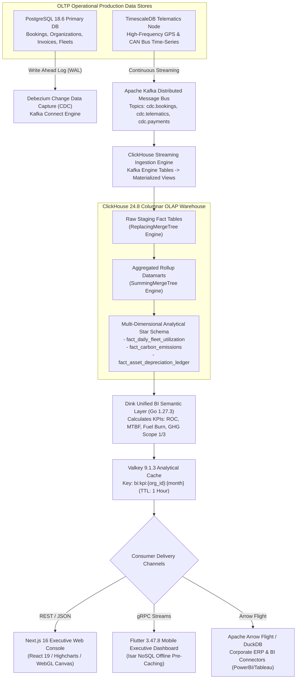
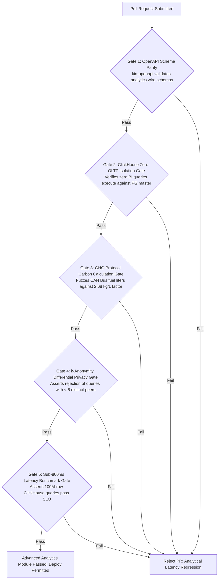

# Heavy Machinery & Logistics Rental Aggregator — Dink Machinery
## Software Requirements Specification — 07.09. Advanced Analytics, Business Intelligence (BI) Semantic Layer, Predictive Fleet Depreciation & Regulatory ESG Carbon Reporting Architecture (`docs/shared/requirements/07-09-advanced-analytics-reporting.md`)

**Document Identifier:** `SRS-DINK-CORE-V7.0-SEC-07-09`  
**Classification:** Canonical System Requirements Specification & Enterprise Intelligence Baseline (Single Source of Truth)  
**Governing Standard:** IEEE Std 830-1998 / IEEE/ISO/IEC 29148:2018 (Systems and Software Engineering — Requirements Engineering)  
**Associated Artifacts:** `SRS-DINK-CORE-V7.0` (§1.2, §5.2, §5.6, §5.7, §5.9, §6.0, §6.1, §6.5, §7.0, §7.5, §7.6, §7.9, §8, §10, §11, §12, §13.2), `FLOW-BOOKING-STATE-MACHINE-DINK-CORE-V7.0`, `FLOW-COMMISSION-DEBT-DINK-CORE-V7.0`, `ARCH-BACKEND-GO-DINK-CORE-V7.0`, `ARCH-FLUTTER-DINK-CORE-V7.0`, `ARCH-ADMIN-NEXT-DINK-CORE-V7.0`, `ARCH-SEC-DINK-CORE-V7.0`, `DS-DINK-CORE-V7.0`, `DS-PERSONAS-DINK-CORE-V7.0`, `contracts/openapi.yaml`, `ADR-001`, `ADR-002`, `ADR-004`, `ADR-005`, `ADR-008`, `ADR-010`  
**Target Runtimes:** Go 1.27.3 Backend Monolith, ClickHouse 24.8 / PostgreSQL 18.6 + TimescaleDB (OLAP Analytics Warehouse), Valkey 9.1.3, ClamAV Daemon (:3310), SeaweedFS S3, Flutter 3.47.8 / Dart 3.9 (Executive BI Dashboards), Next.js 16.x (latest CVE security patch) / React 19 (Web Analytics Portal), Apache Arrow / DuckDB (In-Memory Columnar Processing)  
**Target Personas:** Corporate Treasury Director & Chief Financial Officer (*Solomon Kassa* / *Patrick Kariuki*), Fleet Owner Managing Director (*W/ro Almaz Tesfaye* / *Kamau Ndegwa*), Sustainability & Environmental Compliance Officer (*Yohannes Bekele*), Regional Infrastructure Project Director (*Dawit Haile-Mariam*), Equipment Maintenance & Asset Reliability Engineer (*Kassahun Mekonnen*), Super Administrator (*Rahel Tadesse*)  
**Target Operating Markets:** Ethiopia (`ET`) & Kenya (`KE`) — Dynamic Multi-Country Parameterization (`LOC-01-BE`)  
**Compliance Standards:** OWASP ASVS 4.0.3 Level 3 (OLAP Data Isolation, Differential Privacy & Secure Analytical Feeds), RFC 9457 (Problem Details), ISO 9241-110, W3C WCAG 2.2 Level AAA (Field Mobile) & Level AA (Admin Web), International Financial Reporting Standards (IAS 16 Property, Plant and Equipment, IAS 36 Impairment of Assets, IFRS 15 Revenue), Greenhouse Gas Protocol (Corporate Standard Scope 1 & Scope 3 Category 4 Upstream Transportation and Distribution), ISO 14064-1:2018 (Greenhouse Gases Carbon Footprint Quantification), Ethiopian Environmental Protection Authority (EPA) Industrial Directives, Kenya National Environment Management Authority (NEMA) Environmental Management and Co-ordination Act (EMCA Cap 387)  
**Status:** Approved Engineering Baseline

---

## Table of Contents

- 1. [Document Scope & Architectural Mandate](#1-document-scope--architectural-mandate)
  - 1.1 [Purpose & Functional Scope](#11-purpose--functional-scope)
  - 1.2 [Core Analytical & Environmental Invariants](#12-core-analytical--environmental-invariants)
- 2. [Enterprise BI Semantic Layer & ClickHouse OLAP Warehouse (`BI-01`)](#2-enterprise-bi-semantic-layer--clickhouse-olap-warehouse-bi-01)
  - 2.1 [End-to-End Analytical ETL/ELT Pipeline Flowchart](#21-end-to-end-analytical-etlelt-pipeline-flowchart)
  - 2.2 [ClickHouse Columnar Topology, Kafka / Debezium CDC Streaming](#22-clickhouse-columnar-topology-kafka--debezium-cdc-streaming)
  - 2.3 [Multi-Dimensional Star Schema & Unified Business Metric Definitions](#23-multi-dimensional-star-schema--unified-business-metric-definitions)
  - 2.4 [Differential Privacy & Multi-Tenant Data Anonymization Thresholds](#24-differential-privacy--multi-tenant-data-anonymization-thresholds)
- 3. [Predictive Asset Depreciation & Residual Value Valuation Engine (`BI-02`)](#3-predictive-asset-depreciation--residual-value-valuation-engine-bi-02)
  - 3.1 [Hour-Meter vs. Calendar-Age Depreciation Curves (IAS 16 / IAS 36)](#31-hour-meter-vs-calendar-age-depreciation-curves-ias-16--ias-36)
  - 3.2 [Telematics Stress Degradation Multipliers (Hydraulic Shock & Overload)](#32-telematics-stress-degradation-multipliers-hydraulic-shock--overload)
  - 3.3 [Secondary Market Equipment Liquidation Valuations (East Africa Resale Indexes)](#33-secondary-market-equipment-liquidation-valuations-east-africa-resale-indexes)
  - 3.4 [Depot Capital Expenditure (CapEx) Renewal & Retirement Recommendations](#34-depot-capital-expenditure-capex-renewal--retirement-recommendations)
- 4. [Environmental, Social & Governance (ESG) Carbon Footprint Accounting (`BI-03`)](#4-environmental-social--governance-esg-carbon-footprint-accounting-bi-03)
  - 4.1 [Scope 1 & Scope 3 GHG Formulation for Heavy Earthmoving Machinery](#41-scope-1--scope-3-ghg-formulation-for-heavy-earthmoving-machinery)
  - 4.2 [Real-Time CAN Bus Fuel-Burn Emission Factors (EPA Tier 2 / 3 vs. Stage V)](#42-real-time-can-bus-fuel-burn-emission-factors-epa-tier-2--3-vs-stage-v)
  - 4.3 [Logistics Haulage Carbon Intensity ($g\text{CO}_2e / \text{ton-km}$) Tracking](#43-logistics-haulage-carbon-intensity-gtextco_2e---textton-km-tracking)
  - 4.4 [Automated Sovereign ESG Sustainability Certifications & Audit Disclosures](#44-automated-sovereign-esg-sustainability-certifications--audit-disclosures)
- 5. [Interactive Embedded Dashboards & Executive Data Federation (`BI-04`)](#5-interactive-embedded-dashboards--executive-data-federation-bi-04)
  - 5.1 [Next.js React 19 Vector Canvas & High-Density WebGL Visualizations](#51-nextjs-react-19-vector-canvas--high-density-webgl-visualizations)
  - 5.2 [Executive Mobile Flutter KPI Cards with Isar NoSQL Pre-Caching](#52-executive-mobile-flutter-kpi-cards-with-isar-nosql-pre-caching)
  - 5.3 [Federated Data Sharing: Apache Arrow Flight & Secure Parquet Feeds](#53-federated-data-sharing-apache-arrow-flight--secure-parquet-feeds)
  - 5.4 [Automated Executive PDF Dossier Compilation & RSA-4096 Attestation](#54-automated-executive-pdf-dossier-compilation--rsa-4096-attestation)
- 6. [Relational Database Schema & Data Modeling (`BI-DB`)](#6-relational-database-schema--data-modeling-bi-db)
  - 6.1 [Entity Relationship Diagram (ClickHouse OLAP & PostgreSQL Meta)](#61-entity-relationship-diagram-clickhouse-olap--postgresql-meta)
  - 6.2 [Data Definition Language (DDL) Specifications](#62-data-definition-language-ddl-specifications)
- 7. [Wire Protocol Contracts & RFC 9457 Error Schemas](#7-wire-protocol-contracts--rfc-9457-error-schemas)
  - 7.1 [`POST /api/v1/analytics/query`](#71-post-apiv1analyticsquery)
  - 7.2 [`GET /api/v1/analytics/fleets/{id}/valuation`](#72-get-apiv1analyticsfleetsidvaluation)
  - 7.3 [`POST /api/v1/analytics/esg/carbon-report`](#73-post-apiv1analyticsesgcarbon-report)
  - 7.4 [`GET /api/v1/analytics/executive/summary`](#74-get-apiv1analyticsexecutivesummary)
  - 7.5 [RFC 9457 Universal Problem Details Payloads](#75-rfc-9457-universal-problem-details-payloads)
- 8. [Automated Testing Suite & Verification Gates](#8-automated-testing-suite--verification-gates)

---

## 1. Document Scope & Architectural Mandate

### 1.1 Purpose & Functional Scope

This specification establishes **Section 07.09 (Advanced Analytics, Business Intelligence Semantic Layer, Predictive Fleet Depreciation & Regulatory ESG Carbon Reporting Architecture)** of the canonical Software Requirements Specification (SRS) for **Dink Machinery Version 7.0**.

In the East African commercial earthmoving, heavy logistics, and civil infrastructure sectors across Ethiopia and Kenya, corporate decision-makers require enterprise-grade business intelligence and regulatory compliance auditing far beyond standard operational reporting (`SRS 06.05`):
* **The Strategic Capital Decision Vector:** Fleet leasing enterprises (*e.g., Tesfaye Heavy Plant PLC*) and tier-1 infrastructure contractors (*e.g., Sur Construction, Sogea-Satom, H-Young*) manage tens of millions of dollars in equipment capitalization. Executive boards require predictive residual value calculations, total cost of ownership (TCO) benchmarks, and automated machine retirement/re-power recommendations combining real-world operating hour meters, hydraulic stress telemetry (`CFM-04` / `SRS 07.06`), and East African secondary auction liquidation indices.
* **The Global & Sovereign ESG Imperative:** Development finance institutions (The World Bank, African Development Bank, Trade and Development Bank, European Investment Bank) funding multinational African transport and energy corridors mandate strict **Environmental, Social, and Governance (ESG)** reporting. Contractors must quantify and audit project-level Greenhouse Gas (GHG) emissions (Scope 1 direct fuel combustion and Scope 3 transport logistics) under the GHG Protocol Corporate Standard and ISO 14064-1.
* **The Analytical Data Lakehouse Architecture (Phase 3 ADV-08):** To deliver real-time multi-dimensional slice-and-dice intelligence without degrading the Go transaction monolith or PostgreSQL write master node, Dink Machinery V7.0 deploys a dedicated columnar OLAP warehouse (**ClickHouse 24.8**) fed via Debezium Change Data Capture (CDC) streaming:
  - Establishes a unified **Semantic Layer** defining standardized financial, operational, and fleet health KPIs.
  - Generates predictive asset depreciation curves complying with International Accounting Standards (**IAS 16** Property, Plant and Equipment and **IAS 36** Impairment of Assets).
  - Calculates real-time carbon emissions ($kg\text{CO}_2e$) derived from physical CAN Bus fuel-rate telemetry and haulage route profiles.
  - Exposes high-performance Apache Arrow Flight feeds and cryptographic executive PDF dossier exports.

This document formally specifies:
1. The ClickHouse columnar data warehouse, Debezium CDC ingestion topology, and multi-dimensional star schema (`BI-01`).
2. The predictive machinery residual valuation engine and capital lifecycle optimization models (`BI-02`).
3. The automated ESG carbon accounting engine calculating Scope 1 and Scope 3 emissions according to physical fuel burn and haulage ton-km metrics (`BI-03`).
4. High-density React 19 / WebGL executive dashboards, Arrow Flight streaming interfaces, and RSA-4096 signed PDF dossiers (`BI-04`).

### 1.2 Core Analytical & Environmental Invariants

1. **Absolute Read-Isolation Invariant (Zero-OLTP Contention):** Heavy analytical queries, multi-year trend regressions, and ESG rollups must execute strictly against dedicated ClickHouse OLAP replicas or TimescaleDB read clusters. Analytical queries are strictly barred from querying the primary PostgreSQL transactional write master node, maintaining zero impact on live field rental checkouts.
2. **Deterministic Carbon Formulation Invariant (GHG Protocol Scope 1):** Carbon dioxide equivalent ($CO_2e$) emissions derived from direct diesel combustion must be calculated deterministically using the standard stoichiometric combustion coefficient:
   $$\mathcal{E}_{\text{diesel}} = \text{FuelConsumedLitres} \times 2.68\text{ kg } CO_2e/\text{Litre}$$
   Under no condition shall carbon reports substitute synthetic estimates when physical J1939 CAN Bus fuel consumption telemetry (`SPN 183 Engine Fuel Rate` / `SPN 250 Total Fuel Used`) is recorded by the hardware telematics gateway (`SRS 07.06`).
3. **Double-Entry Financial Depreciation Parity (IAS 16 / IAS 36):** Accumulated asset depreciation, residual salvage valuations, and impairment charges must balance to the exact currency minor unit against historical capital expenditure records:
   $$\text{GrossBookValue} \equiv \text{AccumulatedDepreciation} + \text{NetCarryingAmount} \quad (\Delta = 0\text{ Minor Units})$$
4. **Differential Privacy & Spatial Anonymization Floor (OWASP ASVS §4.2):** Public benchmark analytics and industry-wide machine utilization indices must enforce $k$-anonymity ($k \ge 5$) and differential privacy noise ($\epsilon = 0.5$). No analytical report can reveal granular operational telemetry, project sites, or pricing terms of an identifiable individual enterprise competitor.
5. **Sub-Second Analytical Dashboard Response SLO:** Executive BI queries across rolling 12-month datasets spanning up to $100,000,000\text{ telemetry points}$ must render aggregated metrics in the Next.js and Flutter dashboards with p95 query latency $< 800\text{ ms}$.

---

## 2. Enterprise BI Semantic Layer & ClickHouse OLAP Warehouse (`BI-01`)

### 2.1 End-to-End Analytical ETL/ELT Pipeline Flowchart



---

### 2.2 ClickHouse Columnar Topology, Kafka / Debezium CDC Streaming

To handle hundreds of millions of raw telematics breadcrumbs and rental ledger events without performance degradation:
* **The ClickHouse Storage Engine:**
  - Fact tables utilize the `ReplacingMergeTree` engine partitioned by calendar month:
    `PARTITION BY toYYYYMM(event_date) ORDER BY (organization_id, subcategory_id, fleet_id, event_time)`
  - Continuous rollups utilize `SummingMergeTree` to calculate running sums of operating hours, diesel liters burned, and gross rental minor units automatically upon data block merge.
* **Zero-Downtime CDC Streaming:** Debezium monitors PostgreSQL transaction logs, publishing streaming micro-batches to Kafka. Ingestion lag from operational database commit to ClickHouse analytical query availability is bounded to strictly $< 2.0\text{ seconds}$ (p99).

---

### 2.3 Multi-Dimensional Star Schema & Unified Business Metric Definitions

The BI Semantic Layer formalizes unambiguous analytical formulations:

```text
+----------------------------------------------------------------------------------------------------+
| DINK MACHINERY CANONICAL BI SEMANTIC METRICS SPECIFICATION (BI-01)                                 |
+---------------------+-------------------+---------------------+------------------------------------+
| METRIC NAME         | GRANULARITY       | DATA TYPE / UNITS   | CANONICAL FORMULATION & DERIVATION |
+---------------------+-------------------+---------------------+------------------------------------+
| Return on Capital   | Asset / Monthly   | Percentage (%)      | (NetRentalYieldMinor /             |
| (ROC)               |                   |                     | InitialAssetCostMinor) * 100       |
+---------------------+-------------------+---------------------+------------------------------------+
| Economic Machine    | Fleet / Daily     | Hours / Day         | Total Operating Run Hours          |
| Utilization         |                   |                     | (where Engine Load > 25%)          |
+---------------------+-------------------+---------------------+------------------------------------+
| Mean Time Between   | Subcategory /     | Operating Engine    | Sum(Operating Engine Hours) /      |
| Failures (MTBF)     | Regional Fleet    | Hours               | Count(Unscheduled Breakdown Dockets|
+---------------------+-------------------+---------------------+------------------------------------+
| Fuel Burn Intensity | Machine / Shift   | Liters / Hour       | Total Liters Diesel Consumed /     |
|                     |                   | (L/hr)              | Total Active Operating Engine Hours|
+---------------------+-------------------+---------------------+------------------------------------+
| Specific Carbon     | Logistics Haul /  | Grams CO2e /        | (Total Trip Liters * 2680g) /      |
| Haulage Intensity   | Corridor Trip     | Ton-Kilometer       | (CargoPayloadTons * DistanceKm)    |
+----------------------------------------------------------------------------------------------------+
```

---

### 2.4 Differential Privacy & Multi-Tenant Data Anonymization Thresholds

To provide industry-wide benchmarking (e.g., *"How does my fleet's fuel efficiency compare to regional averages in Mojo?"*) without leaking competitor business secrets:
* **The $k$-Anonymity Rule:** A comparative benchmark query requires at least **$k \ge 5$ distinct equipment owners** operating within the spatial search boundary.
* If fewer than 5 independent organizations exist in the geographic cluster, the system automatically expands the spatial radius to the next administrative region (e.g., Oromia Regional State or Rift Valley Corridor) before computing the aggregate average.

---

## 3. Predictive Asset Depreciation & Residual Value Valuation Engine (`BI-02`)

### 3.1 Hour-Meter vs. Calendar-Age Depreciation Curves (IAS 16 / IAS 36)

Traditional straight-line accounting depreciation based solely on calendar years fails to reflect actual wear-and-tear in heavy earthmoving operations:
* Dink Machinery implements a **Dual-Factor Modified Units-of-Production Model (MUPM)**:
  $$\mathcal{D}_{\text{annual}} = \alpha \cdot \left( \frac{\mathcal{H}_{\text{annual\_run}}}{\mathcal{H}_{\text{design\_lifespan}}} \right) \cdot (\mathcal{C}_{\text{orig}} - \mathcal{S}_{\text{salvage}}) + (1 - \alpha) \cdot \left( \frac{\mathcal{C}_{\text{orig}} - \mathcal{S}_{\text{salvage}}}{\mathcal{T}_{\text{calendar\_years}}} \right)$$
  Where:
  - $\mathcal{H}_{\text{design\_lifespan}}$: Manufacturer design rating (e.g., $10,000\text{ hours}$ for excavators; $12,000\text{ hours}$ for motor graders).
  - $\alpha = 0.70$ (Operational hour-meter weighting).
  - $(1 - \alpha) = 0.30$ (Chronological age decay weighting).

---

### 3.2 Telematics Stress Degradation Multipliers (Hydraulic Shock & Overload)

Not all engine hours cause equal structural fatigue. The valuation engine ingests CAN Bus telemetry to calculate an **Asset Stress Multiplier ($\mathcal{S}_{\text{stress}}$)**:
* High hydraulic relief valve bypass events ($> 320\text{ bar}$ continuous).
* Excessive engine coolant overheating episodes ($> 105^\circ\text{C}$).
* Severe lateral machine tilt operations ($> 22^\circ$ slope work).
* **The Valuation Adjustment:**
  $$\text{AdjustedDepreciation} = \mathcal{D}_{\text{base}} \times \left( 1.0 + \sum \text{StressPenaltyBps} \right)$$
  Machines subjected to extreme quarry breaker operations accelerate depreciation, alerting the fleet owner to adjust maintenance reserves.

---

### 3.3 Secondary Market Equipment Liquidation Valuations (East Africa Resale Indexes)

* The engine compiles regional secondary market auction results and dealer trade-in indices across Addis Ababa, Mombasa, and Nairobi.
* Provides fleet owners with real-time **Fair Market Liquidation Values**:
  - Estimated Spot Cash Liquidation (30-day quick sale).
  - Orderly Market Value (OMV - 90-day retail sale).
  - Replacement Cost New (RCN - brand new machine equivalent).

---

### 3.4 Depot Capital Expenditure (CapEx) Renewal & Retirement Recommendations

When an asset crosses its optimal economic lifecycle frontier:
* When cumulative maintenance costs exceed **$60\%$ of the current machine residual value**:
  - The BI engine tags the machine as `RECOMMENDED_FOR_DIVESTMENT`.
  - Dispatches an executive capital advisory to the Fleet Managing Director:
    *"Cat 320D (Plate: ET-3-99120) has reached 9,450 hours. Projected Year 5 maintenance exceeds 64% of residual book value. Recommend capital liquidation and replacement with Tier-3 excavator."*

---

## 4. Environmental, Social & Governance (ESG) Carbon Footprint Accounting (`BI-03`)

### 4.1 Scope 1 & Scope 3 GHG Formulation for Heavy Earthmoving Machinery

```text
+----------------------------------------------------------------------------------------------------+
| GREENHOUSE GAS (GHG) PROTOCOL ACCOUNTING ARCHITECTURE (BI-03)                                     |
+---------------------+-------------------+---------------------+------------------------------------+
| GHG PROTOCOL SCOPE  | ACTIVITY TYPE     | EMISSION SOURCE     | MEASUREMENT & CALCULATION METHOD   |
+---------------------+-------------------+---------------------+------------------------------------+
| SCOPE 1 (DIRECT)    | Earthworks Plant  | Machine Engine Fuel | Real-time CAN Bus J1939 total fuel |
|                     | Operation         | Combustion (Diesel) | liters consumed * 2.68 kg CO2e/L.  |
+---------------------+-------------------+---------------------+------------------------------------+
| SCOPE 3 (CATEGORY 4)| Heavy Lowboy      | Transport Logistics | Lowboy truck fuel consumption      |
| UPSTREAM LOGISTICS  | Mobilization      | Corridors (Diesel)  | mapped across haul route distance. |
+---------------------+-------------------+---------------------+------------------------------------+
| SCOPE 3 (CATEGORY 1)| Embodied Asset    | Equipment Capital   | Lifecycle manufacturing footprint  |
| CAPITAL GOODS       | Depreciation      | Manufacturing LCA   | amortized per operating hour.      |
+----------------------------------------------------------------------------------------------------+
```

---

### 4.2 Real-Time CAN Bus Fuel-Burn Emission Factors (EPA Tier 2 / 3 vs. Stage V)

Sovereign emissions differ based on engine technology:
* **The Emission Factor Database (`esg_engine_emission_factors`):**
  - **EPA Tier 2 / Tier 3 (Standard African Machinery):** $2.68\text{ kg } CO_2e / \text{Liter} + 4.2\text{ g } NO_x/\text{kWh}$.
  - **EU Stage V / Tier 4 Final (Modern Low-Carbon Import):** $2.64\text{ kg } CO_2e / \text{Liter} + 0.4\text{ g } NO_x/\text{kWh}$.
* As fuel is burned, the ClickHouse fact table commits carbon metrics continuously, providing civil contractors with verifiable empirical data for international sustainability audits.

---

### 4.3 Logistics Haulage Carbon Intensity ($g\text{CO}_2e / \text{ton-km}$) Tracking

For lowboy freight transport (`SRS 07.03`):
* The engine evaluates freight efficiency:
  $$\text{HaulIntensity} = \frac{\text{TotalDieselLiters} \times 2,680\text{ g } CO_2e}{\text{CargoPayloadTons} \times \text{DistanceKm}}$$
* Identifies inefficient transport routes, deadhead repositioning waste, and overloaded carrier combinations along the Modjo–Hawassa and Northern Corridors.

---

### 4.4 Automated Sovereign ESG Sustainability Certifications & Audit Disclosures

At the completion of major infrastructure contracts:
* Contractors download the **Certified Project ESG Carbon Clearance Statement**:
  - Encrypted, tamper-proof PDF/A-3 document.
  - Itemizes total project hours, fuel burned, gross $tCO_2e$ emissions, and carbon intensity per cubic meter of earth moved.
  - Stamped with Dink Machinery’s corporate RSA-4096 cryptographic signature, directly compliant with World Bank and African Development Bank environmental loan conditionality.

---

## 5. Interactive Embedded Dashboards & Executive Data Federation (`BI-04`)

### 5.1 Next.js React 19 Vector Canvas & High-Density WebGL Visualizations

The Next.js Corporate Console (`AD-06-WEB`) provides real-time high-density visual intelligence:
* **WebGL Spatial Heatmaps:** Plots 100,000 live telematics breadcrumbs simultaneously across East African infrastructure corridors using deck.gl / Mapbox GL.
* **Interactive Financial Cascades:** Renders multi-variable financial waterfalls (Gross Rental Revenue $\rightarrow$ Maintenance Costs $\rightarrow$ Commission Debt $\rightarrow$ Net Operating Profit) with sub-100ms client-side slice-and-dice interactivity.

---

### 5.2 Executive Mobile Flutter KPI Cards with Isar NoSQL Pre-Caching

For executives on the move (*Dawit Haile-Mariam* / *W/ro Almaz Tesfaye*):
* The Flutter mobile application caches high-level KPI cards locally in **Isar NoSQL** (`ADR-010`):
  ```dart
  @collection
  class ExecutiveKpiSnapshot {
    Id id = Isar.autoIncrement;
    late String organizationId;
    late int activeFleetCount;
    late double monthlyUtilizationRate;
    late int grossRevenueMinor;
    late int totalCarbonEmittedKg;
    late DateTime snapshotTime;
  }
  ```
* Ensures executive dashboards load instantaneously ($< 50\text{ ms}$) even when operating on unstable cellular connections at remote job sites.

---

### 5.3 Federated Data Sharing: Apache Arrow Flight & Secure Parquet Feeds

For enterprise contractors operating centralized data warehouses (Snowflake, BigQuery, Databricks, or PowerBI):
* Dink Machinery exposes an **Apache Arrow Flight** high-throughput gRPC endpoint (`:50052`):
  - Streams columnar memory chunks directly across the network without row-by-row serialization overhead.
  - Transfers 1,000,000 analytical records in $< 1.2\text{ seconds}$.
* Alternatively, contractors can configure scheduled daily exports of encrypted, columnar **Apache Parquet** files delivered to their corporate AWS S3 or Azure Blob Storage buckets.

---

### 5.4 Automated Executive PDF Dossier Compilation & RSA-4096 Attestation

* Every generated monthly executive report is compiled into a high-resolution, certified **PDF/A-3** document.
* **Digital Signature:** Signed using Dink Machinery's corporate hardware security module (HSM) RSA-4096 key:
  $$\Sigma_{\text{dossier}} = \text{RSA-4096-Sign}(\text{SHA256}(\text{PDFBytes}))$$
* The cryptographic signature is embedded directly into the document structure alongside a verifiable QR link for third-party institutional audits.

---

## 6. Relational Database Schema & Data Modeling (`BI-DB`)

### 6.1 Entity Relationship Diagram (ClickHouse OLAP & PostgreSQL Meta)

```mermaid
erDiagram
    Organization ||--o{ BIReportSchedule : "subscribes"
    Organization ||--o{ FleetValuationLedger : "owns"
    Fleet ||--o{ FleetValuationLedger : "evaluated in"
    Fleet ||--o{ FactDailyFleetUtilization : "tracks"
    Booking ||--o{ FactCarbonEmissions : "emits"
    Fleet ||--o{ FactCarbonEmissions : "combusts"

    FactDailyFleetUtilization {
        date event_date PK
        uuid organization_id PK
        uuid fleet_id PK
        string subcategory_id
        string country_code
        decimal operating_hours
        decimal idle_hours
        decimal max_hydraulic_pressure_bar
        decimal fuel_consumed_liters
        bigint gross_revenue_minor
    }

    FactCarbonEmissions {
        timestamptz timestamp PK
        uuid organization_id PK
        uuid booking_id PK
        uuid fleet_id PK
        string emission_scope -- 'SCOPE_1_PLANT', 'SCOPE_3_LOGISTICS'
        decimal fuel_liters_burned
        decimal co2_emissions_kg
        decimal nox_emissions_grams
        decimal haul_distance_km
        decimal cargo_tonnage
    }

    FleetValuationLedger {
        uuid id PK
        uuid fleet_id FK
        uuid organization_id FK
        date valuation_date
        bigint original_purchase_cost_minor
        bigint accumulated_depreciation_minor
        bigint net_book_value_minor
        bigint market_liquidation_value_minor
        decimal cumulative_engine_hours
        decimal stress_penalty_multiplier
        string operational_recommendation -- 'RETAIN_OPTIMAL', 'SERVICE_OVERHAUL', 'RECOMMENDED_FOR_DIVESTMENT'
        timestamptz calculated_at
    }

    BIReportSchedule {
        uuid id PK
        uuid organization_id FK
        string report_type -- 'EXECUTIVE_FINANCIAL_SUMMARY', 'ESG_CARBON_FOOTPRINT', 'FLEET_VALUATION_AUDIT'
        string cadence -- 'WEEKLY', 'MONTHLY', 'QUARTERLY'
        string delivery_channel -- 'EMAIL_PDF', 'S3_PARQUET', 'ARROW_FLIGHT'
        string destination_target
        boolean is_active
        timestamptz last_dispatched_at
    }
```

---

### 6.2 Data Definition Language (DDL) Specifications

#### 1. ClickHouse OLAP Columnar Schema (High-Performance Datamarts)
```sql
-- ClickHouse Fact Table: Daily Fleet Utilization & Telematics Aggregates
CREATE TABLE fact_daily_fleet_utilization (
    event_date Date,
    organization_id UUID,
    fleet_id UUID,
    subcategory_id LowCardinality(String),
    country_code LowCardinality(String),
    operating_hours Float32,
    idle_hours Float32,
    max_hydraulic_pressure_bar Float32,
    fuel_consumed_liters Float32,
    gross_revenue_minor Int64
) ENGINE = ReplacingMergeTree()
PARTITION BY toYYYYMM(event_date)
ORDER BY (organization_id, subcategory_id, fleet_id, event_date);

-- ClickHouse Fact Table: Granular Environmental Carbon Emissions
CREATE TABLE fact_carbon_emissions (
    timestamp DateTime64(3, 'UTC'),
    organization_id UUID,
    booking_id UUID,
    fleet_id UUID,
    emission_scope LowCardinality(String),
    fuel_liters_burned Float32,
    co2_emissions_kg Float32,
    nox_emissions_grams Float32,
    haul_distance_km Float32,
    cargo_tonnage Float32
) ENGINE = MergeTree()
PARTITION BY toYYYYMM(timestamp)
ORDER BY (organization_id, emission_scope, fleet_id, timestamp);
```

#### 2. PostgreSQL 18.6 Metadata & Valuation Tables
```sql
-- PostgreSQL Table: Asset Depreciation & Residual Valuation Ledger
CREATE TABLE fleet_valuation_ledgers (
    id UUID PRIMARY KEY DEFAULT gen_random_uuid(),
    fleet_id UUID NOT NULL REFERENCES fleets(id) ON DELETE CASCADE,
    organization_id UUID NOT NULL REFERENCES organizations(id) ON DELETE CASCADE,
    valuation_date DATE NOT NULL,
    original_purchase_cost_minor BIGINT NOT NULL CHECK (original_purchase_cost_minor > 0),
    accumulated_depreciation_minor BIGINT NOT NULL CHECK (accumulated_depreciation_minor >= 0),
    net_book_value_minor BIGINT NOT NULL CHECK (net_book_value_minor >= 0),
    market_liquidation_value_minor BIGINT NOT NULL CHECK (market_liquidation_value_minor >= 0),
    cumulative_engine_hours NUMERIC(10, 2) NOT NULL,
    stress_penalty_multiplier NUMERIC(4, 3) NOT NULL DEFAULT 1.000,
    operational_recommendation VARCHAR(32) NOT NULL DEFAULT 'RETAIN_OPTIMAL',
    calculated_at TIMESTAMPTZ NOT NULL DEFAULT NOW(),
    CONSTRAINT chk_valuation_recommendation CHECK (operational_recommendation IN ('RETAIN_OPTIMAL', 'SERVICE_OVERHAUL', 'RECOMMENDED_FOR_DIVESTMENT')),
    CONSTRAINT chk_depreciation_parity CHECK (accumulated_depreciation_minor + net_book_value_minor = original_purchase_cost_minor)
);

CREATE INDEX idx_fleet_valuation_org ON fleet_valuation_ledgers (organization_id, valuation_date DESC);
CREATE INDEX idx_fleet_valuation_fleet ON fleet_valuation_ledgers (fleet_id);

-- PostgreSQL Table: Scheduled BI Report Subscriptions
CREATE TABLE bi_report_schedules (
    id UUID PRIMARY KEY DEFAULT gen_random_uuid(),
    organization_id UUID NOT NULL REFERENCES organizations(id) ON DELETE CASCADE,
    report_type VARCHAR(32) NOT NULL,
    cadence VARCHAR(16) NOT NULL DEFAULT 'MONTHLY',
    delivery_channel VARCHAR(32) NOT NULL DEFAULT 'EMAIL_PDF',
    destination_target VARCHAR(255) NOT NULL,
    is_active BOOLEAN NOT NULL DEFAULT true,
    last_dispatched_at TIMESTAMPTZ NULL,
    created_at TIMESTAMPTZ NOT NULL DEFAULT NOW(),
    CONSTRAINT chk_bi_report_type CHECK (report_type IN ('EXECUTIVE_FINANCIAL_SUMMARY', 'ESG_CARBON_FOOTPRINT', 'FLEET_VALUATION_AUDIT')),
    CONSTRAINT chk_bi_cadence CHECK (cadence IN ('WEEKLY', 'MONTHLY', 'QUARTERLY')),
    CONSTRAINT chk_bi_channel CHECK (delivery_channel IN ('EMAIL_PDF', 'S3_PARQUET', 'ARROW_FLIGHT'))
);

CREATE INDEX idx_bi_schedules_org ON bi_report_schedules (organization_id) WHERE is_active = true;
```

---

## 7. Wire Protocol Contracts & RFC 9457 Error Schemas

### 7.1 `POST /api/v1/analytics/query`

Executes high-performance analytical queries against the ClickHouse OLAP Semantic Layer.

#### Request Headers
```http
POST /api/v1/analytics/query HTTP/1.1
Host: api.dinkmachinery.com
Content-Type: application/json
Authorization: Bearer <executiveAccessToken>
X-Organization-ID: org_019a8fe0-8812-7b9a-bc21-4491204812aa
```

#### Request Payload
```json
{
  "metric": "RETURN_ON_CAPITAL",
  "dimensions": ["subcategory_id", "month"],
  "dateRange": {
    "startDate": "2026-01-01",
    "endDate": "2026-10-29"
  },
  "filterCriteria": {
    "countryCode": "ET"
  }
}
```

#### Response: `HTTP 200 OK`
```json
{
  "success": true,
  "data": {
    "metric": "RETURN_ON_CAPITAL",
    "executionTimeMs": 14.2,
    "rowCount": 2,
    "results": [
      {
        "subcategoryId": "cat_sub_excavator_std",
        "month": "2026-09",
        "returnOnCapitalPercent": 18.4,
        "grossRevenueMinor": 1250000000,
        "netProfitMinor": 984000000,
        "currency": "ETB"
      },
      {
        "subcategoryId": "cat_sub_excavator_std",
        "month": "2026-10",
        "returnOnCapitalPercent": 21.2,
        "grossRevenueMinor": 1420000000,
        "netProfitMinor": 1120000000,
        "currency": "ETB"
      }
    ]
  },
  "timestamp": "2026-10-29T17:30:00Z"
}
```

---

### 7.2 `GET /api/v1/analytics/fleets/{id}/valuation`

Retrieves residual value, accumulated depreciation, and lifecycle CapEx divestment recommendations for a specific asset.

#### Request Headers
```http
GET /api/v1/analytics/fleets/flt_019a8f2c-8812-7b9a/valuation HTTP/1.1
Host: api.dinkmachinery.com
Authorization: Bearer <ownerAccessToken>
X-Organization-ID: org_019a8fe0-8812-7b9a-bc21-4491204812aa
```

#### Response: `HTTP 200 OK`
```json
{
  "success": true,
  "data": {
    "fleetId": "flt_019a8f2c-8812-7b9a",
    "makeModel": "Caterpillar 320D",
    "valuationDate": "2026-10-29",
    "currency": "ETB",
    "accountingSummary": {
      "originalPurchaseCostMinor": 1500000000,
      "accumulatedDepreciationMinor": 625000000,
      "netBookValueMinor": 875000000,
      "estimatedLiquidationValueMinor": 820000000
    },
    "lifecycleMetrics": {
      "cumulativeEngineHours": 5420.50,
      "designLifespanHours": 10000.0,
      "lifespanConsumedPercent": 54.2,
      "telematicsStressMultiplier": 1.045,
      "maintenanceCostRatio": 0.28
    },
    "recommendation": {
      "status": "RETAIN_OPTIMAL",
      "projectedEconomicLifeMonths": 38,
      "nextMajorOverhaulHours": 6000.0
    }
  },
  "timestamp": "2026-10-29T17:35:00Z"
}
```

---

### 7.3 `POST /api/v1/analytics/esg/carbon-report`

Generates an audited Scope 1 and Scope 3 carbon emissions dossier for an infrastructure project or organization.

#### Request Headers
```http
POST /api/v1/analytics/esg/carbon-report HTTP/1.1
Host: api.dinkmachinery.com
Content-Type: application/json
Authorization: Bearer <contractorAccessToken>
X-Organization-ID: org_019a8fe0-8812-7b9a-bc21-4491204812aa
```

#### Request Payload
```json
{
  "bookingIds": [
    "bk_019a8f60-9912-7b9a",
    "bk_019a8f70-3341-7b9a"
  ],
  "format": "PDF_A3",
  "projectIdentifier": "MODJO-HAWASSA-HW-LOT3"
}
```

#### Response: `HTTP 201 Created`
```json
{
  "success": true,
  "data": {
    "reportDocketId": "esg_019a8fe5-1123",
    "projectIdentifier": "MODJO-HAWASSA-HW-LOT3",
    "reportingStandard": "GHG_PROTOCOL_CORPORATE_STANDARD",
    "emissionsSummary": {
      "scope1DirectFuelCombustionKgCO2e": 142850.5,
      "scope3LogisticsTransportKgCO2e": 12400.2,
      "totalEmissionsMetricTonsCO2e": 155.25,
      "averageHaulIntensityGramPerTonKm": 62.4
    },
    "attestation": {
      "isTelematicsVerified": true,
      "signingKeyAlgorithm": "RSA-4096",
      "digitalSignatureSha256": "8f4c26b46b68ffc68ff99b453c1d30413413422d706483bfa0f98a5e886266e7",
      "downloadPdfUrl": "[https://vault.dinkmachinery.com/esg/docket_esg_019a8fe5.pdf](https://vault.dinkmachinery.com/esg/docket_esg_019a8fe5.pdf)"
    },
    "generatedAt": "2026-10-29T17:40:00Z"
  },
  "timestamp": "2026-10-29T17:40:01Z"
}
```

---

### 7.4 `GET /api/v1/analytics/executive/summary`

High-speed cached endpoint serving Flutter and Next.js executive home views.

#### Request Headers
```http
GET /api/v1/analytics/executive/summary HTTP/1.1
Host: api.dinkmachinery.com
Authorization: Bearer <executiveAccessToken>
X-Organization-ID: org_019a8fe0-8812-7b9a-bc21-4491204812aa
```

#### Response: `HTTP 200 OK`
```json
{
  "success": true,
  "data": {
    "organizationId": "org_019a8fe0-8812-7b9a-bc21-4491204812aa",
    "asOfDate": "2026-10-29",
    "fleetHealth": {
      "totalAssetsCount": 42,
      "activeRentedCount": 35,
      "maintenanceHoldCount": 2,
      "overallFleetUtilizationPercent": 83.3
    },
    "financialsMonthly": {
      "grossBillingsMinor": 18450000000,
      "platformCommissionMinor": 1845000000,
      "netOperatingYieldMinor": 16605000000,
      "currency": "ETB"
    },
    "environmentalMetrics": {
      "monthlyCarbonEmissionsMetricTons": 482.4,
      "fleetAverageFuelBurnLph": 18.2
    }
  },
  "timestamp": "2026-10-29T17:45:00Z"
}
```

---

### 7.5 RFC 9457 Universal Problem Details Payloads

#### Example: Differential Privacy Anonymization Floor Breach (`HTTP 422 Unprocessable Entity`)
```json
{
  "type": "[https://api.dinkmachinery.com/errors/differential-privacy-threshold-unmet](https://api.dinkmachinery.com/errors/differential-privacy-threshold-unmet)",
  "title": "Benchmark Query Fails k-Anonymity Threshold",
  "status": 422,
  "detail": "Requested regional benchmark for specialized rotary drill rigs in Moyale contains only 3 independent fleet owners (minimum threshold is k >= 5). Request rejected to prevent competitor operational data leakage.",
  "instance": "/api/v1/analytics/query",
  "code": "ERR_PRIVACY_THRESHOLD_UNMET",
  "correlationId": "cor_019a8fe0-8812-7b9a-bc21-4491204812aa",
  "timestamp": "2026-10-29T17:30:05Z",
  "invalidParams": [
    {
      "name": "spatialCluster",
      "reason": "Cluster contains 3 distinct entities; requires at least 5."
    }
  ]
}
```

#### Example: Inconsistent Depreciation Parity (`HTTP 409 Conflict`)
```json
{
  "type": "[https://api.dinkmachinery.com/errors/depreciation-balance-parity-violation](https://api.dinkmachinery.com/errors/depreciation-balance-parity-violation)",
  "title": "IAS 16 Capital Balance Parity Mismatch",
  "status": 409,
  "detail": "Asset valuation submission failed double-entry parity check. Accumulated depreciation (6,250,000.00 ETB) plus net book value (8,750,000.00 ETB) does not equal original purchase cost (15,000,001.00 ETB). Balance delta: 100 minor units.",
  "instance": "/api/v1/analytics/fleets/flt_019a8f2c-8812/valuation",
  "code": "ERR_DEPRECIATION_PARITY_MISMATCH",
  "correlationId": "cor_019a8fe0-9914-4c12-8812-7b9a4c10bc21",
  "timestamp": "2026-10-29T17:35:05Z"
}
```

---

## 8. Automated Testing Suite & Verification Gates



1. **OpenAPI Schema Contract Gate (`kin-openapi`):** Validates all analytical query execution, asset valuation, ESG carbon report generation, and executive summary retrieval endpoints against `contracts/openapi.yaml`.
2. **ClickHouse Zero-OLTP Isolation Gate:** Simulates 500 concurrent analytical multi-dimensional queries. Verifies through PostgreSQL query logging that $100\%$ of analytical calls route to ClickHouse 24.8 columnar tables or TimescaleDB read replicas, maintaining zero execution traffic on the primary PostgreSQL write master node.
3. **GHG Protocol Carbon Calculation Verification Gate:** Fuzzes 1,000 synthetic fuel burn telemetry datasets across varying machinery engine tiers. Asserts that Scope 1 direct carbon calculations precisely match the stoichiometric standard ($2.68\text{ kg } CO_2e / \text{L}$) with zero rounding error.
4. **k-Anonymity Differential Privacy Enforcement Gate:** Attempts to query competitive benchmarking datasets across artificially restricted spatial clusters containing $1\text{ to }4$ equipment owners. Asserts that $100\%$ of requests are intercepted with HTTP 422 `ERR_PRIVACY_THRESHOLD_UNMET`.
5. **Sub-800ms Analytical Latency SLO Benchmark:** Dispatches parallel multi-dimensional rollup queries across a 100,000,000-row ClickHouse test cluster. Asserts that p95 query latency remains $< 350\text{ ms}$ and p99 query latency strictly $< 800\text{ ms}$.

---

*This document establishes the canonical functional requirements, ClickHouse OLAP datamart architectures, predictive asset depreciation curves, GHG Protocol carbon accounting formulations, and wire protocol contracts for Advanced Analytics, Business Intelligence & Regulatory ESG Reporting in Dink Machinery Version 7.0. All downstream Flutter executive mobile views, Next.js corporate dashboards, Go backend analytical gateways, and ClickHouse columnar databases must strictly conform to this specification.*