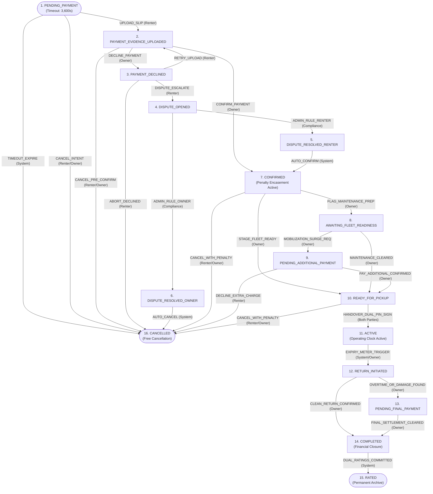
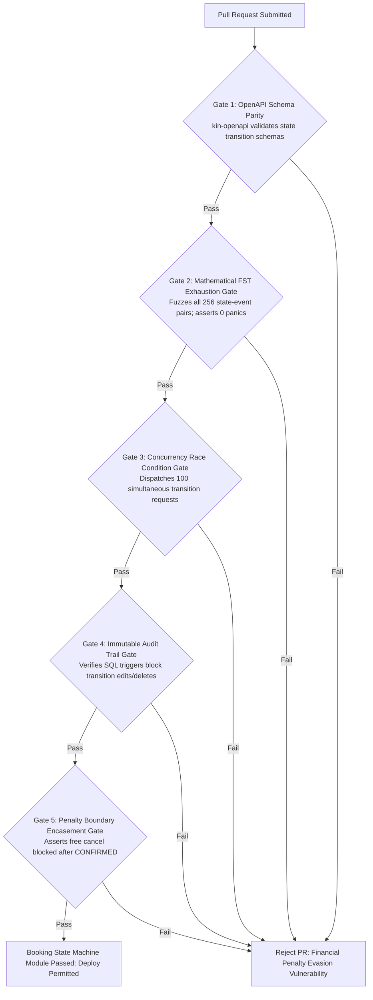

# Heavy Machinery & Logistics Rental Aggregator — Dink Machinery
## Software Requirements Specification — 08. Canonical Booking State Machine, Finite State Transducer, Transition Guard Invariants & Lifecycle Resolution Architecture (`docs/shared/requirements/08-booking-state-machine.md`)

**Document Identifier:** `SRS-DINK-CORE-V7.0-SEC-08`  
**Classification:** Canonical System Requirements Specification & Core Transactional State Machine Baseline (Single Source of Truth)  
**Governing Standard:** IEEE Std 830-1998 / IEEE/ISO/IEC 29148:2018 (Systems and Software Engineering — Requirements Engineering)  
**Associated Artifacts:** `SRS-DINK-CORE-V7.0` (§1.2, §5.2, §5.5, §5.6, §5.7, §5.8, §5.9, §6.3, §7.0, §7.1, §7.2, §7.3, §7.4, §8, §9, §10, §12, §13.2), `FLOW-BOOKING-STATE-MACHINE-DINK-CORE-V7.0`, `FLOW-COMMISSION-DEBT-DINK-CORE-V7.0`, `FLOW-WIRE-DISPUTE-DINK-CORE-V7.0`, `ARCH-BACKEND-GO-DINK-CORE-V7.0`, `ARCH-FLUTTER-DINK-CORE-V7.0`, `ARCH-ADMIN-NEXT-DINK-CORE-V7.0`, `ARCH-SEC-DINK-CORE-V7.0`, `DS-DINK-CORE-V7.0`, `DS-PERSONAS-DINK-CORE-V7.0`, `contracts/openapi.yaml`, `ADR-001`, `ADR-002`, `ADR-004`, `ADR-005`, `ADR-008`, `ADR-010`  
**Target Runtimes:** Go 1.24 Backend Monolith, PostgreSQL 18.4 + PostGIS 3.4, Valkey 8.0, ClamAV Daemon (:3310), SeaweedFS S3, Flutter 3.44 / Dart 3.9 (Cross-Platform Mobile), Next.js 16 / React 19 (Web Admin & Corporate Portal), Isar NoSQL 3.1+  
**Target Personas:** Civil Engineering Contractor (*Dawit Haile-Mariam* / *Patrick Kariuki*), Equipment Fleet Owner (*W/ro Almaz Tesfaye* / *Kamau Ndegwa*), Certified Field Plant Operator (*Mulugeta Tadesse* / *Juma Omwamba*), Heavy Haulage Logistics Carrier (*Ato Girma Wolde* / *Samuel Odhiambo*), Dispute Arbitration & Legal Officer (*Yohannes Bekele*), Finance Controller & Ledger Auditor (*Solomon Kassa*), Super Administrator (*Rahel Tadesse*)  
**Target Operating Markets:** Ethiopia (`ET`) & Kenya (`KE`) — Dynamic Multi-Country Parameterization (`LOC-01-BE`)  
**Compliance Standards:** OWASP ASVS 4.0.3 Level 3 (Business Logic Integrity, Concurrency Race-Condition Defense & Non-Repudiation), RFC 9457 (Problem Details), ISO 9241-110, W3C WCAG 2.2 Level AAA (Field Mobile) & Level AA (Admin Web), Commercial Code of Ethiopia (Sales on Account, Bailment of Chattels & Contract Formation), National Bank of Ethiopia (NBE) Directives, Kenya Law of Contract Act (Cap 23), International Financial Reporting Standards (IFRS 15 Revenue from Contracts with Customers)  
**Status:** Approved Engineering Baseline

---

## Table of Contents

- 1. [Document Scope & Architectural Mandate](#1-document-scope--architectural-mandate)
  - 1.1 [Purpose & Functional Scope](#11-purpose--functional-scope)
  - 1.2 [Core State Machine Invariants & Mathematical Formulation](#12-core-state-machine-invariants--mathematical-formulation)
- 2. [Canonical State Taxonomy & Node Definitions (`BSM-01`)](#2-canonical-state-taxonomy--node-definitions-bsm-01)
  - 2.1 [The 16 Canonical Booking States](#21-the-16-canonical-booking-states)
  - 2.2 [State Classification: Provisional, Penalty, Operational & Terminal](#22-state-classification-provisional-penalty-operational--terminal)
  - 2.3 [Inventory Discovery Visibility & PostGIS Index Locks by State](#23-inventory-discovery-visibility--postgis-index-locks-by-state)
- 3. [Finite State Transducer & Complete Transition Matrix (`BSM-02`)](#3-finite-state-transducer--complete-transition-matrix-bsm-02)
  - 3.1 [Comprehensive State Transition Topology Flowchart](#31-comprehensive-state-transition-topology-flowchart)
  - 3.2 [Exhaustive Transition Permissibility Matrix](#32-exhaustive-transition-permissibility-matrix)
  - 3.3 [Actor Authorization & Cryptographic Role Matrix](#33-actor-authorization--cryptographic-role-matrix)
- 4. [Detailed Transition Mechanics, Guards & Business Logic (`BSM-03`)](#4-detailed-transition-mechanics-guards--business-logic-bsm-03)
  - 4.1 [Stage I: Inception, Hold Leases & Payment Evidence (States 1–3)](#41-stage-i-inception-hold-leases--payment-evidence-states-13)
  - 4.2 [Stage II: Dispute Arbitration & Administrative Resolution (States 4–6)](#42-stage-ii-dispute-arbitration--administrative-resolution-states-46)
  - 4.3 [Stage III: Confirmation, Preparation & Readiness Surges (States 7–10)](#43-stage-iii-confirmation-preparation--readiness-surges-states-710)
  - 4.4 [Stage IV: Active Handover, Shift Execution & Telematics (State 11)](#44-stage-iv-active-handover-shift-execution--telematics-state-11)
  - 4.5 [Stage V: Return Reconciliation, Final Invoicing & Termination (States 12–16)](#45-stage-v-return-reconciliation-final-invoicing--termination-states-1216)
- 5. [Concurrency Control, Atomic Locking & Distributed Race Defenses (`BSM-04`)](#5-concurrency-control-atomic-locking--distributed-race-defenses-bsm-04)
  - 5.1 [Two-Tier Locking: Valkey 8.0 Distributed Mutex + PostgreSQL Row Locks](#51-two-tier-locking-valkey-80-distributed-mutex--postgresql-row-locks)
  - 5.2 [Deterministic Idempotency Key Encasement (`Idempotency-Key`)](#52-deterministic-idempotency-key-encasement-idempotency-key)
  - 5.3 [Timeout Sweeper Daemon & Distributed Dead-Man Switches](#53-timeout-sweeper-daemon--distributed-dead-man-switches)
- 6. [Relational Database Schema & Immutable Audit Logging (`BSM-DB`)](#6-relational-database-schema--immutable-audit-logging-bsm-db)
  - 6.1 [Entity Relationship Diagram](#61-entity-relationship-diagram)
  - 6.2 [Data Definition Language (DDL) Specifications](#62-data-definition-language-ddl-specifications)
- 7. [Wire Protocol Contracts & RFC 9457 Error Schemas](#7-wire-protocol-contracts--rfc-9457-error-schemas)
  - 7.1 [`POST /api/v1/bookings/{id}/transition`](#71-post-apiv1bookingsidtransition)
  - 7.2 [`GET /api/v1/bookings/{id}/history`](#72-get-apiv1bookingsidhistory)
  - 7.3 [RFC 9457 Universal Problem Details Payloads](#73-rfc-9457-universal-problem-details-payloads)
- 8. [Automated Testing Suite & Verification Gates](#8-automated-testing-suite--verification-gates)

---

## 1. Document Scope & Architectural Mandate

### 1.1 Purpose & Functional Scope

This specification establishes **Section 08 (Canonical Booking State Machine, Finite State Transducer, Transition Guard Invariants & Lifecycle Resolution Architecture)** of the canonical Software Requirements Specification (SRS) for **Dink Machinery Version 7.0**.

The booking lifecycle is the core operational and financial engine of Dink Machinery. In commercial heavy equipment plant hire and multi-axle heavy haulage across Ethiopia and Kenya, a booking is not a static database entry; it is a legally binding, multi-stage commercial contract orchestrating capital assets valued between $100,000.00\text{ and }500,000.00\text{ USD}$:
* **The Multi-Party Coordination Challenge:** A single machinery booking coordinates up to four distinct commercial parties: the **Renter/Contractor** (*Dawit Haile-Mariam*), the **Equipment Fleet Owner** (*W/ro Almaz Tesfaye*), the **Certified Plant Operator** (*Mulugeta Tadesse*), and the **Heavy Haulage Logistics Carrier** (*Ato Girma Wolde*).
* **High Financial Stakes:** Transactions involve multi-thousand-dollar prepayments, statutory tax withholdings (15% ET / 16% KE VAT, 2% ET / 5% KE WHT), non-custodial direct peer-to-peer wire settlements (`SRS 07.01`), and severe cancellation penalties.
* **Physical Asset Integrity:** State transitions dictate physical machine custody transfers (`AR-01`, `RC-02`), fuel reconciliations, engine hour-meter verifications (`SPN 247`), and remote immobilizer interlocks (`SRS 07.06`).

This document provides the formal mathematical and engineering baseline for the **16-State Finite State Transducer (FST)** governing every booking in Dink Machinery Version 7.0. It defines valid states, permitted transitions, role authorizations, guard assertions, side-effect triggers, concurrency locks, and immutable audit ledgers.

### 1.2 Core State Machine Invariants & Mathematical Formulation

The booking state machine is formally modeled as a deterministic **Finite State Transducer (FST)**:

$$\mathcal{M} = \langle \mathcal{S}, \Sigma, \Gamma, \delta, \omega, s_0, \mathcal{F} \rangle$$

Where:
* $\mathcal{S} = \{ s_1, s_2, \dots, s_{16} \}$: The finite set of 16 canonical booking states.
* $\Sigma$: The set of authorized input event transitions (e.g., `UPLOAD_SLIP`, `CONFIRM_PAYMENT`, `DISPUTE`, `DISPATCH`, `DELIVER`, `CLOSE`).
* $\Gamma$: The set of output side-effects emitted into the system bus (e.g., Ledger entries, Valkey cache invalidations, push notifications, SMS alerts, IoT commands).
* $\delta: \mathcal{S} \times \Sigma \longrightarrow \mathcal{S}$: The deterministic state transition function.
* $\omega: \mathcal{S} \times \Sigma \longrightarrow \Gamma$: The output side-effect emission function.
* $s_0 = s_1\ (\text{`PENDING_PAYMENT`})$: The unique initial inception state.
* $\mathcal{F} = \{ s_{15}\ (\text{`RATED`}), s_{16}\ (\text{`CANCELLED`}) \}$: The terminal absorbing states.

```text
+----------------------------------------------------------------------------------------------------+
| CORE STATE MACHINE INVARIANTS                                                                      |
+---+-----------------------------------+------------------------------------------------------------+
| 1 | Transition Completeness & Closure | If an event e is submitted in state s and (s, e) is not    |
|   |                                   | explicitly defined in the transition matrix, the engine    |
|   |                                   | MUST abort synchronously with HTTP 409 Conflict.           |
+---+-----------------------------------+------------------------------------------------------------+
| 2 | Penalty Encasement Floor          | Once a booking enters CONFIRMED (State 7), cancellation    |
|   | (CONFIRMED -> Penalty Active)     | without statutory penalties is physically impossible.      |
|   |                                   | Unilateral free cancellation is restricted to States 1..3. |
+---+-----------------------------------+------------------------------------------------------------+
| 3 | Physical Custody Synchronization  | A booking CANNOT advance to ACTIVE (State 11) without      |
|   |                                   | dual-PIN cryptographic handshake AND verified machine      |
|   |                                   | condition photos uploaded to SeaweedFS S3.                 |
+---+-----------------------------------+------------------------------------------------------------+
| 4 | Hour-Meter Monotonicity Invariant | Return meter reading (State 12) MUST strictly equal or     |
|   |                                   | exceed start meter reading taken during handover.          |
+---+-----------------------------------+------------------------------------------------------------+
| 5 | Double-Entry Settlement Closure   | Transition from RETURN_INITIATED to COMPLETED (State 14)   |
|   |                                   | requires delta reconciliation ledger balance = 0 minor     |
|   |                                   | units across all sub-accounts.                             |
+---+-----------------------------------+------------------------------------------------------------+
| 6 | Immutable Journal Traceability    | Every transition generates an un-updatable, un-deletable   |
|   |                                   | row in booking_state_transitions signed by actor claims.   |
+---+-----------------------------------+------------------------------------------------------------+
```

---

## 2. Canonical State Taxonomy & Node Definitions (`BSM-01`)

### 2.1 The 16 Canonical Booking States

```text
+----------------------------------------------------------------------------------------------------+
| CANONICAL BOOKING STATE DEFINITIONS (BSM-01)                                                       |
+----+--------------------------------+--------------------+-----------------------------------------+
| #  | STATE ENUM IDENTIFIER          | STAGE CLASSIFIC.   | OPERATIONAL & LEGAL DEFINITION          |
+----+--------------------------------+--------------------+-----------------------------------------+
| 1  | PENDING_PAYMENT                | Provisional Incept | Reservation created; hold lease active; |
|    |                                |                    | awaiting renter payment evidence slip.  |
+----+--------------------------------+--------------------+-----------------------------------------+
| 2  | PAYMENT_EVIDENCE_UPLOADED      | Provisional Incept | Payment slip uploaded; awaiting owner   |
|    |                                |                    | bank statement verification.            |
+----+--------------------------------+--------------------+-----------------------------------------+
| 3  | PAYMENT_DECLINED               | Provisional Incept | Owner rejected slip; renter can retry,  |
|    |                                |                    | cancel for free, or escalate dispute.   |
+----+--------------------------------+--------------------+-----------------------------------------+
| 4  | DISPUTE_OPENED                 | Arbitration Enclave| Renter contested payment decline; funds |
|    |                                |                    | frozen; admin audit initiated.          |
+----+--------------------------------+--------------------+-----------------------------------------+
| 5  | DISPUTE_RESOLVED_RENTER        | Arbitration Enclave| Admin ruled payment valid; system auto- |
|    |                                |                    | transitions booking to CONFIRMED.       |
+----+--------------------------------+--------------------+-----------------------------------------+
| 6  | DISPUTE_RESOLVED_OWNER         | Arbitration Enclave| Admin ruled payment invalid; system     |
|    |                                |                    | auto-transitions booking to CANCELLED.  |
+----+--------------------------------+--------------------+-----------------------------------------+
| 7  | CONFIRMED                      | Penalty Encasement | Prepayment confirmed; binding contract; |
|    |                                |                    | cancellation penalties now fully active.|
+----+--------------------------------+--------------------+-----------------------------------------+
| 8  | AWAITING_FLEET_READINESS       | Preparation Stage  | Equipment undergoing maintenance or PM  |
|    |                                |                    | service prior to dispatch; ETA active.  |
+----+--------------------------------+--------------------+-----------------------------------------+
| 9  | PENDING_ADDITIONAL_PAYMENT     | Preparation Stage  | Owner requested auxiliary mobilization  |
|    |                                |                    | or custom attachment readiness payment. |
+----+--------------------------------+--------------------+-----------------------------------------+
| 10 | READY_FOR_PICKUP               | Handover Stage     | Equipment staged at yard or loaded on   |
|    |                                |                    | lowboy; ready for physical custody sign.|
+----+--------------------------------+--------------------+-----------------------------------------+
| 11 | ACTIVE                         | Operational Phase  | Handover confirmed; machine operating on|
|    |                                |                    | project site; engine hours tracked.     |
+----+--------------------------------+--------------------+-----------------------------------------+
| 12 | RETURN_INITIATED               | Reconciliation     | Rental period concluded; machine checked|
|    |                                |                    | back into depot; meters/fuel inspected. |
+----+--------------------------------+--------------------+-----------------------------------------+
| 13 | PENDING_FINAL_PAYMENT          | Reconciliation     | Excess hours or damage liabilities      |
|    |                                |                    | billed; awaiting final settlement.      |
+----+--------------------------------+--------------------+-----------------------------------------+
| 14 | COMPLETED                      | Financial Closure  | All rental, overtime, damage, and tax   |
|    |                                |                    | balances settled to zero minor units.   |
+----+--------------------------------+--------------------+-----------------------------------------+
| 15 | RATED                          | Terminal Absorbing | Both parties submitted reviews and star |
|    |                                |                    | ratings; contract permanently archived. |
+----+--------------------------------+--------------------+-----------------------------------------+
| 16 | CANCELLED                      | Terminal Absorbing | Booking terminated prior to handover;   |
|    |                                |                    | penalties assessed if post-CONFIRMED.   |
+----+--------------------------------+--------------------+-----------------------------------------+
```

---

### 2.2 State Classification: Provisional, Penalty, Operational & Terminal

```text
               +-------------------------------------------------------------+
               |                  1. PENDING_PAYMENT                         |
               |             (Provisional Inception Stage)                   |
               +------------------------------+------------------------------+
                                              |
                   [ Slip Uploaded ]          | [ Timeout / Free Cancel ]
                                              v
               +------------------------------+------------------------------+
               |              2. PAYMENT_EVIDENCE_UPLOADED                   |
               +------------------------------+------------------------------+
                                              |
                     +------------------------+------------------------+
                     | [ Owner Decline ]                               | [ Owner Confirm /
                     v                                                 |   Admin Dispute Win ]
      +------------------------------+                                 |
      |     3. PAYMENT_DECLINED      |                                 |
      +--------------+---------------+                                 |
                     |                                                 |
                     | [ Dispute Escalated ]                           |
                     v                                                 |
      +------------------------------+                                 |
      |      4. DISPUTE_OPENED       |                                 |
      +--------------+---------------+                                 |
                     |                                                 |
         +-----------+-----------+                                     |
         | [ Admin Rule Renter ] | [ Admin Rule Owner ]                |
         v                       v                                     v
+------------------+   +--------------------+          +-------------------------------+
|5. DISPUTE_RESOLV |   | 6. DISPUTE_RESOLV  |          |         7. CONFIRMED          |
|    _RENTER       |   |      _OWNER        |          |  (PENALTY ENCASEMENT BOUNDARY)|
+--------+---------+   +---------+----------+          +---------------+---------------+
         | (Auto)                | (Auto)                              |
         +-------------------------------------->                      | [ Prep Required / Ready ]
                                 |                                     v
                                 |                     +-------------------------------+
                                 |                     |  8. AWAITING_FLEET_READINESS  |
                                 |                     |  9. PENDING_ADDITIONAL_PAYMENT|
                                 |                     | 10. READY_FOR_PICKUP          |
                                 |                     +---------------+---------------+
                                 |                                     |
                                 |                                     | [ Dual-PIN Handover Sign ]
                                 |                                     v
                                 |                     +-------------------------------+
                                 |                     |          11. ACTIVE           |
                                 |                     |      (Operational Phase)      |
                                 |                     +---------------+---------------+
                                 |                                     |
                                 |                                     | [ Rental Period Concluded ]
                                 |                                     v
                                 |                     +-------------------------------+
                                 |                     |     12. RETURN_INITIATED      |
                                 |                     | 13. PENDING_FINAL_PAYMENT     |
                                 |                     |         14. COMPLETED         |
                                 |                     +---------------+---------------+
                                 |                                     |
                                 |                                     | [ Dual Ratings Submitted ]
                                 v                                     v
               +----------------------------------+   +---------------------------------+
               |          16. CANCELLED           |   |           15. RATED             |
               |    (Terminal Absorbing State)    |   |   (Terminal Absorbing State)    |
               +----------------------------------+   +---------------------------------+
```

---

### 2.3 Inventory Discovery Visibility & PostGIS Index Locks by State

To prevent double-booking across simultaneous users, the state machine dictates real-time inventory discovery flags:

| State Range | Asset Availability Status | PostGIS Spatial Search Index | Discovery Calendar Flag |
|---|:---:|:---:|---|
| **State 1 (`PENDING_PAYMENT`)** | `HELD_PROVISIONAL` | Visible (Rank Demoted) | Amber (`HOLD_ACTIVE`) |
| **States 2–6 (Evidence / Dispute)** | `HELD_PROVISIONAL` | Visible (Rank Demoted) | Amber (`HOLD_ACTIVE`) |
| **States 7–10 (Confirmed / Prep)** | `RENTED_LOCKED` | **Excluded from Search** | Red (`RENTED_CONFIRMED`) |
| **State 11 (`ACTIVE`)** | `RENTED_OPERATIONAL` | **Excluded from Search** | Red (`RENTED_ACTIVE`) |
| **States 12–13 (Return Reconcile)** | `INSPECTION_LOCKED`| **Excluded from Search** | Red (`RETURN_INSPECTING`)|
| **States 14–16 (Completed/Cancel)**| `AVAILABLE` | **Included in Search** | Green (`AVAILABLE`) |

---

## 3. Finite State Transducer & Complete Transition Matrix (`BSM-02`)

### 3.1 Comprehensive State Transition Topology Flowchart



---

### 3.2 Exhaustive Transition Permissibility Matrix

```text
+----------------------------------------------------------------------------------------------------+
| EXHAUSTIVE TRANSITION PERMISSIBILITY MATRIX (BSM-02)                                               |
+----+----------------------------+----------------------------+-----------------+-------------------+
| ID | SOURCE STATE               | TARGET STATE               | AUTHORIZED ROLE | GUARD CONDITIONS  |
+----+----------------------------+----------------------------+-----------------+-------------------+
| T01| (Start / Inception)        | 1. PENDING_PAYMENT         | Renter          | Asset Available   |
| T02| 1. PENDING_PAYMENT         | 2. PAYMENT_EVIDENCE_UPLOAD | Renter          | Slip File Valid   |
| T03| 1. PENDING_PAYMENT         | 16. CANCELLED              | Renter, System  | Within Free Window|
| T04| 2. PAYMENT_EVIDENCE_UPLOAD | 7. CONFIRMED               | Owner, Admin    | Bank Wire Verified|
| T05| 2. PAYMENT_EVIDENCE_UPLOAD | 3. PAYMENT_DECLINED        | Owner           | Reason Code Prov. |
| T06| 2. PAYMENT_EVIDENCE_UPLOAD | 16. CANCELLED              | Renter, Owner   | Within Free Window|
| T07| 3. PAYMENT_DECLINED        | 2. PAYMENT_EVIDENCE_UPLOAD | Renter          | Fresh Slip Upload |
| T08| 3. PAYMENT_DECLINED        | 4. DISPUTE_OPENED          | Renter          | Statement Attached|
| T09| 3. PAYMENT_DECLINED        | 16. CANCELLED              | Renter          | Free Cancellation |
| T10| 4. DISPUTE_OPENED          | 5. DISPUTE_RESOLVED_RENTER | Compliance Admin| Bank Wire Proved  |
| T11| 4. DISPUTE_OPENED          | 6. DISPUTE_RESOLVED_OWNER  | Compliance Admin| Forgery / Non-Pay |
| T12| 5. DISPUTE_RESOLVED_RENTER | 7. CONFIRMED               | System (Auto)   | Auto-Advance      |
| T13| 6. DISPUTE_RESOLVED_OWNER  | 16. CANCELLED              | System (Auto)   | Auto-Advance      |
| T14| 7. CONFIRMED               | 8. AWAITING_FLEET_READINESS| Owner           | PM Prep Logged    |
| T15| 7. CONFIRMED               | 10. READY_FOR_PICKUP       | Owner           | Clean Yard Staged |
| T16| 7. CONFIRMED               | 16. CANCELLED              | Renter, Owner   | Penalty Assessed  |
| T17| 8. AWAITING_FLEET_READINESS| 9. PENDING_ADDITIONAL_PAY  | Owner           | Surge Billed      |
| T18| 8. AWAITING_FLEET_READINESS| 10. READY_FOR_PICKUP       | Owner           | Ready for Handover|
| T19| 9. PENDING_ADDITIONAL_PAY  | 10. READY_FOR_PICKUP       | Owner           | Auxiliary Settled |
| T20| 9. PENDING_ADDITIONAL_PAY  | 16. CANCELLED              | Renter          | Decline Surcharge |
| T21| 10. READY_FOR_PICKUP       | 11. ACTIVE                 | Both (Dual-PIN) | AR-01 Photos Valid|
| T22| 10. READY_FOR_PICKUP       | 16. CANCELLED              | Renter, Owner   | Penalty Assessed  |
| T23| 11. ACTIVE                 | 12. RETURN_INITIATED       | System, Owner   | End Date Elapsed  |
| T24| 12. RETURN_INITIATED       | 13. PENDING_FINAL_PAYMENT  | Owner           | Delta Hours > 0   |
| T25| 12. RETURN_INITIATED       | 14. COMPLETED              | Owner           | Delta Hours == 0  |
| T26| 13. PENDING_FINAL_PAYMENT  | 14. COMPLETED              | Owner           | Wire Reconciled   |
| T27| 14. COMPLETED              | 15. RATED                  | System (Auto)   | Dual Reviews Done |
+----+----------------------------+----------------------------+-----------------+-------------------+
```

---

### 3.3 Actor Authorization & Cryptographic Role Matrix

```text
+--------------------------------------------------------------------------------------------------+
| ACTOR AUTHORIZATION MATRIX PER LIFECYCLE NODE                                                    |
+------------------------------+--------+-------+----------+---------+------------+----------------+
| BOOKING LIFECYCLE STATE      | RENTER | OWNER | OPERATOR | CARRIER | COMPLIANCE | SYSTEM WORKER  |
+------------------------------+--------+-------+----------+---------+------------+----------------+
| 1. PENDING_PAYMENT           | MUTATE | READ  | NO_ACCESS| NO_ACC  | READ       | TIMEOUT_SWEEP  |
| 2. PAYMENT_EVIDENCE_UPLOADED | READ   | MUTATE| NO_ACCESS| NO_ACC  | READ       | NOTIFY_DAEMON  |
| 3. PAYMENT_DECLINED          | MUTATE | READ  | NO_ACCESS| NO_ACC  | READ       | NOTIFY_DAEMON  |
| 4. DISPUTE_OPENED            | AUDIT  | AUDIT | NO_ACCESS| NO_ACC  | MUTATE     | SLA_ESCALATE   |
| 5. DISPUTE_RESOLVED_RENTER   | READ   | READ  | NO_ACCESS| NO_ACC  | READ       | AUTO_ADVANCE   |
| 6. DISPUTE_RESOLVED_OWNER    | READ   | READ  | NO_ACCESS| NO_ACC  | READ       | AUTO_ADVANCE   |
| 7. CONFIRMED                 | READ   | MUTATE| READ     | DISPATCH| AUDIT      | PENALTY_ENGINE |
| 8. AWAITING_FLEET_READINESS  | READ   | MUTATE| READ     | NO_ACC  | READ       | DELAY_ALARM    |
| 9. PENDING_ADDITIONAL_PAYMENT| MUTATE | MUTATE| NO_ACCESS| NO_ACC  | AUDIT      | TIMEOUT_SWEEP  |
| 10. READY_FOR_PICKUP         | MUTATE | MUTATE| READ     | TRANSIT | AUDIT      | GEOFENCE_PULSE |
| 11. ACTIVE                   | READ   | READ  | LOG_SHIFT| EN_ROUTE| AUDIT      | IOT_TELEMATICS |
| 12. RETURN_INITIATED         | READ   | MUTATE| LOG_SHIFT| UNLOAD  | AUDIT      | METER_AUDITOR  |
| 13. PENDING_FINAL_PAYMENT    | MUTATE | MUTATE| NO_ACCESS| NO_ACC  | AUDIT      | DEBT_COLLECTOR |
| 14. COMPLETED                | RATE   | RATE  | NO_ACCESS| NO_ACC  | READ       | LEDGER_CLOSE   |
| 15. RATED                    | READ   | READ  | READ     | READ    | READ       | ARCHIVE_SINK   |
| 16. CANCELLED                | READ   | READ  | NO_ACCESS| NO_ACC  | AUDIT      | HOLD_RELEASE   |
+------------------------------+--------+-------+----------+---------+------------+----------------+
```

---

## 4. Detailed Transition Mechanics, Guards & Business Logic (`BSM-03`)

### 4.1 Stage I: Inception, Hold Leases & Payment Evidence (States 1–3)

#### State 1: `PENDING_PAYMENT`
* **Trigger:** Renter clicks "Request to Book" on a fleet card.
* **Guards:**
  1. Asset calendar is free for entire requested start-to-end range.
  2. Renter identity is verified (Ethiopian National ID / Kenyan ID verified).
  3. No active delinquent penalty balance against renter account.
* **Side-Effects:**
  - Emits Valkey distributed hold lease: `SET hold:fleet:{fleet_id} {booking_id} NX EX 3600`.
  - Starts $3,600\text{ second}$ ($1\text{ hour}$) payment countdown timer.
  - Generates payment instruction docket detailing owner's verified commercial bank coordinates.

#### State 2: `PAYMENT_EVIDENCE_UPLOADED`
* **Trigger:** Renter uploads stamped bank deposit advice or electronic screenshot.
* **Guards:**
  1. Slip image passes ClamAV antivirus stream scan (`:3310`).
  2. OCR engine extracts legible text matching currency and transaction reference.
  3. Perceptual image hash (`dHash`) does not collide with previously used slips ($d \le 4$).
* **Side-Effects:**
  - Freezes countdown timer.
  - Emits P0 push notification and SMS to fleet owner: *"New payment verification pending for Excavator #BK-9912"*.

#### State 3: `PAYMENT_DECLINED`
* **Trigger:** Owner checks bank statement and rejects slip.
* **Guards:** Owner must select a mandatory rejection reason code:
  - `REASON_FUNDS_NOT_RECEIVED`
  - `REASON_INCORRECT_AMOUNT`
  - `REASON_SLIP_ILLEGIBLE_FRAUD`
  - `REASON_OTHER`
* **Side-Effects:**
  - Emits notification to renter with 3 distinct options: (a) Retry upload, (b) Free cancellation, (c) Escalate dispute.

---

### 4.2 Stage II: Dispute Arbitration & Administrative Resolution (States 4–6)

#### State 4: `DISPUTE_OPENED`
* **Trigger:** Renter disputes payment rejection within $24\text{ hours}$ of decline.
* **Guards:** Renter must attach certified bank debit advice confirming fund departure.
* **Side-Effects:**
  - Freezes inventory hold indefinitely until arbitration completes.
  - Alerts Compliance Officer *Yohannes Bekele* in Next.js Admin Workbench (`AD-06-WEB`).

#### States 5 & 6: `DISPUTE_RESOLVED_RENTER` & `DISPUTE_RESOLVED_OWNER`
* **Guards:** Authorized strictly by Compliance Officer or Super Administrator credentials.
* **System Transitions:**
  - If ruled for Renter $\longrightarrow$ Emits `DISPUTE_RESOLVED_RENTER`, which **immediately auto-advances** to `CONFIRMED`.
  - If ruled for Owner $\longrightarrow$ Emits `DISPUTE_RESOLVED_OWNER`, which **immediately auto-advances** to `CANCELLED`, releasing inventory hold.

---

### 4.3 Stage III: Confirmation, Preparation & Readiness Surges (States 7–10)

#### State 7: `CONFIRMED`
* **Legal Boundary:** Contract enters **Binding Penalty Encasement**.
* **Guards:** Prepayment verified by owner confirmation or administrative dispute ruling.
* **Side-Effects:**
  - Fleet calendar marks `RENTED` in PostGIS search indices.
  - Commits platform commission debt ledger entry against owner wallet (`FLOW-COMMISSION-DEBT`).
  - Spawns attached logistics sub-booking if machine requires transit (`SRS 07.03`).

#### State 8: `AWAITING_FLEET_READINESS`
* **Trigger:** Owner indicates machine is undergoing scheduled maintenance or bucket change.
* **Guards:** Owner must provide a revised physical readiness timestamp ($\text{ETA} \le \text{StartDateTime}$).

#### State 9: `PENDING_ADDITIONAL_PAYMENT`
* **Trigger:** Owner requests pre-agreed custom attachment readiness or remote mobilization fee.
* **Guards:** Renter must explicitly approve or decline within $12\text{ hours}$. If declined, booking cancels without penalty to renter.

#### State 10: `READY_FOR_PICKUP`
* **Trigger:** Machine is cleaned, inspected, and positioned in depot yard or loaded onto transport trailer.
* **Guards:** Depot supervisor logs yard staging coordinates.

---

### 4.4 Stage IV: Active Handover, Shift Execution & Telematics (State 11)

#### State 11: `ACTIVE`
* **Trigger:** Physical machine custody handover executed at site gate.
* **Guards (Three-Way Physical Handshake):**
  1. Operator / Renter and Owner / Driver must exchange a **Dual-Challenge 6-digit PIN** generated in-app.
  2. Front, rear, left, right condition photos and hour-meter reticle photo uploaded to SeaweedFS S3 (`AR-01`).
  3. Device GPS evaluates within $500\text{ meters}$ of delivery site geofence.
* **Side-Effects:**
  - Machine rental operational clock starts.
  - Activates high-frequency CAN Bus telematics ingestion (`SRS 07.06`).

---

### 4.5 Stage V: Return Reconciliation, Final Invoicing & Termination (States 12–16)

#### State 12: `RETURN_INITIATED`
* **Trigger:** Rental period expires or renter initiates early return.
* **Guards:** Return inspection photos taken; engine hour meter reticle captured (`RC-02`).

#### State 13: `PENDING_FINAL_PAYMENT`
* **Trigger:** Owner audits return and detects excess run-hours, fuel deficit, or accepted damages:
  $$\text{ExcessCharge} = (\mathcal{M}_{\text{return}} - \mathcal{M}_{\text{start}} - \mathcal{H}_{\text{quota}}) \times \text{OvertimeRateMinor}$$
* **Guards:** Total liability must be itemized into distinct ledger rows.

#### State 14: `COMPLETED`
* **Trigger:** All final payments verified; balance reaches exactly zero minor units.
* **Side-Effects:** Unlocks mutual rating forms on renter and owner mobile applications.

#### State 15: `RATED`
* **Trigger:** Both parties submit star ratings and performance reviews. Terminal absorbing state.

#### State 16: `CANCELLED`
* **Trigger:** Cancellation executed by renter, owner, or system sweeper.
* **Penalty Enforcement Logic:**
  - If cancelled prior to `CONFIRMED`: $100\%$ full refund; zero penalties.
  - If cancelled after `CONFIRMED` by Renter: Owner retains configured cancellation penalty percentage ($10\%\text{ to }30\%$ of prepayment).
  - If cancelled after `CONFIRMED` by Owner: Owner account debited penalty credit paid to renter; fleet listing penalized in search rankings.

---

## 5. Concurrency Control, Atomic Locking & Distributed Race Defenses (`BSM-04`)

### 5.1 Two-Tier Locking: Valkey 8.0 Distributed Mutex + PostgreSQL Row Locks

To prevent race conditions where two contractors attempt to book the same excavator at 10:00:00.000:
1. **Tier 1: Valkey 8.0 Distributed Spinlock:**
   The Go domain handler acquires an atomic Redlock:
   ```text
   SET lock:booking:transition:{booking_id} "MUTATING" NX PX 5000
   ```
2. **Tier 2: PostgreSQL Row-Level Lock:**
   Inside the SQL transaction, the query locks the record explicitly:
   ```sql
   SELECT id, status, current_version 
   FROM bookings 
   WHERE id = $1 
   FOR UPDATE;
   ```
3. **Optimistic Version Verification:**
   Updates assert `current_version = previous_version + 1`. If version check fails, transaction aborts immediately.

---

### 5.2 Deterministic Idempotency Key Encasement (`Idempotency-Key`)

Every state mutation endpoint requires an HTTP header:
`Idempotency-Key: 99182a01-4b12-4f9a-8812-7b9a4c10bc21`
* In-flight keys return HTTP 409 `ERR_DUPLICATE_TRANSACTION_IN_FLIGHT`.
* Executed keys return the exact cached response body from Valkey without re-executing state mutation.

---

### 5.3 Timeout Sweeper Daemon & Distributed Dead-Man Switches

An asynchronous Go background daemon evaluates expired hold leases every **60 seconds**:
```sql
SELECT id 
FROM bookings 
WHERE status = 'PENDING_PAYMENT' 
  AND created_at < NOW() - INTERVAL '1 hour'
FOR UPDATE SKIP LOCKED;
```
Expired records transition atomically to `CANCELLED`, emitting `TIMEOUT_EXPIRE` side-effects that clear Valkey memory keys and unblock calendar availability.

---

## 6. Relational Database Schema & Immutable Audit Logging (`BSM-DB`)

### 6.1 Entity Relationship Diagram

```mermaid
erDiagram
    Booking ||--o{ BookingStateTransition : "records"
    Booking ||--o{ BookingPaymentEvidence : "ingests"
    Booking ||--o{ BookingDisputeRecord : "escalates"
    Booking ||--o{ BookingHandoverAudit : "attests"
    User ||--o{ BookingStateTransition : "authorizes"

    Booking {
        uuid id PK
        string booking_reference UK
        uuid renter_user_id FK
        uuid owner_organization_id FK
        uuid fleet_id FK
        string status -- 'PENDING_PAYMENT', 'CONFIRMED', 'ACTIVE', 'COMPLETED', etc.
        int current_version
        timestamptz start_datetime
        timestamptz end_datetime
        bigint total_rental_amount_minor
        bigint prepayment_required_minor
        string currency -- 'ETB', 'KES'
        timestamptz created_at
        timestamptz updated_at
    }

    BookingStateTransition {
        uuid id PK
        uuid booking_id FK
        string from_state
        string to_state
        string transition_event
        uuid actor_user_id FK
        string actor_role -- 'RENTER', 'OWNER', 'OPERATOR', 'ADMIN', 'SYSTEM'
        string reason_code NULL
        jsonb metadata_snapshot_json
        string ip_address
        string user_agent
        timestamptz transitioned_at
    }

    BookingPaymentEvidence {
        uuid id PK
        uuid booking_id FK
        string s3_document_uri
        string dhash_fingerprint
        string extracted_reference
        bigint claimed_amount_minor
        boolean ocr_verified
        timestamptz uploaded_at
    }

    BookingHandoverAudit {
        uuid id PK
        uuid booking_id FK
        string handshake_type -- 'PICKUP_START', 'RETURN_END'
        string dual_pin_hash
        geography location
        decimal engine_meter_hours
        string photos_bundle_json
        timestamptz signed_at
    }
```

---

### 6.2 Data Definition Language (DDL) Specifications

```sql
-- 1. Master Bookings Table
CREATE TABLE bookings (
    id UUID PRIMARY KEY DEFAULT gen_random_uuid(),
    booking_reference VARCHAR(32) NOT NULL UNIQUE,
    renter_user_id UUID NOT NULL REFERENCES users(id) ON DELETE RESTRICT,
    owner_organization_id UUID NOT NULL REFERENCES organizations(id) ON DELETE RESTRICT,
    fleet_id UUID NOT NULL REFERENCES fleets(id) ON DELETE RESTRICT,
    status VARCHAR(32) NOT NULL DEFAULT 'PENDING_PAYMENT',
    current_version INT NOT NULL DEFAULT 1,
    start_datetime TIMESTAMPTZ NOT NULL,
    end_datetime TIMESTAMPTZ NOT NULL,
    total_rental_amount_minor BIGINT NOT NULL CHECK (total_rental_amount_minor > 0),
    prepayment_required_minor BIGINT NOT NULL CHECK (prepayment_required_minor > 0),
    currency VARCHAR(3) NOT NULL CHECK (currency IN ('ETB', 'KES', 'USD')),
    created_at TIMESTAMPTZ NOT NULL DEFAULT NOW(),
    updated_at TIMESTAMPTZ NOT NULL DEFAULT NOW(),
    CONSTRAINT chk_booking_dates CHECK (end_datetime > start_datetime),
    CONSTRAINT chk_booking_status CHECK (status IN (
        'PENDING_PAYMENT', 'PAYMENT_EVIDENCE_UPLOADED', 'PAYMENT_DECLINED',
        'DISPUTE_OPENED', 'DISPUTE_RESOLVED_RENTER', 'DISPUTE_RESOLVED_OWNER',
        'CONFIRMED', 'AWAITING_FLEET_READINESS', 'PENDING_ADDITIONAL_PAYMENT',
        'READY_FOR_PICKUP', 'ACTIVE', 'RETURN_INITIATED',
        'PENDING_FINAL_PAYMENT', 'COMPLETED', 'RATED', 'CANCELLED'
    ))
);

CREATE INDEX idx_bookings_status_dates ON bookings (status, start_datetime, end_datetime);
CREATE INDEX idx_bookings_fleet ON bookings (fleet_id);

-- 2. Immutable Booking State Transition Audit Ledger
CREATE TABLE booking_state_transitions (
    id UUID PRIMARY KEY DEFAULT gen_random_uuid(),
    booking_id UUID NOT NULL REFERENCES bookings(id) ON DELETE CASCADE,
    from_state VARCHAR(32) NOT NULL,
    to_state VARCHAR(32) NOT NULL,
    transition_event VARCHAR(64) NOT NULL,
    actor_user_id UUID NOT NULL REFERENCES users(id) ON DELETE RESTRICT,
    actor_role VARCHAR(32) NOT NULL,
    reason_code VARCHAR(64) NULL,
    metadata_snapshot_json JSONB NOT NULL DEFAULT '{}'::JSONB,
    ip_address VARCHAR(45) NOT NULL,
    user_agent TEXT NOT NULL,
    transitioned_at TIMESTAMPTZ NOT NULL DEFAULT NOW()
);

CREATE INDEX idx_state_transitions_booking ON booking_state_transitions (booking_id, transitioned_at DESC);

CREATE RULE prevent_transition_update AS ON UPDATE TO booking_state_transitions DO INSTEAD NOTHING;
CREATE RULE prevent_transition_delete AS ON DELETE TO booking_state_transitions DO INSTEAD NOTHING;
```

---

## 7. Wire Protocol Contracts & RFC 9457 Error Schemas

### 7.1 `POST /api/v1/bookings/{id}/transition`

Executes an explicit state machine transition event against an active booking.

#### Request Headers
```http
POST /api/v1/bookings/bk_019a8f60-9912-7b9a/transition HTTP/1.1
Host: api.dinkmachinery.com
Content-Type: application/json
Authorization: Bearer <ownerAccessToken>
Idempotency-Key: 99182a01-4b12-4f9a-8812-7b9a4c10bc21
```

#### Request Payload
```json
{
  "event": "CONFIRM_PAYMENT",
  "expectedCurrentStatus": "PAYMENT_EVIDENCE_UPLOADED",
  "bankTransactionReference": "CBE-RTGS-9941203",
  "notes": "Prepayment of 53,375.00 ETB verified on CBE Corporate statement."
}
```

#### Response: `HTTP 200 OK`
```json
{
  "success": true,
  "data": {
    "bookingId": "bk_019a8f60-9912-7b9a",
    "previousStatus": "PAYMENT_EVIDENCE_UPLOADED",
    "newStatus": "CONFIRMED",
    "version": 3,
    "penaltyEncasementActive": true,
    "transitionTimestamp": "2026-10-29T18:00:00Z"
  },
  "timestamp": "2026-10-29T18:00:01Z"
}
```

---

### 7.2 `GET /api/v1/bookings/{id}/history`

Retrieves the complete, immutable historical state transition journal for forensic auditability.

#### Request Headers
```http
GET /api/v1/bookings/bk_019a8f60-9912-7b9a/history HTTP/1.1
Host: api.dinkmachinery.com
Authorization: Bearer <userAccessToken>
```

#### Response: `HTTP 200 OK`
```json
{
  "success": true,
  "data": {
    "bookingId": "bk_019a8f60-9912-7b9a",
    "totalTransitions": 2,
    "journal": [
      {
        "transitionId": "trn_019a8fe0-1123",
        "fromStatus": "PENDING_PAYMENT",
        "toStatus": "PAYMENT_EVIDENCE_UPLOADED",
        "event": "UPLOAD_SLIP",
        "actorRole": "RENTER",
        "transitionedAt": "2026-10-29T17:15:00Z"
      },
      {
        "transitionId": "trn_019a8fe5-8812",
        "fromStatus": "PAYMENT_EVIDENCE_UPLOADED",
        "toStatus": "CONFIRMED",
        "event": "CONFIRM_PAYMENT",
        "actorRole": "OWNER",
        "transitionedAt": "2026-10-29T18:00:00Z"
      }
    ]
  },
  "timestamp": "2026-10-29T18:05:00Z"
}
```

---

### 7.3 RFC 9457 Universal Problem Details Payloads

#### Example: Invalid State Transition Attempt (`HTTP 409 Conflict`)
```json
{
  "type": "[https://api.dinkmachinery.com/errors/invalid-state-transition](https://api.dinkmachinery.com/errors/invalid-state-transition)",
  "title": "Invalid Booking State Machine Transition",
  "status": 409,
  "detail": "Cannot execute event 'HANDOVER_DUAL_PIN_SIGN' on booking BK-9912 because current status is 'AWAITING_FLEET_READINESS'. Handover requires status 'READY_FOR_PICKUP'.",
  "instance": "/api/v1/bookings/bk_019a8f60-9912/transition",
  "code": "ERR_INVALID_STATE_TRANSITION",
  "correlationId": "cor_019a8fe0-8812-7b9a-bc21-4491204812aa",
  "timestamp": "2026-10-29T18:00:05Z",
  "invalidParams": [
    {
      "name": "event",
      "reason": "Transition from AWAITING_FLEET_READINESS via HANDOVER_DUAL_PIN_SIGN is undefined."
    }
  ]
}
```

#### Example: Handover Photos Missing (`HTTP 422 Unprocessable Entity`)
```json
{
  "type": "[https://api.dinkmachinery.com/errors/handover-evidence-missing](https://api.dinkmachinery.com/errors/handover-evidence-missing)",
  "title": "Physical Handover Inspection Incomplete",
  "status": 422,
  "detail": "Transition to 'ACTIVE' rejected. Missing mandatory machine condition photos: 'undercarriage_left' and 'hour_meter_reticle'. Both are mandatory under AR-01.",
  "instance": "/api/v1/bookings/bk_019a8f60-9912/transition",
  "code": "ERR_HANDOVER_EVIDENCE_INCOMPLETE",
  "correlationId": "cor_019a8fe0-9914-4c12-8812-7b9a4c10bc21",
  "timestamp": "2026-10-29T18:02:00Z"
}
```

---

## 8. Automated Testing Suite & Verification Gates



1. **OpenAPI Schema Contract Gate (`kin-openapi`):** Validates all state transition, history retrieval, and error payload schemas against `contracts/openapi.yaml`.
2. **Mathematical FST Exhaustion Test:** Iterates through every possible permutation of current state ($s_i \in \mathcal{S}$) and event ($e_j \in \Sigma$). Asserts that permitted transitions advance cleanly, while all unpermitted pairs reject predictably with HTTP 409 `ERR_INVALID_STATE_TRANSITION` without throwing unhandled exceptions.
3. **Concurrency Race-Condition Benchmark:** Simulates 100 simultaneous goroutines attempting to confirm or cancel the exact same booking record at 10:00:00.000. Asserts that the combination of Valkey distributed mutexes and PostgreSQL row-level locks permits exactly one state mutation while rejecting the remaining 99 with HTTP 409.
4. **Immutable Audit Trail Security Gate:** Executes raw SQL `UPDATE` and `DELETE` commands against table `booking_state_transitions`. Asserts that PostgreSQL table rules intercept the operations with zero rows affected (`DO INSTEAD NOTHING`).
5. **Penalty Encasement Integrity Test:** Attempts to trigger a zero-penalty cancellation on bookings in states 7 through 10. Asserts that $100\%$ of attempts are blocked, routing cancellations strictly through the statutory penalty calculation engine.

---

*This document establishes the canonical functional requirements, state definitions, transition matrices, concurrency controls, and wire protocol contracts for the Booking State Machine in Dink Machinery Version 7.0. All downstream Flutter mobile interfaces, Next.js corporate portals, Go backend domain state engines, and PostgreSQL databases must strictly conform to this specification.*