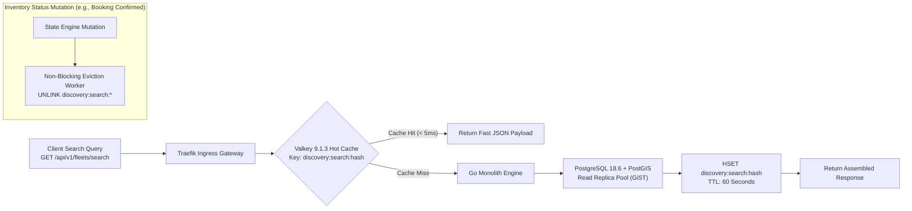
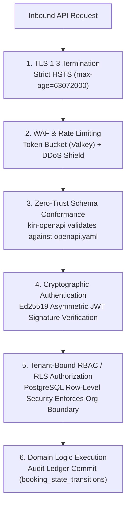
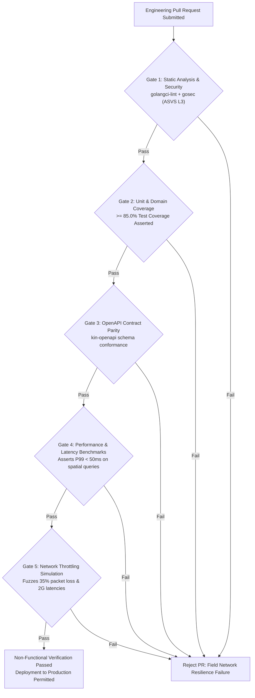

# Heavy Machinery & Logistics Rental Aggregator — Dink Machinery
## Software Requirements Specification — 09. Non-Functional Requirements, Operational Quality Attributes & Architectural Governance (`docs/shared/requirements/09-non-functional.md`)

**Document Identifier:** `SRS-DINK-CORE-V7.0-SEC-09`  
**Classification:** Canonical System Requirements Specification & Quality Attributes Baseline (Single Source of Truth)  
**Governing Standard:** IEEE Std 830-1998 / IEEE/ISO/IEC 25010:2023 (Systems and Software Quality Requirements and Evaluation — SQuaRE)  
**Associated Artifacts:** `SRS-DINK-CORE-V7.0` (§1.2, §5.2, §5.6, §6.3, §7.0, §8, §9, §10, §11, §12, §13.2), `FLOW-BOOKING-STATE-MACHINE-DINK-CORE-V7.0`, `ARCH-BACKEND-GO-DINK-CORE-V7.0`, `ARCH-FLUTTER-DINK-CORE-V7.0`, `ARCH-ADMIN-NEXT-DINK-CORE-V7.0`, `ARCH-SEC-DINK-CORE-V7.0`, `DS-DINK-CORE-V7.0`, `contracts/openapi.yaml`, `ADR-001`, `ADR-002`, `ADR-004`, `ADR-005`, `ADR-008`, `ADR-010`  
**Target Runtimes:** Go 1.27.3 Backend Monolith, PostgreSQL 18.6 + PostGIS 3.6.4, Valkey 9.1.3, ClamAV Daemon (:3310), SeaweedFS S3, Flutter 3.47.9 / Dart 3.9 (Cross-Platform Mobile), Next.js 16.x (latest CVE security patch) / React 19 (Web Admin & Corporate Portal), Isar NoSQL 3.1+  
**Target Personas:** Site Reliability Engineer (SRE), Chief Information Security Officer (CISO), Corporate Infrastructure Director, Mobile Platform Lead, Legal Counsel & Compliance Auditor (*Yohannes Bekele*), Super Administrator (*Rahel Tadesse*)  
**Target Operating Markets:** Ethiopia (`ET`) & Kenya (`KE`) — Dynamic Multi-Country Parameterization (`LOC-01-BE`)  
**Compliance Standards:** OWASP ASVS 4.0.3 Level 3 (Complete Verification), ISO/IEC 27001:2022 (Information Security Controls), RFC 9457 (Problem Details for HTTP APIs), W3C WCAG 2.2 Level AAA (Mobile Field Interfaces) & Level AA (Admin Portals), ISO 9241-110 (Ergonomics of Human-System Interaction), National Bank of Ethiopia (NBE) Financial Cloud Directives, Kenya Data Protection Act (KDPA) 2019  
**Status:** Approved Engineering Baseline

---

## Table of Contents

- 1. [Document Scope & Architectural Mandate](#1-document-scope--architectural-mandate)
  - 1.1 [Purpose & Scope](#11-purpose--scope)
  - 1.2 [Non-Functional Architectural Invariants](#12-non-functional-architectural-invariants)
- 2. [Performance & Latency Service Level Objectives (`NFR-PERF`)](#2-performance--latency-service-level-objectives-nfr-perf)
  - 2.1 [API Response Time Thresholds & Latency Envelopes](#21-api-response-time-thresholds--latency-envelopes)
  - 2.2 [Spatial Indexing Throughput & Concurrency Bounds](#22-spatial-indexing-throughput--concurrency-bounds)
  - 2.3 [Edge Caching & Valkey 9.1.3 Eviction Topology](#23-edge-caching--valkey-80-eviction-topology)
  - 2.4 [Mobile Cold-Start & Network Payload Quotas](#24-mobile-cold-start--network-payload-quotas)
- 3. [Scalability, Elasticity & Capacity Planning (`NFR-SCALE`)](#3-scalability-elasticity--capacity-planning-nfr-scale)
  - 3.1 [Transaction Processing Throughput Targets (TPS)](#31-transaction-processing-throughput-targets-tps)
  - 3.2 [Database Connection Pooling & Partitioning Horizon](#32-database-connection-pooling--partitioning-horizon)
  - 3.3 [Stateless Horizontal Scaling & Session Decoupling](#33-stateless-horizontal-scaling--session-decoupling)
- 4. [Availability, Reliability & Fault Tolerance (`NFR-AVAIL`)](#4-availability-reliability--fault-tolerance-nfr-avail)
  - 4.1 [High-Availability SLOs & Uptime Tiers](#41-high-availability-slos--uptime-tiers)
  - 4.2 [Disaster Recovery Metrics: RPO and RTO Envelopes](#42-disaster-recovery-metrics-rpo-and-rto-envelopes)
  - 4.3 [Degraded Operation Modes (Offline-First Resiliency)](#43-degraded-operation-modes-offline-first-resiliency)
  - 4.4 [Circuit Breaker Topologies & Automated Health Checks](#44-circuit-breaker-topologies--automated-health-checks)
- 5. [Security, Cryptography & Threat Mitigation (`NFR-SEC`)](#5-security-cryptography--threat-mitigation-nfr-sec)
  - 5.1 [OWASP ASVS 4.0.3 Level 3 Baseline Alignment](#51-owasp-asvs-403-level-3-baseline-alignment)
  - 5.2 [Data-at-Rest and Data-in-Transit Cryptographic Ciphers](#52-data-at-rest-and-data-in-transit-cryptographic-ciphers)
  - 5.3 [Anti-Tamper, OCR Verification & Malware Scanning](#53-anti-tamper-ocr-verification--malware-scanning)
  - 5.4 [Audit Trail Immutability & Forensic Non-Repudiation](#54-audit-trail-immutability--forensic-non-repudiation)
- 6. [Frontier Telecommunications & Network Adaptation (`NFR-NET`)](#6-frontier-telecommunications--network-adaptation-nfr-net)
  - 6.1 [Extreme Network Resilience (2G/EDGE & Packet Loss Tolerances)](#61-extreme-network-resilience-2gedge--packet-loss-tolerances)
  - 6.2 [Differential Sync & Binary Serialization Protocols](#62-differential-sync--binary-serialization-protocols)
  - 6.3 [Local Store-and-Forward Queuing Mechanics](#63-local-store-and-forward-queuing-mechanics)
- 7. [Maintainability, Observability & Telemetry (`NFR-MAINT`)](#7-maintainability-observability--telemetry-nfr-maint)
  - 7.1 [Structured Logging Protocols & Correlation Tracing](#71-structured-logging-protocols--correlation-tracing)
  - 7.2 [Distributed APM, OpenTelemetry & Prometheus Metrics](#72-distributed-apm-opentelemetry--prometheus-metrics)
  - 7.3 [Code Maintainability, Modularity & Static Analysis Gates](#73-code-maintainability-modularity--static-analysis-gates)
- 8. [Usability, Internationalization & Accessibility (`NFR-UX`)](#8-usability-internationalization--accessibility-nfr-ux)
  - 8.1 [Multilingual Script Encodings (Amharic UTF-8 vs. Latin)](#81-multilingual-script-encodings-amharic-utf-8-vs-latin)
  - 8.2 [W3C WCAG 2.2 Level AAA Field Mobile Adaptation](#82-w3c-wcag-22-level-aaa-field-mobile-adaptation)
  - 8.3 [Dual-Calendar Temporal Localization (Ge'ez vs. Gregorian)](#83-dual-calendar-temporal-localization-geez-vs-gregorian)
- 9. [Quality Assurance Verification Gates & Enforcement Matrix](#9-quality-assurance-verification-gates--enforcement-matrix)

---

## 1. Document Scope & Architectural Mandate

### 1.1 Purpose & Scope

This specification establishes **Section 09 (Non-Functional Requirements, Operational Quality Attributes & Architectural Governance)** of the canonical Software Requirements Specification (SRS) for **Dink Machinery Version 7.0**. 

Heavy machinery rental and construction logistics in frontier markets (Ethiopia and Kenya) operate under extreme environmental, network, and financial constraints. Civil engineering job sites frequently reside in remote regions (*e.g., Afar, Somali Region, Omo Valley, Turkana, Lamu Corridor*) characterized by:
* High cellular packet loss ($15\%\text{ to }40\%$) and intermittent fallback to 2G/EDGE networks.
* Harsh field operating conditions requiring high-contrast UI visibility in full sunlight ($> 100,000\text{ lux}$).
* Stringent sovereign regulatory policies governing multi-party transactions, banking integration, cross-border tax withholding, and local data protection.

While functional specifications define *what* the system executes, this document defines the *quality bounds, operational limits, security invariants, and performance envelopes* within which the Go backend monolith, Flutter cross-platform mobile apps, Next.js corporate portals, and PostgreSQL/PostGIS databases must operate.

```text
+----------------------------------------------------------------------------------------------------+
| QUALITY ATTRIBUTE TAXONOMY (ISO/IEC 25010 ALIGNMENT)                                               |
+---------------------+-------------------+----------------------------------------------------------+
| ATTRIBUTE DOMAIN    | METRIC FOCUS      | MANDATED OPERATIONAL TARGET                              |
+---------------------+-------------------+----------------------------------------------------------+
| Performance         | Latency & P99     | < 50ms Search/Discovery, < 100ms Financial State Shifts  |
| Scalability         | Throughput & Load | 1,500 Sustained TPS, Linear Horizontal Monolith Scaling  |
| Reliability         | Availability/MTBF | 99.95% Core Uptime, RPO < 60s, RTO < 15min                |
| Security            | Threat Defenses   | OWASP ASVS 4.0.3 Level 3, Zero Unencrypted PII at Rest   |
| Network Resilience  | Frontier Telecoms | Complete 2G/EDGE Operability, Store-and-Forward Queuing  |
| Maintainability     | Code Quality      | Strict Monolithic Modular Boundaries, Zero Cyclic Import |
| Usability/A11y      | Human Factors     | WCAG 2.2 Level AAA (Mobile Sunlight), Amharic UTF-8 Ge'ez|
+---------------------+-------------------+----------------------------------------------------------+
```

### 1.2 Non-Functional Architectural Invariants

1. **Monolithic Process Execution Invariant (`ADR-001`):** All business logic, spatial query handling, state transitions, and background domain workers must execute within a unified Go 1.27.3 process monolith. Cross-module communications occur strictly via Go in-memory interfaces and strongly typed channels; out-of-process distributed RPCs for internal domain logic are prohibited.
2. **Offline-First Deterministic Replay Invariant (`ADR-010`):** Any field action executed on mobile clients while disconnected (e.g., shift check-ins, return inspection photo captures, condition punch-lists) must commit locally to Isar NoSQL and replay deterministically upon reconnection without loss of chronological integrity or data corruption.
3. **Integer Currency Invariant:** Floating-point representations for currency values are barred across all network payloads, database schemas, and application logic. Monetary amounts must be handled as 64-bit signed integers representing currency minor units ($100\text{ Cents} = 1\text{ ETB/KES/USD}$).
4. **Zero-Trust Input Sanitization (OWASP ASVS §5.1):** All data ingress points (REST API payloads, uploaded documents, incoming webhook triggers, and telematics packets) must undergo strict validation, schema conformance verification via `kin-openapi`, and ClamAV in-flight anti-malware scanning prior to persistence or execution.
5. **Deterministic Error Responses (RFC 9457):** The platform must never leak internal database stack traces, SQL syntax strings, or raw exception dumps to clients. All API errors must return standard RFC 9457 Problem Details JSON bodies.

---

## 2. Performance & Latency Service Level Objectives (`NFR-PERF`)

### 2.1 API Response Time Thresholds & Latency Envelopes

The system enforces strict Service Level Objectives (SLOs) under normal and peak operating conditions across both regional application clusters:

```text
+----------------------------------------------------------------------------------------------------+
| SERVICE LEVEL OBJECTIVES (SLO) LATENCY ENVELOPE (NFR-PERF)                                         |
+-----------------------------+-------------------+-------------------+------------------------------+
| OPERATION CLASSIFICATION    | TARGET P95 (MS)   | TARGET P99 (MS)   | MEASUREMENT BOUNDARY         |
+-----------------------------+-------------------+-------------------+------------------------------+
| Geospatial Catalog Search   | <= 25 ms          | <= 50 ms          | Edge Gateway -> JSON Wire    |
| Single Fleet Details Fetch  | <= 10 ms          | <= 20 ms          | Hot Cache Hit in Valkey 9.1.3  |
| State Machine Mutation      | <= 50 ms          | <= 100 ms         | Complete ACID DB Transaction |
| Dynamic Pricing Surge Eval  | <= 20 ms          | <= 45 ms          | Valkey Spatial H3 Read       |
| Document Upload & Ingestion | <= 800 ms         | <= 1,500 ms       | ClamAV + S3 SeaweedFS Commit |
| Telematics Packet Parsing   | <= 15 ms          | <= 35 ms          | Binary Ingestion -> Memory   |
+-----------------------------+-------------------+-------------------+------------------------------+
```

* **Breach Threshold:** If P99 latency on core search discovery breaches $100\text{ ms}$ over a sustained 5-minute window, the edge ingress gateway (Traefik) automatically triggers local circuit-breaker sheds and alerts the SRE on-call rotation.

### 2.2 Spatial Indexing Throughput & Concurrency Bounds

* **PostGIS Indexing Standard:** Spatial bounding searches must utilize PostGIS 3.6.4 GiST indexes over geometry/geography types with spatial reference system identifier `SRID 4326` (WGS 84).
* **Throughput Bound:** The spatial search engine must sustain **$1,200\text{ complex spatial queries per second}$** within a $50\text{ km}$ radius buffer without query response times exceeding $50\text{ ms}$.
* **Lock Free Concurrency:** Spatial queries must never take exclusive locks on asset inventory tables; searches execute under `READ COMMITTED` isolation levels utilizing MVCC semantics.

### 2.3 Edge Caching & Valkey 9.1.3 Eviction Topology



* **Cache TTL Horizons:**
  - Fleet discovery search cards: $60\text{ seconds}$ sliding TTL.
  - Organization profiles and verified badges: $3,600\text{ seconds}$ ($1\text{ hour}$).
  - Active dynamic pricing multipliers: $900\text{ seconds}$ ($15\text{ minutes}$).
* **Invalidation Strategy:** Inventory state changes emit asynchronous Valkey non-blocking `UNLINK` tasks across affected geospatial cluster keys in $< 5\text{ ms}$.

### 2.4 Mobile Cold-Start & Network Payload Quotas

* **Application Launch Performance:**
  - **Cold-Start Time:** The Flutter application must reach an interactive state (Frame Rendered & Touch Responsive) in **$< 1.5\text{ seconds}$** on mid-range Android devices ($3\text{ GB RAM}$, octa-core $2.0\text{ GHz}$).
  - **Warm-Start Time:** Re-activation from background must resolve in **$< 300\text{ ms}$**.
* **Payload Size Constraints:**
  - Initial catalog page load payload must not exceed **$45\text{ KB}$** uncompressed JSON.
  - Image assets served over wire must utilize WebP format, dynamically resized to screen resolution, with asset byte sizes strictly **$< 80\text{ KB}$** per photograph.

---

## 3. Scalability, Elasticity & Capacity Planning (`NFR-SCALE`)

### 3.1 Transaction Processing Throughput Targets (TPS)

The Dink Machinery platform infrastructure must sustain linear scaling up to the following operational parameters:

```text
+----------------------------------------------------------------------------------------------------+
| CAPACITY AND TRANSACTION THROUGHPUT TARGETS (NFR-SCALE)                                            |
+------------------------------------+-----------------------+---------------------------------------+
| SYSTEM METRIC                      | BASELINE (PHASE 1)    | TARGET SCALE CAPACITY (V7.0 PHASE 3)  |
+------------------------------------+-----------------------+---------------------------------------+
| Concurrent Active Users            | 1,000                 | 50,000 Concurrent Connected Sessions  |
| Read Throughput (Catalog Browsing) | 150 QPS               | 5,000 Queries Per Second (QPS)        |
| Write Throughput (State Changes)   | 25 TPS                | 500 Transactions Per Second (TPS)     |
| Real-Time Telematics Ingestion     | 100 Packets/sec       | 15,000 Packets Per Second (M2M)       |
| Total Registered Fleets Tracked    | 500 Machines          | 25,000 Heavy Machinery Units          |
+------------------------------------+-----------------------+---------------------------------------+
```

### 3.2 Database Connection Pooling & Partitioning Horizon

* **pgx Connection Pool Allocation:**
  - The Go backend manages PostgreSQL connections via `pgxpool.Pool`.
  - Max connections per instance: 75 connections.
  - Connection acquisition timeout: $2.0\text{ seconds}$. Idle connection reap time: $30\text{ minutes}$.
* **Table Partitioning Strategy:**
  - Table `fleet_telematics_timeseries` must use declarative time-range partitioning in daily chunks via TimescaleDB hypertables.
  - Table `booking_state_transitions` partitions annually by `transitioned_at` once total row count exceeds $10,000,000\text{ rows}$.

### 3.3 Stateless Horizontal Scaling & Session Decoupling

* **Monolith Statelessness:** The Go monolith holds zero in-memory user session state. Authentication state is validated via stateless, cryptographically signed Ed25519 JSON Web Tokens (JWT).
* **Autoscaling Triggers:**
  - Instances scale horizontally behind the Traefik load balancer based on CPU utilization ($> 70\%$ for 3 consecutive minutes) or active HTTP request backlog ($> 200\text{ requests/instance}$).
  - Instance spin-up time must not exceed **$8.0\text{ seconds}$** from container initiation to health check pass.

---

## 4. Availability, Reliability & Fault Tolerance (`NFR-AVAIL`)

### 4.1 High-Availability SLOs & Uptime Tiers

* **System Availability SLA:** The platform commits to a **$99.95\%$ Uptime Service Level Agreement** across all public API and database services, allowing a maximum unplanned downtime budget of:
  - $\le 4.38\text{ minutes}$ per month.
  - $\le 52.6\text{ minutes}$ per calendar year.
* **Maintenance Windows:** Planned maintenance requiring downtime must be scheduled between `02:00:00` and `04:00:00 EAT` on Sunday mornings with minimum 72-hour advance advisory notice.

### 4.2 Disaster Recovery Metrics: RPO and RTO Envelopes

```text
+----------------------------------------------------------------------------------------------------+
| DISASTER RECOVERY SERVICE LEVEL ENVELOPES (NFR-AVAIL)                                              |
+-----------------------------+-------------------+--------------------------------------------------+
| DISASTER RECOVERY METRIC    | TARGET ENVELOPE   | ENFORCEMENT MECHANISM                            |
+-----------------------------+-------------------+--------------------------------------------------+
| Recovery Point Objective    | <= 60 Seconds     | PostgreSQL Continuous Write-Ahead Log (WAL)      |
| (RPO)                       | (Data Loss Floor) | Streaming to Remote SeaweedFS Storage Node       |
+-----------------------------+-------------------+--------------------------------------------------+
| Recovery Time Objective     | <= 15.0 Minutes   | Automated Standby Node Promotion via Patroni /   |
| (RTO)                       | (Downtime Ceiling)| Orchestrated Container Spin-Up Scripts           |
+-----------------------------+-------------------+--------------------------------------------------+
```

* **Backup Regimes:**
  - Full PostgreSQL base backups: Executed every 24 hours at `01:00:00 UTC` and mirrored to geographically distinct off-site S3 storage.
  - Point-in-Time Recovery (PITR): WAL files archived every $60\text{ seconds}$, enabling recovery to any millisecond within the past 30 days.

### 4.3 Degraded Operation Modes (Offline-First Resiliency)

When field cellular coverage is lost completely:
1. **Local Writes to Isar NoSQL:** The mobile client intercepts write operations, writes the entity locally, and stamps a UUIDv7 and UTC timestamp.
2. **Read Fallback to Local Cache:** Equipment listings, active rental details, and cached map polygons remain completely readable offline.
3. **Optimistic UI Feedback:** The user interface reflects pending mutations with a localized visual indicator (Amber sync icon), guaranteeing zero disruption to operator field tasks.

### 4.4 Circuit Breaker Topologies & Automated Health Checks

* **External Gateway Circuit Breakers:** Integrations with sovereign mobile money gateways (TeleBirr, CBEBirr, Safaricom M-PESA) are governed by `sony/gobreaker` circuit breakers.
  - Trip condition: Failure rate $\ge 30\%$ over a rolling 60-second window.
  - Reset timeout: 30 seconds in `HALF-OPEN` state before allowing traffic resumption.
* **Deep Health Check Endpoints:**
  - `GET /healthz/liveness`: Returns HTTP 200 if Go process is alive.
  - `GET /healthz/readiness`: Queries PostgreSQL `SELECT 1`, Valkey ping, and SeaweedFS connection before accepting ingress traffic.

---

## 5. Security, Cryptography & Threat Mitigation (`NFR-SEC`)

### 5.1 OWASP ASVS 4.0.3 Level 3 Baseline Alignment

The system enforces OWASP Application Security Verification Standard (ASVS) 4.0.3 Level 3 controls across all operational layers:



### 5.2 Data-at-Rest and Data-in-Transit Cryptographic Ciphers

* **Data-in-Transit (Encryption over Wire):**
  - All communication over public networks must enforce **TLS 1.3** (with TLS 1.2 as minimum fallback).
  - Permitted Cipher Suites: `TLS_AES_256_GCM_SHA384`, `TLS_CHACHA20_POLY1305_SHA256`.
  - HTTP Strict Transport Security (HSTS) enforced with `max-age=63072000; includeSubDomains; preload`.
* **Data-at-Rest (Storage Encryption):**
  - Database disk volumes encrypted via AES-256 XTS block-level encryption (LUKS).
  - Sensitive columns (national ID numbers, bank account numbers, tax identification numbers) encrypted at application level using **AES-256-GCM** with keys managed via HashiCorp Vault.

### 5.3 Anti-Tamper, OCR Verification & Malware Scanning

* **Malware Stream Interception:** All file uploads (deposit slips, condition photos, operator licenses) stream in-memory through the ClamAV daemon (:3310). Any file matching known viral signatures is discarded immediately with HTTP 422 `ERR_FILE_MALWARE_DETECTED`.
* **Perceptual Hash Anti-Fraud:** Handover condition photographs and bank wire deposit slips are fingerprinted using a difference hash algorithm (`dHash`). If a submitted payment slip collides with a previously uploaded slip ($d \le 4$), the transaction is flagged for fraud review.

### 5.4 Audit Trail Immutability & Forensic Non-Repudiation

* **Relational Immutability:** Tables recording financial transitions, condition handovers, and state shifts (`booking_state_transitions`, `commission_ledger_entries`, `logistics_pod_records`) enforce PostgreSQL table rules:
  ```sql
  CREATE RULE prevent_audit_update AS ON UPDATE TO booking_state_transitions DO INSTEAD NOTHING;
  CREATE RULE prevent_audit_delete AS ON DELETE TO booking_state_transitions DO INSTEAD NOTHING;
  ```
* **Cryptographic Attestation:** High-value transactions (POD sign-offs, lease contracts) record an immutable SHA-256 digest binding the transaction parameters, actor ID, and exact GPS coordinates.

---

## 6. Frontier Telecommunications & Network Adaptation (`NFR-NET`)

### 6.1 Extreme Network Resilience (2G/EDGE & Packet Loss Tolerances)

* **Packet Loss Tolerance:** Mobile applications must operate reliably on cellular links exhibiting up to **$35\%$ sustained packet loss** and round-trip times (RTT) up to **$2,500\text{ ms}$**.
* **Bandwidth Throttling Adaptation:** When the application detects low-bandwidth conditions ($< 50\text{ kbps}$ on 2G/EDGE):
  - Automatically disables non-critical telemetry streams.
  - Defers high-resolution image uploads until Wi-Fi or 3G/4G/5G connectivity resumes.
  - Compresses network requests using gzip/brotli transfer encodings.

### 6.2 Differential Sync & Binary Serialization Protocols

```text
+----------------------------------------------------------------------------------------------------+
| DATA SYNC OPTIMIZATION PROTOCOLS (NFR-NET)                                                         |
+---------------------+-------------------+---------------------+------------------------------------+
| DATA DOMAIN         | PROTOCOL / FORMAT | COMPRESSION GAIN    | NETWORK REASONING                  |
+---------------------+-------------------+---------------------+------------------------------------+
| Entity Sync         | JSON + Brotli     | 70% Size Reduction  | Standard REST payloads over low-   |
| (Fleets/Bookings)   | Compression       |                     | bandwidth edge connections.        |
+---------------------+-------------------+---------------------+------------------------------------+
| Telematics Pings    | Compact Binary    | 88% Reduction vs.   | 32-byte packed struct for high-    |
| (GPS/CAN Bus)       | Packet (J1939)    | Raw JSON Payloads   | frequency M2M hardware ingestion.  |
+---------------------+-------------------+---------------------+------------------------------------+
| Field Photographs   | WebP Progressive  | 65% Reduction vs.   | Transmits low-res preview first;   |
| (Inspections/Slips) | Encoding (Q=82)   | Baseline JPEG       | background syncs full resolution.  |
+---------------------+-------------------+---------------------+------------------------------------+
```

### 6.3 Local Store-and-Forward Queuing Mechanics

1. **Persistent Enlistment:** Offline mutations are written to an encrypted Isar NoSQL collection: `offline_mutation_queue`.
2. **Backoff Re-Transmission:** When network connectivity is re-established, the background sync worker flushes tasks sequentially using exponential backoff with randomized jitter:
   $$T_{\text{backoff}} = \min(60, \ 2^n \times 1.5) \pm \text{RandomJitter}$$
3. **Conflict Resolution:** In conflicts between offline client timestamps and canonical server state, the server's canonical state machine rules dictate resolution, returning informational diffs to the client.

---

## 7. Maintainability, Observability & Telemetry (`NFR-MAINT`)

### 7.1 Structured Logging Protocols & Correlation Tracing

* **JSON Structured Log Format:** All server logs must output strictly to `stdout` in JSON format using Go's `log/slog` library:
  ```json
  {
    "time": "2026-10-29T12:00:00.104Z",
    "level": "INFO",
    "msg": "Booking transitioned successfully",
    "correlationId": "cor_019a8fe0-8812-7b9a-bc21-4491204812aa",
    "bookingId": "bk_019a8f60-9912-7b9a",
    "fromState": "PENDING_PAYMENT",
    "toState": "PAYMENT_EVIDENCE_UPLOADED",
    "actorUserId": "usr_018f6a9e-876b-7341",
    "latencyMs": 14.8
  }
  ```
* **Distributed Correlation Tracing:** Every incoming HTTP request is stamped with an `X-Correlation-ID` header at the edge gateway. This identifier propagates across all database queries, downstream gateway calls, and log outputs.

### 7.2 Distributed APM, OpenTelemetry & Prometheus Metrics

* **Metric Exposition:** The Go monolith exposes Prometheus-formatted operational metrics over a dedicated internal scrape endpoint (`:9090/metrics`):
  - `http_requests_total{method, path, status}`
  - `http_request_duration_seconds{quantile="0.95|0.99"}`
  - `booking_state_transitions_total{from_state, to_state}`
  - `db_connection_pool_active_connections`
* **Tracing Telemetry:** Integrates OpenTelemetry (OTel) instrumentation capturing distributed spans across SQL execution, Valkey caching lookups, and external payment gateway webhooks.

### 7.3 Code Maintainability, Modularity & Static Analysis Gates

* **Zero Cyclic Dependencies:** Go packages within the monolith must strictly enforce clean unidirectional dependency flow:
  `cmd/ -> internal/api/ -> internal/domain/ -> internal/repository/ -> internal/platform/`
  Cyclic imports trigger immediate build failure via `golangci-lint`.
* **Static Analysis Compliance:**
  - Code test coverage across domain business logic must maintain a **$\ge 85.0\%$ threshold**.
  - All public Go functions, structs, and interfaces must carry standard Godoc comments.
  - Zero linting warnings permitted under `govet`, `staticcheck`, `errcheck`, and `gosec`.

---

## 8. Usability, Internationalization & Accessibility (`NFR-UX`)

### 8.1 Multilingual Script Encodings (Amharic UTF-8 vs. Latin)

* **UTF-8 Character Integrity:** All backend databases, network wire protocols, and mobile rendering engines must fully support **Unicode UTF-8 (RFC 3629)**, specifically handling:
  - Ethiopic Ge'ez script blocks (`U+1200` to `U+137F` and `U+1380` to `U+139F`).
  - Swahili and English Latin script blocks.
* **Font Fallback Hierarchy:**
  Flutter and Next.js applications embed local font assets:
  - Primary: `Noto Sans Ethiopic` (Regular, Medium, Bold).
  - Secondary / Numeric: `Inter` (Optimized for financial tabular figures).

### 8.2 W3C WCAG 2.2 Level AAA Field Mobile Adaptation

To accommodate plant operators and site engineers working under intense tropical sunlight:
* **High-Contrast Field Mode:** Mobile UIs must support an automated High-Contrast Mode exceeding **7:1 contrast ratio** for text and critical interactive glyphs, complying with **W3C WCAG 2.2 Level AAA**.
* **Minimum Touch Targets:** All interactive touch elements on mobile screens must maintain a minimum bounding box of **$48 \times 48\text{ dp}$** ($9.0\text{ mm}$ physical dimension), enabling reliable tapping by personnel wearing industrial work gloves.

### 8.3 Dual-Calendar Temporal Localization (Ge'ez vs. Gregorian)

* **Localization Parity:** The user interface must seamlessly render temporal data according to user locale preferences:
  - **Ethiopian Locale (`am_ET`, `om_ET`, `ti_ET`):** Primary display renders the Ge'ez calendar (*e.g., Tikimt 19, 2019 A.M.*) alongside the 12-hour vernacular day clock (*Ken / Lelit*).
  - **Kenyan / International Locale (`en_KE`, `sw_KE`, `en_US`):** Primary display renders standard Gregorian calendar dates and 24-hour UTC+3 timestamps.

---

## 9. Quality Assurance Verification Gates & Enforcement Matrix



1. **Static Analysis & Security Gate:** Runs `golangci-lint` and `gosec`. Any insecure crypto cipher, unhandled error, or potential SQL injection immediately aborts the deployment pipeline.
2. **Unit & Domain Coverage Gate:** Asserts that business logic packages (`/internal/domain/...`) achieve $\ge 85\%$ line and branch coverage under automated Go unit tests.
3. **OpenAPI Contract Parity Gate:** Validates Go API handler outputs and request structures against `contracts/openapi.yaml` using `kin-openapi`. Schema mismatches abort deployment.
4. **Performance & Latency Benchmark Gate:** Spawns a dedicated Docker test cluster with 10,000 synthetic fleet records. Executes spatial search queries; builds that exhibit P99 latency $> 50\text{ ms}$ fail automatically.
5. **Network Resilience Simulation Gate:** Executes automated Flutter integration tests through an upstream network proxy (Toxiproxy) injecting $35\%$ packet loss and $2,000\text{ ms}$ jitter. Asserts that offline transactions queue into Isar NoSQL and sync upon recovery with zero data loss.

---

*This document establishes the canonical non-functional requirements, quality attributes, performance envelopes, security ciphers, and verification gates for Dink Machinery Version 7.0. All downstream architectural designs, implementation modules, infrastructure deployment manifests, and automated testing pipelines must strictly comply with this specification.*