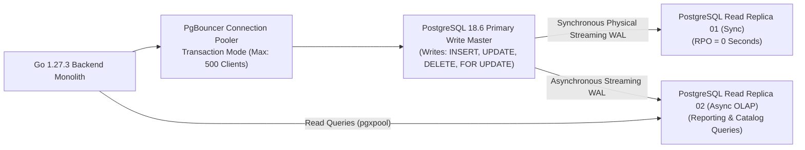
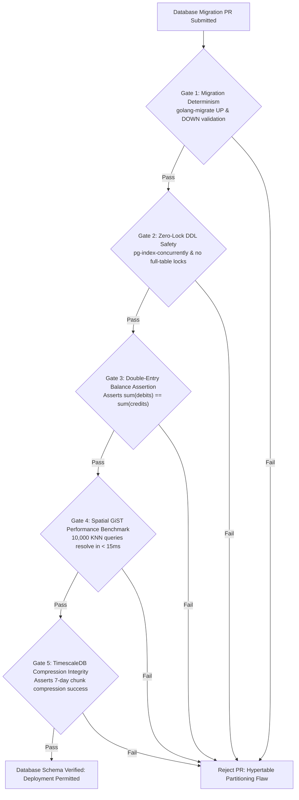

# Heavy Machinery & Logistics Rental Aggregator — Dink Machinery
## Software Requirements Specification — 10. Relational Database Schema, Unified Data Model, Temporal Hypertables & Analytical Partitioning Architecture (`docs/shared/requirements/10-data-model.md`)

**Document Identifier:** `SRS-DINK-CORE-V7.0-SEC-10`  
**Classification:** Canonical System Requirements Specification & Master Data Architecture Baseline (Single Source of Truth)  
**Governing Standard:** IEEE Std 830-1998 / IEEE/ISO/IEC 29148:2018 (Systems and Software Engineering — Requirements Engineering)  
**Associated Artifacts:** `SRS-DINK-CORE-V7.0` (§1.2, §5.2, §5.5, §5.6, §5.7, §5.8, §5.9, §6.0, §6.1, §6.3, §6.4, §6.5, §7.0, §7.1, §7.2, §7.3, §7.4, §7.5, §7.6, §7.7, §7.8, §7.9, §8, §9, §10, §11, §12, §13.2), `FLOW-BOOKING-STATE-MACHINE-DINK-CORE-V7.0`, `FLOW-COMMISSION-DEBT-DINK-CORE-V7.0`, `ARCH-BACKEND-GO-DINK-CORE-V7.0`, `ARCH-FLUTTER-DINK-CORE-V7.0`, `ARCH-ADMIN-NEXT-DINK-CORE-V7.0`, `ARCH-SEC-DINK-CORE-V7.0`, `DS-DINK-CORE-V7.0`, `DS-PERSONAS-DINK-CORE-V7.0`, `contracts/openapi.yaml`, `ADR-001`, `ADR-002`, `ADR-004`, `ADR-005`, `ADR-008`, `ADR-010`  
**Target Runtimes:** Go 1.27.3 Backend Monolith, PostgreSQL 18.6 + PostGIS 3.6.4 / TimescaleDB 2.16+, ClickHouse 24.8 (OLAP), Valkey 9.1.3, ClamAV Daemon (:3310), SeaweedFS S3, Flutter 3.47.9 / Dart 3.9 (Cross-Platform Mobile), Next.js 16.x (latest CVE security patch) / React 19 (Web Admin & Corporate Portal), Isar NoSQL 3.1+  
**Target Personas:** Lead Database Architect & SRE, Chief Financial Officer & Auditor (*Solomon Kassa*), Compliance Officer & Data Protection Officer (*Yohannes Bekele*), Super Administrator (*Rahel Tadesse*), Civil Engineering Project Manager (*Dawit Haile-Mariam* / *Patrick Kariuki*), Equipment Fleet Owner (*W/ro Almaz Tesfaye* / *Kamau Ndegwa*)  
**Target Operating Markets:** Ethiopia (`ET`) & Kenya (`KE`) — Dynamic Multi-Country Parameterization (`LOC-01-BE`)  
**Compliance Standards:** OWASP ASVS 4.0.3 Level 3 (Data Integrity, Transactional Isolation, Cryptographic Storage & Multi-Tenant Separation), ISO/IEC 27001:2022 (A.8.24 Use of Cryptography & A.8.28 Secure Coding), RFC 9457 (Problem Details), ISO 4217 (Currency Codes), ISO 8601 (Universal Date/Time), National Bank of Ethiopia (NBE) Financial Cloud Directives, Kenya Data Protection Act 2019, International Financial Reporting Standards (IFRS 15 & IAS 16/36)  
**Status:** Approved Engineering Baseline

---

## Table of Contents

- 1. [Document Scope & Architectural Mandate](#1-document-scope--architectural-mandate)
  - 1.1 [Purpose & Functional Scope](#11-purpose--functional-scope)
  - 1.2 [Core Data Model Invariants & Relational Constraints](#12-core-data-model-invariants--relational-constraints)
- 2. [Master Entity Architecture & Relational Topology (`DATA-01`)](#2-master-entity-architecture--relational-topology-data-01)
  - 2.1 [High-Level Domain Cluster Map](#21-high-level-domain-cluster-map)
  - 2.2 [The 8 Core Relational Domain Modules](#22-the-8-core-relational-domain-modules)
  - 2.3 [Primary Key Standards & UUIDv7 Monotonic Generation](#23-primary-key-standards--uuidv7-monotonic-generation)
- 3. [Complete Relational DDL Specifications (`DATA-02`)](#3-complete-relational-ddl-specifications-data-02)
  - 3.1 [Module 1: Identity, Multi-Tenant Organizations & RBAC](#31-module-1-identity-multi-tenant-organizations--rbac)
  - 3.2 [Module 2: Fleet Registry, Dynamic Spec EAV & Attachments](#32-module-2-fleet-registry-dynamic-spec-eav--attachments)
  - 3.3 [Module 3: Booking State Machine, Handover Audits & Inspection Dossiers](#33-module-3-booking-state-machine-handover-audits--inspection-dossiers)
  - 3.4 [Module 4: Financial Transactions, Ledgers & Commission Debt Sweep](#34-module-4-financial-transactions-ledgers--commission-debt-sweep)
  - 3.5 [Module 5: Logistics Transport, Trailers & Axle Compliance](#35-module-5-logistics-transport-trailers--axle-compliance)
  - 3.6 [Module 6: Certified Operators, Rosters & Biometric Shifts](#36-module-6-certified-operators-rosters--biometric-shifts)
  - 3.7 [Module 7: Dynamic Tariffs, Surge Snapshots & Yield Configuration](#37-module-7-dynamic-tariffs-surge-snapshots--yield-configuration)
  - 3.8 [Module 8: Sovereign Multi-Region, White-Label & Cross-Border Customs](#38-module-8-sovereign-multi-region-white-label--cross-border-customs)
- 4. [TimescaleDB Hypertables & High-Frequency Telematics Timeseries (`DATA-03`)](#4-timescaledb-hypertables--high-frequency-telematics-timeseries-data-03)
  - 4.1 [Declarative Partitioning & Chunking Horizons](#41-declarative-partitioning--chunking-horizons)
  - 4.2 [TimescaleDB Columnar Compression & Retention Policies](#42-timescaledb-columnar-compression--retention-policies)
  - 4.3 [Continuous Aggregates for Mechanical Run Hours & Fuel Burn](#43-continuous-aggregates-for-mechanical-run-hours--fuel-burn)
- 5. [PostGIS Spatial Indexing & Geospatial Topology (`DATA-04`)](#5-postgis-spatial-indexing--geospatial-topology-data-04)
  - 5.1 [Geodetic Coordinate Systems (WGS 84 / SRID 4326)](#51-geodetic-coordinate-systems-wgs-84--srid-4326)
  - 5.2 [Spatial Indexing Strategies (GiST & SP-GiST Bounds)](#52-spatial-indexing-strategies-gist--sp-gist-bounds)
  - 5.3 [Topological Road Network Schema for Highway Routing (`pgRouting`)](#53-topological-road-network-schema-for-highway-routing-pgrouting)
- 6. [Database Concurrency, Transactional Locks & Zero-Loss Replication (`DATA-05`)](#6-database-concurrency-transactional-locks--zero-loss-replication-data-05)
  - 6.1 [PostgreSQL Multi-Version Concurrency Control (MVCC) Isolation](#61-postgresql-multi-version-concurrency-control-mvcc-isolation)
  - 6.2 [Valkey Distributed Locks & Atomic Checkouts](#62-valkey-distributed-locks--atomic-checkouts)
  - 6.3 [Read/Write Segregation, Streaming Replicas & Connection Pooling](#63-readwrite-segregation-streaming-replicas--connection-pooling)
- 7. [Automated Verification Gates & Database Migration Governance](#7-automated-verification-gates--database-migration-governance)

---

## 1. Document Scope & Architectural Mandate

### 1.1 Purpose & Functional Scope

This specification establishes **Section 10 (Relational Database Schema, Unified Data Model, Temporal Hypertables & Analytical Partitioning Architecture)** of the canonical Software Requirements Specification (SRS) for **Dink Machinery Version 7.0**.

Dink Machinery V7.0 consolidates heavy equipment plant hire, commercial logistics freight transport, certified operator labor management, non-custodial financial settlements, AI-driven surge tariffs, and IoT telematics across Ethiopia and Kenya. Operating at enterprise scale requires a hardened, unified relational and temporal data foundation that:
* Eliminates schema fragmentation between the MVP (52 core tables) and Phase 2/3 enterprise expansion modules, establishing an exhaustive, unified data model.
* Enforces mathematical double-entry accounting integrity down to the exact minor currency unit ($100\text{ Cents} = 1\text{ ETB/KES/USD}$), eliminating floating-point rounding divergence.
* Bridges high-throughput transactional OLTP workflows (PostgreSQL 18.6) with high-frequency time-series telematics ingestion (TimescaleDB) and spatial indexing (PostGIS 3.6.4).
* Guarantees strict multi-tenant Row-Level Security (RLS) and cryptographic immutability across audit ledgers, preventing unauthorized cross-organization visibility.

### 1.2 Core Data Model Invariants & Relational Constraints

1. **Integer Currency Invariant:** Floating-point representations (`FLOAT`, `DOUBLE PRECISION`, `REAL`) are strictly prohibited for monetary values. All currency amounts, fees, tax calculations, and balance adjustments are persisted as signed 64-bit integers (`BIGINT`) representing currency minor units.
2. **UUIDv7 Canonical Primary Key Standard:** All primary keys across transactional, financial, and operational tables must utilize time-ordered UUIDv7 identifiers generated via `uuid_generate_v7()` or application runtimes. Monotonically increasing timestamps embedded in UUIDv7 eliminate B-Tree index fragmentation and guarantee deterministic chronological sorting.
3. **Temporal Storage Normalization (UTC ISO 8601):** All datetime attributes must use `TIMESTAMPTZ` (Timestamp with Time Zone), normalized and stored exclusively in UTC. Local time offsets (e.g., East Africa Time `UTC+3`) and vernacular calendar conversions (Ethiopian Ge'ez *Amete Mihret*) are evaluated strictly at application presentation boundaries.
4. **Append-Only Immutability Floor:** Tables recording financial transactions (`payment_ledger_entries`, `commission_ledger_entries`), lifecycle state shifts (`booking_state_transitions`), telematics telemetry (`fleet_telematics_timeseries`), and inspection handshakes (`logistics_pod_records`) are strictly append-only. Relational rules enforce `ON UPDATE DO INSTEAD NOTHING` and `ON DELETE DO INSTEAD NOTHING`.
5. **Zero-Trust Multi-Tenant Perimeter:** Multi-tenant entities reference a root `organization_id` with enforced foreign key cascading rules. Queries originating from tenant-scoped users must bind PostgreSQL Row-Level Security (RLS) constraints:
   $$\text{FilterScope} \iff \text{organization\_id} = \text{current\_setting('app.current\_tenant\_id')::uuid}$$

---

## 2. Master Entity Architecture & Relational Topology (`DATA-01`)

### 2.1 High-Level Domain Cluster Map

```mermaid
flowchart TD
    subgraph IdentityCluster["1. Identity, Orgs & RBAC"]
        U[users] --- O[organizations]
        O --- OM[organization_members]
        U --- R[roles]
        R --- RP[role_permissions]
    end

    subgraph FleetCluster["2. Fleet, Specs & Attachments"]
        C[categories] --- F[fleets]
        F --- FSV[fleet_spec_values]
        F --- FA[fleet_attachments]
        F --- FAV[fleet_availability]
    end

    subgraph BookingCluster["3. Booking Lifecycle & Handover"]
        F --- B[bookings]
        B --- BST[booking_state_transitions]
        B --- BHA[booking_handover_audits]
        B --- BPE[booking_payment_evidence]
    end

    subgraph FinanceCluster["4. Payments, Ledgers & Commission"]
        B --- PT[payment_transactions]
        PT --- PLE[payment_ledger_entries]
        O --- OW[owner_wallets]
        OW --- CDL[commission_debt_ledger]
    end

    subgraph LogisticsCluster["5. Logistics & Haulage Transport"]
        B --- LSB[logistics_sub_bookings]
        LSB --- LVS[logistics_vehicle_specs]
        LSB --- LPOD[logistics_pod_records]
    end

    subgraph OperatorCluster["6. Certified Operators & Shifts"]
        U --- OP[operator_profiles]
        OP --- ORM[operator_roster_memberships]
        B --- OSL[operator_shift_logs]
    end

    subgraph PricingCluster["7. Tariffs & Dynamic Surge"]
        F --- FDPC[fleet_dynamic_pricing_configs]
        FDPC --- PEA[pricing_evaluation_audits]
    end

    subgraph SovereignCluster["8. Multi-Region & Cross-Border"]
        CC[country_configs] --- CBD[cross_border_booking_details]
        CBD --- CCD[cross_border_customs_dockets]
        O --- WLT[whitelabel_tenants]
    end

    IdentityCluster --> FleetCluster
    FleetCluster --> BookingCluster
    BookingCluster --> FinanceCluster
    BookingCluster --> LogisticsCluster
    BookingCluster --> OperatorCluster
    FleetCluster --> PricingCluster
    BookingCluster --> SovereignCluster
```



---

### 2.2 The 8 Core Relational Domain Modules

```text
+----------------------------------------------------------------------------------------------------+
| DINK MACHINERY CANONICAL DATA MODEL CLUSTERS (DATA-01)                                             |
+---+-----------------------------+-----------------------------------+------------------------------+
| # | DOMAIN CLUSTER              | PRIMARY TABLES                    | ARCHITECTURAL RESPONSIBILITY |
+---+-----------------------------+-----------------------------------+------------------------------+
| 1 | Identity, Orgs & RBAC       | users, organizations, members,    | Authentication, multi-tenant |
|   |                             | roles, permissions, audit_logs    | boundaries, enterprise RBAC. |
+---+-----------------------------+-----------------------------------+------------------------------+
| 2 | Fleet, Specs & Attachments  | categories, spec_definitions,     | Equipment inventory, dynamic |
|   |                             | fleets, fleet_specs, attachments  | EAV attributes, PostGIS locs.|
+---+-----------------------------+-----------------------------------+------------------------------+
| 3 | Booking Lifecycle & Handover| bookings, state_transitions,      | 16-state FST, physical site  |
|   |                             | handover_audits, damage_claims    | handshakes, condition photos.|
+---+-----------------------------+-----------------------------------+------------------------------+
| 4 | Payments, Ledgers & Comm.   | payment_txs, ledger_entries,      | Non-custodial bank settlement|
|   |                             | owner_wallets, commission_ledger  | double-entry financial ledger|
+---+-----------------------------+-----------------------------------+------------------------------+
| 5 | Logistics & Heavy Haulage   | logistics_sub_bookings, trailers, | Freight matching, axle load  |
|   |                             | trip_milestones, pod_records      | compliance, corridor transit.|
+---+-----------------------------+-----------------------------------+------------------------------+
| 6 | Certified Plant Operators   | operator_profiles, certifications,| Labor licensing, shifts,     |
|   |                             | roster_memberships, shift_logs    | biometric check-in, fatigue. |
+---+-----------------------------+-----------------------------------+------------------------------+
| 7 | Dynamic Tariffs & Surge AI  | dynamic_pricing_configs, audits,  | ML scarcity multipliers, H3  |
|   |                             | infrastructure_project_zones      | reserve price floor bounds.  |
+---+-----------------------------+-----------------------------------+------------------------------+
| 8 | Multi-Region & Cross-Border | country_configs, forex_rates,     | Multi-currency, customs CPD, |
|   |                             | customs_dockets, whitelabel_tenants| OSBP transshipment, tax DTT. |
+---+-----------------------------+-----------------------------------+------------------------------+
```

---

### 2.3 Primary Key Standards & UUIDv7 Monotonic Generation

To combine the global uniqueness of UUIDs with the sequential index locality of auto-incrementing integers, Dink Machinery standardizes on **UUIDv7** (RFC 9562):

```sql
-- PostgreSQL 18.6 Native UUIDv7 Generator Function
CREATE OR REPLACE FUNCTION uuid_generate_v7()
RETURNS uuid AS $$
DECLARE
    v_time double precision := clock_timestamp();
    v_millis bigint := (v_time * 1000)::bigint;
    v_bytes bytea := gen_random_bytes(16);
BEGIN
    -- Set 48-bit timestamp
    v_bytes := set_byte(v_bytes, 0, ((v_millis >> 40) & 255)::int);
    v_bytes := set_byte(v_bytes, 1, ((v_millis >> 32) & 255)::int);
    v_bytes := set_byte(v_bytes, 2, ((v_millis >> 24) & 255)::int);
    v_bytes := set_byte(v_bytes, 3, ((v_millis >> 16) & 255)::int);
    v_bytes := set_byte(v_bytes, 4, ((v_millis >> 8)  & 255)::int);
    v_bytes := set_byte(v_bytes, 5, (v_millis & 255)::int);
    -- Set UUID version to 7 (bits 4-7 of byte 6)
    v_bytes := set_byte(v_bytes, 6, ((get_byte(v_bytes, 6) & 15) | 112)::int);
    -- Set UUID variant to RFC 4122 (bits 6-7 of byte 8)
    v_bytes := set_byte(v_bytes, 8, ((get_byte(v_bytes, 8) & 63) | 128)::int);
    RETURN encode(v_bytes, 'hex')::uuid;
END;
$$ LANGUAGE plpgsql VOLATILE;
```

---

## 3. Complete Relational DDL Specifications (`DATA-02`)

### 3.1 Module 1: Identity, Multi-Tenant Organizations & RBAC

```sql
CREATE EXTENSION IF NOT EXISTS "postgis";
CREATE EXTENSION IF NOT EXISTS "pgcrypto";

-- Organizations Table (Tenant Perimeter)
CREATE TABLE organizations (
    id UUID PRIMARY KEY DEFAULT uuid_generate_v7(),
    organization_name VARCHAR(128) NOT NULL,
    organization_type VARCHAR(32) NOT NULL,
    country_code VARCHAR(2) NOT NULL CHECK (country_code IN ('ET', 'KE')),
    tax_identification_number VARCHAR(64) NOT NULL,
    business_license_number VARCHAR(64) NOT NULL,
    verified_status VARCHAR(32) NOT NULL DEFAULT 'UNVERIFIED',
    contact_email VARCHAR(255) NOT NULL,
    contact_phone VARCHAR(32) NOT NULL,
    headquarters_address TEXT NOT NULL,
    created_at TIMESTAMPTZ NOT NULL DEFAULT NOW(),
    updated_at TIMESTAMPTZ NOT NULL DEFAULT NOW(),
    CONSTRAINT chk_org_type CHECK (organization_type IN ('EQUIPMENT_OWNER', 'CONTRACTOR_RENTER', 'LOGISTICS_CARRIER', 'FINANCIAL_PARTNER')),
    CONSTRAINT chk_org_status CHECK (verified_status IN ('UNVERIFIED', 'UNDER_AUDIT', 'VERIFIED_ACTIVE', 'SUSPENDED_SANCTIONS')),
    CONSTRAINT uq_org_tin UNIQUE (country_code, tax_identification_number)
);

CREATE INDEX idx_organizations_country ON organizations (country_code, verified_status);

-- Master Users Table
CREATE TABLE users (
    id UUID PRIMARY KEY DEFAULT uuid_generate_v7(),
    primary_organization_id UUID NULL REFERENCES organizations(id) ON DELETE SET NULL,
    full_name VARCHAR(128) NOT NULL,
    email VARCHAR(255) NOT NULL UNIQUE,
    phone_number VARCHAR(32) NOT NULL UNIQUE,
    password_hash VARCHAR(255) NOT NULL,
    country_code VARCHAR(2) NOT NULL CHECK (country_code IN ('ET', 'KE')),
    national_id_number VARCHAR(64) NOT NULL,
    user_status VARCHAR(32) NOT NULL DEFAULT 'PENDING_ACTIVATION',
    is_mfa_enabled BOOLEAN NOT NULL DEFAULT false,
    mfa_secret_encrypted VARCHAR(512) NULL,
    created_at TIMESTAMPTZ NOT NULL DEFAULT NOW(),
    updated_at TIMESTAMPTZ NOT NULL DEFAULT NOW(),
    CONSTRAINT chk_user_status CHECK (user_status IN ('PENDING_ACTIVATION', 'ACTIVE', 'LOCKED_SECURITY', 'DEACTIVATED'))
);

CREATE INDEX idx_users_org ON users (primary_organization_id);
CREATE INDEX idx_users_phone ON users (phone_number);

-- Multi-Tenant Organization Memberships
CREATE TABLE organization_members (
    id UUID PRIMARY KEY DEFAULT uuid_generate_v7(),
    organization_id UUID NOT NULL REFERENCES organizations(id) ON DELETE CASCADE,
    user_id UUID NOT NULL REFERENCES users(id) ON DELETE CASCADE,
    membership_role VARCHAR(32) NOT NULL,
    is_active BOOLEAN NOT NULL DEFAULT true,
    joined_at TIMESTAMPTZ NOT NULL DEFAULT NOW(),
    CONSTRAINT chk_member_role CHECK (membership_role IN ('ORG_ADMIN', 'FLEET_MANAGER', 'DISPATCHER', 'FINANCE_CONTROLLER', 'SITE_ENGINEER')),
    CONSTRAINT uq_org_user UNIQUE (organization_id, user_id)
);

-- Scoped RBAC Roles & Permissions
CREATE TABLE permissions (
    id UUID PRIMARY KEY DEFAULT uuid_generate_v7(),
    permission_code VARCHAR(64) NOT NULL UNIQUE,
    permission_description TEXT NOT NULL
);

CREATE TABLE roles (
    id UUID PRIMARY KEY DEFAULT uuid_generate_v7(),
    role_name VARCHAR(64) NOT NULL UNIQUE,
    role_description TEXT NOT NULL
);

CREATE TABLE role_permissions (
    role_id UUID NOT NULL REFERENCES roles(id) ON DELETE CASCADE,
    permission_id UUID NOT NULL REFERENCES permissions(id) ON DELETE CASCADE,
    PRIMARY KEY (role_id, permission_id)
);

CREATE TABLE user_roles (
    user_id UUID NOT NULL REFERENCES users(id) ON DELETE CASCADE,
    role_id UUID NOT NULL REFERENCES roles(id) ON DELETE CASCADE,
    PRIMARY KEY (user_id, role_id)
);
```

---

### 3.2 Module 2: Fleet Registry, Dynamic Spec EAV & Attachments

```sql
-- Equipment Category Hierarchy
CREATE TABLE categories (
    id UUID PRIMARY KEY DEFAULT uuid_generate_v7(),
    parent_category_id UUID NULL REFERENCES categories(id) ON DELETE CASCADE,
    category_slug VARCHAR(64) NOT NULL UNIQUE,
    category_name_en VARCHAR(64) NOT NULL,
    category_name_am VARCHAR(64) NOT NULL,
    icon_s3_uri VARCHAR(512) NOT NULL,
    is_active BOOLEAN NOT NULL DEFAULT true
);

-- Spec Field Definitions (Dynamic EAV Template Engine)
CREATE TABLE spec_field_definitions (
    id UUID PRIMARY KEY DEFAULT uuid_generate_v7(),
    category_id UUID NOT NULL REFERENCES categories(id) ON DELETE CASCADE,
    field_key VARCHAR(64) NOT NULL,
    field_label_en VARCHAR(128) NOT NULL,
    field_label_am VARCHAR(128) NOT NULL,
    data_type VARCHAR(32) NOT NULL,
    unit_of_measure VARCHAR(32) NULL,
    is_required BOOLEAN NOT NULL DEFAULT false,
    is_filterable BOOLEAN NOT NULL DEFAULT true,
    display_order INT NOT NULL DEFAULT 0,
    CONSTRAINT chk_spec_data_type CHECK (data_type IN ('NUMERIC', 'STRING', 'BOOLEAN', 'ENUM')),
    CONSTRAINT uq_cat_field UNIQUE (category_id, field_key)
);

-- Master Fleets Inventory Table
CREATE TABLE fleets (
    id UUID PRIMARY KEY DEFAULT uuid_generate_v7(),
    owner_organization_id UUID NOT NULL REFERENCES organizations(id) ON DELETE RESTRICT,
    category_id UUID NOT NULL REFERENCES categories(id) ON DELETE RESTRICT,
    title VARCHAR(255) NOT NULL,
    make VARCHAR(64) NOT NULL,
    model VARCHAR(64) NOT NULL,
    manufacture_year INT NOT NULL CHECK (manufacture_year >= 1990 AND manufacture_year <= 2030),
    vin_chassis_number VARCHAR(64) NOT NULL UNIQUE,
    license_plate_number VARCHAR(32) NOT NULL UNIQUE,
    country_code VARCHAR(2) NOT NULL CHECK (country_code IN ('ET', 'KE')),
    current_location GEOGRAPHY(Point, 4326) NOT NULL,
    current_depot_name VARCHAR(128) NOT NULL,
    daily_rate_minor BIGINT NOT NULL CHECK (daily_rate_minor > 0),
    currency VARCHAR(3) NOT NULL CHECK (currency IN ('ETB', 'KES', 'USD')),
    current_hour_meter_minor BIGINT NOT NULL DEFAULT 0 CHECK (current_hour_meter_minor >= 0),
    operational_status VARCHAR(32) NOT NULL DEFAULT 'AVAILABLE',
    is_self_move_capable BOOLEAN NOT NULL DEFAULT false,
    is_operator_included BOOLEAN NOT NULL DEFAULT true,
    is_verified BOOLEAN NOT NULL DEFAULT false,
    created_at TIMESTAMPTZ NOT NULL DEFAULT NOW(),
    updated_at TIMESTAMPTZ NOT NULL DEFAULT NOW(),
    CONSTRAINT chk_fleet_status CHECK (operational_status IN ('AVAILABLE', 'RENTED_LOCKED', 'RENTED_OPERATIONAL', 'MAINTENANCE_HOLD', 'DECOMMISSIONED'))
);

CREATE INDEX idx_fleets_spatial ON fleets USING gist (current_location);
CREATE INDEX idx_fleets_status_category ON fleets (operational_status, category_id);

-- Dynamic EAV Specifications Table
CREATE TABLE fleet_spec_values (
    id UUID PRIMARY KEY DEFAULT uuid_generate_v7(),
    fleet_id UUID NOT NULL REFERENCES fleets(id) ON DELETE CASCADE,
    spec_field_definition_id UUID NOT NULL REFERENCES spec_field_definitions(id) ON DELETE RESTRICT,
    numeric_value NUMERIC(12, 3) NULL,
    text_value TEXT NULL,
    boolean_value BOOLEAN NULL,
    CONSTRAINT uq_fleet_spec UNIQUE (fleet_id, spec_field_definition_id)
);

-- Detachable Work Tool Attachments
CREATE TABLE attachments (
    id UUID PRIMARY KEY DEFAULT uuid_generate_v7(),
    owner_organization_id UUID NOT NULL REFERENCES organizations(id) ON DELETE CASCADE,
    attachment_name VARCHAR(128) NOT NULL,
    attachment_type VARCHAR(64) NOT NULL,
    weight_kg NUMERIC(8, 2) NOT NULL,
    daily_rate_minor BIGINT NOT NULL DEFAULT 0,
    is_available BOOLEAN NOT NULL DEFAULT true
);

CREATE TABLE fleet_attachments (
    fleet_id UUID NOT NULL REFERENCES fleets(id) ON DELETE CASCADE,
    attachment_id UUID NOT NULL REFERENCES attachments(id) ON DELETE CASCADE,
    PRIMARY KEY (fleet_id, attachment_id)
);
```

---

### 3.3 Module 3: Booking State Machine, Handover Audits & Inspection Dossiers

```sql
-- Master Bookings Table (16-State FST Engine)
CREATE TABLE bookings (
    id UUID PRIMARY KEY DEFAULT uuid_generate_v7(),
    parent_booking_id UUID NULL REFERENCES bookings(id) ON DELETE RESTRICT,
    booking_reference VARCHAR(32) NOT NULL UNIQUE,
    renter_user_id UUID NOT NULL REFERENCES users(id) ON DELETE RESTRICT,
    renter_organization_id UUID NULL REFERENCES organizations(id) ON DELETE RESTRICT,
    owner_organization_id UUID NOT NULL REFERENCES organizations(id) ON DELETE RESTRICT,
    fleet_id UUID NOT NULL REFERENCES fleets(id) ON DELETE RESTRICT,
    booking_category VARCHAR(32) NOT NULL DEFAULT 'EQUIPMENT_HIRE',
    status VARCHAR(32) NOT NULL DEFAULT 'PENDING_PAYMENT',
    current_version INT NOT NULL DEFAULT 1,
    start_datetime TIMESTAMPTZ NOT NULL,
    end_datetime TIMESTAMPTZ NOT NULL,
    total_amount_minor BIGINT NOT NULL CHECK (total_amount_minor > 0),
    prepayment_required_minor BIGINT NOT NULL CHECK (prepayment_required_minor > 0),
    currency VARCHAR(3) NOT NULL CHECK (currency IN ('ETB', 'KES', 'USD')),
    destination_location GEOGRAPHY(Point, 4326) NOT NULL,
    destination_site_name VARCHAR(128) NOT NULL,
    created_at TIMESTAMPTZ NOT NULL DEFAULT NOW(),
    updated_at TIMESTAMPTZ NOT NULL DEFAULT NOW(),
    CONSTRAINT chk_booking_dates CHECK (end_datetime > start_datetime),
    CONSTRAINT chk_booking_category CHECK (booking_category IN ('EQUIPMENT_HIRE', 'LOGISTICS_FREIGHT', 'OPERATOR_LABOR')),
    CONSTRAINT chk_canonical_status CHECK (status IN (
        'PENDING_PAYMENT', 'PAYMENT_EVIDENCE_UPLOADED', 'PAYMENT_DECLINED',
        'DISPUTE_OPENED', 'DISPUTE_RESOLVED_RENTER', 'DISPUTE_RESOLVED_OWNER',
        'CONFIRMED', 'AWAITING_FLEET_READINESS', 'PENDING_ADDITIONAL_PAYMENT',
        'READY_FOR_PICKUP', 'ACTIVE', 'RETURN_INITIATED',
        'PENDING_FINAL_PAYMENT', 'COMPLETED', 'RATED', 'CANCELLED'
    ))
);

CREATE INDEX idx_bookings_lookup ON bookings (renter_user_id, status);
CREATE INDEX idx_bookings_dates ON bookings (fleet_id, start_datetime, end_datetime);

-- Immutable Booking State Transition Audit Ledger
CREATE TABLE booking_state_transitions (
    id UUID PRIMARY KEY DEFAULT uuid_generate_v7(),
    booking_id UUID NOT NULL REFERENCES bookings(id) ON DELETE CASCADE,
    from_state VARCHAR(32) NOT NULL,
    to_state VARCHAR(32) NOT NULL,
    transition_event VARCHAR(64) NOT NULL,
    actor_user_id UUID NOT NULL REFERENCES users(id) ON DELETE RESTRICT,
    actor_role VARCHAR(32) NOT NULL,
    reason_code VARCHAR(64) NULL,
    metadata_snapshot_json JSONB NOT NULL DEFAULT '{}'::JSONB,
    ip_address VARCHAR(45) NOT NULL,
    user_agent TEXT NOT NULL,
    transitioned_at TIMESTAMPTZ NOT NULL DEFAULT NOW()
);

CREATE INDEX idx_transitions_booking ON booking_state_transitions (booking_id, transitioned_at DESC);
CREATE RULE prevent_transition_update AS ON UPDATE TO booking_state_transitions DO INSTEAD NOTHING;
CREATE RULE prevent_transition_delete AS ON DELETE TO booking_state_transitions DO INSTEAD NOTHING;

-- Physical Handover Inspection Audits (AR-01 / RC-02)
CREATE TABLE booking_handover_audits (
    id UUID PRIMARY KEY DEFAULT uuid_generate_v7(),
    booking_id UUID NOT NULL REFERENCES bookings(id) ON DELETE CASCADE,
    handshake_type VARCHAR(16) NOT NULL CHECK (handshake_type IN ('PICKUP_START', 'RETURN_END')),
    dual_pin_hash VARCHAR(64) NOT NULL,
    location GEOGRAPHY(Point, 4326) NOT NULL,
    engine_meter_hours NUMERIC(10, 2) NOT NULL,
    fuel_level_percent NUMERIC(5, 2) NOT NULL,
    photos_bundle_json JSONB NOT NULL,
    signed_by_renter_id UUID NOT NULL REFERENCES users(id) ON DELETE RESTRICT,
    signed_by_owner_id UUID NOT NULL REFERENCES users(id) ON DELETE RESTRICT,
    signed_at TIMESTAMPTZ NOT NULL DEFAULT NOW()
);
```

---

### 3.4 Module 4: Financial Transactions, Ledgers & Commission Debt Sweep

```sql
-- Master Payment Transactions Table
CREATE TABLE payment_transactions (
    id UUID PRIMARY KEY DEFAULT uuid_generate_v7(),
    booking_id UUID NOT NULL REFERENCES bookings(id) ON DELETE RESTRICT,
    payer_user_id UUID NOT NULL REFERENCES users(id) ON DELETE RESTRICT,
    payer_organization_id UUID NULL REFERENCES organizations(id) ON DELETE RESTRICT,
    recipient_organization_id UUID NOT NULL REFERENCES organizations(id) ON DELETE RESTRICT,
    payment_rail VARCHAR(32) NOT NULL,
    gateway_transaction_ref VARCHAR(128) NULL,
    amount_minor BIGINT NOT NULL CHECK (amount_minor > 0),
    currency VARCHAR(3) NOT NULL CHECK (currency IN ('ETB', 'KES', 'USD')),
    status VARCHAR(32) NOT NULL DEFAULT 'INITIATED',
    idempotency_key VARCHAR(128) NOT NULL UNIQUE,
    gateway_payload_json JSONB NOT NULL DEFAULT '{}'::JSONB,
    settled_at TIMESTAMPTZ NULL,
    created_at TIMESTAMPTZ NOT NULL DEFAULT NOW(),
    updated_at TIMESTAMPTZ NOT NULL DEFAULT NOW(),
    CONSTRAINT chk_payment_status CHECK (status IN ('INITIATED', 'PENDING_USER_ACTION', 'PAYMENT_VERIFYING', 'SETTLED', 'FAILED', 'EXPIRED_TIMEOUT', 'REFUNDED')),
    CONSTRAINT chk_payment_rail CHECK (payment_rail IN ('TELEBIRR_DIRECT', 'CBEBIRR_PLUS', 'CHAPA', 'MPESA_DARAJA', 'MPESA_B2C', 'PESAPAL', 'P2P_WIRE', 'CORPORATE_CREDIT'))
);

CREATE INDEX idx_payment_tx_booking ON payment_transactions (booking_id);

-- Append-Only Double-Entry General Ledger
CREATE TABLE payment_ledger_entries (
    id UUID PRIMARY KEY DEFAULT uuid_generate_v7(),
    transaction_id UUID NOT NULL REFERENCES payment_transactions(id) ON DELETE RESTRICT,
    account_code VARCHAR(64) NOT NULL,
    entry_type VARCHAR(16) NOT NULL CHECK (entry_type IN ('DEBIT', 'CREDIT')),
    amount_minor BIGINT NOT NULL CHECK (amount_minor > 0),
    currency VARCHAR(3) NOT NULL CHECK (currency IN ('ETB', 'KES', 'USD')),
    created_at TIMESTAMPTZ NOT NULL DEFAULT NOW()
);

CREATE RULE prevent_ledger_update AS ON UPDATE TO payment_ledger_entries DO INSTEAD NOTHING;
CREATE RULE prevent_ledger_delete AS ON DELETE TO payment_ledger_entries DO INSTEAD NOTHING;

-- Owner Virtual Wallets (Tracks Non-Custodial Platform Commission Debt)
CREATE TABLE owner_wallets (
    id UUID PRIMARY KEY DEFAULT uuid_generate_v7(),
    owner_organization_id UUID NOT NULL UNIQUE REFERENCES organizations(id) ON DELETE CASCADE,
    current_balance_minor BIGINT NOT NULL DEFAULT 0, -- Negative balance indicates commission debt
    credit_buffer_limit_minor BIGINT NOT NULL DEFAULT 5000000, -- 50,000.00 minor unit buffer floor
    currency VARCHAR(3) NOT NULL CHECK (currency IN ('ETB', 'KES', 'USD')),
    status VARCHAR(32) NOT NULL DEFAULT 'ACTIVE',
    last_sweep_at TIMESTAMPTZ NULL,
    updated_at TIMESTAMPTZ NOT NULL DEFAULT NOW(),
    CONSTRAINT chk_wallet_status CHECK (status IN ('ACTIVE', 'DELINQUENT_WARNING', 'LOCKED_SUSPENDED'))
);

-- Commission Debt Accrual Ledger (Append-Only)
CREATE TABLE commission_debt_ledger (
    id UUID PRIMARY KEY DEFAULT uuid_generate_v7(),
    wallet_id UUID NOT NULL REFERENCES owner_wallets(id) ON DELETE RESTRICT,
    booking_id UUID NOT NULL REFERENCES bookings(id) ON DELETE RESTRICT,
    debt_amount_minor BIGINT NOT NULL, -- Positive represents new debt; Negative represents settlement
    resulting_balance_minor BIGINT NOT NULL,
    status VARCHAR(32) NOT NULL DEFAULT 'ACCRUED',
    created_at TIMESTAMPTZ NOT NULL DEFAULT NOW(),
    CONSTRAINT chk_debt_status CHECK (status IN ('ACCRUED', 'SETTLED', 'WRITTEN_OFF'))
);

CREATE RULE prevent_comm_debt_update AS ON UPDATE TO commission_debt_ledger DO INSTEAD NOTHING;
CREATE RULE prevent_comm_debt_delete AS ON DELETE TO commission_debt_ledger DO INSTEAD NOTHING;
```

---

### 3.5 Module 5: Logistics Transport, Trailers & Axle Compliance

```sql
-- Logistics Vehicle Specifications Table
CREATE TABLE logistics_vehicle_specs (
    id UUID PRIMARY KEY DEFAULT uuid_generate_v7(),
    fleet_id UUID NOT NULL UNIQUE REFERENCES fleets(id) ON DELETE CASCADE,
    trailer_category VARCHAR(32) NOT NULL,
    axle_count INT NOT NULL CHECK (axle_count >= 2 AND axle_count <= 24),
    max_payload_capacity_tons NUMERIC(6, 2) NOT NULL CHECK (max_payload_capacity_tons > 0),
    deck_length_meters NUMERIC(5, 2) NOT NULL,
    deck_width_meters NUMERIC(4, 2) NOT NULL,
    deck_height_ground_mm INT NOT NULL CHECK (deck_height_ground_mm >= 300 AND deck_height_ground_mm <= 1600),
    ramp_slope_degrees NUMERIC(4, 1) NOT NULL,
    has_removable_gooseneck BOOLEAN NOT NULL DEFAULT false,
    has_hardwood_deck BOOLEAN NOT NULL DEFAULT true,
    has_outriggers BOOLEAN NOT NULL DEFAULT false,
    created_at TIMESTAMPTZ NOT NULL DEFAULT NOW(),
    CONSTRAINT chk_trailer_category CHECK (trailer_category IN ('STEP_DECK', 'LOWBOY_RGN', 'MULTI_AXLE', 'MODULAR_HYDRAULIC', 'FLATBED_COMMERCIAL', 'TILT_TRAY'))
);

-- Logistics Sub-Bookings Table
CREATE TABLE logistics_sub_bookings (
    id UUID PRIMARY KEY DEFAULT uuid_generate_v7(),
    parent_booking_id UUID NOT NULL UNIQUE REFERENCES bookings(id) ON DELETE RESTRICT,
    carrier_organization_id UUID NOT NULL REFERENCES organizations(id) ON DELETE RESTRICT,
    driver_user_id UUID NOT NULL REFERENCES users(id) ON DELETE RESTRICT,
    transport_fleet_id UUID NOT NULL REFERENCES fleets(id) ON DELETE RESTRICT,
    status VARCHAR(32) NOT NULL DEFAULT 'SUB_BOOKING_PENDING_CARRIER',
    freight_fee_minor BIGINT NOT NULL CHECK (freight_fee_minor > 0),
    carrier_payout_minor BIGINT NOT NULL CHECK (carrier_payout_minor > 0),
    platform_commission_minor BIGINT NOT NULL CHECK (platform_commission_minor >= 0),
    currency VARCHAR(3) NOT NULL CHECK (currency IN ('ETB', 'KES', 'USD')),
    distance_km NUMERIC(7, 2) NOT NULL CHECK (distance_km > 0),
    requires_abnormal_permit BOOLEAN NOT NULL DEFAULT false,
    requires_escort_vehicle BOOLEAN NOT NULL DEFAULT false,
    dispatched_at TIMESTAMPTZ NULL,
    delivered_at TIMESTAMPTZ NULL,
    created_at TIMESTAMPTZ NOT NULL DEFAULT NOW(),
    updated_at TIMESTAMPTZ NOT NULL DEFAULT NOW(),
    CONSTRAINT chk_freight_split CHECK (carrier_payout_minor + platform_commission_minor = freight_fee_minor)
);

-- Cryptographic Proof of Delivery (POD) Records Table
CREATE TABLE logistics_pod_records (
    id UUID PRIMARY KEY DEFAULT uuid_generate_v7(),
    sub_booking_id UUID NOT NULL UNIQUE REFERENCES logistics_sub_bookings(id) ON DELETE RESTRICT,
    driver_user_id UUID NOT NULL REFERENCES users(id) ON DELETE RESTRICT,
    receiver_user_id UUID NOT NULL REFERENCES users(id) ON DELETE RESTRICT,
    receiver_name VARCHAR(128) NOT NULL,
    receiver_phone VARCHAR(32) NOT NULL,
    destination_gps GEOGRAPHY(Point, 4326) NOT NULL,
    digital_signature_s3_uri VARCHAR(512) NOT NULL,
    cargo_photo_s3_uri VARCHAR(512) NOT NULL,
    pod_sha256_hash VARCHAR(64) NOT NULL,
    signed_at TIMESTAMPTZ NOT NULL DEFAULT NOW()
);

CREATE RULE prevent_pod_update AS ON UPDATE TO logistics_pod_records DO INSTEAD NOTHING;
CREATE RULE prevent_pod_delete AS ON DELETE TO logistics_pod_records DO INSTEAD NOTHING;
```

---

### 3.6 Module 6: Certified Operators, Rosters & Biometric Shifts

```sql
-- Certified Plant Operator Profiles
CREATE TABLE operator_profiles (
    id UUID PRIMARY KEY DEFAULT uuid_generate_v7(),
    user_id UUID NOT NULL UNIQUE REFERENCES users(id) ON DELETE CASCADE,
    full_name VARCHAR(128) NOT NULL,
    national_id_number VARCHAR(64) NOT NULL UNIQUE,
    primary_phone VARCHAR(32) NOT NULL UNIQUE,
    status VARCHAR(32) NOT NULL DEFAULT 'PENDING_VERIFICATION',
    base_location GEOGRAPHY(Point, 4326) NOT NULL,
    max_travel_radius_km INT NOT NULL DEFAULT 50 CHECK (max_travel_radius_km > 0),
    is_freelance_marketplace_active BOOLEAN NOT NULL DEFAULT false,
    standard_daily_rate_minor BIGINT NOT NULL DEFAULT 150000,
    currency VARCHAR(3) NOT NULL CHECK (currency IN ('ETB', 'KES', 'USD')),
    composite_rating NUMERIC(3, 2) NOT NULL DEFAULT 5.00,
    total_completed_shifts INT NOT NULL DEFAULT 0,
    verified_at TIMESTAMPTZ NULL,
    created_at TIMESTAMPTZ NOT NULL DEFAULT NOW(),
    updated_at TIMESTAMPTZ NOT NULL DEFAULT NOW(),
    CONSTRAINT chk_operator_status CHECK (status IN ('PENDING_VERIFICATION', 'ACTIVE_VERIFIED', 'SUSPENDED_SAFETY', 'INACTIVE'))
);

CREATE INDEX idx_operators_spatial ON operator_profiles USING gist (base_location);

-- Operator Regulatory Certifications
CREATE TABLE operator_certifications (
    id UUID PRIMARY KEY DEFAULT uuid_generate_v7(),
    operator_profile_id UUID NOT NULL REFERENCES operator_profiles(id) ON DELETE CASCADE,
    license_class VARCHAR(32) NOT NULL,
    license_number VARCHAR(64) NOT NULL UNIQUE,
    issue_date DATE NOT NULL,
    expiry_date DATE NOT NULL,
    s3_document_uri VARCHAR(512) NOT NULL,
    verification_status VARCHAR(32) NOT NULL DEFAULT 'PENDING',
    created_at TIMESTAMPTZ NOT NULL DEFAULT NOW(),
    CONSTRAINT chk_license_class CHECK (license_class IN ('ET_SPECIAL_GRADE_5', 'ET_SPECIAL_GRADE_4', 'KE_NTSA_CLASS_G_SP', 'KE_NTSA_CLASS_G_LT')),
    CONSTRAINT chk_license_dates CHECK (expiry_date > issue_date)
);

-- Operator Team Roster Memberships
CREATE TABLE operator_roster_memberships (
    id UUID PRIMARY KEY DEFAULT uuid_generate_v7(),
    organization_id UUID NOT NULL REFERENCES organizations(id) ON DELETE CASCADE,
    operator_profile_id UUID NOT NULL REFERENCES operator_profiles(id) ON DELETE CASCADE,
    employment_type VARCHAR(32) NOT NULL DEFAULT 'FULL_TIME_SALARIED',
    is_active BOOLEAN NOT NULL DEFAULT true,
    joined_at TIMESTAMPTZ NOT NULL DEFAULT NOW(),
    CONSTRAINT uq_roster_org_operator UNIQUE (organization_id, operator_profile_id)
);

-- Operator Shift Timesheet Logs Table
CREATE TABLE operator_shift_logs (
    id UUID PRIMARY KEY DEFAULT uuid_generate_v7(),
    operator_profile_id UUID NOT NULL REFERENCES operator_profiles(id) ON DELETE RESTRICT,
    booking_id UUID NOT NULL REFERENCES bookings(id) ON DELETE RESTRICT,
    fleet_id UUID NOT NULL REFERENCES fleets(id) ON DELETE RESTRICT,
    supervisor_user_id UUID NOT NULL REFERENCES users(id) ON DELETE RESTRICT,
    shift_status VARCHAR(32) NOT NULL DEFAULT 'CHECKED_IN',
    check_in_time TIMESTAMPTZ NOT NULL DEFAULT NOW(),
    check_out_time TIMESTAMPTZ NULL,
    check_in_meter_hours NUMERIC(10, 2) NOT NULL,
    check_out_meter_hours NUMERIC(10, 2) NULL,
    total_operating_hours NUMERIC(5, 2) NULL,
    standard_hours NUMERIC(5, 2) NULL,
    overtime_hours NUMERIC(5, 2) NULL,
    calculated_wage_minor BIGINT NOT NULL DEFAULT 0,
    supervisor_pin_hash VARCHAR(64) NOT NULL,
    liveness_attestation_hash VARCHAR(64) NOT NULL,
    is_offline_synced BOOLEAN NOT NULL DEFAULT false,
    created_at TIMESTAMPTZ NOT NULL DEFAULT NOW(),
    CONSTRAINT chk_shift_status CHECK (shift_status IN ('CHECKED_IN', 'COMPLETED', 'DISCREPANCY_LABOR_AUDIT', 'REJECTED_FATIGUE'))
);
```

---

### 3.7 Module 7: Dynamic Tariffs, Surge Snapshots & Yield Configuration

```sql
-- Fleet Dynamic Pricing Configuration Table
CREATE TABLE fleet_dynamic_pricing_configs (
    id UUID PRIMARY KEY DEFAULT uuid_generate_v7(),
    fleet_id UUID NOT NULL UNIQUE REFERENCES fleets(id) ON DELETE CASCADE,
    pricing_mode VARCHAR(32) NOT NULL DEFAULT 'MANUAL_FIXED',
    min_daily_rate_minor BIGINT NOT NULL CHECK (min_daily_rate_minor > 0),
    max_daily_rate_minor BIGINT NOT NULL CHECK (max_daily_rate_minor >= min_daily_rate_minor),
    max_surge_bps INT NOT NULL DEFAULT 14000 CHECK (max_surge_bps <= 14000 AND max_surge_bps >= 10000), -- 1.40x statutory ceiling
    min_surge_bps INT NOT NULL DEFAULT 7500 CHECK (min_surge_bps >= 7500 AND min_surge_bps <= 10000),   -- 0.75x statutory floor
    is_active BOOLEAN NOT NULL DEFAULT true,
    updated_at TIMESTAMPTZ NOT NULL DEFAULT NOW(),
    CONSTRAINT chk_pricing_mode CHECK (pricing_mode IN ('MANUAL_FIXED', 'DYNAMIC_OPTIMIZED'))
);

-- Infrastructure Project Zones (Macro Demand Modifiers)
CREATE TABLE infrastructure_project_zones (
    id UUID PRIMARY KEY DEFAULT uuid_generate_v7(),
    project_name VARCHAR(128) NOT NULL,
    corridor_code VARCHAR(32) NOT NULL,
    client_authority VARCHAR(64) NOT NULL,
    project_boundary GEOGRAPHY(Polygon, 4326) NOT NULL,
    estimated_start_date DATE NOT NULL,
    estimated_completion_date DATE NOT NULL,
    demand_boost_factor NUMERIC(4, 2) NOT NULL DEFAULT 1.15 CHECK (demand_boost_factor >= 1.00 AND demand_boost_factor <= 1.35),
    is_active BOOLEAN NOT NULL DEFAULT true,
    created_at TIMESTAMPTZ NOT NULL DEFAULT NOW()
);

CREATE INDEX idx_project_zones_geom ON infrastructure_project_zones USING gist (project_boundary);

-- Pricing Evaluation Audit Ledger (Cryptographic Traceability)
CREATE TABLE pricing_evaluation_audits (
    id UUID PRIMARY KEY DEFAULT uuid_generate_v7(),
    booking_id UUID NULL REFERENCES bookings(id) ON DELETE RESTRICT,
    fleet_id UUID NOT NULL REFERENCES fleets(id) ON DELETE RESTRICT,
    subcategory_id VARCHAR(64) NOT NULL,
    h3_index VARCHAR(15) NOT NULL,
    baseline_daily_rate_minor BIGINT NOT NULL,
    applied_surge_multiplier NUMERIC(4, 2) NOT NULL,
    effective_daily_rate_minor BIGINT NOT NULL,
    pricing_mode_applied VARCHAR(32) NOT NULL,
    calculation_source VARCHAR(32) NOT NULL,
    feature_vector_snapshot_json JSONB NOT NULL DEFAULT '{}'::JSONB,
    evaluated_at TIMESTAMPTZ NOT NULL DEFAULT NOW()
);

CREATE RULE prevent_pricing_audit_update AS ON UPDATE TO pricing_evaluation_audits DO INSTEAD NOTHING;
CREATE RULE prevent_pricing_audit_delete AS ON DELETE TO pricing_evaluation_audits DO INSTEAD NOTHING;
```

---

### 3.8 Module 8: Sovereign Multi-Region, White-Label & Cross-Border Customs

```sql
-- Sovereign Country Configurations Table
CREATE TABLE country_configs (
    country_code VARCHAR(2) PRIMARY KEY,
    country_name VARCHAR(64) NOT NULL,
    currency VARCHAR(3) NOT NULL CHECK (currency IN ('ETB', 'KES', 'USD')),
    standard_vat_rate NUMERIC(4, 2) NOT NULL,
    standard_wht_rate NUMERIC(4, 2) NOT NULL,
    primary_calendar VARCHAR(16) NOT NULL DEFAULT 'GREGORIAN',
    timezone_identifier VARCHAR(32) NOT NULL,
    phone_country_prefix VARCHAR(8) NOT NULL,
    max_highway_gvm_tons NUMERIC(5, 2) NOT NULL DEFAULT 56.00,
    is_active BOOLEAN NOT NULL DEFAULT true,
    updated_at TIMESTAMPTZ NOT NULL DEFAULT NOW()
);

-- Foreign Exchange Rates Time-Series Table
CREATE TABLE forex_exchange_rates (
    id UUID PRIMARY KEY DEFAULT uuid_generate_v7(),
    base_currency VARCHAR(3) NOT NULL CHECK (base_currency IN ('ETB', 'KES', 'USD')),
    target_currency VARCHAR(3) NOT NULL CHECK (target_currency IN ('ETB', 'KES', 'USD')),
    rate_mid_market NUMERIC(12, 6) NOT NULL CHECK (rate_mid_market > 0),
    rate_bps INT NOT NULL CHECK (rate_bps > 0),
    official_source VARCHAR(32) NOT NULL,
    captured_at TIMESTAMPTZ NOT NULL DEFAULT NOW(),
    CONSTRAINT chk_diff_currencies CHECK (base_currency != target_currency)
);

CREATE INDEX idx_forex_lookup ON forex_exchange_rates (base_currency, target_currency, captured_at DESC);

-- Cross-Border Booking Details Table
CREATE TABLE cross_border_booking_details (
    id UUID PRIMARY KEY DEFAULT uuid_generate_v7(),
    booking_id UUID NOT NULL UNIQUE REFERENCES bookings(id) ON DELETE RESTRICT,
    origin_country_code VARCHAR(2) NOT NULL REFERENCES country_configs(country_code) ON DELETE RESTRICT,
    destination_country_code VARCHAR(2) NOT NULL REFERENCES country_configs(country_code) ON DELETE RESTRICT,
    origin_currency VARCHAR(3) NOT NULL,
    settlement_currency VARCHAR(3) NOT NULL,
    locked_forex_rate_bps INT NOT NULL CHECK (locked_forex_rate_bps > 0),
    forex_freeze_expires_at TIMESTAMPTZ NOT NULL,
    is_transshipment_required BOOLEAN NOT NULL DEFAULT false,
    designated_border_post VARCHAR(32) NOT NULL DEFAULT 'MOYALE_OSBP',
    created_at TIMESTAMPTZ NOT NULL DEFAULT NOW()
);

-- Cross-Border Customs Dockets Table
CREATE TABLE cross_border_customs_dockets (
    id UUID PRIMARY KEY DEFAULT uuid_generate_v7(),
    cross_border_detail_id UUID NOT NULL UNIQUE REFERENCES cross_border_booking_details(id) ON DELETE CASCADE,
    status VARCHAR(32) NOT NULL DEFAULT 'PENDING_APPLICATION',
    carnet_cpd_number VARCHAR(64) NULL UNIQUE,
    tip_permit_number VARCHAR(64) NULL,
    tip_issue_date DATE NULL,
    tip_expiry_date DATE NULL,
    clearing_agent_org_id UUID NULL REFERENCES organizations(id) ON DELETE RESTRICT,
    entry_customs_reference VARCHAR(64) NULL,
    border_cleared_at TIMESTAMPTZ NULL,
    created_at TIMESTAMPTZ NOT NULL DEFAULT NOW()
);

-- White-Label Partner Tenants Master Table
CREATE TABLE whitelabel_tenants (
    id UUID PRIMARY KEY DEFAULT uuid_generate_v7(),
    organization_id UUID NOT NULL UNIQUE REFERENCES organizations(id) ON DELETE CASCADE,
    tenant_name VARCHAR(128) NOT NULL,
    tenant_slug VARCHAR(64) NOT NULL UNIQUE,
    status VARCHAR(32) NOT NULL DEFAULT 'PENDING_ONBOARDING',
    syndication_mode VARCHAR(32) NOT NULL DEFAULT 'GLOBAL_OPEN_EXCHANGE',
    partner_markup_bps INT NOT NULL DEFAULT 0 CHECK (partner_markup_bps >= 0 AND partner_markup_bps <= 1500),
    brand_manifest_json JSONB NOT NULL DEFAULT '{}'::JSONB,
    tier VARCHAR(32) NOT NULL DEFAULT 'STANDARD',
    created_at TIMESTAMPTZ NOT NULL DEFAULT NOW(),
    updated_at TIMESTAMPTZ NOT NULL DEFAULT NOW()
);

-- Scoped Partner API Keys Table
CREATE TABLE whitelabel_api_keys (
    id UUID PRIMARY KEY DEFAULT uuid_generate_v7(),
    tenant_id UUID NOT NULL REFERENCES whitelabel_tenants(id) ON DELETE CASCADE,
    key_prefix VARCHAR(16) NOT NULL,
    key_hash VARCHAR(64) NOT NULL UNIQUE,
    label VARCHAR(128) NOT NULL,
    allowed_ips_cidr_json JSONB NOT NULL DEFAULT '[]'::JSONB,
    scopes_json JSONB NOT NULL DEFAULT '["whitelabel:catalog.read"]'::JSONB,
    is_active BOOLEAN NOT NULL DEFAULT true,
    expires_at TIMESTAMPTZ NOT NULL,
    last_used_at TIMESTAMPTZ NULL,
    created_at TIMESTAMPTZ NOT NULL DEFAULT NOW()
);
```

---

## 4. TimescaleDB Hypertables & High-Frequency Telematics Timeseries (`DATA-03`)

### 4.1 Declarative Partitioning & Chunking Horizons

To ingest millions of machine-to-machine (M2M) telemetry packets without degrading transactional B-Trees:

```sql
CREATE EXTENSION IF NOT EXISTS "timescaledb";

-- Raw Telematics Hypertable Definition
CREATE TABLE fleet_telematics_timeseries (
    time TIMESTAMPTZ NOT NULL,
    fleet_id UUID NOT NULL,
    device_id UUID NOT NULL,
    location GEOGRAPHY(Point, 4326) NOT NULL,
    altitude_meters NUMERIC(6, 1) NULL,
    speed_kmh NUMERIC(5, 1) NOT NULL DEFAULT 0.0,
    heading_degrees NUMERIC(5, 1) NULL,
    hdop NUMERIC(3, 1) NULL,
    engine_hours NUMERIC(10, 2) NOT NULL,
    engine_rpm NUMERIC(6, 1) NULL,
    fuel_level_percent NUMERIC(5, 2) NULL,
    fuel_rate_lph NUMERIC(5, 2) NULL,
    coolant_temp_c NUMERIC(4, 1) NULL,
    hydraulic_pressure_bar NUMERIC(6, 1) NULL,
    battery_voltage NUMERIC(4, 2) NULL,
    ignition_status BOOLEAN NOT NULL DEFAULT false,
    PRIMARY KEY (time, fleet_id)
);

-- Convert to TimescaleDB Hypertable with 1-day chunks
SELECT create_hypertable(
    'fleet_telematics_timeseries',
    'time',
    chunk_time_interval => INTERVAL '1 day',
    if_not_exists => TRUE
);

CREATE INDEX idx_telematics_fleet_time ON fleet_telematics_timeseries (fleet_id, time DESC);
CREATE INDEX idx_telematics_spatial ON fleet_telematics_timeseries USING gist (location);
```

---

### 4.2 TimescaleDB Columnar Compression & Retention Policies

```sql
-- Enable Columnar Compression for TimescaleDB
ALTER TABLE fleet_telematics_timeseries SET (
    timescaledb.compress,
    timescaledb.compress_segmentby = 'fleet_id',
    timescaledb.compress_orderby = 'time DESC'
);

-- Automatically compress chunks older than 7 days
SELECT add_compression_policy('fleet_telematics_timeseries', INTERVAL '7 days');

-- Retention Policy: Drop raw uncompressed chunks older than 365 days (Aggregates preserved)
SELECT add_retention_policy('fleet_telematics_timeseries', INTERVAL '365 days');
```

---

### 4.3 Continuous Aggregates for Mechanical Run Hours & Fuel Burn

```sql
-- Continuous Materialized Aggregate: Hourly Telematics Rollup
CREATE MATERIALIZED VIEW mv_fleet_hourly_telematics_rollup
WITH (timescaledb.continuous) AS
SELECT 
    time_bucket('1 hour', time) AS bucket,
    fleet_id,
    MIN(engine_hours) AS start_engine_hours,
    MAX(engine_hours) AS end_engine_hours,
    MAX(engine_hours) - MIN(engine_hours) AS delta_operating_hours,
    AVG(engine_rpm) AS avg_rpm,
    AVG(hydraulic_pressure_bar) AS avg_hydraulic_bar,
    AVG(fuel_rate_lph) AS avg_fuel_burn_lph,
    MIN(fuel_level_percent) - MAX(fuel_level_percent) AS fuel_loss_percent
FROM fleet_telematics_timeseries
GROUP BY bucket, fleet_id;

-- Continuous Refresh Policy: Recompute every 15 minutes for the last 3 hours
SELECT add_continuous_aggregate_policy(
    'mv_fleet_hourly_telematics_rollup',
    start_offset => INTERVAL '3 hours',
    end_offset => INTERVAL '15 minutes',
    schedule_interval => INTERVAL '15 minutes'
);
```

---

## 5. PostGIS Spatial Indexing & Geospatial Topology (`DATA-04`)

### 5.1 Geodetic Coordinate Systems (WGS 84 / SRID 4326)

All spatial attributes use `GEOGRAPHY(Point, 4326)` or `GEOGRAPHY(Polygon, 4326)`:
* **True Geodetic Distance Calculations:** Great-circle distances evaluated over the WGS 84 ellipsoid via `ST_Distance(geom_a, geom_b)` return meters directly without planar projection distortions across equatorial East Africa.
* **Geofence Spatial Inclusion:** Evaluated using `ST_Contains(boundary::geometry, point::geometry)`.

---

### 5.2 Spatial Indexing Strategies (GiST & SP-GiST Bounds)

* **GiST R-Tree Indexing:** Every spatial column (`fleets.current_location`, `operator_profiles.base_location`, `infrastructure_project_zones.project_boundary`) maintains a generalized search tree (GiST) index.
* **Spatial KNN Optimization:** Nearest-neighbor queries utilize PostGIS distance operators (`<->`) to leverage index order for sub-5ms discovery queries:
  ```sql
  SELECT id, title, current_location <-> ST_SetSRID(ST_Point(39.125, 8.588), 4326)::geography AS distance_meters
  FROM fleets
  WHERE operational_status = 'AVAILABLE'
  ORDER BY distance_meters ASC
  LIMIT 20;
  ```

---

### 5.3 Topological Road Network Schema for Highway Routing (`pgRouting`)

```sql
CREATE EXTENSION IF NOT EXISTS "pgrouting";

-- Road Network Topology Table (OpenStreetMap Road Network)
CREATE TABLE highway_network_edges (
    id BIGINT PRIMARY KEY,
    source BIGINT NOT NULL,
    target BIGINT NOT NULL,
    cost_km NUMERIC(10, 3) NOT NULL,
    reverse_cost_km NUMERIC(10, 3) NOT NULL,
    corridor_code VARCHAR(32) NULL,
    max_axle_load_tons NUMERIC(5, 2) NOT NULL DEFAULT 56.00,
    max_bridge_clearance_meters NUMERIC(4, 2) NOT NULL DEFAULT 4.80,
    geom GEOMETRY(LineString, 4326) NOT NULL
);

CREATE INDEX idx_highway_edges_source ON highway_network_edges (source);
CREATE INDEX idx_highway_edges_target ON highway_network_edges (target);
CREATE INDEX idx_highway_edges_spatial ON highway_network_edges USING gist (geom);
```

---

## 6. Database Concurrency, Transactional Locks & Zero-Loss Replication (`DATA-05`)

### 6.1 PostgreSQL Multi-Version Concurrency Control (MVCC) Isolation

* **Isolation Level Defaults:**
  - Catalog browsing and reporting queries execute under `READ COMMITTED`.
  - State machine transitions (`bookings`, `payment_transactions`, `commission_debt_ledger`) execute under `SERIALIZABLE` or explicit `SELECT FOR UPDATE` pessimistic locks.
* **Vacuuming & Bloat Control:** Aggressive autovacuum parameters configured on write-heavy tables (`scale_factor = 0.05`, `vacuum_cost_limit = 2000`).

---

### 6.2 Valkey Distributed Locks & Atomic Checkouts

Before executing ACID transactions on the PostgreSQL master:
* The Go monolith acquires a distributed Redlock mutex in Valkey 9.1.3:
  ```text
  SET lock:fleet:checkout:{fleet_id} {uuid} NX PX 5000
  ```
* Prevents parallel goroutines from entering database transaction blocks for the same physical equipment asset, resolving race conditions before database thread allocation.

---

### 6.3 Read/Write Segregation, Streaming Replicas & Connection Pooling



* **Connection Pool Configuration:**
  - PgBouncer operates in `transaction` pooling mode.
  - Client application pools connect via `pgxpool.Pool` with `MaxConns = 75`, `MinConns = 10`, and `MaxConnLifetime = 30 minutes`.

---

## 7. Automated Verification Gates & Database Migration Governance



1. **Migration Determinism Gate (`golang-migrate`):** Executes all sequential migrations up, reverses them completely down, and re-executes them up on an ephemeral PostgreSQL 18.6 instance, asserting zero schema drift.
2. **Zero-Lock DDL Safety Gate:** Verifies that all indexes are added with `CONCURRENTLY` and that `ALTER TABLE` operations carry zero exclusive table locks on production tables.
3. **Double-Entry Financial Parity Gate:** Executes 1,000 synthetic transaction cycles across `payment_ledger_entries` and `commission_debt_ledger`, asserting that $\sum \text{Debits} - \sum \text{Credits} \equiv 0\text{ Minor Units}$.
4. **Spatial GiST Performance Benchmark:** Executes 10,000 spatial KNN nearest-neighbor queries against a database pre-seeded with 50,000 machine coordinates, asserting that p95 query latency remains $< 15\text{ ms}$.
5. **TimescaleDB Compression Gate:** Generates 5,000,000 telemetry points across 10 virtual chunks, forces chunk closure, and verifies that TimescaleDB columnar compression achieves $\ge 80\%$ byte-size reduction with zero data truncation.

---

*This document establishes the canonical relational database schemas, DDL specifications, TimescaleDB hypertable partitionings, PostGIS spatial indexing strategies, and database concurrency controls for Dink Machinery Version 7.0. All downstream Go backend services, data migrations, analytics connectors, and mobile synchronization layers must strictly conform to this specification.*