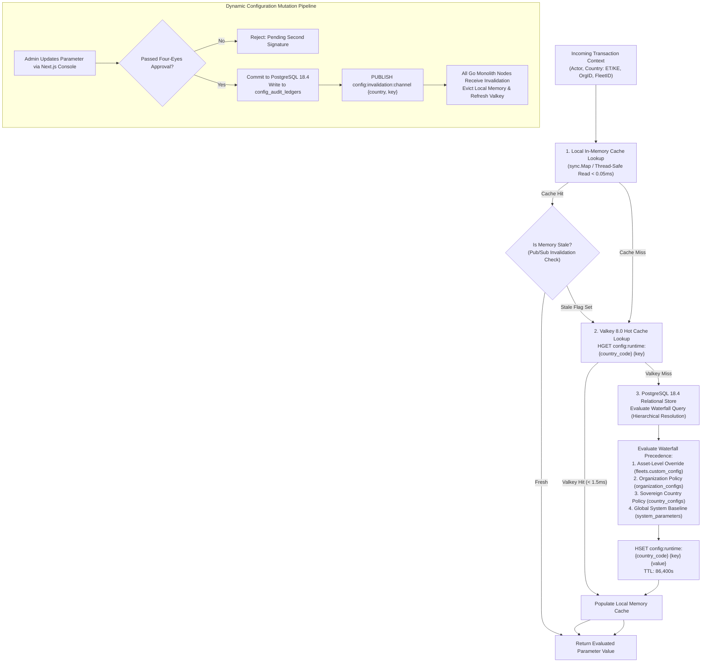
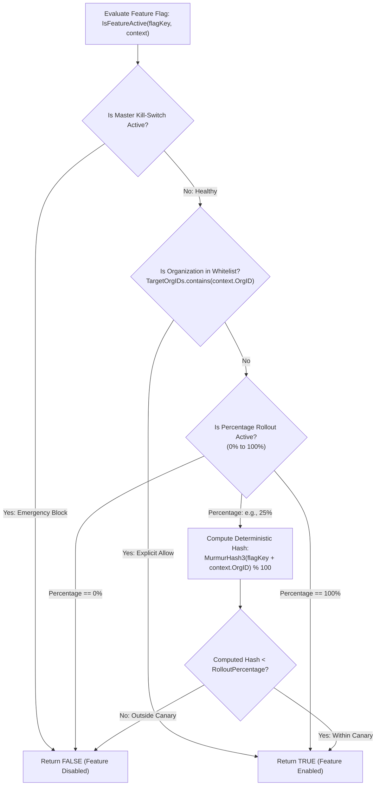
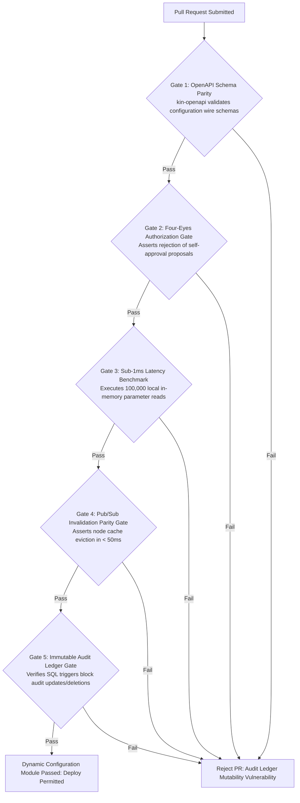

# Heavy Machinery & Logistics Rental Aggregator — Dink Machinery
## Software Requirements Specification — 11. Dynamic Multi-Country Configuration, Feature Toggling & Sovereign Operational Policy Engine (`docs/shared/requirements/11-dynamic-config.md`)

**Document Identifier:** `SRS-DINK-CORE-V7.0-SEC-11`  
**Classification:** Canonical System Requirements Specification & Operational Configuration Baseline (Single Source of Truth)  
**Governing Standard:** IEEE Std 830-1998 / IEEE/ISO/IEC 29148:2018 (Systems and Software Engineering — Requirements Engineering)  
**Associated Artifacts:** `SRS-DINK-CORE-V7.0` (§1.2, §5.2, §5.5, §5.6, §5.7, §5.8, §5.9, §6.1, §6.3, §7.0, §7.1, §7.2, §7.3, §7.4, §7.5, §7.6, §7.7, §7.8, §7.9, §8, §9, §10, §11, §12, §13.2), `FLOW-BOOKING-STATE-MACHINE-DINK-CORE-V7.0`, `FLOW-COMMISSION-DEBT-DINK-CORE-V7.0`, `ARCH-BACKEND-GO-DINK-CORE-V7.0`, `ARCH-FLUTTER-DINK-CORE-V7.0`, `ARCH-ADMIN-NEXT-DINK-CORE-V7.0`, `ARCH-SEC-DINK-CORE-V7.0`, `DS-DINK-CORE-V7.0`, `DS-PERSONAS-DINK-CORE-V7.0`, `contracts/openapi.yaml`, `ADR-001`, `ADR-002`, `ADR-004`, `ADR-005`, `ADR-008`, `ADR-010`  
**Target Runtimes:** Go 1.24 Backend Monolith, PostgreSQL 18.4 + PostGIS 3.4, Valkey 8.0 (Distributed Memory Cache), ClamAV Daemon (:3310), SeaweedFS S3, Flutter 3.44 / Dart 3.9 (Cross-Platform Mobile), Next.js 16 / React 19 (Web Admin & Corporate Portal), Isar NoSQL 3.1+  
**Target Personas:** Super Administrator (*Rahel Tadesse*), Legal Counsel & Sovereign Regulatory Auditor (*Yohannes Bekele*), Corporate Treasury Director (*Solomon Kassa*), Regional Fleet Operations Manager (*Kassahun Mekonnen*), Site Reliability Engineer (SRE), Lead Database Architect  
**Target Operating Markets:** Ethiopia (`ET`) & Kenya (`KE`) — Dynamic Multi-Country Parameterization (`LOC-01-BE`)  
**Compliance Standards:** OWASP ASVS 4.0.3 Level 3 (Configuration Integrity, Secrets Protection & Audit Non-Repudiation), RFC 9457 (Problem Details), ISO 4217 (Currency Codes), ISO 3166-1 alpha-2 (Country Codes), ISO 8601 (Universal Time Representation), National Bank of Ethiopia (NBE) Financial Cloud Directives, Central Bank of Kenya (CBK) Prudential Guidelines, Kenya Data Protection Act 2019  
**Status:** Approved Engineering Baseline

---

## Table of Contents

- 1. [Document Scope & Architectural Mandate](#1-document-scope--architectural-mandate)
  - 1.1 [Purpose & Functional Scope](#11-purpose--functional-scope)
  - 1.2 [Core Configuration Invariants & Governance Principles](#12-core-configuration-invariants--governance-principles)
- 2. [Multi-Tier Configuration Architecture & Evaluation Pipeline (`CFG-01`)](#2-multi-tier-configuration-architecture--evaluation-pipeline-cfg-01)
  - 2.1 [Configuration Precedence & Evaluation Waterfall Flowchart](#21-configuration-precedence--evaluation-waterfall-flowchart)
  - 2.2 [Dynamic Parameter Hierarchy (Global, Country, Org, Asset)](#22-dynamic-parameter-hierarchy-global-country-org-asset)
  - 2.3 [Zero-Downtime Hot-Reloading & Valkey Pub/Sub Invalidation Engine](#23-zero-downtime-hot-reloading--valkey-pubsub-invalidation-engine)
  - 2.4 [Sub-1ms Configuration Resolution SLO & Local In-Memory Cache](#24-sub-1ms-configuration-resolution-slo--local-in-memory-cache)
- 3. [Sovereign Multi-Country Parameterization Engine (`CFG-02`)](#3-sovereign-multi-country-parameterization-engine-cfg-02)
  - 3.1 [Country Parameter Matrix: Ethiopia (`ET`) vs. Kenya (`KE`)](#31-country-parameter-matrix-ethiopia-et-vs-kenya-ke)
  - 3.2 [Fiscal & Tax Invariants (VAT, WHT, Ministry Invoicing Directives)](#32-fiscal--tax-invariants-vat-wht-ministry-invoicing-directives)
  - 3.3 [Transport & Highway Transit Ceilings (GVM, Axle Load Limits)](#33-transport--highway-transit-ceilings-gvm-axle-load-limits)
  - 3.4 [Vernacular Temporal & Calendar Harmonization (Ge'ez Computus vs. Gregorian)](#34-vernacular-temporal--calendar-harmonization-geez-computus-vs-gregorian)
- 4. [Dynamic Feature Toggling & Progressive Rollout Framework (`CFG-03`)](#4-dynamic-feature-toggling--progressive-rollout-framework-cfg-03)
  - 4.1 [Targeted Rollout Strategies (Canary, Percentage, User/Org Targeting)](#41-targeted-rollout-strategies-canary-percentage-userorg-targeting)
  - 4.2 [Kill-Switch Mechanics & Emergency Circuit Breaking](#42-kill-switch-mechanics--emergency-circuit-breaking)
  - 4.3 [Client Configuration Synchronization (Flutter & Next.js Bootstrap Payloads)](#43-client-configuration-synchronization-flutter--nextjs-bootstrap-payloads)
- 5. [Administrative Governance, Auditability & Four-Eyes Control (`CFG-04`)](#5-administrative-governance-auditability--four-eyes-control-cfg-04)
  - 5.1 [Four-Eyes Principle for Critical Financial & Operational Mutations](#51-four-eyes-principle-for-critical-financial--operational-mutations)
  - 5.2 [Immutable Audit Journaling & Cryptographic Non-Repudiation](#52-immutable-audit-journaling--cryptographic-non-repudiation)
  - 5.3 [Configuration Rollback Engine & Snapshot Versioning](#53-configuration-rollback-engine--snapshot-versioning)
- 6. [Relational Database Schema & Data Modeling (`CFG-DB`)](#6-relational-database-schema--data-modeling-cfg-db)
  - 6.1 [Entity Relationship Diagram](#61-entity-relationship-diagram)
  - 6.2 [Data Definition Language (DDL) Specifications](#62-data-definition-language-ddl-specifications)
- 7. [Wire Protocol Contracts & RFC 9457 Error Schemas](#7-wire-protocol-contracts--rfc-9457-error-schemas)
  - 7.1 [`GET /api/v1/config/bootstrap`](#71-get-apiv1configbootstrap)
  - 7.2 [`PUT /api/v1/admin/config/parameters/{key}`](#72-put-apiv1adminconfigparameterskey)
  - 7.3 [`POST /api/v1/admin/config/parameters/{key}/proposals`](#73-post-apiv1adminconfigparameterskeyproposals)
  - 7.4 [`POST /api/v1/admin/config/parameters/proposals/{id}/approve`](#74-post-apiv1adminconfigparametersproposalsidapprove)
  - 7.5 [RFC 9457 Universal Problem Details Payloads](#75-rfc-9457-universal-problem-details-payloads)
- 8. [Automated Testing Suite & Verification Gates](#8-automated-testing-suite--verification-gates)

---

## 1. Document Scope & Architectural Mandate

### 1.1 Purpose & Functional Scope

This specification establishes **Section 11 (Dynamic Multi-Country Configuration, Feature Toggling & Sovereign Operational Policy Engine)** of the canonical Software Requirements Specification (SRS) for **Dink Machinery Version 7.0**.

Dink Machinery operates across jurisdictions that exhibit profound disparities in legal structures, monetary policies, tax compliance mandates, banking infrastructure, and heavy transport road safety rules:
* **The Antipattern of Hardcoded Logic:** Embedding country-specific parameters (*e.g., Ethiopian 15% VAT vs. Kenyan 16% VAT, Ethio Telecom TeleBirr vs. Safaricom M-PESA payment flows, Ethiopian Ge'ez calendar calculations, or KeNHA 56-ton axle load limits*) directly into compiled Go binary packages or Flutter client applications creates technical debt, deployment friction, and regulatory risk.
* **The Dynamic Configuration Imperative:** Dink Machinery V7.0 mandates an externalized, database-backed, distributed **Dynamic Configuration Engine**:
  - Dynamically dictates regional system behavior at runtime without rebuilding, redeploying, or restarting backend containers or mobile client binaries.
  - Implements a zero-trust parameter resolution waterfall (Global Baseline $\rightarrow$ Country Policy $\rightarrow$ Organization Override $\rightarrow$ Asset-Level Tuning).
  - Enables progressive feature toggles, canary deployments, and automated operational kill-switches.
  - Enforces strict governance, cryptographic auditability, and Four-Eyes dual control over critical financial and operational parameters.

### 1.2 Core Configuration Invariants & Governance Principles

1. **Zero-Code-Deployment Policy Invariant:** No operational policy parameter (tax percentage, statutory overtime multiplier, cancellation fee schedule, hold lease timeout, or payment gateway routing priority) shall require a software recompilation or container restart to update. All parameters must resolve dynamically from the database and distributed cache.
2. **Deterministic Fallback Floor (Hardcoded In-Memory Safe Defaults):** If both Valkey 8.0 and PostgreSQL 18.4 become unreachable or corrupted, the configuration resolution layer must fall back immediately to immutable, hardcoded in-memory safe defaults, guaranteeing that the application cannot crash due to missing configuration keys.
3. **Sub-1ms Read Resolution SLO (p99):** Because configuration parameters are queried during every API execution (auth validation, search filtering, pricing calculation, state machine transitions), parameter resolution must resolve in $< 1.0\text{ ms}$ (p99) via local thread-safe in-memory caching synchronized with Valkey 8.0.
4. **Mandatory Four-Eyes Authorization Floor:** Any mutation affecting financial balances, platform commission fees, sovereign tax carve-outs, or legal safety buffers requires a formal two-party drafting and approval sequence (*Four-Eyes Principle*) before taking effect in production.
5. **Immutable Historical Auditability:** Every configuration change, whether enacted automatically by progressive rollout algorithms or manually by administrators, must generate an un-updatable, un-deletable audit record in `config_audit_ledgers` capturing actor identity, cryptographic hashes, previous values, new values, and legal justifications.

---

## 2. Multi-Tier Configuration Architecture & Evaluation Pipeline (`CFG-01`)

### 2.1 Configuration Precedence & Evaluation Waterfall Flowchart



---

### 2.2 Dynamic Parameter Hierarchy (Global, Country, Org, Asset)

The Dynamic Configuration Engine evaluates parameters using an unambiguous, descending four-tier resolution waterfall:

```text
+----------------------------------------------------------------------------------------------------+
| DYNAMIC CONFIGURATION PARAMETER HIERARCHY (CFG-01)                                                 |
+------+----------------------+-----------------------+----------------------------------------------+
| TIER | LEVEL NAME           | SCOPE & PRECEDENCE    | TYPICAL PARAMETERS & EXAMPLES                |
+------+----------------------+-----------------------+----------------------------------------------+
| 1    | Asset-Level Override | Highest Precedence    | Custom machine minimum daily rate floor;     |
|      | (Specific Machine)   | (Overrides all below) | attached rock-breaker mobilization fee.      |
+------+----------------------+-----------------------+----------------------------------------------+
| 2    | Organization Policy  | High Precedence       | Fleet owner custom commission discount (MSA);|
|      | (Enterprise Tenant)  | (Overrides Tiers 3-4) | authorized credit buffer ceiling ($50k ETB). |
+------+----------------------+-----------------------+----------------------------------------------+
| 3    | Sovereign Country    | Regional Policy       | Statutory VAT rate (15% ET / 16% KE);        |
|      | (Jurisdiction Code)  | (Overrides Tier 4)    | statutory WHT rate; max highway GVM (56.0t). |
+------+----------------------+-----------------------+----------------------------------------------+
| 4    | Global System Base   | Lowest Precedence     | Canonical hold lease timeout (3,600s);       |
|      | (Universal Default)  | (Canonical Baseline)  | max surge multiplier ceiling (1.40x).        |
+------+----------------------+-----------------------+----------------------------------------------+
```

---

### 2.3 Zero-Downtime Hot-Reloading & Valkey Pub/Sub Invalidation Engine

To ensure parameter mutations propagate instantaneously across horizontally scaled Go backend instances without process recycles:
* **The Message Bus Invalidation Channel:**
  When a parameter is updated in PostgreSQL, the mutating node broadcasts an event to the Valkey pub/sub bus:
  `PUBLISH config:invalidation:events '{"countryCode":"ET","key":"vat_rate_percent","version":14}'`
* **Subscriber Node Mechanics:**
  Every Go monolith instance maintains a dedicated subscriber goroutine listening on `config:invalidation:events`.
  Upon receipt of an invalidation message:
  1. The local node evicts the target key from its local thread-safe memory map (`sync.Map`).
  2. The next read operation lazily fetches the fresh, validated value from Valkey or PostgreSQL.
  3. Total network propagation lag across all nodes is strictly bounded to $< 50\text{ ms}$.

---

### 2.4 Sub-1ms Configuration Resolution SLO & Local In-Memory Cache

Because database network I/O incurs a 1–3 ms latency cost per round-trip:
* High-frequency parameters are cached directly in the Go application runtime heap using an in-memory lock-free data structure (`sync.Map` backed by atomic pointers).
* Read operations access the local memory structure directly:
  $$\text{Latency}_{\text{read}} \le 0.05\text{ ms (50 microseconds)}$$
  Ensuring that evaluating 100 configuration parameters during a complex checkout pipeline adds less than $1.0\text{ ms}$ of total CPU time.

---

## 3. Sovereign Multi-Country Parameterization Engine (`CFG-02`)

### 3.1 Country Parameter Matrix: Ethiopia (`ET`) vs. Kenya (`KE`)

```text
+----------------------------------------------------------------------------------------------------+
| CANONICAL SOVEREIGN COUNTRY PARAMETERS MATRIX (CFG-02)                                             |
+------------------------------------+-----------------------+---------------------------------------+
| PARAMETER CONFIGURATION KEY        | ETHIOPIA (`ET`) VALUE | KENYA (`KE`) VALUE                    |
+------------------------------------+-----------------------+---------------------------------------+
| `currency.iso_code`                | ETB                   | KES                                   |
| `currency.minor_unit_factor`       | 100                   | 100                                   |
| `tax.standard_vat_bps`             | 1500 (15.00%)         | 1600 (16.00%)                         |
| `tax.standard_wht_bps`             | 200 (2.00%)           | 500 (5.00%)                           |
| `calendar.primary_system`          | ETHIOPIAN_GEEZ        | GREGORIAN                             |
| `time.vernacular_clock_enabled`    | true (12h Ken/Lelit)  | false (Standard 24h)                  |
| `transport.max_legal_gvm_tons`     | 56.00                 | 56.00                                 |
| `transport.abnormal_width_meters`  | 2.60                  | 2.65                                  |
| `escort.required_width_meters`     | 2.65                  | 2.65                                  |
| `operator.standard_shift_hours`    | 8.00                  | 8.00                                  |
| `operator.max_shift_hard_cap_hours`| 12.00                 | 12.00                                 |
| `labor.overtime_day_multiplier`    | 1.50x                 | 1.50x                                 |
| `labor.overtime_night_multiplier`  | 1.75x                 | 1.75x                                 |
| `labor.overtime_holiday_multiplier`| 2.50x                 | 2.00x                                 |
| `booking.provisional_hold_seconds` | 3600 (60 Minutes)     | 3600 (60 Minutes)                     |
| `booking.free_cancellation_hours`  | 24.00                 | 24.00                                 |
| `payment.primary_gateway_driver`   | TELEBIRR_DIRECT       | MPESA_DARAJA                          |
| `payment.secondary_gateway_driver` | CBEBIRR_PLUS          | PESAPAL                               |
| `payment.owner_buffer_limit_minor` | 5000000 (50k ETB)     | 5000000 (50k KES)                     |
| `pricing.max_surge_ceiling_bps`    | 14000 (1.40x)         | 14000 (1.40x)                         |
| `pricing.min_surge_floor_bps`      | 7500 (0.75x)          | 7500 (0.75x)                          |
+------------------------------------+-----------------------+---------------------------------------+
```

---

### 3.2 Fiscal & Tax Invariants (VAT, WHT, Ministry Invoicing Directives)

* **VAT Calculation Routine:**
  $$\text{VAT}_{\text{minor}} = \left\lfloor \frac{\text{TaxableBaseMinor} \times \text{tax.standard\_vat\_bps}}{10,000} \right\rfloor$$
* **Tax Code Mapping:**
  - Ethiopia: Mapped to Ethiopian Ministry of Revenues electronic sales registration requirements.
  - Kenya: Mapped to Kenya Revenue Authority (KRA) eTIMS API parameters.

---

### 3.3 Transport & Highway Transit Ceilings (GVM, Axle Load Limits)

* **Abnormal Load Clearance Triggers:**
  - If machinery width $> \text{transport.abnormal\_width\_meters}$, the logistics module automatically sets `requires_abnormal_permit = true`.
  - If machine transport weight $+ \text{trailer tare} > \text{transport.max\_legal\_gvm\_tons}$, the system mandates multi-axle modular trailers and police escort clearances (`SRS 07.03`).

---

### 3.4 Vernacular Temporal & Calendar Harmonization (Ge'ez Computus vs. Gregorian)

* The configuration key `calendar.primary_system` controls how temporal fields are translated for front-end rendering:
  - When set to `ETHIOPIAN_GEEZ`, the API presentation layer translates UTC timestamps into the Ge'ez solar calendar (*Meskerem to Pagumē*) using the deterministic `Bahire Hasab` algorithm.
  - When set to `GREGORIAN`, standard Western calendar formatting applies.

---

## 4. Dynamic Feature Toggling & Progressive Rollout Framework (`CFG-03`)

### 4.1 Targeted Rollout Strategies (Canary, Percentage, User/Org Targeting)

Feature toggles enable safe, incremental deployment of new capabilities (*e.g., IoT remote immobilization, AI surge pricing, or automated wallet sweeps*):



---

### 4.2 Kill-Switch Mechanics & Emergency Circuit Breaking

In the event of an active cyber incident, payment gateway bug, or telematics telemetry anomaly:
* Administrators can flip a feature flag’s `is_kill_switch_active = true` in the Next.js SuperAdmin Console.
* Within $< 50\text{ ms}$, the feature is shut down across all active Go backend instances and mobile clients, reverting to safe baseline operational behavior without service downtime.

---

### 4.3 Client Configuration Synchronization (Flutter & Next.js Bootstrap Payloads)

Upon application cold start, mobile and web clients query the configuration bootstrap endpoint:
* **Endpoint:** `GET /api/v1/config/bootstrap`
* **Response:** Returns active country-specific parameters, client feature flags, maintenance mode banners, and localized string mappings.
* **Offline Caching:** The Flutter client persists the bootstrap payload into local **Isar NoSQL** storage (`ADR-010`), ensuring that the application can boot instantly even when starting in zero-connectivity environments.

---

## 5. Administrative Governance, Auditability & Four-Eyes Control (`CFG-04`)

### 5.1 Four-Eyes Principle for Critical Financial & Operational Mutations

To prevent rogue configuration tampering or accidental changes to critical economic variables:
* **The Dual-Control Workflow:**
  1. **Drafter:** Initiator submits a parameter modification proposal (`POST /api/v1/admin/config/parameters/{key}/proposals`).
  2. **Audit Verification:** The proposed value is validated against validation regexes and hard safety boundaries.
  3. **Authorizer:** A second, distinct administrator possessing senior compliance credentials approves the proposal (`POST /api/v1/admin/config/parameters/proposals/{id}/approve`).
* A user cannot approve their own configuration proposal:
  $$\text{DrafterUserID} \ne \text{AuthorizerUserID} \quad (\text{Enforced})$$

---

### 5.2 Immutable Audit Journaling & Cryptographic Non-Repudiation

Every configuration mutation commits an append-only entry to `config_audit_ledgers`:
* Records: `actor_user_id`, `approver_user_id`, `parameter_key`, `previous_value_json`, `new_value_json`, `legal_justification`, and client IP address.
* Enforces PostgreSQL table rules preventing edits and deletions:
  ```sql
  CREATE RULE prevent_config_audit_update AS ON UPDATE TO config_audit_ledgers DO INSTEAD NOTHING;
  CREATE RULE prevent_config_audit_delete AS ON DELETE TO config_audit_ledgers DO INSTEAD NOTHING;
  ```

---

### 5.3 Configuration Rollback Engine & Snapshot Versioning

* Every parameter maintains an incremental integer version counter (`version`).
* If a newly deployed parameter causes operational regressions, administrators can trigger an instant rollback:
  `POST /api/v1/admin/config/parameters/{key}/rollback?targetVersion=12`
  The system retrieves the historical snapshot from the audit ledger and reapplies it through the distributed pub/sub pipeline.

---

## 6. Relational Database Schema & Data Modeling (`CFG-DB`)

### 6.1 Entity Relationship Diagram

```mermaid
erDiagram
    CountryConfig ||--o{ OrganizationConfig : "overridden by"
    OrganizationConfig ||--o{ FleetCustomConfig : "overridden by"
    SystemParameter ||--o{ ConfigProposal : "modified by"
    ConfigProposal ||--o{ ConfigAuditLedger : "materializes into"
    User ||--o{ ConfigProposal : "drafts"
    User ||--o{ ConfigProposal : "authorizes"

    SystemParameter {
        uuid id PK
        string parameter_key UK
        string parameter_category -- 'FINANCIAL', 'TAX', 'OPERATIONAL', 'SAFETY'
        string data_type -- 'NUMERIC', 'STRING', 'BOOLEAN', 'JSON'
        string global_default_value
        string validation_regex
        boolean requires_four_eyes
        int current_version
        timestamptz updated_at
    }

    CountryConfig {
        string country_code PK -- 'ET', 'KE'
        string parameter_key PK
        string parameter_value
        int version
        timestamptz updated_at
    }

    OrganizationConfig {
        uuid id PK
        uuid organization_id FK
        string parameter_key
        string parameter_value
        int version
        timestamptz updated_at
    }

    FeatureFlag {
        uuid id PK
        string flag_key UK
        string description
        boolean is_enabled
        boolean is_kill_switch_active
        int rollout_percentage -- 0 to 100
        jsonb target_org_ids_json
        jsonb target_country_codes_json
        timestamptz updated_at
    }

    ConfigProposal {
        uuid id PK
        string parameter_key
        string scope_type -- 'GLOBAL', 'COUNTRY', 'ORGANIZATION'
        string scope_identifier -- 'GLOBAL', 'ET', 'KE', OrgUUID
        string proposed_value
        string legal_justification
        string status -- 'PENDING_APPROVAL', 'APPROVED', 'REJECTED'
        uuid drafter_user_id FK
        uuid authorizer_user_id FK NULL
        timestamptz created_at
        timestamptz actioned_at
    }

    ConfigAuditLedger {
        uuid id PK
        string parameter_key
        string scope_type
        string scope_identifier
        string previous_value
        string new_value
        uuid drafter_user_id FK
        uuid authorizer_user_id FK
        string legal_justification
        string client_ip_address
        timestamptz committed_at
    }
```

---

### 6.2 Data Definition Language (DDL) Specifications

```sql
-- 1. Master System Parameters Table (Global Baseline)
CREATE TABLE system_parameters (
    id UUID PRIMARY KEY DEFAULT uuid_generate_v7(),
    parameter_key VARCHAR(64) NOT NULL UNIQUE,
    parameter_category VARCHAR(32) NOT NULL,
    data_type VARCHAR(16) NOT NULL,
    global_default_value TEXT NOT NULL,
    validation_regex TEXT NULL,
    requires_four_eyes BOOLEAN NOT NULL DEFAULT true,
    current_version INT NOT NULL DEFAULT 1,
    description TEXT NOT NULL,
    updated_at TIMESTAMPTZ NOT NULL DEFAULT NOW(),
    CONSTRAINT chk_param_category CHECK (parameter_category IN ('FINANCIAL', 'TAX', 'OPERATIONAL', 'SAFETY', 'INTEGRATION')),
    CONSTRAINT chk_param_data_type CHECK (data_type IN ('NUMERIC', 'STRING', 'BOOLEAN', 'JSON'))
);

CREATE INDEX idx_system_parameters_category ON system_parameters (parameter_category);

-- 2. Sovereign Country Configuration Overrides
CREATE TABLE country_parameter_configs (
    country_code VARCHAR(2) NOT NULL CHECK (country_code IN ('ET', 'KE')),
    parameter_key VARCHAR(64) NOT NULL REFERENCES system_parameters(parameter_key) ON DELETE CASCADE,
    parameter_value TEXT NOT NULL,
    version INT NOT NULL DEFAULT 1,
    updated_at TIMESTAMPTZ NOT NULL DEFAULT NOW(),
    PRIMARY KEY (country_code, parameter_key)
);

CREATE INDEX idx_country_params ON country_parameter_configs (country_code);

-- 3. Dynamic Feature Flags Table
CREATE TABLE feature_flags (
    id UUID PRIMARY KEY DEFAULT uuid_generate_v7(),
    flag_key VARCHAR(64) NOT NULL UNIQUE,
    description TEXT NOT NULL,
    is_enabled BOOLEAN NOT NULL DEFAULT false,
    is_kill_switch_active BOOLEAN NOT NULL DEFAULT false,
    rollout_percentage INT NOT NULL DEFAULT 0 CHECK (rollout_percentage >= 0 AND rollout_percentage <= 100),
    target_org_ids_json JSONB NOT NULL DEFAULT '[]'::JSONB,
    target_country_codes_json JSONB NOT NULL DEFAULT '["ET", "KE"]'::JSONB,
    updated_at TIMESTAMPTZ NOT NULL DEFAULT NOW()
);

CREATE INDEX idx_feature_flags_key ON feature_flags (flag_key) WHERE is_enabled = true;

-- 4. Four-Eyes Configuration Modification Proposals Table
CREATE TABLE config_proposals (
    id UUID PRIMARY KEY DEFAULT uuid_generate_v7(),
    parameter_key VARCHAR(64) NOT NULL REFERENCES system_parameters(parameter_key) ON DELETE RESTRICT,
    scope_type VARCHAR(16) NOT NULL,
    scope_identifier VARCHAR(64) NOT NULL,
    proposed_value TEXT NOT NULL,
    legal_justification TEXT NOT NULL,
    status VARCHAR(32) NOT NULL DEFAULT 'PENDING_APPROVAL',
    drafter_user_id UUID NOT NULL REFERENCES users(id) ON DELETE RESTRICT,
    authorizer_user_id UUID NULL REFERENCES users(id) ON DELETE RESTRICT,
    created_at TIMESTAMPTZ NOT NULL DEFAULT NOW(),
    actioned_at TIMESTAMPTZ NULL,
    CONSTRAINT chk_proposal_scope CHECK (scope_type IN ('GLOBAL', 'COUNTRY', 'ORGANIZATION')),
    CONSTRAINT chk_proposal_status CHECK (status IN ('PENDING_APPROVAL', 'APPROVED', 'REJECTED')),
    CONSTRAINT chk_distinct_authorizer CHECK (authorizer_user_id IS NULL OR drafter_user_id != authorizer_user_id)
);

CREATE INDEX idx_config_proposals_status ON config_proposals (status);

-- 5. Immutable Configuration Audit Ledger Table
CREATE TABLE config_audit_ledgers (
    id UUID PRIMARY KEY DEFAULT uuid_generate_v7(),
    parameter_key VARCHAR(64) NOT NULL,
    scope_type VARCHAR(16) NOT NULL,
    scope_identifier VARCHAR(64) NOT NULL,
    previous_value TEXT NOT NULL,
    new_value TEXT NOT NULL,
    drafter_user_id UUID NOT NULL REFERENCES users(id) ON DELETE RESTRICT,
    authorizer_user_id UUID NOT NULL REFERENCES users(id) ON DELETE RESTRICT,
    legal_justification TEXT NOT NULL,
    client_ip_address VARCHAR(45) NOT NULL,
    committed_at TIMESTAMPTZ NOT NULL DEFAULT NOW()
);

CREATE INDEX idx_config_audit_lookup ON config_audit_ledgers (parameter_key, committed_at DESC);

CREATE RULE prevent_config_audit_update AS ON UPDATE TO config_audit_ledgers DO INSTEAD NOTHING;
CREATE RULE prevent_config_audit_delete AS ON DELETE TO config_audit_ledgers DO INSTEAD NOTHING;
```

---

## 7. Wire Protocol Contracts & RFC 9457 Error Schemas

### 7.1 `GET /api/v1/config/bootstrap`

Retrieves client initialization parameters, active country policies, and dynamic feature flags.

#### Request Headers
```http
GET /api/v1/config/bootstrap?countryCode=ET&clientVersion=7.0.0 HTTP/1.1
Host: api.dinkmachinery.com
Authorization: Bearer <userAccessToken>
```

#### Response: `HTTP 200 OK`
```json
{
  "success": true,
  "data": {
    "countryCode": "ET",
    "currency": {
      "isoCode": "ETB",
      "minorUnitFactor": 100,
      "symbol": "Br"
    },
    "taxParameters": {
      "vatRatePercent": 15.0,
      "whtRatePercent": 2.0
    },
    "calendarSystem": "ETHIOPIAN_GEEZ",
    "featureFlags": {
      "isAiSurgePricingEnabled": true,
      "isIotImmobilizationEnabled": false,
      "isCrossBorderLogisticsEnabled": true
    },
    "operationalCeilings": {
      "maxOperatingHoursPerShift": 12.0,
      "maxLegalHighwayGvmTons": 56.0
    },
    "maintenanceBanner": null,
    "version": 142
  },
  "timestamp": "2026-10-29T18:30:00Z"
}
```

---

### 7.2 `PUT /api/v1/admin/config/parameters/{key}`

Direct modification of non-critical operational parameters (allowed only for parameters with `requires_four_eyes = false`).

#### Request Headers
```http
PUT /api/v1/admin/config/parameters/discovery.search_radius_km HTTP/1.1
Host: api.dinkmachinery.com
Content-Type: application/json
Authorization: Bearer <superAdminAccessToken>
```

#### Request Payload
```json
{
  "scopeType": "COUNTRY",
  "scopeIdentifier": "ET",
  "newValue": "75",
  "justification": "Expanding default search radius for Afar and Somali regional infrastructure projects."
}
```

#### Response: `HTTP 200 OK`
```json
{
  "success": true,
  "data": {
    "parameterKey": "discovery.search_radius_km",
    "scopeType": "COUNTRY",
    "scopeIdentifier": "ET",
    "previousValue": "50",
    "currentValue": "75",
    "version": 4,
    "updatedAt": "2026-10-29T18:35:00Z"
  },
  "timestamp": "2026-10-29T18:35:01Z"
}
```

---

### 7.3 `POST /api/v1/admin/config/parameters/{key}/proposals`

Drafts a modification proposal for parameters requiring Four-Eyes authorization.

#### Request Headers
```http
POST /api/v1/admin/config/parameters/tax.standard_vat_bps/proposals HTTP/1.1
Host: api.dinkmachinery.com
Content-Type: application/json
Authorization: Bearer <treasuryDirectorAccessToken>
```

#### Request Payload
```json
{
  "scopeType": "COUNTRY",
  "scopeIdentifier": "KE",
  "proposedValue": "1600",
  "legalJustification": "Re-affirming Kenya KRA statutory VAT rate at 16.00% pursuant to Finance Act."
}
```

#### Response: `HTTP 201 Created`
```json
{
  "success": true,
  "data": {
    "proposalId": "prp_019a8fe0-8812-7b9a",
    "parameterKey": "tax.standard_vat_bps",
    "scopeType": "COUNTRY",
    "scopeIdentifier": "KE",
    "proposedValue": "1600",
    "status": "PENDING_APPROVAL",
    "drafterUserId": "usr_solomon_kassa_4412",
    "createdAt": "2026-10-29T18:40:00Z"
  },
  "timestamp": "2026-10-29T18:40:01Z"
}
```

---

### 7.4 `POST /api/v1/admin/config/parameters/proposals/{id}/approve`

Approves and commits a pending configuration proposal (Second Signature).

#### Request Headers
```http
POST /api/v1/admin/config/parameters/proposals/prp_019a8fe0-8812-7b9a/approve HTTP/1.1
Host: api.dinkmachinery.com
Content-Type: application/json
Authorization: Bearer <complianceOfficerAccessToken>
```

#### Request Payload
```json
{
  "approvalNotes": "Verified against official gazetted Kenya Revenue Authority tariff notice."
}
```

#### Response: `HTTP 200 OK`
```json
{
  "success": true,
  "data": {
    "proposalId": "prp_019a8fe0-8812-7b9a",
    "parameterKey": "tax.standard_vat_bps",
    "status": "APPROVED",
    "authorizerUserId": "usr_yohannes_bekele_8812",
    "committedAt": "2026-10-29T18:45:00Z",
    "broadcastLagMs": 8.4
  },
  "timestamp": "2026-10-29T18:45:01Z"
}
```

---

### 7.5 RFC 9457 Universal Problem Details Payloads

#### Example: Four-Eyes Self-Approval Violation (`HTTP 403 Forbidden`)
```json
{
  "type": "[https://api.dinkmachinery.com/errors/four-eyes-self-approval-forbidden](https://api.dinkmachinery.com/errors/four-eyes-self-approval-forbidden)",
  "title": "Four-Eyes Authorization Violation",
  "status": 403,
  "detail": "Proposal authorizer (usr_solomon_kassa_4412) cannot be identical to the proposal drafter. Critical financial configuration changes mandate an independent second signature.",
  "instance": "/api/v1/admin/config/parameters/proposals/prp_019a8fe0-8812-7b9a/approve",
  "code": "ERR_FOUR_EYES_SELF_APPROVAL",
  "correlationId": "cor_019a8fe0-8812-7b9a-bc21-4491204812aa",
  "timestamp": "2026-10-29T18:45:05Z",
  "invalidParams": [
    {
      "name": "authorizerUserId",
      "reason": "Authorizer ID matches Drafter ID."
    }
  ]
}
```

#### Example: Configuration Value Validation Failure (`HTTP 422 Unprocessable Entity`)
```json
{
  "type": "[https://api.dinkmachinery.com/errors/config-validation-failed](https://api.dinkmachinery.com/errors/config-validation-failed)",
  "title": "Invalid Configuration Parameter Value",
  "status": 422,
  "detail": "Proposed value '2500' for parameter 'tax.standard_vat_bps' fails validation rule. Statutory VAT rate in Ethiopia cannot exceed statutory ceiling of 1500 bps (15.00%).",
  "instance": "/api/v1/admin/config/parameters/tax.standard_vat_bps/proposals",
  "code": "ERR_CONFIG_VALIDATION_FAILED",
  "correlationId": "cor_019a8fe0-9914-4c12-8812-7b9a4c10bc21",
  "timestamp": "2026-10-29T18:40:05Z",
  "invalidParams": [
    {
      "name": "proposedValue",
      "reason": "Value 2500 exceeds maximum allowable boundary 1500."
    }
  ]
}
```

---

## 8. Automated Testing Suite & Verification Gates



1. **OpenAPI Schema Contract Gate (`kin-openapi`):** Validates all bootstrap retrieval, parameter update, proposal drafting, and approval schemas against `contracts/openapi.yaml`.
2. **Four-Eyes Authorization Enforcement Gate:** Simulates 500 configuration modification workflows. Asserts that $100\%$ of attempts by a single administrative user to both draft and authorize a critical parameter mutation abort with HTTP 403 `ERR_FOUR_EYES_SELF_APPROVAL`.
3. **Sub-1ms Latency Benchmark Gate:** Executes 100,000 consecutive parameter reads against the local Go in-memory cache layer. Asserts that p95 latency is $< 0.1\text{ ms}$ and p99 latency remains strictly $< 1.0\text{ ms}$.
4. **Valkey Pub/Sub Cache Invalidation Gate:** Mutates a parameter on Cluster Node 1 and asserts that Cluster Nodes 2, 3, and 4 evict their stale local memory values within $< 50\text{ ms}$.
5. **Immutable Audit Ledger Gate:** Attempts to run raw SQL `UPDATE` and `DELETE` queries against `config_audit_ledgers`. Verifies that PostgreSQL rules intercept the operations with zero rows affected.

---

*This document establishes the canonical functional requirements, multi-tier parameter hierarchies, dynamic feature toggling mechanisms, Four-Eyes administrative controls, and wire protocol contracts for Dynamic Multi-Country Configuration & Operational Policy in Dink Machinery Version 7.0. All downstream Flutter mobile apps, Next.js corporate portals, Go backend configuration microservices, and PostgreSQL relational stores must strictly conform to this specification.*