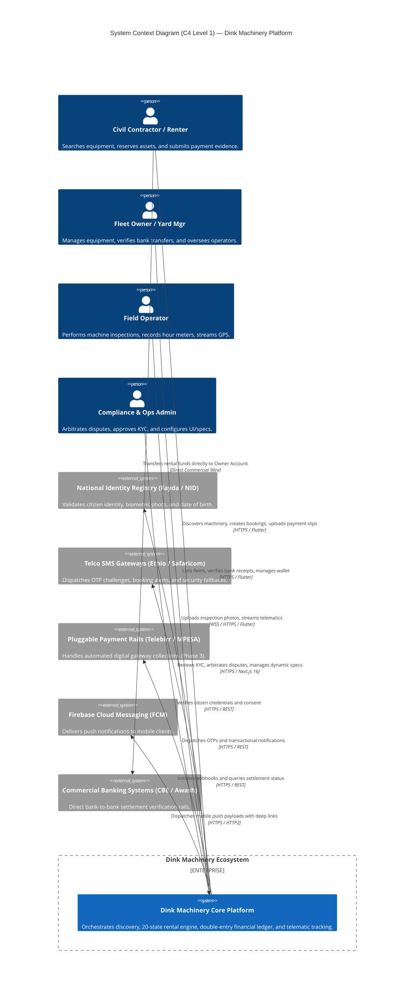
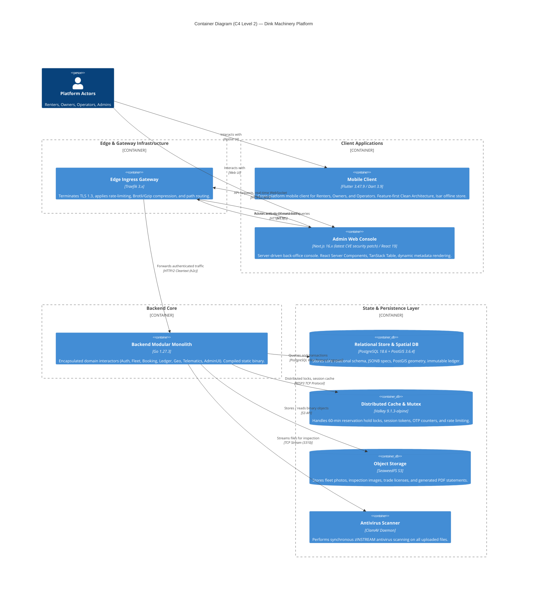
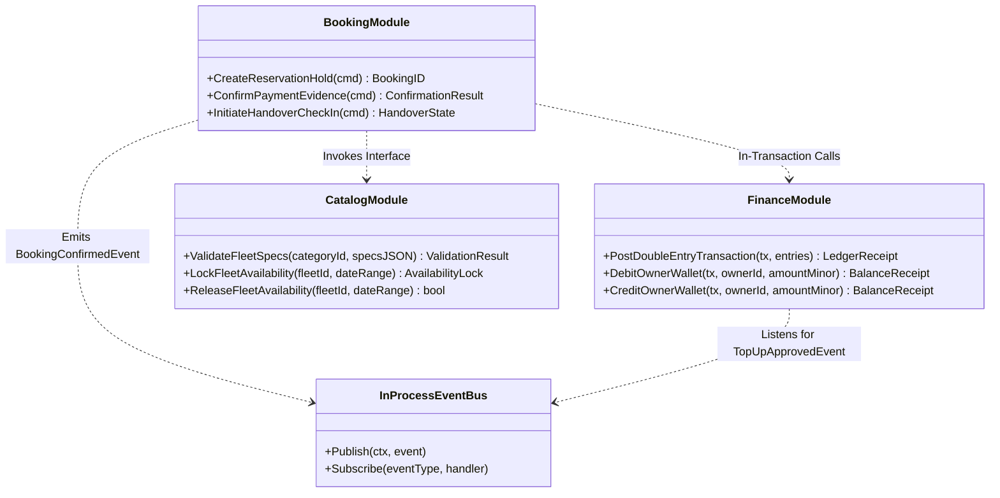
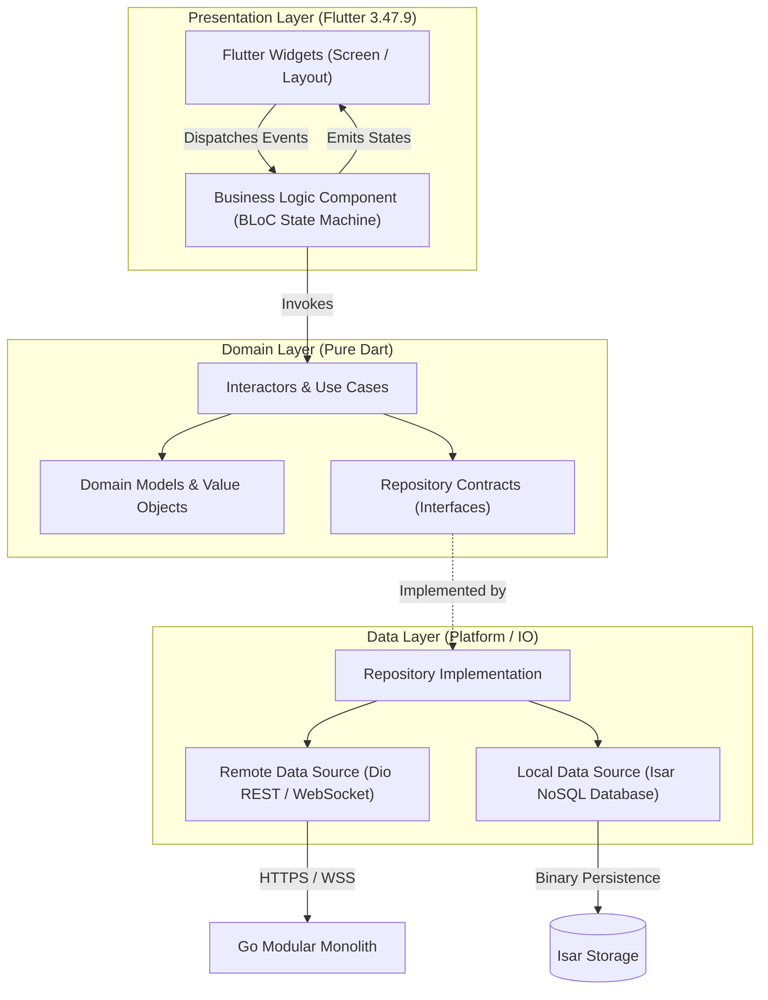
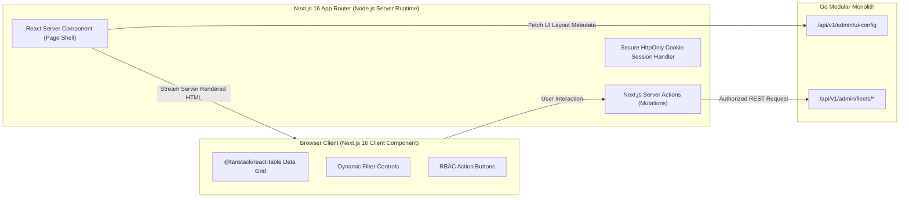
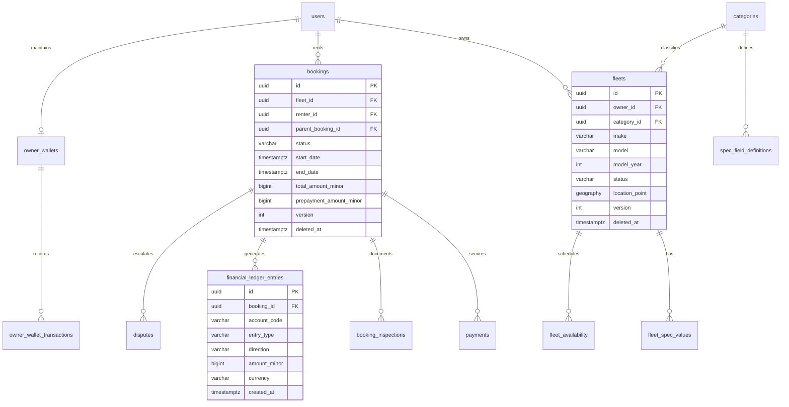
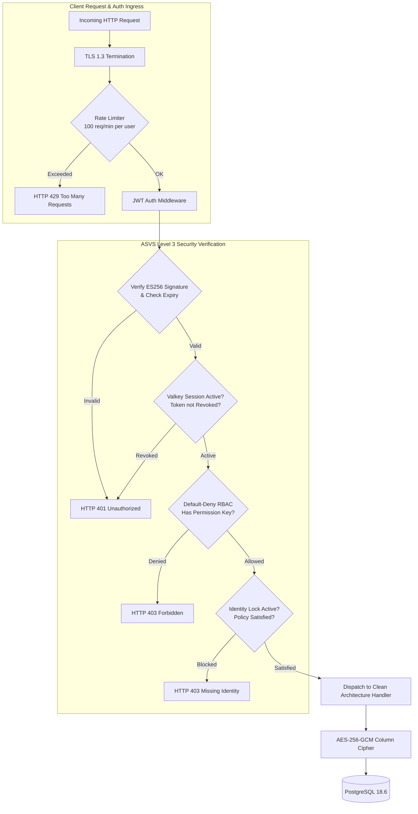

# Heavy Machinery & Logistics Rental Aggregator — Dink Machinery
## Architecture Design Document (ADD) (`docs/source/Architecture_Design_Document.md`)

**Document Identifier:** `ADD-DINK-CORE-V7.0`  
**Classification:** Canonical Architecture Specification & Engineering Blueprint (Single Source of Truth)  
**Governing Documents:** `SRS-DINK-CORE-V7.0` (Parts 1–5), `FLOW-DINK-CORE-V7.0`, `UIUX-DINK-CORE-V7.0`, `contracts/openapi.yaml`  
**Target Runtimes:** Go 1.27.3 Modular Monolith, Flutter 3.47.9 Cross-Platform Mobile Client, Next.js 16.x Admin Web Console (latest CVE security patch), PostgreSQL 18.6 + PostGIS 3.6.4, Valkey 9.1.3-alpine, SeaweedFS S3, ClamAV Daemon  
**Compliance Standards:** OWASP ASVS 4.0.3 Level 3, RFC 9457 (Problem Details), W3C WCAG 2.2 AA / AAA (Outdoor Mode), ISO/IEC/IEEE 42010, ISO 4217, ISO 3166-1 alpha-2  
**Status:** Approved Engineering Baseline

---

## Table of Contents

- 1. [Executive Summary & Architectural Invariants](#1-executive-summary--architectural-invariants)
- 2. [System Context & External Integrations (C4 Level 1)](#2-system-context--external-integrations-c4-level-1)
- 3. [Container Architecture & Technology Matrix (C4 Level 2)](#3-container-architecture--technology-matrix-c4-level-2)
- 4. [Modular Monolith Component Decomposition (C4 Level 3)](#4-modular-monolith-component-decomposition-c4-level-3)
  - 4.1 [Package & Boundary Encapsulation (`internal/modules/*`)](#41-package--boundary-encapsulation-internalmodules)
  - 4.2 [Domain Event Bus & In-Process Messaging](#42-domain-event-bus--in-process-messaging)
  - 4.3 [Transaction Boundaries & `pgx/v5` Persistence Protocol](#43-transaction-boundaries--pgxv5-persistence-protocol)
- 5. [Mobile Client Architecture (Flutter 3.47.9)](#5-mobile-client-architecture-flutter-344)
  - 5.1 [Feature-First Clean Architecture Layering](#51-feature-first-clean-architecture-layering)
  - 5.2 [BLoC State Management & Lifecycle](#52-bloc-state-management--lifecycle)
  - 5.3 [Offline-First Persistence (Isar NoSQL) & Outbox Sync Daemon](#53-offline-first-persistence-isar-nosql--outbox-sync-daemon)
  - 5.4 [OTA Dynamic Font Delivery Engine (`ADR-013`)](#54-ota-dynamic-font-delivery-engine-adr-013)
- 6. [Admin Web Console Architecture (Next.js 16)](#6-admin-web-console-architecture-nextjs-16)
  - 6.1 [React Server Components (RSC) & Server Actions](#61-react-server-components-rsc--server-actions)
  - 6.2 [Dynamic Metadata-Driven Table & Form Engine](#62-dynamic-metadata-driven-table--form-engine)
  - 6.3 [Fine-Grained RBAC & Dynamic Menu Compilation](#63-fine-grained-rbac--dynamic-menu-compilation)
- 7. [Data Architecture, Spatial Indexing & Ledger Integrity](#7-data-architecture-spatial-indexing--ledger-integrity)
  - 7.1 [Relational Storage & PostGIS 3.6.4 Spatial Queries](#71-relational-storage--postgis-34-spatial-queries)
  - 7.2 [Dynamic EAV Specifications & JSONB Indexing](#72-dynamic-eav-specifications--jsonb-indexing)
  - 7.3 [Immutable Double-Entry Financial Ledger (`BK-17-BE`)](#73-immutable-double-entry-financial-ledger-bk-17-be)
  - 7.4 [Distributed Mutex Locking & Valkey 9.1.3 Cache](#74-distributed-mutex-locking--valkey-80-cache)
  - 7.5 [Blob Storage Topology & ClamAV Antivirus Pipeline](#75-blob-storage-topology--clamav-antivirus-pipeline)
- 8. [Security Architecture & ASVS Level 3 Governance](#8-security-architecture--asvs-level-3-governance)
  - 8.1 [Authentication, ES256 JWT & Rotating Refresh Tokens](#81-authentication-es256-jwt--rotating-refresh-tokens)
  - 8.2 [WebAuthn Passkeys & Hardware-Backed MFA](#82-webauthn-passkeys--hardware-backed-mfa)
  - 8.3 [Field-Level Encryption (AES-256-GCM) & Zero-PII Logging](#83-field-level-encryption-aes-256-gcm--zero-pii-logging)
  - 8.4 [Default-Deny RBAC & Permission Middleware](#84-default-deny-rbac--permission-middleware)
- 9. [Cross-Cutting Technical Workflows](#9-cross-cutting-technical-workflows)
  - 9.1 [The 20-State Booking Machine & Concurrency Control (OCC)](#91-the-20-state-booking-machine--concurrency-control-occ)
  - 9.2 [Direct Transfer Model vs. Pluggable Payment Gateways](#92-direct-transfer-model-vs-pluggable-payment-gateways)
  - 9.3 [Pluggable Identity Provider Pipeline](#93-pluggable-identity-provider-pipeline)
  - 9.4 [Operator Telematics & Geofencing Engine](#94-operator-telematics--geofencing-engine)
- 10. [Infrastructure Deployment Topology & Observability](#10-infrastructure-deployment-topology--observability)
  - 10.1 [Production Container Deployment Topology](#101-production-container-deployment-topology)
  - 10.2 [High Availability, Backups & Disaster Recovery (RPO/RTO)](#102-high-availability-backups--disaster-recovery-rport)
  - 10.3 [Observability, Structured Logging & RED Metrics](#103-observability-structured-logging--red-metrics)
- 11. [Architectural Decision Records (ADR Log)](#11-architectural-decision-records-adr-log)

---

## 1. Executive Summary & Architectural Invariants

The Dink Machinery software ecosystem operates as an enterprise-grade heavy equipment and logistics aggregator engineered specifically for East Africa (Ethiopia and Kenya). It solves asset discovery friction, machine transport logistics, informal payment verification, and equipment utilization tracking.

### The Nine Non-Negotiable Architectural Invariants

1. **Contract Supremacy:** Wire models, API contracts, parameters, and error models are strictly governed by `contracts/openapi.yaml`. Manual DTO changes that diverge from the contract fail CI linting immediately.
2. **Strict Integer Minor-Unit Currency Representation:** Floating-point numbers are prohibited for financial calculations. All monetary attributes are 64-bit signed integers (`int64` / `BIGINT`) representing minor currency units (Santims for `ETB`, Cents for `KES` and `USD`) paired with an ISO 4217 code (`MoneyAmount`).
3. **Atomic Double-Entry Ledger Posting (`BK-17-BE`):** State transitions mutating balances and double-entry ledger entries (`financial_ledger_entries`) execute inside a single atomic database transaction (`pgx.Tx`). Debits and credits balance to zero minor units.
4. **Optimistic Concurrency Control (OCC):** Stateful tables (`bookings`, `fleets`, `owner_wallets`, `booking_inspections`) maintain `version INT NOT NULL DEFAULT 1` and update via `WHERE id = $1 AND version = $2`.
5. **Universal Soft-Delete Policy (`SD-01-BE`):** Mutable operational entities implement `deleted_at TIMESTAMPTZ NULL`. Hard deletes are blocked from application queries.
6. **Multi-Country Parameterization (`LOC-01-BE`):** Regulatory parameters (dialing prefixes, currency codes, VAT rates, dispute SLA durations) resolve dynamically from `country_configs`.
7. **OWASP ASVS Level 3 Zero-PII Security:** Customer PII (National ID, phone number, TIN, bank accounts) is encrypted at rest using AES-256-GCM, masked in structured logs, and excluded from error messages.
8. **RFC 9457 Universal Error Envelope:** Every non-2xx response conforms strictly to RFC 9457 Problem Details. Internal stack traces or database driver leakages are prohibited.
9. **Single Modular Monolith Deployment:** The backend compiles into a single static Go binary. Microservice network serialization overhead is avoided in favor of strict in-process package boundaries.

---

## 2. System Context & External Integrations (C4 Level 1)



---

## 3. Container Architecture & Technology Matrix (C4 Level 2)



### Complete Technology Matrix

| Layer | Component | Version / Runtime | Architectural Justification |
|---|---|---|---|
| **API Edge Gateway** | Traefik Ingress | `3.1+` | Cloud-native Go gateway; handles automatic TLS 1.3 termination, rate-limiting, and Brotli/Gzip compression. |
| **Backend Monolith** | Go | `1.27.3` | High concurrency, memory efficiency ($\le 256\text{MB}$ RSS), fast compile times, strict typing, and zero-allocation routing via Chi. |
| **HTTP Routing** | Chi Router | `v5.0.12` | Lightweight, 100% standard library compatible HTTP router; zero third-party lock-in. |
| **Database Driver** | `jackc/pgx/v5` | `v5.7.1` | Native PostgreSQL binary protocol encoding, pooled connections (`pgxpool`), and low allocation overhead. |
| **SQL Compiler** | `sqlc` | `v1.27.0` | Generates type-safe Go structs and queries directly from raw SQL migrations; guarantees compile-time query verification. |
| **Primary Database** | PostgreSQL + PostGIS | `18.6` / `3.6.4` | ACID relational compliance, advanced spatial distance calculations (`ST_DWithin`), JSONB EAV indexing via GIN. |
| **Distributed Cache & Mutex**| Valkey | `8.0-alpine` | High-throughput open-source Redis replacement; powers 60-min reservation hold locks (`SET NX EX`) and session tokens. |
| **Object Persistence** | SeaweedFS | `3.70+` | High-performance Go-based object storage; S3-compatible, horizontally scalable, optimized for millions of small/medium photos. |
| **Antivirus Scanning** | ClamAV Daemon | `1.3.1` | Synchronous malware inspection (`zINSTREAM`) verifying all uploaded media before S3 persistence. |
| **Mobile Client** | Flutter / Dart | `3.47.9` / `3.9` | Single cross-platform codebase compiling to native ARM64 for Android and iOS; 60fps animations, accessible layout tree. |
| **Admin Web Console** | Next.js / React | `16.x` / `19.x` | React Server Components by default, SSR performance, edge hydration, and dynamic data tables via `@tanstack/react-table`. |
| **Secrets & Keys** | OpenBao | `2.0+` | Linux Foundation open-source Vault fork managing column-encryption master keys and JWT signing credentials. |

---

## 4. Modular Monolith Component Decomposition (C4 Level 3)

The Go backend utilizes Clean Architecture packaged by bounded context. Direct cross-module database queries are prohibited. Modules communicate via exported interfaces and an in-process domain event bus.

```text
backend/
├── cmd/
│   └── server/
│       └── main.go                 # App wiring, dependency injection, HTTP lifecycle
├── internal/
│   ├── platform/                   # Cross-cutting platform infrastructure
│   │   ├── config/                 # Dynamic environment & country configurations
│   │   ├── database/               # pgxpool connection pool and migration runners
│   │   ├── eventbus/               # Type-safe in-process domain event bus
│   │   ├── logger/                 # Zap JSON logger with zero-PII masking core
│   │   ├── middleware/             # Auth, RFC 9457 error handler, rate-limit, recovery
│   │   ├── security/               # AES-256-GCM cipher, WebAuthn, ES256 JWT
│   │   └── storage/                # SeaweedFS S3 adapter & ClamAV stream scanner
│   └── modules/                    # Bounded context packages (Clean Architecture)
│       ├── auth/                   # Identity, OTP, MFA, Fayda adapter, Session mgmt
│       ├── catalog/                # Fleet registry, Dynamic EAV specs, Attachments
│       ├── search/                 # PostGIS spatial queries, Faceted search, Ranking
│       ├── booking/                # 20-State machine, Valkey hold locks, Invoicing
│       ├── inspection/             # Handover stepper, Monotonic meters, Attestations
│       ├── dispute/                # Arbitration, Lightbox comparison, 3-day SLA cron
│       ├── finance/                # Double-entry ledger, Owner wallet, Commission
│       ├── logistics/              # Transport sub-bookings, Weight matching, Cascades
│       ├── notification/           # Multi-channel router (SMS, Push, In-App, Email)
│       ├── telematics/             # WebSocket ingress, GPS tracking, Geofence checks
│       └── adminui/                # Server-driven UI config engine (/admin/ui-config)
```



### 4.1 Package & Boundary Encapsulation (`internal/modules/*`)

Each module defines three internal tiers:
1. **Domain Layer:** Pure business entities, state transition machines, and domain invariants. Zero external dependencies.
2. **Application (Use Case) Layer:** Coordinates transactional workflows, orchestrates domain entities, and defines outbound repository interfaces.
3. **Infrastructure / Port Layer:** Implements outbound interfaces (`sqlc` repositories, Valkey commands, S3 client, external HTTP adapters).

### 4.2 Domain Event Bus & In-Process Messaging

To decouple asynchronous processes (e.g. sending SMS notifications, triggering image re-compression, updating search materialized views), the system uses an in-memory, thread-safe Go event bus backed by buffered channels and worker pools.

```go
// Event represents a typed domain occurrence
type Event interface {
    EventID() string
    EventType() string
    OccurredAt() time.Time
}

// EventBus provides publish-subscribe capabilities inside the monolith
type EventBus interface {
    Publish(ctx context.Context, event Event) error
    Subscribe(eventType string, handler func(ctx context.Context, event Event) error)
}
```

### 4.3 Transaction Boundaries & `pgx/v5` Persistence Protocol

Cross-table mutating workflows execute inside a single PostgreSQL transaction (`pgx.Tx`). When a use case orchestrates multiple sub-repositories, a transactional unit-of-work wraps the execution context:

```go
func (s *BookingService) ConfirmPayment(ctx context.Context, cmd ConfirmPaymentCmd) error {
    return s.unitOfWork.Execute(ctx, func(tx pgx.Tx) error {
        // 1. Acquire row-level lock on Booking and verify OCC version
        booking, err := s.bookingRepo.GetForUpdate(ctx, tx, cmd.BookingID)
        if err != nil { return err }

        // 2. Advance 20-state machine
        if err := booking.TransitionTo(StateConfirmed); err != nil { return err }
        if err := s.bookingRepo.Update(ctx, tx, booking); err != nil { return err }

        // 3. Atomically debit commission from OwnerWallet
        commissionMinor := s.calculator.ComputeCommission(booking.BaseAmountMinor)
        if err := s.financeRepo.DebitWallet(ctx, tx, booking.OwnerID, commissionMinor); err != nil {
            return err
        }

        // 4. Append to double-entry financial ledger
        return s.ledgerRepo.Post(ctx, tx, NewCommissionDebitLedgerEntries(booking, commissionMinor))
    })
}
```

---

## 5. Mobile Client Architecture (Flutter 3.47.9)

The mobile client is built on Flutter 3.47.9 (Dart 3.9) using Feature-First Clean Architecture. A unified binary serves Renters, Fleet Owners, and Operators, dynamically altering visible tabs, navigation drawers, and actions according to the authenticated persona's active claims.



### 5.1 Feature-First Clean Architecture Layering
Every feature (`features/booking`, `features/inspection`, `features/catalog`) is completely self-contained:
* `presentation/`: Widgets, screens, BLoCs, and UI state models.
* `domain/`: Pure Dart entities, use cases, and repository interfaces.
* `data/`: DTO wire models, API data sources, and local database entities.

### 5.2 BLoC State Management & Lifecycle
State management is enforced strictly via `flutter_bloc`. BLoCs act as localized state machines receiving immutable events and emitting immutable states. View layers contain zero business logic.

### 5.3 Offline-First Persistence (Isar NoSQL) & Outbox Sync Daemon
Field inspectors operate in deep construction corridors lacking cellular connectivity. The mobile app implements the **Outbox Pattern**:
1. Inspections and attestations save immediately to the local **Isar database** with `sync_status = "QUEUED"` and a client-generated UUIDv4 idempotency key.
2. Full-resolution photos compress locally into WebP format ($1600\text{ px}$ max edge, $82\%$ quality) in the device's sandbox.
3. An active `connectivity_plus` background listener detects connection recovery and launches `SyncEngine.processQueue()`, uploading files and syncing records sequentially without data loss.

### 5.4 OTA Dynamic Font Delivery Engine (`ADR-013`)
To prevent APK/IPA bundle bloat, non-Latin typography (Noto Sans Ethiopic for Amharic and Oromo) is excluded from the build-time asset bundle. Upon selecting an Ethiopic locale:
1. The app checks local storage for a cached TTF/OTF font file.
2. If absent, it downloads the font binary over HTTPS from SeaweedFS S3.
3. It validates the downloaded binary against a pre-baked SHA-256 checksum.
4. It registers the font dynamically via Flutter's `FontLoader` API and triggers a global text-theme rebuild.

---

## 6. Admin Web Console Architecture (Next.js 16)

The administrative web console provides back-office capabilities for platform operations, financial reconciliation, and dispute arbitration.



### 6.1 React Server Components (RSC) & Server Actions
* **Server-First Fetching:** Administrative pages fetch data directly on the server runtime via React Server Components, eliminating client-side loading flashes and securing API tokens.
* **Mutations via Server Actions:** Form submissions, KYC approvals, and dispute rulings execute via Next.js Server Actions, verifying CSRF tokens and user permissions before dispatching to the Go backend.

### 6.2 Dynamic Metadata-Driven Table & Form Engine
The web console avoids hardcoding operational pages. The layout shell queries `/api/v1/admin/ui-config` on load:
* Data table columns (`header`, `accessorKey`, `sortable`, `cellFormat`) are delivered dynamically from `admin_table_columns`.
* Grids instantiate on the fly via `@tanstack/react-table`, applying sorting and filtering rules without requiring frontend code changes.

### 6.3 Fine-Grained RBAC & Dynamic Menu Compilation
The top-level navigation tree compiles dynamically based on the administrator's permission set:
* A `support_agent` receives access only to `/admin/disputes` and `/admin/tickets`.
* A `finance_admin` receives access to `/admin/ledger`, `/admin/wallets`, and `/admin/payouts`.
* Action buttons (e.g. "Approve Fleet", "Issue Refund") are omitted from the DOM entirely if the caller lacks the required permission key.

---

## 7. Data Architecture, Spatial Indexing & Ledger Integrity



### 7.1 Relational Storage & PostGIS 3.6.4 Spatial Queries
Geographic coordinates are persisted using PostGIS native spatial types:
```sql
ALTER TABLE fleets ADD COLUMN location_point geography(POINT, 4326);
CREATE INDEX idx_fleets_location_point ON fleets USING GIST (location_point);
```
Radius queries execute using spheroidal spatial distance math:
```sql
SELECT id, make, model, daily_rate_amount_minor,
       ST_Distance(location_point, ST_SetSRID(ST_MakePoint($1, $2), 4326)::geography) / 1000.0 AS distance_km
FROM fleets
WHERE status = 'ACTIVE'
  AND deleted_at IS NULL
  AND ST_DWithin(location_point, ST_SetSRID(ST_MakePoint($1, $2), 4326)::geography, $3 * 1000.0)
ORDER BY distance_km ASC
LIMIT $4 OFFSET $5;
```

### 7.2 Dynamic EAV Specifications & JSONB Indexing
To support diverse technical specifications across excavators, cranes, dump trucks, and lowboy trailers, dynamic specs are stored in structured JSONB columns indexed via GIN:
```sql
CREATE INDEX idx_fleet_specs_gin ON fleet_spec_indexed USING GIN (specs jsonb_path_ops);
```

### 7.3 Immutable Double-Entry Financial Ledger (`BK-17-BE`)
All financial operations post to the immutable `financial_ledger_entries` audit log:
* Ledger rows are strictly **append-only**. Updates and deletes are blocked by a PostgreSQL trigger.
* Every transaction posts balanced **Debit** and **Credit** entries.
* A transaction constraint verifies that:
  $$\sum \text{Amount}_{\text{Debit}} + \sum \text{Amount}_{\text{Credit}} = 0$$

### 7.4 Distributed Mutex Locking & Valkey 9.1.3 Cache
To prevent race conditions during booking creation, a distributed lock is acquired in Valkey:
```text
SET lock:hold:fleet:{fleet_id} {renter_id} NX EX 3600
```
* **Atomicity:** `NX` ensures only one caller can acquire the hold.
* **Auto-Expiration:** `EX 3600` ensures that if a renter fails to upload payment proof within 60 minutes, the hold expires automatically without blocking the machinery.

### 7.5 Blob Storage Topology & ClamAV Antivirus Pipeline
* Media streams directly through the Go API into the **ClamAV daemon** via TCP socket (`zINSTREAM`).
* If malware is identified, the connection aborts immediately, and the client receives an RFC 9457 error (`INSPECT_MEDIA_SCAN_FAILED`).
* Clean streams are piped directly to **SeaweedFS S3**, returning a content-addressed storage URI.

---

## 8. Security Architecture & ASVS Level 3 Governance



### 8.1 Authentication, ES256 JWT & Rotating Refresh Tokens
* Access tokens are short-lived (15 minutes), digitally signed with an **ECDSA P-256 (ES256)** private key.
* Refresh tokens are single-use cryptographically random 256-bit tokens stored in Valkey with a 30-day sliding expiry.
* Exchanging a refresh token rotates both the access and refresh token, invalidating the old token family if reuse is detected.

### 8.2 WebAuthn Passkeys & Hardware-Backed MFA
* The platform implements WebAuthn / FIDO2 passkeys for passwordless authentication and progressive step-up authorization.
* Stored public credentials in `user_webauthn_credentials` enforce a monotonic `sign_count` check to detect cloned authenticators.
* Administrative roles require mandatory TOTP multi-factor authentication.

### 8.3 Field-Level Encryption (AES-256-GCM) & Zero-PII Logging
* Highly sensitive database columns (TIN, National ID, Bank Account Numbers, Personal Phone Numbers) are encrypted at the application layer using **AES-256-GCM** with authenticated data (AAD) bound to the user's primary key.
* The logging pipeline applies a Zap PII-scrubbing core that matches regex patterns for phone numbers, national IDs, and JWTs, replacing sensitive substrings with `[REDACTED]`.

### 8.4 Default-Deny RBAC & Permission Middleware
All administrative and mutation routes implement default-deny authorization checks. Unless a user's role explicitly includes the targeted permission key (e.g., `fleets:approve`), the request terminates with an HTTP 403 Forbidden response.

---

## 9. Cross-Cutting Technical Workflows

### 9.1 The 20-State Booking Machine & Concurrency Control (OCC)
Booking state changes are strictly governed by the canonical 20-state engine:

```text
DRAFT -> HOLD_PENDING -> PAYMENT_EVIDENCE_UPLOADED -> CONFIRMED -> READY_FOR_PICKUP -> ACTIVE -> RETURN_INITIATED -> PENDING_FINAL_PAYMENT -> COMPLETED -> RATED -> CLOSED
```

Branch states include:
* `HOLD_EXPIRED` (timeout on initial reservation)
* `PAYMENT_DECLINED` (owner rejects payment receipt)
* `DISPUTE_OPENED` (arbitration triggered)
* `DISPUTED_HOUR_METER` (pre/post-rental meter conflict)
* `DAMAGE_PARTIAL_RESOLVED` (admin partial damage ruling)
* `AWAITING_FLEET_READINESS` (owner reports mobilization delay)
* `PENDING_ADDITIONAL_PAYMENT` (owner requests extra mobilization fee)
* `CANCELLED` (terminal aborted state)

### 9.2 Direct Transfer Model vs. Pluggable Payment Gateways
The platform provides a dual settlement-method architecture:
1. **Manual Direct Transfer Model (`MANUAL_TRANSFER`):** Renter transfers funds directly to the owner's bank account. Renter uploads payment evidence. Owner verifies and confirms receipt. Platform commission is debited from the owner's pre-funded `OwnerWallet`.
2. **Pluggable Payment Gateways (`GATEWAY`):** Telco rails (Telebirr, MPESA) initiate transactions via standardized adapters (`PaymentGatewayAdapter`). Callbacks verify cryptographic signatures and auto-advance booking states.

### 9.3 Pluggable Identity Provider Pipeline
Identity verification operates through a pluggable interface:
```go
type IdentityVerificationProvider interface {
    Submit(ctx context.Context, identifier string, consent bool) (*ProviderResult, error)
    QueryStatus(ctx context.Context, providerRef string) (*ProviderStatus, error)
}
```
* **Fayda Registry:** Acts as the reference implementation in Ethiopia.
* **Enforcement Engine:** Dynamically assesses provider requirements against `ALL`, `ANY`, or `N_OF_M` policies configured by platform administrators.

### 9.4 Operator Telematics & Geofencing Engine
* Field operators stream high-precision telemetry packets (`lat`, `lng`, `speed`, `heading`, `timestamp`) every 30 seconds over a secure WebSocket (`/ws/v1/bookings/{id}/tracking`).
* The backend evaluates incoming coordinates against the project site's boundary using PostGIS `ST_DWithin`.
* If a machine moves outside the approved perimeter ($> 1,000\text{m}$), a high-priority geofence breach event alerts the owner via FCM push.
* Tracking terminates automatically when the booking reaches `COMPLETED`, and raw GPS breadcrumbs are permanently pruned after 30 days.

---

## 10. Infrastructure Deployment Topology & Observability

```mermaid
flowchart TD
    subgraph PublicInternet["Public Internet & Edge Network"]
        DNS["GeoDNS Routing<br>(Addis Ababa / Nairobi Edge)"]
        WAF["Edge DDoS Protection & WAF"]
    end

    subgraph DemilitarizedZone["DMZ / Ingress Tier"]
        TraefikCluster["Traefik 3.x Gateway Cluster<br>(Active-Active Load Balanced)"]
    end

    subgraph ApplicationTier["Application Workload Tier"]
        GoNode1["Go Monolith Replica 1<br>(Internal App Server)"]
        GoNode2["Go Monolith Replica 2<br>(Internal App Server)"]
        NextNode["Next.js 16 Web Cluster<br>(React Server Components)"]
    end

    subgraph DataStorageTier["Persistence & Data Tier"]
        PGPrimary[("PostgreSQL 18.6 Primary<br>(RW Master)")]
        PGReplica[("PostgreSQL 18.6 Standby<br>(RO Read Replica)")]
        ValkeyCluster[("Valkey 9.1.3 Cluster<br>(Primary-Replica Sentinel)")]
        SeaweedCluster[("SeaweedFS S3 Cluster<br>(Distributed Volume Servers)")]
    end

    DNS --> WAF
    WAF --> TraefikCluster

    TraefikCluster -->|Port 8080| GoNode1 & GoNode2
    TraefikCluster -->|Port 3000| NextNode

    GoNode1 & GoNode2 -->|pgxpool RW| PGPrimary
    GoNode1 & GoNode2 -->|pgxpool RO| PGReplica
    PGPrimary -.->|Streaming Replication (WAL)| PGReplica

    GoNode1 & GoNode2 -->|TCP Port 6379| ValkeyCluster
    GoNode1 & GoNode2 -->|S3 Port 8333| SeaweedCluster
```

### 10.1 Production Container Deployment Topology
The platform deploys as containerized workloads orchestrated via Docker Compose / Kubernetes:
* **Ingress:** Traefik 3.x cluster exposing ports `80` (HTTP to HTTPS redirect) and `443` (TLS 1.3).
* **Workloads:** Go application replicas running unprivileged (`nonroot`), exposing internal metrics on `:9090` and application APIs on `:8080`.
* **Database:** PostgreSQL 18.6 instance utilizing NVMe storage, tuned for high concurrency connection pooling (`max_connections = 250`, `shared_buffers = 4GB`, `work_mem = 64MB`).

### 10.2 High Availability, Backups & Disaster Recovery (RPO/RTO)
* **High Availability:** Application nodes deploy in an active-active configuration behind Traefik load balancers.
* **Continuous Backups:** PostgreSQL writes write-ahead logs (WAL) continuously to an isolated secondary storage zone. Hourly snapshots and daily full dumps are retained for 30 days.
* **Disaster Recovery SLA:**
  * **Recovery Point Objective (RPO):** $\le 1\text{ hour}$ (target $0\text{s}$ via synchronous replication).
  * **Recovery Time Objective (RTO):** $\le 4\text{ hours}$ (target $< 60\text{s}$ automated failover).

### 10.3 Observability, Structured Logging & RED Metrics
* **Structured Logging:** All logs output in JSON format with contextual attributes (`timestamp`, `level`, `service`, `correlation_id`, `trace_id`, `caller`).
* **RED Metrics:** Endpoints expose Prometheus-compatible metrics at `/metrics` measuring:
  * **Rate:** Requests per second per endpoint.
  * **Errors:** Count of 4xx and 5xx responses categorized by RFC 9457 problem type.
  * **Duration:** Request latency histograms tracking P50, P90, P95, and P99 percentiles.
* **Distributed Tracing:** Trace contexts propagate across client and server boundaries using W3C `traceparent` headers.

---

## 11. Architectural Decision Records (ADR Log)

### ADR-001: Architecture Style — Modular Monolith over Microservices
* **Context:** Microservice architectures introduce network serialization overhead, distributed transaction complexities, and high DevOps maintenance costs.
* **Decision:** Build the backend as a single compiled Go 1.27.3 modular monolith with strict package boundaries.
* **Consequences:** Simplifies deployment, enables single-binary operations, and permits in-memory atomic transactions (`pgx.Tx`) while maintaining modular isolation.

### ADR-002: Monetary Representation — Integer Minor-Unit Math
* **Context:** Floating-point representations introduce precision errors in currency arithmetic.
* **Decision:** Model all financial values as 64-bit signed integers (`int64` / `BIGINT`) representing minor currency units (Santims for `ETB`, Cents for `KES` and `USD`) paired with an ISO 4217 currency code.
* **Consequences:** Completely eliminates rounding errors and float drift across ledger calculations.

### ADR-003: Concurrency Control — Versioned Optimistic Concurrency Control (OCC)
* **Context:** High-demand equipment can experience simultaneous reservation attempts from multiple contractors.
* **Decision:** Enforce optimistic concurrency control on all mutable operational entities using a `version INT NOT NULL DEFAULT 1` column.
* **Consequences:** Updates assert `WHERE id = $1 AND version = $2`. Conflicting operations fail safely with HTTP 409 Conflict without deadlocking database rows.

### ADR-004: Geospatial Indexing — PostgreSQL + PostGIS 3.6.4
* **Context:** Search requires high-speed spatial distance queries and corridor filtering across heavy machinery locations.
* **Decision:** Utilize PostgreSQL PostGIS geometry/geography data types indexed via GiST.
* **Consequences:** Distance queries execute within $\le 80\text{ ms}$ at P95 without requiring a separate geospatial search cluster.

### ADR-005: Temporary Reservation Locks — Valkey Distributed Mutex
* **Context:** Renters need time to complete manual bank transfers without allowing another user to reserve the same machine.
* **Decision:** Use Valkey 9.1.3 `SET lock:hold:fleet:{id} {renter_id} NX EX 3600` to create a 60-minute reservation hold.
* **Consequences:** Ensures atomic hold reservation with automatic TTL release if payment evidence is not uploaded.

### ADR-006: Antivirus Ingress — Synchronous ClamAV Stream Scanning
* **Context:** Contractors and owners upload photos and PDF trade licenses from field devices, introducing malware risks.
* **Decision:** Route all file upload streams synchronously through a local ClamAV daemon using the `zINSTREAM` protocol before persisting to S3.
* **Consequences:** Infected files are rejected at the edge before storage; prevents malicious payload spread.

### ADR-007: Mobile Architecture — Flutter Feature-First Clean Architecture
* **Context:** The mobile app must serve three user roles, maintain offline reliability, and execute complex state machines.
* **Decision:** Implement Flutter 3.47.9 with Feature-First packaging, BLoC state management, and an Isar local database.
* **Consequences:** Clean separation of concerns, isolated testing, and robust offline field inspection support.

### ADR-008: Admin Console — Server-Driven Metadata Architecture (`/admin/ui-config`)
* **Context:** Operational requirements frequently add new machinery categories and custom specifications without warranting frontend rebuilds.
* **Decision:** The Next.js 16 web console dynamically queries `/api/v1/admin/ui-config` to build navigation, table columns, and form fields.
* **Consequences:** Administrators can configure categories, specifications, and layout tables without redeploying frontend code.

### ADR-009: Pluggable Identity Verification Framework
* **Context:** Ethiopia is transitioning to the Fayda National ID system, while future regional expansion requires supporting Kenyan identity rails.
* **Decision:** Decouple identity verification behind a provider-agnostic adapter framework (`REG-IDP-01-BE`) with Fayda as the reference implementation.
* **Consequences:** New national identity providers plug in via configuration and adapter interfaces without modifying transactional workflows.

### ADR-010: Error Response Standardization — RFC 9457 Problem Details
* **Context:** Heterogeneous error structures complicate client-side parsing and obscure root-cause debugging.
* **Decision:** All 4xx and 5xx API responses conform strictly to RFC 9457 (`application/problem+json`).
* **Consequences:** Predictable error handling across Flutter and Next.js clients, complete with error codes, human titles, and validation parameter breakdowns.

### ADR-011: Data Retention & Privacy — Monotonic Pruning Pipeline
* **Context:** Compliance with the Ethiopian Personal Data Protection Proclamation No. 1321/2024 requires strict data minimization.
* **Decision:** Retain financial audit records for exactly 7 years, anonymize user PII 5 years post-account deletion, and prune raw GPS coordinate breadcrumbs after 30 days.
* **Consequences:** Satisfies legal audit mandates while guaranteeing that high-precision location trails are not stored indefinitely.

### ADR-012: Object Persistence — SeaweedFS S3
* **Context:** Storing millions of equipment photos and inspection images requires scalable, low-latency blob storage without proprietary cloud lock-in.
* **Decision:** Deploy SeaweedFS S3 storage backed by local volume servers.
* **Consequences:** High-throughput read/write performance, native Go ecosystem compatibility, and full S3 API compliance.

### ADR-013: Multilingual Typography — Over-The-Air (OTA) Font Loading
* **Context:** Including all Ge'ez (Ethiopic) and Arabic fonts in the mobile app bundle inflates download sizes for users on limited bandwidth.
* **Decision:** Ship only Latin fonts in the base binary. Download Ethiopic fonts on-demand from S3 with SHA-256 verification and hot-load via Flutter `FontLoader`.
* **Consequences:** Reduces initial application bundle size while providing sharp, unclipped non-Latin typography.

### ADR-014: Ledger Architecture — In-Transaction Double-Entry Immutability
* **Context:** Financial audits require provable mathematical tracking of all money movements.
* **Decision:** All payments, wallet debits, and adjustments post to `financial_ledger_entries` inside the same database transaction mutating the domain entity, enforcing zero-sum balancing.
* **Consequences:** Guarantees zero ledger drift, unalterable audit trails, and automated accounting reconciliation.

---

*This document constitutes the canonical Architecture Design Document for Dink Machinery Version 7.0. All downstream engineering, database migrations, and component implementations must strictly adhere to the technical patterns and invariants specified herein.*