# Heavy Machinery & Logistics Rental Aggregator — Dink Machinery
## System Architecture, Application Flow Diagrams & UI/UX Design System Specification

**Document Identifier:** `ARCH-UIUX-DINK-CORE-V7.0`  
**Classification:** Canonical Architecture, Sequence Choreography & UX Baseline (Single Source of Truth)  
**Governing Specifications:** `SRS-DINK-CORE-V7.0` (Parts 1–5), `contracts/openapi.yaml`, `ADR-013` (OTA Typography)  
**Target Platforms:** Flutter 3.47.8 Mobile (iOS & Android), Next.js 16 Admin Web Console (Desktop & Tablet)  
**Backend & Data Runtimes:** Go 1.27.3 Modular Monolith, PostgreSQL 18.6 + PostGIS 3.6.4, Valkey 9.1.3-alpine, SeaweedFS S3, ClamAV Daemon  
**Target Markets:** Ethiopia (`ET`) & Kenya (`KE`) — Dynamic Multi-Country Parameterization (`LOC-01-BE`)  
**Compliance Standards:** OWASP ASVS 4.0.3 Level 3, W3C WCAG 2.2 AA / AAA (Outdoor Mode), RFC 9457 (Problem Details), ISO 4217, ISO 3166-1 alpha-2  
**Status:** Approved Unified Baseline

---

## Table of Contents

- [Part I: System Architecture & Flow Choreography](#part-i-system-architecture--flow-choreography)
  - 1. [High-Level System Context & Multi-Persona Ingress](#1-high-level-system-context--multi-persona-ingress)
  - 2. [Identity, Registration & Pluggable Verification Flows](#2-identity-registration--pluggable-verification-flows)
    - 2.1 [Passwordless Phone OTP Authentication & Refresh Rotation](#21-passwordless-phone-otp-authentication--refresh-rotation)
    - 2.2 [Pluggable Identity Verification (Fayda / National ID Adapter)](#22-pluggable-identity-verification-fayda--national-id-adapter)
    - 2.3 [Multi-Factor Authentication (Passkey WebAuthn & TOTP)](#23-multi-factor-authentication-passkey-webauthn--totp)
  - 3. [Fleet Registration, Dynamic EAV Taxonomy & Availability Scheduling](#3-fleet-registration-dynamic-eav-taxonomy--availability-scheduling)
  - 4. [Geospatial Radius Discovery, Corridor Search & Filtering (PostGIS)](#4-geospatial-radius-discovery-corridor-search--filtering-postgis)
  - 5. [End-to-End Booking Reservation, 60-Minute Valkey Hold & Dual Settlement](#5-end-to-end-booking-reservation-60-minute-valkey-hold--dual-settlement)
    - 5.1 [Manual Direct Transfer Flow (`MANUAL_TRANSFER` / Direct Transfer Model)](#51-manual-direct-transfer-flow-manual_transfer--direct-transfer-model)
    - 5.2 [Online Payment Gateway Flow (`GATEWAY` / Pluggable Adapter)](#52-online-payment-gateway-flow-gateway--pluggable-adapter)
  - 6. [The Canonical 20-State Booking Machine Choreography](#6-the-canonical-20-state-booking-machine-choreography)
  - 7. [Handover Check-In & Check-Out Inspection Workflow (Monotonic Meters & ClamAV)](#7-handover-check-in--check-out-inspection-workflow-monotonic-meters--clamav)
  - 8. [Damage Dispute Arbitration, SLA Escalation & Escrow Settlement](#8-damage-dispute-arbitration-sla-escalation--escrow-settlement)
  - 9. [Logistics Transport Sub-Booking & Bidirectional Cascade Cancellation](#9-logistics-transport-sub-booking--bidirectional-cascade-cancellation)
  - 10. [Double-Entry Financial Ledger & Wallet-Debit Commission Accounting](#10-double-entry-financial-ledger--wallet-debit-commission-accounting)
  - 11. [Operator Dispatch, 30-Second GPS Telematics & Geofence Breach Engine](#11-operator-dispatch-30-second-gps-telematics--geofence-breach-engine)
  - 12. [Server-Driven Dynamic Admin UI Engine (`/api/v1/admin/ui-config`)](#12-server-driven-dynamic-admin-ui-engine-apiv1adminui-config)
  - 13. [Dynamic Multilingual Typography & OTA Font Pipeline (`ADR-013`)](#13-dynamic-multilingual-typography--ota-font-pipeline-adr-013)
  - 14. [Offline-First Resilience, Isar Local Store & Background Sync Engine](#14-offline-first-resilience-isar-local-store--background-sync-engine)
- [Part II: Industrial Ergonomics & UI/UX Design System](#part-ii-industrial-ergonomics--uiux-design-system)
  - 15. [Executive Summary & Product Persona Context](#15-executive-summary--product-persona-context)
  - 16. [Industrial Ergonomics & Environmental Constraints](#16-industrial-ergonomics--environmental-constraints)
    - 16.1 [Direct Sunlight & High-Glare Visibility](#161-direct-sunlight--high-glare-visibility)
    - 16.2 [Gloved Hands, Vibration & Tactile Feedback](#162-gloved-hands-vibration--tactile-feedback)
    - 16.3 [One-Handed Field Operation & Thumb Zones](#163-one-handed-field-operation--thumb-zones)
  - 17. [Design System Foundations & Tokens](#17-design-system-foundations--tokens)
    - 17.1 [Color System (Standard & Outdoor High-Contrast Modes)](#171-color-system-standard--outdoor-high-contrast-modes)
    - 17.2 [Typography Engine & Multi-Script Baseline Alignment (`ADR-013`)](#172-typography-engine--multi-script-baseline-alignment-adr-013)
    - 17.3 [8dp Spatial Grid, Layout Boundaries & Elevation](#173-8dp-spatial-grid-layout-boundaries--elevation)
    - 17.4 [Component Touch Targets ($48 \times 48\text{ dp}$)](#174-component-touch-targets-48-times-48text-dp)
  - 18. [Cross-Platform Persona Journeys & Wireflows](#18-cross-platform-persona-journeys--wireflows)
    - 18.1 [Equipment Renter Experience (Discovery to Handover)](#181-equipment-renter-experience-discovery-to-handover)
    - 18.2 [Fleet Owner Experience (Fleet Registry, Availability & Wallet)](#182-fleet-owner-experience-fleet-registry-availability--wallet)
    - 18.3 [Field Operator Experience (Inspection Stepper & GPS Telematics)](#183-field-operator-experience-inspection-stepper--gps-telematics)
    - 18.4 [Operations & Compliance Admin Console (Next.js 16 Web)](#184-operations--compliance-admin-console-nextjs-16-web)
  - 19. [Core Component Library & Interaction Specifications](#19-core-component-library--interaction-specifications)
    - 19.1 [Dynamic EAV Form Accordion Engine](#191-dynamic-eav-form-accordion-engine)
    - 19.2 [Camera-Enforced Telematics Capture Overlay](#192-camera-enforced-telematics-capture-overlay)
    - 19.3 [Countdown Timer & Bank Transfer Card](#193-countdown-timer--bank-transfer-card)
    - 19.4 [Interactive Handover Checklist & Glass Signature Canvas](#194-interactive-handover-checklist--glass-signature-canvas)
    - 19.5 [Split-Screen Dispute Arbitration Lightbox](#195-split-screen-dispute-arbitration-lightbox)
  - 20. [Motion, Micro-Interactions & Audio-Haptic Feedback](#20-motion-micro-interactions--audio-haptic-feedback)
  - 21. [Offline Cues, Empty States & RFC 9457 Error Presentation](#21-offline-cues-empty-states--rfc-9457-error-presentation)
    - 21.1 [Persistent Offline Status Banner](#211-persistent-offline-status-banner)
    - 21.2 [RFC 9457 Problem Details Presentation](#212-rfc-9457-problem-details-presentation)

---

# Part I: System Architecture & Flow Choreography

## 1. High-Level System Context & Multi-Persona Ingress

The Dink Machinery platform coordinates three mobile client personas (Renters, Fleet Owners, Field Operators) and desktop administrative workstations through Traefik 3.x edge ingress, routing into a single compiled Go 1.27.3 modular monolith backend.

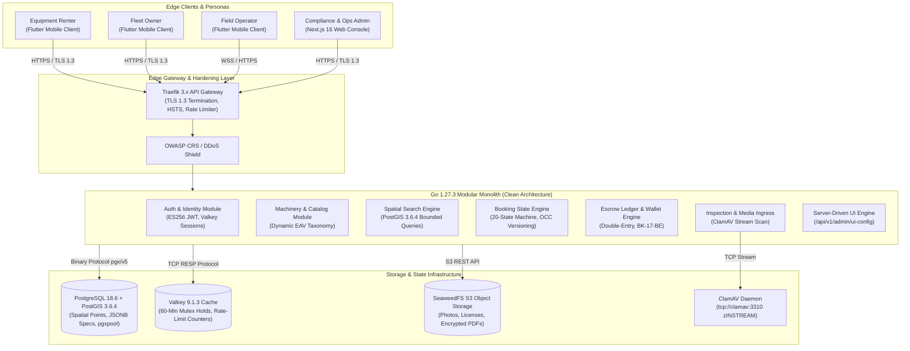

---

## 2. Identity, Registration & Pluggable Verification Flows

### 2.1 Passwordless Phone OTP Authentication & Refresh Rotation

Authentication follows OWASP ASVS 4.0.3 Level 3 with single-use rotating refresh tokens stored in Valkey and cryptographic ES256 session JWTs.

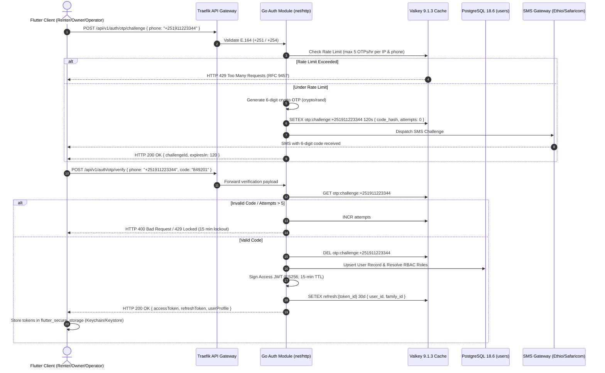

### 2.2 Pluggable Identity Verification (Fayda / National ID Adapter)

The backend provides a pluggable adapter framework (`REG-IDP-01-BE`). When active, incomplete verification blocks mutating transactional endpoints (`AUTH-05-BE`).

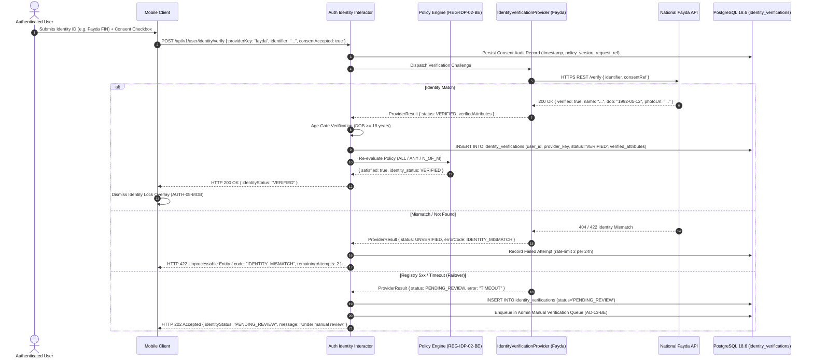

### 2.3 Multi-Factor Authentication (Passkey WebAuthn & TOTP)

Enforces mandatory TOTP setup for administrative staff (`AUTH-04-WEB`) while offering progressive Passkey and Authenticator App options for standard personas.

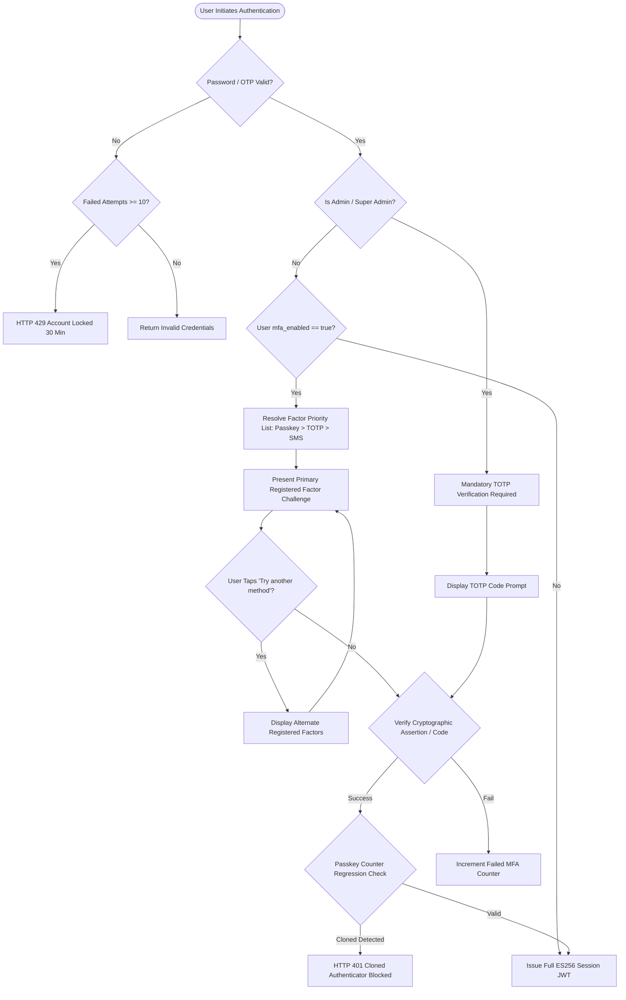

---

## 3. Fleet Registration, Dynamic EAV Taxonomy & Availability Scheduling

Fleet asset registration validates technical attributes dynamically using JSON Schema definitions stored in `spec_field_definitions` for the chosen category.

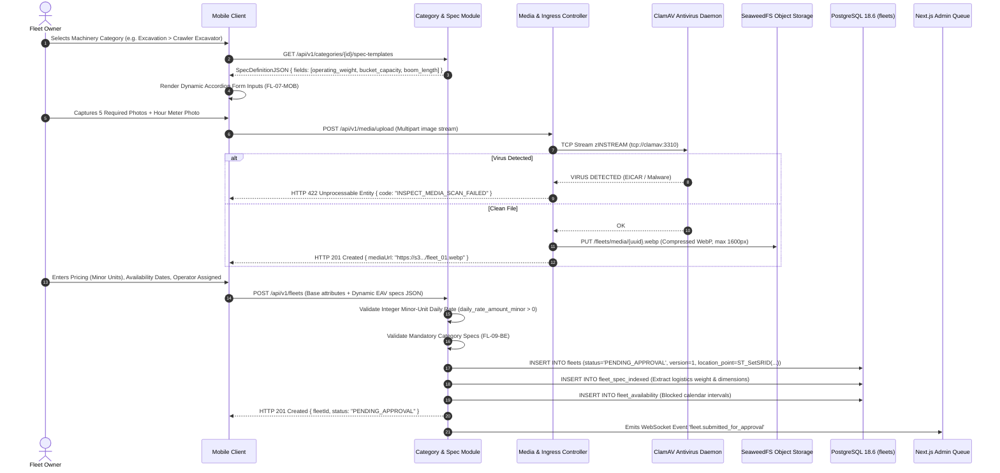

---

## 4. Geospatial Radius Discovery, Corridor Search & Filtering (PostGIS)

Dink Machinery executes high-throughput spheroidal distance queries over PostGIS GiST indexes, ensuring queries complete within $\le 80\text{ ms}$ at P95 across 1,000,000 indexed assets.

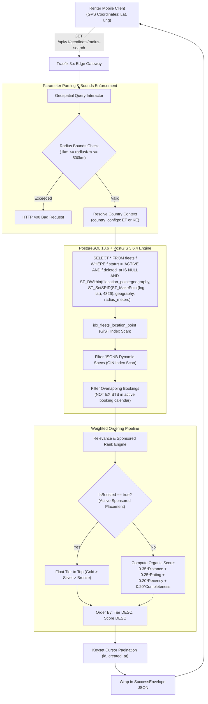

---

## 5. End-to-End Booking Reservation, 60-Minute Valkey Hold & Dual Settlement

### 5.1 Manual Direct Transfer Flow (`MANUAL_TRANSFER` / Direct Transfer Model)

The primary MVP settlement rail where the renter pays the fleet owner directly via commercial bank transfer. The platform holds zero customer escrow funds, collecting marketplace commission via owner wallet debit upon confirmation (`BK-17-BE`).

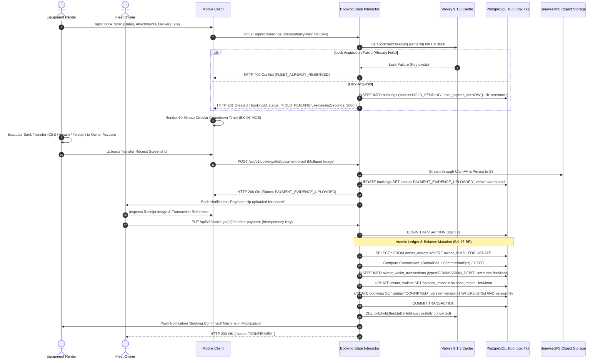

### 5.2 Online Payment Gateway Flow (`GATEWAY` / Pluggable Adapter)

When pluggable online gateways (Telebirr, MPESA) are activated, state machine transitions occur automatically via cryptographic webhook callbacks.

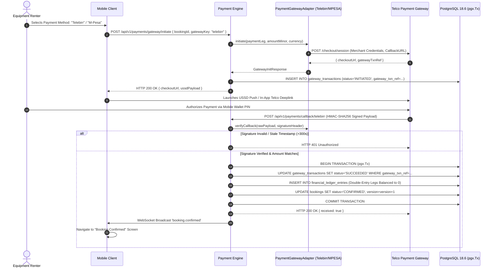

---

## 6. The Canonical 20-State Booking Machine Choreography

The rental booking machine enforces 20 deterministic states, strictly governed by optimistic concurrency control (`WHERE id = $1 AND version = $2`). Unmapped transitions abort with RFC 9457 error `BOOKING_INVALID_STATE_TRANSITION`.

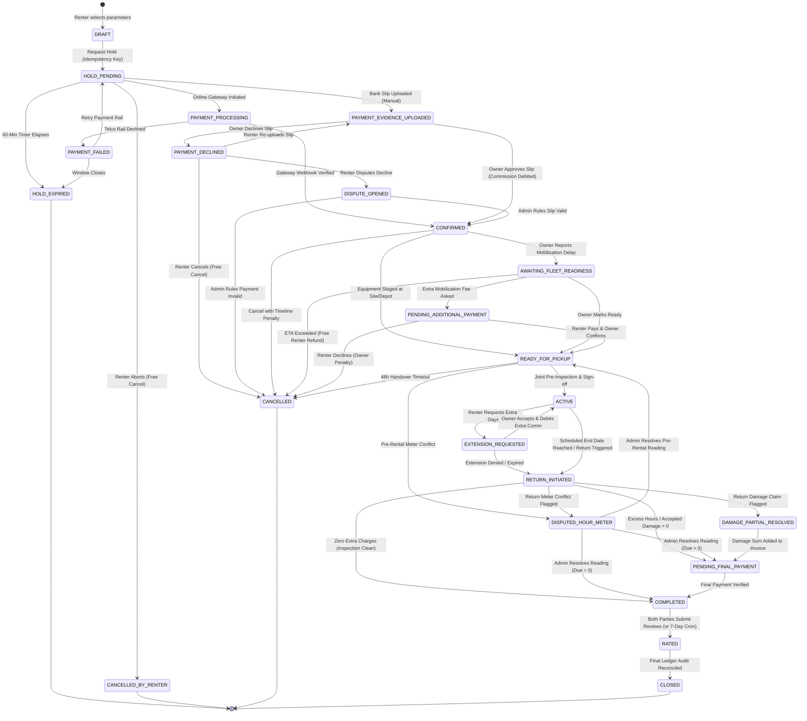

---

## 7. Handover Check-In & Check-Out Inspection Workflow (Monotonic Meters & ClamAV)

Physical handovers require joint digital inspection enforcing monotonic hour meter progression and antivirus scanning.

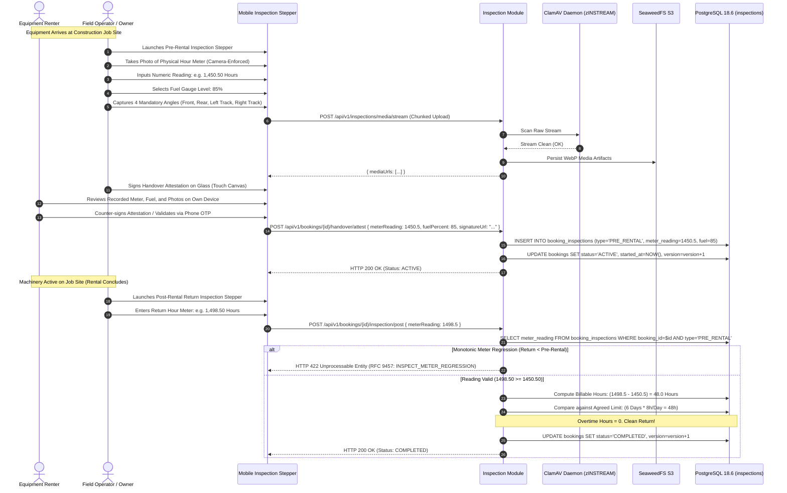

---

## 8. Damage Dispute Arbitration, SLA Escalation & Escrow Settlement

Disputed claims (damage, hour meter discrepancies) are isolated into a first-class `Dispute` domain with strict 3-day SLA timers and dual administrative communication channels.

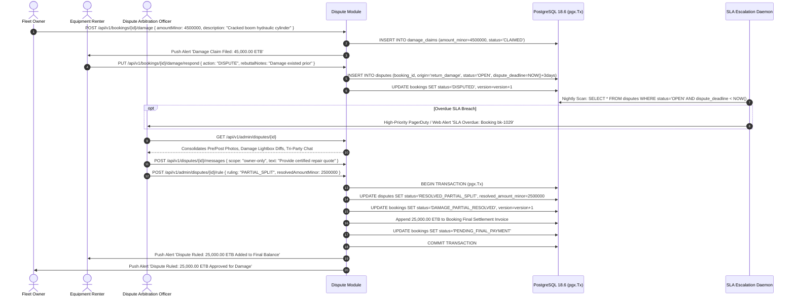

---

## 9. Logistics Transport Sub-Booking & Bidirectional Cascade Cancellation

Logistics transport vehicles (lowboys, flatbeds) are booked as formal sub-bookings linked via `parent_booking_id`. Cancellation cascades preserve operational balance across carriers.

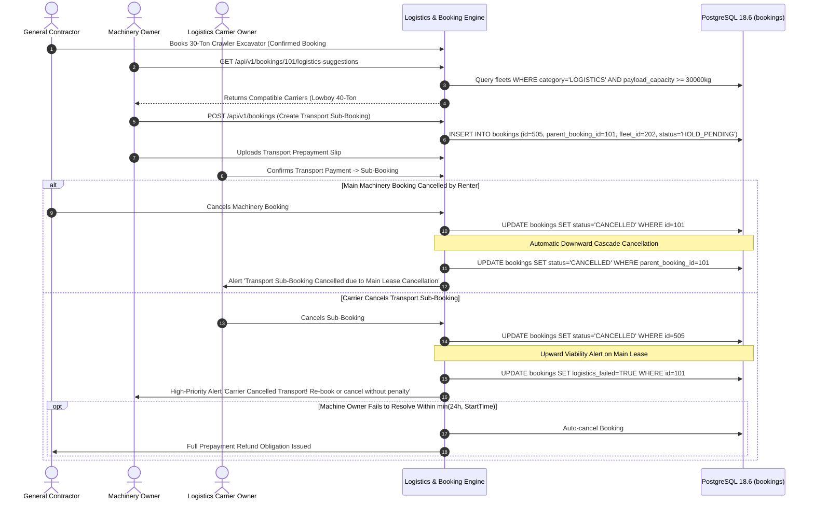

---

## 10. Double-Entry Financial Ledger & Wallet-Debit Commission Accounting

Under requirement `BK-17-BE`, every mutating financial action writes immutable, balanced credit and debit rows into `financial_ledger_entries`. The sum of all legs in a transaction must equal exactly zero minor units.

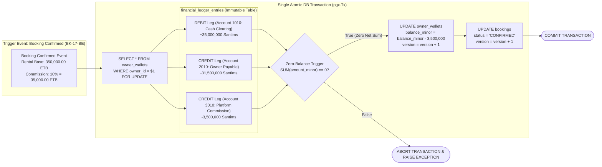

---

## 11. Operator Dispatch, 30-Second GPS Telematics & Geofence Breach Engine

Operating under requirements `GPS-01` to `GPS-04`, the mobile client streams high-precision GPS telematics via WebSocket every 30 seconds when in `ACTIVE` or `IN_TRANSIT` states.

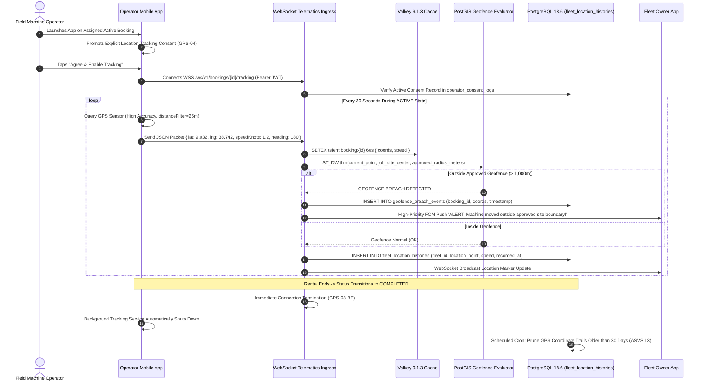

---

## 12. Server-Driven Dynamic Admin UI Engine (`/api/v1/admin/ui-config`)

The Next.js 16 back-office console renders menus, table columns, search filters, and RBAC-gated action buttons dynamically from `/api/v1/admin/ui-config`.

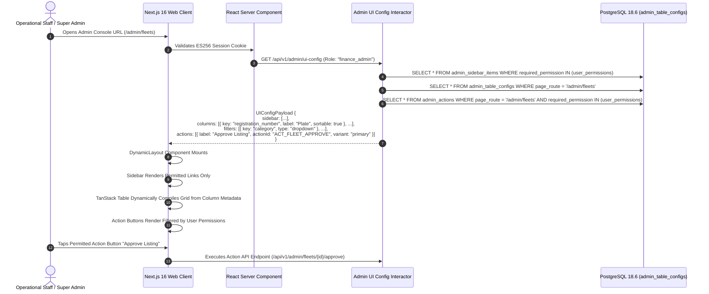

---

## 13. Dynamic Multilingual Typography & OTA Font Pipeline (`ADR-013`)

To render Ethiopic (`am`, `om`, `ti`) and Arabic scripts cleanly without inflating the base application binary, non-Latin typography is delivered over-the-air (OTA) with SHA-256 integrity validation.

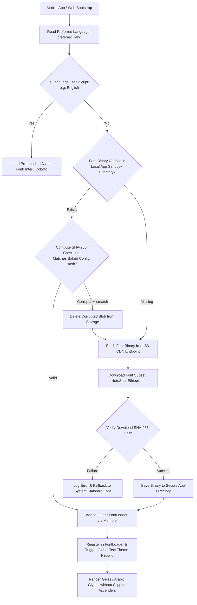

---

## 14. Offline-First Resilience, Isar Local Store & Background Sync Engine

Field inspectors in remote locations record condition reports offline. Data is cached in local Isar NoSQL storage and synchronized idempotently upon connection recovery.

```mermaid
flowchart TD
    subgraph OfflineCapture["Offline Field Capture Phase (No Connectivity)"]
        FieldOperator[Field Operator on Remote Site] --> SubmitInsp[Completes Handover Inspection Form]
        SubmitInsp --> NetCheck{Network Available?}
        NetCheck -- Offline --> LocalStore[Write Inspection Draft to Isar DB]
        LocalStore --> GenerateDraftId[Assign UUIDv4 localDraftId]
        GenerateDraftId --> StatusQueued[Set syncStatus = SyncStatus.queued]
        StatusQueued --> CacheMedia[Persist Full-Res Photos in App File Cache]
    end

    subgraph SyncLoop["Connectivity Restoration & Background Sync Daemon"]
        NetListener[connectivity_plus Listener] --> ReconnectEvent[Network Interface Restored: 3G / LTE]
        ReconnectEvent --> SyncEngine[Trigger SyncEngine.processQueue]
        
        SyncEngine --> ReadQueue[Read All Inspections WHERE syncStatus == queued]
        ReadQueue --> CompressIsolate["Background Worker Isolate (compute)<br>Resize Photos to WebP 1600px, Quality 82%"]
        
        CompressIsolate --> StreamMedia["POST /media/upload<br>(Stream Bytes through ClamAV Daemon)"]
        StreamMedia --> S3Urls[Receive S3 Object URLs]
        
        S3Urls --> MutatingRPC["POST /api/v1/inspections/sync<br>(Header: Idempotency-Key == localDraftId)"]
        
        MutatingRPC --> BackendResponse{Backend Response Status}
        BackendResponse -- 200 / 201 Success --> MarkSynced[Update Isar: syncStatus = SyncStatus.synced]
        BackendResponse -- 409 Conflict --> MarkConflict[Update Isar: syncStatus = SyncStatus.failed]
        
        MarkSynced --> PurgeLocal[Purge Temporary File Cache]
        MarkConflict --> PromptOperator[Surface Manual Concurrency Resolution Prompt]
    end
```

---

# Part II: Industrial Ergonomics & UI/UX Design System

## 15. Executive Summary & Product Persona Context

Dink Machinery bridges heavy civil engineering contractors, industrial equipment owners, and field operators across East Africa. The user experience must accommodate high-value financial commitments while functioning reliably on dusty, sunlit construction corridors with intermittent cellular connectivity.

The platform balances four distinct personas:
1. **The Renter (Civil Contractor / Project Manager):** Needs fast spatial discovery, reliable machine dimensions, verified owner credibility, and transparent, binding rental agreements.
2. **The Fleet Owner (Asset Investor / Equipment Yard Manager):** Manages multi-million Birr machinery, demands payment verification, tracks operator assignments, and requires visibility into wallet commission balances.
3. **The Operator (Field Technician / Heavy Equipment Driver):** Works on active job sites, interacts with physical hour meters and fuel gauges, wears protective gloves, and uses entry-level or mid-tier smartphones.
4. **The Platform Administrator (Compliance, Finance & Dispute Officer):** Operates on desktop browsers, requires high-density server-driven data tables, reviews photographic inspection diffs, and executes legally binding dispute rulings.

---

## 16. Industrial Ergonomics & Environmental Constraints

### 16.1 Direct Sunlight & High-Glare Visibility
Construction corridors in East Africa frequently exceed 80,000 to 100,000 lux ambient sunlight. Pastel palettes become illegible in direct glare.

* **Outdoor High-Contrast Mode:** Automatically triggered when device lux sensors detect ambient light $> 25,000\text{ lux}$, or manually enabled via a toggle in the top app bar.
* **Contrast Ratios:** Standard UI targets WCAG 2.2 AA ($4.5:1$ for body text, $3:1$ for large text). Outdoor High-Contrast Mode enforces WCAG 2.2 AAA ($\ge 7.0:1$ across all interactive surfaces and $\ge 10:1$ for engine telemetry).
* **High-Contrast Badges:** Informational states use solid-fill pills with distinct geometric icons (e.g., solid triangle for warnings, filled octagonal stop sign for credit lockouts).

### 16.2 Gloved Hands, Vibration & Tactile Feedback
Operators face heavy mechanical vibrations and wear protective leather or polyurethane gloves.

* **Touch Boundaries:** All primary touch controls meet or exceed $48 \times 48\text{ dp}$ (target $56 \times 56\text{ dp}$ for camera triggers and inspection checks).
* **Touch Separation:** Minimum physical separation of $8\text{ dp}$ between adjacent targets.
* **Tactile Haptic Confirmation:** Mutating operations trigger a haptic pulse (`HapticFeedback.heavyImpact` on iOS and Android).
* **Audio Cues:** Inspection steps emit an optional high-frequency chime ($85\text{ dB}$, $1200\text{ Hz}$) confirming photo uploads and valid meter inputs.

### 16.3 One-Handed Field Operation & Thumb Zones
Operators frequently operate their devices with one hand while climbing access ladders or inspecting machine linkages.

```
+-----------------------------------+
|      Hard-to-Reach Zone           |  <- Read-only metadata, Status pills
|   (Status badges, Title, Back)    |
+-----------------------------------+
|                                   |
|      Natural Reach Zone           |  <- Content cards, Inspection photo grids,
|     (Form fields, Sliders)        |     Radio selectors
|                                   |
+-----------------------------------+
|      Optimal Thumb Action Zone    |  <- Primary CTAs: "Confirm Handover",
|   (Sticky Bottom Bar, Shutter)    |     "Take Photo", "Upload Proof"
+-----------------------------------+
```

---

## 17. Design System Foundations & Tokens

### 17.1 Color System (Standard & Outdoor High-Contrast Modes)

The palette balances heavy industrial heritage (safety amber, komatsu blue) with strict functional hierarchy.

#### Semantic Color Tokens

| Token Name | Standard Light Mode | Standard Dark Mode | Outdoor High-Contrast Mode | Functional Role |
|---|:---:|:---:|:---:|---|
| `--color-brand-primary` | `#F59E0B` (Amber 500) | `#FBBF24` (Amber 400) | `#FFE600` (Safety Yellow) | Primary brand accents, key milestones |
| `--color-brand-secondary` | `#0F172A` (Slate 900) | `#F8FAFC` (Slate 50) | `#000000` (Pure Black) | Core surface contrast, primary text |
| `--color-surface-bg` | `#F8FAFC` (Slate 50) | `#0B0F17` (Dark Pitch) | `#FFFFFF` (Pure White) | Application canvas background |
| `--color-surface-card` | `#FFFFFF` (Pure White) | `#1E293B` (Slate 800) | `#FFFFFF` (Bordered 2px Black) | Elevated content containers |
| `--color-action-cta` | `#D97706` (Amber 600) | `#F59E0B` (Amber 500) | `#000000` (White on Black) | Primary action buttons |
| `--color-status-success` | `#10B981` (Emerald 500) | `#34D399` (Emerald 400) | `#056B38` (Deep Forest) | Active rental, confirmed payment |
| `--color-status-warning` | `#F59E0B` (Amber 500) | `#FBBF24` (Amber 400) | `#8F5B00` (Dark Ochre) | Hold pending, SLA warning |
| `--color-status-danger` | `#EF4444` (Red 500) | `#F87171` (Red 400) | `#B91C1C` (Deep Crimson) | Disputed state, cancellation penalty |
| `--color-telematics-meter`| `#2563EB` (Blue 600) | `#60A5FA` (Blue 400) | `#002D9C` (Navy High-Viz) | Engine hours, fuel gauges, GPS markers |

### 17.2 Typography Engine & Multi-Script Baseline Alignment (`ADR-013`)

The application supports simultaneous Latin and Ge'ez (Ethiopic) scripts. Ge'ez characters include tall ascenders and deep descenders; inadequate line-height settings cause glyph clipping.

```
Ge'ez Ascender Line    -----------------------------  (ማ, ፕ, ፭)
Latin Cap Height       =============================  (H, M, K)
Baseline               _____________________________
Ge'ez Descender Line   -----------------------------  (ሟ, ጴ, ጇ)
```

#### Multi-Script Typography Scale

| Style Token | Font Family | Weight | Size | Line Height | Tracking | Script Constraints |
|---|---|---|---|---|---|---|
| `display-large` | Roboto / Noto Sans Ethiopic | Bold (700) | 32sp | 44sp | -0.5px | Min line-height multiplier $1.38\times$ for Ge'ez |
| `headline-medium` | Roboto / Noto Sans Ethiopic | SemiBold (600) | 24sp | 34sp | 0px | Prevents upper diacritic clipping |
| `title-medium` | Roboto / Noto Sans Ethiopic | Medium (500) | 18sp | 26sp | +0.15px | Field labels, dialog titles |
| `body-large` | Roboto / Noto Sans Ethiopic | Regular (400) | 16sp | 24sp | +0.5px | Primary body, spec descriptions |
| `body-medium` | Roboto / Noto Sans Ethiopic | Regular (400) | 14sp | 22sp | +0.25px | Secondary metadata, review comments |
| `telematics-mono` | JetBrains Mono / Space Mono | Bold (700) | 20sp | 28sp | +1.0px | Engine hour counters, GPS coordinates |

* **OTA Font Pipeline (`ADR-013`):** Latin characters use pre-bundled Inter/Roboto. Ethiopic and Arabic glyphs are delivered over-the-air from SeaweedFS S3 upon locale selection, verified by SHA-256 integrity checks, and loaded dynamically into memory via Flutter's `FontLoader`.

### 17.3 8dp Spatial Grid, Layout Boundaries & Elevation
Layouts strictly adhere to an 8dp spatial grid system ($8, 16, 24, 32, 48, 64\text{ dp}$). Half-grid increments ($4\text{ dp}$) are used exclusively for tight badge padding and icon-to-label spacing.

* **Card Corner Radii:** Uniform $12\text{ dp}$ for interactive cards; $8\text{ dp}$ for internal input containers; $24\text{ dp}$ for pill badges and button caps.
* **Elevation & Layering:**
  - `Level 0` ($0\text{ dp}$): Background canvas (`#F8FAFC`).
  - `Level 1` ($2\text{ dp}$ shadow / $1\text{ px}$ border): Listing cards, spec accordions.
  - `Level 2` ($4\text{ dp}$ shadow): Floating filter chips, scrolling app bars.
  - `Level 3` ($8\text{ dp}$ shadow): Sticky bottom action sheets, date-picker drawers.
  - `Level 4` ($16\text{ dp}$ shadow): Blocking modals, handover signature canvas overlay.

### 17.4 Component Touch Targets ($48 \times 48\text{ dp}$)

Every interactive control enforces a minimum touch target envelope:

```
+---------------------------------------+
|  Invisible Touch Target: 48 x 48 dp   |
|      +-------------------------+      |
|      | Visible Icon: 24 x 24 dp|      |
|      +-------------------------+      |
+---------------------------------------+
```

---

## 18. Cross-Platform Persona Journeys & Wireflows

### 18.1 Equipment Renter Experience (Discovery to Handover)

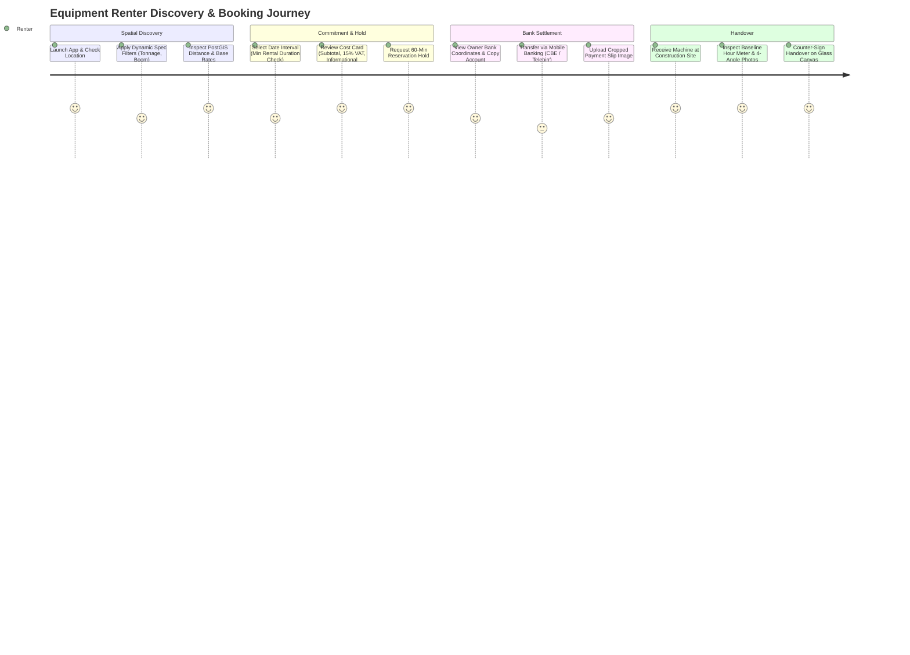

#### Key Renter Screens
1. **Catalog Home & Geospatial Facets:** Search header with PostGIS radius slider ($5\text{–}200\text{ km}$), category icons, and keyset-paginated cards showing price/day, distance in kilometers, operator badge, and verified owner status.
2. **Dynamic Fleet Detail View:** Swipeable 5-to-20 photo carousel, interactive specs accordion grouped by system (Engine, Hydraulics, Dimensions), public insurance badge, and sticky bottom booking bar.
3. **Pre-Booking Summary Modal (`BK-06B-MOB`):** Non-editable confirmation sheet itemizing rental subtotal, 15% VAT, total due, and separate informational deposit notice.
4. **Active 60-Minute Payment Hold Screen (`BK-06-MOB`):** Animated circular countdown timer, copyable owner bank coordinates, transfer instructions, and direct image upload button.

### 18.2 Fleet Owner Experience (Fleet Registry, Availability & Wallet)

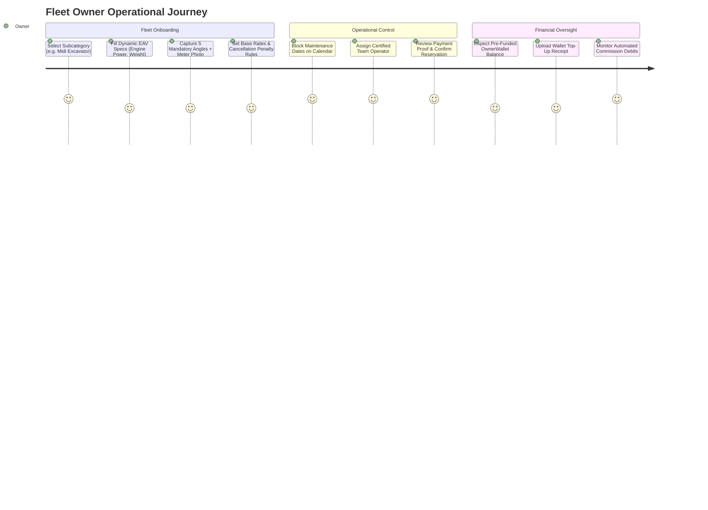

#### Key Owner Screens
1. **Fleet Listing Wizard:** Cascading category pickers triggering dynamic accordion fields, camera upload slots for required angles, and pricing inputs with minor-unit currency formatting.
2. **Availability Calendar Board (`FL-35-MOB`):** Interactive monthly calendar where owners drag and tap date intervals to toggle active availability, pending reservations, or manual maintenance blocks.
3. **Payment Evidence Review Drawer (`BK-09-MOB`):** Zoomable viewer for bank slips with duplicate detection flags (`BK-07B`), transaction metadata, and "Confirm Payment" / "Decline" action buttons.
4. **OwnerWallet Dashboard (`CW-02-MOB`):** Balance display, credit limit bar, top-up entry point, and infinite-scroll ledger table showing commission debits linked to booking IDs.

### 18.3 Field Operator Experience (Inspection Stepper & GPS Telematics)

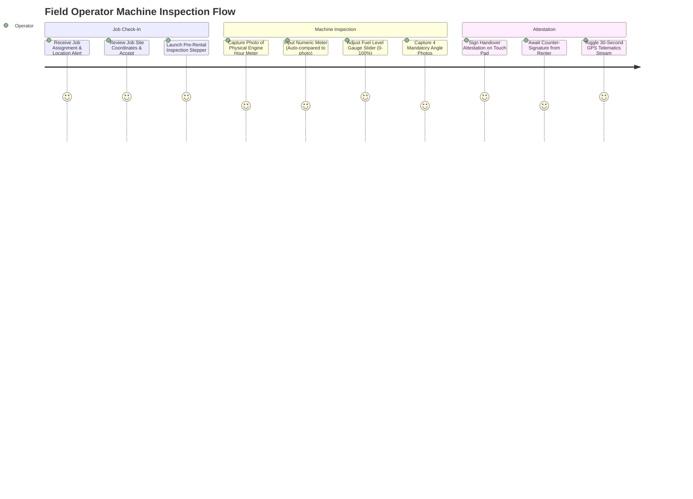

#### Key Operator Screens
1. **Operator Active Task Dashboard:** High-contrast card showing assigned machine make/model, job site pin, delivery deadline, and large "Start Field Inspection" CTA.
2. **Camera-Enforced Meter Capture (`AR-01-MOB`):** Custom camera overlay featuring a rectangular reticle for the physical hour meter gauge, with numerical confirmation entry immediately below.
3. **Digital Fuel & Condition Check:** Chunky horizontal slider for fuel percentage ($0\text{–}100\%$ in $5\%$ increments) and toggleable chips for equipment defects.
4. **Glass Signature Pad (`AR-08-MOB`):** Full-screen orientation-locked canvas capturing finger signatures, paired with recipient name and role fields.

### 18.4 Operations & Compliance Admin Console (Next.js 16 Web)

* **Server-Driven Dynamic Data Grids (`AD-06-WEB`):** The console does not hardcode table columns. Grids parse `/api/v1/admin/ui-config`, rendering dynamic columns, sorting rules, and permission-gated action buttons.
* **Split-Screen Dispute Lightbox (`AD-04-WEB`):** Renders pre-rental check-in photos directly beside post-rental check-out photos with synchronized pan-and-zoom inspection.
* **Audit Diff Viewer (`AD-09-WEB`):** Expandable rows displaying visual JSON diffs comparing previous and updated system states.

---

## 19. Core Component Library & Interaction Specifications

### 19.1 Dynamic EAV Form Accordion Engine
Renders dynamic specification fields based on category schema JSON.

```
+-------------------------------------------------------------------+
|  [v] ENGINE & POWERTRAIN SPECIFICATIONS                           |
+-------------------------------------------------------------------+
|  Engine Manufacturer *                                            |
|  [ Isuzu 4HK1X                              ]                     |
|                                                                   |
|  Gross Power (hp) *                                               |
|  [ 162                                      ] hp                  |
|                                                                   |
|  Fuel Type *                                                      |
|  (o) Diesel    ( ) Electric    ( ) Hybrid                         |
+-------------------------------------------------------------------+
|  [>] HYDRAULIC & WORKING RANGES (3 Incomplete)                    |
+-------------------------------------------------------------------+
|  [>] PHYSICAL DIMENSIONS & WEIGHT (Complete)                      |
+-------------------------------------------------------------------+
```

* **Section Completion Pills:** Closed accordions display a badge showing incomplete required fields (e.g., `"3 Required Missing"` in amber).
* **Auto-Scroll to Error:** On submit, if validation fails, the accordion collapses unaffected sections, opens the first invalid section, and scrolls smoothly to the invalid input.

### 19.2 Camera-Enforced Telematics Capture Overlay
Restricts photo acquisition to the active device camera (banning gallery uploads for field inspections).

```
+-------------------------------------------------------------------+
|  <- Back                   Pre-Rental Check-In             [ ? ]  |
+-------------------------------------------------------------------+
|                                                                   |
|         +-----------------------------------------------+         |
|         |  ALIGN ENGINE HOUR METER GAUGE INSIDE RETICLE |         |
|         |                                               |         |
|         |            [   1 4 5 0 . 5 0   ]              |         |
|         |                                               |         |
|         +-----------------------------------------------+         |
|                                                                   |
|  Enter Observed Gauge Reading *                                   |
|  [ 1450.50                                  ] Hours               |
|                                                                   |
|  Fuel Level: 85%                                                  |
|  [===|=========================================o=======] 85%       |
|                                                                   |
|                         [ (O) SHUTTER ]                           |
+-------------------------------------------------------------------+
```

* **Reticle Guide:** Semi-transparent viewfinder ($4:3$ aspect ratio) indicating gauge placement.
* **Client-Side Image Optimization:** Captured raw images resize on a background Dart isolate to a maximum dimension of $1600\text{ px}$ at $82\%$ WebP quality, reducing uploads from $\approx 12\text{MB}$ to $< 800\text{KB}$ before virus scanning.

### 19.3 Countdown Timer & Bank Transfer Card
Maintains urgency and clarity during the 60-minute payment hold window.

```
+-------------------------------------------------------------------+
|  RESERVATION HOLD EXPIRES IN:                                      |
|                            [ 48:22 ]                              |
|  Complete bank transfer and upload receipt before timer expires.  |
+-------------------------------------------------------------------+
|  OWNER DIRECT BANK COORDINATES                                    |
|                                                                   |
|  Bank: Commercial Bank of Ethiopia (CBE)                          |
|  Account Name: Mesfin Industrial Equipment PLC                    |
|  Account Number: 1000123456789                      [ COPY NO ]   |
|                                                                   |
|  Required Prepayment: 35,000.00 ETB                               |
+-------------------------------------------------------------------+
|  [ UPLOAD TRANSFER RECEIPT SCREENSHOT ]                           |
+-------------------------------------------------------------------+
```

* **Color Interpolation:** Timer circle stays Emerald from 60 to 20 minutes, transitions to Amber between 20 and 5 minutes, and pulses Crimson under 5 minutes.
* **Clipboard Interaction:** Tapping `[ COPY NO ]` updates the system clipboard, triggers haptic feedback, and changes label to `"COPIED!"` for 2.5 seconds.

### 19.4 Interactive Handover Checklist & Glass Signature Canvas
Ensures binding dual-party sign-off at equipment dispatch and return.

```
+-------------------------------------------------------------------+
|  EQUIPMENT CONDITION ATTESTATION                                   |
|                                                                   |
|  [x] Engine oil & hydraulic fluid verified at operational levels   |
|  [x] All safety decals & ROPS/FOPS structural points intact       |
|  [x] Demountable bucket attachment securely pinned & locked       |
|                                                                   |
|  Receiving Party Signature (Sign inside box)                      |
|  +-------------------------------------------------------------+  |
|  |                                                             |  |
|  |                /s/ Dawit Wolde                              |  |
|  |                                                             |  |
|  +-------------------------------------------------------------+  |
|  Signee Name: Dawit Wolde             Signee Role: Site PM        |
|                                                                   |
|  [ CONFIRM & ACTIVATE LEASE ]                                     |
+-------------------------------------------------------------------+
```

* **Minimum Stroke Requirement:** The signature canvas requires a minimum of 20 vector points before enabling submission, preventing accidental taps from submitting empty signatures.
* **Fallback Authentication:** If the physical touch glass is damaged or wet, the user can switch to `"Verify via Phone OTP"`.

### 19.5 Split-Screen Dispute Arbitration Lightbox
Administrative view comparing check-in vs check-out machine condition.

```
+-------------------------------------------------------------------+
|  DISPUTE #DSP-9042: CRAWLER EXCAVATOR (BOOM CYLINDER CRACK)       |
+---------------------------------+---------------------------------+
|  CHECK-IN (2026-10-12 09:14 UTC)|  CHECK-OUT (2026-10-18 16:30 UTC|
|                                 |                                 |
|       [ Image Viewport A ]      |       [ Image Viewport B ]      |
|    (Hydraulic Cylinder Clean)   |    (Hydraulic Cylinder Crack)   |
|                                 |                                 |
|  Recorded Meter: 1,450.50 Hrs   |  Recorded Meter: 1,498.50 Hrs   |
+---------------------------------+---------------------------------+
|  Synchronized Zoom: [ 100% | 200% | 400% ]     [ Synchronize Pan ]|
|                                                                   |
|  Claimed Damage: 45,000.00 ETB       Suggested Split: 50% / 50%   |
|  [ RULE FOR RENTER ]    [ RULE PARTIAL SPLIT ]    [ RULE FOR OWNER]|
+-------------------------------------------------------------------+
```

---

## 20. Motion, Micro-Interactions & Audio-Haptic Feedback

1. **Page Transitions:** Mobile views use horizontal slide transitions (`CupertinoPageRoute` on iOS, shared axis material motion on Android) with a duration of $250\text{ ms}$.
2. **Pull-to-Refresh:** Custom pull-to-refresh animation showing a rotating excavator gear; triggers light haptic pulse upon crossing release threshold.
3. **Card Expansion Animation:** Expanding dynamic spec accordions uses a cubic ease-in-out curve ($300\text{ ms}$) without layout shifts.
4. **Shutter Micro-Interaction:** Tapping the inspection camera shutter triggers a $50\text{ ms}$ screen flash and haptic tap, followed by an immediate progress indicator.
5. **Reduced Motion Mode:** Respects system accessibility toggles (`prefers-reduced-motion`). When enabled, all non-essential spatial transitions switch to instant opacity cross-fades ($100\text{ ms}$).

---

## 21. Offline Cues, Empty States & RFC 9457 Error Presentation

### 21.1 Persistent Offline Status Banner
When network connectivity is lost, Flutter's `connectivity_plus` listener mounts a sticky, high-contrast banner below the app bar.

```
+-------------------------------------------------------------------+
|  [!] OFFLINE MODE: Showing cached fleet data (Updated 2h ago).    |
|      Field inspections will automatically sync once reconnected.  |
+-------------------------------------------------------------------+
```

* **Color:** High-visibility amber background (`#D97706`) with pure white text and warning triangle icon.
* **Behavior:** Persistent across all mobile views; does not dismiss until reliable socket connectivity is restored.

### 21.2 RFC 9457 Problem Details Presentation
Errors from the backend map into user-friendly localized cards while preserving tracking IDs for support assistance.

```
+-------------------------------------------------------------------+
|  (X) UNABLE TO COMPLETE RESERVATION                               |
|                                                                   |
|  This equipment was just reserved by another contractor for the   |
|  selected dates.                                                  |
|                                                                   |
|  Reason: Conflicting Reservation Active                           |
|  Reference Code: FLEET_ALREADY_RESERVED                           |
|  Support Tracking ID: req-8842-1982-9912                          |
|                                                                   |
|  [ CHOOSE ALTERNATIVE DATES ]         [ VIEW SIMILAR EXCAVATORS ] |
+-------------------------------------------------------------------+
```

* **Inline Form Errors:** Validation errors targeting specific fields render red text (`#EF4444`) with an error outline around the input container.
* **Copyable Support ID:** Tapping the Support Tracking ID copies the UUID to clipboard, facilitating rapid support ticket resolution.

---

*This document defines the canonical unified architecture, sequence choreography, and UI/UX design system specification for Dink Machinery Version 7.0.*